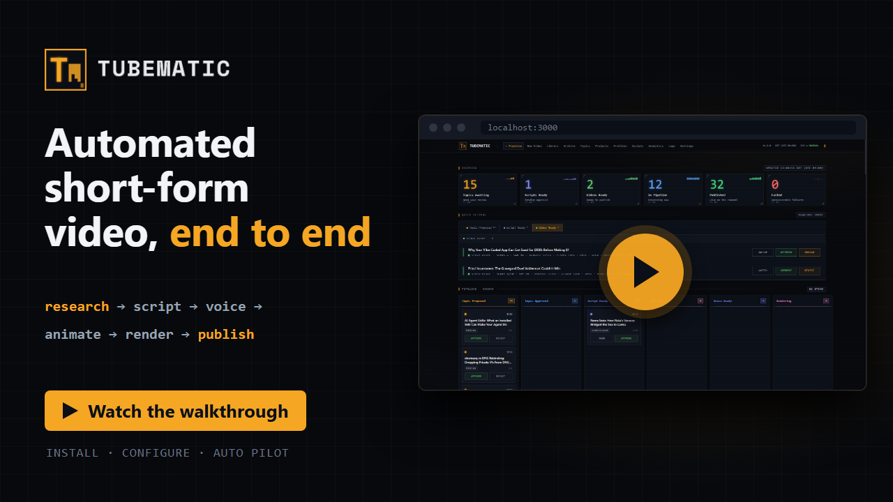

<p align="center">
  <picture>
    <source media="(prefers-color-scheme: dark)" srcset="logos/lockup-horizontal/tubematic-horizontal-on-dark-2x.png">
    
  </picture>
</p>

Tubematic turns a topic into a finished YouTube Short, on your own Linux machine. An AI agent
(Claude Code, Codex or OpenCode) writes the script, voices it, generates images and writes each
scene as a React component, which [Remotion](https://remotion.dev) renders to an mp4. You approve
the topic, the script and the finished video on a web dashboard.

## Walkthrough

<p align="center">
  <a href="https://youtu.be/-y9zBSg8WEc">
    
  </a>
</p>

## Install

You need Linux, Docker, Python 3.11 or newer, an ElevenLabs API key and an OpenAI API key. The
[Quickstart](https://docs.tubematic.ai/quickstart) lists the rest.

```bash
curl -LO https://github.com/teja156/tubematic/releases/download/v2.2.0/tubematic-v2.2.0.tar.gz
curl -LO https://github.com/teja156/tubematic/releases/download/v2.2.0/CHECKSUMS.txt
sha256sum -c CHECKSUMS.txt --ignore-missing
tar xzf tubematic-v2.2.0.tar.gz
cd tubematic-v2.2.0
python3 onboard.py
```

## Documentation

[docs.tubematic.ai](https://docs.tubematic.ai) has the quickstart, the user guide and the developer
docs for each release.

## Licence

Tubematic is licensed under the [Apache License 2.0](LICENSE).

Tubematic renders with [Remotion](https://remotion.dev), which it installs as a dependency and does
not include. Remotion has its own licence. It is free for individuals, non-profits and for-profit
companies with up to three employees. A larger for-profit company needs a paid Remotion company
licence to run Tubematic. Read
[Remotion's licence terms](https://github.com/remotion-dev/remotion/blob/main/LICENSE.md) before you
use Tubematic in a company.

## History

2.0.0 is Tubematic's first public release. Earlier development happened in a private repository, and
its history is not public.
