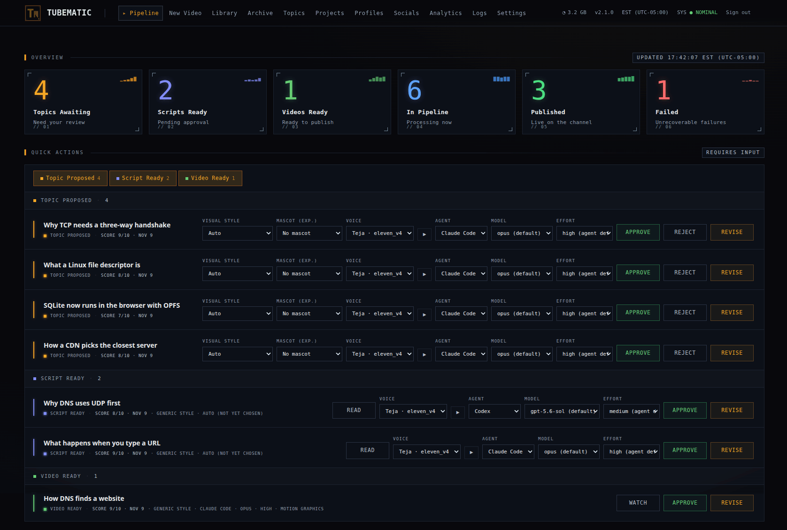

# Tubematic dashboard

This folder holds the web app you run Tubematic from. It shows where each video is, takes your
three approvals (topic, script, video), publishes finished videos and edits the settings. It is a
Next.js app that runs in the `tubematic-dashboard` container on port 3000.



| To read about | Go to |
|---|---|
| What each page does and how to use it | [The Dashboard](../docs/user-guide/04-dashboard.md) |
| How the code works: routes, sign-in, polling, components | [Dashboard internals](../docs/developer/15-dashboard.md) |
| The path and source file of each page | [Dashboard internals: Pages](../docs/developer/15-dashboard.md#pages) |

## What is in this folder

| Path | Contents |
|---|---|
| `app/` | One folder per page, plus the server-side routes: `app/api/proxy/`, `app/api/auth/`, `app/api/update-check/`, `app/stream/` and `app/mascot-sheets/` |
| `components/` | The React components. `components/ui/` holds the shadcn/ui primitives |
| `lib/` | Shared helpers and types |
| `middleware.ts` | Sends a page load that has no session cookie to `/login` |
| `tests/unit/` | Vitest tests |
| `tests/e2e/` | Playwright specs, their seed data and the test stack's setup |
| `Dockerfile` | The image for the `tubematic-dashboard` container |

The stack is Next.js 15 (App Router), React 19, TypeScript 5, Tailwind CSS 4 and shadcn/ui. The
reasons are in [Stack](../docs/developer/15-dashboard.md#stack).

## Running it locally

The dashboard needs the Flask API, which runs in the `tubematic-api` container. Start the stack
from the repository root:

```bash
python3 scripts/service.py start
```

Then start the dashboard from this folder:

```bash
cd dashboard
npm install
TUBEMATIC_SECRETS_DIR=~/.tubematic-data/secrets npm run dev   # http://localhost:3000
```

- `RENDERER_URL` is the address of the Flask API. It defaults to `http://localhost:4000`. The
  variable keeps the name `RENDERER_URL`, and the API it points at is `tubematic-api`.
- `TUBEMATIC_SECRETS_DIR` names the directory with the two secrets the server-side routes read:
  `api_token`, which they send to the API, and `session_secret`, which signs the login cookie. It
  defaults to `/run/secrets`, where the container has them mounted.
- Each page needs a sign-in. Use the dashboard password. To set one, run
  `python3 onboard.py --set-password` from the repository root.
- If the API is not running, the proxy answers each request with `502`.
- The stack's own dashboard container also listens on port 3000. Stop it first with
  `python3 scripts/service.py stop tubematic-dashboard`, or `next dev` takes the next free port
  and prints it.

## npm scripts

| Command | What it does |
|---|---|
| `npm run dev` | Development server with Turbopack |
| `npm run build` | Production build with Turbopack |
| `npm start` | Runs `next start` on the production build |
| `npm test` | Unit tests, one run |
| `npm run test:watch` | Unit tests in watch mode |
| `npm run test:e2e` | End-to-end tests, headless |
| `npm run test:e2e:headed` | End-to-end tests in a visible browser |
| `npm run test:e2e:ui` | Playwright's interactive UI |

`npx tsc --noEmit` typechecks the project.

## How it reaches the API

The browser has no direct route to the Flask API. Client components fetch relative URLs under
`/api/proxy/`, and `app/api/proxy/[...path]/route.ts` forwards each request to `RENDERER_URL` with
the same method, body and query string.

```
Browser  →  /api/proxy/videos         →  http://localhost:4000/videos
Browser  →  /api/proxy/videos/abc123  →  http://localhost:4000/videos/abc123
Browser  →  /api/proxy/stats          →  http://localhost:4000/stats
```

Rules to follow when you change the dashboard:

- A new Flask endpoint needs no new dashboard route. Fetch it at `/api/proxy/<path>`.
- A `fetch()` that sends a body must set `Content-Type: application/json`. The proxy, the login
  route and the logout route answer `415` to any other body type and `403` to a cross-site
  request (`lib/requestGuard.ts`). See
  [Cross-site request forgery](../docs/developer/15-dashboard.md#cross-site-request-forgery).
- Pass `cache: "no-store"` on each `fetch()` of pipeline state. The proxy sets
  `Cache-Control: no-store` on each response, because a cached status shows a video in a stage it
  has already left.
- Pages poll on a timer and use no WebSockets. The intervals are in
  [Poll intervals](../docs/developer/15-dashboard.md#poll-intervals).
- The proxy route and the stream route verify the session cookie on each request. `middleware.ts`
  runs on the Edge runtime, which cannot read the signing secret, so it checks only that a cookie
  is present. See [Signing in](../docs/developer/15-dashboard.md#signing-in).

The other server-side routes are described in
[How the browser reaches the API](../docs/developer/15-dashboard.md#how-the-browser-reaches-the-api)
(the proxy, the stream route for `.mp4` and `.mp3` files, the mascot-sheet route) and
[Update check](../docs/developer/15-dashboard.md#update-check).

### Ports

| Service | Port |
|---|---|
| Dashboard | 3000 |
| Dashboard in the end-to-end test stack | 3001 |
| Flask API (`tubematic-api`) | 4000 |
| Flask API in the end-to-end test stack | 4001 |

## Tests

| Suite | Lives in | Needs | Documentation |
|---|---|---|---|
| Unit (Vitest) | `tests/unit/` | Nothing else | [`dashboard/tests/unit`](../docs/developer/test-suites/dashboard-unit.md) |
| End-to-end (Playwright) | `tests/e2e/specs/` | Docker | [`dashboard/tests/e2e`](../docs/developer/test-suites/dashboard-e2e.md) |

`npm run test:e2e` builds and starts its own stack from `docker-compose.test.yml` before the first
spec (`tests/e2e/global-setup.ts`), and removes the containers and their volumes after the last
(`tests/e2e/global-teardown.ts`). The first build takes several gigabytes of disk.
