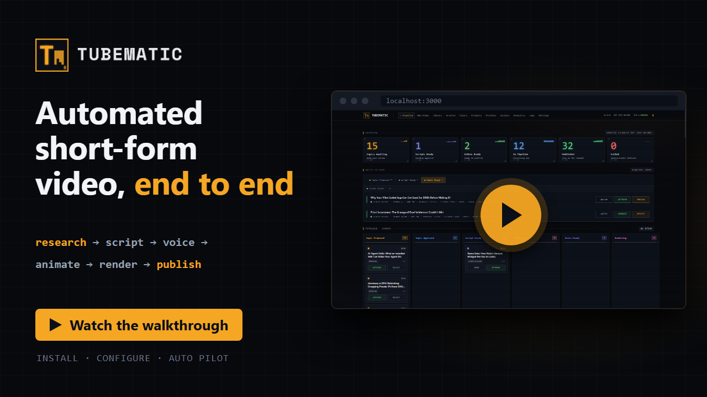

# Tubematic Documentation

Tubematic turns a topic into a finished YouTube Short. An AI agent writes the script, voices it,
generates images and writes the animation as code. You approve the topic, the script and the
finished video on a web dashboard, on your own Linux machine.

## Start here

| You want to | Read |
|---|---|
| Install it and make a first video | [Quickstart](quickstart.md) |
| Understand what it does before you install | [Overview](user-guide/01-overview.md) |
| Change how it works, or contribute | [Developer docs](#developer-docs) |
| See what changed in a release | [Release notes](release-notes.md) |
| Fix a problem | [Troubleshooting](user-guide/08-troubleshooting.md) |

## User guide

For anyone running Tubematic.

| Page | Covers |
|---|---|
| [1 · Overview](user-guide/01-overview.md) | What it makes, how a video moves, what it costs, and a glossary |
| [2 · Installing](user-guide/02-installing.md) | Prerequisites, the install, checking it, and uninstalling |
| [3 · Using Tubematic](user-guide/03-using-tubematic.md) | The daily routine, where topics come from, and limiting research |
| [4 · The Dashboard](user-guide/04-dashboard.md) | Each page, and the decisions you make there |
| [5 · Settings](user-guide/05-settings.md) | Each setting, its default, and when to change it |
| [6 · Publishing](user-guide/06-publishing.md) | Connecting accounts, posting and scheduling |
| [7 · Upgrading](user-guide/07-upgrading.md) | Moving to a new version, backups, and going back |
| [8 · Troubleshooting](user-guide/08-troubleshooting.md) | Symptoms and fixes, and reporting a bug |
| [9 · Remote Access](user-guide/09-remote-access.md) | Using the dashboard from another machine |
| [10 · GPU Rendering](user-guide/10-gpu-rendering.md) | Rendering on an NVIDIA GPU |
| [11 · Remote Renderers](user-guide/11-remote-renderers.md) | Letting other machines render |
| [12 · Agents](user-guide/12-agents.md) | Installing, updating and choosing agents |
| [13 · Visual Styles and Mascots](user-guide/13-visual-styles-and-mascots.md) | How videos look |
| [14 · Auto Pilot](user-guide/14-auto-pilot.md) | Approving and posting without you |
| [15 · Command Reference](user-guide/15-command-reference.md) | Every command you run on the machine |

## Developer docs

For contributors and anyone building on Tubematic.

| Page | Covers |
|---|---|
| [1 · Architecture](developer/01-architecture.md) | The containers and processes, how they talk, and where files live |
| [2 · The Pipeline](developer/02-pipeline.md) | Every status and transition |
| [3 · Database](developer/03-database.md) | Tables, columns and migrations |
| [4 · Settings internals](developer/04-settings.md) | How settings and credentials are stored, and every key |
| [5 · HTTP API](developer/05-http-api.md) | Every route |
| [6 · MCP Server](developer/06-mcp-server.md) | Every tool the agent has |
| [7 · The Agent Layer](developer/07-agent-layer.md) | Skills, commands and how agents are installed and assigned |
| [8 · Scripting and Voice](developer/08-scripting-and-voice.md) | Script segments, pronunciation markup and script profiles |
| [9 · The Remotion Project](developer/09-remotion-project.md) | How a video is composed from scenes |
| [10 · Scene Authoring](developer/10-scene-authoring.md) | How the agent writes scenes, and how to add a component |
| [11 · Rendering and Review](developer/11-rendering-and-review.md) | The renderer, the render gateway and the AI review |
| [12 · The Worker](developer/12-the-worker.md) | The background loop and each pass it runs |
| [13 · The Poller](developer/13-the-poller.md) | The scheduled job that runs agent sessions |
| [14 · Publishing internals](developer/14-publishing.md) | The postforme client, routes and Auto Pilot |
| [15 · Dashboard internals](developer/15-dashboard.md) | The Next.js app |
| [16 · Infrastructure](developer/16-infrastructure.md) | Compose services, authentication, volumes and operating commands |
| [17 · Development](developer/17-development.md) | Running the tests, conventions and how to write these docs |
| [18 · Releases](developer/18-releases.md) | What a release is and how one is built |
| [Test suites](developer/test-suites/README.md) | What each test file guards |

## Where to start as a contributor

| You want to | Read, in order |
|---|---|
| Change how videos look | [The Remotion Project](developer/09-remotion-project.md), then [Scene Authoring](developer/10-scene-authoring.md) |
| Change how the agent behaves | [The Pipeline](developer/02-pipeline.md), [The Agent Layer](developer/07-agent-layer.md), then [MCP Server](developer/06-mcp-server.md) |
| Integrate another system | [Architecture](developer/01-architecture.md), [HTTP API](developer/05-http-api.md), then [Database](developer/03-database.md) |
