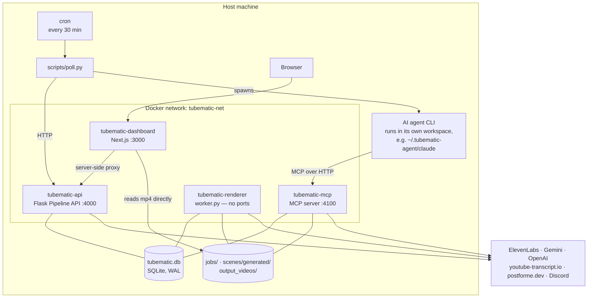

# Architecture

Tubematic runs as four Docker containers plus one cron job, all on a single machine, coordinating
through one SQLite file.



---

## The containers

| Container | Image | Ports | Role |
|---|---|---|---|
| `tubematic-api` | built from `renderer/Dockerfile` | 4000 | The Flask Pipeline API |
| `tubematic-mcp` | **the same image** | 4100 | The MCP server — the agent's entire interface |
| `tubematic-renderer` | **the same image** | none | The render worker |
| `tubematic-dashboard` | built from `dashboard/Dockerfile` | 3000 | Next.js |

The first three are one image with a different `command:`. Only the API service declares `build:`;
the other two reuse the tag, so one build covers all three.

Those same three mount a shared logs directory at `/logs` and each append a daily JSONL file there.
The dashboard deliberately does not — it reads them back through Flask's `GET /logs`, so it needs
neither a log mount nor a Docker socket. See [Infrastructure](16-infrastructure.md#volumes).

**One foreground process per container, deliberately.** Flask and the MCP server used to share
`tubematic-api`, started by an entrypoint that backgrounded Flask and `exec`ed the MCP server. When
Flask died the MCP server still held PID 1, so the container stayed up, reported at most
`unhealthy`, and `restart: unless-stopped` had nothing to act on — a dead API behind a container
that looked alive. Splitting them makes a dead process a dead container, which the restart policy
can act on, and gives each an independent healthcheck.

**Why the worker is separate.** Rendering runs Chromium and ffmpeg for twenty minutes and can be
OOM-killed. Isolating it means a render crash restarts only the renderer.

**The dependency direction is one-way.** `tubematic-api` depends on nothing; the dashboard, the
worker and the MCP server all wait on it. So the dashboard and poller path keeps working with the
MCP server down, and an agent session survives a Flask restart.

## Ports

| Port | Service |
|---|---|
| 3000 | Dashboard — all interfaces in a checkout, `127.0.0.1` in a release install; behind a login either way |
| 4000 | Flask Pipeline API — `127.0.0.1` only |
| 4100 | MCP server — `127.0.0.1` only |
| 3001 / 4001 | The isolated end-to-end test stack |

Loopback binding costs nothing between containers: they reach each other over the compose network by
service name, which never touches a published port. See
[Infrastructure — Why the ports bind to loopback](16-infrastructure.md#why-the-ports-bind-to-loopback).

Binding is not the only lock. The dashboard needs a sign-in, and the API and the MCP server each need
their own bearer token on every request but their health probes — see
[Infrastructure — Authentication](16-infrastructure.md#authentication).

---

## How the pieces talk

Everything is HTTP or the shared database. There is no message broker, no socket, and no shared
in-process state between containers.

| From | To | Via |
|---|---|---|
| Browser | Dashboard | HTTP |
| Dashboard | Flask API | A server-side proxy route — the browser never learns the API's address or its token |
| Dashboard | Rendered files | Direct `fs` reads off the shared volume, with Range support |
| AI agent | MCP server | MCP over HTTP on 4100, with the MCP token |
| Cron poller | Flask API | HTTP with the API token, including which agent runs each video. It has **no database access, by design** |
| Installer | Database | Direct SQLite from the host — the only writer of the `agents` table |
| Worker | Database | Guarded `UPDATE` polling |
| Everything | Database | SQLite in WAL mode |

---

## Where things live on disk

Pipeline data lives at a fixed absolute path **outside the checkout**:

```
~/.tubematic-data/
├── data/tubematic.db              # state machine, settings, credentials
├── jobs/<video_id>/               # audio.mp3, timeline.json, scene-config.json, images/
├── scenes/generated/<video_id>/   # agent-authored scene TSX
├── output_videos/<project_id>/    # rendered mp4s, and voice-previews/
├── logs/<service>.<date>.jsonl    # structured logs, one file per service per day
├── backups/                       # pre-migration database snapshots
└── secrets/                       # the three service tokens (API, MCP, dashboard session)
```

This location is not configurable, and the reason is worth knowing: it used to be a directory inside
the repository, which meant `rm -rf tubematic && git clone` silently destroyed the database and the
entire video library, and running Compose from the wrong directory created a second, empty data tree.

Compose exposes the first six as named volumes with `o=bind` device paths under `${HOME}` — see
[Infrastructure — Volumes](16-infrastructure.md#volumes). `secrets/` is not a volume: each token file
is mounted read-only into the services that need it, as a Compose secret — see
[Infrastructure — Authentication](16-infrastructure.md#authentication).
`${HOME}` rather than `${PWD}` is deliberate: cron strips the environment down to `HOME`, `LOGNAME`,
`PATH` and `SHELL`, so `HOME` still resolves from a cron-invoked `docker compose`.

**Paths stored in the database are container-absolute** (`/jobs/…`, `/output_videos/…`), because the
processes that consume them run inside containers. No process reads a file's location back out of
them: each derives it from the video's ids, and the dashboard plays a render from
`/stream/<project_id>/<id>.mp4` (`dashboard/lib/utils.ts::videoStreamUrl`).

### What is baked in and what is mounted

| | |
|---|---|
| **Baked into the image** | `renderer/api/`, `mcp/`, the dashboard, the Remotion project's `src/` including `scenes/installed/` |
| **Bind-mounted** | The five data directories above, including `scenes/generated/` |

Editing this repository changes nothing in a running container until the image is rebuilt.
`scenes/generated/` is the exception — it is a volume, so agent-written scenes appear immediately.

---

## The repository

```
tubematic/
├── onboard.py, onboard/       # the installer — the canonical setup path
├── upgrade.py                 # the upgrade: gate, images, stop, start, cron, agents
├── uninstall.py
├── mcp/                       # MCP server and the text-audit decision layer
├── renderer/
│   ├── api/                   # Flask API, render worker, AI review, DB helpers
│   ├── remotion/              # the Remotion video project
│   ├── Dockerfile             # one image for tubematic-api, -mcp and -renderer
│   └── entrypoint.sh
├── tubematic_core/             # the one shared Python package — schema/migrations, logging, version
├── dashboard/                 # Next.js app
├── agent_files/
│   ├── skills/                # what the agent knows how to do
│   ├── claude/commands/       # slash commands for Claude Code
│   └── opencode/commands/     # the same commands for OpenCode (Codex has none)
├── scripts/                   # poll.py (cron), release tooling, and other host-side utilities
├── vqa/                       # the video-quality assessment environment
├── kasm_workspace/            # the published Kasm Workspace: installs a release at session launch
├── kasm_workspace_testing/    # the disposable full-install test environment
├── docs/                      # this documentation
├── .github/workflows/         # CI, the tag-triggered release, the docs-site sync, the Kasm workspace image
├── VERSION                    # the single source of truth for the installed version
├── docker-compose.yml
└── docker-compose.test.yml    # isolated stack for end-to-end tests
```

---

## Duplication is intentional

Several constants and helpers are hand-copied across `mcp/`, `renderer/api/`, `dashboard/` and
`onboard/`. That is not drift. These are separate deployable units — the MCP server and the Flask API
ship in the same image but the dashboard does not, and the installer runs on the host before any
image exists.

There is now exactly one shared Python package, `tubematic_core/`, copied into the image at
`/app/lib` and reachable on the host from the repo root. Everything in it was added only because a
copy of it would be genuinely dangerous to let drift: structured logging (a redactor that
strips credentials out of every log line, where three copies quietly diverging is a security bug
rather than an inconvenience), schema migrations (`tubematic_core/migrations/`, see
[Database](03-database.md#migrations)), the canonical version string, and the spend ledger with its
model prices (`usage.py`, `prices.py` — every container records paid calls, and a pricing rule
copied into three processes would price the same call three ways; see
[Settings — Costs](../user-guide/05-settings.md#costs)), and what each ElevenLabs model can speak
(`voice_models.py` — the API refuses a voice whose model cannot speak a script, and `generate_voice`
refuses the same thing before spend, so two copies disagreeing would let the dashboard approve what
voicing then rejects; see [The model follows the voice](08-scripting-and-voice.md#the-model-follows-the-voice)),
and which YouTube URLs mining accepts (`youtube.py` — each becomes Gemini's `file_uri` on a paid
call, so a writer that accepted what the mining tool refuses would store a list that can never be
mined; see [HTTP API — Mining sources](05-http-api.md#mining-sources)), and the rules for ids that
become paths and where a video's files live (`ids.py`, `jobfiles.py` — the worker, the API, the
MCP server and a VQA script all build those paths, and a copy that drifted would be a path
traversal rather than a cosmetic difference; see [`videos`](03-database.md#videos)).
The dashboard keeps a TypeScript copy of the model sets, pinned by a source-text test. It is not a general home
for anything two processes happen to share — the copies below stay copies.

The copies that matter:

| Duplicated | Copies |
|---|---|
| `VALID_VIDEO_STATUSES` / `WORKABLE_STATUSES` | `renderer/api/pipeline.py`, `mcp/server.py`, `dashboard/lib/types.ts` |
| Safe-zone pixel constants | `TextRevealScene.tsx`, `mcp/text_audit.py`, `renderer/api/ai_review.py` |
| Timezone detection | `renderer/api/hosttz.py`, `scripts/config.py`, `onboard.py` |
| `_truncate_title` | `renderer/api/pipeline.py`, `mcp/server.py` — with a test that execs both copies and asserts they agree |
| The mining URL rule | `tubematic_core/youtube.py`, `dashboard/components/MiningSources.tsx` (only so the Add button lights for what the API stores — the API stays the authority, and a disagreement shows as its 400), and migration `0014`'s frozen copy. The dashboard's copy is held to the same accept-and-refuse table as the Python one rather than by source text, since the two regex dialects differ |
| The `agents` table schema | `tubematic_core/migrations/` plus `onboard/agent_install.py::AGENTS_SCHEMA` — the installer runs on the host, where it may create the table before any container has started, so it cannot just import the schema from the running services. Pinned against a fully migrated database, column positions included |
| `AGENT_EFFORTS` | `renderer/api/pipeline.py`, `mcp/server.py`, `scripts/agent_adapters.py::AGENT_EFFORTS` (the CLI-facing copy, shared by every adapter), `dashboard/lib/agents.ts` — pinned by a test that reads all four as source text |
| `_pick_agent_id`, `_agent_model_error` | `renderer/api/pipeline.py`, `mcp/server.py` — `_pick_agent_id` is pinned by an agreement test |
| `POLL_LOG_DIR` | `scripts/config.py`, `onboard/config.py` |
| API-key redaction in error strings | `renderer/api/ai_review.py`, `mcp/server.py` — predates `tubematic_core` and is a reasonable future move into it |

The rest of the schema is **not** a copy any more. `renderer/api/pipeline.py::_init_db` and
`mcp/server.py::_init_db` used to each define the whole thing by hand; both now do nothing but call
`tubematic_core.db.migrate()`, which is the one place the schema is defined.

Most carry `# Keep in sync` comments. **Grep before changing one.** Several settings defaults are
additionally repeated in three to five places without such a comment, so grep for the *value* too.

---

## Failure model

| Failure | Result |
|---|---|
| Render crashes | Retry, then `REVISION_REQUESTED`, then `FAILED` past the cap |
| Render times out | Requeued automatically; nothing is known to be wrong with the job |
| Worker container dies mid-render | Startup reconciliation counts it as a failure and requeues or escalates |
| AI review errors | **Fails open** — the video advances to `VIDEO_READY`, and the error is written to `gemini_feedback` and the comment thread |
| MCP server dies | Container restarts; the in-memory scene claim is lost, which is harmless |
| Flask API unreachable | The poller starts nothing; an idle supervisor exits non-zero and cron starts a new one on the next tick |
| No agent installed | The poller logs `No agent installed` and exits cleanly; nothing runs until `--install-agent` |
| A video's agent is uninstalled or missing | That video is skipped, loudly, and never rerouted to another agent |
| An agent session crashes mid-authoring | The poller waits out its 15-minute scene claim before starting the video's next session |
| An agent session hangs | It is killed with its whole process group after `agent_session_timeout_secs` |
| Three agent sessions in a row leave a video where they found it | The video is flagged stuck, with a comment, and skipped until a human changes its status or presses Retry agent — never marked `FAILED` |
| The poller itself dies mid-session | Its sessions keep running; the next cron tick's poller adopts them, and records their usage and outcome when they end |
| The poller hangs | The next cron tick logs an error about its stale heartbeat, and kills nothing |

The pattern is consistent: prefer degrading to stopping, and make the degradation *visible* rather
than silent.
