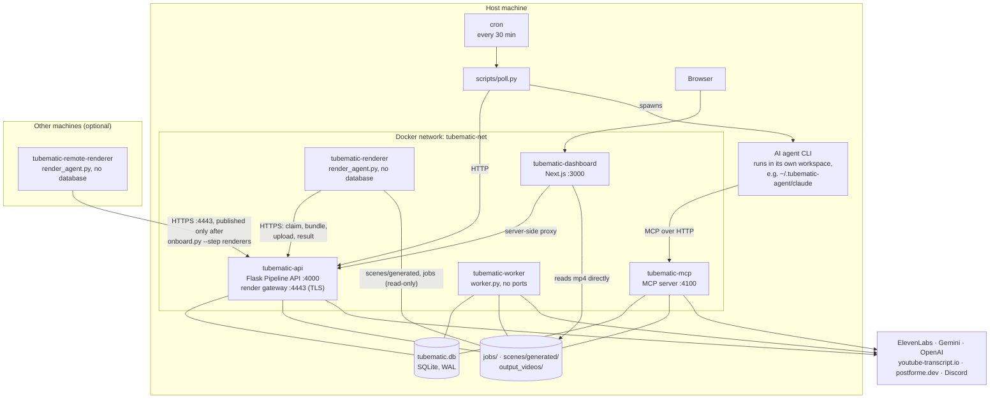

# Architecture

Tubematic runs as five Docker containers and one cron job on one machine. Three of the containers
(the API, the MCP server and the worker) open one SQLite file and coordinate through it. The
dashboard reaches the data through the API. A renderer works through the **render gateway**, an HTTPS
endpoint the API container serves for renderers. A **remote renderer** is the same renderer in a
container on another machine, reaching the gateway over the network
([Remote renderers](../user-guide/11-remote-renderers.md)).

The main install is the machine that runs the dashboard and the database.



---

## The containers

| Container | Image | Ports | Role |
|---|---|---|---|
| `tubematic-api` | built from `renderer/Dockerfile` | 4000, and 4443 on the Compose network | The Flask Pipeline API, and the render gateway that renderers call ([The Render Gateway](19-render-gateway.md)) |
| `tubematic-mcp` | the same image | 4100 | The MCP server, the agent's only interface to the pipeline |
| `tubematic-worker` | the same image | none | Publishing, Auto Pilot, analytics, price sync, retention, notifications, the stalled-voicing check, the AI review of uploaded renders, and the render-lease and GPU-wait sweeps ([The Worker](12-the-worker.md)) |
| `tubematic-renderer` | the same image | 4455, Compose network only | The built-in renderer. It renders what the gateway hands it, tests its GPU and runs the Cartoon 3D stills server ([Rendering and Review](11-rendering-and-review.md)) |
| `tubematic-dashboard` | built from `dashboard/Dockerfile` | 3000 | The Next.js dashboard |

The first four run one image with a different `command:`. Only the API service declares `build:`
and the other three reuse its tag, so one build covers all four
([Infrastructure](16-infrastructure.md#services)). Those four mount a shared logs directory at
`/logs` and each appends a daily JSONL file there. The dashboard mounts neither the logs nor a
Docker socket, and reads the logs through the API's `GET /logs`.

The reasons behind the split:

- Each container runs one foreground process, so a process that dies stops its container and
  `restart: unless-stopped` starts it again.
- A render runs Chromium and ffmpeg for minutes at a time and can be killed for memory. In its own
  container, a renderer that stops takes no other service with it.
- The renderer has no database because a renderer may be another machine, and the built-in one uses
  the same gateway so every install exercises that path. Through the gateway a renderer holds one
  credential, sees one job at a time and can move a video only by reporting on a render it holds.
  It never sees the stored API keys.
- The worker is separate from the renderer so that a render does not hold up a post, an Auto Pilot
  approval or a notification, and so that recreating the renderer (as `onboard.py --step gpu` does)
  does not stop them. The worker changes a video at the render stage in three guarded cases: its
  review thread finishes an uploaded render, its lease sweep requeues a render whose renderer
  stopped reporting, and its GPU-wait sweep fails a GPU-only video that no renderer can take
  ([The Worker](12-the-worker.md)).
- `tubematic-api` depends on no other service, and the other four wait for it to be healthy. The
  dashboard and the poller keep working while the MCP server is down, and an agent session survives
  an API restart.

## Ports

The API (4000) and the MCP server (4100) are published on `127.0.0.1` only. The dashboard (3000) is
published on every interface in a source checkout and on `127.0.0.1` in a release install.
Containers reach each other by service name over the Compose network, which does not use the
published ports. The end-to-end test stack uses 3001 and 4001.
[Infrastructure: Ports](16-infrastructure.md#ports) has the full table.

The gateway (4443) is the one port that can face the network, because remote renderers have to
reach it. It is published only by an override file that `onboard.py --step renderers` writes, on
the host port you pick, so an install without remote renderers exposes nothing more. It serves TLS
only and authenticates every route except its version and enrollment endpoints
([Remote-renderers override](16-infrastructure.md#remote-renderers-override)).

The dashboard needs a sign-in, and the API and the MCP server each need their own bearer token on
every request except their health probes ([Authentication](16-infrastructure.md#authentication)).

---

## How the pieces talk

Processes talk over HTTP or through the shared database. There is no message broker and no shared
in-process state between containers, and no container mounts the Docker socket.

| From | To | Via |
|---|---|---|
| Browser | Dashboard | HTTP |
| Dashboard | Flask API | A server-side proxy route. The browser never learns the API's address or its token |
| Dashboard | Rendered files | Direct `fs` reads from the shared volume, with Range support |
| AI agent | MCP server | MCP over HTTP on 4100, with the MCP token |
| Poller | Flask API | HTTP with the API token, including which agent runs each video. The poller has no database access |
| Installer | Database | Direct SQLite from the host. It is the only process that adds or archives rows in the `agents` table |
| Renderer, built-in or remote | Render gateway | HTTPS on 4443 with a renderer credential, trusting only the gateway's pinned certificate: heartbeat, claim, bundle download, mp4 upload, result. The built-in renderer uses the Compose network and a remote one the published port |
| API, MCP server, worker | Database | SQLite in WAL mode. The worker and the render gateway change a status with a guarded `UPDATE` |

---

## Where things live on disk

Pipeline data lives at a fixed absolute path outside the checkout:

```
~/.tubematic-data/
├── data/tubematic.db              # state machine, settings, credentials
├── jobs/<video_id>/               # audio.mp3, timeline.json, scene-config.json, images/
├── scenes/generated/<video_id>/   # agent-authored scene TSX
├── output_videos/<project_id>/    # rendered mp4s, and voice-previews/
├── logs/<service>.<date>.jsonl    # structured logs, one file per service per day
├── backups/                       # pre-migration database snapshots
└── secrets/                       # the four service tokens (API, MCP, dashboard session, built-in
                                   # renderer) and the render gateway's TLS key and certificate
```

The location is not configurable. Because it is outside the repository, deleting or re-cloning the
checkout leaves the database and the video library in place, and Compose finds the same data tree
from any directory.

Compose exposes the first six as named volumes with `o=bind` device paths under `${HOME}`
([Infrastructure: Volumes](16-infrastructure.md#volumes)). `secrets/` is not a volume: each secret
file is mounted read-only into the services that need it, as a Compose secret
([Infrastructure: Authentication](16-infrastructure.md#authentication)).

Paths stored in the database are container-absolute (`/jobs/…`, `/output_videos/…`), because the
processes that use them run inside containers. No process reads a file's location from those
columns. Each derives it from the video's ids, and the dashboard plays a render from
`/stream/<project_id>/<id>.mp4` (`dashboard/lib/utils.ts::videoStreamUrl`).

### What is baked in and what is mounted

| | |
|---|---|
| Baked into the image | `renderer/api/`, `mcp/`, the dashboard, the Remotion project's `src/` including `scenes/installed/` |
| Bind-mounted | The six data directories above that are volumes, including `scenes/generated/` |

Editing the repository changes nothing in a running container until you rebuild the image.
`scenes/generated/` is a volume, so agent-written scenes appear without a rebuild.

---

## The repository

```
tubematic/
├── onboard.py, onboard/       # the installer, the canonical setup path
├── upgrade.py                 # the upgrade: gate, images, stop, start, cron, agents
├── uninstall.py
├── mcp/                       # MCP server and the text-audit decision layer
├── renderer/
│   ├── api/                   # Flask API, worker, renderer, AI review, DB helpers
│   ├── remotion/              # the Remotion video project
│   ├── Dockerfile             # one image for tubematic-api, -mcp, -worker and -renderer
│   └── entrypoint.sh
├── tubematic_core/            # the one shared Python package: schema and migrations, logging, version
├── dashboard/                 # Next.js app
├── agent_files/
│   ├── skills/                # what the agent knows how to do
│   ├── claude/commands/       # slash commands for Claude Code
│   └── opencode/commands/     # the same commands for OpenCode (Codex has none)
├── scripts/                   # poll.py (cron), release tooling, and other host-side utilities
├── vqa/                       # the video-quality assessment environment
├── kasm_workspace/            # the published Kasm Workspace: installs a release at session launch
├── kasm_workspace_testing/    # the disposable full-install test environment
├── docs/                      # this documentation
├── .github/workflows/         # CI, the tag-triggered release (it also syncs the docs site and the Kasm registry), the docs-site sync
├── VERSION                    # the single source of truth for the installed version
├── docker-compose.yml
└── docker-compose.test.yml    # isolated stack for end-to-end tests
```

---

## Duplication is intentional

Several constants and helpers are hand-copied across `mcp/`, `renderer/api/`, `dashboard/` and
`onboard/`. These are separate deployable units: the MCP server and the Flask API ship in one
image, the dashboard ships in another, and the installer runs on the host before any image exists.

`tubematic_core/` is the one shared Python package. The image copies it to `/app/lib`, and host
scripts import it from the repository root. A module goes there only when two copies that disagreed
would be dangerous. Everything else that two processes share stays a copy.

| Module | What it holds | What a second copy would risk |
|---|---|---|
| `logging.py` | Structured JSONL logging, with a redactor that strips credentials from every log line | A credential in a log |
| `db.py`, `migrations/` | The schema and `migrate()`, which every process that opens the database calls | Two definitions of the schema ([Database](03-database.md#migrations)) |
| `version.py` | The version string, read from `VERSION` | Release tooling and services that report different versions |
| `auth.py` | The service tokens, the gateway's TLS pair and the admin password | Processes that look for a secret in different files |
| `usage.py`, `prices.py` | The spend ledger and the model prices | One paid call priced three ways by three containers |
| `voice_models.py` | What each ElevenLabs model can speak | The dashboard approving a voice that `generate_voice` then refuses ([The model follows the voice](08-scripting-and-voice.md#the-model-follows-the-voice)) |
| `youtube.py` | Which YouTube URLs mining accepts | A stored URL list that the mining tool refuses to send to Gemini |
| `ids.py`, `jobfiles.py` | The rules for ids that become paths, and where a video's files live | A path traversal in one of the programs that build those paths |
| `renderers.py` | Which renderer may take which video, whether the install's GPU works, credentials and enrollment tokens | The dashboard offering a style that no renderer is handed |
| `mascots.py` | The mascot statuses, the attempt cap and the cue checks | The API, the MCP server, the worker, the renderer and the poller applying different rules |

`renderer/api/pipeline.py::_init_db` and `mcp/server.py::_init_db` define no schema. Both call
`tubematic_core.db.migrate()`. The dashboard keeps a TypeScript copy of the ElevenLabs model sets,
pinned by a source-text test.

### The hand-copied constants

| Duplicated | Copies, and what holds them together |
|---|---|
| `VALID_VIDEO_STATUSES`, `WORKABLE_STATUSES` | `renderer/api/pipeline.py`, `mcp/server.py`, and for the full list the `VideoStatus` type in `dashboard/lib/types.ts` ([The status sets](02-pipeline.md#the-status-sets)) |
| Safe-zone pixel constants | `TextRevealScene.tsx`, `mcp/text_audit.py`, `renderer/api/ai_review.py`, `tubematic_core/mascots.py` |
| Timezone detection | `renderer/api/hosttz.py`, `scripts/config.py` |
| `_truncate_title` | `renderer/api/pipeline.py`, `mcp/server.py`. A test executes both copies and asserts they agree |
| The mining URL rule | `tubematic_core/youtube.py`, `dashboard/components/MiningSources.tsx`, and migration `0014`'s frozen copy. The dashboard's copy only lights the Add button, and the API's `400` is the authority. Both pass one accept-and-refuse table, because the two regex dialects differ |
| The `agents` table schema | `tubematic_core/migrations/` and `onboard/agent_install.py::AGENTS_SCHEMA`, because the installer may create the table on the host before any container has started. A test pins it against a migrated database, column positions included |
| `AGENT_EFFORTS` | `renderer/api/pipeline.py`, `mcp/server.py`, `scripts/agent_adapters.py::AGENT_EFFORTS`, `dashboard/lib/agents.ts`. A test reads all four as source text |
| `_pick_agent_id`, `_agent_model_error` | `renderer/api/pipeline.py`, `mcp/server.py`. An agreement test pins `_pick_agent_id` |
| `POLL_LOG_DIR` | `scripts/config.py`, `onboard/config.py` |
| API-key redaction in error strings | `renderer/api/ai_review.py`, `mcp/server.py` |
| Enrollment token decoding, the certificate pin, the `nvidia-smi` parse, the GPU environment, the backend image name | `scripts/tubematic_remote_renderer.py`, which runs on a machine with no checkout and imports nothing from the repository. Tests in `scripts/tests/test_tubematic_remote_renderer.py` pin each copy against `tubematic_core/renderers.py`, `onboard/gpu.py` and `scripts/gen_release_compose.py` |
| The remote-renderer host command and the `render_gateway_address` row name | `onboard/remote_renderers.py`, `renderer/api/pipeline.py` |

Most copies carry a `# Keep in sync` comment. Grep before you change one. Several settings defaults
are repeated in three to five places with no such comment, so grep for the value too.

---

## Failure model

A failure stops one part and leaves a trace: a comment on the video, a banner or a log line.

| Failure | Result |
|---|---|
| A render fails | `REVISION_REQUESTED` for the agent to fix, then `FAILED` past the retry cap ([Rendering and Review](11-rendering-and-review.md)) |
| A render times out, or its renderer stops or stops reporting | The video is requeued, and each requeue counts toward the retry cap. A renderer's lease on a video lasts five minutes without a heartbeat ([The Render Gateway](19-render-gateway.md)) |
| No renderer is enabled, online and on the main install's version | Queued videos wait and the Pipeline page shows a **NOTHING CAN RENDER** banner. The worker fails a GPU-only video after at most 30 minutes ([GPU and Remote Renderers](20-gpu-and-remote-renderers.md)) |
| The AI review errors | The video advances to `VIDEO_READY`. The error is written to `gemini_feedback` and the comment thread ([AI Review](21-ai-review.md)) |
| The MCP server stops | The container restarts. The in-memory scene-work claims are lost, and the next session takes a new one |
| The Flask API is unreachable | The poller starts nothing. With nothing running it exits non-zero, and the next cron tick starts a new one |
| No agent is installed | The poller logs `No agent installed` and exits with code 0 |
| An agent session hangs, or leaves its video where it found it | The poller kills a session after `agent_session_timeout_secs`, and flags a video stuck after three sessions without progress. It does not mark the video `FAILED` |
| The poller dies or hangs | Its sessions keep running, and the poller started by the next cron tick adopts them. A hung poller is logged and nothing is killed |

[The Poller](13-the-poller.md) covers the last four rows.
