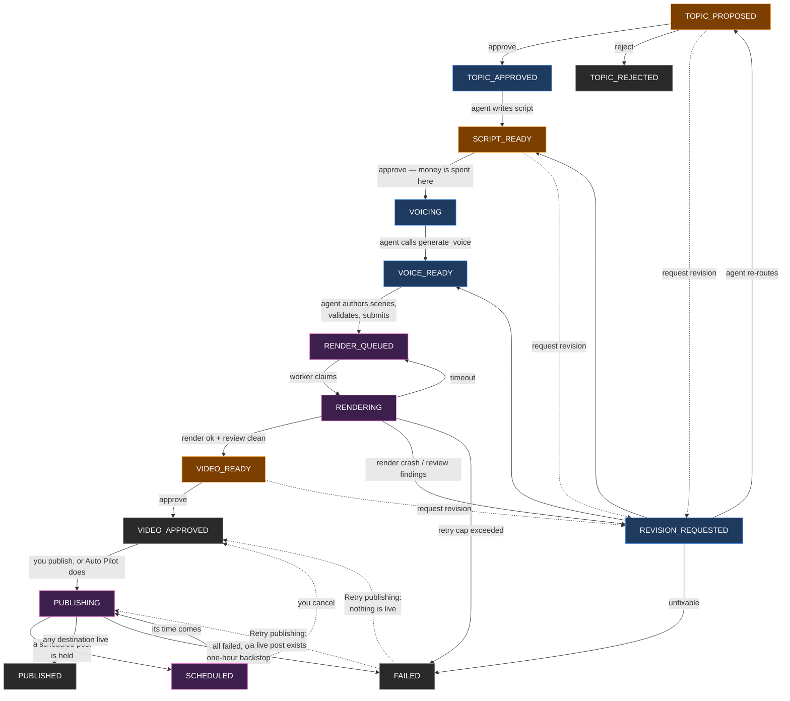
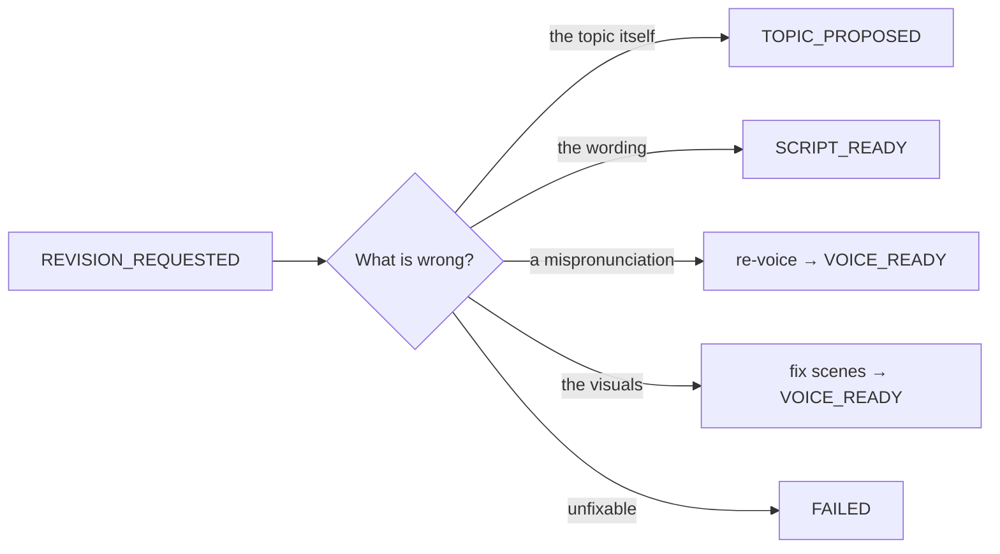
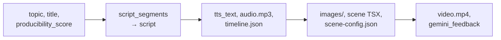

# The Pipeline

Every video is one row in the `videos` table, and its `status` column is the whole state machine.
There is no queue, no scheduler and no orchestrator process — each component polls for the statuses
it owns and writes the next one back.

Three parties move a video, and the split between them is the most important thing to understand:

| Party | What it may do |
|---|---|
| **Human** | Approve or reject at the three checkpoints. Nothing else is required of you |
| **AI agent** | Everything between checkpoints — research, scripting, voicing, scene authoring, submitting a render |
| **Worker** | Rendering and AI review, autonomously. Never asks and never waits |

---

## The states



<sub>**Amber** — a human must act · **Blue** — the AI agent acts · **Purple** — automatic, worker-owned · **Grey** — terminal</sub>

| Status | Owner | Meaning |
|---|---|---|
| `TOPIC_PROPOSED` | Human | A topic has been researched and scored. Awaiting your decision |
| `TOPIC_APPROVED` | Agent | Approved. The agent will write a script |
| `TOPIC_REJECTED` | — | Terminal. You said no |
| `SCRIPT_READY` | Human | A script exists. **Approving spends money** |
| `VOICING` | Agent | Approved for voicing. The agent will call ElevenLabs |
| `VOICE_READY` | Agent | Audio and `timeline.json` exist. The agent authors scenes |
| `RENDER_QUEUED` | Worker | Waiting for the render worker. Not agent-actionable |
| `RENDERING` | Worker | Being rendered |
| `VIDEO_READY` | Human | A finished mp4 exists, and the reviewer found nothing. Awaiting sign-off |
| `VIDEO_APPROVED` | Human | You signed it off. Publishing, if enabled, starts here — by hand, unless the video's project is on [Auto Pilot](14-publishing.md#auto-pilot) |
| `SCHEDULED` | Worker | Uploaded; the publishing service holds the post until the time you picked. You can cancel it back to `VIDEO_APPROVED` |
| `PUBLISHING` | Worker | Uploaded to the publishing service; awaiting per-destination results |
| `PUBLISHED` | — | At least one destination went live |
| `REVISION_REQUESTED` | Agent | Something needs fixing. The agent diagnoses and re-routes |
| `FAILED` | — | Terminal, except for a video that failed while publishing: **Retry publishing** checks postforme and moves it to `PUBLISHING` (a live post was found) or back to `VIDEO_APPROVED` (nothing is live) |

There is no `SCRIPTING` status. Writing a script is effectively instant, so `TOPIC_APPROVED` is the
workable status the agent picks up directly.

## The three status sets

```python
ACTIONABLE_STATUSES = {"TOPIC_PROPOSED", "SCRIPT_READY", "VIDEO_READY"}

WORKABLE_STATUSES = ["TOPIC_APPROVED", "VOICING", "VOICE_READY",
                     "REVISION_REQUESTED"]
# VIDEO_APPROVED is deliberately absent — publishing is never agent work.
```

`ACTIONABLE_STATUSES` is what the dashboard's inbox shows. `WORKABLE_STATUSES` is what the cron
poller looks for before starting an agent session. A status in neither set is either worker-owned or
terminal. A workable video that three agent sessions in a row failed to move is flagged **stuck**
(`agent_stuck_at`): it keeps its status but is left out until a human changes the status or presses
Retry agent — see [The Poller](13-the-poller.md#success-is-read-from-the-database).

Both are duplicated across `renderer/api/pipeline.py`, `mcp/server.py` and
`dashboard/lib/types.ts`, and carry `# Keep in sync` comments. The duplication is deliberate —
separate processes with no shared package — but it means a change needs three edits.

---

## Human checkpoints

Three, and the agent is instructed never to cross one alone even though the MCP tools would let it.

A project can be put on **Auto Pilot**, which approves all three and then posts the video, with no
human involved. It is off by default and is done by the render worker, never by the agent, so
everything below about what the agent may do holds either way. Read
[Auto Pilot](14-publishing.md#auto-pilot) before turning it on. The rest of this section describes
a project that is not on it.

### `SCRIPT_READY` — the money checkpoint

ElevenLabs charges per character and does not refund. This is the last point at which a bad script
costs nothing. The agent must stop here and post a comment saying what it wrote and why.

If your voice roster has two or more voices, approving asks which one to use. The choice travels
with the approval. Each voice has its own ElevenLabs model, and the script was written for the model
of the video's voice, so a voice that cannot speak the script is offered but disabled. Pick another,
or request a revision to have the script rewritten for it — see
[The model follows the voice](08-scripting-and-voice.md#the-model-follows-the-voice). A switch
between `eleven_v3`/`eleven_v4` and any other model almost always lands here, so the place to make it is one step
earlier: approving a topic offers the same voice picker, and the script is then written for the
voice picked there.

The checkpoint is the *status*, not the voicing tool. Approving moves the video to `VOICING`, and
that move authorizes both the spend and sending the script to ElevenLabs. `VOICING` is ordinary
agent work, so the poller's next pass starts a voicing session without asking again. If a video sits in `VOICING`
for three poll intervals anyway, the render worker flags it. See
[Troubleshooting](../user-guide/08-troubleshooting.md#voice).

### `VIDEO_READY` — the quality checkpoint

A rendered video exists and the AI reviewer found nothing. It is still not approved until a human
watches it. The reviewer is a filter for obvious defects, not a substitute for judgement.

### `TOPIC_PROPOSED` — the scope checkpoint

The cheapest place to say no. Rejecting here costs nothing but the research that already happened.

### `VIDEO_APPROVED` — the publish checkpoint

Publishing is irreversible and **never the agent's**. No MCP tool can publish, `VIDEO_APPROVED` is not in
`WORKABLE_STATUSES`, and the agent is told never to write `SCHEDULED`, `PUBLISHING` or `PUBLISHED`.
A post can go out now or at a time you schedule. With publishing disabled, `VIDEO_APPROVED` is simply
terminal. See [Publishing](14-publishing.md). Only [Auto Pilot](14-publishing.md#auto-pilot) posts
without a click, and only for the projects selected for it.

### Approve, reject, revise

`TOPIC_PROPOSED`, `SCRIPT_READY` and `VIDEO_READY` offer **Request Revision**, which requires a
comment and routes to `REVISION_REQUESTED`. It is also the only way a human adds a comment to a
video, so every human comment is a revision request the agent will act on. `VIDEO_APPROVED` has
none: once a video is approved, the remaining decision is whether to publish it. That is distinct from a flat reject: only `TOPIC_PROPOSED` can be
flat-rejected to the terminal `TOPIC_REJECTED`, and its comment is optional.

---

## Notifications

A checkpoint only works if someone knows they have been handed one. Tubematic can announce all
three to a Discord channel, each independently switchable, configured entirely from the dashboard's
Settings → Notifications tab. Everything is off until both a webhook URL and at least one trigger
are set. The keys are listed under [Settings](../user-guide/05-settings.md#notifications).

**Announcing is a sweep in the render worker, not a send at each write site.** The three statuses
are written by three different processes — `TOPIC_PROPOSED` by the MCP server's `create_video`,
`SCRIPT_READY` by either the MCP server or the Flask `PATCH`, `VIDEO_READY` by the render worker
itself — and the worker's poll loop is the only place that sees all three. That choice also buys
three things a per-call-site send could not:

- **Bundling.** A research run files several topics seconds apart. The sweep holds proposals back
  until the newest has been still for a settle window, then sends one message for the run. Six pings
  for one run is what makes a channel get muted.
- **No latency anywhere it matters.** A slow or unreachable Discord cannot delay an MCP call or a
  dashboard save.
- **Free retries.** The marker that records what has been announced only advances on a successful
  send, so a failure is retried on the next tick rather than lost.

The cost is latency: the passes run at the top of each tick, so a message arrives within a tick when
the worker is idle, or once the current render finishes when it is not.

**A second arrival announces again.** A video going
`SCRIPT_READY → REVISION_REQUESTED → SCRIPT_READY` is announced both times — the whole point of the
revision loop is that the human sees the result of their feedback.

What makes that work is that `videos.notified_status` records an *arrival*, `<status>@<updated_at>`,
rather than a status name. A status name alone is not an identity: if the whole round happens
between two sweeps — which is the normal case, since a render holds the worker's loop for up to
forty minutes — the second `SCRIPT_READY` would read as already announced and the human would never
hear that their feedback landed. Every status write already bumps `updated_at`, so pairing the two
makes each arrival distinct without any of the three writing processes needing to know
notifications exist. The one thing it cannot separate is two status changes inside the same second.

**Switching a trigger on does not replay a backlog.** Videos keep reaching checkpoints while
notifications are off, so the sweep stamps those arrivals as seen without sending. Enabling a
trigger starts announcing from that moment — the same reasoning as the one-time migration backfill,
and for the same reason: a feature whose first act is to fire twenty messages gets switched straight
back off.

---

## The revision loop

`REVISION_REQUESTED` is not a state a video sits in. It is a *diagnosis* state: the agent reads the
comment thread and the video's own fields, decides what actually needs redoing, and routes the video
back to the earliest checkpoint that can fix it.



Two things about this loop are easy to get wrong and are worth stating explicitly.

**A pronunciation fix and a visual fix both land back at `VOICE_READY`, but they are not the same.**
Re-voicing produces a new `timeline.json` with a different total frame count, which invalidates
every frame span in the existing scene config. A visual fix does not. The agent distinguishes them
by comparing `scene-config.totalFrames` against `timeline.total_frames`: equal means the audio is
unchanged and only the named scenes need rewriting; unequal means the audio was re-voiced and the
whole config must be re-derived.

That comparison is the entry test on purpose. The intuitive test — "was a revision requested?" or
"is `scene_config_path` populated?" — is wrong, because a pronunciation revision returns through
`VOICE_READY` with that field still populated and would route every re-voice down the incremental
path.

**Routing back never skips a checkpoint.** A topic revision goes to `TOPIC_PROPOSED`, not further
forward.

---

## Frozen choices

The per-video choices freeze in two groups, and both freezes are enforced server-side in
`PATCH /videos/<id>` (returning `409`) and the MCP server's `update_video` — not merely hidden in
the UI.

| Group | Fields | Settable while the video is at |
|---|---|---|
| Topic | `script_profile_id`, `visual_style` | `TOPIC_PROPOSED` only |
| Agent | `agent_id`, `agent_model`, `agent_effort` | any human checkpoint — `TOPIC_PROPOSED`, `SCRIPT_READY`, `VIDEO_READY` |

**Why two groups.** The topic group shapes what the script *is*: changing either after the script
exists leaves a script that no longer matches what the row claims. The agent group only decides
*who does the next piece of work*, so a human may change it at every point they review the video.
Between checkpoints an agent or the renderer holds the video, and switching under it
would move it between agents, models or effort levels mid-task — so it is frozen there.

The guard reads the *current* status, which is what makes the approving request work: it carries the
choices and the status change together, and at the moment it is evaluated the video is still at the
checkpoint. The same holds for a revision request. That makes ordering load-bearing for anything
else setting these fields — the write must happen **before** the flip, not after.

**The agent is dealt at creation and changed only by a human.** A video gets `videos.agent_id` from
the weighted deal when it is created, and nothing but a human at a checkpoint moves it — the poller
never reroutes a video on its own. `agent_id` must name a live agent (an uninstalled one cannot be
handed new work); naming the video's current agent again is a no-op. **Changing the agent clears
`agent_model`** back to `""`, because a model belongs to one agent's list — unless the same request
sets a model, which is then checked against the *new* agent. `agent_effort` carries across. See
[The Agent Layer](07-agent-layer.md#assignment).

`agent_model` is validated against the video's agent: a non-empty value must be one of its installed
models and the agent must not be archived, or the write is refused with `400`. The freeze check runs
first, so a late edit still reads as frozen rather than as a model problem. `""` always passes and
means the agent's own default model. A model written on its own is bound to the agent it was checked
against: if another request moves the video to a different agent in between, it is refused with
`409` rather than pinning a model the new agent does not have.

**`agent_effort` is frozen for the same reason as `agent_model` but validated more simply.** Its
five levels are fixed by the CLI rather than probed per install, so membership in them is the whole
check — no agent need be installed, and every level is valid for every agent. `""` means the
agent's own level. See [The Agent Layer](07-agent-layer.md#effort).

**`visual_style` is frozen for a different reason from the agent group**, and it is the strongest
freeze of all. The scripting skill reads the register *before* it writes a single `visual` brief,
because a brief for a posed figure and a brief for a photograph are different requests. Changing
the register after the script exists therefore invalidates every brief the video carries: the fix
is a rewrite, not a re-render.

`resolved_visual_style` is deliberately **not** part of that freeze. It records which concrete
register `auto` settled on, and the agent writes it at scene-config time — long past
`TOPIC_PROPOSED`, so a status freeze would make it unwritable in practice. It is **write-once**
instead: a second, different value is refused. That, and nothing else, is what makes a revision
round render at the register the video already uses; no code on the revision path knows the field
exists. Re-rolling it mid-video would mix two registers' assets into one render, which reads as
broken rather than merely different.

`title` is deliberately **not** frozen. It is cosmetic and stays writable at any status.

---

## Concurrency

Three separate mechanisms, at three layers.

**The render claim** is a single guarded `UPDATE`. See
[Rendering and Review](11-rendering-and-review.md#the-claim).

**`onlyIfCurrentStatus`** is an optimistic-concurrency guard on the HTTP API, used by every
status-changing write the dashboard makes. Two people looking at a five-second-stale board cannot
both approve the same video; the second gets a `409`.

**The scene-work claim** is an owner-keyed, TTL-refreshed lock in the MCP server covering the whole
scene-authoring window. See [MCP Server](06-mcp-server.md#the-scene-work-claim).

---

## What a video accumulates



| Stage | Files written | Columns set |
|---|---|---|
| Research | — | `topic`, `title`, `strategy`, `producibility_score`, `project_id` |
| Scripting | — | `script_segments`, `script` |
| Voicing | `<jobs>/<id>/audio.mp3`, `timeline.json` | `tts_text`, `voice_file_path`, `timeline_path` |
| Scene authoring | `<jobs>/<id>/images/*`, `scenes/generated/<id>/*.tsx`, `scene-config.json` | `scene_config_path` |
| Rendering | `<output>/<project>/<id>.mp4` | `video_path`, `video_version` |
| Review | — | `gemini_feedback`, `ai_review_count` |

Job files live under `~/.tubematic-data/jobs/<video_id>/`; generated scenes under
`~/.tubematic-data/scenes/generated/<video_id>/`; renders under
`~/.tubematic-data/output_videos/<project_id>/`.

---

## Where topics come from

Four sourcing modes, all filing into project domains — the single organizing entity.

| Mode | Trigger | `videos.strategy` |
|---|---|---|
| Curriculum | Scheduled, from projects flagged `is_curriculum_seed` | `curriculum` |
| Trending | Scheduled, from GitHub Trending, Hacker News and friends | `trending` |
| Mining | Scheduled, Gemini watching configured YouTube URLs. Off while no Gemini key is stored | `mining` |
| Manual | You, via `/tubematic-submit-new-job` or the dashboard's **New Video** page | `manual` |

Five controls govern how much they produce:

1. **Mode toggle** — `active_strategies`. Mining is dropped from it at every read while no Gemini key
   is stored, and refused if switched on; the stored row is untouched, so a key added later brings it
   back
2. **Domain pause** — `projects.status`, on curriculum seeds only. See [Domain pause](#domain-pause)
3. **Topic cap** — `projects.topic_cap`, on every domain. See [Topic cap](#topic-cap)
4. **Pending cap** — `research_pending_cap`, the backlog ceiling
5. **Daily run cap** — `max_research_runs_per_day`, rolling 24 hours

The caps are reported by the API and enforced by `scripts/poll.py`. See
[The Poller](13-the-poller.md).

### Domain pause

Pausing a domain stops topic generation from it. **Only a curriculum seed can be paused.** The
API, the MCP tools and the dashboard all refuse to pause any other domain, and the dashboard offers
the control on seeds alone. The reason is what a domain means to each mode. For curriculum, the
seed is the *source*: sub-topics are enumerated from it, so pausing it stops generation at the
root. For trending and mining, the domain is only where a topic researched elsewhere gets *filed*.
Pausing it could not stop the subject being researched, only which row the topic landed in. The
agent could file the topic into a neighbouring domain, or create a new one, and the pause would be
defeated while appearing to hold.

A paused seed has two effects:

- Scheduled curriculum research does not enumerate it.
- `create_video` (MCP) and `POST /videos` **refuse** to file a new video into it, whatever mode
  found the topic. Mining files through `create_video`, and refuses a closed domain before its
  first Gemini call. A trending or mining topic can match a seed domain too. This is enforced in code,
  not left to the research prompt: the check reads the domain's `status`, and the refusal tells
  the agent to skip the candidate rather than refile it. The `INSERT` re-checks the pause itself,
  so a pause that commits while a video is being created still holds. An earlier read would not
  see it, because it runs outside any transaction.

**`strategy="manual"` is exempt.** A topic you submit yourself outranks a pause. The exemption is
only as honest as the `strategy` label, which the agent supplies, so the refusal message
deliberately never mentions it.

Videos already in the domain are untouched: they keep voicing, rendering and reviewing. Resuming
restores normal filing with no other step. Clearing `is_curriculum_seed` on a paused domain makes
it active again, so no domain is ever left paused with no control able to change it.

There is no way to say "stop making videos about databases" for a subject that was never seeded.
The options are to reject those proposals at `TOPIC_PROPOSED`, or to turn trending or mining off.

### Topic cap

Research must not propose a topic a domain has already had. The agent checks each candidate
against the domain's whole history with the MCP tool `list_project_topics`, which lists every
video ever filed there. That includes **archived** videos (deleted by you or by the retention
sweep) and **rejected** topics. `list_videos` can't be used for this: it never lists an archived
video, so a topic that was made and later deleted would come back, and under Auto Pilot it would
be approved and paid for with nobody looking. Mining already counts archived rows as covered for
the same reason.

That history has to stay a size an agent can read in one call. So every domain has a
**`topic_cap`**: how many topics it may ever hold.
- The cap is a whole number from 25 to 750, and 100 by default.
- Every video ever filed counts, archived, rejected and failed ones included. The count is
  `topic_count` in `GET /projects` and `list_projects`. It is not the board's video count, which
  leaves archived videos out.
- A domain whose count has reached its cap is **expired**. An expired domain is refused exactly
  like a paused one: it is not enumerated, and `create_video` and `POST /videos` refuse to file
  into it. The `INSERT` re-counts the domain itself, so two
  sessions filing at once can't overshoot.
- The `manual` exemption holds here too. The dashboard's New Video page always files into the
  fixed `manual` domain, which can therefore go past its cap and show as expired. That is harmless,
  because research never files there.

Expired is **derived** on every read (`topic_count >= topic_cap`), never stored. Raising the cap on
the Topics page re-opens the domain with no other step. Lowering it below the count expires the
domain at once.

The bounds keep the list bounded, not the domain's output: at 750 topics with briefs clipped to 160
characters, `list_project_topics` is still a single readable call. A domain that genuinely needs
more topics than that is better split into narrower domains, which also gives research a sharper
subject to enumerate.

A manual submission skips `TOPIC_PROPOSED` entirely and lands at `TOPIC_APPROVED` — asking you to
approve a topic you just typed would be pointless. The dashboard's New Video page makes this a
checkbox, **Automatically approve topic**, on by default. Unchecking it lands the video at
`TOPIC_PROPOSED` for a second look on the Pipeline page.

The two manual routes file differently. `/tubematic-submit-new-job` has an agent at hand, so it
scores the topic and matches it to a subject domain, as research does. The New Video page has no
agent at submit time, so every video it creates goes into one fixed domain, **Manual Videos** (id
`manual`), and is left **unscored**: `producibility_score` 0, shown as "—". Nothing else files a
video below 5, so 0 can only mean "unscored". The domain is created the first time the form is
used. It is not a curriculum seed, so it can't be paused and research never enumerates it, and its
description tells the research agent never to file a researched topic there. See
[`POST /videos/manual`](05-http-api.md#post-videosmanual).
