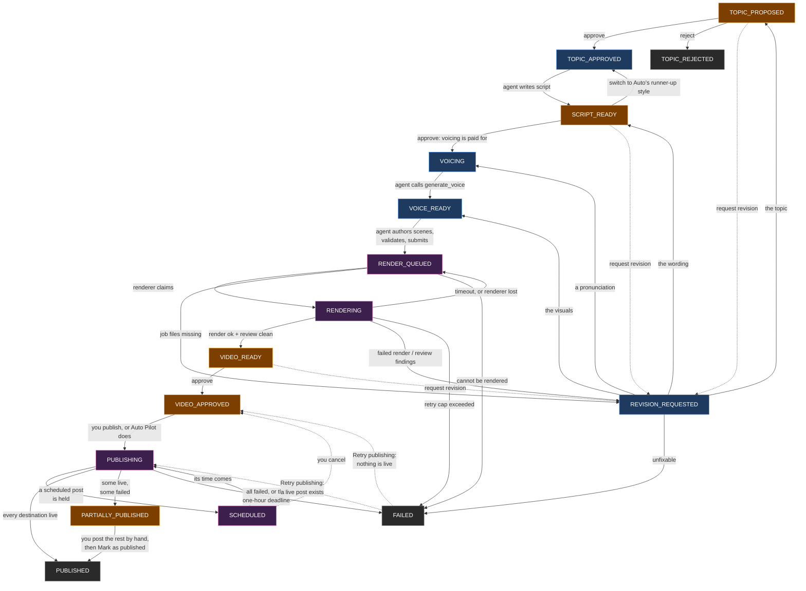
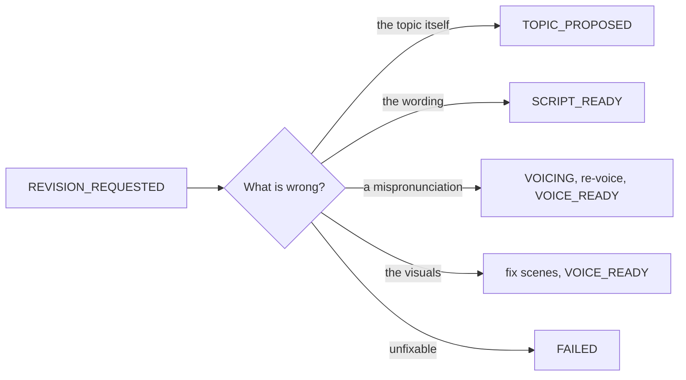
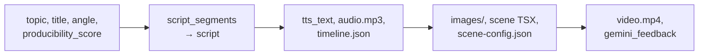

# The Pipeline

Every video is one row in the `videos` table, and its `status` column is the state machine. No
process schedules the others. Each one polls for the statuses it owns and writes the next status
back.

| Party | What it does |
|---|---|
| Human | Approves, rejects or asks for a revision at the three human checkpoints, then starts publishing |
| AI agent | The work between checkpoints: research, scripting, voicing, scene authoring, submitting a render |
| Renderer and worker | The renderer renders, through the API's render gateway. The worker runs the AI review, publishing, Auto Pilot and the timed sweeps. Neither waits for a person |

The [glossary](../user-guide/01-overview.md#glossary) defines domain, research mode, visual style
and the other product terms. postforme is the publishing service that holds and sends the posts.

---

## The states

Amber: a human acts. Blue: the AI agent acts. Purple: automatic, owned by the worker or the renderer. Grey: terminal.

| Status | Owner | Meaning |
|---|---|---|
| `TOPIC_PROPOSED` | Human | A researched, scored topic waits for a decision |
| `TOPIC_APPROVED` | Agent | The agent picks a style when the video is on `auto`, then writes a script |
| `TOPIC_REJECTED` | none | Terminal. A human rejected the topic |
| `SCRIPT_READY` | Human | A script exists. Approving it authorizes the paid voicing |
| `VOICING` | Agent | The agent calls ElevenLabs |
| `VOICE_READY` | Agent | Audio and `timeline.json` exist. The agent authors scenes |
| `RENDER_QUEUED` | Renderer | Waiting for a renderer |
| `RENDERING` | Renderer, then the worker | Being rendered. Once the mp4 is uploaded, waiting for the AI review |
| `VIDEO_READY` | Human | A finished mp4 exists and the AI review, when it is on, found nothing |
| `VIDEO_APPROVED` | Human | Signed off. A human publishes from here, unless the domain is on Auto Pilot. Terminal while publishing is disabled |
| `SCHEDULED` | Worker | Uploaded. postforme holds the post until the chosen time. A human can cancel it back to `VIDEO_APPROVED` |
| `PUBLISHING` | Worker | Uploaded to postforme, waiting for each destination's result |
| `PUBLISHED` | none | Terminal. Every destination went live, or a human marked a partial publish as published |
| `PARTIALLY_PUBLISHED` | Human | Live on some destinations, failed on others. A human posts to the failed ones by hand, then presses **Mark as published**. The files are kept until then ([Publishing](14-publishing.md#a-partial-publish)) |
| `REVISION_REQUESTED` | Agent | Something needs fixing. The agent diagnoses it and routes the video back |
| `FAILED` | none | Terminal, except after a failed publish: **Retry publishing** asks postforme and moves the video to `PUBLISHING` (a live post exists) or `VIDEO_APPROVED` (nothing is live) |

There is no `SCRIPTING` status. The agent picks a video up at `TOPIC_APPROVED` and writes the
script in one session. On a video whose style is `auto`, the same session first picks the style
([How Auto picks a style](10-scene-authoring.md#how-auto-picks-a-style)), because the script is
written for it.

### Render-stage exits

A queued video can leave `RENDER_QUEUED` without a render
([Refused before anything renders](11-rendering-and-review.md#refused-before-anything-renders)):

- The render gateway moves it to `REVISION_REQUESTED` when a job file is missing at the claim.
- The gateway moves it to `FAILED` when an id cannot be used as a file path, when a Cartoon 3D
  video holds a mascot, or when a mascot's code cannot be staged.
- The worker's GPU-wait sweep moves a GPU-only video to `FAILED` when no renderer can take it.

From `RENDERING`, a failed render goes to `REVISION_REQUESTED` and a timeout, a stall or a lost
renderer back to `RENDER_QUEUED`. Each counts toward `max_render_retries`, and the video goes to
`FAILED` past it. A GPU-only video whose GPU stops working during a render goes to `FAILED` at
once. A video also reaches `VIDEO_READY` when the review is switched off, errors, or has passed
its loop cap ([Status transitions](11-rendering-and-review.md#status-transitions)).

### What the API enforces

`PATCH /videos/<id>` and the MCP tool `set_video_status` do not check a write against the diagram.
Both accept any valid status on a video that is not archived, with one exception:
`set_video_status` refuses `TOPIC_REJECTED` and `SCHEDULED` with `human_only_status`
(`mcp/server.py::HUMAN_ONLY_STATUSES`). The agent's skills and the dashboard's buttons are what
keep to the diagram.

## The status sets

| Set | Members | Used for | Copies |
|---|---|---|---|
| `VALID_VIDEO_STATUSES` | Every status in the table above | Validating a status write | `renderer/api/pipeline.py`, `mcp/server.py`, the `VideoStatus` type in `dashboard/lib/types.ts` |
| `ACTIONABLE_STATUSES` | `TOPIC_PROPOSED`, `SCRIPT_READY`, `VIDEO_READY` | The human checkpoints: `GET /videos/actionable`, the dashboard's Quick Actions list, and where the agent fields may change | `renderer/api/pipeline.py`, and `HUMAN_CHECKPOINT_STATUSES` in `mcp/server.py` |
| `WORKABLE_STATUSES` | `TOPIC_APPROVED`, `VOICING`, `VOICE_READY`, `REVISION_REQUESTED` | `GET /videos/workable`, the list the poller starts agent sessions from | `renderer/api/pipeline.py`, `mcp/server.py`, the keys of `scripts/poll.py::STAGES`, the operator skill's status table |
| `DELETABLE_STATUSES` | Every status except `VOICING`, `VOICE_READY`, `REVISION_REQUESTED`, `RENDER_QUEUED`, `RENDERING`, `SCHEDULED`, `PUBLISHING` | Which videos a human may delete | `renderer/api/pipeline.py`, `dashboard/lib/videoStatus.ts` |

The copies carry `# Keep in sync` comments, and a change needs an edit in each.

`VIDEO_APPROVED` is absent from `WORKABLE_STATUSES` because no MCP tool can publish. A session
started for such a video could do nothing, and the poller would start one on every pass.

A workable video that three agent sessions in a row failed to move is flagged stuck
(`agent_stuck_at`). It keeps its status, and `GET /videos/workable` leaves it out until a human
changes the status or presses **Retry agent**
([The Poller](13-the-poller.md#success-is-read-from-the-database)).

---

## Human checkpoints

The three human checkpoints are the statuses in `ACTIONABLE_STATUSES`. The agent's instructions
tell it to stop at each one. The MCP tools do not enforce that.

A domain on [Auto Pilot](14-publishing.md#auto-pilot) has all three approved and the video posted
by the worker. Auto Pilot is off by default and does not change the agent's rules. The rest of
this section describes a domain that is not on it.

### `TOPIC_PROPOSED`: the scope checkpoint

A rejection here costs only the research already done. The approval is also where the topic
choices are made: the voice, the script profile, the visual style and the mascot
([Frozen choices](#frozen-choices)).

### `SCRIPT_READY`: the money checkpoint

ElevenLabs charges per character and does not refund, so this is the last status at which a bad
script costs nothing. The agent stops here and posts a comment that says what it wrote and why.

With two or more voices in the roster, the approval carries the voice choice. A voice whose
ElevenLabs model cannot speak the script is listed and disabled, and using it takes a revision. A
switch between `eleven_v3` or `eleven_v4` and any other model usually hits this, so pick the voice
at the topic approval
([The model follows the voice](08-scripting-and-voice.md#the-model-follows-the-voice)).

The approval is the status change. Moving the video to `VOICING` authorizes both the spend and
sending the script to ElevenLabs, so the poller's next pass starts a voicing session and the agent
calls `generate_voice` without asking again. If a video stays in `VOICING` for three poll
intervals, the worker flags it ([Troubleshooting](../user-guide/08-troubleshooting.md#voice)).

### `VIDEO_READY`: the quality checkpoint

A rendered video exists and the AI review, when it is on, found nothing. The review filters
obvious defects. A person still has to watch the video before it is approved.

### After the checkpoints: `VIDEO_APPROVED`

Publishing cannot be undone, and the agent cannot do it: no MCP tool publishes, and the operator
skill tells the agent not to write `SCHEDULED`, `PUBLISHING`, `PUBLISHED` or
`PARTIALLY_PUBLISHED` ([The agent cannot publish](14-publishing.md#the-agent-cannot-publish)). A
human posts now or schedules a time. Only Auto Pilot posts without a click, and only for the
domains selected for it. With publishing disabled, `VIDEO_APPROVED` is terminal.

### Approve, reject, revise

- Each checkpoint offers **Request Revision**. It requires a comment and moves the video to
  `REVISION_REQUESTED`. It is the dashboard's only control for commenting on a video that stays in
  the pipeline, so the agent treats every human comment as a revision request.
- Only `TOPIC_PROPOSED` can be rejected outright, to the terminal `TOPIC_REJECTED`. The comment
  is optional.
- `VIDEO_APPROVED` has no revision. The remaining decision is whether to publish.

---

## Notifications

The worker can announce each arrival at a human checkpoint, at `PARTIALLY_PUBLISHED` and at
`FAILED` to a Discord channel, once per arrival. See
[The Worker](12-the-worker.md#notifications).

---

## The revision loop

At `REVISION_REQUESTED` the agent reads the comment thread and the video's fields, decides what
has to be redone, and routes the video back to the earliest status that can fix it.

Routing back does not skip a checkpoint: a topic revision goes to `TOPIC_PROPOSED` and a script
revision to `SCRIPT_READY`. A pronunciation fix needs no new approval, because the script approval
covers the re-voice.

A pronunciation fix and a visual fix both pass through `VOICE_READY`. A re-voice writes a new
`timeline.json` with a different total frame count, which invalidates every frame span in the
scene config. A visual fix leaves the audio alone. The agent compares the scene config's
`totalFrames` with the timeline's `total_frames`:

- Equal: the audio is unchanged, and the agent rewrites only the scenes named in the feedback.
- Unequal: the audio was re-voiced, and the agent derives the whole config again.

`scene_config_path` cannot serve as that test, because a pronunciation revision returns through
`VOICE_READY` with the field still set.

---

## Frozen choices

The per-video choices freeze in two groups. `PATCH /videos/<id>` (with a `409`) and the MCP
server's `update_video` both enforce the freeze, so it does not depend on the dashboard hiding a
control.

| Group | Fields | Settable while the video is at |
|---|---|---|
| Topic | `script_profile_id`, `visual_style`, `mascot_id` | `TOPIC_PROPOSED` only |
| Agent | `agent_id`, `agent_model`, `agent_effort` | Any human checkpoint: `TOPIC_PROPOSED`, `SCRIPT_READY`, `VIDEO_READY` |

The topic group shapes what the script is, so a later change would leave a script that does not
match the row. The agent group decides who does the next piece of work. A human may change it at
every checkpoint, and it is frozen while an agent or the renderer holds the video.

The guard reads the current status, so an approval or a revision request can carry the choices
and the status change together. Any other caller must write these fields before it changes the
status. The `UPDATE` is bound to the status the freeze was checked against, so a status change
that lands in between fails the write with `409`.

### The agent group

- A video gets `agent_id` when it is created: its domain's agent, or one from the weighted deal
  when the domain names none ([Assignment](07-agent-layer.md#assignment)). After that only a human
  at a checkpoint changes it. The poller does not move a video to another agent.
- `agent_id` must name a live agent, or the write is refused with `400`. Naming the video's
  current agent again changes nothing.
- Changing the agent clears `agent_model` to `""`, because a model belongs to one agent's list. A
  model sent in the same request is kept and checked against the new agent. `agent_effort` carries
  across.
- A non-empty `agent_model` must be an installed model of the video's agent, and that agent must
  not be archived, or the write is refused with `400`. `""` always passes and means the agent's
  default model. The freeze check runs first, so a late edit is reported as frozen.
- A model written without an agent is bound to the agent it was checked against. If another
  request moves the video to a different agent in between, the write is refused with `409`.
- `agent_effort` must be `""` or one of the five levels. They are the same for every agent, so the
  check needs no installed agent. `""` means the agent's own level
  ([Effort](07-agent-layer.md#effort)).

### The topic group

`visual_style` is frozen because the scripting skill reads it before it writes any `visual` brief.
A brief for a posed figure differs from a brief for a photograph, so a later change would call for
a new script.

Three writes of `visual_style` happen after the topic checkpoint, each in one `UPDATE` that repeats
its checks:

- `choose_visual_style`, once, at `TOPIC_APPROVED`, on a video still on `auto`: the agent records
  the style Auto picked, before any script exists.
- [`POST /videos/<id>/switch-style`](05-http-api.md#post-videosvideo_idswitch-style), at
  `SCRIPT_READY`: a person takes Auto's runner-up, and the video goes back to `TOPIC_APPROVED` for a
  new script.
- A move back to `TOPIC_PROPOSED` returns a style Auto picked to `auto`, so the revised topic is
  routed again, and clears the renderer and canvas recorded for an `auto` video's old scenes. A
  style a person chose is kept.

Two fields that follow from `visual_style` are write-once. The agent writes them through
`update_video`, HTTP cannot write them, and a second, different value is refused:

- `resolved_visual_style` records which canvas (`dark` or `light`) `auto` settled on. The agent
  writes it at scene-config time, after `TOPIC_PROPOSED`, so a status freeze would make it
  unwritable. Write-once is what makes a revision round render on the canvas the video already
  uses. No code on the revision path reads the field.
- `resolved_renderer` records which renderer an `auto` video uses (`dom`, or `cartoon_3d` on a
  video that recorded it before Auto picked styles). The agent writes it before it authors any
  scene, because a revision that changed the renderer would discard every scene.

`title` is not frozen. It is a display name and stays writable at any status.

---

## Concurrency

Three mechanisms guard a video against two writers:

- The render claim: the render gateway hands a queued video to one renderer with a single guarded
  `UPDATE` ([Rendering and Review](11-rendering-and-review.md#the-claim)).
- `onlyIfCurrentStatus`, a precondition the dashboard sends with every status change. The check
  is part of the `UPDATE`, so when two people approve the same video from a stale board, the
  second request gets a `409`.
- The scene-work claim: a lock in the MCP server, keyed to its owner and refreshed on use, that
  covers the whole scene-authoring window ([MCP Server](06-mcp-server.md#the-scene-work-claim)).

---

## What a video accumulates

| Stage | Files written | Columns set |
|---|---|---|
| Research | none | `topic`, `title`, `strategy`, `producibility_score`, `project_id`, `angle`, `angle_kind`, `angle_score` |
| Scripting | none | `script_segments`, `script` |
| Voicing | `<jobs>/<id>/audio.mp3`, `timeline.json` | `tts_text`, `voice_file_path`, `timeline_path` |
| Scene authoring | `<jobs>/<id>/images/*`, `scenes/generated/<id>/*.tsx`, `scene-config.json` | `scene_config_path` |
| Rendering | `<output>/<project>/<id>.mp4` | `video_path`, `video_version` |
| Review | none | `gemini_feedback`, `ai_review_count` |

Job files live under `~/.tubematic-data/jobs/<video_id>/`, generated scenes under
`~/.tubematic-data/scenes/generated/<video_id>/`, and renders under
`~/.tubematic-data/output_videos/<project_id>/`.

---

## Where topics come from

Four research modes file topics into domains. The mode is stored in `videos.strategy`.

| Mode | Trigger | `videos.strategy` |
|---|---|---|
| Curriculum | Scheduled, from domains flagged `is_curriculum_seed` | `curriculum` |
| Trending | Scheduled, from the configured sources such as GitHub Trending and Hacker News | `trending` |
| Mining | Scheduled. Gemini watches the configured YouTube URLs. Off while no Gemini key is stored | `mining` |
| Manual | A person, through `/tubematic-submit-new-job` or the dashboard's **New Video** page | `manual` |

Five controls limit how much they produce:

1. The mode toggle, `active_strategies`. While no Gemini key is stored, every read leaves mining
   out and switching it on is refused. The stored row keeps it, so a key added later brings it
   back.
2. The domain pause, `projects.status`, on curriculum seeds only ([Domain pause](#domain-pause)).
3. The topic cap, `projects.topic_cap`, on every domain ([Topic cap](#topic-cap)).
4. The pending cap, `research_pending_cap`: how many topics may wait at `TOPIC_PROPOSED`.
5. The daily run cap, `max_research_runs_per_day`, over a rolling 24 hours.

The API reports the last two and `scripts/poll.py` enforces them
([The Poller](13-the-poller.md#research-caps)).

### Topic angle

A topic carries an angle: what it gives the video's opening. Three columns hold it.

| Column | Holds |
|---|---|
| `videos.angle` | One sentence, at most 300 characters (`ANGLE_MAX_CHARS`), saying what the opening will use. `''` means no angle |
| `videos.angle_kind` | The angle's kind, a key of `ANGLE_KINDS`, or `''`. Stored together with `angle`: both or neither. Every route passes a sent kind through `clean_kind`, so `Broken expectation` is stored as `broken_expectation` |
| `videos.angle_score` | How strong the angle is, 0 to 10. 0 means unscored |

`tubematic_core/angles.py` owns the rules. `ANGLE_KINDS` lists the ten kinds, each with a label,
what a topic must hold for it, and the script formula it is the first choice for. `ANGLE_RUBRIC`
lists the signals of the score. `angle_error` is the validator that the MCP server and the API both
call. The topic-research skill's kind table and score table are rendered from the same module by
`scripts/gen_angle_reference.py`, and the mining prompt takes its text from `prompt_text`, so the
agent, Gemini and the server read one definition.

Who writes the angle:

| Writer | Where | Rule |
|---|---|---|
| Research (curriculum, trending, mining) | `create_video` | Required. A proposal with no angle, or an angle scoring under 5 (`ANGLE_MIN_SCORE`), is refused |
| A person's own topic | `create_video` with `strategy="manual"`, `POST /videos/manual` | Optional, and the score has no floor |
| A person, on the dashboard | `PATCH /videos/<id>` | At `TOPIC_PROPOSED` only. A changed angle resets `angle_score` to 0 in the same statement. A request that edits only the angle leaves `updated_at` as it was |
| The agent | `update_video` | At `TOPIC_PROPOSED`, at `REVISION_REQUESTED`, and at `TOPIC_APPROVED` while the stored angle is empty |

The write at `TOPIC_APPROVED` is how a video with no angle gets one: the operator skill looks for
an angle before the style and the script, and records it or comments that the topic has none. The
`UPDATE` carries `angle = ''` in its `WHERE`, so that write cannot replace an angle a person
approved with the topic. Sending the angle the video already has, beside other fields, writes
nothing for the angle and lets the other fields through.

`updated_at` stays put on an angle-only edit because the worker announces a topic on Discord when
its `status@updated_at` changes: an edit that moved it would announce the same topic again.

`POST /videos` stores the three fields when they are sent and checks their shape. It does not
require them, for the same reason it enforces no score floor: the route seeds test and tool data,
and research files through the MCP server.

A research run reports the subjects it dropped in the summary the agent ends on, which
`scripts/poll.py` writes to its log. `mine_youtube_topics` returns its own in `not_filed`.

The script-writing skill reads the angle from `get_video`, which adds `angle_formula`: the formula
the kind points to ([Scripting and Voice](08-scripting-and-voice.md#the-topics-angle)).

### Domain pause

Pausing a domain stops topic generation from it. Only a curriculum seed can be paused: the API and
the MCP tools refuse to pause any other domain, and the dashboard shows the control on seeds
alone. A seed is the source that curriculum sub-topics are enumerated from, so a pause stops
generation at the root. For trending and mining a domain is only where a topic found elsewhere is
filed, and a pause there could not stop the agent filing the topic into a neighbouring domain.

A paused seed has two effects:

- Scheduled curriculum research does not enumerate it.
- `create_video` (MCP) and `POST /videos` refuse to file a new video into it, whatever mode found
  the topic, because a trending or mining topic can match a seed domain too. Mining files through
  `create_video`, and refuses a closed domain before its first Gemini call.

The refusal tells the agent to skip the candidate and file it nowhere else. The `INSERT` repeats
the check in its own `WHERE` clause, so a pause that commits while a video is being created still
holds.

A video with `strategy="manual"` is exempt, because a topic a person submits outranks a pause. The
agent supplies the `strategy` value, so the refusal message does not mention the exemption.

Videos already in the domain keep voicing, rendering and reviewing. Resuming restores filing with
no other step. Clearing `is_curriculum_seed` on a paused domain makes it active again, so no
domain stays paused without a control that can resume it.

A subject that was never seeded cannot be paused. To stop videos about it, reject the proposals at
`TOPIC_PROPOSED`, or turn trending or mining off.

### Topic cap

The agent checks each research candidate against the MCP tool `list_project_topics`, which lists
every video ever filed in the domain, including archived videos (deleted by a person or by the
retention sweep) and rejected topics. `list_videos` leaves archived videos out, so a topic that
was made and later deleted would be proposed again, and Auto Pilot would approve and pay for it.

That history has to fit in one tool call, so every domain has a `topic_cap`: the number of topics
it may ever hold.

- The cap is a whole number from 25 to 750, and 100 by default.
- Every video ever filed counts, including archived, rejected and failed ones. The count is
  `topic_count` in `GET /projects` and `list_projects`. The board's video count leaves archived
  videos out, so the two differ.
- A domain whose count has reached its cap is expired, and is closed the same way as a paused
  one. The `INSERT` counts the domain again, so two sessions filing at once cannot pass the cap.
- `strategy="manual"` is exempt here too. The dashboard's New Video page files into the fixed
  `manual` domain, which can therefore pass its cap and show as expired. Research does not file
  there, so nothing is blocked.
- Expired is derived on every read (`topic_count >= topic_cap`) and is not stored. Raising the cap
  on the Topics page re-opens the domain with no other step. Lowering it below the count expires
  the domain at once.

At 750 topics, with briefs clipped to 160 characters, `list_project_topics` is still one readable
call. Split a domain that needs more into narrower domains.

### Manual submissions

A manual submission lands at `TOPIC_APPROVED`, because the person who typed the topic has already
chosen it. On the dashboard's New Video page this is the **Automatically approve topic** checkbox,
on by default. With it cleared the video lands at `TOPIC_PROPOSED`.

The two manual routes file differently:

- `/tubematic-submit-new-job` runs inside an agent session, so the agent scores the topic, looks
  for its [angle](#topic-angle) and matches it to a domain, as research does. A topic with no angle
  is filed without one.
- The New Video page has no agent at submit time. Every video it creates goes into one fixed
  domain, **Manual Videos** (id `manual`), with `producibility_score` 0, which the dashboard shows
  as unscored. `create_video` refuses a score below 5, so 0 does not occur on a researched topic.
  The form's optional angle is stored with `angle_score` 0.
  The domain is created the first time the form is used. It is not a curriculum seed, so it cannot
  be paused and research does not enumerate it, and its description tells the research agent not
  to file a researched topic there ([`POST /videos/manual`](05-http-api.md#post-videosmanual)).
