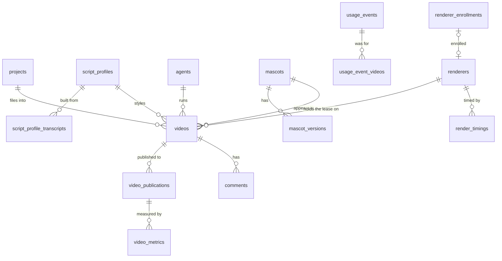
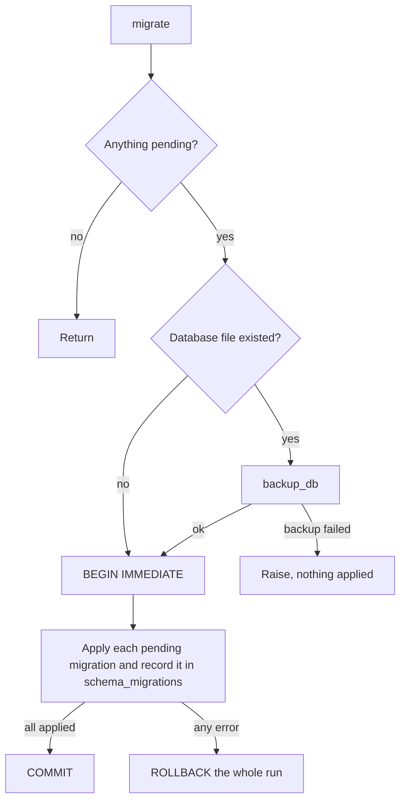

# Database

Tubematic keeps its state in one SQLite file: the videos and their statuses, the settings, the
credentials, the render queue and the spend ledger. Processes coordinate through it and use no
message broker or cache.

| | |
|---|---|
| File | `~/.tubematic-data/data/tubematic.db` on the host, `/data/tubematic.db` inside the containers |
| Journal mode | WAL, so several processes can read while one writes |
| Foreign keys | ON |
| Access | Raw `sqlite3` from Python, no ORM |

Three containers open the file: `tubematic-api`, `tubematic-mcp` and `tubematic-worker`. A renderer
reaches the database only through the render gateway in `tubematic-api` (see
[Rendering and Review](11-rendering-and-review.md)).

Every process that opens the database calls `tubematic_core.db.migrate()` first. The call holds a
write lock for its whole run, so processes that start together on a new database apply the schema
once. See [Migrations](#migrations).

The `settings` table holds the API keys in plain text, so treat the file and every backup of it as
a secret. [Settings internals](04-settings.md#how-credentials-are-stored) covers who can read it.

---

## Entity relationships

Declared foreign keys with `ON DELETE CASCADE`: `comments.video_id`,
`video_metrics.publication_id`, `script_profile_transcripts.profile_id` and
`usage_event_videos.event_id`. Declared without a cascade: `videos.project_id`,
`video_publications.video_id` and `mascot_versions.mascot_id`. The code resolves the other links.

---

## Ids that become paths

A video id names the video's job directory and its output file. A domain id (`projects.id`) names
the domain's output directory. `tubematic_core/ids.py` holds both rules that follow from that.

| Rule | Applied | What it allows |
|---|---|---|
| `ids.py::check_segment` | When a row is created | Letters, digits, `_` and `-`, not starting with `-`, at most 128 characters |
| `ids.py::is_component` | Every time an id is joined onto a directory | One path component: no `/` or `\`, not `.` or `..`, no control character, at most 255 bytes |

The second rule is looser so that a row created under an id with a dot, a space or more than 128
characters still renders and stays editable.

The render is written as `<id>.mp4`, and `jobfiles.py::_check_name_length` counts the suffix. A
video id of 252 to 255 bytes names a job directory but no possible output file. The render gateway
moves such a video to `FAILED` with a comment when a renderer would claim it.

---

## `videos`

One row per video, from proposed topic to published file.

| Column | Type | Default | Meaning |
|---|---|---|---|
| `id` | TEXT PK | | `vid_<hex>` from MCP, a UUID from `POST /videos`. See [Ids that become paths](#ids-that-become-paths) |
| `project_id` | TEXT → `projects.id` | | The domain the video files into |
| `topic` | TEXT NOT NULL | | The full brief: what the video is about, up to a few thousand characters |
| `title` | TEXT NOT NULL | `''` | A short display name, at most 70 characters. When it is `''` the UI shows `topic` |
| `status` | TEXT NOT NULL | `TOPIC_PROPOSED` | See [The Pipeline](02-pipeline.md) |
| `strategy` | TEXT NOT NULL | `manual` | `curriculum`, `trending`, `mining` or `manual` |
| `producibility_score` | INTEGER NOT NULL | `0` | 1 to 10. The MCP `create_video` tool rejects a score below 5. `POST /videos` does not check it. A video submitted from the dashboard stores `0`, meaning unscored |
| `script` | TEXT NOT NULL | `''` | The flat script, derived from `script_segments` |
| `script_segments` | TEXT | | JSON array of `{id, voice, visual}` |
| `tts_text` | TEXT NOT NULL | `''` | The text sent to ElevenLabs, after pronunciation substitution |
| `voice_id` | TEXT NOT NULL | `''` | The video's voice. `''` means the install default |
| `notified_status` | TEXT NOT NULL | `''` | The arrival a Discord notification was last sent for, as `<status>@<updated_at>`. `''` means none. Nothing clears it: a marker for a status the video has left matches nothing. See [Notifications](02-pipeline.md#notifications) |
| `script_profile_id` | TEXT NOT NULL | `''` | The script profile. `''` means the generic style |
| `visual_style` | TEXT NOT NULL | `auto` | `auto` or a [style pack](10-scene-authoring.md#style-packs) id: `motion_graphics`, `stick`, `illustrated`, `system_flow` or `cartoon_3d`. Set while the video is `TOPIC_PROPOSED` and frozen after, except for the style Auto picks at `TOPIC_APPROVED`. See [Visual style columns](#visual-style-columns) |
| `resolved_visual_style` | TEXT NOT NULL | `''` | The canvas `auto` settled on: `dark` or `light`. Written once by the agent |
| `resolved_renderer` | TEXT NOT NULL | `''` | The renderer an `auto` video uses: `dom` or `cartoon_3d`. Written once by the agent, and not over HTTP |
| `style_pick` | TEXT NOT NULL | `''` | What Auto picked before the script: a style pack id (then also `visual_style`), `scenes` for the mixed scene system, or `''` when Auto has not decided or a person chose the style |
| `style_runner_up` | TEXT NOT NULL | `''` | The candidate that came second, offered as a switch at `SCRIPT_READY`, or `''` |
| `style_reason` | TEXT NOT NULL | `''` | Auto's one-sentence reason for the pick, at most 300 characters |
| `mascot_id` | TEXT NOT NULL | `''` | The [mascot](#mascots-and-mascot_versions) the video shows. `''` means none. Settable only while the video is `TOPIC_PROPOSED` |
| `mascot_version` | INTEGER NOT NULL | `0` | The mascot version the video was authored against. `0` means not pinned yet |
| `agent_id` | TEXT | `NULL` | The [agent](#agents) the video runs under. `NULL` means the default agent at dispatch time |
| `agent_model` | TEXT NOT NULL | `''` | The video's model. `''` means its agent's default, `models[0]`. Any other value must be one of that agent's models |
| `agent_effort` | TEXT NOT NULL | `''` | `low`, `medium`, `high`, `xhigh` or `max`. `''` means its agent's own `effort` |
| `agent_no_progress_count` | INTEGER NOT NULL | `0` | Scheduled agent sessions in a row that left the video at the status they found it at |
| `agent_stuck_at` | TEXT | `NULL` | When the poller stopped dispatching the video. `NULL` while it is not stuck |
| `agent_last_outcome_key` | TEXT | `NULL` | The session key of the last outcome counted, so a report sent twice is counted once |
| `voice_file_path` | TEXT NOT NULL | `''` | Where `generate_voice` wrote `audio.mp3`. See [Path columns](#path-columns) |
| `timeline_path` | TEXT NOT NULL | `''` | Where `generate_voice` wrote `timeline.json` |
| `scene_config_path` | TEXT NOT NULL | `''` | Where `write_scene_config` wrote `scene-config.json` |
| `video_path` | TEXT NOT NULL | `''` | Where the render gateway stored the uploaded mp4 |
| `video_version` | INTEGER NOT NULL | `1` | Raised on each re-render |
| `gemini_feedback` | TEXT NOT NULL | `''` | The AI reviewer's full findings, stored uncapped |
| `ai_review_count` | INTEGER NOT NULL | `0` | Reviews run so far. Capped by `ai_review_max_loops` |
| `render_fail_count` | INTEGER NOT NULL | `0` | Render failures so far: failed renders, stalls, timeouts, and renders lost to a renderer restart or an expired lease. Capped by `max_render_retries` |
| `renderer_id` | TEXT NOT NULL | `''` | The [renderer](#renderers-renderer_enrollments-and-render_timings) holding the render lease, its time-limited hold on a `RENDERING` video. `''` when none does, which the worker's lease sweep reads as an expired lease and re-queues |
| `render_lease_until` | TEXT NOT NULL | `''` | When the lease runs out unless a heartbeat extends it, UTC |
| `render_started_at` | TEXT NOT NULL | `''` | When the current render was claimed. The scheduler's "time spent so far" for a busy renderer |
| `render_uploaded_at` | TEXT NOT NULL | `''` | When the render's mp4 arrived. A `RENDERING` row with this set is waiting for the worker's AI review and is not re-queued |
| `render_claim_id` | TEXT NOT NULL | `''` | The current claim's id: random, new on every claim. See [Render lease columns](#render-lease-columns) |
| `publish_title` | TEXT NOT NULL | `''` | The title the video is posted with, written by the agent with the script. Separate from `title` |
| `publish_description` | TEXT NOT NULL | `''` | The post's description, written by the agent with the script |
| `scheduled_at` | TEXT NOT NULL | `''` | When a scheduled post goes out, UTC. `''` means not scheduled. The worker moves a `SCHEDULED` video to `PUBLISHING` once it has passed. See [Scheduling a post](14-publishing.md#scheduling-a-post) |
| `scheduled_timezone` | TEXT NOT NULL | `''` | The IANA zone the schedule was picked in, kept so the time is shown back in that zone |
| `auto_pilot_hold` | INTEGER NOT NULL | `0` | `1` once a human has cancelled the video's scheduled post, so Auto Pilot does not schedule it again. Nothing clears it. See [Stopping one video](14-publishing.md#stopping-one-video) |
| `auto_pilot_blocked` | TEXT NOT NULL | `''` | `<status>@<updated_at>` for the arrival Auto Pilot last commented it could not approve. It keeps that comment to one per arrival |
| `archived_at` | TEXT | `NULL` | When the video's files were deleted and the row archived. `NULL` means live |
| `created_at`, `updated_at` | TEXT NOT NULL | | ISO-8601 UTC |

Four columns are unused: `youtube_url` (TEXT) and `cost_cents_elevenlabs`, `cost_cents_gemini` and
`cost_cents_claude` (INTEGER). They remain because a shipped migration cannot be edited.
Publications live in [`video_publications`](#video_publications-and-video_metrics). Cost lives in
[`usage_events`](#usage_events-usage_event_videos-and-model_prices) and is computed per video when
it is shown.

### `updated_at`

`updated_at` orders the render queue: the render gateway claims the oldest `RENDER_QUEUED` row
first. Any write to the column changes render order.

### Visual style columns

`motion_graphics`, `stick` and `illustrated` are permission sets: each names which scene
vocabularies the video may draw from. `system_flow` makes the whole video one diagram scene written
as data. `cartoon_3d` selects a different renderer (one painted 3D world written as code for the
video) and needs a working GPU. `auto` leaves the choice to the agent. The values are checked in
code against the style packs, and the column has no CHECK constraint, so a new style needs no
migration.
[Frozen choices](02-pipeline.md#frozen-choices) covers when each may change.

Under `auto` the agent first picks a style, at `TOPIC_APPROVED` (`choose_visual_style`). A pack it
picks becomes `visual_style`, and `style_pick`, `style_runner_up` and `style_reason` record that
Auto made the choice ([How Auto picks a style](10-scene-authoring.md#how-auto-picks-a-style)). The
three are cleared when a person changes `visual_style` and when the video goes back to
`TOPIC_PROPOSED`, where a style Auto picked returns to `auto`. Every new style decision (Auto's
pick, a switch to the runner-up, a return to the topic from an Auto pick) also clears
`resolved_renderer` and `resolved_visual_style`: a new script and new scenes follow it, and a
renderer recorded as `cartoon_3d` for the old scenes would send the new ones to the Cartoon 3D
renderer.

A video that stays on `auto` (the mixed scene system) records two more decisions, each once:

- `resolved_visual_style` holds the canvas (the background the scenes are designed against). The
  canvas is the one thing `auto` must fix for the life of the video, so a revision round renders on
  the canvas the video already uses. The column means nothing unless `visual_style` is `auto`.
- `resolved_renderer` is written before any scene is authored. A revision round that changed the
  renderer would discard every scene.

### Mascot columns

`mascot_id` is copied from the domain's default mascot, then the install's, when the video is
created. The copy happens only while a renderer's GPU test passes, and not for a `cartoon_3d`
video.

The first `write_scene_config` of a video that has a mascot sets `mascot_version`, and every
revision keeps it. The renderer renders the pinned version, so approving a changed mascot does not
alter a video already in progress.

### Agent columns

`agent_id` is dealt when the video is created. A human may move the video to another live agent, or
change `agent_model` and `agent_effort`, at a human checkpoint. Nothing else changes them
([Frozen choices](02-pipeline.md#frozen-choices)).

- `agent_id` is not a declared foreign key, and nothing writes it back to `NULL`. The poller skips
  a video whose `agent_id` does not resolve. It does not reroute it.
- Any of the five `agent_effort` levels can be stored. Whether a level is usable depends on the
  model, which is resolved when the session runs.
- [`POST /videos/<id>/agent-outcome`](05-http-api.md#post-videosvideo_idagent-outcome) is the only
  writer of `agent_no_progress_count` and resets it on any status change. The count is stored
  because the poller exits when it runs out of work.
- `agent_stuck_at` is set after 3 sessions without progress, and `/videos/workable` then leaves the
  video out. A `PATCH` that carries `status`, or `POST /videos/<id>/agent-retry`, clears it. A
  stuck video keeps its status
  ([The Poller](13-the-poller.md#success-is-read-from-the-database)).

### Path columns

`generate_voice`, `write_scene_config` and the render gateway write `voice_file_path`,
`timeline_path`, `scene_config_path` and `video_path` when they write the files. `PATCH` and the
MCP `update_video` tool refuse them. A column marks that its step completed, and an empty one reads
as "not written yet".

No reader uses a stored value as a path. `tubematic_core/jobfiles.py` derives every location from
the ids, so a row that names another video's files cannot reach them:

- `<jobs>/<video_id>/audio.mp3`, `timeline.json` and `scene-config.json`
- `<output>/<project_id>/<video_id>.mp4`

`jobfiles.py::join_below` refuses a symlink in any component below the jobs or output directory,
including one that stays inside it: `<jobs>/vid_a` linked to `<jobs>/vid_b` would hand video A the
audio of video B. The jobs or output directory itself may be a symlink. The check runs before the
file is used, and `jobfiles.py` does not open files beneath a directory descriptor (`openat2` with
`RESOLVE_BENEATH`), so the rule relies on only Tubematic's containers writing there.

The stored values are container paths (`/jobs/…`, `/output_videos/…`). An MCP server driven from a
host shell stores host paths, and the video still renders when its files are in the jobs volume.
The dashboard plays a render from `/stream/<project_id>/<id>.mp4`
(`dashboard/lib/utils.ts::videoStreamUrl`) and reads `video_path` only to learn that a render
exists.

### Render lease columns

The claim sets the five lease columns, and the arrival of the render's result clears them. The
bundle, the upload and the result must name `render_claim_id`, and a heartbeat extends the lease
only when it names it. A renderer whose lease ran out therefore cannot act for a later claim of the
same video, its own included. See
[Leases, restarts and lost renderers](20-gpu-and-remote-renderers.md#leases-restarts-and-lost-renderers).

### Archived videos

Deleting a video, by hand or by the retention sweep, removes its mp4 and job directory, sets
`archived_at` and clears `video_path`. No `ARCHIVED` status exists: `status` is left alone, because
it is the one field that says what the video was (published, failed, rejected). The row, its
comments, publications and metrics are kept.

Every list and count that feeds the board or the agent filters `archived_at IS NULL`. An archived
row is frozen: `PATCH` and publish return `409`, and the MCP `set_video_status` and `update_video`
tools refuse it with `video_archived`, because an agent may hold the id from before the delete.
[The Worker](12-the-worker.md) covers the retention sweep.

---

## `projects`

A domain. Every video files into one, whatever its research mode.

| Column | Type | Default | Meaning |
|---|---|---|---|
| `id` | TEXT PK | | A slug such as `proj_networking`. See [Ids that become paths](#ids-that-become-paths) |
| `name` | TEXT NOT NULL | | |
| `description` | TEXT NOT NULL | `''` | The domain's scope, multi-line, at most 2000 characters |
| `is_curriculum_seed` | INTEGER NOT NULL | `0` | `1` means scheduled curriculum research draws topics from it |
| `status` | TEXT NOT NULL | `active` | `active` or `paused`. Only a curriculum seed can be paused. See [Domain pause](02-pipeline.md#domain-pause) |
| `default_visual_style` | TEXT NOT NULL | `''` | The visual style the domain's `curriculum` videos start with. `''` means no domain preference |
| `default_voice_id` | TEXT NOT NULL | `''` | The voice every new video in the domain starts with, whatever its `strategy`. `''` means the install default |
| `default_script_profile_id` | TEXT NOT NULL | `''` | The [script profile](08-scripting-and-voice.md#script-profiles) the domain's `curriculum` videos start with. `''` means none |
| `default_mascot_id` | TEXT NOT NULL | `''` | The mascot new videos start with, whatever their `strategy`. `''` inherits the install's `default_mascot_id` setting. `none` means no mascot |
| `topic_cap` | INTEGER NOT NULL | `100` | How many topics the domain may ever hold, 25 to 750. See [Topic cap](02-pipeline.md#topic-cap) |
| `created_at` | TEXT NOT NULL | | |

The API and the MCP server check `description` only when it changes, so a longer one already
stored is kept. The limit is low because `list_projects` returns every domain's description on
every research run.

The four defaults are copied into the video's own column (`videos.voice_id`,
`videos.script_profile_id` and so on) when the video is created. Changing one does not reach videos
already filed.

- `default_visual_style` and `default_script_profile_id` apply to `curriculum` videos only, because
  curriculum is the one research mode that produces a series. A `default_visual_style` of `''` is
  different from `auto`: `auto` is a per-video instruction to the agent.
- `default_voice_id` is skipped if the voice has left the roster. See
  [The model follows the voice](08-scripting-and-voice.md#the-model-follows-the-voice).
- `default_script_profile_id` is skipped if the profile is deleted or not `READY`, because the
  approving `PATCH` would refuse it.
- A `default_mascot_id` that names an archived or unapproved mascot reads as none.

The API and the MCP server check `topic_cap`, because SQLite cannot add a `CHECK` to an existing
table. Every video ever filed counts, archived and rejected included. At the cap the domain is
expired and research files nothing more into it. Expired is derived on read: `GET /projects` and
`list_projects` return `expired` and `topic_count`.

## `comments`

The audit trail of a video. The dashboard renders it as a read-only thread.

| Column | Type | Notes |
|---|---|---|
| `id` | INTEGER PK AUTOINCREMENT | |
| `video_id` | TEXT NOT NULL → `videos.id` | `ON DELETE CASCADE` |
| `author` | TEXT NOT NULL | `CHECK (author IN ('human','agent'))` |
| `content` | TEXT NOT NULL | |
| `created_at` | TEXT NOT NULL | |

The agent leaves a comment at every checkpoint to say what it did. Its `add_comment` tool refuses
any author but `agent`. A `human` comment comes from the dashboard's Request Revision dialog, or
from the API when a video is deleted from the dashboard.

Error text is written here and shown on the dashboard, so every outbound API error is scrubbed of
credentials before it is stored.

## `agents`

One row per installed coding agent. [The Agent Layer](07-agent-layer.md#agents) covers how agents
are installed and how videos are assigned to them.

| Column | Type | Default | Meaning |
|---|---|---|---|
| `id` | TEXT PK | | `claude`, `codex` or `opencode`: the argument `--install-agent` takes |
| `name` | TEXT NOT NULL | | Display name, such as `Claude Code` |
| `binary` | TEXT NOT NULL | | The CLI's path, resolved at install time. The poller resolves it again through `PATH` before each run |
| `run_path` | TEXT NOT NULL | | The agent's workspace. Cron runs the agent from here |
| `install_scope` | TEXT NOT NULL | `'user'` | `user` or `project`: where its skills and commands were deployed |
| `models` | TEXT NOT NULL | `'[]'` | JSON list of model names, each probed against the CLI at install time. `models[0]` is the agent's default |
| `is_default` | INTEGER NOT NULL | `0` | At most one live row carries it. See below |
| `weight` | INTEGER NOT NULL | `1` | Share of new videos, 0 to 100. `0` means none |
| `verified_at` | TEXT NOT NULL | `''` | When the models were probed. `''` when they were not (`--disable-verification`) |
| `archived_at` | TEXT | `NULL` | `NULL` means live |
| `created_at`, `updated_at` | TEXT NOT NULL | | ISO-8601 UTC |
| `effort` | TEXT NOT NULL | `'high'` | The agent's default effort level, used by every run no video overrides |

The default agent builds script profiles, runs research and runs videos with no `agent_id`. If no
row is flagged, the oldest live agent is used.

The host-side installer is the only writer of rows, and writes straight into SQLite
([Deployment](07-agent-layer.md#deployment)). Over HTTP a human can change `is_default`, `weight`,
`effort` and which installed model sits first in `models` (`pipeline.py::AGENT_PATCHABLE`,
[HTTP API](05-http-api.md#agents)). `effort` is editable over HTTP because its five levels are a
fixed set the API can validate without the agent's CLI. No MCP tool writes this table.

`python3 onboard.py --uninstall-agent <name>` sets `archived_at` and keeps the row, so a video
pinned to that agent still resolves and shows its name. An archived agent is assigned no new
videos, and the poller skips the videos it already has.

The table's schema exists twice. The second copy is `onboard/agent_install.py::AGENTS_SCHEMA`,
because the installer runs on the host and may create the table before any container has started.
A test compares the installer's copy with a fully migrated database, column positions included.
`ALTER TABLE … ADD COLUMN` appends, so the installer's copy lists columns added after the baseline
at the bottom, in migration order.

### `agent_deck`

One row (`id = 1`, enforced by a `CHECK`) holding the deck: the shuffled list of agent ids that new
videos are dealt from, in proportion to each agent's `weight`. See
[Assignment](07-agent-layer.md#assignment).

| Column | Type | Meaning |
|---|---|---|
| `signature` | TEXT NOT NULL | JSON `[[agent_id, reduced_weight], …]` the deck was built from. A mismatch with the live agents means a new deck is shuffled |
| `cards` | TEXT NOT NULL | JSON list of agent ids still to deal |

The row is created on the first deal. `_pick_agent_id` in the API and the MCP server is its only
writer.

---

## `usage_events`, `usage_event_videos` and `model_prices`

The spend ledger. Each paid call gets one `usage_events` row, written as soon as the provider's
response exists, on the success path and on every failure after it, because a response that failed
to parse was still billed. Writers call `tubematic_core/usage.py::record_usage`, which logs a
failure to record and does not raise, so bookkeeping cannot fail a video.

| `usage_events` column | Type | Meaning |
|---|---|---|
| `id` | INTEGER PK AUTOINCREMENT | |
| `created_at` | TEXT NOT NULL | |
| `session_id` | TEXT | Groups the rows of one agent session, one row per model it used |
| `service` | TEXT NOT NULL | `gemini`, `openai`, `anthropic`, `elevenlabs` and others |
| `model` | TEXT NOT NULL, `''` | The model id the call used |
| `operation` | TEXT NOT NULL | `voice`, `voice_preview`, `ai_review`, `mining`, `image`, `character`, `agent_pipeline`, `agent_research`, `agent_profile` or `agent_mascot`. Readers also accept `publish_metadata` and `agent_unscoped`, which no current writer produces |
| `units` | TEXT NOT NULL, `'{}'` | JSON counts: `input`, `input_audio`, `input_image`, `output`, `reasoning`, `output_image`, `cache_read`, `cache_write` and `cache_write_1h` tokens, or ElevenLabs `credits` |
| `raw_usage` | TEXT | The provider's own usage object, verbatim |
| `request_id` | TEXT | ElevenLabs' `request-id` response header on voice and preview rows. `NULL` elsewhere |
| `cost_usd` | REAL | Dollars at API list price, or `NULL` when no rate was known |
| `cost_basis` | TEXT NOT NULL | `priced` (units × rates), `reported` (the agent CLI's own figure), `credits` (ElevenLabs) or `unpriced` |
| `price_snapshot` | TEXT | The rates applied and their source |
| `estimated` | INTEGER NOT NULL, `0` | `1` when a fallback rate or a long-prompt price tier made the figure approximate |
| `event_key` | TEXT | Unique when set. See below |

- An agent session's events arrive over HTTP and are keyed by session and position in
  `event_key`, so a report resent after a timeout records nothing twice. Calls recorded in-process
  leave it `NULL`.
- A row keeps both its units and the price applied. Units alone would re-price history whenever a
  rate is edited, and a dollar figure alone could not be corrected. Editing a rate changes future
  calls only, except that adding a rate for a model fills in its `unpriced` rows.
- An unpriced call stores `cost_usd` as `NULL`, because `0` would read as a free call and
  understate spend. The dashboard shows unpriced calls as a count beside every total. A billed
  response whose usage could not be read is recorded with no units, which is unpriced.

`videos` keeps only `voice_id`, and a roster voice's model can be edited after voicing, so the
ledger is the one record of which model voiced a video. `usage.py::last_voice_model` reads it from
the video's latest `voice` row. See `voice_info` under
[`GET /videos/<id>`](05-http-api.md#get-videosvideo_id).

| `usage_event_videos` column | Type | Meaning |
|---|---|---|
| `event_id` | INTEGER NOT NULL → `usage_events.id` | `ON DELETE CASCADE`. Primary key with `video_id` |
| `video_id` | TEXT NOT NULL | The video the call was for |
| `stage` | TEXT | The video's status when an agent session started. It labels the session in the video modal |

A call links to no video (research, voice previews) or to one. An agent session linked to several
videos is split evenly between them when cost is shown. `video_id` has no foreign key to `videos`:
spend outlives a deleted video, and removing one video must not shift the other videos' shares. A
`stage` of `VOICING_WITH_SCENES` marks a session that voiced the script and wrote the scenes.
`VOICING` is voicing only.

| `model_prices` column | Type | Meaning |
|---|---|---|
| `service`, `model`, `unit_kind` | TEXT NOT NULL | The primary key: one row per model and unit kind |
| `usd_per_unit` | REAL NOT NULL | |
| `source` | TEXT NOT NULL | `manual`, `openrouter` or `litellm` |
| `effective_from` | TEXT NOT NULL | When the row was written |
| `user_override` | INTEGER NOT NULL, `0` | `1` for a manual rate |
| `tiered` | INTEGER NOT NULL, `0` | `1` when the model has long-prompt price tiers |

### How a call is priced

Every dollar figure is an API list price. It does not reflect a subscription, plan credits or a
discount, and the dashboard says so beside every total. An install cannot know what its accounts
pay, and list prices cost every call the same way, which is what comparing videos, models and
stages needs.

| Provider | Recorded as | Priced from |
|---|---|---|
| Gemini (review, mining) | Tokens from `usageMetadata` | The price table |
| OpenAI (images, characters) | Tokens from the response's `usage` | The price table |
| Codex sessions | Tokens from `codex exec --json` | The price table |
| Claude Code sessions | `modelUsage` from `claude -p --output-format json` | Claude's own `costUSD` |
| OpenCode sessions | Per-message tokens and `cost` from OpenCode's session API | OpenCode's own `cost` |
| ElevenLabs (voice, previews) | Plan credits, from the `character-cost` response header | Not priced. Shown as credits |

The `character-cost` header is the number of credits the call deducted from the plan's pool, after
the model's discount (a Flash or Turbo call costs half). Installs are assumed to be on a
subscription that prepays those credits, so a dollar figure would be an allocation of the plan fee.

All of one model's rates come from one source, so a wrong figure can be traced
(`tubematic_core/prices.py::lookup_rates`, `prices.py::resolve_from_feeds`). The order is:

1. A manual rate typed on **Settings → Costs**. A sync does not touch it.
2. The synced rate. This is OpenRouter's public model list (`/api/v1/models`) when it lists the
   model, and LiteLLM's `model_prices_and_context_window.json` only when it does not. OpenRouter
   comes first because every model there uses one small set of fields.
3. The built-in snapshot, `tubematic_core/prices_snapshot.json`, shipped with each release, so a
   new install prices calls before its first sync. It keeps the Gemini image models so that
   recorded Gemini image calls stay priced.
4. Otherwise the call is unpriced.

Both feeds are third parties reading the vendors' pricing pages. The vendor's page is the authority
when they disagree.

`prices.py::price_units` handles a rate the table lacks:

- `reasoning` (thinking) tokens without their own rate bill at the output rate, which is how
  every provider bills them.
- `input_audio` or `input_image` without its own rate uses the input rate, and `cache_write_1h`
  uses the `cache_write` rate. The row is marked `estimated`.
- Any other missing rate makes the call unpriced.
- A model with long-prompt price tiers is priced at its base rate and marked `estimated`, because
  usage arrives as totals.

The worker runs `prices.py::sync_prices` weekly, timed by the `last_price_sync_at` settings row so
the schedule survives restarts. **Settings → Costs → Sync now** runs it on demand. The sync:

- fetches both feeds whole
- touches only models in use: the snapshot's list, any model already recorded, and the installed
  Codex agent's models
- leaves manual rates alone
- rejects a move of more than 5× as a broken feed (`MAX_SYNC_MOVE`)
- logs every change with its old and new value
- keeps every existing price and records the error if anything fails

No call fetches a price. A render does not depend on GitHub or OpenRouter being up.

---

## `settings`

A key/value table: `key TEXT PRIMARY KEY`, `value TEXT NOT NULL`. Every value is a string.
[Settings internals](04-settings.md) covers how values are typed, validated and masked, and lists
every key, including the [rows that are not declared settings](04-settings.md#undeclared-rows).

## `video_publications` and `video_metrics`

One `video_publications` row per video and account, and a time series of readings per publication.
The column reference is in [Publishing](14-publishing.md#schema).

- The metric columns (`views`, `likes`, `comments`, `shares`) are nullable. "Not reported by the
  platform" is different from "reported as zero".
- Each `video_metrics` row is a cumulative reading. Aggregate by taking each publication's latest
  row. Summing rows multiplies a view count by the number of polls.
- `raw_json` keeps the whole payload, so a column added later can be filled from history.

## `script_profiles` and `script_profile_transcripts`

A script profile captures a creator's style (tone, hook patterns, structure, vocabulary), learned
from YouTube transcripts, so that scripts can be written in that style.

| `script_profiles` column | Type | Default | Meaning |
|---|---|---|---|
| `id` | TEXT PK | | |
| `name` | TEXT NOT NULL | | |
| `status` | TEXT NOT NULL | `PENDING` | `PENDING`, then `GENERATING`, then `READY` or `FAILED` |
| `markdown` | TEXT NOT NULL | `''` | The finished profile, held to the [profile schema](08-scripting-and-voice.md#the-profile-schema) |
| `corpus_summary` | TEXT NOT NULL | `''` | |
| `source_urls` | TEXT NOT NULL | `'[]'` | JSON array |
| `error` | TEXT NOT NULL | `''` | |
| `attempt_count` | INTEGER NOT NULL | `0` | |
| `archived` | INTEGER NOT NULL | `0` | A flag with no timestamp: nothing needs to show when a profile was archived |
| `created_at`, `updated_at` | TEXT NOT NULL | | |

| `script_profile_transcripts` column | Type | Notes |
|---|---|---|
| `id` | INTEGER PK AUTOINCREMENT | |
| `profile_id` | TEXT NOT NULL → `script_profiles.id` | `ON DELETE CASCADE` |
| `source_url` | TEXT NOT NULL | |
| `youtube_id` | TEXT NOT NULL, `''` | |
| `text` | TEXT NOT NULL | |
| `created_at` | TEXT NOT NULL | |

Transcripts are staging data. `complete_script_profile` deletes every transcript row for the
profile once the markdown is written.

## `mascots` and `mascot_versions`

A mascot is a small on-screen character. An agent writes its drawing code once, a human approves
it, and videos then pick it. [The Agent Layer](07-agent-layer.md) covers how one is built and
reviewed, and [Scene authoring](10-scene-authoring.md#mascots) covers the cue track a video plays
it with.

| `mascots` column | Type | Default | Meaning |
|---|---|---|---|
| `id` | TEXT PK | | A slug of 1 to 64 lowercase letters, digits, `-` or `_`, starting with a letter or digit. It names a directory |
| `name`, `description` | TEXT NOT NULL | `''` | |
| `builtin` | INTEGER NOT NULL | `0` | `1` for a mascot that ships in the repo |
| `based_on` | TEXT NOT NULL | `''` | The mascot this one is a variation of |
| `status` | TEXT NOT NULL | `PENDING` | `PENDING`, `BUILDING`, `IN_REVIEW`, then `READY` or `FAILED` |
| `approved_version` | INTEGER NOT NULL | `0` | The version a video may use. A mascot is pickable once this is above `0` and the row is not archived |
| `agent_id`, `agent_model`, `agent_effort` | TEXT NOT NULL | `''` | The agent pinned to build it. `''` means the default agent |
| `attempt_count` | INTEGER NOT NULL | `0` | Builder sessions started for the current request. Capped at `MAX_MASCOT_ATTEMPTS` |
| `sheet_renders` | INTEGER NOT NULL | `0` | Sheet renders used in the current attempt. Capped at `MAX_SHEET_RENDERS_PER_ATTEMPT` |
| `error` | TEXT NOT NULL | `''` | |
| `archived` | INTEGER NOT NULL | `0` | Archiving is the only removal, for a built-in too |
| `created_at`, `updated_at` | TEXT NOT NULL | `''` | |

| `mascot_versions` column | Type | Default | Meaning |
|---|---|---|---|
| `mascot_id` | TEXT NOT NULL → `mascots.id` | | Primary key with `version` |
| `version` | INTEGER NOT NULL | | Numbered from 1. An approved version is not edited |
| `code` | TEXT NOT NULL | `''` | The p5.js drawing code. `''` for a built-in |
| `change_request` | TEXT NOT NULL | `''` | What a human asked for in this version. `''` for the first |
| `created_at`, `approved_at` | TEXT NOT NULL | `''` | The draft is the highest version with `approved_at = ''` |

A built-in mascot's code is a repo file: `renderer/remotion/mascot-builtin/<id>/v<N>/` holds
`mascot.js` and three model-sheet images. `tubematic_core/mascots.py::code_for` reads the file for
a built-in and `mascot_versions.code` for any other. The code stays out of the database because a
shipped migration cannot be edited when the drawing changes. Each version directory is immutable.
A new drawing ships as `v2` beside `v1`, with a new migration that raises `approved_version`, and
videos pinned to `v1` keep rendering with `v1`.

The rendered model sheets of other mascots are files beside the database:
`<data root>/data/mascots/<id>/v<N>/<turn|feels|act>.png`.

## `renderers`, `renderer_enrollments` and `render_timings`

The machines that render, the one-time secrets that enroll a new one, and how long each takes.
`tubematic-api` (the render gateway and the GPU gates) and the worker read and write all three. A
renderer does not. [The Render Gateway](19-render-gateway.md) and
[GPU and Remote Renderers](20-gpu-and-remote-renderers.md) cover how they are used.

| `renderers` column | Type | Default | Meaning |
|---|---|---|---|
| `id` | TEXT PK | | `builtin` for the built-in renderer, `r_<12 hex>` for an enrolled one |
| `name` | TEXT NOT NULL | | |
| `builtin` | INTEGER NOT NULL | `0` | `1` for the built-in renderer's row. The API re-creates that row at start if it is missing |
| `enabled` | INTEGER NOT NULL | `1` | A disabled renderer still authenticates, is told it is disabled, and gets no work |
| `machine_id` | TEXT NOT NULL | `''` | A random id the renderer keeps in its state file. Enrolling the same machine again updates its row |
| `host` | TEXT NOT NULL | `''` | |
| `credential_hash`, `previous_credential_hash` | TEXT NOT NULL | `''` | sha256 of the current credential, and of the one it replaced while a rotation is undelivered |
| `credential_issued_at`, `credential_expires_at` | TEXT NOT NULL | `''` | An expiry of `''` means the credential does not expire |
| `version` | TEXT NOT NULL | `''` | The version the renderer last reported. A renderer whose version differs from the API's gets no work |
| `compute` | TEXT NOT NULL | `'{}'` | JSON `{cpus, memory_bytes, gpus: [{name, uuid, memory_mb}]}`, as reported |
| `gpu_probe` | TEXT NOT NULL | `''` | The renderer's last GPU test, as JSON. `''` until it has tested |
| `gpu_verified` | INTEGER NOT NULL | `0` | `1` when the last probe's `ok` was true. This is what makes a renderer GPU-capable |
| `gpu_probe_requested_at` | TEXT NOT NULL | `''` | The dashboard's last Test request, in microseconds, compared as a string with the probe's start |
| `last_heartbeat_at` | TEXT NOT NULL | `''` | A renderer is online if this is within the last 120 seconds |
| `state`, `current_video_id` | TEXT NOT NULL | `'idle'`, `''` | What the renderer last reported |
| `last_error` | TEXT NOT NULL | `''` | The renderer's last reported problem, or `renderers.py::CREDENTIAL_EXPIRED_ERROR` |
| `created_at` | TEXT NOT NULL | | |
| `removed_at` | TEXT | `NULL` | `NULL` means active |

The built-in renderer's credential is the `builtin_renderer_token` secret file. Its two hashes stay
`''` and its credential does not expire, so rotating the file needs no row update.

`gpu_probe` records when the test ran and why, the configured GPU, the host's GPU list, Chromium's
WebGL renderer and vendor strings, `ok`, the reason when it failed, and what `nvidia-smi` saw.

`DELETE /renderers/<id>` (the dashboard's **Remove**) sets `removed_at`, clears both credential
hashes and keeps the row. The API refuses to remove the built-in renderer.

| `renderer_enrollments` column | Type | Default | Meaning |
|---|---|---|---|
| `secret_hash` | TEXT PK | | sha256 of the one-time enrollment secret. The secret is not stored |
| `name` | TEXT NOT NULL | `''` | The name the renderer gets, when the token was issued with one |
| `created_at`, `expires_at` | TEXT NOT NULL | | One hour apart |
| `used_at`, `renderer_id` | TEXT | `NULL` | Set when the token is redeemed, which happens once |

| `render_timings` column | Type | Meaning |
|---|---|---|
| `id` | INTEGER PK AUTOINCREMENT | Orders a renderer's timings |
| `renderer_id` | TEXT NOT NULL | |
| `kind` | TEXT NOT NULL | `dom`, `cartoon_3d` or `mascot` |
| `on_gpu` | INTEGER NOT NULL | Whether the render ran on the GPU |
| `frames`, `seconds` | INTEGER, REAL NOT NULL | One row per successful render |
| `created_at` | TEXT NOT NULL | |

The scheduler estimates from the median seconds per frame of a renderer's last five timings of a
kind.

---

## Indexes

Besides the indexes that primary keys imply:

| Index | On | Why |
|---|---|---|
| `idx_video_publications_video` | `video_publications(video_id)` | |
| `idx_video_metrics_publication` | `video_metrics(publication_id, fetched_at)` | |
| `idx_usage_events_created_at` | `usage_events(created_at)` | |
| `idx_usage_events_model` | `usage_events(service, model)` | |
| `idx_usage_events_event_key` | `usage_events(event_key)`, unique | Makes a resent session report record nothing twice |
| `idx_usage_event_videos_video_id` | `usage_event_videos(video_id)` | |
| `idx_videos_project_id` | `videos(project_id)` | The [topic cap](02-pipeline.md#topic-cap) counts a domain's videos on every insert |
| `idx_render_timings_renderer` | `render_timings(renderer_id, kind, id)` | Every claim reads each renderer's last few timings per kind |

---

## Migrations

Numbered files in `tubematic_core/migrations/` define every table, column and one-time data change
above, and `tubematic_core.db.migrate()` applies them. The API, the MCP server, the worker,
`onboard.py`, `scripts/clear_db.py` and the VQA seed-database generator all call `migrate()` and
define no schema of their own (`pipeline.py::_init_db` and the MCP server's `_init_db` only call
it). The [`agents` table](#agents) is the one definition with a second copy.

- A file is named `NNNN_<name>.sql` or `NNNN_<name>.py`, where `NNNN` is a zero-padded integer.
  `db.py::discover` sorts files by number and ignores any other file name. A gap in the numbering
  is allowed. Two files with the same number raise `MigrationError`, because one would not run.
- `schema_migrations` (`version INTEGER PRIMARY KEY`, `name`, `applied_at`) records each applied
  migration, in the transaction the migration runs in. A run with nothing pending costs one
  `SELECT`.
- The whole run is one `BEGIN IMMEDIATE` transaction. A second process that arrives mid-run blocks
  on the write lock, then finds nothing pending. A `COMMIT` between migrations would release the
  lock, so the run cannot be one transaction per migration.
- The backup is taken only when a migration is pending and the file already existed, so a normal
  start adds nothing to the backup directory. [Backups](16-infrastructure.md#backups) covers where
  backups land and how to restore one.
- Every process migrates because MCP tools are sometimes driven from a host shell with no API
  process running.

An older release refuses a database whose schema is newer than its own migrations
(`upgrade.py::run_upgrade`). Going back past any migration means restoring the backup taken before
it. See [Upgrading](../user-guide/07-upgrading.md).

### Migration reference

"One-way" marks a migration that overwrites or deletes stored values. The earlier values exist
only in the pre-migration backup.

| File | What it changes | One-way |
|---|---|---|
| `0001_baseline.py` | Creates the ten base tables and two indexes, and converges a database that predates migrations. Details below | Yes |
| `0002_visual_style.sql` | Adds `videos.visual_style`, `videos.resolved_visual_style` and `projects.default_visual_style`. Sets every existing video to `motion_graphics` | No |
| `0003_agent_effort.sql` | Adds `videos.agent_effort` and `agents.effort` | No |
| `0004_pause_seeds_only.sql` | Sets every paused domain that is not a curriculum seed back to `active` | Yes |
| `0005_usage_accounting.sql` | Creates `usage_events`, `usage_event_videos`, `model_prices` and their four indexes | No |
| `0006_voice_models.py` | Copies the `elevenlabs_model_id` settings row onto every `elevenlabs_voices` entry as `model_id`, deletes that row, and adds `projects.default_voice_id` | Yes |
| `0007_agent_progress.sql` | Adds `videos.agent_no_progress_count`, `agent_stuck_at` and `agent_last_outcome_key`. Relabels existing `VOICING` stages in `usage_event_videos` as `VOICING_WITH_SCENES` | Yes |
| `0008_scheduled_publishing.sql` | Adds `videos.scheduled_at` and `videos.scheduled_timezone` | No |
| `0009_auto_pilot.sql` | Adds `videos.auto_pilot_hold` and `videos.auto_pilot_blocked` | No |
| `0010_default_script_profile.sql` | Adds `projects.default_script_profile_id` | No |
| `0011_image_model_2_5.sql` | Changes a stored `image_model` of `gpt-image-2` to `gpt-image-2.5-flare` | Yes |
| `0012_auto_pilot_in_flight.sql` | Renames the settings row `auto_pilot_max_scheduled` to `auto_pilot_max_in_flight`, keeping its value | Yes |
| `0013_domain_topic_cap.sql` | Adds `projects.topic_cap` and `idx_videos_project_id`. A domain already holding 100 or more topics gets `min(750, count + 100)` | No |
| `0014_mining_sources.py` | Brings the stored `mining_youtube_urls` list to the shape its writers accept. Details below | Yes |
| `0015_gemini_3_pro_image.sql` | Changes a stored `image_model` of `gemini-3-pro-image-preview` to `gemini-3-pro-image` | Yes |
| `0016_openai_only_images.sql` | Changes any stored `image_model` outside the OpenAI list to `gpt-image-2.5-flare` and deletes the `image_provider` row | Yes |
| `0017_resolved_renderer.sql` | Adds `videos.resolved_renderer` and sets it to `dom` on every existing video | No |
| `0018_mascots.sql` | Creates `mascots` and `mascot_versions`, adds `projects.default_mascot_id`, `videos.mascot_id` and `videos.mascot_version`, and inserts the built-in mascot Tubi | No |
| `0019_renderers.sql` | Creates `renderers`, `renderer_enrollments`, `render_timings` and `idx_render_timings_renderer`, adds the five lease columns to `videos`, and inserts the built-in renderer's row | No |
| `0020_style_pick.sql` | Adds `videos.style_pick`, `style_runner_up` and `style_reason`, `''` on every existing video | No |

`0001_baseline.py` is Python because SQLite has no `ADD COLUMN IF NOT EXISTS`, and a `.sql` file
cannot express an `ALTER TABLE` guarded by a pragma check. Every statement in it is idempotent, so
it creates a new database and also adopts one from before migrations existed. On such a database
it:

- adds any base column that is missing
- renames the statuses `VIDEO_REVISION_REQUESTED` to `REVISION_REQUESTED`, `RENDER_READY` to
  `VOICE_READY` and `SCRIPTING` to `TOPIC_APPROVED`
- renames `videos.animatability_score` to `producibility_score`, keeping the values. Reverting the
  code does not restore the old column name
- renames the settings row `max_feedback_loops` to `max_render_retries`, and deletes the
  `agent_model` settings row
- adds `videos.notified_status` and fills it with `status || '@' || updated_at`, so the first
  notification sweep does not announce every video already waiting at a checkpoint

`0006_voice_models.py` is Python because it edits entries inside a JSON value. A release that
predates it accepts only `{name, voice_id}` roster entries and reads a migrated roster as empty.

`0014_mining_sources.py` rewrites each YouTube video URL as
`https://www.youtube.com/watch?v=<id>`. It drops a second spelling of the same video, anything that
is not a YouTube video URL, and everything past 50 distinct videos. A value that is not a JSON list
becomes `[]`. Entries are dropped because the dashboard re-sends the whole list on every save and
the writer refuses a list with any bad entry. Each dropped entry is logged at `WARNING` on the
`tubematic.migrations` logger by whichever service migrates first, normally `tubematic-api`
(`docker compose logs tubematic-api`).

`0016_openai_only_images.sql` exists because the MCP server reads `image_model` raw, so a value
outside the list would make every `generate_image` call refuse.

While `0016` or `0019` is pending, `upgrade.py` refuses `--no-stop`, because containers recreated
one at a time would leave old code running against the new database. A row that was `RENDERING`
when `0019` was applied keeps `renderer_id = ''`. The worker's lease sweep re-queues it, counts a
retry and comments "Render interrupted by the upgrade".

### Rules for a migration

- A shipped migration is immutable. A database that applied it has recorded the old behaviour, and
  a database that has not would apply the edited file. A schema change is a new file.
- A migration copies any list or rule it needs (`0006` its model list, `0014` its URL rule) and
  inserts literal values (`0018`). It does not import from the codebase, which changes.
- Write `.sql` after `0001`. `ALTER TABLE … ADD COLUMN` needs no existence guard, because
  `schema_migrations` records whether the file has run.
- `ADD COLUMN` applies its default to existing rows. Add an `UPDATE` when they need a different
  value, as `0002` and `0017` do.
- Put each statement in its own line group, and do not call `executescript()`, in a `.py`
  migration's `up(con)` either. `executescript()` issues its own `COMMIT`, which ends the run's
  transaction and releases its write lock. `db.py::_split_statements` splits a file with
  `sqlite3.complete_statement` and runs each statement with `execute()`, so two statements on one
  line raise "you can only execute one statement at a time".

## Adding a column

1. Write a new `NNNN_<name>.sql` migration. Prefer an additive change: a rename cannot be undone by
   reverting the code.
2. If the agent or the dashboard should write the column, add it to `create_video` and
   `update_video` in `mcp/server.py` and to `patch_video` in `renderer/api/pipeline.py`.
3. Add it to the `Video` type in `dashboard/lib/types.ts`.
4. Update `tubematic_core/tests`: a new `EXPECTED_*_COLUMNS` entry, and a fixture-based test if the
   change must converge an older database
   ([Tests: `tubematic_core`](test-suites/tubematic-core.md)).

[Development](17-development.md#schema-changes) has the full checklist.
