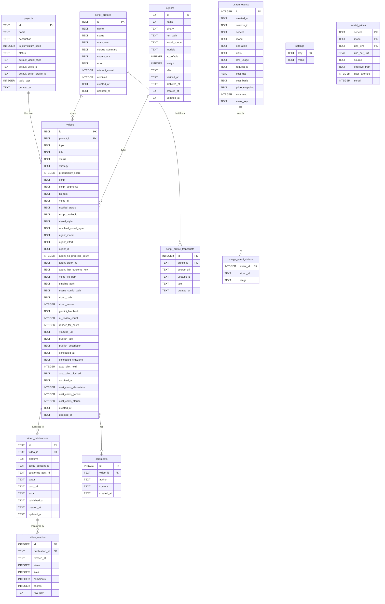

# Database

Tubematic stores everything in one SQLite file. There is no second store, no cache, and no message
queue — the database *is* the queue, the state machine, and the configuration store.

| | |
|---|---|
| File | `~/.tubematic-data/data/tubematic.db` on the host, `/data/tubematic.db` inside the containers |
| Journal mode | WAL |
| Foreign keys | ON |
| Access | Raw `sqlite3` from Python, no ORM |

Three containers open it concurrently — `tubematic-api`, `tubematic-mcp` and
`tubematic-renderer`. WAL mode is what makes that safe, and it is also why the file cannot be made
unreadable to the host user: WAL requires write access to the `-shm` sidecar even for readers.

Schema creation and evolution is no longer something concurrency merely tolerates — it is made safe
by construction. Every process that opens this database calls `tubematic_core.db.migrate()` before
doing anything else, and that function holds a real write lock for its whole run, so two processes
racing on a brand-new database serialize rather than corrupt it. See [Migrations](#migrations).

> **Security note.** Since API keys moved out of environment variables, this file contains them as
> plaintext rows in the `settings` table. It is not a secret store. `renderer/entrypoint.sh`
> restricts it to the host user's group where it can (`0660` plus setgid on the directory), falling
> back to world-writable only when the mount directory is root-owned. The agent is denied reading
> the data directory that holds it, on Claude Code and OpenCode (Codex's read-only sandbox has no
> per-path rule) — see [Deployment](07-agent-layer.md#deployment).

## Schema creation

The schema lives in one place, `tubematic_core/migrations/`, applied by `migrate()` and shared by
every process — see [Migrations](#migrations) for the full model. `renderer/api/pipeline.py` and
`mcp/server.py` each keep a thin `_init_db()` that does nothing but call `migrate()`; there is no
per-process schema definition left to keep in sync between them. The one schema definition that is
still hand-duplicated is the `agents` table, in `onboard/agent_install.py::AGENTS_SCHEMA` — see
[below](#agents) for why.

Besides those implied by primary keys, the indexes are `idx_video_publications_video`,
`idx_video_metrics_publication`, the usage ledger's four (migration `0005`: `idx_usage_events_created_at`, `idx_usage_events_model`,
the unique `idx_usage_events_event_key` and `idx_usage_event_videos_video_id`) and
`idx_videos_project_id` (migration `0013`). The last one exists because the
[topic cap](02-pipeline.md#topic-cap) counts a domain's videos on every insert.

---

## Entity relationships

---

## `videos`

The central table. One row per video, from proposed topic to published file.

| Column | Type | Default | Meaning |
|---|---|---|---|
| `id` | TEXT PK | | `vid_<hex>` from MCP, a UUID from `POST /videos`. A caller-chosen id must be letters, digits, `_` and `-`, not starting with `-`, at most 128 characters, because it names the video's job directory. That is checked only when the row is created. Every use of an existing id as a path checks only that it is one component (no separator, not `.` or `..`, no control character, at most 255 bytes, the longest file name the filesystem allows), so a video filed earlier under an id with a dot, a space or more than 128 characters still renders. The render itself is written as `<id>.mp4`, so the id must also leave four bytes for that suffix: one of 252 to 255 bytes names a working job directory but no possible output file, and the worker moves it to `FAILED` with a comment before staging anything, rather than failing part-way through the render |
| `project_id` | TEXT → `projects.id` | | The domain this video files into |
| `topic` | TEXT NOT NULL | | The **full brief** — what the video is about, up to a few thousand characters |
| `title` | TEXT NOT NULL | `''` | A **short display name**, capped at 70 characters. Legacy rows hold `''`; the UI falls back to `topic` |
| `status` | TEXT NOT NULL | `TOPIC_PROPOSED` | See [The Pipeline](02-pipeline.md) |
| `strategy` | TEXT NOT NULL | `manual` | `curriculum` · `trending` · `mining` · `manual` |
| `producibility_score` | INTEGER NOT NULL | `0` | 1–10. Below 5 is rejected at creation |
| `script` | TEXT NOT NULL | `''` | The flat script, **derived** from `script_segments` |
| `script_segments` | TEXT | | JSON array of `{id, voice, visual}` |
| `tts_text` | TEXT NOT NULL | `''` | The exact text sent to ElevenLabs, after pronunciation substitution |
| `voice_id` | TEXT NOT NULL | `''` | This video's voice. Empty means the install default |
| `notified_status` | TEXT NOT NULL | `''` | The *arrival* a Discord notification was last sent for, as `<status>@<updated_at>`. `''` means nothing has been sent. A marker naming a status the video has since left never matches again, so nothing clears it. See [Notifications](02-pipeline.md#notifications) |
| `script_profile_id` | TEXT | `''` | Style profile. Empty means the generic style |
| `visual_style` | TEXT NOT NULL | `auto` | Which vocabularies the video may draw from: `auto`, `motion_graphics`, `stick` or `illustrated`. A **permission set**, not a look. Chosen at the topic checkpoint and frozen there — see [Frozen choices](02-pipeline.md#frozen-choices). `auto` defers the choice to the agent |
| `resolved_visual_style` | TEXT NOT NULL | `''` | Which **canvas** `auto` settled on (`dark` or `light`), written **once** by the agent at scene-config time. It stores a canvas rather than a register name because the canvas is the only thing `auto` must fix for the life of the video — everything else stays free per beat. `''` until it has. Meaningless unless `visual_style` is `auto`. Write-once is what makes a revision round render at the register the video already uses, without anything on the revision path knowing this column exists |
| `agent_model` | TEXT | `''` | This video's model. Empty means its agent's default, `models[0]`. A non-empty value must be one of that agent's models |
| `agent_effort` | TEXT NOT NULL | `''` | How hard the agent thinks on this video: `low`, `medium`, `high`, `xhigh` or `max`. Empty means its agent's own `effort`. Settable at any human checkpoint and frozen between them, like `agent_model` — see [Frozen choices](02-pipeline.md#frozen-choices). Unlike the model, any of the five is always *storable*: the levels are a fixed set rather than a per-install list. Whether a level is *usable* depends on the model the video runs under — some models accept fewer — which is resolved when the run happens, not here |
| `agent_id` | TEXT | `NULL` | The [agent](#agents) this video runs under. Dealt at creation; a human may move it to another live agent at a checkpoint, and nothing else changes it — see [Frozen choices](02-pipeline.md#frozen-choices). Never written back to `NULL`, which means the default agent at dispatch time — rows from before agents existed, or created while none was installed. Deliberately not a declared foreign key; an id that does not resolve makes the poller skip the video rather than reroute it |
| `agent_no_progress_count` | INTEGER NOT NULL | `0` | Scheduled agent sessions in a row that left the video at the status they found it at. Written only by [`POST /videos/<id>/agent-outcome`](05-http-api.md#post-videosvideo_idagent-outcome), which resets it on any status change. Persisted rather than held by the poller, whose supervisor exits when it runs out of work and would otherwise never reach the cap |
| `agent_stuck_at` | TEXT | `NULL` | When the poller stopped dispatching this video, after 3 sessions without progress; `NULL` while it is not stuck. `/videos/workable` leaves a stuck video out. Cleared by a `PATCH` that carries `status` or by Retry agent (`POST /videos/<id>/agent-retry`). A stuck video keeps its status: it is not `FAILED` — see [The Poller](13-the-poller.md#success-is-read-from-the-database) |
| `agent_last_outcome_key` | TEXT | `NULL` | The session key of the last outcome `agent-outcome` counted, so a report replayed by a successor supervisor is not counted twice |
| `voice_file_path` | TEXT NOT NULL | `''` | Where `generate_voice` wrote `audio.mp3`. Server-written; see the path columns note below |
| `timeline_path` | TEXT NOT NULL | `''` | Where `generate_voice` wrote `timeline.json`. Server-written |
| `scene_config_path` | TEXT NOT NULL | `''` | Where `write_scene_config` wrote `scene-config.json`. Server-written |
| `video_path` | TEXT NOT NULL | `''` | Where the render worker wrote the mp4. Server-written |
| `video_version` | INTEGER NOT NULL | `1` | Bumped on each re-render |
| `gemini_feedback` | TEXT NOT NULL | `''` | The AI reviewer's full findings. Stored uncapped |
| `ai_review_count` | INTEGER | `0` | Reviews run so far. Capped by `ai_review_max_loops` |
| `render_fail_count` | INTEGER | `0` | Render crashes so far. Capped by `max_render_retries` |
| `youtube_url` | TEXT NOT NULL | `''` | Legacy single-URL publish target. Retired as a *read* path — publications live in their own table |
| `publish_title` | TEXT NOT NULL | `''` | What the video is posted with, written by the agent with the script; distinct from `title` |
| `publish_description` | TEXT NOT NULL | `''` | The post's description, written by the agent with the script |
| `scheduled_at` | TEXT NOT NULL | `''` | When a scheduled post goes out, UTC. `''` means not scheduled; the worker moves a `SCHEDULED` video to `PUBLISHING` once this has passed. Migration `0008` — see [Scheduling a post](14-publishing.md#scheduling-a-post) |
| `scheduled_timezone` | TEXT NOT NULL | `''` | The IANA zone the schedule was picked in, kept only so the time is shown back in that zone |
| `auto_pilot_hold` | INTEGER NOT NULL | `0` | `1` once a human has cancelled this video's scheduled post, so Auto Pilot does not schedule it again. Never cleared. Migration `0009` — see [Auto Pilot](14-publishing.md#stopping-one-video) |
| `auto_pilot_blocked` | TEXT NOT NULL | `''` | `<status>@<updated_at>` for the arrival at a checkpoint that Auto Pilot last commented it could not approve; what keeps that comment to one per arrival |
| `archived_at` | TEXT | `NULL` | When the video's files were deleted and the row archived. `NULL` means live |
| `cost_cents_elevenlabs` | INTEGER NOT NULL | `0` | **Unused.** Superseded by [`usage_events`](#usage_events-usage_event_videos-and-model_prices); kept only because shipped migrations are immutable |
| `cost_cents_gemini` | INTEGER NOT NULL | `0` | **Unused**, as above |
| `cost_cents_claude` | INTEGER NOT NULL | `0` | **Unused**, as above |
| `created_at` / `updated_at` | TEXT NOT NULL | | ISO-8601 UTC |

**`updated_at` is load-bearing.** It is the FIFO ordering key for the render worker's atomic claim.
Anything that writes to it changes render order.

**The four path columns are written only by the code that writes the files, and no reader trusts
them.** `generate_voice`, `write_scene_config` and the render worker fill them in; `PATCH` and MCP
`update_video` refuse them. Every reader — the worker's staging, `validate_job`, archive and
retention, publishing, the publish dialog's duration — derives the location from the ids instead:
`<jobs>/<video_id>/audio.mp3`, `timeline.json` and `scene-config.json`, and
`<output>/<project_id>/<video_id>.mp4` (`tubematic_core/jobfiles.py`). A symlink in any component
below the jobs or output directory is refused, not only one that leads out of it: `<jobs>/vid_a`
linked to `<jobs>/vid_b` stays inside the jobs directory, and would hand video A video B's audio.
The directory itself may be a symlink. One gap is known and left open: the check runs before the
file is used, so a process that can write under those directories could swap a checked directory
for a link in between. Closing it means opening every file beneath a directory descriptor
(`openat2` with `RESOLVE_BENEATH`), which the shared layer does not do; only Tubematic's own
containers write there. A column is only a marker
that its step completed: an empty one still reads as "not written yet". The columns used to be
writable by any caller, so a row could name another video's render for its own archive to delete,
or any readable file for the worker to stage into a render. Deriving the path makes a row tampered
with before that was fixed harmless, with no migration. It also means a row written by an MCP
server driven from a host shell, which stores host paths, renders as long as the files are in the
jobs volume. The values are container-absolute (`/jobs/…`, `/output_videos/…`) in a normal install.
The dashboard plays a render from `/stream/<project_id>/<id>.mp4`, built from the ids too
(`dashboard/lib/utils.ts::videoStreamUrl`); `video_path` only tells it a render exists.

**Archived is a column, not a status.** Deleting a video — by hand, or by the retention sweep —
removes its mp4 and job directory, sets `archived_at`, clears `video_path`, and leaves `status`
alone. An `ARCHIVED` status would overwrite the one field that says what the video actually was
(published, failed, never approved). The row, its comments, publications and metrics are all kept.
Every list and count that feeds the board or the agent filters `archived_at IS NULL`, and an
archived row is frozen: `PATCH` and publish both return `409`, and the MCP server's
`set_video_status` and `update_video` refuse it with `video_archived` — an agent may already hold the
id from before the delete, so filtering the lists alone would not stop it. `script_profiles.archived` is an
integer flag instead because nothing there needs to show *when*. See
[Rendering and Review](11-rendering-and-review.md#retention).

**Cost is not stored on the video.** Every paid call is its own row in
[`usage_events`](#usage_events-usage_event_videos-and-model_prices), and a video's cost is computed from
those rows when it is shown.

## `projects`

Project domains are the single organizing entity — every video files into one, regardless of how it
was sourced.

| Column | Type | Default | Meaning |
|---|---|---|---|
| `id` | TEXT PK | | Slug, e.g. `proj_networking`. A new id must be letters, digits, `_` and `-`, not starting with `-`, at most 128 characters, because it names the domain's output directory. Checked only when the row is created, so a domain filed earlier under an id with a dot or more than 128 characters stays editable and still renders; such an id is refused at render time only if it would leave the output directory or is longer than a file name can be |
| `name` | TEXT NOT NULL | | |
| `description` | TEXT NOT NULL | `''` | The domain's scope, multi-line. At most 2000 characters, checked by the API and the MCP server only when it changes, so a longer one stored before the limit is kept. The limit is low because `list_projects` returns every domain's description on every research run |
| `is_curriculum_seed` | INTEGER NOT NULL | `0` | `1` means scheduled curriculum research draws topics from it |
| `status` | TEXT NOT NULL | `active` | `active` or `paused`. Only a curriculum seed can be `paused`; see [Domain pause](02-pipeline.md#domain-pause) |
| `default_visual_style` | TEXT NOT NULL | `''` | The register this domain's **curriculum** videos start in. `''` means the domain has no preference, which is not the same as `auto`: `auto` is a per-video instruction to the agent, this is the absence of a domain-level one. Videos filed here by trending, mining or manual ignore it — the register reads as a series identity, and curriculum is the one strategy that produces a series |
| `default_voice_id` | TEXT NOT NULL | `''` | The voice every new video filed into this domain starts with, **whatever its strategy** — unlike `default_visual_style`, it is the domain's narrator, not a series identity. `''` means the install default. It is copied into `videos.voice_id` when a video is created, and skipped if the voice has left the roster, so changing it never reaches back to videos already filed. See [The model follows the voice](08-scripting-and-voice.md#the-model-follows-the-voice) |
| `default_script_profile_id` | TEXT NOT NULL | `''` | The [script profile](08-scripting-and-voice.md#script-profiles) this domain's **curriculum** videos start with, for the same series-identity reason as `default_visual_style`; other strategies ignore it. `''` means none. Copied into `videos.script_profile_id` when a curriculum video is created, and skipped if the profile is no longer `READY` or has been deleted — the approving `PATCH` would refuse it. Changing it never reaches back to videos already filed. Migration `0010` |
| `topic_cap` | INTEGER NOT NULL | `100` | How many topics the domain may ever hold, 25–750, checked by the API and the MCP server (SQLite can't add a `CHECK` to an existing table). Every video ever filed counts, archived and rejected included. At the cap the domain is **expired** and research files nothing more into it. Expired is derived on read, never stored; `GET /projects` and `list_projects` return it with the count as `expired` and `topic_count`. See [Topic cap](02-pipeline.md#topic-cap). Migration `0013`, which gave a domain already holding 100 or more topics `min(750, count + 100)` so that none expired on upgrade |
| `created_at` | TEXT NOT NULL | | |

## `comments`

The audit trail. Both the agent and humans write here, and the dashboard renders it as a read-only
thread. The agent is required to leave a comment at every checkpoint explaining what it did. A human
comment enters only through the dashboard's Request Revision dialog; the agent's `add_comment` tool
refuses any author but `agent`, so it cannot write one.

| Column | Type | Notes |
|---|---|---|
| `id` | INTEGER PK AUTOINCREMENT | |
| `video_id` | TEXT NOT NULL → `videos.id` | `ON DELETE CASCADE` |
| `author` | TEXT NOT NULL | `CHECK (author IN ('human','agent'))` |
| `content` | TEXT NOT NULL | |
| `created_at` | TEXT NOT NULL | |

> Comments are visible in the dashboard, and error text gets written here. That is why every
> outbound API error is scrubbed of credentials before it is persisted.

## `agents`

One row per installed coding agent. See [The Agent Layer](07-agent-layer.md#agents) for how agents
are installed and how videos are assigned to them.

| Column | Type | Default | Meaning |
|---|---|---|---|
| `id` | TEXT PK | | The agent's id — `claude`, `codex` or `opencode`, the argument `--install-agent` takes |
| `name` | TEXT NOT NULL | | Display name, e.g. `Claude Code`, `Codex`, `OpenCode` |
| `binary` | TEXT NOT NULL | | The CLI's path, resolved at install time. The poller re-resolves it through `PATH` before running it |
| `run_path` | TEXT NOT NULL | | The agent's workspace. Cron runs the agent from here |
| `install_scope` | TEXT NOT NULL | `'user'` | `user` or `project` — where its skills and commands were deployed |
| `models` | TEXT NOT NULL | `'[]'` | JSON list of model names, each probed against the CLI at install time. `models[0]` is the agent's default |
| `effort` | TEXT NOT NULL | `'high'` | This agent's default effort level, used by every run no video overrides. Editable over HTTP, unlike `models`: the five levels are a fixed set rather than a per-install list, so the API can validate a value without an agent binary. Whether a level is *usable* still depends on the model a run uses — some accept fewer — which the installer probes against the default model and the poller falls back on at run time |
| `is_default` | INTEGER NOT NULL | `0` | At most one live row carries it. The default agent builds script profiles, runs research, and runs videos with no `agent_id`; with none flagged, the oldest live agent is used |
| `weight` | INTEGER NOT NULL | `1` | Share of new videos, 0–100, dealt exactly per deck (see `agent_deck` below). 0 means no cards |
| `verified_at` | TEXT NOT NULL | `''` | When the models were probed. Blank when they were not (`--disable-verification`) |
| `archived_at` | TEXT | `NULL` | `NULL` means live |
| `created_at` / `updated_at` | TEXT NOT NULL | | ISO-8601 UTC |

**Only the host-side installer writes rows**, straight into SQLite — see
[Deployment](07-agent-layer.md#deployment) for why not over HTTP. Over HTTP a human can change only
`is_default`, `weight`, `effort`, and which installed model sits first in `models`
([HTTP API](05-http-api.md#agents)). No MCP tool writes this table.

**Uninstalled means archived, never deleted** (`python onboard.py --uninstall-agent <name>` sets
`archived_at`), so a video pinned to an agent always resolves and keeps showing its name. An
uninstalled agent is assigned no new videos, and the poller skips the videos it already has.

**Two copies of the schema.** The real one is in `tubematic_core/migrations/`; the second is
`onboard/agent_install.py::AGENTS_SCHEMA`, because the installer runs on the host, where it may
create the table before any container — and before `tubematic_core/migrations` has ever run against
this database — has started. A test compares the installer's copy column-for-column against a
**fully migrated** database, not against `0001`'s source text, so a column added by a later
migration is caught too. That also means the installer's copy has to list post-baseline columns
**in migration order, at the bottom**: `ALTER TABLE … ADD COLUMN` always appends, and the
comparison includes each column's position.

### `agent_deck`

A single row (`id = 1`, enforced by a `CHECK`) holding the shuffled deck new videos are dealt their
agent from — see [Assignment](07-agent-layer.md#assignment).

| Column | Type | Meaning |
|---|---|---|
| `signature` | TEXT NOT NULL | JSON `[[agent_id, reduced_weight], …]` the deck was built from. A mismatch with the live agents means "shuffle a new deck" |
| `cards` | TEXT NOT NULL | JSON list of agent ids still to deal |

The row is created on the first deal, and only `_pick_agent_id` in the API and MCP processes writes
it — the installer never touches it, because a changed signature already rebuilds the deck. Its
table is defined once, in `0001_baseline.py`, so there is no cross-copy to drift.

## `usage_events`, `usage_event_videos` and `model_prices`

The spend ledger. **One `usage_events` row per paid call**, written as soon as the provider's
response exists — on the success path and on every failure after it, because a response that
failed to parse was still billed. Writers call `tubematic_core/usage.py::record_usage`, which never
raises: bookkeeping must not fail a video, but a failure to record is always logged.

| Column | Meaning |
|---|---|
| `service` / `model` | `gemini`, `openai`, `anthropic`, `elevenlabs`, … and the model id the call used |
| `operation` | `voice`, `voice_preview`, `ai_review`, `mining`, `publish_metadata` (only on rows from before the agent wrote the publish metadata), `image`, `character`, `agent_pipeline`, `agent_research`, `agent_profile`, and `agent_unscoped` on rows from before the poller ran one video per session |
| `units` | Normalised counts: `input`, `input_audio`, `input_image`, `output`, `reasoning`, `output_image`, `cache_read`, `cache_write`, `cache_write_1h` tokens, or ElevenLabs `credits` |
| `raw_usage` | The provider's own usage object, verbatim — what makes re-pricing possible later |
| `request_id` | ElevenLabs' `request-id` response header on voice and preview rows, for matching a row to the provider's own history. `NULL` elsewhere |
| `session_id` | Groups the rows of one agent session (one row per model it used) |
| `cost_usd` | Dollars at API list price, or **`NULL`** when no rate was known |
| `cost_basis` | `priced` (units × rates), `reported` (the agent CLI's own figure), `credits` (ElevenLabs — never priced), `unpriced` |
| `price_snapshot` | The rates and their source applied at the time |
| `estimated` | Set when a fallback rate or a long-prompt price tier made the figure approximate |
| `event_key` | Unique when set. An agent session's events arrive over HTTP and are keyed by session and position, so a report resent after a timeout records nothing twice. `NULL` for calls recorded in-process, which never resend |

**Units and the price are both kept, on purpose.** Units alone would silently re-price history
whenever a rate is edited; a stored dollar figure alone could never be corrected. So editing a rate
changes future calls only — except `unpriced` rows, which are filled in when a rate for their model
is added, because their units were kept exactly.

**Unpriced is `NULL`, never `0`.** Zero is indistinguishable from "this call was free" and would
understate spend invisibly; the dashboard shows unpriced calls as a count beside every total. That
includes a billed response whose usage could not be read: it is recorded with no units, and no
units is unpriced, not free.

**ElevenLabs is recorded in plan credits and never priced.** The `character-cost` response header
is the exact number of credits the call deducted from the plan's pool, after the model's discount
(a Flash or Turbo call costs half). Installs are assumed to be on a subscription that prepays those
credits, so a dollar figure would be an allocation, not spend.

The ledger is also **the only record of which model voiced a video**. `videos` keeps only
`voice_id`, and the model belongs to the roster voice, which can be edited after voicing.
`usage.py::last_voice_model` reads the model of a video's latest `voice` row for the video modal.
See `voice_info` under [HTTP API — `GET /videos/<id>`](05-http-api.md#get-videosvideo_id).

`usage_event_videos` links a row to the video(s) it was for — none (research, voice previews) or one
(most calls, and every agent session the poller now starts). Agent sessions recorded before the
poller ran one video per session could cover a whole batch. `stage` records the video's status when
an agent session started, which is what labels each session in the video modal. Migration `0007`
relabelled every `VOICING` row that existed when it ran as `VOICING_WITH_SCENES`: the poller that
wrote them carried a voicing session straight on into scene writing, so their cost covers both. A
`VOICING` row written since is voicing only. **It has no foreign
key to `videos`, deliberately:** spend outlives a deleted video, and an old shared session is split
evenly across its batch, so removing one video must not shift the other videos' shares.

`model_prices` holds synced and manual rates, one row per model and unit kind. See
[Settings — Costs](../user-guide/05-settings.md#costs) for where rates come from and how they sync.

## `settings`

A flat key/value store: `key TEXT PRIMARY KEY`, `value TEXT NOT NULL`. Every value is a string;
typed keys are coerced on read and validated on write. See [Settings](../user-guide/05-settings.md) for the full
reference.

Not every row is a declared setting. `mining_youtube_urls` and the research-run window are stored
here too, outside the validated specification. `mining_youtube_urls` has its own check instead: its
writers accept only YouTube video URLs and store each as `https://www.youtube.com/watch?v=<id>`
(see [HTTP API — Mining sources](05-http-api.md#mining-sources)), and migration `0014` brought
lists stored before that check to the same shape.

## `video_publications` and `video_metrics`

Full column reference in [Publishing](14-publishing.md#schema). Two things about their shape matter
here:

- **The metric columns are nullable.** "Not reported by the platform" is not the same as "reported as
  zero", and collapsing them would make an unpolled video look like a failed one.
- **`video_metrics` is a time series of cumulative readings, not deltas.** Aggregate by taking each
  publication's *latest* row; summing rows multiplies a view count by the number of polls.

`raw_json` keeps the whole payload so a column added later can be backfilled from history.

## `script_profiles` and `script_profile_transcripts`

A script profile captures a creator's *style* — tone, hook patterns, structure, vocabulary — learned
from a corpus of YouTube transcripts, so that scripts can be written in that voice.

| `script_profiles` | Type | Default |
|---|---|---|
| `id` | TEXT PK | |
| `name` | TEXT NOT NULL | |
| `status` | TEXT NOT NULL | `PENDING` → `GENERATING` → `READY` \| `FAILED` |
| `markdown` | TEXT NOT NULL | `''` — the finished style profile, held to the [profile schema](08-scripting-and-voice.md#the-profile-schema) |
| `corpus_summary` | TEXT NOT NULL | `''` |
| `source_urls` | TEXT NOT NULL | `'[]'` — JSON array |
| `error` | TEXT NOT NULL | `''` |
| `attempt_count` | INTEGER NOT NULL | `0` |
| `archived` | INTEGER NOT NULL | `0` |
| `created_at` / `updated_at` | TEXT NOT NULL | |

Transcripts are staging data, not an archive: `complete_script_profile` deletes every transcript row
for the profile once the markdown is written.

| `script_profile_transcripts` | Type | Notes |
|---|---|---|
| `id` | INTEGER PK AUTOINCREMENT | |
| `profile_id` | TEXT NOT NULL → `script_profiles.id` | `ON DELETE CASCADE` |
| `source_url` | TEXT NOT NULL | |
| `youtube_id` | TEXT NOT NULL DEFAULT `''` | |
| `text` | TEXT NOT NULL | |
| `created_at` | TEXT NOT NULL | |

---

## Migrations

Every table, column and one-time data fixup above is defined by a numbered migration file in
`tubematic_core/migrations/`, applied by `tubematic_core.db.migrate()`. This is the one schema
authority for the whole project — `renderer/api/pipeline.py`, `mcp/server.py`, the render worker,
`onboard.py`, `scripts/clear_db.py`, and the VQA seed-database generator all call `migrate()` rather
than defining or asserting a schema of their own.

**Layout and naming.** A file is named `NNNN_<name>.sql` or `NNNN_<name>.py`, where `NNNN` is a
zero-padded integer. Migrations are discovered on disk, sorted numerically (not lexically — `0002`
sorts before `0010`), and applied in that order. Each applied migration is recorded in a
`schema_migrations` table (`version`, `name`, `applied_at`), and `migrate()` applies only the
versions a given database has not already recorded. A gap in the numbering (a reverted migration) is
fine; two files claiming the same number is a hard error, since one of them would silently never run.

**`0001_baseline.py` is the accumulated pre-migration schema, frozen.** It is every table, column,
index and one-time fixup this project had accumulated before it had a migration system — the two
`_init_db` copies merged into one, kept idempotent exactly as they were, so it can adopt a database
at *any* prior state as well as create one from nothing. It is Python rather than `.sql` for a
concrete reason: SQLite has no `ADD COLUMN IF NOT EXISTS`, so the pragma-guarded `ALTER TABLE`
statements that let an old database converge cannot be expressed in a `.sql` file, which can only
hold literal SQL. **Every migration after `0001` should be plain SQL** — it never needs to guard
against a column that might already exist, because `schema_migrations` already knows whether it has
run.

`0006_voice_models.py` is one of two other Python migrations, both for a data reason, not a schema one. It
moves the retired install-wide `elevenlabs_model_id` settings row onto every voice in the
`elevenlabs_voices` JSON document, so each voice keeps the model the install was using, and adds
`projects.default_voice_id`. Rewriting entries inside a JSON value is not something a `.sql` file can
say cleanly. Its model list is written into the file rather than imported, because a shipped
migration must behave the same forever. It is **one-way**: 1.1.0's readers accept only
`{name, voice_id}` roster entries and read a migrated roster as empty, so rolling back means
restoring the automatic pre-migration backup.

`0014_mining_sources.py` is the other. It brings the stored `mining_youtube_urls` list to the shape
its writers now insist on: each YouTube video URL is rewritten to
`https://www.youtube.com/watch?v=<id>`, a second spelling of the same video is dropped, anything that
is not a YouTube video URL is **dropped**, and so is everything past 50 distinct videos. Dropping
rather than keeping is deliberate: the dashboard re-sends the whole list on every add and remove, and
the writer refuses a list with any bad entry, so one leftover would make every later save fail. Each
dropped entry is logged at `WARNING` on the `tubematic.migrations` logger by whichever service
migrates first — normally `tubematic-api` at start, so `docker compose logs tubematic-api` shows
it — and the pre-migration backup keeps the list as it was. A value that is not a JSON list is
replaced by `[]`, its old value logged the same way. Like `0006`, it carries its own copy of the
URL rule rather than importing `tubematic_core/youtube.py`.

Baked into `0001` are several one-time fixups worth knowing about, because they explain rows an old
database might still be missing: the `VIDEO_REVISION_REQUESTED → REVISION_REQUESTED`,
`SCRIPTING → TOPIC_APPROVED` and `RENDER_READY → VOICE_READY` status rewrites; the
`videos.animatability_score → producibility_score` rename, which carries the old column's values
rather than dropping and re-adding; the deletion of the retired install-wide `agent_model` settings
row (superseded by each agent's own `models[0]`); and the `videos.notified_status` backfill
(`status || '@' || updated_at` for every existing row), without which the first notification sweep
after an upgrade would announce every parked video at once.

**A shipped migration is immutable.** Once a migration has gone out in a release, it must never be
edited — doing so silently diverges every database that already applied it (which stamped the old
behaviour into `schema_migrations` and moved on) from every database that has not (which will apply
the edited version). A schema change is always a *new* migration file. See
[Development](17-development.md#schema-changes) for the full checklist.

**Every process calls `migrate()`, not one owner asserting.** That is deliberate, and it is safe
because a run holds a real write lock (`BEGIN IMMEDIATE`) for its entire duration: a database with
nothing pending costs one cheap `SELECT`, and a second process that arrives mid-run simply blocks on
the lock, then finds nothing left to do once the first commits. The alternative — only Flask
migrates, everyone else asserts the version and refuses to proceed — would break the VQA workflow,
where MCP tools are routinely driven from a host shell with no Flask process running at all.

**The whole run is one transaction, not one per migration.** Those two are mutually exclusive in
SQLite, because a `COMMIT` releases the write lock — and the lock is exactly what makes
every-process-migrates safe above. Run-wide atomicity is also the stronger guarantee on its own
terms: a failure partway through a run unwinds *everything* that run applied, including migrations
earlier in the same run, so a partially-migrated database cannot exist. A migration is stamped in
`schema_migrations` in the same transaction it runs in, so it is never recorded as applied unless it
actually committed.

**A backup precedes any pending migration.** `migrate()` calls `backup_db()` before opening its
transaction, but only when a migration is actually about to run *and* the database file already
exists — a no-op start (nothing pending) does not grow the backup directory, and a brand-new file has
nothing worth saving. If the backup itself fails, the migration does not run. See
[Infrastructure — Backups](16-infrastructure.md#backups) for where these land and how to restore
one, and [Upgrading](../user-guide/07-upgrading.md) for the versioning policy and the full
upgrade/rollback story built on top of all this.

**`.sql` migrations are split on statement boundaries, not run with `executescript()`.** SQLite's
`executescript()` issues its own implicit `COMMIT`, which would silently drop the run-wide
transaction and the write lock it holds — so `migrate()` uses `sqlite3.complete_statement` (the same
helper the `sqlite3` CLI uses) to split a file into individual statements and `execute()` each one.
The same rule binds a `.py` migration's own `up(con)` — nothing stops it calling `con.executescript()`
itself, and doing so drops the lock exactly the same way; a `.py` migration should build its SQL as a
string and split it with the same helper `migrate()` uses, rather than executing a block directly.
The practical consequence for anyone writing a `.sql` migration: **each statement needs its own line
group**. Two statements written on one line are passed to `execute()` as a single string and it
raises "you can only execute one statement at a time" — a mistake that fails loudly at authoring
time, not silently at runtime.

## Adding a column

1. Write a new `NNNN_<name>.sql` migration — never edit an existing one. `ALTER TABLE … ADD COLUMN`
   needs no existence guard here, unlike in `0001`, because `schema_migrations` already tracks
   whether it has run.
2. Plumb it through `create_video` / `update_video` in `mcp/server.py` and `patch_video` in
   `renderer/api/pipeline.py` if the agent or the dashboard should write it.
3. Add it to the `Video` type in `dashboard/lib/types.ts`.
4. Prefer additive. A rename is a one-way door — see the `producibility_score` example above.
5. Update `tubematic_core/tests` (a new `EXPECTED_*_COLUMNS` entry, and a fixture-based test if the
   change needs to prove it converges an old database) before calling the change done. See
   [Tests — `tubematic_core`](test-suites/tubematic-core.md).
