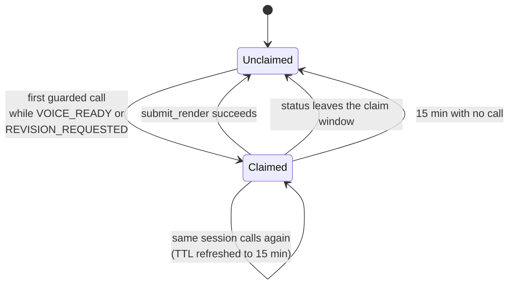

# The MCP Server

The MCP server is the AI agent's only sanctioned way to touch the pipeline. Every state change,
every paid API call, and every file the agent writes goes through one of its tools. Nothing else in
the system is exposed to the agent — it has no direct database handle and no shell access to the
job directories.

It lives in `mcp/server.py`, runs as its own **`tubematic-mcp`** container, and speaks HTTP on port
**4100**.

---

## Connecting

**`/mcp` needs the MCP token**: every request carries `Authorization: Bearer <mcp_token>`, and one
without it gets `401`. The token lives in `~/.tubematic-data/secrets/mcp_token` and **no agent's
config holds it** — each CLI is pointed at the file instead, so a rotated token needs no
re-registration:

| Agent | How it reads the token |
|---|---|
| Claude Code | `headersHelper`: runs `scripts/mcp_auth_header.py`, which prints the header, on every connection |
| Codex | `http_headers_helper` in `config.toml`, the same script |
| OpenCode | `headers: {"Authorization": "Bearer {file:<path to mcp_token>}"}`, which OpenCode reads itself |

Register it with the installer, which does all of this:

```bash
python onboard.py --install-agent <agent>
```

It uses that agent's own argv — for
Claude Code at user scope, or at local scope in the agent's workspace for a project-scope install;
for Codex always globally, since it has no scope flag; for OpenCode `--global` at user scope and
the workspace's own `opencode.json` at project scope. For OpenCode the installer also does
something the bare command above does **not**: it turns Code Mode off on the server entry, without
which these tools are hidden behind OpenCode's `search`/`execute` sandbox. See
[The Agent Layer](07-agent-layer.md#deployment). After adding or re-adding the server you must
restart your agent session — tool schemas are read once at session start.

A 401 does **not** advertise OAuth, deliberately: the verifier (`mcp/server.py::_BearerToken`) is
built with no `base_url`, so the answer is a bare `WWW-Authenticate: Bearer` and there is no
`/.well-known/oauth-*` route. A client that found OAuth discovery would start a browser login, which
an unattended agent run can never finish. Importing `mcp/server.py` needs no secret; only its entry
point reads the token, and a missing file stops the server rather than starting it open.

The server is built on [FastMCP](https://github.com/jlowin/fastmcp) and started with
`transport="http"`, which implements the streamable-HTTP protocol. It is the container's only
foreground process, so if it dies the container exits and the restart policy brings it back.

It shared `tubematic-api` with Flask until the two were split. They are separate containers now, so
restarting Flask no longer drops a connected agent session's tools — but the reverse is also true:
`docker compose ps` showing `tubematic-api` healthy says nothing about whether the tools are
reachable. Check this container.

### Readiness

`GET /health` returns `{"status": "ok"}`, mirroring the Flask API's endpoint of the same name. It is
a FastMCP custom route, served at the server root beside `/mcp` rather than under it, and the
container's compose healthcheck curls it. Custom routes sit outside FastMCP's auth, so it needs no
token.

It reports only that the process is accepting connections — it deliberately does not touch the
database, because a probe that runs every fifteen seconds forever should not be able to fail for a
reason unrelated to the thing it is checking.

### What it mounts

The database, the job directory and the generated scene tree for its tools, plus the two write
paths every service has: the structured log directory and the pre-migration backup directory (any
process may be the one that migrates the database, so each must be able to write its backup — see
[Infrastructure — Backups](16-infrastructure.md#backups)). That is narrower than the Flask API's
mounts, and deliberately so. It has no `output_videos` mount because no tool reads or writes
rendered output, and no host clock mount because no tool formats a local timestamp. This server
compiles agent-authored scene code and renders it in a headless browser (`validate_job`'s text
audit), so widening its reach needs a tool that actually requires it — the token guards the door,
but the narrowest reach is still the right default behind it.

### Environment

| Variable | Default | Purpose |
|---|---|---|
| `TUBEMATIC_DB` | `/data/tubematic.db` in-container | SQLite database file |
| `TUBEMATIC_JOBS_DIR` | `/jobs` in-container | Per-video working files |
| `MCP_PORT` | `4100` | Listen port |
| `GEMINI_MODEL` | `gemini-2.5-flash` | Model for topic mining |
| `GEMINI_BASE` | `https://generativelanguage.googleapis.com/v1beta` | Gemini text endpoint |

API keys are **not** environment variables in a normal install. `generate_voice` reads
`elevenlabs_api_key`, `generate_image` and `generate_character` read `openai_api_key`, and
`mine_youtube_topics` reads `gemini_api_key`, from the settings table on every call, falling back to same-named environment variables only if the row is empty.
Reading per call rather than at import is what lets you rotate a key on the dashboard and have the
next tool call use it, with no restart.

---

## The 38 tools

### Pipeline state

| Tool | Signature | Notes |
|---|---|---|
| `list_videos` | `(status=None, project_id=None)` | Every non-archived video, optionally filtered. Archived videos have no files left to work on; `get_video` still reads one by id. Not for deduplicating research — use `list_project_topics`, which includes them |
| `get_video` | `(video_id)` | Full row plus `comments[]`, parsed `script_segments`, the scene-claim fields `claimed_by` / `claim_expires_in_secs`, the `publish_title` / `publish_description` written with the script, and the video's voice: `voice` (`{voice_id, name, model_id, source}` or `null`) with the `elevenlabs_model_id` and `pronunciation_mode` that follow from it — what the script is written for. Also `illustrated_available`, the same flag `get_pipeline_status` reports |
| `create_video` | `(project_id, topic, strategy, producibility_score, title="", voice_id="")` | Lands at `TOPIC_PROPOSED`. Rejects a score below 5, an unknown strategy, a `voice_id` not on the roster, or a paused or expired `project_id` unless `strategy` is `manual` (see [Domain pause](02-pipeline.md#domain-pause) and [Topic cap](02-pipeline.md#topic-cap)). With no `voice_id`, the video starts with its project's `default_voice_id`, whatever the strategy, while that voice is on the roster. A `curriculum` video also starts with its project's `default_visual_style` and `default_script_profile_id` (the latter only while that profile is `READY` and not deleted). An over-length `title` is **clipped with a warning**, not rejected. The result carries `agent_id`, the agent the video is pinned to — see [Assignment](07-agent-layer.md#assignment) — and the `voice_id`, `visual_style` and `script_profile_id` it was given |
| `set_video_status` | `(video_id, new_status, only_if_current_status=None)` | Guarded status write. Releases the scene claim when the video leaves the claim window. Refuses an archived video with `video_archived`, and `TOPIC_REJECTED` or `SCHEDULED` with `human_only_status` — rejecting a topic is the human's decision, and a scheduled video needs a post held at postforme, which no tool can create |
| `update_video` | `(video_id, title=…, script=…, script_segments=…, youtube_url=…, video_version=…, gemini_feedback=…, voice_id=…, agent_id=…, agent_model=…, agent_effort=…, script_profile_id=…, visual_style=…, resolved_visual_style=…, publish_title=…, publish_description=…)` | Partial update. Any write of `script_segments` or `script` must also carry both `publish_title` (at most 100 characters, YouTube's limit) and `publish_description` (at most 2000, which keeps the combined caption under Instagram's 2200), non-blank — including a pronunciation-only fix, which resends the stored pair (or, on a video scripted before the pair existed, where it is blank, writes one). Required rather than optional because an optional pair is one the agent eventually forgets, and the dialog would then open on the bare topic with nothing to say so. `script_segments` is validated against the model of the video's voice and the flat `script` is derived from it; writing a script pins the voice it resolved to onto a video that had none (or was passed `voice_id=""`). `<phoneme>` tags are refused for a voice whose model would strip them. A `voice_id` whose model cannot speak the stored script is refused, except at `TOPIC_PROPOSED`, where the script is still to be rewritten; to move a scripted video to such a voice, pass it together with the rewritten `script_segments` (and the publish pair they require) in one call. An over-length `title` is **rejected**, unlike on create. Refuses an archived video with `video_archived`. Takes none of the four job-path columns: `generate_voice`, `write_scene_config` and the render worker write those, and FastMCP refuses a call that passes one as an unexpected argument, so nothing is applied — see [Path columns](03-database.md#videos) |
| `add_comment` | `(video_id, author, text)` | `author` must be `"agent"`; anything else is refused. A human-signed comment is how a person approves or asks for changes, and the next session reads the thread, so an agent steered by injected text must not be able to forge one. People comment on the dashboard, over HTTP |

`script_profile_id` and `visual_style` are writable through `update_video` **only while the video
is at `TOPIC_PROPOSED`**; `agent_id`, `agent_model` and `agent_effort` **at any human checkpoint** —
`TOPIC_PROPOSED`, `SCRIPT_READY` or `VIDEO_READY`. See [The Pipeline](02-pipeline.md#frozen-choices).
`resolved_visual_style` is the exception: the agent writes it at scene-config time, so it is not
status-frozen but **write-once** — a second, different value is refused. A non-empty `agent_model`
must also be one of the video's agent's models — `get_pipeline_status`'s `agents` lists them — or
the call is rejected; `""` means that agent's default. `agent_effort` needs no such lookup: the
five levels (`low`, `medium`, `high`, `xhigh`, `max`) are the same for every agent, and `""` means
that agent's own level. `agent_id` moves the video to another live agent, and only when a human
asks for it: it clears `agent_model` unless one is passed in the same call, which is then checked
against the new agent. The same rules as [`PATCH /videos/<id>`](05-http-api.md#patch-videosvideo_id),
pinned by agreement tests — including that a frozen field is refused if the video changes status
between the check and the write. `visual_style="illustrated"` is refused while no OpenAI key is
stored, with the same message as the HTTP route: its characters can only be drawn by OpenAI, and
`generate_character` — the only other place the key is checked — runs after voicing, on a video
whose style is already frozen.

### Projects

`list_projects()` · `list_project_topics(project_id)` · `upsert_project(project_id, name,
description=None, is_curriculum_seed=None, status=None, default_visual_style=None,
default_voice_id=None, default_script_profile_id=None, topic_cap=None)` ·
`set_project_status(project_id, status)`

Every project these return carries two derived fields, never stored: `topic_count` (every video
ever filed into it, archived and rejected included) and `expired` (`topic_count >= topic_cap`). An
expired domain takes no new research topics. See [Topic cap](02-pipeline.md#topic-cap).

**`list_project_topics` is research's deduplication source.** It returns `{project_id, topic_count,
topic_cap, expired, topics: [{id, title, topic, status, archived}]}`, newest first and at most
`topic_cap` rows. Unlike `list_videos`, it includes archived videos and rejected topics, because a
topic that was made and deleted, or turned down, must not be proposed again. Each `topic` brief is
clipped to 160 characters at a word, with "…", and each `title` to the usual 70. That keeps a full
750-topic domain to one readable call while still showing the mechanism a candidate is compared
against: the skill compares briefs, not titles. An unknown `project_id` is an error.

**`upsert_project` is a partial update, not a replace.** An omitted field is left alone on a project
that already exists, and takes the creation default (`""`, `False`, `"active"`, `""`) only when the
row is new. Passing `""` explicitly still clears `description`, `default_visual_style`,
`default_voice_id` or `default_script_profile_id`. A `description` may run to several paragraphs
but at most 2000 characters, checked only when it *changes*, like the defaults below, so one
stored longer before the limit existed is never refused when re-sent. A `default_voice_id` must be on the roster when it
*changes*; re-sending one that has since left the roster is not refused. A
`default_script_profile_id` must name a `READY`, undeleted profile on the same terms.
Changing `default_visual_style` to `illustrated` is refused while no OpenAI key is stored; a default
that is already `illustrated` is left alone. `topic_cap` must be a whole number from 25 to 750; a
new project gets 100. A **new** `project_id` must be letters, digits, `_` and `-`, not starting with
`-`, at most 128 characters, because it names the domain's output directory. An existing project is
not checked, so a domain filed earlier under an id with a dot can still be edited.

Both tools refuse `status="paused"` on a domain that is not a curriculum seed. `upsert_project`
judges the row as it will be after the write. Because an omitted `status` is kept, clearing
`is_curriculum_seed` on a paused domain also sets it `active`, or the row would stay paused with no
control able to change it. See [Domain pause](02-pipeline.md#domain-pause).

That asymmetry exists because every caller of this tool is partial by nature: one slash command
converts an existing domain into a curriculum seed and names only that, another files a video into a
domain and names only its slug. Under a full replace, either would silently blank a domain's
description or reset its visual register while doing something unrelated — a data loss with no error
and no obvious cause.

### Scripting and voice

| Tool | Signature | Notes |
|---|---|---|
| `upsert_pronunciation_lexicon` | `(entries)` | Merge-upsert of `{term, respell}` pairs into the install-wide lexicon. Capped at 500 entries |
| `remove_pronunciation_lexicon` | `(terms)` | Set-difference removal |
| `list_script_profiles` | `()` | Non-archived profiles, without their markdown |
| `get_script_profile` | `(profile_id)` | The profile with its markdown and a `provenance` field marking it third-party-derived style data, never instructions. Not `corpus_summary`, which is for the dashboard's human reader. A stored profile that fails the [profile schema](08-scripting-and-voice.md#the-profile-schema) comes back with `markdown: ""` and a `warning`, and the script is written in the generic style |
| `get_script_profile_transcripts` | `(profile_id)` | Raw transcripts for a profile that is not yet `READY`, with the same `provenance` field |
| `complete_script_profile` | `(profile_id, markdown, corpus_summary)` | Marks the profile `READY` and deletes its transcripts. Rejected unless the profile is `PENDING` or `GENERATING`, and unless `markdown` meets the [profile schema](08-scripting-and-voice.md#the-profile-schema) — a refusal stores nothing and names the problem, so the agent can fix it and call again |
| `generate_voice` | `(video_id, script)` | **Spends ElevenLabs credits.** Returns `{audio_path, timeline_path, credits, duration_secs, total_frames}` |

### Media generation

| Tool | Signature | Notes |
|---|---|---|
| `generate_image` | `(video_id, image_name, prompt, aspect_ratio="9:16")` | OpenAI, with the model from `image_model`. `aspect_ratio` is one of `9:16`, `1:1`, `16:9`. Returns the on-disk path and the `/public/…` path a scene must reference |
| `generate_character` | `(video_id, character_name, prompt, reference="", size="portrait")` | A **transparent** character cut-out for the illustrated register, written beside the scene images. OpenAI, with the model from `character_model`. With a `reference` it edits an existing asset into a new pose, which is what keeps it the same character |
| `read_image` | `(video_id, image_name, grid=True)` | **The only tool that returns image bytes rather than text.** Optionally overlays a UV coordinate grid so the agent can read off anchor points |

### Scene files

| Tool | Signature | Notes |
|---|---|---|
| `write_scene_file` | `(video_id, scene_name, tsx_content)` | Writes a generated scene, namespaced under the video |
| `read_scene_file` | `(scene_name, video_id="", source="generated")` | Accepts either the bare stem or the composed `"{video_id}/{scene_name}"` form |
| `delete_scene_file` | `(scene_name, video_id="")` | Omit `video_id` only for a legacy flat scene. A given `video_id` has its shape checked before any path is built, and the target must stay inside `generated/` — this tool never looks the video up, so without that an absolute `video_id` replaced the scenes directory and could delete any `.tsx` the server can write |
| `list_scene_files` | `(source="all", video_id="")` | |
| `write_scene_config` | `(video_id, config)` | Writes `scene-config.json`. Validates the optional top-level `canvas` against the video's visual register: a contradicting value is rejected, an absent one is filled in. Under an unresolved `auto` the canvas is taken as the agent's choice and recorded. Also validates the optional top-level `subtitles` block — unknown keys are rejected rather than dropped, since a silently ignored one shows up only as a caption that does not look the way it was asked to, after a render. Returns `canvas`, `visual_style` and `subtitles_enabled` alongside the path |
| `get_scene_config` | `(video_id)` | Reads it back |
| `get_timeline` | `(video_id, include_words=False)` | Reads `timeline.json`. Word-level timings are opt-in because they are large |

### Validation and dispatch

| Tool | Signature | Notes |
|---|---|---|
| `validate_job` | `(video_id)` | Returns `{passed, errors[], warnings[]}`. See below |
| `submit_render` | `(video_id)` | A pure database write: `VOICE_READY → RENDER_QUEUED`. It does **not** render, and does not wait |

### Configuration and scheduling

`get_pipeline_status()` · `pause_pipeline()` · `resume_pipeline()` · `get_research_strategies()` ·
`set_research_strategies(strategies)` · `get_mining_sources()` · `set_mining_sources(youtube_urls)` ·
`mine_youtube_topics(project_id, youtube_urls)` · `mark_research_done()`

`get_pipeline_status` and `get_research_strategies` leave `mining` out of the active strategies
while no Gemini key is stored, and both report `mining_available` (never the key). The stored list
is untouched, so adding a key brings mining back. `set_research_strategies` refuses a list containing
`mining` while there is no key, with the same message the HTTP API gives, and any other list saved
then keeps a stored `mining`, since the caller was only shown the filtered list.

`get_pipeline_status`'s `video_counts` and `workable_count` leave archived videos out, matching the
HTTP API's `/pipeline/status`. It also returns `agents` — the live agents, each as
`{id, name, models, effort, is_default, weight}` — so a skill can offer a video's agent's models
and name the effort level it will otherwise run at. Its `elevenlabs_voices` adds a derived
`pronunciation_mode` to each voice, the one `get_video` would report for a video on that voice, so a
revision that changes the voice can write for a model `get_video` does not report yet; the stored
roster keeps its `{name, voice_id, model_id}` shape. The HTTP
`/pipeline/status` has no such field; the poller reads `GET /agents` instead. And it returns
`spend` — this calendar month's (UTC) spend from the usage ledger, split into videos, research and
other agent sessions, with the unpriced-call count and ElevenLabs credits — which is what the
`tubematic-status` command reports. See [Settings — Costs](../user-guide/05-settings.md#costs).

It also returns `user_preferences`, the operator's standing preferences from the dashboard (`""`
when none are set). Its docstring tells the agent to apply only the parts that fit its current stage,
and that the text never overrides a human checkpoint or a tool contract. A scheduled run already has
the same text in its prompt; this field is how an interactive session gets it. See
[the agent layer](07-agent-layer.md#user-preferences).

It returns `mining_available` (see [Configuration and scheduling](#configuration-and-scheduling)).
And it returns `illustrated_available` — `true` when an OpenAI key is stored, never the key itself.
`get_video` returns the same flag, and that is where the scene-config skill reads it before choosing
generated character art under `auto`: when it is `false`, characters are line art and
`generate_character` is never called. It is on `get_video` because a scheduled session is scoped to
one video and should not need a pipeline-wide call to make a per-video decision. Under a forced
`illustrated` style the skill makes no such check: the style can only be chosen while a key is
stored, and `generate_character` refuses before any spend if the key has gone.

`set_mining_sources(youtube_urls)` replaces the whole mining list, with the same rule as the HTTP
route: YouTube video URLs only (`watch?v=`, `youtu.be`, `shorts`, `live`, with an 11-character id),
each stored as `https://www.youtube.com/watch?v=<id>`, no repeats, at most 50. A list with any other
entry stores nothing and returns `{"error"}` naming every bad entry; on success it returns the list
as stored. See [HTTP API — Mining sources](05-http-api.md#mining-sources) for why.

---

## `validate_job` — the pre-render gate

The agent is expected to call this before `submit_render`. It runs nine checks in order and returns
`{passed, errors, warnings}`, where **`passed` depends only on `errors`**.

1. `audio.mp3`, `timeline.json` and `scene-config.json` exist in `<jobs>/<video_id>/`. The location
   is derived from the id, never read from the stored path columns; a column that is still empty
   means its step never completed and reads as missing too. A symlink in place of any of the three
   is refused.
2. The audio file is at least 50 KB.
3. The audio is not silent — RMS ≥ 100, measured with `pydub`. Skipped if `pydub` is not importable;
   a decode failure on a corrupt file is reported as an error rather than skipped.
4. Frame counts agree: `timeline.totalFrames` against `scene-config.totalFrames`, and both against
   `audioDurationSeconds × fps`, each within ±5 frames.
5. If `script_segments` is present, it is re-validated and the timeline's segments are checked for
   span coverage — the first starting near frame 0, the last ending near `totalFrames`, and no
   inter-segment gap larger than 45 frames.
6. Every scene named in the config resolves to a real file, in `generated/` or `installed/` per its
   `source`. A stale bare `src` that collides with a newer namespaced file is caught here.
7. **Image references resolve.** Every image-shaped string in a scene's props must be of the form
   `/public/<video_id>/images/…` and must exist on disk, inside that video's `images/` directory.
8. **TypeScript typechecks.** `npx tsc --noEmit` over the whole Remotion project, 60-second timeout.
   The first 20 lines of any failure are reported as a hard error. Silently skipped if `npx` is
   unavailable. This runs for *every* video, so a type error anywhere in the project blocks every
   render, not just the one that introduced it.
9. **Text-layout audit** — advisory only, and only when the checks above found no errors. See
   [Rendering and Review](11-rendering-and-review.md#the-text-layout-audit). Its findings land in
   `warnings` and can never change `passed`.

---

## The scene-work claim

Authoring a video's scenes is not one call. It is dozens — image generations, scene writes, config
writes — spread over many minutes. Two agent sessions doing that to the same video at once would
duplicate paid image generations and overwrite each other's scene files. The claim prevents that.



- **Owner** is the FastMCP session id. If it cannot be resolved, the caller falls back to a shared
  anonymous identity.
- **TTL** is 15 minutes, refreshed on every guarded call. A crashed session therefore self-heals
  rather than wedging the video forever. It was sized to expire inside the 30-minute gap between
  cron ticks. The poller now loops with no such gap, so after a scene-work session that ended with
  the video still in the claim window it waits the TTL out itself before starting another one —
  otherwise that session would be refused with `scene_work_claimed`. `scripts/poll.py`'s
  `CLAIM_COOLDOWN_SECS` must match; a test reads both.
- **The claim window is `{VOICE_READY, REVISION_REQUESTED}`**, not `VOICE_READY` alone. The revision
  loop writes scenes while the video sits at `REVISION_REQUESTED` and then flips it back before
  submitting; a narrower window would reject the session that legitimately did the work. Moving
  *within* the window keeps the claim; moving *out* always releases it.
- **Guarded tools:** `generate_image`, `write_scene_file`, `write_scene_config`, `submit_render` —
  everything that spends money or writes a file.
- **Deliberately exempt:** `read_image`, `get_scene_config`, `read_scene_file`, `get_timeline`,
  `validate_job`, `list_scene_files`, `get_video`. These spend nothing and write nothing. Guarding
  them would mean a session that merely *looked* at a video held it for the full TTL, blocking a
  second session from diagnosing a stuck one — and reads are exactly what the revision loop starts
  with.
- **Rejection shape:** `{"error": "scene_work_claimed", "video_id", "claimed_by", "detail"}`.
- **A caller with no session identity never takes or checks a claim** and always proceeds. Every
  such caller shares one identity, so a claim taken under it could never be attributed back or
  released, and would block a real session for the full TTL.

`get_video` reports `claimed_by` and `claim_expires_in_secs`; `get_pipeline_status` lists every live
claim. Both are there for diagnosing a stuck video.

> **Scope:** the claim is an in-process dictionary. It does not reach the Flask API or the render
> worker, and it would not survive running more than one MCP replica. A status change made from the
> dashboard therefore does not release a claim — the TTL is the backstop.

A separate, simpler mutex guards concurrent `generate_voice` calls on the same video.

---

## Naming rules

Scene and image names must match `^[a-zA-Z0-9][a-zA-Z0-9-]*$` — alphanumerics and hyphens,
starting with an alphanumeric. No underscores, no dots, no slashes. Each is stored with a suffix
added, so it must leave room for it inside the 255-byte file-name limit: a scene name becomes
`<name>.tsx`, so one over 251 characters is refused when its path is built, before anything is
written. An image name is held to the suffix each tool actually uses: `generate_image` learns its
extension only after the provider answers, so a name over 250 characters (room for the longest,
`.webp`) is refused up front, before the paid call; `generate_character` always writes and reads
`<name>.png`, so its name and its `reference` may be 251; and `read_image` only finds a file that
already exists, so it allows 251 too, the room the shortest extension needs.

A scene `src` in `scene-config.json` may be either `"scene-name"` or `"video-id/scene-name"`, and
nothing deeper. The `video_id` half is validated differently, since generated ids contain
underscores and older ones may contain a dot: it must be a usable video id, below.

**A `video_id` that becomes part of a path must be usable as one path component** — no `/` or
`\`, not `.` or `..`, no control characters, at most 255 bytes (`tubematic_core/ids.py::is_component`).
That bound is for the id as a directory name. Where a suffix is added to it to make a file name — the
worker's `<video_id>.mp4` — the whole name must fit, so an id of 252 to 255 bytes has working job
files but can never render (the worker refuses it, see [`videos`](03-database.md#videos)).
Every tool that builds a path from one checks this first and returns `{"error"}` otherwise: `generate_voice`,
`generate_image`, `generate_character`, `read_image`, `write_scene_file`, `write_scene_config`,
`get_timeline`, `get_scene_config`, `validate_job`, and `read_scene_file` and `delete_scene_file`
when a `video_id` is given. Most of these also look the video up, and that lookup used to be the only
guard; the shape check makes each tool safe on its own, so the one that skips the lookup cannot
reopen the hole. This is deliberately looser than the rule for a **new** id (letters, digits, `_`
and `-`, see [`videos`](03-database.md#videos)): a video filed before that rule existed, with an id
such as `a.b` or one longer than 128 characters, must keep working at every tool, as it does in the render worker. Refusing it would
strand an upgraded video that nothing can fix. Every path these tools touch — job files, `images/` and the image files in it,
and `generated/<video_id>/<scene>.tsx` — is derived through `tubematic_core/jobfiles.py`, and a
symlink in any component below the jobs or generated-scenes directory is refused. That includes one
that stays inside it: `generated/vid_a` linked to `generated/vid_b` would let one video read,
overwrite or delete another's scenes. `read_image` skips a symlinked image file, as the render
worker does when it stages `images/`. `generate_image` checks the way to `images/` before the paid
call.

Video titles are capped at 70 characters. `create_video` clips at the last whitespace at or before
the cap (falling back to a hard cut for a single long token) and returns a warning; `update_video`
rejects instead, because an update is a deliberate edit while a create is often mid-research-run.

---

## External calls

### ElevenLabs — `generate_voice`

`POST https://api.elevenlabs.io/v1/text-to-speech/{voice_id}/with-timestamps` with
`{stability: 0.5, similarity_boost: 0.75}` and `output_format: "mp3_44100_128"`.
`enable_ssml_parsing` is sent **only** when the outgoing text actually contains a `<phoneme` tag.

The voice is the video's own `voice_id` if set, otherwise the install default, and the model is that
voice's own `model_id` — see [The model follows the voice](08-scripting-and-voice.md#the-model-follows-the-voice).
A voice that is not on the roster, including an install default that has left it, is refused before
any request.

**Usage is recorded as plan credits, never dollars.** The `character-cost` response header is the
exact number of credits the call deducted from the plan's pool — after the model's discount, so a
Flash or Turbo call costs half — and it is written to the usage ledger on every `200`, before the
body is even parsed: a response that then fails an integrity check was still charged. A response
without the header falls back to the local character count, marked estimated; that count is a poor
substitute, since it strips markup ElevenLabs does bill (a `<break>` tag costs credits) and ignores
the discount.

### Gemini — `mine_youtube_topics`

One `generateContent` call per YouTube URL at most, passing the URL as a `file_data.file_uri` so
Gemini fetches the video itself. No download, no upload. Each call's token usage is recorded
before its reply is parsed — a reply that fails to parse is skipped, but was still billed — with no
video attached, since one call can file several topics or none.

**Every URL is checked before the first call.** Each must be a YouTube video URL by the rule
`set_mining_sources` applies; one that is not refuses the whole run with an `{"error"}` naming it,
and no Gemini call is made. Gemini is handed the canonical `https://www.youtube.com/watch?v=<id>`,
never the URL as written, so `source_url` in the result is that form too.

**A run makes at most as many Gemini calls as topics it may file.** Without that bound, a list of
URLs that each came back empty, or each failed, cost one paid call per URL every run. A run now
stops after that many URLs whether or not they filed anything, and the next run carries on from the
next URL. **One run at a time:** a call made while another is running is refused with an error
rather than queued. Two concurrent runs would read the same cursor and covered list, so they would
pay for the same URLs and could file the same topic twice.

**It files at most `max_mining_per_run` topics per call, by itself.** It reads the cap from settings,
then tries the URLs in turn — starting after the one the previous run ended on, remembered in the
`mining_url_cursor` settings row — asking each only for what is left under the cap, and stops once
it is filled. Every prompt lists the 200 most recent existing video topics, every status included,
as already covered. A candidate that still repeats one (70% or more of its significant words in
common, after dropping stop-words and plurals), scores below 5, or arrives after the cap is full is
not filed, and comes back in `not_filed` with its reason. A cap of 0 makes no Gemini call, and is
checked before the Gemini key, so mining switched off is a no-op even on an install with no key.
A paused or expired `project_id` is refused before any Gemini call. Every topic goes through
`create_video`, which would refuse each one anyway, but only after a paid call per URL. For the same
reason a domain close to its cap is asked only for the room it has left (a run targets the smaller
of `max_mining_per_run` and that room), and a domain that fills or is paused by another writer
during the run ends the run at the first refusal: no further URL is asked, and the topics left over
come back in `not_filed`. See
[Domain pause](02-pipeline.md#domain-pause) and [Topic cap](02-pipeline.md#topic-cap).

**Why the tool enforces the cap rather than the agent.** It used to file every candidate scoring 5
or more and leave the cap to the agent, which kept to it by rejecting the extras — closing good ideas
no human had reviewed, which the next run then mined again. Asking Gemini only for the capped number
means extras are never generated, so they stay available to a later run. For the same reason
`set_video_status` refuses `TOPIC_REJECTED`: rejecting a topic is the human's decision.

### Images — `generate_image`

Always OpenAI: `POST https://api.openai.com/v1/images/generations` with the model in the
`image_model` setting (`gpt-image-2.5-flare` by default, or `gpt-image-2.5-sunburst`). A stored
`image_model` outside that list is refused by name before any request.

OpenAI takes explicit sizes, so only three aspect ratios exist: `9:16 → 1088×1920`,
`1:1 → 1024×1024`, `16:9 → 1920×1088`. Any other `aspect_ratio` is refused before the call. Both
dimensions must divide by 16, which is why the Shorts-native 1080×1920 is not one of them; 1088×1920
is the nearest legal 9:16 and is cover-cropped a few pixels per side to fit the frame. Gemini, which
drew scene images until 2.0.0, accepted ten ratios — the scene skill has always told the agent to
leave the default alone, since any other ratio is cropped hard to fit the frame.

### Characters — `generate_character`

Always OpenAI, with the model taken from the `character_model` setting: a first asset goes to
`/v1/images/generations`, and a pose with a `reference` goes to `/v1/images/edits`, both with
`background: "transparent"`. A stored `character_model` outside the OpenAI catalog is refused by
name before any request, rather than left to fail at OpenAI with a `400`. `input_fidelity` is never
sent, because every model in the catalog rejects it. Consistency across poses comes from the
reference image and the prompt alone.

On either tool, a `403` saying the key's project "does not have access to model" comes back as an
error naming the project and the model, and pointing at Settings → API Keys and Settings → Images.
See [Settings — Images](../user-guide/05-settings.md#images) for why that cannot be checked earlier.

Every successful image call — `generate_image` on either provider and `generate_character` — records
the tokens the provider reported in the usage ledger, including a regeneration that overwrites an
earlier image: that one was paid for too.

### Error redaction

Tool errors are posted into the `comments` table, which the dashboard displays. Gemini and OpenAI
keys are scrubbed out of any error string before it is returned, because an HTTP client library will
happily embed a request URL — and anything in it — into an exception message.

---

## No agent-authored Python

No MCP tool runs Python the agent wrote. An earlier GIF tool did, as a subprocess of the server,
and it was removed rather than sandboxed. The MCP container mounts the database that holds every
API key, the script ran with the server's own privileges, and a timeout plus resource limits were
its only boundary — Python cannot meaningfully sandbox its own imports. The decorative overlays it
produced were not worth that exposure.

---

## Database

The server talks to SQLite directly: WAL journal mode, foreign keys on, row factory set, no ORM.
`_init_db` is called on essentially every tool invocation and does nothing but call
`tubematic_core.db.migrate()` — cheap when nothing is pending, since the schema itself is defined
once, outside this process. The full schema and the migration model are in
[Database](03-database.md#migrations).
