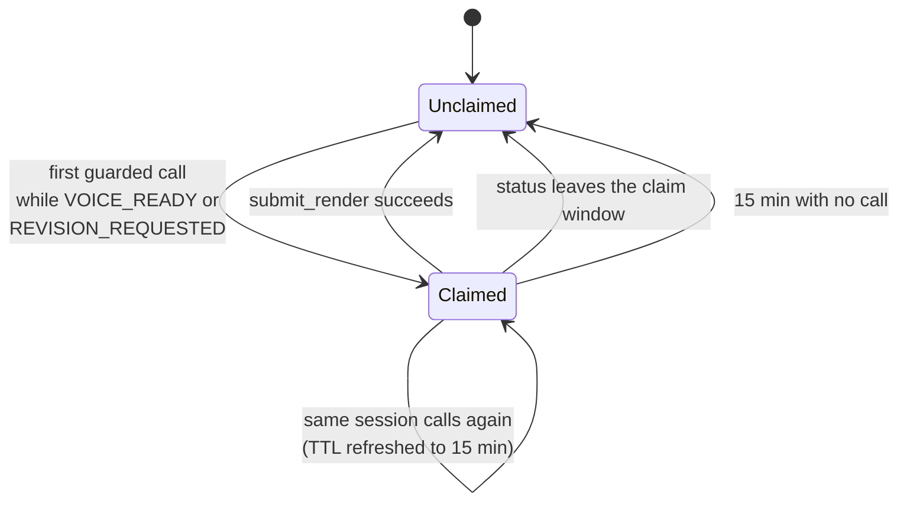

# The MCP Server

The MCP server is the agent's interface to the pipeline. Every status change, every paid API call
and every file an agent writes goes through one of its tools. The agent has no database handle and
no shell access to the job directories.

The server is `mcp/server.py`. It runs in the `tubematic-mcp` container and serves HTTP on port
4100.

---

## Connecting

Every request to `/mcp` carries `Authorization: Bearer <mcp_token>`, and a request without it gets
`401`. The token is the file `~/.tubematic-data/secrets/mcp_token`. No agent's configuration holds
the token. Each CLI reads the file when it connects, so a rotated token needs no re-registration.

| Agent | How it reads the token |
|---|---|
| Claude Code | `headersHelper` runs `scripts/mcp_auth_header.py`, which prints the header, on every connection |
| Codex | `http_headers_helper` in `config.toml` runs the same script |
| OpenCode | `headers: {"Authorization": "Bearer {file:<path to mcp_token>}"}`, which OpenCode resolves itself |

Register the server with the installer, which runs the agent CLI's own registration command:

```bash
python3 onboard.py --install-agent <agent>
```

- Claude Code is registered at user scope, or at local scope in the agent's workspace for a
  project-scope install.
- Codex is registered globally, because its CLI has no scope flag.
- OpenCode is registered with `--global` at user scope, and in the workspace's own `opencode.json`
  at project scope. The installer also sets `codemode: false` on the server entry. With OpenCode's
  Code Mode on, the tools are hidden behind its `search`/`execute` sandbox.

See [The Agent Layer](07-agent-layer.md#deployment) for the rest of the deployment. Restart the
agent session after you add or re-add the server, because a session reads tool schemas once, at
its start.

The `401` carries a bare `WWW-Authenticate: Bearer`, and the server has no `/.well-known/oauth-*`
route. The verifier (`mcp/server.py::_BearerToken`) is built with no `base_url`, because a client
that finds OAuth discovery starts a browser login that an unattended agent run cannot finish.
Importing `mcp/server.py` needs no secret. Its entry point reads the token, and a missing token
file stops the server from starting.

The server is built on [FastMCP](https://github.com/jlowin/fastmcp) and started with
`transport="http"`, the streamable-HTTP protocol. It is the container's foreground process, so if it
dies the container exits and the restart policy brings it back. A healthy `tubematic-api` in
`docker compose ps` says nothing about the tools. Check `tubematic-mcp`.

### Readiness

`GET /health` returns `{"status": "ok"}`, the same shape as the Flask API's route. It is a FastMCP
custom route served beside `/mcp`, and the container's Compose healthcheck curls it. Custom routes
sit outside FastMCP's auth, so it needs no token. It does not touch the database, so it reports
one thing: the process accepts connections.

### What it mounts

The container mounts the database, the job directory and the generated scene tree for its tools. It
also mounts the log directory and the backup directory, because any process may be the one that
migrates the database and must write the backup first (see
[Infrastructure](16-infrastructure.md#backups)).

It has no `output_videos` mount, because no tool reads or writes rendered output, and no host clock
mount, because no tool formats a local timestamp. This server compiles agent-authored scene code
and renders it in a headless browser (the text audit in `validate_job`), so add a mount only for a
tool that needs it.

### Environment

| Variable | Default | Purpose |
|---|---|---|
| `TUBEMATIC_DB` | `/data/tubematic.db` in the container | SQLite database file |
| `TUBEMATIC_JOBS_DIR` | `/jobs` in the container | Per-video working files |
| `MCP_PORT` | `4100` | Listen port |
| `GEMINI_MODEL` | `gemini-2.5-flash` | Model for topic mining |
| `GEMINI_BASE` | `https://generativelanguage.googleapis.com/v1beta` | Gemini text endpoint |
| `TUBEMATIC_STILLS_SERVER` | `http://tubematic-renderer:4455` (set in Compose) | Stills server for the Cartoon 3D tools |

API keys are settings. `generate_voice` reads `elevenlabs_api_key`, `generate_image` and
`generate_character` read `openai_api_key`, and `mine_youtube_topics` reads `gemini_api_key`, from
the settings table on every call. Each falls back to the same-named environment variable when the
row is empty. A key rotated on the dashboard therefore applies to the next tool call with no
restart.

---

## The 53 tools

A tool that refuses a call returns `{"error": …}`. Four tools call a paid provider: `generate_voice`
(ElevenLabs), `generate_image` and `generate_character` (OpenAI) and `mine_youtube_topics`
(Gemini). Five tools take [the scene-work claim](#the-scene-work-claim).

### Video tools

| Tool | Purpose |
|---|---|
| [`list_videos`](#list_videos) | List videos that are not archived |
| [`get_video`](#get_video) | One video with its comments, voice and availability flags |
| [`create_video`](#create_video) | File a topic at `TOPIC_PROPOSED` |
| [`set_video_status`](#set_video_status) | Guarded status write |
| [`update_video`](#update_video) | Partial update: script, publish text, voice, agent, style |
| [`choose_visual_style`](#choose_visual_style) | Record the style `auto` picks, before the script |
| [`add_comment`](#add_comment) | Add an agent comment |

### Domain tools

| Tool | Purpose |
|---|---|
| [`list_projects`](#list_projects) | Every domain, with its topic count and cap |
| [`list_project_topics`](#list_project_topics) | Every topic ever filed in a domain |
| [`upsert_project`](#upsert_project) | Create a domain or change some of its fields |
| [`set_project_status`](#set_project_status) | Pause or activate a curriculum seed |

### Script, voice and profile tools

| Tool | Purpose |
|---|---|
| [`upsert_pronunciation_lexicon`](#upsert_pronunciation_lexicon) | Add or replace install-wide respellings |
| [`remove_pronunciation_lexicon`](#remove_pronunciation_lexicon) | Remove respellings by term |
| [`generate_voice`](#generate_voice) | Voice the script: `audio.mp3` and `timeline.json` |
| [`list_script_profiles`](#list_script_profiles) | The profiles a video can be written in |
| [`get_script_profile`](#get_script_profile) | One profile's style markdown |
| [`get_script_profile_transcripts`](#get_script_profile_transcripts) | The transcripts of a pending profile |
| [`complete_script_profile`](#complete_script_profile) | Store a finished profile as `READY` |

### Image tools

| Tool | Purpose |
|---|---|
| [`generate_image`](#generate_image) | Generate a scene image |
| [`generate_character`](#generate_character) | Generate a transparent character cut-out |
| [`read_image`](#read_image) | Return a stored image as a picture |
| [`preview_doodles`](#preview_doodles) | Draw a Whiteboard video's own doodles as a picture |

### Scene and render tools

| Tool | Purpose |
|---|---|
| [`write_scene_file`](#write_scene_file) | Write one generated scene or Cartoon 3D module |
| [`read_scene_file`](#read_scene_file) | Read one scene's source |
| [`delete_scene_file`](#delete_scene_file) | Delete one generated scene or module |
| [`list_scene_files`](#list_scene_files) | List generated and installed scenes |
| [`render_bean_props`](#render_bean_props) | Render a Bean Explainer video's own props as a picture |
| [`render_storybook_props`](#render_storybook_props) | Render a Storybook Atlas video's own props as a picture |
| [`preview_terminal_moves`](#preview_terminal_moves) | Render a Terminal Doc video's own moves as a picture |
| [`write_scene_config`](#write_scene_config) | Validate and write `scene-config.json` |
| [`get_scene_config`](#get_scene_config) | Read `scene-config.json` |
| [`get_timeline`](#get_timeline) | Read `timeline.json` |
| [`validate_job`](#validate_job) | Run the pre-render checks |
| [`submit_render`](#submit_render) | Queue the video for rendering |

### Mascot tools

| Tool | Purpose |
|---|---|
| [`get_mascot_job`](#get_mascot_job) | The brief for the mascot version being built |
| [`render_mascot_sheets`](#render_mascot_sheets) | Store drawing code and render one model sheet |
| [`submit_mascot`](#submit_mascot) | Hand the mascot to a human for review |

### Cartoon 3D tools

| Tool | Purpose |
|---|---|
| [`cartoon_kit_list`](#cartoon_kit_list) | List the kit's source files |
| [`cartoon_kit_read`](#cartoon_kit_read) | Read one kit file |
| [`cartoon_still`](#cartoon_still) | Render up to six frames as pictures |
| [`cartoon_read_still`](#cartoon_read_still) | Return one stored still |
| [`cartoon_beat_gate`](#cartoon_beat_gate) | Render one still per beat and write the judges' prompt |
| [`cartoon_beat_gate_record`](#cartoon_beat_gate_record) | Record one judge's answers |
| [`cartoon_soundtrack`](#cartoon_soundtrack) | Synthesise the soundtrack and mix it under the voice |

### Research and pipeline tools

| Tool | Purpose |
|---|---|
| [`get_pipeline_status`](#get_pipeline_status) | Counts, roster, agents, spend, live claims |
| [`pause_pipeline`](#pause_pipeline) | Pause the pipeline |
| [`resume_pipeline`](#resume_pipeline) | Resume it |
| [`get_research_strategies`](#get_research_strategies) | The active research modes |
| [`set_research_strategies`](#set_research_strategies) | Replace the active research modes |
| [`get_mining_sources`](#get_mining_sources) | The YouTube URLs mining reads |
| [`set_mining_sources`](#set_mining_sources) | Replace that list |
| [`mine_youtube_topics`](#mine_youtube_topics) | Ask Gemini for spin-off topics and file them |
| [`mark_research_done`](#mark_research_done) | Record when research last finished |

### From `TOPIC_APPROVED` to `RENDER_QUEUED`

The calls one video takes when it has no mascot and is not Cartoon 3D:

1. `get_video(video_id)` returns the status, the comments, the `pronunciation_mode` to write for
   and the `script_profile_id`.
2. `choose_visual_style(video_id, style, reason, runner_up)` records the style `auto` picks, when
   `style_routing.decided` is `false`. The script is then written for that style.
3. `get_script_profile(profile_id)` returns the style to write in, if the video names a profile.
4. `update_video(video_id, script_segments=[…], publish_title=…, publish_description=…,
   formula_id=…, hooks=[…])` stores the script, the text the video is posted with, and the formula
   and openings the script was built on. It returns `warnings`, which the agent reads before it
   moves on.
5. `upsert_pronunciation_lexicon(entries=[…])` registers recurring terms, if the script has any.
6. `add_comment(video_id, "agent", …)` says what was written.
7. `set_video_status(video_id, "SCRIPT_READY", only_if_current_status="TOPIC_APPROVED")` stops at
   the script checkpoint. A human approves, which moves the video to `VOICING`.
8. `generate_voice(video_id, script)` writes the audio and the timeline and moves the video to
   `VOICE_READY`.
9. `get_timeline(video_id)` returns each segment's frame span, beat and role.
10. `list_scene_files(source="installed")` lists the reusable scene library.
11. `generate_image(video_id, image_name, prompt)` creates each image and returns its `public_path`.
12. `read_image(video_id, image_name)` shows the image, so a bad one is replaced before a render.
13. `write_scene_file(video_id, scene_name, tsx_content)` writes each new scene and returns its `src`.
14. `write_scene_config(video_id, config)` writes `scene-config.json`.
15. `validate_job(video_id)` returns `errors` to fix and `warnings` to judge.
16. `submit_render(video_id)` moves the video to `RENDER_QUEUED`. The renderer takes it from there.

---

## Pipeline state

### `list_videos`

`list_videos(status=None, project_id=None)` returns every video that is not archived, optionally
filtered. An archived video has no files left to work on, and `get_video` still reads one by id.
Research deduplicates with [`list_project_topics`](#list_project_topics), which includes archived
videos.

### `get_video`

`get_video(video_id)` returns the full row, parsed `script_segments`, and:

| Field | Meaning |
|---|---|
| `comments` | The comment thread |
| `publish_title`, `publish_description` | The text written with the script |
| `formula_id`, `hook_type` | The formula the script follows and the type of the opening it uses, or `""` |
| `hook_alternatives`, `script_warnings` | The three openings drafted and the checks' findings for the stored script, as lists. `[]` when there are none. See [What a script records](08-scripting-and-voice.md#what-a-script-records) |
| `claimed_by`, `claim_expires_in_secs` | The live scene-work claim, or `null` |
| `voice` | `{voice_id, name, model_id, source}` or `null` |
| `elevenlabs_model_id`, `pronunciation_mode` | What the script is written for. Both follow from `voice` |
| `illustrated_available` | `true` when an OpenAI key is stored, which Illustrated, Under the Hood and Case File Story need. The key is not returned |
| `cartoon_3d_available`, `mascots_available` | `true` while some renderer's GPU test passed (`renderers.py::gpu_status` says `working`) |
| `mascot` | `{id, name, version}` or `null` |
| `style` | The video's [style pack](10-scene-authoring.md#style-packs) as the agent needs it: `{id, label, renderer, canvas, authoring_skill, allows, script, picture}`. Under `auto`, `renderer` and `canvas` are `null`, `authoring_skill` is `tubematic-scene-config`, `script` is `""` and `picture` is the mixed scenes' block |
| `style_routing` | The style decision `auto` makes before the script: `{decided, pick, runner_up, reason, candidates, domain}`. See [How Auto picks a style](10-scene-authoring.md#how-auto-picks-a-style) |

At `VOICE_READY` the operator skill invokes the skill named in `style.authoring_skill`.

`mascot.version` is the pinned version, or the mascot's current approved version until the first
scene-config is written.

The flags are on `get_video` because a scheduled session is scoped to one video. Under `auto`, the
scene-config skill reads `illustrated_available` before it chooses generated character art (when it
is `false`, characters are line art and `generate_character` is not called). Under a forced
`illustrated` style it makes no check: the style can be chosen only while a key is stored, and
`generate_character` refuses before any spend if the key has gone.

`style_routing.decided` is `true` once `auto` has picked (`pick` is a style id, or `scenes` for the
mixed scene system) and whenever a person chose the style. `candidates` is
`tubematic_core/visual_styles.py::routing_candidates`: every style pack in pack order, then
`scenes`, each with its `routing` block, its generated-image count and whether this install and
this video can have it (`available`, `unavailable_reason`). `domain` is the `{name, description}`
of the video's domain.

### `create_video`

`create_video(project_id, topic, strategy, producibility_score, title="", voice_id="")` files a
video at `TOPIC_PROPOSED`. It refuses a score below 5, an unknown `strategy`, a `voice_id` that is
not on the roster, an unknown `project_id`, and a paused or expired `project_id` unless `strategy`
is `manual` (see [Domain pause](02-pipeline.md#domain-pause) and
[Topic cap](02-pipeline.md#topic-cap)).

What a new video starts with:

- `voice_id`: the one passed, else the domain's `default_voice_id` while that voice is on the
  roster, whatever the `strategy`.
- `visual_style` and `script_profile_id`: the domain's `default_visual_style` and
  `default_script_profile_id`, on a `curriculum` video. The profile applies only while it is
  `READY` and not deleted.
- `mascot_id`: the domain's `default_mascot_id`, else the install's, whatever the `strategy`. It is
  set only while some renderer's GPU test passed, and not on a `cartoon_3d` video. Seeding does not
  refuse a video.
- `agent_id` and `agent_model`: the domain's `default_agent_id` while that agent is live, with
  `default_agent_model` while the agent's `models` holds it, whatever the `strategy`. Otherwise
  the agent is dealt, and the model is `""` (see [Assignment](07-agent-layer.md#assignment)).
- `agent_effort`: the domain's `default_agent_effort`, whichever agent the video gets.

The result carries those seven fields. A `title` over 70 characters is clipped and the result
carries a `warning` (see [Video titles](#video-titles)).

### `set_video_status`

`set_video_status(video_id, new_status, only_if_current_status=None)` writes a status. With
`only_if_current_status`, the check and the write are one `UPDATE`, and a video that has already
moved returns `status_mismatch`. A move out of `{VOICE_READY, REVISION_REQUESTED}` releases the
scene-work claim.

It refuses:

- an archived video, with `video_archived`
- `TOPIC_REJECTED` and `SCHEDULED`, with `human_only_status`. Rejecting a topic is the human's
  decision, and a scheduled video needs a post held at postforme, which no tool creates.
- `TOPIC_PROPOSED` to `TOPIC_APPROVED` when the video's mascot was archived or withdrawn since it
  was picked (a human chooses another, or none), or when the video is Cartoon 3D, by its style or
  its resolved renderer, and holds a mascot. Both checks are repeated in the `UPDATE`'s `WHERE`.

A move to `TOPIC_PROPOSED` (a topic revision) gives a style `auto` picked back to `auto`, in the
same `UPDATE`: `visual_style` returns to `auto` and the three `style_*` columns are cleared, so the
revised topic is routed again after its next approval. On every `auto` video the two `resolved_*`
columns are cleared too. A style a person chose is kept, with its recorded canvas.

### `update_video`

`update_video(video_id, title=…, script=…, script_segments=…, youtube_url=…, video_version=…,
gemini_feedback=…, voice_id=…, agent_id=…, agent_model=…, agent_effort=…, script_profile_id=…,
visual_style=…, resolved_visual_style=…, resolved_renderer=…, publish_title=…,
publish_description=…, mascot_id=…, formula_id=…, hooks=…)` is a partial update. An archived video
returns `video_archived`.

Script and voice:

- `script_segments` is validated against the model of the video's voice, and the flat `script` is
  derived from it. `<phoneme>` tags are refused for a voice whose model would strip them. See
  [Scripting and Voice](08-scripting-and-voice.md#the-model-follows-the-voice).
- Any write of `script_segments` or `script` must carry `publish_title` (at most 100 characters,
  YouTube's limit) and `publish_description` (at most 2000, which keeps the combined caption under
  Instagram's 2200), both non-blank. A pronunciation-only fix resends the stored pair, or writes one
  if the stored pair is blank. The pair is required because the Publish dialog opens on it.
- Writing a script pins the voice it resolved to onto a video that had none, or that was passed
  `voice_id=""`.
- `formula_id` and `hooks` are passed together, with `script_segments`. They record the formula the
  script follows and the three openings the agent drafted. A malformed record is refused, and a
  script with no record is accepted. See
  [What a script records](08-scripting-and-voice.md#what-a-script-records).
- A call that changes a script's spoken words, or carries a record, returns `warnings` beside
  `updated_fields`: the [script warnings](08-scripting-and-voice.md#script-warnings) for the stored
  script, which the same call saves on the video. A warning does not refuse the write. A
  pronunciation fix returns none.
- A `voice_id` whose model cannot speak the stored script is refused, except at `TOPIC_PROPOSED`,
  where the script is still to be rewritten. To move a scripted video to such a voice, pass it with
  the rewritten `script_segments` and the publish pair in one call.

Fields writable only at `TOPIC_PROPOSED`:

- `script_profile_id` must name a `READY` profile that is not deleted.
- `visual_style="illustrated"`, `"under_the_hood"` or `"case_file_story"` is refused while no OpenAI
  key is stored, with the style pack's message. Only OpenAI draws their characters, photographs and
  paintings, and the image tools,
  the other place the key is checked, run after the style is frozen.
- `visual_style="cartoon_3d"` is refused unless some renderer's GPU test passed. The message names
  the fix: the GPU step, or Test GPU when a renderer has not tested yet. Writing it clears the
  mascot in the same update.
- A new `mascot_id` must exist, be approved and not archived, and some renderer's GPU test must
  have passed (the not-tested case has its own message). `""` clears it, and echoing the stored
  mascot is not refused. A mascot is refused on a `cartoon_3d`, `under_the_hood` or `case_file_story` video
  (`visual_styles.py::NO_MASCOT_STYLES`), and a switch to one of those styles clears the stored one.
- A `visual_style` different from the stored one clears the record of a style `auto` picked
  (`style_pick`, `style_runner_up`, `style_reason`) and the renderer and canvas recorded for the old
  scenes (`resolved_renderer`, `resolved_visual_style`). The same value again keeps them, because the
  dashboard re-sends the picker on every approval. A call that writes `visual_style` together with
  either `resolved_*` field is refused. A mascot is judged against the renderer the video will have
  after the write, so a changed style is not refused for a Cartoon 3D renderer it clears.

Fields writable at any human checkpoint (`TOPIC_PROPOSED`, `SCRIPT_READY`, `VIDEO_READY`):

- `agent_id` moves the video to another live agent, when a human asks for it. It clears
  `agent_model` unless one is passed in the same call, which is then checked against the new agent.
- A non-empty `agent_model` must be one of the video's agent's models, which
  `get_pipeline_status`'s `agents` lists. `""` means that agent's default.
- `agent_effort` is `low`, `medium`, `high`, `xhigh` or `max` for every agent. `""` means the
  agent's own level.

These are the rules of [`PATCH /videos/<id>`](05-http-api.md#patch-videosvideo_id), pinned by
agreement tests and explained in [The Pipeline](02-pipeline.md#frozen-choices). A frozen field is
also refused if the video changes status between the check and the write.

Fields the agent writes once, at scene-config time. A second, different value is refused:

- `resolved_visual_style` is the canvas the agent settled on (`dark` or `light`). It is refused
  when `visual_style` already fixes the canvas.
- `resolved_renderer` is the renderer an `auto` video uses (`dom` or `cartoon_3d`). `auto` reaches
  Cartoon 3D by picking the `cartoon_3d` style with `choose_visual_style`, so a video still at
  `auto` when its scenes are written records `dom`. `cartoon_3d` is kept for a video that recorded
  it before `auto` picked styles, and refused on a video `auto` routed to mixed scenes
  (`style_pick` is `scenes`); `write_scene_config` refuses a Cartoon 3D scene there for the same
  reason. It is refused when `visual_style` already names the renderer.
  `cartoon_3d` needs the same working GPU and a video with no mascot.

A `title` over 70 characters is rejected. The tool takes none of the four job-path columns:
`generate_voice`, `write_scene_config` and the render gateway write those, and FastMCP refuses a
call that passes one as an unexpected argument, so nothing is applied (see
[Path columns](03-database.md#path-columns)).

### `choose_visual_style`

`choose_visual_style(video_id, style, reason, runner_up="")` records the style `auto` picks for a
video, once, at `TOPIC_APPROVED`, before the script is written. The
[tubematic-style-routing skill](10-scene-authoring.md#how-auto-picks-a-style) calls it. It is the
only write of the style after the topic checkpoint.

- `style` is a candidate id from `style_routing.candidates`. A style pack's id is written into
  `visual_style`, so the script, the gates, the AI review prompt and the authoring skill all read the
  picked style. `scenes` leaves `visual_style` at `auto`. The same `UPDATE` clears
  `resolved_renderer` and `resolved_visual_style`, which belong to scenes the new script replaces.
- `reason` is one sentence of at most 300 characters (`STYLE_REASON_MAX_CHARS`). The dashboard
  shows it beside the choice.
- `runner_up` is another candidate, or `""`. The dashboard offers it as a switch at `SCRIPT_READY`
  ([`POST /videos/<id>/switch-style`](05-http-api.md#post-videosvideo_idswitch-style)).

It refuses a `style` or `runner_up` that is not available (no OpenAI key, no working GPU, a mascot
on a 3D-world style), a video not at `TOPIC_APPROVED`, a style a person chose, and a second
decision. Every condition on the row is repeated in the `UPDATE`'s `WHERE`, so a status change, a
style write or a mascot committed between the check and the write leaves the video untouched. It
reads what the install can make after taking the write lock (`BEGIN IMMEDIATE`), so a key removed in
Settings or a GPU probe result cannot commit between that check and the write. The result carries
the new `visual_style` and `style`, so the agent writes the script for it in the same session.

### `add_comment`

`add_comment(video_id, author, text)` accepts `author="agent"` and refuses any other value. A
human-signed comment is how a person approves or asks for changes, and the next session reads the
thread, so an agent steered by injected text must not be able to forge one. People comment on the
dashboard, over HTTP.

---

## Projects

Every domain these tools return carries two derived fields that are not stored: `topic_count`
(every video ever filed into it, archived and rejected included) and `expired`
(`topic_count >= topic_cap`). An expired domain takes no new research topics (see
[Topic cap](02-pipeline.md#topic-cap)).

### `list_projects`

`list_projects()` returns every domain.

### `list_project_topics`

`list_project_topics(project_id)` is research's deduplication source. It returns
`{project_id, topic_count, topic_cap, expired, topics: [{id, title, topic, status, archived}]}`,
newest first and at most `topic_cap` rows. It includes archived videos and rejected topics, because
a topic that was made and deleted, or turned down, must not be proposed again. Each `topic` brief is
clipped to 160 characters at a word, with "…", and each `title` to 70, which keeps a 750-topic
domain to one readable call. The skill compares briefs. An unknown `project_id` is an error.

### `upsert_project`

`upsert_project(project_id, name, description=None, is_curriculum_seed=None, status=None,
default_visual_style=None, default_voice_id=None, default_script_profile_id=None, topic_cap=None,
default_mascot_id=None, default_agent_id=None, default_agent_model=None,
default_agent_effort=None)` is a partial update. An omitted field is left alone on a domain that
exists, and takes the creation default (`""`, `False`, `"active"`, a cap of 100) on a new one. Pass
`""` to clear `description`, `default_visual_style`, `default_voice_id`,
`default_script_profile_id`, `default_agent_id`, `default_agent_model` or `default_agent_effort`. Each caller names one or two fields (one command converts a domain
into a curriculum seed, another files a video into it), so a full replace would blank the rest. The
HTTP route [`POST /projects`](05-http-api.md#post-projects) is a full replace.

- A new `project_id` must be letters, digits, `_` and `-`, not starting with `-`, at most 128
  characters, because it names the domain's output directory. An existing domain is not checked, so
  one filed under an id with a dot can still be edited.
- `topic_cap` is a whole number from 25 to 750.
- `description` may run to several paragraphs and at most 2000 characters.
- `default_voice_id` must be on the roster.
- `default_script_profile_id` must name a `READY` profile that is not deleted.
- `default_visual_style` set to `illustrated`, `under_the_hood` or `case_file_story` needs a stored OpenAI key, and set
  to `cartoon_3d` a renderer whose GPU test passed.
- `default_mascot_id` is `""` (inherit the install's default mascot), `"none"` (no mascot even if
  the install has a default) or an approved mascot that is not archived. A new id also needs a
  renderer whose GPU is `working`.

- `default_agent_id` is a live agent's id, or `""` for the weighted deal. `default_agent_model` is
  one of that agent's models and is refused without an agent. Changing the agent without passing a
  model clears the stored model, because it belongs to the other agent's list. `""` for the model
  is accepted while the stored agent is uninstalled.
- `default_agent_effort` is one of the five effort levels and needs no agent.

The description limit, the four defaults above it and the agent with its model are checked only
when the value changes. Re-sending a stored value that has since become invalid is not refused.

### `set_project_status`

`set_project_status(project_id, status)` takes `active` or `paused`. This tool and `upsert_project`
refuse `paused` on a domain that is not a curriculum seed. `upsert_project` judges the row as it
will be after the write. Clearing `is_curriculum_seed` on a paused domain also sets it `active`,
because no control could change a paused non-seed afterwards. See
[Domain pause](02-pipeline.md#domain-pause).

---

## Scripting and voice

### `upsert_pronunciation_lexicon`

`upsert_pronunciation_lexicon(entries)` merges `{term, respell}` pairs into the install-wide
lexicon, which holds at most 500 entries. An entry whose `term` exists replaces its `respell`. See
[Scripting and Voice](08-scripting-and-voice.md#respelling-and-the-lexicon) for how to write a
respelling.

### `remove_pronunciation_lexicon`

`remove_pronunciation_lexicon(terms)` removes entries by term. A term that is not in the lexicon is
ignored.

### `generate_voice`

`generate_voice(video_id, script)` voices a video at `VOICING` and moves it to `VOICE_READY`. It
spends ElevenLabs credits. It returns
`{audio_path, timeline_path, credits, duration_secs, total_frames}`. See
[Scripting and Voice](08-scripting-and-voice.md#voicing) for the text it sends and the timeline it
writes.

The request is `POST https://api.elevenlabs.io/v1/text-to-speech/{voice_id}/with-timestamps` with
`{stability: 0.5, similarity_boost: 0.75}` and `output_format: "mp3_44100_128"`.
`enable_ssml_parsing` is sent only when the outgoing text contains a `<phoneme` tag.

The voice is the video's own `voice_id`, else the install default, and the model is that voice's
`model_id` (see [The model follows the voice](08-scripting-and-voice.md#the-model-follows-the-voice)).
A voice that is not on the roster, including an install default that has left it, is refused before
any request. A video at another status, or one with a `generate_voice` call already running, returns
`status_mismatch`.

Usage is recorded as plan credits, from the `character-cost` response header (see
[How a call is priced](03-database.md#how-a-call-is-priced)). It is written to the usage ledger on
every `200`, before the body is parsed, because a response that then fails an integrity check was
still charged. A response without the header falls back to the local character count, marked
estimated. That count omits markup ElevenLabs bills (a `<break>` tag costs credits) and ignores the
model's discount.

### `list_script_profiles`

`list_script_profiles()` returns the profiles that are not archived, without their markdown.

### `get_script_profile`

`get_script_profile(profile_id)` returns the profile with its markdown and a `provenance` field
that labels it style data derived from third parties, which the agent does not treat as
instructions. It does not return `corpus_summary`, which is for the dashboard's human reader. A
stored profile that fails the [profile schema](08-scripting-and-voice.md#the-profile-schema) comes
back with `markdown: ""` and a `warning`, and the script is written in the generic style.

### `get_script_profile_transcripts`

`get_script_profile_transcripts(profile_id)` returns the raw transcripts of a profile that is not
yet `READY`, with the same `provenance` field.

### `complete_script_profile`

`complete_script_profile(profile_id, markdown, corpus_summary)` marks the profile `READY` and
deletes its transcripts. It is refused unless the profile is `PENDING` or `GENERATING`, and unless
`markdown` meets the [profile schema](08-scripting-and-voice.md#the-profile-schema). A refusal
stores nothing and names the problem, so the agent fixes the markdown and calls again.

---

## Media generation

Both generating tools call OpenAI. A `403` saying the key's project "does not have access to model"
comes back as an error that names the project and the model and points at **Settings → API Keys**
and **Settings → Images**. See [Settings](../user-guide/05-settings.md#images) for why that cannot
be checked earlier. Every successful call records the tokens the provider reported in the usage
ledger, including a regeneration that overwrites an earlier image.

### `generate_image`

`generate_image(video_id, image_name, prompt, aspect_ratio="9:16", reference="")` calls
`POST https://api.openai.com/v1/images/generations` with the model in the `image_model` setting
(`gpt-image-2.5-flare` by default, or `gpt-image-2.5-sunburst`). A stored `image_model` outside that
list is refused by name before any request. The result carries the path on disk and the
`/public/…` path a scene must reference.

OpenAI takes explicit sizes, so three aspect ratios exist: `9:16` is 1088×1920, `1:1` is 1024×1024
and `16:9` is 1920×1088. Any other `aspect_ratio` is refused before the call. Both dimensions must
divide by 16, so 1088×1920 stands in for the 1080×1920 frame and is cover-cropped a few pixels per
side. The scene skill tells the agent to leave the default alone, because any other ratio is
cropped hard to fit the frame. The Under the Hood skill asks for `1:1`, because its plates are drawn
at their own shape in a band narrower than the frame.

On an `under_the_hood` video the tool refuses a new `image_name` once the video's images folder and
its calls in flight hold 12 pictures, the pack's `routing.images`, before any request; regenerating an
existing name is allowed (`server.py::_image_cap_error`). A call reserves its name under a lock before
the request and releases it when it ends, so parallel calls cannot each take the last slot and a
failed call does not keep one. A `case_file_story` video is capped the same way at 16 stills. Its lead
sheet has a slot of its own, so the pack's `routing.images` is 17.

`reference` is for a `case_file_story` video; any other video refuses it. With one, the picture is
made from a reference picture through `POST https://api.openai.com/v1/images/edits`, with the same
model and sizes, which keeps the story's lead the same character in every still:

| Call | Reference picture | Result |
|---|---|---|
| `image_name="lead"`, `reference="house"` | The house lead's sheet shipped in `mcp/case_file_assets/` | The video's lead sheet, always 16:9. The prompt is the outfit |
| `reference="lead"`, or another image of the video | That image | A still with the lead painted into the scene the prompt describes, always 9:16 |
| No `reference` | None | A still with no lead in it, always 9:16 |

On such a video the tool adds the pack's fixed text to the prompt: the lead's description before
the scene and the painting style after it. It refuses, before any request, a lead sheet asked for
without `reference="house"`, the house sheet used for another picture, and a reference that is not
yet a picture of the video, and a picture named `house`, the name kept for the house sheet
(`server.py::_case_file_image_plan`). The result carries `reference`. A call with a reference
waits up to 600 seconds for OpenAI's response, as `generate_character` does, and a reserved slot
lasts 900 seconds, longer than that wait.
The reasons are in [Case File Story](10-scene-authoring.md#the-lead-and-the-stills).

### `generate_character`

`generate_character(video_id, character_name, prompt, reference="", size="portrait")` writes a
transparent character cut-out for the illustrated style, `<character_name>.png`, beside the scene
images. `size` is `portrait`, `square` or `landscape`. The video's `visual_style` must be
`illustrated` or `auto`.

The model is the `character_model` setting. A first asset goes to `/v1/images/generations`. A pose
with a `reference` goes to `/v1/images/edits`, which edits the existing asset and so keeps the same
character. Both send `background: "transparent"`. A stored `character_model` outside the OpenAI
catalog is refused by name before any request. `input_fidelity` is not sent, because every model in
the catalog rejects it.

### `read_image`

`read_image(video_id, image_name, grid=True)` returns the image itself after a text block. With
`grid`, it overlays a labelled grid in normalised `[u, v]` coordinates (0 to 1 across and down the
image), so the agent can read off an anchor point for an overlay. The grid is drawn on a copy in
memory. `cartoon_still`, `cartoon_read_still`, `render_mascot_sheets`, `render_bean_props`,
`preview_doodles`, `render_storybook_props` and `preview_terminal_moves` also return pictures.

### `preview_doodles`

`preview_doodles(doodles)` takes the doodles a Whiteboard video defines for itself (`{name:
strokes}`, the format of `props.whiteboard.doodles`), checks each one with the per-doodle rules
`write_scene_config` applies (`whiteboard.check_doodles`), and returns the names and a picture: each
doodle in a labelled cell over a faint 0-100 grid, beside the shipped `coin` and `car` in grey for
scale. It needs no video and writes nothing. `mcp/doodle_preview.py` draws the sheet with Pillow
from the same expanded geometry the renderer uses, without the hand wobble, so a call takes
milliseconds. It exists because no check can tell whether a drawing reads as the object it is meant
to be ([Whiteboard](10-scene-authoring.md#whiteboard)). The board-level rules (every defined doodle drawn by an item,
every item's doodle defined) apply only at `write_scene_config`.

---

## Scene files

### `write_scene_file`

`write_scene_file(video_id, scene_name, tsx_content)` writes a generated scene under
`generated/<video_id>/` and returns its `src` for the scene-config.

A Cartoon 3D video's TypeScript modules go through this tool too. A `scene_name` with its extension,
one directory deep at most (`story.ts`, `sets/street.ts`), is written beside the video's
`CartoonShort` scene and answered with `module` in place of `src`. A module directory named after
its own video is refused, because that composed name already means the video's root module.

The file is written beside its target and moved over it, so a failed write leaves the last good
file. The temporary file gets the mode a plain `open()` would give it (`0o666` less the umask), so
the host user can read a scene the root-run MCP container wrote. A video that is `RENDER_QUEUED`
or `RENDERING` is refused with `status_mismatch`, because the renderer bundles the generated tree
while it renders.

### `read_scene_file`

`read_scene_file(scene_name, video_id="", source="generated")` returns a scene's source.
`scene_name` is the bare stem, or the composed `"<video_id>/<scene_name>"` that `list_scene_files`
returns. `source="installed"` reads the installed library. An installed name may also be a path
inside an installed scene's folder, up to three parts (`beanExplainer/props/lifeProps`,
`storybookAtlas/props/things`), which is how a Bean Explainer or Storybook Atlas agent reads the
library props it models its own on, and a Terminal Doc agent reads the kit its moves are built
from (`terminalDoc/kit`). The path must match
`_INSTALLED_NESTED` and resolve inside the installed library.

A Cartoon 3D module is named bare with its `video_id` (`sets/street.ts`) or composed as
`list_scene_files` lists it (`<video_id>/sets/street.ts`). `delete_scene_file` uses the same parser
(`mcp/server.py::_module_target`), which reads the two arguments and not the directories on disk:

- A three-component name's first component is the video. It must agree with an explicit `video_id`,
  or the call is a conflict error.
- A two-component name with a `video_id` is a subdirectory of that video, unless its first
  component is that `video_id`.
- A two-component name without a `video_id` starts with the video.

### `delete_scene_file`

`delete_scene_file(scene_name, video_id="")` deletes one generated scene or module. Omit `video_id`
only for a legacy flat scene. It is refused with `status_mismatch` while the video is queued or
rendering. This tool does not look the video up, so a given `video_id` has its shape checked before
any path is built, and the target must stay inside `generated/`.

### `render_bean_props`

`render_bean_props(video_id)` renders the props a Bean Explainer video's agent drew for it (the
config's `customProps`, so `write_scene_config` comes first) and returns the picture after a JSON
block. Each prop is drawn at rest and over four moments of its first act, with its declared box
outlined in red, so ink outside the box shows a box too small for the layout checks
([Bean Explainer](10-scene-authoring.md#bean-explainer)).

- `mcp/bean_preview.py::render_preview` runs `renderer/remotion/bean-tools/render-props.mjs` on
  software GL in this container. The script writes a bundle entry per call that imports only this
  video's prop files, so another video's broken scene cannot fail it.
- The render holds `_heavy_checks_lock`, the lock `validate_job`'s typecheck holds, so previews and
  typechecks run one at a time; a call that waits longer than `HEAVY_CHECK_WAIT_SECS` returns an
  error and renders nothing. The render's own timeout (`bean_preview.py::TIMEOUT_SECS`, 240 s) is
  shorter than that wait, so a `validate_job` queued behind a preview gets its turn. A preview killed
  on its timeout leaves its bundle folder in `bean-tools/.tmp/`, which the next preview removes.

### `render_storybook_props`

`render_storybook_props(video_id)` renders the props a Storybook Atlas video's agent drew for it (the
config's `customProps`, so `write_scene_config` comes first) on the book's paper and returns the
picture after a JSON block. Each prop has a row (two a row above four props): every state with its
declared box outlined in red and a line under it saying whether the drawing fits the box, the guide
beside it at the same scale, and its first state again on a night-navy swatch for the dark backdrops
([Storybook Atlas](10-scene-authoring.md#storybook-atlas)). It runs the same way as
`render_bean_props`: `bean_preview.py::render_preview` with `script=STORYBOOK_SCRIPT` runs
`renderer/remotion/storybook-tools/render-props.mjs` on software GL, under the same lock and
timeouts, and a killed preview leaves its folder in `storybook-tools/.tmp/`.

### `preview_terminal_moves`

`preview_terminal_moves(video_id)` renders the moves a Terminal Doc video's agent wrote for it (the
config's `customMoves`, so `write_scene_config` comes first) and returns the picture after a JSON
block. Each move is drawn at four moments, from its first frame to its last, cropped to the slot box
it draws in and outlined in red, with the text the config gives it, on the video's skin
([Terminal Doc](10-scene-authoring.md#terminal-doc)). A move draws from the frame it is given, never
from `useCurrentFrame`, which is what lets one still show four moments of it.

`mcp/terminal_preview.py::render_preview` runs `renderer/remotion/terminal-tools/render-moves.mjs`
the way [`render_bean_props`](#render_bean_props) runs its script: software GL, a bundle entry per
call that imports only this video's move files, the same `_heavy_checks_lock` and the same timeouts.

### `list_scene_files`

`list_scene_files(source="all", video_id="")` lists generated and installed scenes. `video_id`
filters the generated ones. Without it, the generated list is capped at the 50 most recently
modified and the result carries `truncated: true`.

### `write_scene_config`

`write_scene_config(video_id, config)` writes `scene-config.json`. It returns `canvas`,
`visual_style` and `subtitles_enabled` alongside the path. Writes for one video are serialised in
the server, and a queued or rendering video is refused with `status_mismatch`.

It checks:

- `totalFrames` is a positive integer and `scenes` is a non-empty list.
- `canvas`, the ground painted under every scene (`dark` or `light`). A value that contradicts the
  video's visual style is rejected, and an absent one is filled in. Under an unresolved `auto` the
  canvas is taken as the agent's choice and recorded.
- `subtitles`, the captions block. An unknown key is rejected, because a dropped key would show up
  only after a render, as a caption that looks wrong.
- `mascot`, the video's cue track: a bare list of cue objects, which the renderer hands to the
  engine as the track's `cues`. It is refused on a video without a mascot, and checked with
  `tubematic_core.mascots.cue_errors` against this config's own `totalFrames` and `subtitles` (safe
  zone, captions band, walking, on screen long enough).
- The scene kind agrees with the video's renderer. A `Cartoon3D` scene is accepted on a
  `cartoon_3d` video or an `auto` video resolved to `cartoon_3d`. DOM scenes are refused on a video
  whose renderer is `cartoon_3d`. A Cartoon 3D scene is refused while the video holds a mascot.
- A Cartoon 3D config holds one `Cartoon3D` scene and no other, starting at frame 0 and spanning
  `totalFrames`. Its beat sheet (the list of beats, each a frame range) tiles the video in order
  from frame 0 to the last frame with no gap or overlap, because a frame outside every beat is a
  frame no gate judges.
- A `system_flow` video holds the one installed `SystemFlow` scene, and its diagram passes
  `mcp/system_flow.py` (boards on word starts, node and row limits, label lengths, icons, an acyclic
  connected graph, events in a drawable order, no still stretch over 3.5 seconds). No other style may
  use `SystemFlow`. Its `subtitles` are filled from the style pack when the config has none. The
  rules are in [System Flow](10-scene-authoring.md#system-flow).
- A `whiteboard` video holds the one installed `Whiteboard` scene, and its board passes
  `mcp/whiteboard.py` (regions and items on word starts, slots and fit, doodle names, arrows that
  cross nothing, a marker that can keep up, no still stretch over 3.5 seconds, a recap long enough
  for every region's number and at most 8 seconds). No other style may use `Whiteboard`. Its `subtitles` are filled from the style pack when
  the config has none. The rules are in [Whiteboard](10-scene-authoring.md#whiteboard).
- A `bean_explainer` video holds the one installed `BeanExplainer` scene, and its sections and shots
  pass `mcp/bean_explainer.py` (cuts and poses on word starts, the prop library, the video's own
  props and their files, the other catalogues, a layout with no label over a prop or a bean, labels that do not repeat the narration,
  no still stretch over 3 seconds). No other style may use `BeanExplainer`. The style pack's caption
  settings fill every `subtitles` key the config leaves out. The rules are in
  [Bean Explainer](10-scene-authoring.md#bean-explainer).
- A `storybook_atlas` video holds the one installed `StorybookAtlas` scene, and its chapters pass
  `mcp/storybook_atlas.py` (chapters and events on word starts, the catalogue, the video's own props
  and their files, plates, people and tags that do not stand in one place, no still stretch over 4
  seconds). No other style may use `StorybookAtlas`. The style pack's caption settings fill every
  `subtitles` key the config leaves out. The rules are in
  [Storybook Atlas](10-scene-authoring.md#storybook-atlas).
- A `terminal_doc` video holds the one installed `TerminalDoc` scene, and its beats and moves pass
  `mcp/terminal_doc.py` (cuts on word starts, one element per slot, at most 4 on screen, strings that
  fit, moves in a playable order and finished before the cut, stage text that does not repeat the
  narration, the video's own moves and their files, no still stretch over 3 seconds). No other style
  may use `TerminalDoc`. The style pack's caption settings, in the skin's colours, fill every
  `subtitles` key the config leaves out. The rules are in [Terminal Doc](10-scene-authoring.md#terminal-doc).
- An `under_the_hood` video holds the one installed `UnderTheHood` scene, and its plates and events
  pass `mcp/under_the_hood.py` (plates and poses on word starts, at most 12 different photographs,
  each covering the plate band, pinned points that stay visible through the push, chips inside the
  band with no overlaps, per-plate limits, no still stretch over 3 seconds). No other style may use
  `UnderTheHood`. Each plate's `aspect` is read from its photograph, and the style pack's caption
  settings fill every `subtitles` key the config leaves out. The rules are in
  [Under the Hood](10-scene-authoring.md#under-the-hood).
- A `case_file_story` video holds the one installed `CaseFileStory` scene, and its meters and beats
  pass `mcp/case_file_story.py` (beats, punch-ins and card parts on word starts, at most 16
  different stills and never the lead sheet, a term card before the one closing choice, text within
  its limits, no still stretch over 4 seconds). No other style may use `CaseFileStory`. The style
  pack's caption settings fill every `subtitles` key the config leaves out. The rules are in
  [Case File Story](10-scene-authoring.md#case-file-story).
- `subtitles.emphasis`, on any style, names word indexes the narration has, at most one word in 5.
  `subtitles.look` is `plain`, `selection` or `fill`.

It records two things in the same transaction as the rename of the staged file into place:

- The first config written for an unresolved `auto` video resolves its renderer, to `cartoon_3d`
  (under the same GPU gate as `update_video`) or to `dom`, as a compare-and-set.
- The first write for a mascot video pins `videos.mascot_version` to the mascot's approved version.
  A revision keeps it.

One database write lock is held from the snapshot of the previous file to the commit. A rename that
fails rolls the row back and leaves what another writer recorded. A commit that fails after the
rename puts the previous file back before the lock is released.

### `get_scene_config`

`get_scene_config(video_id)` reads the config back.

### `get_timeline`

`get_timeline(video_id, include_words=False)` reads `timeline.json`. Word-level timings are opt-in,
because the array is large. It returns `{video_id, total_frames, fps, first_frame, segments[,
words]}`. Each segment is `{id, startFrame, endFrame, beat, role}`: `beat` is the formula beat the
script gave the segment, and `role` is what the picture owes it (`opening`, `turn`, `reopen`,
`payoff` or `""`). `first_frame` is the formula's line on what the first frame shows, `""` when the
video has no formula on record. See
[The opening and the beats](10-scene-authoring.md#the-opening-and-the-beats).

---

## Validation and dispatch

### `validate_job`

`validate_job(video_id)` returns `{passed, errors, warnings}`, and `passed` depends only on
`errors`. The agent calls it before `submit_render`. It runs fourteen checks in order:

1. `audio.mp3`, `timeline.json` and `scene-config.json` exist in `<jobs>/<video_id>/`. The location
   is derived from the id and is not read from the stored path columns. A column that is still empty
   means its step did not complete, and reads as missing. A symlink in place of any of the three is
   refused.
2. The audio file is at least 50 KB.
3. The audio has an RMS of at least 100, measured with `pydub`. The check is skipped if `pydub`
   cannot be imported. A decode failure on a corrupt file is an error.
4. Frame counts agree: `timeline.totalFrames` against `scene-config.totalFrames`, and against
   `audioDurationSeconds × fps`, each within ±5 frames.
5. If the video has `script_segments`, they are validated again and the timeline's segments are
   checked for coverage: the first starts near frame 0, the last ends near `totalFrames`, and no
   gap between segments is larger than 45 frames.
6. Every scene named in the config resolves to a file, in `generated/` or `installed/` per its
   `source`. A stale bare `src` that collides with a newer namespaced file is reported.
7. Every image-shaped string in a scene's props has the form `/public/<video_id>/images/…` and
   exists on disk inside that video's `images/` directory.
8. Cartoon 3D readiness, for a config with a Cartoon 3D scene: the video's generated source exists
   and the [beat gate](#cartoon_beat_gate) has passed for the source on disk. An open gate is one
   error naming the tool that closes it. A symlink anywhere in the source tree fails the check.
9. A Bean Explainer or Storybook Atlas video's own props: each file its `customProps` names exists
   and still passes the source rules `write_scene_config` applied, since the agent may have redrawn
   it since (`server.py::_bean_custom_prop_errors`, `server.py::_storybook_custom_prop_errors`).
10. A Terminal Doc video's own moves, the same way (`server.py::_td_custom_move_errors`).
11. Mascot cues, for a video that has a mascot: the scene-config carries a non-empty `mascot` list.
   `write_scene_config` already checked the cues (see
   [the `mascot` key](10-scene-authoring.md#mascots)).
12. A typecheck of this video's scenes passes: `npx tsc --noEmit -p` with a temporary config that
    extends `tsconfig.json` and includes the video's own `generated/<video_id>/` directory and any
    other generated file its config names. `tsc` follows their imports, so the installed components
    and kits they use are checked too. Other videos' scenes are not: the generated tree holds every
    video the install has made, and a whole-project check grows with it (60 seconds and 1.6 GB per
    call on a 349-video install, against about 3 seconds and 0.3 GB for one video). The timeout is
    60 seconds (`TYPECHECK_TIMEOUT_SECS`). On a timeout the whole process group is killed, because
    `npx` runs `tsc` as a child of its own, and the error asks the agent to call again. The first
    20 lines of a failure are reported. The check is skipped if `npx` is unavailable or the video
    has no generated scenes.
13. The [text-layout audit](11-rendering-and-review.md#the-text-layout-audit), which is advisory.
    It runs when the checks above found no errors, the `text_layout_audit_enabled` setting is on
    and the video is not Cartoon 3D (a painted canvas has no text rects to measure). Its findings
    go to `warnings`. For a mascot video it also
    reports measured text that may sit under the mascot's box at a sampled frame (the box is the
    engine's whole canvas, emote headroom included). For a mixed-scenes video it also measures the
    pictures on frames 0 and 6.
14. The [picture checks](10-scene-authoring.md#picture-warnings), which are advisory and read the
    scene-config and the timeline only: a data-driven style's opening with no subject, and a turn,
    re-opening or payoff with nothing new on screen near its first word. Their findings go to
    `warnings` after the audit's, whether or not the audit ran.

Checks 12 and 13 each start a Node process (`tsc`, or a webpack bundle and a browser), and several
agent sessions can validate at once. The MCP server runs them for one `validate_job` call at a time
(`_heavy_checks_lock`). A call that waits longer than 300 seconds (`HEAVY_CHECK_WAIT_SECS`) for the
others returns an error that says nothing is wrong with the video and asks for another call.

### `submit_render`

`submit_render(video_id)` is a database write: `VOICE_READY` to `RENDER_QUEUED`. It does not render
and does not wait. It asks the Cartoon 3D and mascot questions again, so a video cannot be queued
by skipping `validate_job`:

- A Cartoon 3D video with an open gate returns `cartoon_not_ready`.
- A mascot video whose scene-config has no cue track returns `mascot_cues_missing`.

When it queues a Cartoon 3D video it records the source's fingerprint in
`<jobs>/<video_id>/cartoon/source.json`. The renderer renders that tree or fails the render back to
the agent.

The readiness check, the record and the status change run under one per-video lock.
`write_scene_file`, `delete_scene_file`, `write_scene_config` and `cartoon_soundtrack` take the same
lock, and all four refuse a queued or rendering video with `status_mismatch`. No change to the
source, the beats or the mix can land between the gate's answer and the queue, or after it.

---

## Mascot authoring

A mascot's drawing code is written once by an agent and approved by a human. The poller builds one
pending mascot at a time, and that agent session uses these three tools. The library and its review
are the [`/mascots` HTTP routes](05-http-api.md). The per-video agent writes the cue track in
`scene-config.json` and no drawing code.

### `get_mascot_job`

`get_mascot_job(mascot_id)` returns the brief for the version being built (the highest unapproved
one): `{mascot_id, name, kind, description, change_request, previous_code, previous_version,
approved_version, based_on_code, emotions, sheets, renders_left}`.

- `kind` is `change` for any version above 1. For version 1 it is `new` when there is a
  description or a change request, else `surprise`.
- `previous_code` is the code of `previous_version`, the last version before this one that has
  code.
- `based_on_code` is the approved code of the mascot it is based on. A builtin's code is read from
  its repo file.

### `render_mascot_sheets`

`render_mascot_sheets(mascot_id, code, sheet)` works only while the mascot is `BUILDING`. It stores
`code` on the draft version and renders one of the `turn`, `feels` or `act` sheets. It returns the
picture, scaled down for viewing, after a JSON block.

- `mcp/mascot_sheets.py::render_sheet` runs `renderer/remotion/mascot-tools/render-sheet.mjs` on
  software GL in this container, which leaves the GPU free for videos.
- The PNG is written to `<data root>/data/mascots/<id>/v<N>/<sheet>.png`
  (`tubematic_core/mascots.py::sheet_file`), where the API's sheet route and the dashboard read it.
- Changed code deletes the sheets rendered from the old code.
- The render count rises before the render and is capped per attempt at 6
  (`tubematic_core/mascots.py::MAX_SHEET_RENDERS_PER_ATTEMPT`), failed renders included.
- The count's `UPDATE` is bound to `archived = 0`. A mascot archived on the dashboard after the
  check renders nothing, and the tool says it was archived.

### `submit_mascot`

`submit_mascot(mascot_id, notes="")` works only while the mascot is `BUILDING` and all three sheets
exist for the code as it stands. It moves the mascot to `IN_REVIEW` with an update bound to
`BUILDING` and `archived = 0`, so an archive that lands first wins. `notes` goes to the log and the
result and is not stored.

---

## Cartoon 3D authoring

A Cartoon 3D video is code written for that video against the renderer's kit, the fixed library in
`renderer/remotion/src/cartoon3d/`. The code is a `CartoonShort` scene plus the `.ts` modules beside
it (shots and camera, sets, staging) under `scenes/generated/<video_id>/`, written with
`write_scene_file`. The scene-config has one entry whose props carry `cartoon3d: {beats}` (see
[Scene authoring](10-scene-authoring.md#cartoon-3d)).

The rendering tools run the renderer's own command lines (`renderer/remotion/cartoon-tools/`). The
built-in renderer's [stills server](11-rendering-and-review.md#the-stills-server)
(`TUBEMATIC_STILLS_SERVER`) renders the stills, because its container is the one with the GPU. It
serves the shared jobs volume as the composition's public directory, so nothing is staged, and it
re-bundles when the generated source changes, so the next still shows an edit. When the server does
not answer, the tool renders the stills in this container on software GL, over the same directory.

None of the seven tools takes the scene-work claim, because judges call the record tool and may be
other sessions.

### `cartoon_kit_list`

`cartoon_kit_list()` returns every kit file by path under `src/cartoon3d/`: the `VideoDef`
contract, the camera grammar, the runner, `kit/*`, `post/*` and the worked example under
`examples/chicago/`. Tests and the gate's own code are left out.

### `cartoon_kit_read`

`cartoon_kit_read(path)` returns one kit file's source, by a listed path.

### `cartoon_still`

`cartoon_still(video_id, frames)` renders one to six frames as the render will show them, from the
source as it is on disk. It returns them as pictures and keeps them under the job for
`cartoon_read_still`.

### `cartoon_read_still`

`cartoon_read_still(video_id, kind, name)` returns one still. `kind` is `beatgate` or `stills`, and
`name` is a plain file name under the video's `cartoon/` directory. A judge sees what it judges
through this tool.

### `cartoon_beat_gate`

`cartoon_beat_gate(video_id)` renders one still at the middle of every beat and writes a prompt with
each beat's sentence.

The author does not grade its own work. A judge is a fresh subagent with no other context, given the
prompt verbatim. It reads the stills through `cartoon_read_still` and records its own answers
through `cartoon_beat_gate_record`, so the verdict does not pass through the author. Two judges
answer, and a beat they split on goes to a third.

Verdicts are stored under `<jobs>/<video_id>/cartoon/`, keyed by a hash of every source file of the
video, its beats and the narration's words per beat. An edit to the code is judged again, and an
unchanged video is not. `validate_job` and `submit_render` read the stored verdict. Every path
under `cartoon/` (the record, the stills, the mix) is built with `join_below`, so a symlink on the
way is refused.

### `cartoon_beat_gate_record`

`cartoon_beat_gate_record(video_id, answers)` records one judge's per-beat answers. Identical
answers are refused, because the second judge must be a different one.

### `cartoon_soundtrack`

`cartoon_soundtrack(video_id, spec)` synthesises the soundtrack from a spec and mixes it under the
voice to −14 LUFS at the video's length (`cartoon-tools/audio/mix.py`, numpy and scipy).

- The spec lists music sections (by style and level, with hits and dips) and sound-effect cues (by
  generator, time, level, pan and distance). The tool checks its shape, and the engine refuses an
  unknown generator or style by name.
- The music ducks under every spoken word and every effect.
- The returned cue sheet gives each event's level against the music at its moment.
  `loudness.events_under_music` counts the covered ones, which the skill treats as a fix.
- The render muxes the mix when it is newer than the voice.

---

## Configuration and scheduling

### `get_pipeline_status`

`get_pipeline_status()` returns:

| Field | Meaning |
|---|---|
| `paused` | Whether the pipeline is paused |
| `video_counts`, `workable_count` | Counts by status. Archived videos are left out, as in the HTTP API's `/pipeline/status` |
| `active_strategies`, `mining_available` | The active research modes, and whether a Gemini key is stored |
| `pronunciation_lexicon` | The install-wide `{term, respell}` list |
| `elevenlabs_voices`, `elevenlabs_voice_id` | The voice roster and the install default |
| `agents` | The live agents, each `{id, name, models, effort, is_default, weight}` |
| `user_preferences` | The operator's standing preferences (`""` when none) |
| `illustrated_available`, `cartoon_3d_available`, `mascots_available` | The flags `get_video` returns |
| `visual_styles` | Every visual style, as [`GET /visual-styles`](05-http-api.md#get-visual-styles) returns them |
| `spend` | This calendar month's (UTC) spend from the usage ledger |
| `scene_claims` | Every live scene-work claim |

- Each entry of `elevenlabs_voices` adds a derived `pronunciation_mode`, the one `get_video` would
  report for a video on that voice, so a revision that changes the voice can write for a model
  `get_video` does not report yet. The stored roster keeps its `{name, voice_id, model_id}` shape.
- `agents` lets a skill offer a video's agent's models and name the effort level it will otherwise
  run at. The HTTP `/pipeline/status` has no such field. The poller reads `GET /agents`.
- `spend` is split into videos, research and other agent sessions, with the unpriced-call count and
  ElevenLabs credits. The `tubematic-status` command reports it (see
  [Settings](../user-guide/05-settings.md#costs)).
- `user_preferences` is how an interactive session gets the text a scheduled run already has in its
  prompt. The docstring tells the agent to apply the parts that fit its current stage, and that the
  text does not override a human checkpoint or a tool contract (see
  [the agent layer](07-agent-layer.md#user-preferences)).

### `pause_pipeline`

`pause_pipeline()` pauses the pipeline. The poller starts no new pipeline or research session.

### `resume_pipeline`

`resume_pipeline()` resumes it.

### `get_research_strategies`

`get_research_strategies()` returns the active research modes and `mining_available`. Like
`get_pipeline_status`, it leaves `mining` out while no Gemini key is stored. The stored list is
untouched, so adding a key brings mining back.

### `set_research_strategies`

`set_research_strategies(strategies)` replaces the list. It refuses a list containing `mining`
while there is no Gemini key, with the message the HTTP API gives. Any other list saved then keeps
a stored `mining`, because the caller was shown the filtered list.

### `get_mining_sources`

`get_mining_sources()` returns the mining list.

### `set_mining_sources`

`set_mining_sources(youtube_urls)` replaces the whole list, with the rule of the HTTP route:
YouTube video URLs only (`watch?v=`, `youtu.be`, `shorts`, `live`, with an 11-character id), each
stored as `https://www.youtube.com/watch?v=<id>`, no repeats, at most 50. A list with any other
entry stores nothing and returns `{"error"}` naming every bad entry. On success it returns the list
as stored. See [HTTP API](05-http-api.md#mining-sources) for the reason.

### `mine_youtube_topics`

`mine_youtube_topics(project_id, youtube_urls)` asks Gemini for spin-off topics and files them
through `create_video`.

It makes one `generateContent` call per YouTube URL at most. The URL is passed as a
`file_data.file_uri`, so Gemini fetches the video itself and nothing is downloaded or uploaded.
Each call's token usage is recorded before its reply is parsed, with no video attached, because one
call can file several topics or none. A reply that fails to parse is skipped and was still billed.

The tool enforces the mining cap itself:

- It reads `max_mining_per_run` from settings. A cap of 0 makes no Gemini call and is checked
  before the Gemini key, so mining switched off is a no-op on an install with no key.
- Every URL is checked before the first call, by the rule `set_mining_sources` applies. One bad URL
  refuses the whole run with an `{"error"}` naming it. Gemini is handed the canonical
  `https://www.youtube.com/watch?v=<id>`, so `source_url` in the result has that form.
- A paused or expired `project_id` is refused before any Gemini call. `create_video` would refuse
  each topic anyway, after a paid call per URL. A run targets the smaller of `max_mining_per_run`
  and the room left under the domain's topic cap.
- It tries the URLs in turn, starting after the one the previous run ended on (the
  `mining_url_cursor` settings row), and asks each for what is left under the target.
- A run makes at most as many Gemini calls as topics it may file. It stops after that many URLs
  whether or not they filed anything, so URLs that return nothing do not cost one call each on
  every run. The next run carries on from the next URL.
- Every prompt lists the 200 most recent video topics, every status included, as already covered.
- A candidate is not filed, and comes back in `not_filed` with its reason, when it repeats an
  existing topic (70% or more of its significant words in common, after dropping stop-words and
  plurals), scores below 5, or arrives after the target is full.
- A domain that fills or is paused by another writer during the run ends the run at the first
  refusal. No further URL is asked, and the topics left over come back in `not_filed`.
- One run happens at a time. A call made while another is running is refused with an error, because
  two runs would read the same cursor and covered list, pay for the same URLs and could file the
  same topic twice.

Asking Gemini for the capped number means extra candidates are not generated, so they stay
available to a later run and no agent has to reject them. See
[Domain pause](02-pipeline.md#domain-pause) and [Topic cap](02-pipeline.md#topic-cap).

### `mark_research_done`

`mark_research_done()` records when research last finished.

---

## The scene-work claim

Authoring a video's scenes takes dozens of calls (image generations, scene writes, config writes)
over many minutes. Two agent sessions doing that to one video would duplicate paid image generations
and overwrite each other's scene files, so the first session to make a guarded call claims the
video.



- The owner is the FastMCP session id. A caller with no session identity does not take or check a
  claim and always proceeds. Every such caller shares one identity, so a claim taken under it could
  not be attributed or released, and would block a real session for the full TTL.
- The TTL is 15 minutes, refreshed on every guarded call, so the claim of a session that stopped
  expires.
- After a scene-work session that ended with the video still in the claim window, the poller waits
  the TTL out before it starts another, which would otherwise be refused with `scene_work_claimed`.
  `scripts/poll.py`'s `CLAIM_COOLDOWN_SECS` must match, and a test reads both.
- The claim window is `{VOICE_READY, REVISION_REQUESTED}`. The revision loop writes scenes while the
  video is at `REVISION_REQUESTED` and then moves it back before submitting. A move within the
  window keeps the claim, and a move out of it releases the claim.
- Five tools take the claim: `generate_image`, `generate_character`, `write_scene_file`,
  `write_scene_config` and `submit_render`.
- Reads are exempt: `read_image`, `get_scene_config`, `read_scene_file`, `get_timeline`,
  `validate_job`, `list_scene_files`, `get_video`. A session that looked at a video would otherwise
  hold it for the full TTL and block a second session from diagnosing it, and reads are what the
  revision loop starts with.
- `delete_scene_file` and the Cartoon 3D tools do not take it. `generate_voice` has its own mutex
  against a concurrent call on the same video.
- A refused call returns `{"error": "scene_work_claimed", "video_id", "claimed_by", "detail"}`.

`get_video` reports `claimed_by` and `claim_expires_in_secs`, and `get_pipeline_status` lists every
live claim. Both are for diagnosing a stuck video.

The claim is an in-process dictionary. It does not reach the Flask API, the worker or the renderer,
and it does not hold across more than one MCP replica. A status change made from the dashboard does
not release a claim. The TTL does.

---

## Naming rules

### Scene and image names

Scene and image names must match `^[a-zA-Z0-9][a-zA-Z0-9-]*$`: alphanumerics and hyphens, starting
with an alphanumeric. Each is stored with a suffix, so it must leave room for the suffix inside the
255-byte file-name limit:

| Name | Limit | Why |
|---|---|---|
| Scene name | 251 characters | Stored as `<name>.tsx`. Refused when its path is built, before anything is written |
| `generate_image` name | 250 | The extension is known after the provider answers, so the name leaves room for `.webp`. Refused before the paid call |
| `generate_character` name and `reference` | 251 | The tool always writes and reads `<name>.png` |
| `read_image` name | 251 | It finds a file that exists, so it allows the room the shortest extension needs |

A scene `src` in `scene-config.json` is `"scene-name"` or `"video-id/scene-name"`, and nothing
deeper. The `video_id` half must be a usable video id, as below.

### Video ids in paths

A `video_id` that becomes part of a path must be usable as one path component: no `/` or `\`,
neither `.` nor `..`, no control characters, at most 255 bytes
(`tubematic_core/ids.py::is_component`). Every tool that builds a path from one checks this first
and returns `{"error"}` otherwise: `generate_voice`, `generate_image`, `generate_character`,
`read_image`, `write_scene_file`, `write_scene_config`, `get_timeline`, `get_scene_config`,
`validate_job`, and `read_scene_file` and `delete_scene_file` when a `video_id` is given. The check
makes each tool safe without the video lookup, which one of them skips.

The rule is looser than the rule for a new id, so a video filed under an older id, such as `a.b`
or one longer than 128 characters, keeps working at every tool and in the renderer. An id of 252
to 255 bytes has working job files and cannot render, because the output file is `<video_id>.mp4`.
See [Ids that become paths](03-database.md#ids-that-become-paths).

Every path these tools touch (job files, `images/` and the image files in it, and
`generated/<video_id>/<scene>.tsx`) is derived through `tubematic_core/jobfiles.py`. A symlink in
any component below the jobs or generated-scenes directory is refused, including one that stays
inside it: `generated/vid_a` linked to `generated/vid_b` would let one video read, overwrite or
delete another's scenes. `read_image` skips a symlinked image file, as the renderer does when it
stages `images/`. `generate_image` checks the way to `images/` before the paid call.

### Video titles

Video titles are capped at 70 characters. `create_video` clips at the last whitespace at or before
the cap, or cuts hard for a single long token, and returns a warning, because a create often
happens during a research run. `update_video` rejects, because an update is an edit the caller can
redo.

---

## Error redaction

Tool errors are posted into the `comments` table, which the dashboard displays. Gemini and OpenAI
keys are removed from any error string before it is returned, because an HTTP client library can
put a request URL, and anything in it, into an exception message.

---

## No agent-authored Python

No MCP tool runs Python that the agent wrote. The MCP container mounts the database that holds every
API key, and Python cannot sandbox its own imports.

---

## Database

The server talks to SQLite directly: WAL journal mode, foreign keys on, row factory set, no ORM.
Nearly every tool calls `_init_db`, which calls `tubematic_core.db.migrate()`. The call is cheap
when no migration is pending. See [Database](03-database.md#migrations) for the schema and the
migration model.
