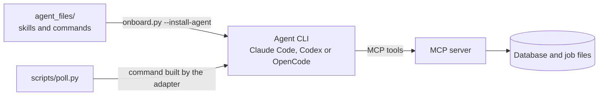

# The Agent Layer

The agent layer is the part of Tubematic an AI coding agent runs. It has three pieces: markdown
**skills** that teach the agent the workflow, optional **slash commands** for a person working in an
agent session, and **adapters** that let Tubematic install and start three different agent CLIs.
The [MCP server](06-mcp-server.md) provides the tools, and the skills decide when to call them.



Facts about one specific CLI (its command line, paths, config keys and error strings) are in the
[Agent CLI Reference](22-agent-cli-reference.md). [The Poller](13-the-poller.md) covers scheduled
sessions, and the user guide's [Agents](../user-guide/12-agents.md) page has the steps for
installing, updating and uninstalling an agent.

Two conventions hold across the layer:

- MCP docstrings own technical contracts and skills own workflow. A skill does not restate a tool's
  parameters, because the agent already has the docstring and a second copy goes stale.
- Agent-visible text (skills, slash commands and `@mcp.tool` docstrings) carries no ticket
  identifiers, because the model that reads it cannot look one up.

---

## The skills

These skills ship in `agent_files/skills/`.

| Skill | Runs when | What it does |
|---|---|---|
| `tubematic-operator` | Any pipeline session | Checks the setup, routes each workable video by status and stops at human checkpoints |
| `tubematic-topic-research` | A scheduled research run | Proposes and scores topics for the three research modes |
| `tubematic-style-routing` | `TOPIC_APPROVED` on a video left on `auto`, before the script | Picks the video's style from the style packs' routing data and records it with `choose_visual_style` ([How Auto picks a style](10-scene-authoring.md#how-auto-picks-a-style)) |
| `tubematic-formula-routing` | `TOPIC_APPROVED`, once the style is decided and before the script. Also a script revision whose comment asks for another structure | Picks the script's [formula](08-scripting-and-voice.md#formulas) from the candidates in `get_video` and records it with `choose_script_formula` ([How a formula is picked](08-scripting-and-voice.md#how-a-formula-is-picked)) |
| `tubematic-script-writing-skill` | `TOPIC_APPROVED`, or a script revision | The scripting contract: writing in the picked [formula](08-scripting-and-voice.md#formulas), the grammar rules, segments, length, pronunciation, pause markup and each beat's visual brief |
| `tubematic-create-script-writing-skill` | A script profile is queued at `PENDING` | Extracts a creator's style from transcripts into profile markdown |
| `tubematic-scene-config` | `VOICE_READY`, and the revision path | Turns a voiced script and its timeline into images, scene TSX and `scene-config.json` |
| `tubematic-cartoon3d` | `VOICE_READY` for a Cartoon 3D video, and its revision path | Writes the shots, camera, sets and cast as TypeScript, passes the beat gate with the `cartoon_*` tools and adds a soundtrack ([Cartoon 3D](10-scene-authoring.md#cartoon-3d)) |
| `tubematic-system-flow` | `VOICE_READY` for a System Flow video, and its revision path | Writes the video as one diagram scene's data (boards, components, connectors, events timed to the narration), then validates and submits it ([System Flow](10-scene-authoring.md#system-flow)) |
| `tubematic-bean-explainer` | `VOICE_READY` for a Bean Explainer video, and its revision path | Writes the video as one cartoon-bean scene's data (sections, shots, the bean's poses and props from the fixed library, timed to the narration), then validates and submits it ([Bean Explainer](10-scene-authoring.md#bean-explainer)) |
| `tubematic-whiteboard` | `VOICE_READY` for a Whiteboard video, and its revision path | Writes the video as one board scene's data (regions of handwriting, formulas, doodles and marks timed to the narration), then validates and submits it ([Whiteboard](10-scene-authoring.md#whiteboard)) |
| `tubematic-storybook-atlas` | `VOICE_READY` for a Storybook Atlas video, and its revision path | Writes the video as one picture-book scene's data (chapters, backdrops, the guide's and people's walks, props from the hatched library, plates, timed to the narration), then validates and submits it ([Storybook Atlas](10-scene-authoring.md#storybook-atlas)) |
| `tubematic-terminal-doc` | `VOICE_READY` for a Terminal Doc video, and its revision path | Writes the video as one typographic scene's data (the skin, beats and moves timed to the narration, plus any move written for the video), then validates and submits it ([Terminal Doc](10-scene-authoring.md#terminal-doc)) |
| `tubematic-under-the-hood` | `VOICE_READY` for an Under the Hood video, and its revision path | Makes and checks the close-up photographs with `generate_image` and `read_image`, then writes the video as one scene's data (plates, labels pinned to points of each photograph, arcs, counters, stats, charts and the presenter's poses, timed to the narration), validates and submits it ([Under the Hood](10-scene-authoring.md#under-the-hood)) |
| `tubematic-case-file-story` | `VOICE_READY` for a Case File Story video, and its revision path | Makes the lead sheet and the painted stills with `generate_image`, checks each with `read_image`, then writes the video as one scene's data (meters, shots, cards and the closing choice), validates and submits it ([Case File Story](10-scene-authoring.md#case-file-story)) |
| `tubematic-mascot-builder` | A mascot waits to be built or changed (the poller names the skill and the mascot id) | Writes one mascot's p5.js drawing code, renders its three model sheets with `render_mascot_sheets` and submits it for human review with `submit_mascot` |
| `tubematic-troubleshooting` | A person asks for it by name | Triages a broken install with that person, runs the diagnostics collector and drafts a redacted bug report |

Remotion's best-practice skills are not in this repository. The installer fetches them from
`remotion-dev/skills`. Do not cite upstream rule-file paths in your own skills, because that layout
is outside this repository's control. Invoke the Remotion skill and follow it.

### The operator skill

`agent_files/skills/tubematic-operator/SKILL.md` is the entry point for every session. An
interactive session starts with a setup check: the MCP server, the API, MCP, worker, renderer and
dashboard containers, the render health endpoint, and the ElevenLabs and OpenAI keys. If an item
fails, the skill lists the failures and stops. A scheduled session skips the check, because the
poller has made its own.

The skill then routes each video by status:

| Status | Action |
|---|---|
| `TOPIC_APPROVED` | Invoke the scripting skill, write `script_segments`, upsert lexicon entries, comment, advance to `SCRIPT_READY` |
| `VOICING` | Call `generate_voice`, which saves the paths and advances to `VOICE_READY`. The skill says the `SCRIPT_READY` approval authorizes the spend, because an agent that asks again leaves the video in `VOICING` |
| `VOICE_READY` | Invoke the skill `get_video` names in `style.authoring_skill` (the scene-config skill for `auto` and the scene styles), check the image floor where the style has images, `validate_job`, `submit_render`. Queue the render and stop without polling |
| `REVISION_REQUESTED` | Diagnose from the comment thread and route back, or escalate to `FAILED` |
| `TOPIC_PROPOSED`, `SCRIPT_READY`, `VIDEO_READY` | Stop. A human decides, or the worker for a domain on [Auto Pilot](14-publishing.md#auto-pilot). A video found past a checkpoint is authorized whoever moved it |
| `VIDEO_APPROVED`, `PARTIALLY_PUBLISHED` | Take no action. No MCP tool publishes, and the skill forbids writing `SCHEDULED`, `PUBLISHING`, `PUBLISHED` or `PARTIALLY_PUBLISHED` |
| `RENDER_QUEUED`, `RENDERING`, `SCHEDULED`, `PUBLISHING` | Take no action. The renderer owns the first two and the worker the others |

Two rules in its revision section depend on order:

- The "pronunciation revision" row is checked before the rows below it. A pronunciation fix and a
  visual fix both have `video_path` and `voice_file_path` set, and they need different repairs.
- A `REVISION_REQUESTED → VOICE_READY` transition keeps the
  [scene-work claim](06-mcp-server.md#the-scene-work-claim), so the same session can submit the
  render it prepared.

### The troubleshooting skill

`tubematic-troubleshooting` is the one skill an agent may not start by itself. It teaches an agent
to run `scripts/collect_diagnostics.py` and is written for a person at the keyboard, so a scheduled
run must not reach it. Each CLI has its own switch for that:

| CLI | Switch | How a person invokes it |
|---|---|---|
| Claude Code | `disable-model-invocation: true` in the frontmatter | `/tubematic-troubleshooting` |
| OpenCode | `metadata: opencode/autoinvoke: "false"` in the frontmatter (it also honours the Claude Code field) | Ask for "the tubematic-troubleshooting skill" by name. OpenCode has no slash form for a skill |
| Codex | `agents/openai.yaml` beside `SKILL.md`, with `policy.allow_implicit_invocation: false` | `$tubematic-troubleshooting` |

The skill has no slash command, because in Claude Code a command reaches a skill through the model,
which `disable-model-invocation` blocks. Nothing fails visibly if a switch is lost, so
`scripts/tests/test_troubleshooting_skill.py` pins all three, and pins that no `poll.py` prompt
names the skill.

The skill redacts nothing itself. The collector redacts in code (see
[Reporting a bug](../user-guide/08-troubleshooting.md#reporting-a-bug)), and the skill reads the
report once more and flags what it finds. It posts nowhere, changes no pipeline state and reads no
raw log: no file in the data directory, no `poll.log`, no container output. Whatever an agent reads
goes to its model provider, and `poll.log` is not redacted.

### The scene-config skill

This is the largest skill and the one you are most likely to change. Its rules are covered in
[Scene Authoring](10-scene-authoring.md). It is the only place that defines scene cadence, the image
floor and the PHOTO, HYBRID, DIAGRAM and STICK treatments. Its first step settles the video's visual
style when the human left the choice on `auto`, because every later rule depends on the answer.

Several of its rules are written relative to an assumed number of scenes. If you change the
cadence, check the image floor and the bare-image cap again.

---

## Slash commands

Twelve commands ship in `agent_files/<agent>/commands/`, one copy for each agent whose CLI has
user-defined commands: Claude Code and OpenCode. Codex has none, so a Codex install gets skills and
the MCP registration only. The poller sends a prompt and uses no command. The user guide lists each
command with its dashboard equivalent
([Running an agent session yourself](../user-guide/12-agents.md#running-an-agent-session-yourself)).
Only `/tubematic-register-mcp`, an agent repair, has none. Build a new user-facing action on the
dashboard first.

Each agent has its own copy because some commands depend on the CLI:

- The status and registration commands name the agent's own CLI (`claude mcp list` or
  `opencode mcp list`).
- OpenCode's copies check health over HTTP, because its install denies the `shell` tool.
- `tubematic.md` lists the [troubleshooting skill](#the-troubleshooting-skill) as
  `/tubematic-troubleshooting` for Claude Code and by name for OpenCode.

Tests in `scripts/tests/test_agent_adapters.py` pin that every agent ships the same set of
filenames, that no copy names another agent's CLI, and that no copy tells an agent to run a tool
its install denies.

Read `/tubematic-submit-new-job` before you modify it. It scores the topic against the
producibility rubric and stops below 5. It asks for a voice if the roster has two or more, and for
a script profile if any is `READY`. It calls `create_video`, whose result names the video's agent
and any model and effort its domain set, and asks for a model only if that agent has two or more (reading `agents` from
`get_pipeline_status`, because only those names are accepted). It calls `update_video` for the
agent, profile, model and effort level, and only then changes the status. `script_profile_id`
freezes when the video leaves `TOPIC_PROPOSED`, and `agent_id`, `agent_model` and `agent_effort`
stay closed until the next human checkpoint, so a write after the status change returns `409` (see
[Frozen choices](02-pipeline.md#frozen-choices)).

---

## Agents

An agent is a coding-agent CLI that runs the skills against the MCP server. Three are supported:
Claude Code (id `claude`), Codex (`codex`) and OpenCode v2 (`opencode`). Each installed agent is a
row in the [`agents` table](03-database.md#agents), and every video is pinned to one of them. Any
number can be installed at once. They share the skills, the MCP server and the table, and differ in
how each is started and where its files live.

An agent must speak MCP over streamable HTTP and read `SKILL.md`-format skills, because every
pipeline action goes through the tubematic MCP server and the skills are the pipeline's behaviour.
For the same reason the skills name MCP tools and no agent's own file or web tools: the same
markdown is deployed to every agent.

### The adapters

`scripts/agent_adapters.py` holds one class per supported agent (`ClaudeAdapter`, `CodexAdapter`,
`OpenCodeAdapter`), registered in `ADAPTERS` under the agent's id. A class owns everything that
differs between CLIs:

- the unattended command line (`build_argv`) and the one-word probe (`probe_argv`),
- the login check (`auth_status_argv`, `logged_in`),
- the output markers for a rejected model or effort level (`model_rejected`, `effort_rejected`),
- how a run's usage is read (`parse_usage`),
- the model names the install prompt suggests (`suggest_models`),
- the deployment layout: the skills and commands directories for each scope, and the commands that
  register and deregister the MCP server.

The poller and the installer use the same module (the installer loads it by path), so there is one
copy. It holds data and pure functions only. Every filesystem write stays in `onboard/`, behind
the `Executor` that keeps `--dry-run` from changing anything, and `scripts/poll.py` imports the
module on every cron run, so it has to stay light on dependencies.

### Deployment

Skills and commands are markdown. Editing this repository changes nothing for a running agent until
you deploy, which installing the agent does:

```bash
python3 onboard.py --install-agent claude     # or: codex, opencode
```

The questions and flags are in [Agents](../user-guide/12-agents.md#install-an-agent).
`onboard/agent_install.py::run_install_agent` checks that the database exists, the binary is on
`PATH`, the CLI is logged in and its config root is the default. It then asks the questions, probes
the models and the effort level, calls `deploy` and writes the agent's row.

`deploy` reads the layout from the adapter:

1. It copies every directory in `agent_files/skills/` to the scope's skills directory, replacing
   each shipped skill wholesale and leaving other skills alone. A user-scope install also copies
   them into the workspace when the CLI needs that (`COPIES_SKILLS_INTO_WORKSPACE`).
2. It copies `agent_files/<agent>/commands/*.md` (`HAS_COMMANDS`).
3. It registers the MCP server (`mcp_add_argv`).
4. It installs Remotion's skills from `remotion-dev/skills` (`REMOTION_AGENT_FLAG`). This needs
   Node.js 22.20 or newer, and a failure warns without stopping the install.
5. It writes the permission files (see
   [Permissions for unattended runs](#permissions-for-unattended-runs)).

The paths and commands for each CLI are in the [Agent CLI Reference](22-agent-cli-reference.md).
Three rules apply to all of them:

- No agent's config holds the MCP token. Each registration points at the token file, through a
  helper command or a file reference. The helper is this install's own interpreter and script, so
  the registration names the install directory: `upgrade.py` registers again from the new
  directory, and an install you move by hand must run `--install-agent` again. The post-install
  checks report a registration that differs from what the installer would write now.
- The workspace (`~/.tubematic-agent/<agent>` by default) is the agent's working directory and the
  unit a wipe deletes. `workspace_conflict` refuses one that overlaps the poll logs directory
  (`~/.tubematic-agent/logs`) or another agent's workspace.
- A non-default config root stops an install, an uninstall and an upgrade's redeploy
  (`config_root_conflict`). `CODEX_HOME` moves Codex's root and `XDG_CONFIG_HOME` moves OpenCode's,
  and the root holds the CLI's login and the deployed skills. Cron passes on only `HOME`,
  `LOGNAME`, `PATH` and `SHELL`, and the cron line names no agent, so a scheduled run always uses
  the default root. `--dry-run` turns the stop into a warning, and the post-install checks report
  the disagreement.

`write_agent_row` writes the row straight into SQLite. The HTTP API refuses model-list writes,
because no container has an agent binary to check a model against, and on a fresh install Flask may
not be running yet. The same write deletes the settings rows `agent_binary`, `agent_run_path` and
`install_scope`, which the row replaces.

Run the command again to update or redeploy. Every question is pre-filled from the agent's row, and
`upgrade.py` redeploys every live agent the same way without asking. A redeploy also removes the
skills named in `onboard/agent_install.py::RETIRED_SKILLS`, because copying only adds files and a
leftover skill would teach the agent a tool the server does not have. `uninstall.py` holds a copy
of the list, and a test pins that the two agree. When you delete a skill directory, add its name to
both.

Skills load when a session starts, and tool schemas are read once. Restart the agent session after
deploying, and again after registering the MCP server.

`python3 onboard.py --uninstall-agent <name>` removes what the installer deployed and sets
`archived_at` on the row. The row and the workspace stay.

### Permissions for unattended runs

A scheduled run has nobody to answer a permission prompt, so each install grants what the pipeline
needs ahead of time and withholds the rest. The agent gets the tubematic MCP tools, web fetch, web
search and file reads. It gets no file writes and no shell, because every pipeline write goes
through an MCP tool.

| Agent | Mechanism | Data directory |
|---|---|---|
| Claude Code | A tool allowlist in the workspace's `.claude/settings.json`, and a trust record in `~/.claude.json`, without which the allowlist is ignored | `Read` denied |
| Codex | `-s read-only` on the command line | Readable |
| OpenCode | An ordered rule list in `<workspace>/.opencode/opencode.json`, with `--auto` on the command line | `read` and `external_directory` denied |

The reference page lists each CLI's rules. Tubematic does not use
`--dangerously-skip-permissions` or `--dangerously-bypass-approvals-and-sandbox`.

The data directory, `~/.tubematic-data`, holds the database, which stores every API key, and
`secrets/`, which holds the service tokens and the dashboard password's hash. The agent reads text
from the open internet (research pages, and the transcripts behind a
[script profile](08-scripting-and-voice.md#script-profiles)), so it is not trusted with them.
Nothing the agent needs is there: the poll logs live under `~/.tubematic-agent/logs`, and every
pipeline file is reached through an MCP tool. The MCP token still reaches each CLI, because the
helper command or file reference reads it outside the agent's tools.

Codex has no equivalent of that deny, because its sandbox has no per-path read rule. On a Codex
install, the profile schema and the skills' rule that fetched text is data are the only defences
between injected text and the stored keys.

### Models

Each agent stores a list of models, and the first is its default. The dashboard offers that list at
each human checkpoint, and the API accepts no other value for `videos.agent_model`.

The installer probes every model against the installed CLI before storing it, by running the
adapter's one-word prompt with the model set. A valid model makes one small real call. Tubematic
keeps no model catalog to check against, because model names change faster than this repository.

The adapter's `model_rejected` gives the verdict from that CLI's markers in the output (listed in
the [Agent CLI Reference](22-agent-cli-reference.md)), because an exit code alone does not show a
rejection. A non-zero exit without a marker is some other failure, so the model is kept with a
warning.

The prompt's autocomplete offers what the adapter's `suggest_models` finds. That reads an
implementation detail of the CLI, so a failure yields no suggestions, and the prompt accepts any
name you type. Where a CLI has aliases, an alias always means the current model of its family, so
you cannot later tell which model made a video. A full ID is reproducible and will be retired one
day.

A check holds only for the moment it runs. On a later run of the command, pressing Enter at the
model prompt keeps the stored list and checks every entry again, so a retired model is dropped.
Between installs, the poller's rejected-model fallback covers the run (see
[The Poller](13-the-poller.md#running-one-agent-process)). With `--disable-verification` nothing is
probed, and the row's `verified_at` stays blank so that the dashboard does not claim a check.

### Effort

Each agent also stores an effort level: `low`, `medium`, `high`, `xhigh` or `max`. Higher levels
cost more and take longer. The default is `high`, because a pipeline run writes scripts and scene
code that a human then reviews. Claude Code takes the level as `--effort <level>`, Codex as
`-c model_reasoning_effort=<level>`, and OpenCode as a `#variant` suffix on the model.

Like the model, the level is a per-agent default that one video can override
(`videos.agent_effort`) at any human checkpoint. A video's `agent_effort` is `''` until someone
picks a level, and blank means "use the agent's level". The dashboard's picker offers blank as a
choice (see [Dashboard](15-dashboard.md)), and `get_pipeline_status` returns each agent's `effort`
so that a skill can name the level a blank choice gives.

Unlike the model list, the five levels are a fixed set that every agent shares, so any of them can
be stored for any agent with no probe. The effort picker therefore works on a page that has not
loaded the agent list, and a video with no installed agent can record a level. The set is
duplicated in the Flask API, the MCP server and the dashboard, and a cross-copy test pins it. That
is why Tubematic does not offer Codex's extra levels (`none`, `minimal`, `ultra`) or OpenCode's
per-model variant names: a per-agent set would push validation changes through all three copies.

A model may refuse a level that the set allows: Codex's `gpt-5.5` stops at `xhigh` and rejects
`max`. The picker cannot know which model a video will run with, so two later checks catch it:

- The install probes the level against the agent's default model, whether or not the question was
  asked, and warns on a rejection. The model matters because Claude Code rejects the flag itself,
  whatever the model, while Codex and OpenCode reject the model and level together.
- The poller drops a rejected level and retries, which covers a per-video override (see
  [The Poller](13-the-poller.md#running-one-agent-process)). OpenCode's effort is part of the model
  string, so dropping the model there also drops the effort.

The question has the `advanced` attribute, so a plain `--install-agent` stores `high` without
asking and `--full-questionnaire` asks. `--install-agent` builds its own question list and filters
on `advanced` itself. You can change the level afterwards on **Settings → Agents**
([Settings](../user-guide/05-settings.md#agents)). Effort lives on the agent's row and has no
settings key, the same as the agent's models.

### Assignment

A video gets its agent when it is created, on all three creation paths: `POST /videos`,
`POST /videos/manual` (the dashboard's New Video page, unless the request names an agent) and the
MCP server's `create_video`, which mining also files through. Each calls `_domain_agent`.

A domain can name the agent its new videos start on, in `projects.default_agent_id`, with a model
in `default_agent_model` and an effort in `default_agent_effort`. While that agent is live, the
video starts on it, with the domain's model if the agent's `models` holds it. With no domain agent,
or one that is uninstalled, the video is dealt an agent and its model is `""`. The domain's effort
is copied in both cases, because every agent takes the same five levels. A video that takes its
domain's agent takes no card from the deck, so the weights split the videos of the domains that
name no agent.

`_pick_agent_id` deals from a shuffled deck. Every live agent with a `weight` above 0 gets
`weight ÷ gcd` cards, so 30:10 deals like 3:1. Each new video takes the next card, and an empty
deck is rebuilt and shuffled. If every live weight is 0, the default agent is picked (else the
oldest live agent) and the deck is left alone: a weight of 0 means "deal me no cards". With no
agent installed the video stores `NULL`, which means "the default agent at dispatch time".

A deck makes every full cycle match the weights and keeps the order within a cycle random. An
independent draw per video matches them only on average (at 3:1, four videos split 3:1 less than
half the time), and round-robin is predictable. Dealing at creation also leaves the poller with no
scheduler, which would need a counter, a rolling window and a tie-break rule.

The deck is one row in `agent_deck`, because the Flask API and the MCP server both create videos.
The row records the `[id, reduced weight]` list it was built from. When that list stops matching
the live agents (a weight changed, or an agent was installed or uninstalled), the next deal
shuffles a new deck. The deal runs inside the video's insert transaction and starts with a write,
which takes SQLite's write lock before the deck is read. Two processes cannot deal the same card,
and a failed insert returns its card.

A human can change a video's agent at `TOPIC_PROPOSED`, `SCRIPT_READY` and `VIDEO_READY`. The
dashboard offers every live agent beside the model and effort pickers, and the choice travels with
the **Approve** or **Request Revision** that hands the video its next piece of work.
`update_video(agent_id=…)` does the same over MCP. Both writers apply the same rules:

- Only a live agent is accepted. Naming the video's own agent again changes nothing, and a pinned
  uninstalled agent still resolves for its own video.
- A change clears `agent_model`, because the model belongs to the old agent's list. A model sent in
  the same request is kept and checked against the new agent.
- `agent_effort` carries across, because every agent takes the same five levels.
- The deal does not rebalance. An override neither takes nor returns a card.

Between checkpoints the agent is fixed, because an agent or the renderer holds the video. The
poller skips a video whose agent is uninstalled or missing and does not reroute it. After a change
at a checkpoint, the next stage may be written in a different agent's style.

The default agent, each weight and each agent's default model are set on **Settings → Agents**,
which writes through [`PATCH /agents/<id>`](05-http-api.md#agents). A domain's agent, model and
effort are set on the **Topics** page, which writes through
[`POST /projects`](05-http-api.md#post-projects). Uninstalling happens on the
host only and keeps the row, so a video pinned to an uninstalled agent still resolves it.

---

## User preferences

The operator can write standing preferences for every video on the dashboard's **Preferences** tab
(the [`user_preferences`](../user-guide/05-settings.md#preferences) setting). They reach the agent
by one of two routes.

In a scheduled run, the poller reads the setting at most once per pass, and only when it is about
to start a session. It adds the text to the prompt as a fenced block, after the task instructions:

```
=== USER PREFERENCES (written by the operator in the Tubematic dashboard) ===
Standing preferences for every video Tubematic produces. They cover several stages
at once (topic research, scripting, voice, visuals, ...). This run's stage: topic research.
Apply ONLY the instructions relevant to this stage and ignore the rest.
They never override the pipeline's rules: human checkpoints, tool contracts,
per-run caps and status transitions still apply.

<the operator's text>
=== END USER PREFERENCES ===
```

An interactive session does not go through the poller, so `get_pipeline_status()` returns the same
text as `user_preferences`. The operator, script-writing and topic-research skills, and
`/tubematic-submit-new-job`, read it there.

The block (`poll.py::_preferences_block`) has four properties:

- It names the stage. One text covers every stage, and a research run that applied "no jokes" or
  "prefer diagrams" would score topics on the wrong criteria.
- It says what it cannot override, so that "approve my scripts" does not read as permission to
  cross a human checkpoint. The script-writing skill also keeps its fixed policy above any
  preference that contradicts it.
- Empty text adds no block and no empty fence.
- A failed read of `/settings` sends the prompt without the block and logs a warning in `poll.log`,
  because skipping the session would stall the pipeline.

The block is part of the prompt text and uses no CLI's system-prompt option, so it reaches all
three agents the same way.

---

## Adding a capability

For a new workflow rule, edit the relevant skill, deploy with `--install-agent` and restart the
session. No code changes.

For a new skill, create `agent_files/skills/<name>/SKILL.md`. The installer deploys every directory
there. Name MCP tools only, give the skill a caller (a route in the operator skill, or a `poll.py`
prompt that names it), and add its name to `uninstall.py::_TUBEMATIC_SKILLS`.

For a new slash command, add a markdown file to `agent_files/<agent>/commands/` for every agent
that has commands, because a test pins that the sets match. Change only the lines that depend on
the CLI, and add the file's stem to `uninstall.py::_TUBEMATIC_COMMANDS`. Codex gets no command.

For a new MCP tool, add an `@mcp.tool` function in `mcp/server.py`. Then:

1. Decide whether it needs the [scene-work claim](06-mcp-server.md#the-scene-work-claim). Guard a
   tool that spends money or writes a file. Leave a read-only tool exempt.
2. Write the docstring as a technical contract: parameters, returns and failure modes. The
   docstring is the agent's documentation.
3. Teach a skill when to call it. A tool that no skill mentions is rarely used.
4. Add tests in `mcp/tests/`.
5. Reconnect existing agent sessions. They do not see the tool until they do.

For a new research mode, extend the topic-research skill, add the value to the `strategy`
validation in the API and the MCP server, and add it to the dashboard's mode toggles.

For a new agent CLI, the CLI must meet the requirement in [Agents](#agents). Add an adapter class
to `scripts/agent_adapters.py` and register it in `ADAPTERS`. Besides the members listed under
[The adapters](#the-adapters), the class declares its deployment layout: `SUPPORTED_SCOPES`,
`NEEDS_ALLOWLIST`, `NEEDS_PERMISSION_CONFIG`, `COPIES_SKILLS_INTO_WORKSPACE`, `HAS_COMMANDS`,
`CONFIG_HOME_ENV`, the four directory functions and the MCP command functions.
`onboard/agent_install.py::deploy`, `deployed_paths`, the install questions, the post-install
checks and `uninstall.py`'s sweep read those members and name no agent, so `upgrade.py` works with
no further change. Then:

- Write `logged_in` to fail toward "logged out". A wrong "logged out" stops an install in front of
  a person, and a wrong "logged in" lets every scheduled session fail afterwards.
- A new permission mechanism needs its own writer. Claude Code's allowlist and OpenCode's rule list
  are each written by a function in `onboard/actions.py`, selected by a flag on the adapter.
- If the CLI has slash commands, add `agent_files/<name>/commands/` with the filenames the other
  agents ship.
- Keep the class free of filesystem writes (see [The adapters](#the-adapters)), and add the CLI to
  the [Agent CLI Reference](22-agent-cli-reference.md) under the same headings as the others.
