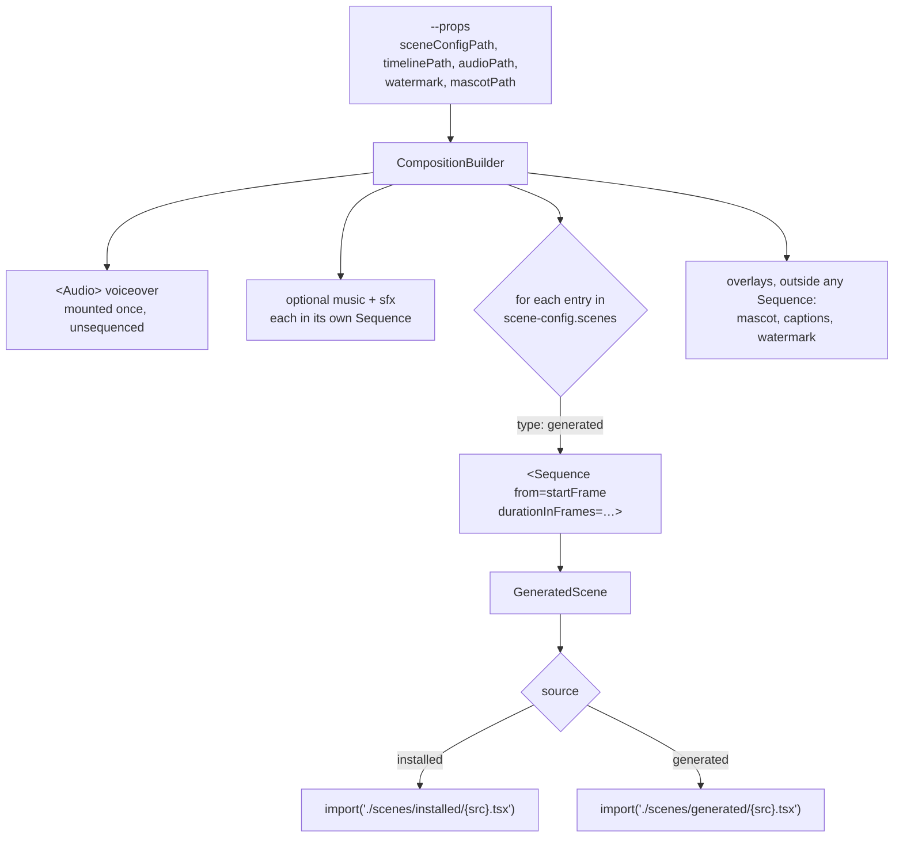

# The Remotion Project

`renderer/remotion/` is a [Remotion](https://remotion.dev) project: React components that render to
video. Remotion runs the components in a headless Chromium, screenshots each frame and hands the
frames to ffmpeg.

This page covers how the project is wired. [Scene Authoring](10-scene-authoring.md) covers how the
agent writes scenes, and [Rendering and Review](11-rendering-and-review.md) covers how a renderer
runs the project.

---

## The frame model

A component is a pure function of the current frame. Remotion has no timeline, no tweening engine and
no animation state. A component calls `useCurrentFrame()`, computes the picture for that frame number
and returns it.

```tsx
const frame = useCurrentFrame();
const opacity = interpolate(frame, [0, 30], [0, 1], {
  extrapolateLeft: "clamp",
  extrapolateRight: "clamp",
});
```

Every composition runs at 30 fps, so frame 30 is one second in. Two rules follow:

- `setTimeout`, `requestAnimationFrame` and CSS transitions do not work. A render produces frames as
  fast as the machine manages, so anything keyed to wall-clock time differs from render to render.
- Frame numbers inside a `<Sequence>` are relative to that sequence. `CompositionBuilder` wraps every
  scene in one, so a scene's `useCurrentFrame()` returns 0 on the scene's first frame.

---

## Compositions

`renderer/remotion/src/Root.tsx` registers four compositions.

| Id | Component | Size and duration |
|---|---|---|
| `Composition` | `CompositionBuilder` | 1080×1920, duration read from `timeline.json` |
| `TextLayoutAudit` | `CompositionBuilder` plus `TextLayoutProbe` | The same |
| `MascotSheet` | `MascotSheet` | One frame, sized per sheet |
| `Placeholder` | A static placeholder | 1080×1920, 90 frames |

A renderer turns `Composition` into a video with `npx remotion render Composition`.
`TextLayoutAudit` is the same video with an invisible measuring probe on top. The
[text-layout audit](11-rendering-and-review.md#the-text-layout-audit) drives it through Remotion's
Node API. `MascotSheet` is listed so that Remotion Studio can show it, and its renders use a separate
entry point ([The mascot layer](#the-mascot-layer)). The GPU test's `GpuProbe` composition is
registered only by its own entry point, `src/gpu-probe/index.ts`.

The first two take their duration from `calculateMetadata` (`Root.tsx::durationFromTimeline`), which
fetches the timeline named in the props and returns its `totalFrames`, or 900 frames if that fails.

---

## How a scene config becomes a video



`CompositionBuilder` fetches the scene config and the timeline, mounts the audio and walks the scene
list. It wraps each `generated` entry in a `<Sequence>` at the entry's `startFrame` for its
`durationInFrames`, and `GeneratedScene` renders it. The layers, bottom to top, are the canvas colour
(`#0f0f0f` for `dark`, `#ffffff` for `light`), the scenes, the mascot, the captions and the
watermark.

### Dynamic import, and why there are two branches

`GeneratedScene` resolves the component with a template-literal dynamic `import()`:

```tsx
source === "installed"
  ? import(`./scenes/installed/${src}.tsx`)
  : import(`./scenes/generated/${src}.tsx`);
```

Webpack resolves each dynamic import to a fixed directory prefix at build time, so one `import()`
with a variable directory would bundle neither tree. Each branch bundles every `.tsx` under its own
tree, recursively, which is why the namespaced `"{video_id}/{scene_name}"` form resolves through the
same call.

The component is `mod.default ?? Object.values(mod)[0]`. A default export is the documented shape,
and a single named export also works.

An import failure does not fail the render. `GeneratedScene` logs the error, calls `continueRender`
and draws nothing, so the bare canvas shows for the scene's whole duration. The typecheck in
`validate_job` is what catches such a scene.

### Props a scene receives

```tsx
<Component durationInFrames={…} words={…} {...props} />
```

A scene receives `durationInFrames` and `words` (the timeline's word spans), then the config entry's
`props` object. `props` is spread last, so a key named `durationInFrames` or `words` overrides the
builder's value.

### Crossfades

`CompositionBuilder::SceneWithFades` fades each generated scene in at its start and out at its end.
The fade-out length is the scene's own `transitionToNext.durationInFrames`: 8 frames when the key is
absent, and 0 for a hard cut. The fade-in length is the previous scene's value, because the two fades
share one overlap window. The first scene has no fade-in and the last has no fade-out. Start frames
do not move, so audio sync is unaffected.

---

## Audio

| Track | Mounting |
|---|---|
| Voiceover | One `<Audio>` at the top level, outside any sequence, always mounted |
| Music | Optional. Inside a `<Sequence>` at its `startFrame`. The volume holds flat, then ramps to zero over `fadeOutFrames` |
| SFX | One `<Sequence>` per entry, at its `startFrame`. `volume` defaults to 0.6 |

The music volume callback receives a frame relative to the music's own sequence.
`CompositionBuilder` applies no defaults to the `music` object, and an entry without `volume` or
`fadeOutFrames` produces `NaN`. Supply both.

A renderer stages `audio.mp3`, `timeline.json`, `scene-config.json`, `images/` and the mascot's code
for a job (`render_agent.py::_stage`). It stages no music or SFX file, and no MCP tool creates one.

## Captions

By default a video has captions of its own narration burned in. The code and the config key call them
`subtitles`. An absent `subtitles` key means enabled with the defaults, which is how a config written
without the key gets captions. The opt-out is an explicit `{"enabled": false}`.

`scenes/installed/Subtitles.tsx` draws the captions from `timeline.words[]`, whose timings are
already in frames. The file is in the installed directory, but it is not a scene and a config entry
cannot reference it.

`CompositionBuilder` renders the captions after the scene list, outside any `Sequence`. As a scene
entry they would be crossfaded away at every scene boundary and would count against the skill's
four-scene minimum. Outside a `Sequence`, `useCurrentFrame()` stays absolute, so the word timings need
no rebasing.

### Grouping words

`Subtitles.tsx::chunkWords` groups the words into runs of at most `maxWords` (1 to 7, default 4). The
ceiling is 7 because captions are read at speaking speed on a phone. A run ends at sentence
punctuation, at a gap of 8 frames or more before the next word (`SILENCE_FRAMES`), at clause
punctuation once the run holds two words, or at the word cap.

`Subtitles.tsx::visibleChunkIndex` picks the run on screen. A run holds until the next run begins, so
captions do not blink out between phrases. The hold ends 12 frames after the run's last word
(`MAX_HOLD_FRAMES`), so no caption stays up through a long pause.

The word being spoken is drawn at full opacity and the rest of its run is dimmed. After a 4-frame
entry, nothing in the line moves or resizes. A word listed in `emphasis` is drawn in white on a red box
from the moment it is spoken, with the box scaling in over 8 frames.

### Fonts

The default font is the container-local `system-ui, sans-serif`. The captions are on the path of every
render, the render browser fetches a Google font over the network, and a renderer without outbound
access would stall on that fetch.

`fontFamily` accepts `Inter`, `Oswald`, `Roboto` or `Montserrat` as webfonts, and passes any other
string through as a CSS family. Each webfont is loaded as one style, one weight and two subsets
(`latin`, `latin-ext`). A loader called with no arguments fetches every file the family publishes,
and newer Remotion versions refuse to load a font without weights and subsets. The weight is declared
per family (800, and 700 for Oswald), because asking a family for a weight it does not publish
throws.

### The older `TextRevealScene`

`scenes/TextRevealScene.tsx` also draws text from `timeline.words[]`: five words a line, the last
three lines. `CompositionBuilder` still renders a scene entry of `"type": "TextReveal"` with it, with
no crossfade. Such an entry takes `startFrame`, `durationInFrames` and optional `fontSize`,
`lineHeight`, `color` and `backgroundColor`. The scene skill forbids the type.

## Watermark

By default every video carries a small "Made with tubematic.ai" mark in its top-right corner.
`CompositionBuilder` draws `Watermark.tsx` last, above every scene and outside any `Sequence`, so the
mark is not crossfaded and does not count as a scene.

The mark is the same on every video: 130 px wide, 32 px from the top and right edges, at opacity 0.6.
It sits outside the safe zone, because the safe zone is where scenes put their content. Four rules
keep it fixed:

- Nothing about the mark comes from `scene-config.json`. The component takes no props and
  `CompositionBuilder` reads no watermark key, because the agent writes that file.
- The only switch is the `watermark_enabled` [setting](04-settings.md). The render gateway sends it
  with the claim, and the renderer passes it to the composition as the `watermark` render prop. No MCP
  tool writes settings, so only a person can turn the mark off. The mark is drawn unless the prop is
  `false`, so Studio preview and the text-layout audit, which send nothing, show it.
- No scene can paint over it. A positioned scene element with a positive `z-index` would paint above
  a later sibling, so the mark carries the largest `z-index` a browser honours (2147483647). On a tie
  the later element wins.
- The artwork carries its own translucent plate, which keeps the white text readable on any frame.
  The mark needs no colour derived from the canvas.

The image is `public/watermark.png`, baked into the renderer image and loaded with `staticFile()`, so
no render fetches it over the network. It sits beside the per-video `public/<video_id>/` directories,
so staging does not touch it. The source artwork is in `logos/` at the repository root.

Scenes are not told about the mark and are not laid out around it. Scene content passing beneath it
is expected, and the [AI review prompt](21-ai-review.md#the-prompts-guard-clauses) says so.

## Safe zones

```
top 150px · bottom 170px · left 60px · right 60px
```

These margins apply to the 1080×1920 frame and leave 960×1600 usable. They clear YouTube's own
overlays.

Four files declare the numbers, because the files run in different processes:
`scenes/TextRevealScene.tsx` (`SAFE`), `mcp/text_audit.py` (`SAFE_ZONE`),
`renderer/api/ai_review.py` (`SAFE_ZONE_TOP`, `SAFE_ZONE_BOTTOM`) and `tubematic_core/mascots.py`
(`SAFE_ZONE`). The scene skill states them in prose. Change them all together.

---

## `scene-config.json`

`scene-config.json` says which scene plays when. The agent writes it through the `write_scene_config`
MCP tool and `CompositionBuilder` reads the file directly. No schema file exists. The shape is the
`SceneConfigFile` interface in `CompositionBuilder.tsx`.

```jsonc
{
  "totalFrames": 2700,        // copy from timeline.totalFrames
  "fps": 30,
  "canvas": "dark",           // "dark" | "light"
  "subtitles": {              // optional; an absent key means enabled
    "maxWords": 4, "fontSize": 62, "background": "pill", "position": 0.78
  },
  "mascot": [                 // only on a video that has a mascot
    { "frame": 0, "on": true, "x": 0.5, "y": 0.62, "emotion": "happy" }
  ],
  "music": {                  // optional
    "src": "…", "volume": 0.15, "startFrame": 0, "fadeOutFrames": 30
  },
  "sfx": [                    // optional
    { "src": "…", "startFrame": 120, "volume": 0.6 }
  ],
  "scenes": [
    {
      "type": "generated",
      "src": "vid_abc123/dns-lookup",   // stem only, no extension
      "source": "generated",            // or "installed"
      "startFrame": 0, "durationInFrames": 420,
      "props": { "title": "…" },
      "transitionToNext": { "durationInFrames": 8 }
    }
  ]
}
```

| Field | Notes |
|---|---|
| `totalFrames` | A positive integer. `validate_job` requires it to be within 5 frames of the timeline's `totalFrames` |
| `fps` | 30. The compositions are registered at 30 fps and do not read this key |
| `canvas` | `"dark"` or `"light"`. See [`canvas`](#canvas) |
| `subtitles` | Caption settings. See [`subtitles`](#subtitles) |
| `mascot` | The mascot's cue track. See [`mascot`](#mascot) |
| `music`, `sfx` | See [Audio](#audio) |
| `scenes[].type` | `"generated"` for every scene, installed ones included |
| `scenes[].src` | Filename stem: `"name"` or `"video_id/name"`, nothing deeper. Each part matches `^[a-zA-Z0-9][a-zA-Z0-9-]*$` |
| `scenes[].source` | `"generated"` (the default) or `"installed"` |
| `scenes[].props` | Forwarded to the component. See [Props a scene receives](#props-a-scene-receives) |
| `scenes[].transitionToNext` | `{"durationInFrames": N}`. See [Crossfades](#crossfades) |

An image path inside `props` must have the form `/public/<video_id>/images/…` and the file must
exist. `validate_job` checks both (`server.py::_bad_image_refs`). A path that does not resolve fails
the whole render, because Remotion's `` retries twice and then cancels it.

### What `write_scene_config` checks

`write_scene_config` writes the JSON as given, after these checks:

- `totalFrames` is a positive integer. The tool does not compare it with the timeline.
- `scenes` is a non-empty list.
- `canvas`, if present, is valid and agrees with the video's canvas.
- `subtitles`, if present, uses known keys and in-range values.
- `mascot`, if present, belongs to a video that has a mascot and passes the cue rules.
- A Cartoon 3D scene is the only scene, its beats cover the video, and the scene kind agrees with the
  video's renderer ([Scene Authoring](10-scene-authoring.md#cartoon-3d)).
- A System Flow video has the one `SystemFlow` scene and its diagram passes the System Flow checks;
  no other video uses `SystemFlow` ([Scene Authoring](10-scene-authoring.md#system-flow)).
- A Bean Explainer video has the one `BeanExplainer` scene and its sections and shots pass the Bean
  Explainer checks; no other video uses `BeanExplainer`
  ([Scene Authoring](10-scene-authoring.md#bean-explainer)).
- A Whiteboard video has the one `Whiteboard` scene and its board passes the Whiteboard checks; no
  other video uses `Whiteboard` ([Scene Authoring](10-scene-authoring.md#whiteboard)).

The tool refuses the write while another session holds the
[scene-work claim](06-mcp-server.md#the-scene-work-claim) (`scene_work_claimed`), and while the video
is queued or rendering (`status_mismatch`).

`canvas` is the only default the tool writes into most files. A System Flow or Whiteboard config
with no `subtitles` also gets its style pack's caption settings, because its captions are part of the
style's look. A Bean Explainer config gets them under whatever `subtitles` keys it sets, so a config that
sets only `emphasis` keeps the look. The
components apply the other defaults at render time, so a changed default reaches every video whose
config omits the key.

[`validate_job`](06-mcp-server.md#validate_job) checks frame-count agreement with the timeline,
scene-file existence, image paths and types.

### `canvas`

`canvas` is the ground painted under every scene. It is one value for the whole video, because scenes
that disagree about it flash between light and dark
([Scene Authoring](10-scene-authoring.md#the-canvas)).

`write_scene_config` rejects a value that contradicts the video's canvas. It fills in an absent key
from the video's visual style or the canvas the agent recorded, and otherwise with `"dark"`.
`CompositionBuilder` also treats an absent key as `"dark"`.

### `subtitles`

| Key | Default | Accepted |
|---|---|---|
| `enabled` | `true` | `true` or `false` |
| `maxWords` | `4` | A whole number, 1 to 7 |
| `fontFamily` | `system-ui, sans-serif` | A non-empty string. See [Fonts](#fonts) |
| `fontSize` | `62` | 28 to 120 |
| `color` | `null` | A CSS colour. `null` follows the canvas: white on dark, near-black on light |
| `background` | `"pill"` | `"pill"` (a translucent plate), `"shadow"`, `"outline"` (bold text, thick dark stroke, no plate) or `"none"` |
| `position` | `0.78` | 0.05 to 0.95. The vertical centre as a fraction of frame height |
| `uppercase` | `false` | `true` or `false` |
| `emphasis` | `[]` | Distinct word indexes into the timeline's words (0 is the first). Each is drawn on a red box once spoken. At most one word in 5 (`SUBTITLE_EMPHASIS_EVERY`) |

`server.py::_validate_subtitles` rejects an unknown key, so a typo is reported at write time.
`server.py::_emphasis_error` checks `emphasis` against the narration's word count. The
ranges are `SUBTITLE_NUMERIC_RANGES` in `mcp/server.py`. The defaults live only in `Subtitles.tsx`.

### `mascot`

`mascot` is the mascot's cue track: a bare list of cue objects. It holds data only, and the drawing
code is not in the config. `write_scene_config` refuses the key on a video without a mascot.
`validate_job` and `submit_render` refuse a mascot video whose config has no cues. The cue fields and
rules are on [Scene Authoring](10-scene-authoring.md#mascots).

---

## Installed components

`renderer/remotion/src/scenes/installed/` is the committed library. A config entry can reference
`KenBurnsImage`, `PanelImage` and `StepFlowDiagram` directly, with `"source": "installed"`.
`SystemFlow`, `BeanExplainer` and `Whiteboard` are referenced the same way, by videos of their own
style only. The other
files are wrappers and helpers that a scene imports. The directory's `README.md` is the catalogue the
agent reads.

### `ImageFX`

`ImageFX` is a wrapper that a scene imports. It applies a Ken Burns move to a full-bleed image and can
expose an anchor to its children.

| Prop | Default | Notes |
|---|---|---|
| `src` | required | The `public_path` from `generate_image`, unchanged |
| `durationInFrames` | required | The pan and zoom ramps span this length |
| `scaleFrom` / `scaleTo` | `1.15` / `1.0` | Zoom at the first and last frame |
| `panFrom` / `panTo` | `[0,0]` | Pan as `[x, y]` fractions of the frame |
| `anchor` | `[0.5,0.5]` | The zoom's transform origin |
| `focus` | `[0.5,0.5]` | The point of the source image that survives the cover-crop |
| `vignette` | `0` | Darkened-edge strength, 0 to 1 |
| `backgroundColor` | `"#000000"` | |
| `children` | none | A node, or a function that receives `{project, scale}` |

Do not wrap `src` in `staticFile()`. Remotion's static base is `/public`, the path already starts with
it, and `staticFile()` throws on a prefixed path.

`project(u, v)` maps a normalised point in image space to on-screen pixels and returns
`{x, y, visible}`, so an overlay drawn through it stays attached to a feature of the picture as the
camera moves. `u` and `v` are the units of the grid that `read_image` draws. `visible` is a
frame-bounds test with no margin.

Design choices in the component:

- The component limits a pan to the overhang the current zoom produces, so a requested pan of 0.05
  can land at 0.04. `project()` inverts the clamped pan, because the requested value would drift by
  the difference.
- Scale is clamped to a minimum of 1. Below 1 the image stops filling the frame.
- `ImageFX` has no `imageAspect` prop. The projection assumes the image's aspect ratio matches the
  frame's, which leaves an error under 1% of frame width. An aspect prop would be one number that is
  easy to invert (`h/w` or `w/h`) and that nothing validates.
- `anchor` cannot change what a cover-crop keeps, because the pan clamp is zero at scale 1. `focus`
  maps to `object-position` and can. Full-bleed, the crop is about 8 px a side. Inside a `PanelImage`,
  a tall portrait in a squarer panel loses nearly half its height from the centre.
- `ImageFX` has no blur filter. A full-bleed blur across 300 or more frames is slow on the
  [software GL renderer](20-gpu-and-remote-renderers.md#the-gl-renderer), and a slow render can run
  into the render timeout.

### `KenBurnsImage`

`KenBurnsImage` is a scene: a thin wrapper over `ImageFX` for an image beat that needs no authored
scene. It takes `src`, `scaleFrom`, `scaleTo`, `panFrom`, `panTo`, `anchor`, `vignette` (default
`0.35`), `backgroundColor` and `caption`. It does not pass `focus`.

`caption` draws a lower-third line inside the safe zone. Omit it in new work: the narration is already
captioned, so a line naming the subject repeats it. The cases where a scene does carry text are on
[Scene Authoring](10-scene-authoring.md#on-screen-text-is-the-exception).

### `StepFlowDiagram`

`StepFlowDiagram` is a scene: an SVG node-and-edge diagram for a linear process with nameable stages,
such as protocol hops, pipeline steps or a state machine. It takes `steps` (a list of
`{label, icon}`), `connections` (`[from, to]` index pairs), `activeStages` (one list of node indexes
per stage), `highlightStage` (default `0`) and `theme`. It fades in linearly over its first 15 frames.

`theme` is `"dark"` (the default) or `"light"`. The dark theme paints an opaque near-black background,
which would put a dark slab on a light canvas. The light theme draws black line art on a transparent
background. The component exposes two whole palettes and no single colour prop, because a diagram is
legible only if its background, both node states and both edge states agree.

### `SystemFlow`

`SystemFlow` draws a whole System Flow video from `props.systemFlow`, with its own canvas, headline
and camera; its helpers are in `systemFlow/`. It loads its fonts (Barlow, Space Grotesk, JetBrains
Mono) from `public/fonts/` before the first frame, so a renderer with no internet access draws the
same picture; the default caption font is unaffected. Its contract, layout, camera and the reasons
it avoids gradients, filters and dashed strokes are in
[System Flow](10-scene-authoring.md#system-flow).

### `BeanExplainer`

`BeanExplainer` draws a whole Bean Explainer video from `props.beanExplainer`, with its own colour
field, floor, header, badge and carousel; its helpers, the bean rig and the prop library are in
`beanExplainer/`. It loads its fonts (Fredoka, Patrick Hand, Instrument Sans) from `public/fonts/`
before the first frame; the style's captions use Instrument Sans, which this scene loads. The
`BeanPropSheet` composition renders the cast and the prop library as a model sheet, one page per
frame, for a person to check a drawing: `npx remotion still src/index.ts BeanPropSheet out.png
--frame=<page>`. With `--props='{"measure":"<prop>"}'` it draws one prop at every moment of its act
on white, the picture each prop's box in `contract.ts` is measured from. No video uses it.

A Bean Explainer video can also use props its agent drew, in `generated/<video_id>/prop-*.tsx`. The
scene imports them under a `delayRender` handle, and one that fails to load fails the render.
`bean-tools/render-props.mjs` renders them for the `render_bean_props` tool on the
`BeanPropPreview` composition, from a bundle entry it writes per call into `bean-tools/.tmp/`
(ignored by git) that imports only that video's prop files. The contract and the reason the bean is drawn as a cached bitmap
are in [Bean Explainer](10-scene-authoring.md#bean-explainer).
### `Whiteboard`

`Whiteboard` draws a whole Whiteboard video from `props.whiteboard`: one board, a camera over it, a
floating marker and the closing pull-back. Its helpers are in `whiteboard/`. It loads its
handwriting font (Kalam) from `public/fonts/` before the first frame, and the style pack's captions
use the same font. It draws its ink on a canvas; its contract, its layouts and the measurement that
put the ink on a canvas are in [Whiteboard](10-scene-authoring.md#whiteboard).

### Figure and panel components

Four files serve videos that use line-art figures or a light canvas. None paints a background by
default, because `CompositionBuilder` already paints the canvas and a repaint risks a visible seam.

`StickFigure` is a wrapper: the line-art figure. It takes `pose`, `expression`, `attire`,
`attireColor`, `headwear`, `headwearColor`, `x`, `y`, `scale`, `flip`, `stroke`, `theme`, `color` and
`fill`. `x` and `y` are the figure's centre in frame coordinates and are required. The accepted values
are the `StickPose`, `StickExpression`, `StickAttire` and `StickHeadwear` types in the file.

- The geometry is a joint table. Every pose is a set of elbow, hand, knee and foot coordinates in one
  local box, so two poses share a head, a torso and a stroke weight, and a pose change reads as one
  character moving.
- The figure does not interpolate. Change `pose` on a frame threshold and the swap takes one frame.
- `theme` is `"light"` (black on white, the default) or `"dark"`. It sets the line colour and the
  head and torso fill together, and the fill must match the canvas.
- In the pose table, a hand must stay clear of the head circle. The head is filled and drawn after
  the arms, so a hand behind it renders as a severed forearm.

`StickScene` is a wrapper: a scaffold with an optional banner `title` and an optional panel frame
(`framed`), around your content as children. It also takes `theme`, `bannerHeight`, `frameInset`,
`transparent` (default `true`), `background` and `ink`.

`Entrances` exports three helpers: `PopIn` (a scale pop over 6 frames), `SlideIn` (a single-axis slide
over 8 frames) and `Swap` (a replacement in one frame). `PopIn` and `SlideIn` apply a CSS `transform`,
which makes the wrapper the containing block for every absolutely positioned descendant. A
`StickFigure` or `PanelImage` nested inside one lands in the wrong place, with no type error.

`PanelImage` is a scene: a generated image inside a bordered panel. It takes `src`, `width` and
`height` (default 900 by 1000), `x` and `y` (the panel centre, default 540 and 900), `label`,
`caption`, `ink`, `border`, `focus`, and the `ImageFX` scale and pan props. A light-canvas video uses
it for a real, specific subject, because a full-bleed image would replace the canvas. A panel crops
from the centre with `objectFit: cover`, so size the panel to the image's real pixel ratio, or pass
`focus`.

---

## The Cartoon 3D kit

`renderer/remotion/src/cartoon3d/` is the kit that a Cartoon 3D video's own code is written against.
The agent writes a `CartoonShort` scene and its modules under `src/scenes/generated/<video_id>/` and
imports the kit from there ([Scene Authoring](10-scene-authoring.md#cartoon-3d)). The dashboard labels
the style **Cartoon 3D (experimental)**.

| Path | Holds |
|---|---|
| `video.ts` | The `VideoDef` contract a video implements |
| `camera.ts` | The camera grammar: glides, pushes, kicks and the lens table |
| `CartoonShort.tsx` | The runner. It builds one three.js world from a `VideoDef`, poses it per frame, and applies the post chain: ink, lens blur, bloom, neutral tone map and grade |
| `kit/` | The figure drawer and the lit cards it is drawn on, the batch builders, the painted textures, the light presets and the water shader |
| `post/` | The ink, lens blur and grade passes |
| `gate/` | The beat gate and the stills command lines |
| `examples/chicago/` | The worked example the skill points at. It is typechecked with the project |

Three things run outside the composition: `cartoon-tools/build.mjs` bundles the `gate/` command lines
for the MCP server, `cartoon-tools/audio/` is the soundtrack engine (Python), and
`cartoon-tools/stills-server.mjs` is the renderer's stills server.

## The mascot layer

A video with a mascot gets one extra layer from `CompositionBuilder`, `src/mascot/MascotLayer.tsx`. It
sits above the scenes and below the captions. It renders only when the renderer passed the
`mascotPath` render prop and the scene config carries a non-empty `mascot` cue list.

The renderer alone sets `mascotPath`, as it does `watermark`. The prop points at the version of the
mascot's drawing code staged beside the job's other files (`/public/<video_id>/mascot.js`). It is not
a `scene-config.json` key, so an agent cannot name a file to load.

The `TextLayoutAudit` composition names its three props and does not spread them, so it receives no
`mascotPath` and boots no mascot. The audit reports
[text under the mascot's box](11-rendering-and-review.md#text-under-a-mascot) from the cue track.

The engine is `renderer/remotion/public/mascot/`:

- `frame.html` hosts the drawing code in a transparent iframe, 560 by 640.
- `driver.js` plays the cue track: walks, emotions, looks and hops. It is the reference for what a cue
  means, for walk speed and for where the box lands.
- `kit/` is the shared drawing kit: a p5.js and p5.brush watercolour look with a paper-edged outline,
  so that the character reads over video.

The layer draws one frame per `delayRender` and hides the iframe while the mascot is off screen. The
mascot has no lip sync: it reacts to the narration and is not the narrator. The layer receives no
timeline and no words, and the mouth shows only the emotion.

The same engine renders a mascot's three model sheets (`turn`, `feels`, `act`) for review, through the
`MascotSheet` composition and `renderer/remotion/mascot-tools/render-sheet.mjs`. The sheet render has
its own bundle entry point, `src/mascot/sheet-index.ts`, as the GPU test does: the main entry bundles
every agent-written scene, so one broken scene would fail every sheet render. The MCP container
renders sheets on software GL, so building a mascot does not take the GPU from a render.

## Building and checking

```bash
cd renderer/remotion
npm ci --ignore-scripts     # keep the flag for a local install
npx tsc --noEmit            # the whole tree; validate_job checks one video's scenes
npm test                    # vitest
npm run dev                 # Remotion Studio
npm run build               # bundle
```

`tsconfig.json` has no `include`, only an exclusion for the Remotion config file. `npx tsc --noEmit`
therefore covers everything under `renderer/remotion/`, including the bind-mounted
`src/scenes/generated/` tree. `validate_job` runs `tsc` with a temporary config that extends this one
and includes only the video's own scenes, which is how it catches a broken agent-written scene before
a render is queued (see [`validate_job`](06-mcp-server.md#validate_job)).
`noUnusedLocals` is on. `allowJs` is off, so the `.mjs` drivers are outside the typechecker.

`--ignore-scripts` keeps a local install to a few hundred megabytes, because it skips the download of
the headless Chromium that `@remotion/renderer` uses. Typechecking does not need a browser, and
`npx remotion render` does. Verify a render in a container: `system-ui` resolves to a different face
outside it, so text geometry measured on the host does not match a real render.

`validate_job` runs `tsc` against the container's own `node_modules`. The Dockerfile runs `npm ci`
from the same lockfile, so a clean typecheck on your machine and one in the container agree.

`npm run lint` is `eslint src && tsc`. eslint reports errors in the committed tree (a volume-callback
preference in `CompositionBuilder.tsx`, an unused prop in `StepFlowDiagram.tsx`), so the script stops
before `tsc`. Run `npx tsc --noEmit` directly. `validate_job` does not run eslint.

`npm test` runs vitest ([the `renderer/remotion` suite](test-suites/renderer-remotion.md)). The tests
run in Node with no browser, so they cannot reach the text-layout probe. Every threshold of the
text-layout audit lives in `mcp/text_audit.py` for that reason.

## Credits

The Cartoon 3D kit descends from
[mromidev/claude-animated-shorts](https://github.com/mromidev/claude-animated-shorts) (MIT License,
Copyright (c) 2026 Mr omi). `CartoonShort.tsx`, `kit/cast.ts`, `kit/lights.ts`, `kit/world.ts`,
`kit/toon.ts` and `kit/build.ts` are adapted from its bridge template, and `camera.ts` from its motion
study. `cartoon-tools/audio/` (`dsp.py`, `instruments.py`, `sfx_gen.py`, and the generalised
`band.py`, `cues.py`, `mix.py`) is adapted from its synthesis library. Each file's header names its
origin. The source repository's reference frames and sheets are not included.

The mascot engine descends from
[JohnHeibel/ClaudeAnimationBase](https://github.com/JohnHeibel/ClaudeAnimationBase) (MIT License; its
license is kept at `public/mascot/kit/LICENSE-ClaudeAnimationBase`). It ships p5.js (LGPL-2.1) and
p5.brush (MIT), with their licenses beside them in `public/mascot/lib/`. The shipped mascot, Tubi, is
original. None of the source's own characters are included.

`SystemFlow`'s icons (`systemFlow/icons.ts`) are path data from [Lucide](https://lucide.dev) (ISC
License; the license is in the file's header). Its fonts in `public/fonts/` are Barlow, Space Grotesk
and JetBrains Mono, each under the SIL Open Font License 1.1, with the license beside them. Its layout
uses [@dagrejs/dagre](https://github.com/dagrejs/dagre) (MIT License).

`BeanExplainer`'s bean and props are original drawings. Its fonts in `public/fonts/` are Fredoka,
Patrick Hand and Instrument Sans, each under the SIL Open Font License 1.1, with the license beside
them.
`Whiteboard`'s font in `public/fonts/` is Kalam, under the SIL Open Font License 1.1, with the license
beside it (`OFL-Kalam.txt`). Its shipped doodles (`whiteboard/doodles.json`) are original.
