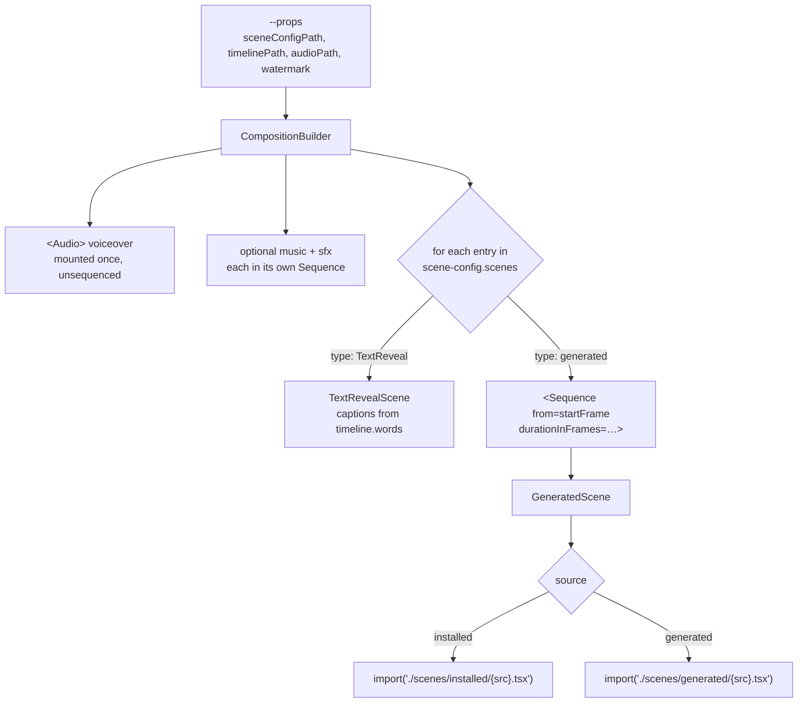

# The Remotion Project

`renderer/remotion/` is a [Remotion](https://remotion.dev) project — React that renders to video.
Remotion runs your components in a headless Chromium, screenshots each frame, and hands the frames to
ffmpeg.

This page covers how *this* project is wired. For how to write a scene, see
[Scene Authoring](10-scene-authoring.md). For Remotion itself, its own documentation is better than
anything that could be restated here.

---

## The frame model

The single concept everything else depends on:

> **A component is a pure function of the current frame.** There is no timeline, no tweening engine,
> and no animation state. You call `useCurrentFrame()`, compute what the picture looks like at that
> number, and return it.

```tsx
const frame = useCurrentFrame();
const opacity = interpolate(frame, [0, 30], [0, 1], {
  extrapolateLeft: "clamp",
  extrapolateRight: "clamp",
});
```

At 30fps, frame 30 is one second in. Two consequences follow directly, and both bite newcomers:

- **`setTimeout`, `requestAnimationFrame` and CSS transitions do not work.** Rendering does not
  happen in real time; frames are produced as fast or as slowly as the machine manages. Anything
  keyed to wall-clock time produces a different result every render.
- **Frame numbers inside a `<Sequence>` are relative to that sequence.** Every scene is wrapped in
  one, so a scene's own `useCurrentFrame()` returns 0 on its first visible frame regardless of where
  it sits in the video.

---

## Compositions

`renderer/remotion/src/Root.tsx` registers three, all 1080×1920 at 30fps.

| Id | Component | Duration |
|---|---|---|
| `Composition` | `CompositionBuilder` | Read from `timeline.json` |
| `TextLayoutAudit` | `CompositionBuilder` plus `TextLayoutProbe` | The same |
| `Placeholder` | A static placeholder | 90 frames |

`Composition` is the only one ever rendered to video — the render worker always invokes
`npx remotion render Composition`. `TextLayoutAudit` is driven only through Remotion's Node API by
the text-layout audit; it is the same video with an invisible measuring probe mounted on top.

Duration comes from `calculateMetadata`, which fetches the timeline named in the props and returns
its `totalFrames`, falling back to 900 frames if that fetch or parse fails.

---

## How a scene config becomes a video



`CompositionBuilder` fetches the scene config and the timeline, mounts the audio, and walks the
scene list. Each `generated` entry is wrapped in a `<Sequence>` at its `startFrame` for its
`durationInFrames`, and rendered by `GeneratedScene`.

### Dynamic import, and why there are two branches

`GeneratedScene` resolves the component with a template-literal dynamic `import()` — webpack, not
`require.context`:

```tsx
source === "installed"
  ? import(`./scenes/installed/${src}.tsx`)
  : import(`./scenes/generated/${src}.tsx`);
```

Webpack must resolve each dynamic import to a fixed directory prefix at build time so it knows what
to bundle. A single `import(\`./scenes/${dir}/${src}.tsx\`)` with a variable directory would give it
nothing to work with. Each branch bundles every `.tsx` under its own tree, **recursively** — which is
what makes the namespaced `"{video_id}/{scene_name}"` form resolve through the same call with no
extra configuration.

The component is taken as `mod.default ?? Object.values(mod)[0]`, so a single named export works
too, though a default export is the documented shape.

> **An import failure does not fail the render.** `GeneratedScene` logs to the console, calls
> `continueRender`, and that scene renders as a flat dark rectangle for its whole duration. A video
> that comes back with a silent black gap is very often a scene that failed to import. This is also
> why `validate_job`'s typecheck matters: it is the layer that actually catches the mistake.

### Props a scene receives

```tsx
<Component durationInFrames={…} words={…} {...props} />
```

Always `durationInFrames` and `words` (the timeline's word spans), then the scene-config entry's
`props` object spread **last** — so a `props` key named `durationInFrames` or `words` overrides the
builder's value.

`TextReveal` entries do not go through this path at all. `CompositionBuilder` instantiates
`TextRevealScene` directly and does not wrap it in the crossfade helper, so `transitionToNext` has
no effect on a `TextReveal` entry.

---

## Audio

| Track | Mounting |
|---|---|
| Voiceover | `<Audio>` at the top level, unconditionally, outside any sequence |
| Music | Optional, inside a `<Sequence>` at its `startFrame`, with a callback volume that holds flat then ramps to zero over `fadeOutFrames` |
| SFX | One `<Sequence>` per entry |

The music volume callback receives a frame **relative to its own sequence**, not to the video.

> Note that the music object's Zod defaults are never applied at runtime (see below), so a hand
> authored `music` entry missing `volume` or `fadeOutFrames` produces `NaN` rather than a default.
> Supply both.

## Captions

Every video burns in subtitles of its own narration, and this is **on by default** — the
`subtitles` key in `scene-config.json` only configures them, and an absent key means enabled.
`Subtitles.tsx` draws them from `timeline.words[]`, which `CompositionBuilder` already threads to
every scene and which nothing else consumes.

It is deliberately **not a scene**, for the same reason `canvas` is not a per-scene property: it
belongs to the whole video. As a scene entry it would be crossfaded away at every boundary by the
same wrapper that dissolves scenes into each other, it would have to be ordered last to sit on top
of anything, and it would count against the four-scene floor. It is rendered as a sibling after the
scene list instead, outside any `Sequence` — which also keeps `useCurrentFrame()` absolute, so the
word timings need no rebasing.

Words are grouped into runs of at most `maxWords` (1–7, default 4). **The ceiling of 7 is the
point of the control:** these are read at speaking speed on a phone, and past seven words the
viewer is reading a paragraph instead of following the voice. A floor of 1 is allowed because one
word at a time is a deliberate style, not a mistake. The break points are chosen in
a fixed order — sentence punctuation first, then a gap of roughly a quarter-second in the
narration, then the word cap, with a clause break allowed once a run has at least two words. **The
cap is a ceiling, not the thing that decides where to break:** capping first cuts mid-clause and
leaves a run starting with "and". A run holds until the next one begins rather than expiring with
its last word, so captions never blink out between phrases — but only up to about four-tenths of a
second past its own last word. That cap never binds on an ordinary between-clause gap, where the
next run starts first; it exists for a deliberate pause, where holding the previous words across a
second or more of silence would leave a caption on screen with nothing being said. The word currently being spoken is
drawn at full strength and the rest of its run is dimmed; nothing moves or resizes, because at
speaking speed a caption that reflows is a caption that cannot be read.

Each webfont on the menu is loaded as **one style, one weight and two subsets**. Called bare, the
loader fetches every style, weight and subset a family publishes — for one of them that is over a
hundred files to draw a single line of captions — and newer Remotion refuses to load a font at all
without them, which for a component that renders on every video would turn an upgrade into a
pipeline-wide render failure. The weight is declared per family rather than shared, because the
families do not offer the same range and asking one for a weight it does not publish raises an
error; the caption is drawn at whichever weight its family was actually loaded at.

The default font is the container-local `system-ui, sans-serif`, **not** a webfont, and that is a
deliberate constraint rather than an oversight. Subtitles are on by default, so their default font
sits on the critical path of every render in the project; a Google font is fetched over the network
by the render browser, and a renderer without egress would stall on it. Naming one of the available
webfonts is an opt-in.

The older `TextRevealScene.tsx` also drives text from `timeline.words[]` — five words a line, last
three lines, each word fading in over three frames. It predates the subtitle layer and nothing
authors it any more; the `TextReveal` scene type is explicitly not used.

## Watermark

Every video carries a small "Made with tubematic.ai" mark in its top-right corner. Like the captions
it is a **whole-video overlay, not a scene**: `CompositionBuilder` draws `Watermark.tsx` last, above
every scene and outside any `Sequence`, so it is not crossfaded at a scene boundary and does not
count as a scene.

It is the same on every video — 130 px wide, tucked into the top-right corner, see-through at a
fixed opacity — and that sameness is the feature. It sits **outside** the safe zone on purpose: the
safe zone is where scenes put their content, and the mark is meant to stay out of their way. Four decisions keep it that way:

- **Nothing about it comes from `scene-config.json`.** The component takes no props, and
  `CompositionBuilder` does not read a watermark key from the config. The agent writes that file,
  so anything expressed there the agent could move, dim or delete. A config that carries a
  `watermark` key changes nothing.
- **The only switch is the `watermark_enabled` [setting](../user-guide/05-settings.md).** The render worker reads
  it when a render starts and passes it to the composition as the `watermark` render prop. No MCP
  tool writes settings, so only a person can turn the mark off. The prop is drawn unless it is
  exactly `false`, so a caller that sends nothing — Studio preview, the text-layout audit — shows
  the same frame a render does.
- **No scene can paint over it.** Being drawn last is not enough: scenes are not isolated stacking
  contexts, so a positioned scene element with a positive `z-index` would otherwise paint above the
  mark. It carries the largest `z-index` a browser honours, which a scene can match but not exceed,
  and on a tie the later element wins.
- **The artwork carries its own translucent plate.** That is why there is no colour derivation from
  the canvas, unlike the captions: the plate puts something dark behind the mark's white text on
  every frame. A plate-less variant with only a drop shadow was tried in real renders, and its text
  all but vanished on a white canvas and on pale backgrounds.

The image is `public/watermark.png`, baked into the renderer image and loaded with `staticFile()`.
It is never fetched over the network, for the reason the caption font is not a webfont: it is on the
path of every render, and a renderer without egress would stall on it. It sits beside, not inside,
the per-video `public/<video_id>/` directories the worker and the audit stage into, so neither
touches it. The source artwork, with the other variants, is in `logos/` at the repository root.

Scenes are **not** told about the mark and should not be laid out around it. It is a see-through
overlay; scene content passing beneath it is expected, and the [review prompt](11-rendering-and-review.md#what-it-is-given)
says so.

### Why this changed what scenes look like

Burning in the narration removed the reason most scenes carried text. The authoring guidance now
treats on-screen text as the exception — see
[Scene authoring](10-scene-authoring.md#on-screen-text-is-the-exception). This is a reversal of the
previous house style, in which a headline or a lower third over an image was the default, and the
guidance says so explicitly so that the older pattern is recognised as superseded rather than as
still-valid precedent.

## Safe zones

```
top 150px · bottom 170px · left 60px · right 60px
```

on the 1080×1920 canvas, leaving 960×1600 usable. These clear YouTube's own overlays.

The numbers are declared independently in **three** places — `TextRevealScene.tsx`,
`mcp/text_audit.py`, and `renderer/api/ai_review.py` — so the measuring layer, the reviewing layer
and the rendering layer agree. Change all three together.

---

## `scene-config.json`

The shape is documented here and nowhere else; there is no schema file to validate against.

> **Writing the file is barely validated.** `write_scene_config` checks only that `totalFrames` is
> a positive integer, that `scenes` is a non-empty list, that `canvas` — if present — agrees with
> the video's visual register, and that `subtitles` — if present — uses known keys and in-range
> values; then it writes the JSON verbatim, and `CompositionBuilder` reads the file directly.
> **No defaults are written into the file** — the renderer applies them at render time, so supply
> every field you rely on and expect an omitted one to follow the component, not the config.

```jsonc
{
  "totalFrames": 2700,        // must equal timeline.totalFrames
  "fps": 30,
  "canvas": "dark",           // "dark" | "light"; omitted means "dark"
  "subtitles": {              // optional; OMITTED MEANS ENABLED
    "maxWords": 4, "fontSize": 62, "background": "pill", "position": 0.78
  },
  "music": {                  // optional
    "src": "…", "volume": 0.15, "startFrame": 0, "fadeOutFrames": 30
  },
  "sfx": [                    // optional
    { "src": "…", "startFrame": 120, "volume": 0.6 }
  ],
  "scenes": [
    {
      "type": "TextReveal",
      "startFrame": 0, "durationInFrames": 2700,
      "fontSize": 64, "lineHeight": 1.4,
      "color": "#ffffff", "backgroundColor": "#0f0f0f"
    },
    {
      "type": "generated",
      "src": "vid_abc123/dns-lookup",   // stem only, no extension
      "source": "generated",            // or "installed"
      "startFrame": 0, "durationInFrames": 420,
      "props": { "title": "…" },
      "transitionToNext": { "durationInFrames": 8 }
    }
  ]
}
```

| Field | Notes |
|---|---|
| `totalFrames` | Positive integer. Enforced against the timeline by `write_scene_config` and `validate_job` |
| `canvas` | `"dark"` or `"light"` — the ground painted under every scene, from the video's [visual register](10-scene-authoring.md#visual-registers). **A whole-video property, deliberately not a per-scene one:** scenes that disagree about the canvas flash, and a viewer reads that as a broken render rather than a style. `write_scene_config` rejects a value contradicting the register and fills in an absent one, so an omitted key is safe but never meaningful |
| `subtitles` | Burned-in captions of the narration — see [Captions](#captions). **Absent means enabled**, which is the only reason the default reaches a config written before the key existed; opting out is an explicit `{"enabled": false}`. Keys: `enabled`, `maxWords` (1–7), `fontFamily`, `fontSize` (28–120), `color` (`null` follows the canvas), `background` (`"pill"`/`"shadow"`/`"none"`), `position`, `uppercase`. `write_scene_config` rejects an unknown key rather than dropping it, and does **not** write the defaults into the file — materialising them would freeze them at whatever they were the day the config was authored |
| `scenes[].src` | Filename stem. `"name"` or `"video_id/name"`, nothing deeper. Matches `^[a-zA-Z0-9][a-zA-Z0-9-]*$` per part |
| `scenes[].source` | `"generated"` (default) or `"installed"` |
| `scenes[].props` | Forwarded verbatim to the component |
| `scenes[].transitionToNext` | Crossfade length, 0–30 frames. Ignored on `TextReveal` entries |

Image paths inside `props` must be of the form `/public/<video_id>/images/…` and must exist —
`validate_job` checks both.

---

## Installed components

`renderer/remotion/src/scenes/installed/` is the curated, committed library. Some entries are
standalone scenes a `scene-config` entry can reference directly; the rest are wrappers and helper
modules that a scene you author imports. Which is which is stated on each below.

### `ImageFX` — a wrapper, not a scene

Never referenced by a scene-config `src`. Other scenes import it. It applies a Ken Burns move to a
full-bleed image and optionally exposes an anchor to its children.

| Prop | Default | Notes |
|---|---|---|
| `src` | — | The raw `public_path` from `generate_image`. **Do not wrap it in `staticFile()`** — Remotion's static base is already `/public` and double-prefixing throws |
| `durationInFrames` | — | |
| `scaleFrom` / `scaleTo` | `1.15` / `1.0` | |
| `panFrom` / `panTo` | `[0,0]` | |
| `anchor` | `[0.5,0.5]` | |
| `vignette` | `0` | |
| `backgroundColor` | `"#000000"` | |
| `children` | — | A node, **or a function** receiving `{project, scale}` |

**`project(u, v)`** maps a normalised point in *image* space to on-screen pixels, returning
`{x, y, visible}`. It is how an overlay stays attached to a feature of the picture as the camera
moves. `visible` is an exact frame-bounds test with no margin — add your own fade if you want an
annotation to retreat before it clips.

Two clamps, both deliberate:

- **`project()` inverts the *clamped* pan, never the raw ramp.** The clamp engages routinely in real
  scenes — a requested pan of 0.05 can land at 0.04 — and projecting through the raw ramp drifts by
  exactly the amount the clamp removed, which is the class of bug the feature exists to fix.
- **Scale is clamped to a minimum of 1.** Below 1 the image stops filling the frame and letterboxes.
  Clamping makes that frame structurally impossible to produce rather than something to validate
  against.

**There is deliberately no `imageAspect` prop.** The projection assumes the image's aspect ratio
matches the frame's, leaving a residual under 1% of frame width. An `imageAspect` prop would be a
single silently invertible number (`h/w` versus `w/h`) supplied with no test and no validation —
strictly more risk than the error it removes.

**`focus` is not `anchor`, and the two are easy to confuse.** `anchor` sets the zoom's transform
origin; the pan clamp collapses to zero at scale 1, so it cannot move what a cover-crop keeps.
`focus` maps to `object-position` and is the only thing that can. It barely matters full-bleed —
a 0.571 image in a 0.5625 frame loses about 8px a side — but inside a `PanelImage` a tall portrait
in a squarer panel loses nearly half its height, centred, which is how a subject's head gets
trimmed off without anything reporting a fault.

There is also **no blur filter**, on purpose. A full-bleed blur across 300+ frames is expensive on a
software GL renderer, and a slow render does not fail cleanly: it can hit the render timeout and
bounce the job back to the queue.

### `Subtitles`

Not a scene and not referenceable from `scene-config.json` — `CompositionBuilder` renders it
directly, above everything, from the top-level `subtitles` key. See [Captions](#captions) for the
chunking, the emphasis and the font constraint.

### `KenBurnsImage`

A thin scene wrapper over `ImageFX` that adds an optional lower-third caption inside the safe zone.
The default shape for a straightforward image beat. Same pan, scale, anchor and vignette props, plus
`caption`.

**Omit `caption` in new work.** The narration is burned in as subtitles, so a caption naming the
subject the voice just named duplicates it. The prop is kept because it predates the subtitle layer
and older videos use it; a beat that genuinely needs a string on screen — a number, a pinned label —
is the exception described in [Scene authoring](10-scene-authoring.md#on-screen-text-is-the-exception).

### `StepFlowDiagram`

An SVG node-and-edge diagram for any linear process with nameable stages — protocol hops, pipeline
steps, state machines. Props: `steps` (label and icon), `connections`, `activeStages`,
`highlightStage`, `theme`. It animates in linearly over the first 15 frames.

`theme` is `"dark"` (default, the original palette) or `"light"`, which draws black line art for the
[stick register](10-scene-authoring.md#visual-registers). It exists because the dark theme paints an
opaque near-black background: without a light variant, a diagram beat in a white-canvas video would
punch a dark slab through it, which is precisely the mixed-canvas failure that register forbids.
The two palettes are whole sets rather than individual colour props — a diagram is only legible if
its background, both node states and both edge states agree, and exposing them one at a time invites
grey-on-grey. The light theme's background is transparent, because the video's canvas is already
painted beneath it.

### The stick register's components

Four entries exist only for the [stick register](10-scene-authoring.md#visual-registers). None of
them paints a background: the canvas is painted once for the whole video from `scene-config.json`'s
`canvas` key, and a scene repainting it is one stray hex away from a visible seam.

| | Kind | Notes |
|---|---|---|
| `StickFigure` | Wrapper | The figure itself. `pose`, `expression`, `attire`, `headwear`, `x`, `y`, `scale`, `flip`. Its geometry is a **joint table**, not hand-drawn paths — every pose is a set of elbow/hand/knee/foot coordinates in one local box, so any two poses share a head, a torso and a stroke weight, which is what makes a swap read as one character moving rather than two drawings. It never interpolates: change `pose` on a frame threshold and the swap is instant, which is the register, not a shortcut |
| `StickScene` | Wrapper | White-ground scaffold — optional comic banner title, optional panel frame. Takes your content as children |
| `Entrances` | Helpers | Named exports `PopIn` (6-frame scale pop), `SlideIn` (8-frame single-axis slide) and `Swap` (1-frame replacement). The register's only three arrivals |
| `PanelImage` | Scene | A generated image contained in a bordered panel on the canvas, referenced from `scene-config` like `KenBurnsImage`. This is how a light-canvas video shows a real, specific subject: full-bleed would replace the canvas and the video would cut between two different-looking worlds. **A panel crops** — `objectFit: cover` trims from the centre — so size the panel to the image's real pixel ratio, or pass `focus` |

`StickFigure` has a deliberate constraint worth knowing before editing its pose table: a hand must
stay clear of the head circle. The head is filled and drawn **after** the arms, so a hand tucked
behind it renders as a severed forearm rather than as an arm passing behind.

---

## Building and checking

```bash
cd renderer/remotion
npm ci --ignore-scripts     # keep the flag; see below
npx tsc --noEmit            # what validate_job runs
npm run dev                 # Remotion Studio
npm run build               # bundle
```

**`tsconfig.json` has no `include`**, only an exclusion for the Remotion config file. That means
`tsc` covers *everything* under `renderer/remotion/`, including the bind-mounted
`src/scenes/generated/` tree — which is precisely what lets `validate_job` catch a broken
agent-authored scene before a render is queued. `noUnusedLocals` is on. `allowJs` is off, so the
audit driver's `.mjs` file is outside the typechecker entirely.

**Keep `--ignore-scripts` for a local install.** It is what holds the install to a few hundred
megabytes instead of pulling `@remotion/renderer`'s headless Chromium. Typechecking does not need a
browser. The cost is that `npx remotion render` is then not runnable locally — and render
verification belongs in a container anyway, because `system-ui` resolves to a different face outside
it and any geometry measured on the host is fiction.

A clean typecheck on your machine proves the *tree* typechecks, not that a rebuilt container will —
`validate_job` runs `tsc` against the container's own `node_modules`. The Dockerfile runs a bare
`npm ci` from the same lockfile, so the two agree today.

> **`npm run lint` currently fails on two pre-existing errors** — a volume-callback preference in
> `CompositionBuilder.tsx` and an unused prop in `StepFlowDiagram.tsx`. Neither affects the pipeline,
> because `validate_job` runs `tsc`, not eslint. Note that the script is `eslint src && tsc`, so the
> eslint failure short-circuits and `tsc` never runs under `npm run lint` even though it passes when
> invoked directly.

There is **no JavaScript test runner in this project at all** — the dev dependencies are eslint,
prettier and typescript. That is why every threshold in the text-layout audit lives in Python rather
than in the probe: Python is the only layer with test coverage.
