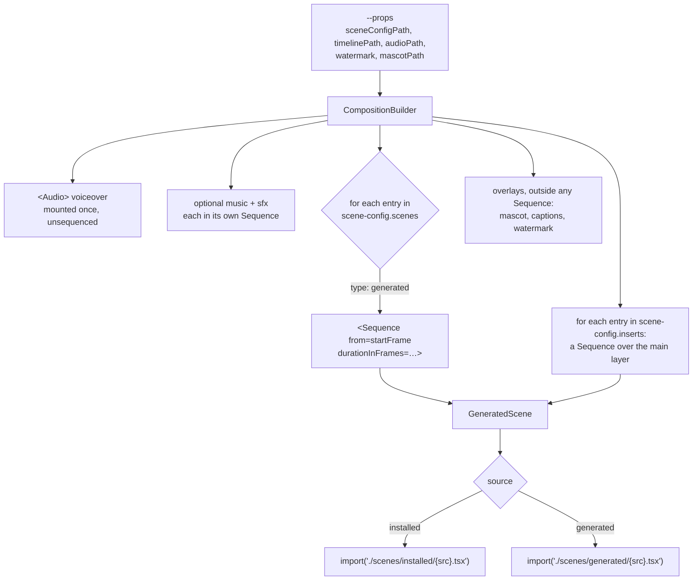

# The Remotion Project

`renderer/remotion/` is a [Remotion](https://remotion.dev) project: React components that render to
video. Remotion runs the components in a headless Chromium, screenshots each frame and hands the
frames to ffmpeg.

This page covers how the project is wired. [Scene Authoring](10-scene-authoring.md) covers how the
agent writes scenes, and [Rendering and Review](11-rendering-and-review.md) covers how a renderer
runs the project.

---

## The frame model

A component is a pure function of the current frame. Remotion has no timeline, no tweening engine and
no animation state. A component calls `useCurrentFrame()`, computes the picture for that frame number
and returns it.

```tsx
const frame = useCurrentFrame();
const opacity = interpolate(frame, [0, 30], [0, 1], {
  extrapolateLeft: "clamp",
  extrapolateRight: "clamp",
});
```

Every composition runs at 30 fps, so frame 30 is one second in. Two rules follow:

- `setTimeout`, `requestAnimationFrame` and CSS transitions do not work. A render produces frames as
  fast as the machine manages, so anything keyed to wall-clock time differs from render to render.
- Frame numbers inside a `<Sequence>` are relative to that sequence. `CompositionBuilder` wraps every
  scene in one, so a scene's `useCurrentFrame()` returns 0 on the scene's first frame.

---

## Compositions

`renderer/remotion/src/Root.tsx` registers these compositions.

| Id | Component | Size and duration |
|---|---|---|
| `Composition` | `CompositionBuilder` | 1080×1920, duration read from `timeline.json` |
| `TextLayoutAudit` | `CompositionBuilder` plus `TextLayoutProbe` | The same |
| `MascotSheet` | `MascotSheet` | One frame, sized per sheet |
| `BeanPropSheet`, `StorybookSheet`, `PresenterSheet`, `PuppetHistorySheet`, `MidcenturySheet`, `ComicPanelsSheet`, `ProcessCastSheet` | A style's model sheet | 1080×1920, one frame per page |
| `Placeholder` | A static placeholder | 1080×1920, 90 frames |

A renderer turns `Composition` into a video with `npx remotion render Composition`.
`TextLayoutAudit` is the same video with an invisible measuring probe on top. The
[text-layout audit](11-rendering-and-review.md#the-text-layout-audit) drives it through Remotion's
Node API. `MascotSheet` is listed so that Remotion Studio can show it, and its renders use a separate
entry point ([The mascot layer](#the-mascot-layer)). The model sheets show a style's fixed cast and
library for a person to check, and no video uses them. The GPU test's `GpuProbe` composition is
registered only by its own entry point, `src/gpu-probe/index.ts`.

The first two take their duration from `calculateMetadata` (`Root.tsx::durationFromTimeline`), which
fetches the timeline named in the props and returns its `totalFrames`, or 900 frames if that fails.

---

## How a scene config becomes a video



`CompositionBuilder` fetches the scene config and the timeline, mounts the audio and walks the scene
list. It wraps each `generated` entry in a `<Sequence>` at the entry's `startFrame` for its
`durationInFrames`, and `GeneratedScene` renders it. The layers, bottom to top, are:

1. the canvas colour (`#0f0f0f` for `dark`, `#ffffff` for `light`)
2. the main layer (`MainLayer`), which holds every entry of `scenes`
3. the [insert scenes](#insert-scenes), one `<Sequence>` each
4. the mascot, hidden for every insert window and its transition frames on either side (`HiddenDuringInserts`)
5. the captions
6. the watermark

### Dynamic import, and why there are two branches

`GeneratedScene` resolves the component with a template-literal dynamic `import()`:

```tsx
source === "installed"
  ? import(`./scenes/installed/${src}.tsx`)
  : import(`./scenes/generated/${src}.tsx`);
```

Webpack resolves each dynamic import to a fixed directory prefix at build time, so one `import()`
with a variable directory would bundle neither tree. Each branch bundles every `.tsx` under its own
tree, recursively, which is why the namespaced `"{video_id}/{scene_name}"` form resolves through the
same call.

The component is `mod.default ?? Object.values(mod)[0]`. A default export is the documented shape,
and a single named export also works.

An import failure does not fail the render. `GeneratedScene` logs the error, calls `continueRender`
and draws nothing, so the bare canvas shows for the scene's whole duration. The typecheck in
`validate_job` is what catches such a scene.

### Props a scene receives

```tsx
<Component durationInFrames={…} words={…} {...props} />
```

A scene receives `durationInFrames` and `words` (the timeline's word spans), then the config entry's
`props` object. `props` is spread last, so a key named `durationInFrames` or `words` overrides the
builder's value.

### Crossfades

`CompositionBuilder::SceneWithFades` fades each generated scene in at its start and out at its end.
The fade-out length is the scene's own `transitionToNext.durationInFrames`: 8 frames when the key is
absent, and 0 for a hard cut. The fade-in length is the previous scene's value, because the two fades
share one overlap window. The first scene has no fade-in and the last has no fade-out. Start frames
do not move, so audio sync is unaffected.

### Insert scenes

An insert is a short scene in an insert style (System Flow, Terminal Doc, Code Scenes, Format Packs)
drawn over the main style for a window of frames. The rules for when a video has inserts and where they go are in
[Main styles and inserts](10-scene-authoring.md#main-styles-and-inserts).

`CompositionBuilder` wraps each entry of the config's `inserts` list in a `<Sequence>` at its
`startFrame` for its `durationInFrames`, inside `InsertFrame` (`data-tm-layer="insert"`), and renders
the installed component its `src` names through `GeneratedScene`. The component receives the
entry's `props` plus an `insert` prop, `InsertPlacement`:

| Key | Meaning |
|---|---|
| `origin` | The insert's first frame on the video's clock. The insert's data is timed on the video's frames, so the component adds it to its local frame |
| `palette` | `dark` or `light`: the look to draw in, which follows the video's canvas |
| `shift` | Pixels the component's layout moves down, or up when negative, to stay clear of the main style's captions |

The main style names one transition into and out of its inserts (`insertTransition`). Each
transition runs just outside the insert's window: the way in over the frames before it and the way
out over the frames after it, so the whole window is on screen and the main style is already on its
next picture as the insert leaves. The insert's `Sequence` covers those frames too, and the component
holds its first frame through the way in and its last through the way out (`InsertPlacement.lead`).
`inserts/transitions.ts` holds the transitions as pure functions of the frame (`insertProgress`,
`activeInsert`, `insertLook`, `glitchBands`), and `TRANSITION_FRAMES` gives their lengths.

An insert never opens on an empty board. Each entry carries `firstFrames`, the frames its first
element takes to settle (System Flow's first node and its label, Terminal Doc's first word; Code
Scenes and Format Packs draw theirs settled on their first frame, so 0). `write_scene_config` fills
it from the insert style's module (`server.py::_INSERT_FIRST_FRAMES`), capped at
`tubematic_core/inserts.py::FIRST_FRAMES_MAX`. `CompositionBuilder` wraps every insert's scene in a
Remotion `<Freeze>` at `transitions.ts::heldFrame`: until the Sequence reaches that frame, the scene
shows the frame on which its first element has settled. The transition therefore reveals content,
and later elements animate in as written. The hold never reaches the insert's next event, so nothing
timed after the first element shows early; a push, a glow or a stream of guesses on the first frame
runs on as the insert plays and does not lengthen the hold. The text-layout audit checks the frame before the window and its first frame for
text of the insert's own (`text_audit.insert_open_passes`).

| Transition | Frames | What it looks like |
|---|---|---|
| `cut` | 0 | The insert appears and disappears on one frame |
| `dip` | 8 | The main layer fades to the canvas colour, then the insert fades up, and the reverse on the way out |
| `push` | 12 | The insert slides in from the right while the main layer slides out to the left, and back on the way out |
| `wipe` | 12 | An edge moving right to left reveals the insert, and moves back left to right on the way out |
| `glitch` | 4 | The insert shows in torn horizontal bands over the main picture, more each frame, and the main layer jolts the other way. The frame seeds the bands, so every render tears alike |
 An
unknown or absent `insertTransition` reads as `cut`. `tubematic_core/inserts.py::TRANSITIONS` and
`TRANSITION_FRAMES` are the Python copy, which the style packs are checked against, and
`tubematic_core/tests/test_inserts.py` pins its frame counts to the renderer's. `CompositionBuilder` passes
`insertLook` the current frame, which the glitch seeds its bands with, and the insert layer takes the look's
`insertClipPath` as its `clip-path`.

While an insert covers the whole frame, `MainLayer` hides the main layer with `visibility: hidden`
and keeps it mounted. Every main component is a pure function of the frame, so it comes back on the
picture its frame gives it, and hiding it skips its paint, which is most of a frame's cost in software
GL.

---

## Audio

| Track | Mounting |
|---|---|
| Voiceover | One `<Audio>` at the top level, outside any sequence, always mounted |
| Music | Optional. Inside a `<Sequence>` at its `startFrame`. The volume holds flat, then ramps to zero over `fadeOutFrames` |
| SFX | One `<Sequence>` per entry, at its `startFrame`. `volume` defaults to 0.6 |

The music volume callback receives a frame relative to the music's own sequence.
`CompositionBuilder` applies no defaults to the `music` object, and an entry without `volume` or
`fadeOutFrames` produces `NaN`. Supply both.

A renderer stages `audio.mp3`, `timeline.json`, `scene-config.json`, `images/` and the mascot's code
for a job (`render_agent.py::_stage`). It stages no music or SFX file, and no MCP tool creates one.

## Captions

By default a video has captions of its own narration burned in. The code and the config key call them
`subtitles`. An absent `subtitles` key means enabled with the defaults, which is how a config written
without the key gets captions. The opt-out is an explicit `{"enabled": false}`.

`scenes/installed/Subtitles.tsx` draws the captions from `timeline.words[]`, whose timings are
already in frames. The file is in the installed directory, but it is not a scene and a config entry
cannot reference it.

`CompositionBuilder` renders the captions after the scene list, outside any `Sequence`. As a scene
entry they would be crossfaded away at every scene boundary and would count against the skill's
four-scene minimum. Outside a `Sequence`, `useCurrentFrame()` stays absolute, so the word timings need
no rebasing.

### Grouping words

`Subtitles.tsx::chunkWords` groups the words into runs of at most `maxWords` (1 to 7, default 4). The
ceiling is 7 because captions are read at speaking speed on a phone. A run ends at sentence
punctuation, at a gap of 8 frames or more before the next word (`SILENCE_FRAMES`), at clause
punctuation once the run holds two words, or at the word cap.

`Subtitles.tsx::visibleChunkIndex` picks the run on screen. A run holds until the next run begins, so
captions do not blink out between phrases. The hold ends 12 frames after the run's last word
(`MAX_HOLD_FRAMES`), so no caption stays up through a long pause.

The word being spoken is drawn at full opacity and the rest of its run is dimmed. After a 4-frame
entry, nothing in the line moves or resizes. A word listed in `emphasis` is drawn in white on a red box
from the moment it is spoken, with the box scaling in over 8 frames. The `label` background is an
ivory printed label hugging the phrase, a diamond each side, every word at full strength, with a
2-frame fade and no rise.

The `log` look (`background: "log"`) draws the run as a terminal log instead
(`Subtitles.tsx::LogStrip`): a `LOG` label and a running clock over a hairline, then the run
left-aligned behind a `›` prompt, each word typed on as it is spoken, with a block caret after the
word being spoken. That word is in `accent`; the words already spoken stay, dimmed. Terminal Doc uses
it.

The `card` background (`Subtitles.tsx`) draws the phrase on a warm-white card with an ink border and a
flat offset shadow, the words left-aligned beside a small isometric cube chip. Isometric Infographic uses it.
The `letterSpacing` key adds space between the letters of the plain look, in ems; absent keeps each
background's own. Night Signal sets its spaced capitals with it.

With `look` set to `"selection"` (`Subtitles.tsx::SelectionLine`), the line builds word by word
instead, each word appearing 2 frames before its audio (`SELECTION_LEAD`) and blurred for its first
frame; the latest word is bold and the earlier ones are grey and regular; the line re-centres at once,
with no tween; and its last frame before the next line is drawn at 60%. An `emphasis` word keeps its
bold and gets a thin blue selection box: two round handles pop in 2 frames after it appears, then the
box's top and bottom edges grow from its centre over 3 frames. The Under the Hood style uses this look.

With `look` set to `"fill"`, the whole phrase is on screen from its first frame, with no rise or
fade. The words still to come are grey, and each turns to the text colour over 2 frames as it is
spoken and stays there. The Case File Story style uses this look. On a `chip` background
(`background: "chip"`) the phrase sits on a cream paper chip, and an `emphasis` word turns to
`accent` (red by default) once spoken; the Archive and Engraving style uses the two together.

With `look` set to `"tags"` (`Subtitles.tsx::TagLine`), each word is a torn paper tag that pops in as
it is spoken: scale 0.6 up to 1.08 and back to 1 over 4 frames (`tagScale`), then still. Each tag's
tilt (up to 5 degrees), lift and torn top and bottom edges come from a seed of its own word
(`tagSeed`, `tornPolygon`), so a tag looks the same on every frame and every render. A run holds up to
`maxWords` tags. The tag is `accent` and its text `color`. The Paper Diorama style uses this look.

With `look` set to `"highlight"` (`Subtitles.tsx::HighlightStrip`), the whole phrase sits on a cream
strip from its first frame, the words still to come in grey as in `fill`, and a yellow marker bar
wipes in under each `emphasis` word over 8 frames as it is spoken (`markerReach`). The Editorial
Collage style uses this look.

With `look` set to `"karaoke"` (`karaokeWordColor` in `Subtitles.tsx`), the whole phrase is on screen from
its first frame in the text colour with no rise, and each word turns to `accent` (`#FFD221` when absent)
on its start frame and stays that colour. The Low-Poly Skit style uses this look with the `outline` background.

### Fonts

The default font is the container-local `system-ui, sans-serif`. The captions are on the path of every
render, the render browser fetches a Google font over the network, and a renderer without outbound
access would stall on that fetch.

`fontFamily` accepts `Inter`, `Oswald`, `Roboto` or `Montserrat` as webfonts, and passes any other
string through as a CSS family. Each webfont is loaded as one style, one weight and two subsets
(`latin`, `latin-ext`). A loader called with no arguments fetches every file the family publishes,
and newer Remotion versions refuse to load a font without weights and subsets. The weight is declared
per family (800, and 700 for Oswald), because asking a family for a weight it does not publish
throws.

### The older `TextRevealScene`

`scenes/TextRevealScene.tsx` also draws text from `timeline.words[]`: five words a line, the last
three lines. `CompositionBuilder` still renders a scene entry of `"type": "TextReveal"` with it, with
no crossfade. Such an entry takes `startFrame`, `durationInFrames` and optional `fontSize`,
`lineHeight`, `color` and `backgroundColor`. The scene skill forbids the type.

## Watermark

By default every video carries a small "Made with tubematic.ai" mark in its top-right corner.
`CompositionBuilder` draws `Watermark.tsx` last, above every scene and outside any `Sequence`, so the
mark is not crossfaded and does not count as a scene.

The mark is the same on every video: 130 px wide, 32 px from the top and right edges, at opacity 0.6.
It sits outside the safe zone, because the safe zone is where scenes put their content. Four rules
keep it fixed:

- Nothing about the mark comes from `scene-config.json`. The component takes no props and
  `CompositionBuilder` reads no watermark key, because the agent writes that file.
- The only switch is the `watermark_enabled` [setting](04-settings.md). The render gateway sends it
  with the claim, and the renderer passes it to the composition as the `watermark` render prop. No MCP
  tool writes settings, so only a person can turn the mark off. The mark is drawn unless the prop is
  `false`, so Studio preview and the text-layout audit, which send nothing, show it.
- No scene can paint over it. A positioned scene element with a positive `z-index` would paint above
  a later sibling, so the mark carries the largest `z-index` a browser honours (2147483647). On a tie
  the later element wins.
- The artwork carries its own translucent plate, which keeps the white text readable on any frame.
  The mark needs no colour derived from the canvas.

`src/watermarkBox.ts` holds the mark's position (`WATERMARK_*`) and `KEEP_OUT_X`, the line 18 px left
of it. An insert moves up by as much as 120 px to clear the captions, which puts its top row beside
the mark, so Code Scenes keeps its header row (tag, step counter and label) and Format Packs its
EXAMPLE tag, list title, quiz question and strap headline at or left of that line. The validators
check the Code Scenes header against it, the Format Packs wrap boxes are narrowed to it, and each
style's contract test pins the numbers to the shared fixtures.

The image is `public/watermark.png`, baked into the renderer image and loaded with `staticFile()`, so
no render fetches it over the network. It sits beside the per-video `public/<video_id>/` directories,
so staging does not touch it. The source artwork is in `logos/` at the repository root.

Scenes are not told about the mark and are not laid out around it. Scene content passing beneath it
is expected, and the [AI review prompt](21-ai-review.md#the-prompts-guard-clauses) says so.

## Safe zones

```
top 150px · bottom 170px · left 60px · right 60px
```

These margins apply to the 1080×1920 frame and leave 960×1600 usable. They clear YouTube's own
overlays.

Four files declare the numbers, because the files run in different processes:
`scenes/TextRevealScene.tsx` (`SAFE`), `mcp/text_audit.py` (`SAFE_ZONE`),
`renderer/api/ai_review.py` (`SAFE_ZONE_TOP`, `SAFE_ZONE_BOTTOM`) and `tubematic_core/mascots.py`
(`SAFE_ZONE`). The scene skill states them in prose. Change them all together.

---

## `scene-config.json`

`scene-config.json` says which scene plays when. The agent writes it through the `write_scene_config`
MCP tool and `CompositionBuilder` reads the file directly. No schema file exists. The shape is the
`SceneConfigFile` interface in `CompositionBuilder.tsx`.

```jsonc
{
  "totalFrames": 2700,        // copy from timeline.totalFrames
  "fps": 30,
  "canvas": "dark",           // "dark" | "light"
  "subtitles": {              // optional; an absent key means enabled
    "maxWords": 4, "fontSize": 62, "background": "pill", "position": 0.78
  },
  "mascot": [                 // only on a video that has a mascot
    { "frame": 0, "on": true, "x": 0.5, "y": 0.62, "emotion": "happy" }
  ],
  "music": {                  // optional
    "src": "…", "volume": 0.15, "startFrame": 0, "fadeOutFrames": 30
  },
  "sfx": [                    // optional
    { "src": "…", "startFrame": 120, "volume": 0.6 }
  ],
  "inserts": [                // optional; see Insert scenes
    {
      "style": "system_flow",
      "startFrame": 600, "durationInFrames": 240,
      "props": { "systemFlow": { "boards": [ … ] } },
      "src": "SystemFlow", "palette": "light", "shift": 0   // filled by write_scene_config
    }
  ],
  "insertTransition": "wipe", // filled by write_scene_config
  "scenes": [
    {
      "type": "generated",
      "src": "vid_abc123/dns-lookup",   // stem only, no extension
      "source": "generated",            // or "installed"
      "startFrame": 0, "durationInFrames": 420,
      "props": { "title": "…" },
      "transitionToNext": { "durationInFrames": 8 }
    }
  ]
}
```

| Field | Notes |
|---|---|
| `totalFrames` | A positive integer. `validate_job` requires it to be within 5 frames of the timeline's `totalFrames` |
| `fps` | 30. The compositions are registered at 30 fps and do not read this key |
| `canvas` | `"dark"` or `"light"`. See [`canvas`](#canvas) |
| `subtitles` | Caption settings. See [`subtitles`](#subtitles) |
| `mascot` | The mascot's cue track. See [`mascot`](#mascot) |
| `music`, `sfx` | See [Audio](#audio) |
| `scenes[].type` | `"generated"` for every scene, installed ones included |
| `scenes[].src` | Filename stem: `"name"` or `"video_id/name"`, nothing deeper. Each part matches `^[a-zA-Z0-9][a-zA-Z0-9-]*$` |
| `scenes[].source` | `"generated"` (the default) or `"installed"` |
| `scenes[].props` | Forwarded to the component. See [Props a scene receives](#props-a-scene-receives) |
| `scenes[].transitionToNext` | `{"durationInFrames": N}`. See [Crossfades](#crossfades) |
| `inserts` | Optional. The [insert scenes](#insert-scenes), in time order |
| `inserts[].style`, `startFrame`, `durationInFrames`, `props` | Written by the agent: the insert style id, the window on the video's frames, and the style's data under its props key (`systemFlow`, `terminalDoc`) |
| `inserts[].src`, `palette`, `shift` | Filled by `write_scene_config` (`mcp/inserts.py::fill`): the component from the pack's `insert.component`, the video's canvas, and the caption clearance (`mcp/inserts.py::shift_for`) |
| `insertTransition` | Filled by `write_scene_config` from the main style's `inserts.transition`. Absent when the config has no inserts |

An image path inside `props` must have the form `/public/<video_id>/images/…` and the file must
exist. `validate_job` checks both (`server.py::_bad_image_refs`). A path that does not resolve fails
the whole render, because Remotion's `` retries twice and then cancels it.

### What `write_scene_config` checks

`write_scene_config` writes the JSON as given, after these checks:

- `totalFrames` is a positive integer. The tool does not compare it with the timeline.
- `scenes` is a non-empty list.
- `canvas`, if present, is valid and agrees with the video's canvas.
- `subtitles`, if present, uses known keys and in-range values.
- `mascot`, if present, belongs to a video that has a mascot and passes the cue rules.
- A Cartoon 3D scene is the only scene, its beats cover the video, and the scene kind agrees with the
  video's renderer ([Scene Authoring](10-scene-authoring.md#cartoon-3d)).
- A video that holds System Flow as its style from an earlier version has the one `SystemFlow`
  scene and its diagram passes the System Flow checks; no other video has `SystemFlow` in `scenes`
  ([Scene Authoring](10-scene-authoring.md#system-flow)).
- A Bean Explainer video has the one `BeanExplainer` scene and its sections and shots pass the Bean
  Explainer checks; no other video uses `BeanExplainer`
  ([Scene Authoring](10-scene-authoring.md#bean-explainer)).
- A Whiteboard video has the one `Whiteboard` scene and its board passes the Whiteboard checks; no
  other video uses `Whiteboard` ([Scene Authoring](10-scene-authoring.md#whiteboard)).
- A Storybook Atlas video has the one `StorybookAtlas` scene and its chapters pass the Storybook
  Atlas checks; no other video uses `StorybookAtlas`
  ([Scene Authoring](10-scene-authoring.md#storybook-atlas)).
- A video that holds Terminal Doc as its style from an earlier version has the one `TerminalDoc`
  scene and its beats and moves pass the Terminal Doc checks; no other video has `TerminalDoc` in
  `scenes` ([Scene Authoring](10-scene-authoring.md#terminal-doc)).
- An Under the Hood video has the one `UnderTheHood` scene and its plates and events pass the Under
  the Hood checks; no other video uses `UnderTheHood`
  ([Scene Authoring](10-scene-authoring.md#under-the-hood)).
- A Case File Story video has the one `CaseFileStory` scene and its meters and beats pass the Case
  File Story checks; no other video uses `CaseFileStory`
  ([Scene Authoring](10-scene-authoring.md#case-file-story)).
- A Paper Diorama video has the one `PaperDiorama` scene and its sets pass the Paper Diorama checks;
  no other video uses `PaperDiorama`
  ([Scene Authoring](10-scene-authoring.md#paper-diorama)).
- An Archive and Engraving video has the one `ArchiveEngraving` scene and its header and beats pass
  the Archive and Engraving checks; no other video uses `ArchiveEngraving`
  ([Scene Authoring](10-scene-authoring.md#archive-and-engraving)).
- An Editorial Collage video has the one `EditorialCollage` scene and its stations pass the Editorial
  Collage checks; no other video uses `EditorialCollage`
  ([Scene Authoring](10-scene-authoring.md#editorial-collage)).
- A Storybook Reveal video has the one `StorybookReveal` scene and its pages pass the Storybook Reveal
  checks; no other video uses `StorybookReveal`
  ([Scene Authoring](10-scene-authoring.md#storybook-reveal)).
- A Puppet History video has the one `PuppetHistory` scene and its cast and beats pass the Puppet
  History checks; no other video uses `PuppetHistory`
  ([Scene Authoring](10-scene-authoring.md#puppet-history)).
- A Mid-century How-To video has the one `MidcenturyHowTo` scene and its steps and shots pass the
  Mid-century How-To checks; no other video uses `MidcenturyHowTo`
  ([Scene Authoring](10-scene-authoring.md#mid-century-how-to)).
- A Comic Panels video has the one `ComicPanels` scene and its cast, pages and panels pass the Comic
  Panels checks; no other video uses `ComicPanels`
  ([Scene Authoring](10-scene-authoring.md#comic-panels)).
- A Process Cast video has the one `ProcessCast` scene and its cast, stations and events pass the
  Process Cast checks; no other video uses `ProcessCast`
  ([Scene Authoring](10-scene-authoring.md#process-cast)).
- A Night Signal video has the one `NightSignal` scene and its scenes pass the Night Signal checks; no
  other video uses `NightSignal` ([Scene Authoring](10-scene-authoring.md#night-signal)).
- A Flat Vector Science video has the one `FlatVectorScience` scene and its shots pass the Flat Vector
  Science checks; no other video uses `FlatVectorScience`
  ([Scene Authoring](10-scene-authoring.md#flat-vector-science)).
- An Isometric Infographic video has the one `IsometricInfographic` scene and its boards pass the
  Isometric Infographic checks; no other video uses `IsometricInfographic`
  ([Scene Authoring](10-scene-authoring.md#isometric-infographic)).
- `inserts`, if present or if the script marks a segment `insert`, passes `mcp/inserts.py::check`:
  the window rules, the style's own checks (`system_flow.check_insert`, `terminal_doc.check_insert`,
  `code_scenes.check_insert`, `format_packs.check_insert`),
  and no main scene starting inside a window. Each main style's checks treat the windows as quiet
  spans, and no mascot cue may fall inside one
  ([Main styles and inserts](10-scene-authoring.md#main-styles-and-inserts)).

The tool refuses the write while another session holds the
[scene-work claim](06-mcp-server.md#the-scene-work-claim) (`scene_work_claimed`), and while the video
is queued or rendering (`status_mismatch`).

`canvas` is the only default the tool writes into most files, besides each insert's `src`, `palette`
and `shift` and the `insertTransition`, which the agent never writes. A System Flow or Whiteboard config
with no `subtitles` also gets its style pack's caption settings, because its captions are part of the
style's look. A Bean Explainer, Storybook Atlas, Under the Hood, Case File Story, Paper Diorama, Archive and Engraving, Editorial Collage, Storybook Reveal, Puppet History, Mid-century How-To, Comic Panels, Process Cast, Night Signal, Flat Vector
Science or Isometric Infographic config gets them under whatever
`subtitles` keys it sets, so a config that sets only `emphasis` keeps the look. A Terminal Doc config
gets them the same way, with its skin's colours and font over the pack's. An Under the Hood config
also gets each plate's `aspect`, read from its photograph. The
components apply the other defaults at render time, so a changed default reaches every video whose
config omits the key.

[`validate_job`](06-mcp-server.md#validate_job) checks frame-count agreement with the timeline,
scene-file existence, image paths and types.

### `canvas`

`canvas` is the ground painted under every scene. It is one value for the whole video, because scenes
that disagree about it flash between light and dark
([Scene Authoring](10-scene-authoring.md#the-canvas)).

`write_scene_config` rejects a value that contradicts the video's canvas. It fills in an absent key
from the video's visual style or the canvas the agent recorded, and otherwise with `"dark"`.
`CompositionBuilder` also treats an absent key as `"dark"`.

### `subtitles`

| Key | Default | Accepted |
|---|---|---|
| `enabled` | `true` | `true` or `false` |
| `maxWords` | `4` | A whole number, 1 to 7 |
| `fontFamily` | `system-ui, sans-serif` | A non-empty string. See [Fonts](#fonts) |
| `fontSize` | `62` | 28 to 120 |
| `color` | `null` | A CSS colour. `null` follows the canvas: white on dark, near-black on light |
| `background` | `"pill"` | `"pill"` (a translucent plate), `"shadow"`, `"outline"` (bold text, thick dark stroke, no plate), `"label"` (an ivory printed label), `"none"`, `"log"` (a terminal log strip), `"chip"` (a cream paper chip) or `"card"` (a cube-chip card); see [Grouping words](#grouping-words) |
| `position` | `0.78` | 0.05 to 0.95. The vertical centre as a fraction of frame height |
| `uppercase` | `false` | `true` or `false` |
| `accent` | `null` | A CSS colour: the word being spoken in the `log` look, an `emphasis` word on a `chip`, the tags in the `tags` look, the marker in the `highlight` look, the word once spoken in the `karaoke` look. `null` uses each one's own colour |
| `emphasis` | `[]` | Distinct word indexes into the timeline's words (0 is the first). Each is drawn on a red box once spoken, or in a selection box under the `selection` look. At most one word in 5 (`SUBTITLE_EMPHASIS_EVERY`) |
| `letterSpacing` | Each background's own | A number, -0.05 to 0.3. Extra space between letters in ems, for the plain look |
| `look` | `"plain"` | `"plain"`, `"selection"`, `"fill"`, `"tags"`, `"highlight"` or `"karaoke"`; see [Grouping words](#grouping-words) |

`server.py::_validate_subtitles` rejects an unknown key, so a typo is reported at write time.
`server.py::_emphasis_error` checks `emphasis` against the narration's word count. The
ranges are `SUBTITLE_NUMERIC_RANGES` in `mcp/server.py`. The defaults live only in `Subtitles.tsx`.

### `mascot`

`mascot` is the mascot's cue track: a bare list of cue objects. It holds data only, and the drawing
code is not in the config. `write_scene_config` refuses the key on a video without a mascot.
`validate_job` and `submit_render` refuse a mascot video whose config has no cues. The cue fields and
rules are on [Scene Authoring](10-scene-authoring.md#mascots).

---

## Installed components

`renderer/remotion/src/scenes/installed/` is the committed library. A config entry can reference
`KenBurnsImage`, `PanelImage` and `StepFlowDiagram` directly, with `"source": "installed"`.
`BeanExplainer`, `Whiteboard`, `StorybookAtlas`, `UnderTheHood`, `CaseFileStory`, `PaperDiorama`, `ArchiveEngraving`, `EditorialCollage`, `StorybookReveal`, `PuppetHistory`, `MidcenturyHowTo`,
`ComicPanels` and `ProcessCast` are referenced the same way, by
videos of their own style only. `SystemFlow` and `TerminalDoc` are drawn as
[insert scenes](#insert-scenes) from the `inserts` list, and as a video's one scene only for a video
that holds their style from an earlier version. `CodeScenes` and `FormatPacks` are insert scenes
only, and `write_scene_config` refuses them in `scenes`. The other
files are wrappers and helpers that a scene imports. The directory's `README.md` is the catalogue the
agent reads.

### `ImageFX`

`ImageFX` is a wrapper that a scene imports. It applies a Ken Burns move to a full-bleed image and can
expose an anchor to its children.

| Prop | Default | Notes |
|---|---|---|
| `src` | required | The `public_path` from `generate_image`, unchanged |
| `durationInFrames` | required | The pan and zoom ramps span this length |
| `scaleFrom` / `scaleTo` | `1.15` / `1.0` | Zoom at the first and last frame |
| `panFrom` / `panTo` | `[0,0]` | Pan as `[x, y]` fractions of the frame |
| `anchor` | `[0.5,0.5]` | The zoom's transform origin |
| `focus` | `[0.5,0.5]` | The point of the source image that survives the cover-crop |
| `vignette` | `0` | Darkened-edge strength, 0 to 1 |
| `backgroundColor` | `"#000000"` | |
| `children` | none | A node, or a function that receives `{project, scale}` |

Do not wrap `src` in `staticFile()`. Remotion's static base is `/public`, the path already starts with
it, and `staticFile()` throws on a prefixed path.

`project(u, v)` maps a normalised point in image space to on-screen pixels and returns
`{x, y, visible}`, so an overlay drawn through it stays attached to a feature of the picture as the
camera moves. `u` and `v` are the units of the grid that `read_image` draws. `visible` is a
frame-bounds test with no margin.

Design choices in the component:

- The component limits a pan to the overhang the current zoom produces, so a requested pan of 0.05
  can land at 0.04. `project()` inverts the clamped pan, because the requested value would drift by
  the difference.
- Scale is clamped to a minimum of 1. Below 1 the image stops filling the frame.
- `ImageFX` has no `imageAspect` prop. The projection assumes the image's aspect ratio matches the
  frame's, which leaves an error under 1% of frame width. An aspect prop would be one number that is
  easy to invert (`h/w` or `w/h`) and that nothing validates.
- `anchor` cannot change what a cover-crop keeps, because the pan clamp is zero at scale 1. `focus`
  maps to `object-position` and can. Full-bleed, the crop is about 8 px a side. Inside a `PanelImage`,
  a tall portrait in a squarer panel loses nearly half its height from the centre.
- `ImageFX` has no blur filter. A full-bleed blur across 300 or more frames is slow on the
  [software GL renderer](20-gpu-and-remote-renderers.md#the-gl-renderer), and a slow render can run
  into the render timeout.

### `KenBurnsImage`

`KenBurnsImage` is a scene: a thin wrapper over `ImageFX` for an image beat that needs no authored
scene. It takes `src`, `scaleFrom`, `scaleTo`, `panFrom`, `panTo`, `anchor`, `vignette` (default
`0.35`), `backgroundColor` and `caption`. It does not pass `focus`.

`caption` draws a lower-third line inside the safe zone. Omit it in new work: the narration is already
captioned, so a line naming the subject repeats it. The cases where a scene does carry text are on
[Scene Authoring](10-scene-authoring.md#on-screen-text-is-the-exception).

### `StepFlowDiagram`

`StepFlowDiagram` is a scene: an SVG node-and-edge diagram for a linear process with nameable stages,
such as protocol hops, pipeline steps or a state machine. It takes `steps` (a list of
`{label, icon}`), `connections` (`[from, to]` index pairs), `activeStages` (one list of node indexes
per stage), `highlightStage` (default `0`) and `theme`. It fades in linearly over its first 15 frames.

`theme` is `"dark"` (the default) or `"light"`. The dark theme paints an opaque near-black background,
which would put a dark slab on a light canvas. The light theme draws black line art on a transparent
background. The component exposes two whole palettes and no single colour prop, because a diagram is
legible only if its background, both node states and both edge states agree.

### `SystemFlow`

`SystemFlow` draws a System Flow insert, or a whole System Flow video, from `props.systemFlow`, with
its own canvas, headline and camera; its helpers are in `systemFlow/`. Given an `insert` prop, it
times its boards from `origin`, draws in its `light` look (dark ink and teal on paper) when
`palette` is `light` and in its `dark` look otherwise (`LOOKS`), and moves its boards and header down
by `shift` with a positioned offset, because a CSS-transformed layer is composited again every frame
in software GL. It loads its fonts (Barlow, Space Grotesk, JetBrains
Mono) from `public/fonts/` before the first frame, so a renderer with no internet access draws the
same picture; the default caption font is unaffected. Its contract, layout, camera and the reasons
it avoids gradients, filters and dashed strokes are in
[System Flow](10-scene-authoring.md#system-flow).

### `BeanExplainer`

`BeanExplainer` draws a whole Bean Explainer video from `props.beanExplainer`, with its own colour
field, floor, header, badge and carousel; its helpers, the bean rig and the prop library are in
`beanExplainer/`. It loads its fonts (Fredoka, Patrick Hand, Instrument Sans) from `public/fonts/`
before the first frame; the style's captions use Instrument Sans, which this scene loads. The
`BeanPropSheet` composition renders the cast and the prop library as a model sheet, one page per
frame, for a person to check a drawing: `npx remotion still src/index.ts BeanPropSheet out.png
--frame=<page>`. With `--props='{"measure":"<prop>"}'` it draws one prop at every moment of its act
on white, the picture each prop's box in `contract.ts` is measured from. No video uses it.

A Bean Explainer video can also use props its agent drew, in `generated/<video_id>/prop-*.tsx`. The
scene imports them under a `delayRender` handle, and one that fails to load fails the render.
`bean-tools/render-props.mjs` renders them for the `render_bean_props` tool on the
`BeanPropPreview` composition, from a bundle entry it writes per call into `bean-tools/.tmp/`
(ignored by git) that imports only that video's prop files. The contract and the reason the bean is drawn as a cached bitmap
are in [Bean Explainer](10-scene-authoring.md#bean-explainer).
### `Whiteboard`

`Whiteboard` draws a whole Whiteboard video from `props.whiteboard`: one board, a camera over it, a
floating marker and the closing pull-back. Its helpers are in `whiteboard/`. It loads its
handwriting font (Kalam) from `public/fonts/` before the first frame, and the style pack's captions
use the same font. It draws its ink on a canvas; its contract, its layouts and the measurement that
put the ink on a canvas are in [Whiteboard](10-scene-authoring.md#whiteboard).

### `StorybookAtlas`

`StorybookAtlas` draws a whole Storybook Atlas video from `props.storybookAtlas`, with its own paper,
frame, plaque, backdrops, guide, people, props and plates; its helpers and the prop library are in
`storybookAtlas/`. It loads EB Garamond from `public/fonts/` before the first frame; the style's
caption label uses it too, which this scene loads. The `StorybookSheet` composition renders the guide,
the people and their knobs, every backdrop as a chapter frame and the prop library (each prop with a
check that its drawing fits its box), one page per frame, for a person to check a drawing: `npx
remotion still src/index.ts StorybookSheet out.png --frame=<page>`. `--props='{"group":"<file>"}'`
shows one prop file's props and `--props='{"chapter":"<backdrop>"}'` one backdrop; `"hold"`,
`"frames"` and `"drop"` make it a render-cost probe. No video uses it.

A Storybook Atlas video can also use props its agent drew, in `generated/<video_id>/prop-*.tsx`,
imported the same way as Bean Explainer's. `storybook-tools/render-props.mjs` renders them for the
`render_storybook_props` tool on the `StorybookPropPreview` composition, from a bundle entry it writes
per call into `storybook-tools/.tmp/` (ignored by git). `storybook-tools/sync-contract.mjs` rewrites the
style pack's `extra` and `mcp/tests/fixtures/storybook_atlas_contract.json` from the renderer's code. The
contract and the reason every drawing is a cached bitmap are in
[Storybook Atlas](10-scene-authoring.md#storybook-atlas).

### `TerminalDoc`

`TerminalDoc` draws a Terminal Doc insert, or a whole Terminal Doc video, from `props.terminalDoc`,
with its ciphertext wall, the CRT glass of its `crt` skin and its moves; its helpers are in
`terminalDoc/`. Its skins are in `terminalDoc/kit.tsx::SKIN_TOKENS`: `house` (near-black), `crt` and
`paper` (dark ink on paper). Given an `insert` prop, it times its beats from `origin`, takes the
`paper` skin when `palette` is `light` and `house` otherwise, ignores `customMoves`, and moves its
stage by `shift` with a positioned offset. It loads its fonts (IBM Plex Mono, and VT323 for the `crt` skin) from `public/fonts/`
before the first frame; the style's `log` captions use the same faces, which this scene loads.

A whole Terminal Doc video can also use moves its agent wrote, in `generated/<video_id>/move-*.tsx`. The
scene imports them under a `delayRender` handle, and one that fails to load fails the render.
`terminal-tools/render-moves.mjs` renders them for the `preview_terminal_moves` tool on the
`TerminalMovePreview` composition, from a bundle entry it writes per call into `terminal-tools/.tmp/`
(ignored by git) that imports only that video's move files. The contract and the reason the wall is
a canvas are in [Terminal Doc](10-scene-authoring.md#terminal-doc).

### `CodeScenes`

`CodeScenes` draws a Code Scenes insert from `props.codeScenes`: an editor card whose code morphs
from step to step, a focus bar, an error squiggle and callout, and an output pane; its helpers are
in `codeScenes/`. It colours the code with Shiki (the `shiki`, `@shikijs/langs` and
`@shikijs/themes` dependencies) synchronously during the render, from grammars bundled with the
scene. Given an `insert` prop it times its steps from `origin`, takes its white card when `palette`
is `light`, and moves its layout by `shift` with a positioned offset. It loads JetBrains Mono and
Barlow from `public/fonts/` before the first frame. The contract is in
[Code Scenes](10-scene-authoring.md#code-scenes).

### `FormatPacks`

`FormatPacks` draws a Format Packs insert from `props.formatPacks`: one format (a chat thread, a
numbered list, a quiz board or a news strap) per insert; its helpers are in `formatPacks/`. It draws
generic chrome only, and an EXAMPLE tag on every chat and on a strap with no `source`. Given an
`insert` prop it times its arrivals from `origin`, takes its paper look when `palette` is `light`,
and moves its layout by `shift` with a positioned offset. It loads Barlow and IBM Plex Mono from
`public/fonts/` before the first frame. The contract is in
[Format Packs](10-scene-authoring.md#format-packs).

### `UnderTheHood`

`UnderTheHood` draws a whole Under the Hood video from `props.underTheHood`: its plates (generated
photographs, or plain dark panels for a chart), the overlays pinned to them, the counter row, the
footnote and the presenter; its helpers are in `underTheHood/`. It loads Space Grotesk (400 and 700)
and JetBrains Mono (500 and 700) from `public/fonts/` before the first frame; the style's captions use
Space Grotesk, which this scene loads. The presenter is drawn once per look as a bitmap. The
`PresenterSheet` composition renders the presenter's poses, mouth shapes and blink as a model sheet,
for a person to check the drawing: `npx remotion still src/index.ts PresenterSheet out.png
--frame=0`. No video uses it. The contract and the projection are in
[Under the Hood](10-scene-authoring.md#under-the-hood).

### `CaseFileStory`

`CaseFileStory` draws a whole Case File Story video from `props.caseFile`: its painted stills with
their push-ins and punch-ins, the meter row, the large meter panel, the count, bars and term cards
and the closing choice buttons; its helpers are in `caseFileStory/`. It loads Instrument Sans (700)
and IBM Plex Mono (400 and 700) from `public/fonts/` before the first frame; the style's captions
use Instrument Sans, which this scene loads. It decodes every still before the first frame, and a
still that does not load fails the render. The contract and the checks are in
[Case File Story](10-scene-authoring.md#case-file-story).

### `PaperDiorama`

`PaperDiorama` draws a whole Paper Diorama video from `props.paperDiorama` (`critter`, `customProps`,
`sets`): paper rooms, props standing in slots, the clay critter and the events that land on the
stressed words. Its helpers are in `paperDiorama/`: `contract.ts` (the vocabulary and limits),
`paint.ts` (the rough edge, grain and shadow of every paper piece), `critter.ts`, `stage.ts` (slots,
levels and timing), `props.json` (the shipped props) and `PaperPropSheet.tsx`. It loads Archivo Black,
Fraunces and Inter from `public/fonts/` before the first frame, and the 8 room JPEGs from
`public/paperDiorama/rooms/`. The style's captions use the `tags` look. The `PaperPropSheet`
composition paints a video's own `customProps` for a person or an agent to check: `paper-tools/render-props.mjs`
renders it for the `render_paper_props` tool, from a bundle entry it writes per call. The contract and
the checks are in [Paper Diorama](10-scene-authoring.md#paper-diorama).

### `ArchiveEngraving`

`ArchiveEngraving` draws a whole Archive and Engraving video from `props.archive` (`header`, `beats`):
a parchment page with a running header, a dated serif title, one museum card (a plate or chart
engraving, a name card for a person or a row of them, or a lined document) and an optional timeline
ruler, with events (`strike`, `stamp`, `magnify`, `route`, `timeline`, `underline`) that land on the
narration. Its helpers are in `archiveEngraving/`: `contract.ts` (the vocabulary, limits and page
zones), `stage.ts` (title layout, the plate's push and crop, the ruler's scale and the event
timing) and `emblems.ts` (the engraved roundel emblems for name cards). Its engravings are
generated stills baked with `treat_image(..., "engraving")`. The renderer draws the "Illustration"
footnote under a plate or chart and "Recreation" under a document, and a person has no picture
field. It loads Cormorant Upright, Bodoni Moda SC, EB Garamond, Inter and Kalam from `public/fonts/`
before the first frame. The style's captions use the `fill` look on the `chip` background. The
contract and the checks are in [Archive and Engraving](10-scene-authoring.md#archive-and-engraving).

### `EditorialCollage`

`EditorialCollage` draws a whole Editorial Collage video from `props.collage` (`stations`): a paper desk
larger than the frame, one station per idea (a headline over a hero) and a camera that rests on a
station and glides to the next while a red string with a pin at each end draws between them. A
headline is a clipping, a label bar or a black card; a hero is a print, a sticker, an index card, a
figure or a stack of small pictures. Red pen circles, underlines, strikes, highlights, stamps and
arrows land on the narration. Its helpers are in `editorialCollage/`: `contract.ts` (the vocabulary,
limits, zones and timing), `stage.ts` (the stepped motion, the camera, headline and hero layout, the
typed lines and the counting figure) and `paint.ts` (the canvas painting of the desk and its
pieces). The pieces move in steps of twelve a second under the smooth camera. The prints and
cut-outs are generated stills baked with `treat_image(..., "print")` and `treat_image(..., "sticker")`.
The renderer draws the "Illustration" note on a print and "Recreation" on a recreated document, and
a hero has no field for a person's face. It loads Source Serif 4, Bricolage Grotesque and Special Elite
from `public/fonts/` before the first frame. The style's captions use the `highlight` look. The contract
and the checks are in [Editorial Collage](10-scene-authoring.md#editorial-collage).

### `StorybookReveal`

`StorybookReveal` draws a whole Storybook Reveal video from `props.reveal` (`pages`): a cream
picture-book page with a hand-lettered title, one rounded panel holding a square picture, and a small
page number. Each page reveals its picture in steps: the title wipes in, the picture's pencil plate
wipes in from the left, the colour then floods over it from the left with a soft, ragged edge, and
the picture pushes in slowly. A page change is a hard cut or a curl from the bottom-right corner.
Its helpers are in `storybookReveal/`: `contract.ts` (the vocabulary, limits, zones and timing) and
`stage.ts` (the title size, the picture's fit in the panel, the push, the flood and the curl). Each
page's picture is a generated still painted from the video's hero sheet, with its pencil plate made
by `treat_image(..., "pencil")`; the plate lines up with the colour still pixel for pixel. The flat
page uses no SVG filter, gradient or blur, which keeps the render cost close to a plain scene. It
loads Patrick Hand and Lora from `public/fonts/` before the first frame. The style's captions use
the `fill` look with no background. The contract and the checks are in
[Storybook Reveal](10-scene-authoring.md#storybook-reveal).

### `PuppetHistory`

`PuppetHistory` draws a whole Puppet History video from `props.puppetHistory`: the sets as flat
colour bands with cached decor, the puppets in their costumes with name plates, signs and hand props,
the document cards with their stamps and struck-out lines, the flat map of today's countries with its
fills, arrows and labels, and the corner date. Its helpers and libraries are in `puppetHistory/`:
`contract.ts` (limits, timings, geometry and the costume, set, pose, face and `PROPS` catalogues),
`stage.ts` (what is on stage at a frame), `puppet.tsx` and `torso.ts`, `costumes.tsx`, `sets.tsx`,
`props.tsx`, `map.tsx`, `ink.tsx` and `fonts.ts`. It loads Fredoka (700), Kalam (700) and IBM Plex
Mono (700) from `public/fonts/` before the first frame; the style's captions use Fredoka, which this
scene loads. The `PuppetHistorySheet` composition renders the costumes with every pose and face, the
sets, and the hand props with each prop's box outlined in red, one page per frame: `npx remotion still
src/index.ts PuppetHistorySheet out.png --frame=<page>`.

The map uses three packages: `d3-geo` for the projection, `topojson-client` to read the atlas and
`world-atlas` for the country shapes (its 1:110m `countries-110m.json`, from Natural Earth). They are
dependencies of the Remotion project in `package.json`, with `@types/d3-geo` and
`@types/topojson-client` as development dependencies. The projection is fitted to the beat's focus
countries by their largest landmass. The country names `contract.ts` exports come from the same file,
so the catalogue and the drawing cannot disagree.

A Puppet History video can also use props its agent drew, in `generated/<video_id>/prop-*.tsx`,
imported through `characterKit/customProps.ts`. `character-tools/render-props.mjs` renders them for
the `render_style_props` tool on the `PuppetHistoryPropPreview` component, and
`character-tools/sync-contract.mjs` rewrites the style pack's `extra` and
`mcp/tests/fixtures/puppet_history_contract.json` from the renderer's code. The contract and the
checks are in [Puppet History](10-scene-authoring.md#puppet-history).

### `MidcenturyHowTo`

`MidcenturyHowTo` draws a whole Mid-century How-To video from `props.midcenturyHowTo`: the title card,
the step grounds and headers, the presenter, the objects and their acts, the presses, medallions,
insets and labels, and the summary card. Its helpers and the object library are in
`midcenturyHowTo/`: `contract.ts` (limits, timings, geometry and the `OBJECTS` catalogue), `stage.ts`
(what is on stage at a frame), `presenter.tsx`, `cel.tsx` (the palette and the off-register `Cel`
shape objects are drawn with), `objects/` and `fonts.ts`. It loads Alfa Slab One, Oleo Script and
Jost (500 and 600) from `public/fonts/` before the first frame; the style's captions use Jost, which
this scene loads. The `MidcenturySheet` composition renders the presenter's poses and faces, then the
object library with each object's box outlined in red, one page per frame: `npx remotion still
src/index.ts MidcenturySheet out.png --frame=<page>`.

A Mid-century How-To video can also use props its agent drew, in `generated/<video_id>/prop-*.tsx`,
imported through `characterKit/customProps.ts` the same way as Bean Explainer's.
`character-tools/render-props.mjs` renders them for the `render_style_props` tool on the
`MidcenturyPropPreview` component, from a bundle entry it writes per call into
`character-tools/.tmp/` (ignored by git). `character-tools/sync-contract.mjs` rewrites the style
pack's `extra` and `mcp/tests/fixtures/midcentury_howto_contract.json` from the renderer's code.

`characterKit/` holds what the [character styles](10-scene-authoring.md#character-styles) share:
`sprite.tsx` (the bitmap cache every character, object and medallion is drawn through), `fonts.ts`
(the font loader, and `fontFaceCss` for text inside a sprite), `geometry.ts` (seeded randomness, easing
and shape helpers) and `customProps.ts`. The contract and the checks are in
[Mid-century How-To](10-scene-authoring.md#mid-century-how-to).

### `ComicPanels`

`ComicPanels` draws a whole Comic Panels video from `props.comicPanels`: the pages with their title
bars, each panel's border, tone and halftone, the cast framed from the waist up, the props, the
balloons, caption boxes and drawn sound effects, the speed and focus lines, and the camera reading
from panel to panel. Its helpers and libraries are in `comicPanels/`: `contract.ts` (limits, timings,
the five page layouts and the `PROPS` catalogue), `stage.ts` (the camera, how far a panel has inked in
and what has appeared at a frame), `cast.tsx` (the hero, the invented people and the villain),
`ink.tsx` (the palette, the halftone `Dots`, burst stars, speed lines and drawn lettering), `props/`
and `fonts.ts`. It loads Bangers (400) and Comic Neue (700) from `public/fonts/` before the first
frame; the style's captions use Comic Neue, which this scene loads. The `ComicPanelsSheet`
composition renders the cast's poses, faces and knobs, then the prop library with each prop's box
outlined in red, one page per frame: `npx remotion still src/index.ts ComicPanelsSheet out.png
--frame=<page>`.

A Comic Panels video can also use props its agent drew, in `generated/<video_id>/prop-*.tsx`,
imported through `characterKit/customProps.ts`. `character-tools/render-props.mjs` renders them for
the `render_style_props` tool on the `ComicPanelsPropPreview` component, and
`character-tools/sync-contract.mjs` rewrites the style pack's `extra` and
`mcp/tests/fixtures/comic_panels_contract.json` from the renderer's code. The contract and the checks
are in [Comic Panels](10-scene-authoring.md#comic-panels).

### `ProcessCast`

`ProcessCast` draws a whole Process Cast video from `props.processCast`: the paper, the ground line,
each station's furniture and hanging sign, the cast with their name tags, task cards and marks, the
props, the cards handed between characters, and the camera travelling along the line. Its helpers
and libraries are in `processCast/`: `contract.ts` (limits, timings, geometry and the `STATIONS` and
`PROPS` catalogues), `stage.ts` (what is on stage at a frame), `actor.tsx` (the bodies and faces),
`ink.tsx` (the palette, the seeded wobbly ink and the pencil hatching), `stations.tsx` (the
furniture, the signs and the ground), `props/` and `fonts.ts`. It loads JetBrains Mono (700) and
Nunito (800) from `public/fonts/` before the first frame; the style's captions use Nunito, which this
scene loads. The `ProcessCastSheet` composition renders the bodies, tints, faces and marks, then the
stations, then the prop library with each prop's box outlined in red, one page per frame:
`npx remotion still src/index.ts ProcessCastSheet out.png --frame=<page>`.

A Process Cast video can also use props its agent drew, in `generated/<video_id>/prop-*.tsx`,
imported through `characterKit/customProps.ts`. `character-tools/render-props.mjs` renders them for
the `render_style_props` tool on the `ProcessCastPropPreview` component, and
`character-tools/sync-contract.mjs` rewrites the style pack's `extra` and
`mcp/tests/fixtures/process_cast_contract.json` from the renderer's code. The contract and the checks
are in [Process Cast](10-scene-authoring.md#process-cast).

### `NightSignal`

`NightSignal` draws a whole Night Signal video from `props.nightSignal`: the case-file row, the
scene on a Canvas 2D band (tableaux, the doorbell-camera panel, the phone, the RULE, case and steps
cards) and the finish over it; its helpers are in `nightSignal/`. It loads Montserrat (600 and 700)
from `public/fonts/` before the first frame; the style's captions use it. The scene's glitch tear
between scenes is drawn by the scene itself. The `NightSignalPartsSheet` composition renders the
library and the video's own parts for [`render_style_parts`](06-mcp-server.md#render_style_parts), and
`nightsignal-tools/sync-contract.mjs` rewrites the style pack's `extra` and
`mcp/tests/fixtures/night_signal_contract.json` from the renderer's code. The contract and the reasons
for its drawing choices are in [Night Signal](10-scene-authoring.md#night-signal).

### `FlatVectorScience`

`FlatVectorScience` draws a whole Flat Vector Science video from `props.flatVector`: the backdrop and
its specks and the props on a Canvas 2D layer, and the pills, counter, rule and scale bar as DOM text
over it; its helpers and the prop library are in `flatVector/`. It loads Inter (800) and Fredoka (600)
from `public/fonts/` before the first frame; the style's captions use Fredoka. Every prop is rendered
once to static SVG markup and rasterised to a bitmap (`flatVector/sprites.ts`), so a prop costs one
image draw a frame. A video's own props are `generated/<video_id>/prop-*.tsx`, imported under a
`delayRender` handle, and one that fails to load fails the render. `FlatVectorPartsSheet` renders them
for `render_style_parts`, and `flatvector-tools/sync-contract.mjs` rewrites the pack's `extra` and
`mcp/tests/fixtures/flat_vector_science_contract.json`. The contract and the reasons for its drawing
choices are in [Flat Vector Science](10-scene-authoring.md#flat-vector-science).

### `IsometricInfographic`

`IsometricInfographic` draws a whole Isometric Infographic video from `props.isometric`: the board,
its props and routes on a Canvas 2D layer, and the title, readout, pins and legend as DOM text over
it; its helpers are in `isometric/`. It loads Jost (400, 500 and 600) from `public/fonts/` before the
first frame; the style's captions use it. The still part of a board (slab, areas, routes, scenery and
settled props) is
drawn once into a `BoardCache` and reused while nothing under it changes (`isometric/draw.ts::drawBoard`).
`IsometricPartsSheet` renders a video's own props for `render_style_parts`, and
`isometric-tools/sync-contract.mjs` rewrites the pack's `extra` and
`mcp/tests/fixtures/isometric_infographic_contract.json`. The contract and the reasons for its drawing choices are
in [Isometric Infographic](10-scene-authoring.md#isometric-infographic).

### Figure and panel components

Four files serve videos that use line-art figures or a light canvas. None paints a background by
default, because `CompositionBuilder` already paints the canvas and a repaint risks a visible seam.

`StickFigure` is a wrapper: the line-art figure. It takes `pose`, `expression`, `attire`,
`attireColor`, `headwear`, `headwearColor`, `x`, `y`, `scale`, `flip`, `stroke`, `theme`, `color` and
`fill`. `x` and `y` are the figure's centre in frame coordinates and are required. The accepted values
are the `StickPose`, `StickExpression`, `StickAttire` and `StickHeadwear` types in the file.

- The geometry is a joint table. Every pose is a set of elbow, hand, knee and foot coordinates in one
  local box, so two poses share a head, a torso and a stroke weight, and a pose change reads as one
  character moving.
- The figure does not interpolate. Change `pose` on a frame threshold and the swap takes one frame.
- `theme` is `"light"` (black on white, the default) or `"dark"`. It sets the line colour and the
  head and torso fill together, and the fill must match the canvas.
- In the pose table, a hand must stay clear of the head circle. The head is filled and drawn after
  the arms, so a hand behind it renders as a severed forearm.

`StickScene` is a wrapper: a scaffold with an optional banner `title` and an optional panel frame
(`framed`), around your content as children. It also takes `theme`, `bannerHeight`, `frameInset`,
`transparent` (default `true`), `background` and `ink`.

`Entrances` exports three helpers: `PopIn` (a scale pop over 6 frames), `SlideIn` (a single-axis slide
over 8 frames) and `Swap` (a replacement in one frame). `PopIn` and `SlideIn` apply a CSS `transform`,
which makes the wrapper the containing block for every absolutely positioned descendant. A
`StickFigure` or `PanelImage` nested inside one lands in the wrong place, with no type error.

`PanelImage` is a scene: a generated image inside a bordered panel. It takes `src`, `width` and
`height` (default 900 by 1000), `x` and `y` (the panel centre, default 540 and 900), `label`,
`caption`, `ink`, `border`, `focus`, and the `ImageFX` scale and pan props. A light-canvas video uses
it for a real, specific subject, because a full-bleed image would replace the canvas. A panel crops
from the centre with `objectFit: cover`, so size the panel to the image's real pixel ratio, or pass
`focus`.

---

## The Cartoon 3D kit

`renderer/remotion/src/cartoon3d/` is the kit that a Cartoon 3D video's own code is written against.
The agent writes a `CartoonShort` scene and its modules under `src/scenes/generated/<video_id>/` and
imports the kit from there ([Scene Authoring](10-scene-authoring.md#cartoon-3d)). The dashboard labels
the style **Cartoon 3D (experimental)**.

| Path | Holds |
|---|---|
| `video.ts` | The `VideoDef` contract a video implements |
| `camera.ts` | The camera grammar: glides, pushes, kicks and the lens table |
| `CartoonShort.tsx` | The runner. It builds one three.js world from a `VideoDef`, poses it per frame, and applies the post chain: ink, lens blur, bloom, neutral tone map and grade |
| `kit/` | The figure drawer and the lit cards it is drawn on, the batch builders, the painted textures, the light presets and the water shader |
| `post/` | The ink, lens blur and grade passes |
| `gate/` | The beat gate and the stills command lines |
| `examples/chicago/` | The worked example the skill points at. It is typechecked with the project |

Three things run outside the composition: `cartoon-tools/build.mjs` bundles the `gate/` command lines
for the MCP server, `cartoon-tools/audio/` is the soundtrack engine (Python), and
`cartoon-tools/stills-server.mjs` is the renderer's stills server.

## The Low-Poly Skit kit

`renderer/remotion/src/cartoon3d/lowpoly/` is the kit that a Low-Poly Skit video's own code is written
against, beside the Cartoon 3D kit and sharing its `camera.ts`, `kit/set.ts` and `gate/`
([Scene Authoring](10-scene-authoring.md#low-poly-skit)).

| Path | Holds |
|---|---|
| `def.ts` | The `LowPolyDef` contract and the light rig |
| `LowPolyShort.tsx` | The runner. It builds the video's sets once, shows the set of the current shot, and draws with a plain light rig and no post chain. A frame the video flags with `blurAt` is drawn as the average of four sub-frames |
| `figure.ts`, `faces.ts` | The house figure (about eighteen flat-shaded parts, joints at the spine, neck, shoulders, elbows, hips and knees) and its faces, which are flat shapes swapped on a frame |
| `poses.ts`, `cycles.ts` | The poses as plain numbers, the snap timing, the walk, jig and idle cycles and the frames a foot lands |
| `crowd.ts` | A crowd as instanced meshes, posed once for each phase bucket, and every member copies its bucket's pose |
| `fx.ts`, `diorama.ts` | The impact burst, debris, comic word and light cone, and the set builders |
| `LowPolySheet.tsx` | The model sheet a person approves the look from; no video uses it |
| `examples/dig/` | The worked example the skill points at. It is typechecked and run by its own test |

`camera.ts` gains `joltAt` and `jolted` (a vertical jolt over six frames on each hit frame) and `whip`
(a hard-eased move between two framings that also returns how much to blur). The runner has no ink,
shadow, lens, bloom or grade pass, which is why the style costs a small multiple of System Flow per
frame on a CPU where Cartoon 3D costs hours.

## The mascot layer

A video with a mascot gets one extra layer from `CompositionBuilder`, `src/mascot/MascotLayer.tsx`. It
sits above the scenes and the inserts and below the captions, and is hidden for every insert window
and its transition frames on either side. It renders only when the renderer passed the
`mascotPath` render prop and the scene config carries a non-empty `mascot` cue list.

The renderer alone sets `mascotPath`, as it does `watermark`. The prop points at the version of the
mascot's drawing code staged beside the job's other files (`/public/<video_id>/mascot.js`). It is not
a `scene-config.json` key, so an agent cannot name a file to load.

The `TextLayoutAudit` composition names its three props and does not spread them, so it receives no
`mascotPath` and boots no mascot. The audit reports
[text under the mascot's box](11-rendering-and-review.md#text-under-a-mascot) from the cue track.

The engine is `renderer/remotion/public/mascot/`:

- `frame.html` hosts the drawing code in a transparent iframe, 560 by 640.
- `driver.js` plays the cue track: walks, emotions, looks and hops. It is the reference for what a cue
  means, for walk speed and for where the box lands.
- `kit/` is the shared drawing kit: a p5.js and p5.brush watercolour look with a paper-edged outline,
  so that the character reads over video.

The layer draws one frame per `delayRender` and hides the iframe while the mascot is off screen. The
mascot has no lip sync: it reacts to the narration and is not the narrator. The layer receives no
timeline and no words, and the mouth shows only the emotion.

The same engine renders a mascot's three model sheets (`turn`, `feels`, `act`) for review, through the
`MascotSheet` composition and `renderer/remotion/mascot-tools/render-sheet.mjs`. The sheet render has
its own bundle entry point, `src/mascot/sheet-index.ts`, as the GPU test does: the main entry bundles
every agent-written scene, so one broken scene would fail every sheet render. The MCP container
renders sheets on software GL, so building a mascot does not take the GPU from a render.

## Building and checking

```bash
cd renderer/remotion
npm ci --ignore-scripts     # keep the flag for a local install
npx tsc --noEmit            # the whole tree; validate_job checks one video's scenes
npm test                    # vitest
npm run dev                 # Remotion Studio
npm run build               # bundle
```

`tsconfig.json` has no `include`, only an exclusion for the Remotion config file. `npx tsc --noEmit`
therefore covers everything under `renderer/remotion/`, including the bind-mounted
`src/scenes/generated/` tree. `validate_job` runs `tsc` with a temporary config that extends this one
and includes only the video's own scenes, which is how it catches a broken agent-written scene before
a render is queued (see [`validate_job`](06-mcp-server.md#validate_job)).
`noUnusedLocals` is on. `allowJs` is off, so the `.mjs` drivers are outside the typechecker.

`--ignore-scripts` keeps a local install to a few hundred megabytes, because it skips the download of
the headless Chromium that `@remotion/renderer` uses. Typechecking does not need a browser, and
`npx remotion render` does. Verify a render in a container: `system-ui` resolves to a different face
outside it, so text geometry measured on the host does not match a real render.

`validate_job` runs `tsc` against the container's own `node_modules`. The Dockerfile runs `npm ci`
from the same lockfile, so a clean typecheck on your machine and one in the container agree.

`npm run lint` is `eslint src && tsc`. eslint reports errors in the committed tree (a volume-callback
preference in `CompositionBuilder.tsx`, an unused prop in `StepFlowDiagram.tsx`), so the script stops
before `tsc`. Run `npx tsc --noEmit` directly. `validate_job` does not run eslint.

`npm test` runs vitest ([the `renderer/remotion` suite](test-suites/renderer-remotion.md)). The tests
run in Node with no browser, so they cannot reach the text-layout probe. Every threshold of the
text-layout audit lives in `mcp/text_audit.py` for that reason.

## Credits

The Cartoon 3D kit descends from
[mromidev/claude-animated-shorts](https://github.com/mromidev/claude-animated-shorts) (MIT License,
Copyright (c) 2026 Mr omi). `CartoonShort.tsx`, `kit/cast.ts`, `kit/lights.ts`, `kit/world.ts`,
`kit/toon.ts` and `kit/build.ts` are adapted from its bridge template, and `camera.ts` from its motion
study. `cartoon-tools/audio/` (`dsp.py`, `instruments.py`, `sfx_gen.py`, and the generalised
`band.py`, `cues.py`, `mix.py`) is adapted from its synthesis library. Each file's header names its
origin. The source repository's reference frames and sheets are not included.

The mascot engine descends from
[JohnHeibel/ClaudeAnimationBase](https://github.com/JohnHeibel/ClaudeAnimationBase) (MIT License; its
license is kept at `public/mascot/kit/LICENSE-ClaudeAnimationBase`). It ships p5.js (LGPL-2.1) and
p5.brush (MIT), with their licenses beside them in `public/mascot/lib/`. The shipped mascot, Tubi, is
original. None of the source's own characters are included.

`SystemFlow`'s icons (`systemFlow/icons.ts`) are path data from [Lucide](https://lucide.dev) (ISC
License; the license is in the file's header). Its fonts in `public/fonts/` are Barlow, Space Grotesk
and JetBrains Mono, each under the SIL Open Font License 1.1, with the license beside them. Its layout
uses [@dagrejs/dagre](https://github.com/dagrejs/dagre) (MIT License).

`BeanExplainer`'s bean and props are original drawings. Its fonts in `public/fonts/` are Fredoka,
Patrick Hand and Instrument Sans, each under the SIL Open Font License 1.1, with the license beside
them.

`Whiteboard`'s font in `public/fonts/` is Kalam, under the SIL Open Font License 1.1, with the license
beside it (`OFL-Kalam.txt`). Its shipped doodles (`whiteboard/doodles.json`) are original.

`StorybookAtlas`'s guide, people, props and backdrops are original drawings. Its font in
`public/fonts/` is EB Garamond, under the SIL Open Font License 1.1, with the license beside it.

`TerminalDoc`'s fonts in `public/fonts/` are IBM Plex Mono and VT323, each under the SIL Open Font
License 1.1, with the license beside them.

`CodeScenes` uses the JetBrains Mono and Barlow files in `public/fonts/` (SIL Open Font License 1.1).
Its syntax colouring comes from Shiki and its grammars and themes, under the MIT License.

`FormatPacks` uses the Barlow and IBM Plex Mono files in `public/fonts/` (SIL Open Font License
1.1). Its phone, bubbles, cards and marks are original drawings.

`UnderTheHood`'s presenter is an original drawing. Its fonts are the Space Grotesk and JetBrains Mono
files in `public/fonts/` (SIL Open Font License 1.1). Its photographs are generated for each video.

`CaseFileStory`'s icons are original drawings, and its fonts are the Instrument Sans and IBM Plex
Mono files in `public/fonts/` (SIL Open Font License 1.1). Its stills are generated for each video
from the house lead's sheet, `mcp/case_file_assets/lead.png`, an original character generated for
this project.

`PaperDiorama`'s eight rooms in `public/paperDiorama/rooms/` come from the papercut-explainer kit (MIT
license, kept beside them as `LICENSE-papercut-explainer.txt`). Its critter and props are original
drawings. Its fonts are the Archivo Black, Fraunces and Inter files in `public/fonts/`, each under the
SIL Open Font License 1.1, with the license beside them.

`ArchiveEngraving`'s emblems and roundels are original drawings. Its fonts are the Cormorant Upright, Bodoni Moda SC, EB Garamond, Inter and Kalam files in `public/fonts/`, each under the SIL Open Font License 1.1 (`OFL-CormorantUpright.txt` and `OFL-BodoniModaSC.txt` sit beside the new ones). Its engravings are generated for each video.

`EditorialCollage`'s pieces are original drawings and its prints and cut-outs are generated for each
video. Its fonts are Source Serif 4 and Bricolage Grotesque (SIL Open Font License 1.1, with
`OFL-SourceSerif4.txt` and `OFL-BricolageGrotesque.txt` beside them) and Special Elite (Apache License
2.0, kept beside it as `Apache-SpecialElite.txt`).

`StorybookReveal`'s page, panel and curl are original drawings and its pictures are generated for each
video. Its fonts are the Patrick Hand and Lora files in `public/fonts/`, each under the SIL Open Font
License 1.1 (`OFL-PatrickHand.txt` and `OFL-Lora.txt`).

`PuppetHistory`'s puppets, costumes, sets and props are original drawings. Its fonts are the Fredoka,
Kalam and IBM Plex Mono files in `public/fonts/`, each under the SIL Open Font License 1.1, with the
license beside them. Its map draws the 1:110m country shapes of `world-atlas` (ISC license), which
are Natural Earth data in the public domain, with `d3-geo` (ISC) and `topojson-client` (ISC).

`MidcenturyHowTo`'s presenter and objects are original drawings. Its fonts in `public/fonts/` are
Alfa Slab One, Oleo Script and Jost, each under the SIL Open Font License 1.1, with the license beside
them.

`ComicPanels`' cast and props are original drawings. Its fonts are the Bangers and Comic Neue files in
`public/fonts/`, each under the SIL Open Font License 1.1, with the license beside them.

`ProcessCast`'s cast, furniture and props are original drawings. Its fonts are the JetBrains Mono and
Nunito files in `public/fonts/`, each under the SIL Open Font License 1.1, with the license beside
them.
