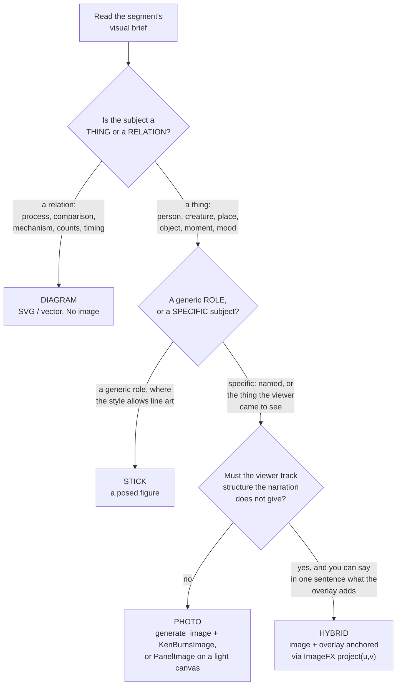
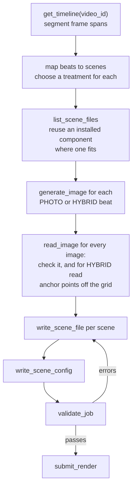
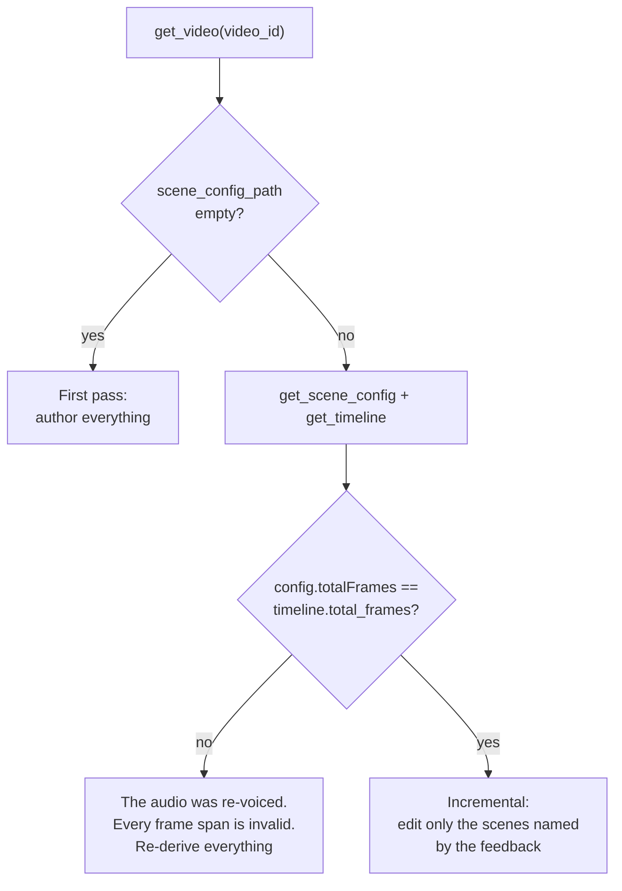

# Scene Authoring

A scene is a React component that renders one beat of a video's script. The agent writes scenes for
each video. You write the components, rules and examples the agent learns from.

Read [The Remotion Project](09-remotion-project.md) first for the frame model, the props a scene
receives and the `scene-config.json` shape. The authoring rules on this page are the
`tubematic-scene-config` skill's ([The Agent Layer](07-agent-layer.md#the-scene-config-skill)), and
the checks are the MCP tools'.

---

## The two kinds of scene

| | `installed` | `generated` |
|---|---|---|
| Lives in | `renderer/remotion/src/scenes/installed/` | `~/.tubematic-data/scenes/generated/<video_id>/` |
| Written by | You, committed to the repository | The agent, per video, with `write_scene_file` |
| Deployed by | Rebuilding the image | The write itself. The directory is a bind mount |
| Reused | By every video | By one video |

Generated scenes are namespaced per video, so two videos that give a scene the same name do not
overwrite each other. Reuse across videos is by copy: the agent reads another video's scene with
`read_scene_file` and writes its own copy with `write_scene_file`.

### The `../../` rule

A generated scene sits two levels below `scenes/`, so it imports installed components two levels up,
with no extension:

```tsx
import ImageFX from "../../installed/ImageFX";     // correct
import ImageFX from "../installed/ImageFX";        // resolves to generated/installed/ and fails
import ImageFX from "../../installed/ImageFX.tsx"; // an extension fails tsc
```

Both wrong forms fail the typecheck in `validate_job`, before a render. If a scene fails with
`Cannot find module '../installed/...'`, check the depth first.

---

## Visual styles

Every video has a visual style, stored in `videos.visual_style`. A person picks it when approving the
topic and it is frozen after that ([Frozen choices](02-pipeline.md#frozen-choices)). The code and the
skill also call a style a **register**.
[Visual Styles and Mascots](../user-guide/13-visual-styles-and-mascots.md#the-styles) shows what each
style looks like.

A style is a set of permissions: which canvas, and which kinds of figure. It does not decide any
beat's treatment.

| `visual_style` | Canvas | Figures | Hand-drawn line art | Generated characters |
|---|---|---|---|---|
| `auto` (the default) | The agent chooses | Yes | Yes | Yes |
| `motion_graphics` | `dark` | No | No | No |
| `stick` | `light` | Yes | Yes | No |
| `illustrated` | The agent chooses | Yes | No | Yes |
| `cartoon_3d` | `dark`, never visible | Its own cast | No | No |

The columns are `CANVAS_BY_STYLE`, `figures_allowed`, `line_art_allowed` and `characters_allowed`.
Each exists in `mcp/server.py` and in `renderer/api/pipeline.py`, and an agreement test pins the two
copies. `dashboard/lib/types.ts` holds a third copy of the style list.

`characters_allowed` gates the `generate_character` tool. `figures_allowed` and `line_art_allowed` go
into the [AI review prompt](21-ai-review.md#the-prompts-guard-clauses), so the reviewer judges a video
against the look it was meant to have. `cartoon_3d` replaces the scene system with one 3D world
([Cartoon 3D](#cartoon-3d)).

The API and `update_video` refuse two styles where they are chosen:

- `illustrated` needs a stored OpenAI key, because an OpenAI image model draws its characters
  (`ILLUSTRATED_NEEDS_OPENAI_KEY`).
- `cartoon_3d` needs a renderer whose [GPU test](20-gpu-and-remote-renderers.md#the-gpu-test) passed
  (`CARTOON3D_NEEDS_GPU`, `CARTOON3D_GPU_UNKNOWN`). Software WebGL can render the style, at about 50
  minutes for a 90-second Short, so the rule is a policy.

`get_video` reports both conditions to the agent as `illustrated_available` and
`cartoon_3d_available`.

### The canvas

The canvas is the ground the renderer paints under every scene: `dark` or `light`. It is one value
for the whole video, the top-level `canvas` key of `scene-config.json`, because a video that
alternates light and dark scenes flashes.

`server.py::effective_canvas` gives a video's canvas. A style in `CANVAS_BY_STYLE` fixes it. Under
`auto` and `illustrated` it is the value the agent recorded in `videos.resolved_visual_style`, which
is written once. [`write_scene_config`](09-remotion-project.md#canvas) rejects a contradicting value.

The figure vocabulary is independent of the canvas. A stick figure is black line art on a light
canvas and white on a dark one, so `StickFigure` and `StickScene` take a `theme` prop that must match
the canvas. A wrong `theme` typechecks and renders a figure that cannot be seen.

A scene leaves its own background transparent where the canvas should show through.

### What `auto` decides

Under `auto` the agent makes two video-wide choices and records each once. Every beat still gets its
own treatment.

1. The renderer, before any scene exists: `update_video(resolved_renderer="dom" | "cartoon_3d")`. The
   agent picks Cartoon 3D when a place and people moving through it carry the video. It picks `dom`
   (the scene components) otherwise, and always when `cartoon_3d_available` is false or the video has
   a mascot. If it wanted a world the install cannot render, it says so in its handback. A later
   change would discard every scene.
2. On the `dom` renderer, the canvas: `update_video(resolved_visual_style="dark" | "light")`. The
   skill's rule is `dark` when images carry the video (about a third or more of the beats are PHOTO
   or HYBRID) and `light` when roles, processes and diagrams carry it. A tie goes to `dark`.

`write_scene_config` records either value if the agent wrote a config without recording it. On a
revision the agent reads the recorded values and does not choose again.

If the video has character beats, the agent also chooses once between line-art figures and generated
characters. Generated characters are for recurring characters the viewer must recognise, and only
while `illustrated_available` is true.

`auto` says which vocabularies are available. The skill tells the agent to use the fewest that carry
the video. A video that uses every vocabulary because it was allowed to is a defect.

### Generated characters

Under `illustrated`, and under `auto` when the agent chose them, a character is a transparent PNG made
by `generate_character`, at one image call per pose. The scene places it with ``. It does not go
through `ImageFX` or `KenBurnsImage`, which fill the frame.

- The agent picks one drawing style from the topic (simple cartoon or rendered illustration) and holds
  it for every character in the video.
- The first call for a character makes its sheet: a plain standing pose, with the style stated in the
  prompt. Every later pose passes `reference=` naming that sheet, because chaining pose to pose
  compounds drift.
- The agent opens every asset with `read_image` and checks that it is still the same character.
- Generated characters and `StickFigure` line art are not mixed in one video. The tool enforces this
  under `stick`, and the skill under `auto`.

Under a forced `illustrated` the agent does not check for a key and does not fall back to line art.
If `generate_character` refuses, the agent comments on the video and ends the session.

---

## Choosing a treatment

Every beat gets one treatment, decided from the beat's subject. The wording of the beat's `visual`
brief does not decide it.



| Treatment | The beat's subject | Built as |
|---|---|---|
| PHOTO | A named character or real person, a creature, a specific place or structure, a distinctive object, one dramatic moment, or an establishing mood | A generated image with a camera move and nothing drawn over it |
| HYBRID | A PHOTO subject, plus structure the viewer must follow that the words do not give: who moved where, in what order, from which direction, how many | A generated image with one overlay anchored to it |
| DIAGRAM | A relation: a process with stages, a comparison, a mechanism, a dataflow, quantities, timing, cause and effect, code or terminal output | A vector scene with no image |
| STICK | A generic role: "the user", "an attacker", anyone in a hypothetical or a walkthrough | A posed `StickFigure` |

PHOTO is the default for a photographic subject. HYBRID must pass a one-sentence test: what does the
overlay tell the viewer that the words and the picture do not? Without an answer the beat is PHOTO.

The skill forbids reducing a named character, creature or real place to an icon, a silhouette or a
marker. A battle, a siege or an ambush has stages and also has subjects the viewer came to see, so it
is PHOTO, or HYBRID where the beat turns on where or in what order.

STICK is available under `stick` and `auto`, for generic roles only. When the subject has a name, the
beat is PHOTO. Under `motion_graphics` a role beat is a DIAGRAM, or a PHOTO if the beat needs a
person shown. Under `illustrated` a role is a generated character.

The canvas changes how a treatment is built:

| Treatment | On a `dark` canvas | On a `light` canvas |
|---|---|---|
| STICK | `StickFigure theme="dark"` | `StickFigure theme="light"` |
| PHOTO, HYBRID | `ImageFX` or `KenBurnsImage`, full-bleed | `PanelImage`, framed on the canvas |
| DIAGRAM | A vector scene in a dark palette, or `StepFlowDiagram` | Black line art, or `StepFlowDiagram` with `theme: "light"` |

Figures move in discrete steps. A figure holds a pose and changes it in one frame, two to five times
per ten seconds of audio. Every other scene moves continuously.

### Worked examples

| Brief | Subject | Treatment |
|---|---|---|
| "Overhead tactical map, army icon crawls toward the castle" | A real army moving on a real place | HYBRID: a march-route overlay anchored to the map |
| "Split diagram: troops besieging the castle, dragon in the sky above" | A dragon, in one specific ambush | PHOTO: a camera move and no text. An arrow at the dragon tells the viewer nothing |
| "Establishing shot of the domed hall at night" | A real structure, a mood | PHOTO: a bare `KenBurnsImage` |
| The same shot with a reticle, a badge and a counter added | A dragon | The defect the taxonomy prevents |
| "Stat cards fade in: small garrison, minor holding, PERFECT BAIT" | The relative worth of a holding | DIAGRAM, no image |
| "Cut to terminal showing `whoami` output" | Command output | DIAGRAM, no image |

### The image floor

The floor applies to dark-canvas videos.

| PHOTO or HYBRID segments | Scenes that must use a generated image |
|---|---|
| 0 | 0. An image here is the defect |
| 1 | 1 |
| 2 or more | 2 |

At most half of a video's scenes may be a bare `KenBurnsImage` entry. Past that share, the agent
authors a scene around `ImageFX` and gives it more motion.

On a light canvas neither rule applies. A named, specific subject still gets a real generated image
there, in a panel.

Nothing checks the floor. `validate_job` verifies only that the image paths a config references
resolve, so a video with no images passes.

---

## On-screen text is the exception

The renderer draws the narration over every video as captions
([Captions](09-remotion-project.md#captions)). A scene therefore carries no text unless the text is
the content. The skill's complete list of justified text:

- A number the viewer must read.
- A label pinned to part of a diagram or an image.
- A term being defined, shown once as it is introduced.
- Code, a command, a filename or an error string.
- A chart's axis, unit or legend.

A headline restating the narration, a title card, a lower third, a caption under a picture, a
pull-quote of the line being spoken and a closing slate all duplicate the captions.

The skill's test for each string: remove it, and ask whether any information is lost that the motion,
the image and the captions do not carry. A beat that would have been a headline over a picture needs
a better visual.

The skill, the installed `README.md` and the examples must agree on this rule, because an agent that
reads two conflicting paragraphs follows the one it read last.

The agent may set `"enabled": false` on `subtitles` only with a reason it states in its handback.

---

## Cadence

The skill sets no target scene count and no target scene length. A cut marks a change of visual idea.

The default is one script segment, one scene. The agent deviates only to:

1. Merge a very short segment into an adjacent one, when their visual briefs compose.
2. Split a segment whose brief names distinct sub-beats, or whose one visual idea cannot carry the
   span. Sub-scenes of one segment hard-cut (`transitionToNext` of 0).
3. Reach the minimum of four `generated` entries. This is the only count-driven split. An installed
   scene counts toward it. A Cartoon 3D video is exempt, because it has one scene.

No scene spans parts of two different segments. The first scene starts at frame 0 and the last
ends at `totalFrames`. Scenes leave no gaps, even where the timeline has a short pause between
segments.

Nothing checks the four-scene minimum. Like the image floor, it is the skill's rule.

---

## The workflow



Before the first step the agent reads `visual_style` from `get_video` and settles the choices under
[Visual styles](#visual-styles). The tools are documented on [The MCP Server](06-mcp-server.md).

`read_image` returns the image with a UV coordinate grid drawn over it. The agent uses it to reject a
bad image before a render, and to read where the subject sits. It passes those coordinates to
`ImageFX`'s `project(u, v)`, which keeps an overlay attached as the camera moves. The grid is drawn
on an in-memory copy, because the file on disk is the render input. `read_image` does not take the
[scene-work claim](06-mcp-server.md#the-scene-work-claim), because it spends nothing and writes
nothing.

### Text-layout warnings

`validate_job` ends with the
[text-layout audit](11-rendering-and-review.md#the-text-layout-audit), which measures the text of
sampled frames in a browser. Its findings go to the `warnings` list of the result and do not change
`passed`. The agent is told to judge each warning, because one can be wrong.

| Warning starts with | Means |
|---|---|
| `Text overlap in scene` | Two text elements overlap. The line names both strings, their boxes, the frame and the overlap percentage |
| `Text outside the safe zone in scene` | Text crosses a safe-zone edge. The line names the edges, and says when the text runs past the frame |
| `Mascot over text in scene` | Text sits under the mascot's box |
| `Text-layout audit` | The audit was skipped, could not run, or could not measure part of a scene. The line says which |

The audit compares text with text only (`text_audit.py::find_overlaps`), so an arrow tip outside the
safe zone or an image under a label is not a finding. The captions are text in the same composition,
so scene text that collides with a caption is reported as an overlap.

The audit does not run when `validate_job` already has errors, or when the
`text_layout_audit_enabled` setting is off.

---

## Revising an existing video

When a video comes back at `REVISION_REQUESTED`, the agent edits the scenes the feedback named. It
runs this test first:



The test compares frame counts because `scene_config_path` alone does not tell a re-voice apart. A
pronunciation fix re-voices the video and returns with the path still set, while the old frame spans
are measured against audio that is gone.

On the incremental path:

- The agent maps each finding to a config entry by `src`, or by frame when the finding gives only a
  timestamp.
- It reads only those scenes and writes them back under the same `scene_name`, so `src` does not
  move. An `installed` entry has no TSX to edit, so the agent changes its `props` or replaces the
  entry.
- Every other config entry is written back unchanged: the same `startFrame`, `durationInFrames`,
  `src`, `source` and `props`.
- `generate_image` runs only for an image that was itself the defect, under the same `image_name`.

---

## Cartoon 3D

A Cartoon 3D video is code written for that one video: a `CartoonShort` scene that spans the whole
video, and TypeScript modules beside it under `scenes/generated/<video_id>/`. The agent writes them
with the `tubematic-cartoon3d` skill, against
[the Cartoon 3D kit](09-remotion-project.md#the-cartoon-3d-kit).

| Module | Holds |
|---|---|
| `story.ts` | The shots timed to the narration, and the camera built from the kit's grammar |
| `sets/*.ts` | The sets, as three.js code |
| `scenes.ts`, `stage/*.ts` | The cast, and who stands where doing what |
| `index.ts` | The `VideoDef` that ties them together |

The worked example the skill points at is `src/cartoon3d/examples/chicago/`.

The video's scene config holds one scene: `src` is `<video_id>/CartoonShort`, `startFrame` is 0 and
`durationInFrames` equals `totalFrames`. Its props carry `cartoon3d: {beats}`, the shots as beats,
which is the only per-video data in the config. `write_scene_config` refuses a config when:

- The beats do not cover the video in order from frame 0 to the last frame, with no gap and no
  overlap, each with integer `start` and `end` frames and a `shot` note.
- The scene does not start at frame 0 and span `totalFrames`, or the config has another scene.
- The scene is not this video's own generated `CartoonShort`.
- The scene kind disagrees with the video's renderer: a Cartoon 3D scene on a video that renders
  scene components, or scene components on a video that renders as Cartoon 3D.
- The video has a mascot.

The code is checked before it renders:

- The typecheck that `validate_job` runs over the Remotion project covers the video's modules. The
  agent is given the file and line of an error.
- The beat gate (`src/cartoon3d/gate/beatGateCli.ts`) takes one frame from the middle of every beat
  and pairs it with the sentence the narrator speaks during it. Two judges say whether the picture
  shows the sentence, and a third decides a beat they split on. The verdict is keyed by a hash of the
  video's source files, its beats and the narration per beat, so any edit or re-voice opens the gate
  again. `validate_job` and `submit_render` refuse a video without a passing verdict.
- The look verifier is a step of the skill. A separate subagent scores the look and lists fixes, and
  it does not gate the render.

A judge is a separate subagent whose whole prompt is the gate's prompt, so the author does not grade
its own work. The tools are on [The MCP Server](06-mcp-server.md#cartoon-3d-authoring). The render
runs [in segments](11-rendering-and-review.md#segmented-cartoon-3d-renders). The text-layout audit
does not run for a Cartoon 3D video.

---

## Mascots

A mascot is an optional on-screen character that reacts to the narration: it walks on, shows an
emotion, glances at something, hops and walks off. It does not speak and is not the narrator. A video
has one when a person picked it at the topic approval
([Mascots](../user-guide/13-visual-styles-and-mascots.md#mascots)).

The video's agent writes no drawing code. The mascot's code was written once and approved by a person
([Mascot authoring](06-mcp-server.md#mascot-authoring)). The agent writes a cue track, under the
top-level `mascot` key of the scene config:

```jsonc
"mascot": [
  { "frame": 0,   "on": true, "x": 0.5, "y": 0.62, "emotion": "happy", "facing": "front" },
  { "frame": 240, "emotion": "surprised", "look": "right", "jump": true },
  { "frame": 600, "x": 0.25, "emotion": "thinking" }
]
```

| Cue field | Accepted |
|---|---|
| `frame` | Required. A whole number from 0 to the last frame. No two cues share a frame |
| `on` | `true` walks the mascot in from the nearer edge. `false` walks it off |
| `x`, `y` | 0 to 1. Where the feet stand, as fractions of the frame |
| `scale` | 0.4 to 1.2 (`SCALE_MIN`, `SCALE_MAX`) |
| `emotion` | One of `EMOTIONS` |
| `look` | One of `LOOKS` |
| `facing` | One of `FACINGS` |
| `jump` | `true` or `false` |

A field that a cue omits keeps the value the previous cue set. An unknown key is refused (`CUE_KEYS`),
and there is no `talk` cue. The mascot starts off screen. The constants are in
`tubematic_core/mascots.py`, and the `write_scene_config` tool description repeats the allowed
values, because the agent learns them from the description.

`write_scene_config` runs `tubematic_core/mascots.py::cue_errors` over the track and refuses it with
one sentence per problem. The function plays the track the way `driver.js` does, frame by frame, and
checks:

- At least one cue brings the mascot on, and every field has the right type and range.
- The mascot's box stays clear of the caption band, at rest and while walking. A walk is tested along
  its whole path, so two clear positions on either side of the band are refused. With captions off
  there is no band.
- At rest, and during a walk that does not cross a frame edge, the box lies inside the safe zone
  (x 60 to 1020, y 150 to 1750; see [Safe zones](09-remotion-project.md#safe-zones)). A walk on or
  off across an edge is exempt from the safe zone, and is still held to the caption band.
- The mascot stands still on screen for at least `MIN_REST_FRAMES` (30 frames, one second) in one
  unbroken run. A walk resets the count, so short stops between walks do not add up.

The box is the engine's whole 560 by 640 canvas scaled by the cue's `scale`, including the headroom
that emotes float into. The caption band is sized from the video's `subtitles` settings
(`mascots.py::caption_band`): its line count follows `maxWords` and `fontSize`, with a minimum of two
lines.

The first `write_scene_config` of a mascot video records the mascot's approved version in
`videos.mascot_version`. Later writes and revisions keep it, so a person approving a changed mascot
does not alter a video already being authored.

The geometry constants in `mascots.py` are copies of the engine's, of `Subtitles.tsx`'s and of
`text_audit.py`'s. Agreement tests keep them in step.

The mascot is drawn under the captions, so it cannot hide one. It can hide a scene's text, which
[`validate_job` reports as a warning](#text-layout-warnings). A Cartoon 3D video cannot have a mascot.

---

## Writing a component

```tsx
import { AbsoluteFill, useCurrentFrame, interpolate, spring, useVideoConfig } from "remotion";

export default function DnsLookup({ durationInFrames, title }: {
  durationInFrames: number;
  title: string;
}) {
  const frame = useCurrentFrame();
  const { fps } = useVideoConfig();

  const enter = spring({ frame, fps, config: { damping: 200 } });
  const exit  = interpolate(frame, [durationInFrames - 20, durationInFrames], [1, 0], {
    extrapolateLeft: "clamp",
  });

  return (
    <AbsoluteFill style={{ backgroundColor: "#0a0a0f", opacity: exit }}>
      <h1 style={{ transform: `scale(${enter})`, color: "#fff" }}>{title}</h1>
    </AbsoluteFill>
  );
}
```

The rules, for a generated scene and an installed component alike:

- Everything derives from `useCurrentFrame()`
  ([The frame model](09-remotion-project.md#the-frame-model)). In 3D, use it in place of `useFrame`.
- Use `spring()`, or `interpolate()` with an `Easing.bezier` curve, for entrances, exits and state
  changes. Clamp the extrapolation.
- Motion spans the scene. Key it to `durationInFrames`, so that a long scene does not finish its
  entrance and then hold still.
- Do not fake motion by mounting one component at several `startFrame` positions with different
  props. Write one scene that animates through every state.
- Keep text inside the [safe zone](09-remotion-project.md#safe-zones), and do not put text over other
  text.

---

## Adding an installed component

1. Write it in `renderer/remotion/src/scenes/installed/`, with a default export and a typed props
   interface. Accept `durationInFrames`. Keep it generic and driven by props.
2. Pass asset paths through unchanged. Do not wrap them in `staticFile()`
   ([`ImageFX`](09-remotion-project.md#imagefx)).
3. Document it in `renderer/remotion/src/scenes/installed/README.md`, which the agent reads when it
   decides what to use.
4. If it is the right answer for a class of beat, add it to the scene-config skill's tables. The
   agent does not use a component the skill does not name.
5. Run `npx tsc --noEmit`. `validate_job` runs it for every video, so a type error in an installed
   component blocks every render.
6. Rebuild the image. Installed components are baked into it.

No tool promotes a generated scene. Copy it from `~/.tubematic-data/scenes/generated/<video_id>/`,
move its hardcoded content into props and commit it.

---

## Example scenes

`agent_files/skills/tubematic-scene-config/examples/` holds six reference scenes. The skill tells the
agent to read all of them before it writes a scene, so keep them current.

| File | Technique |
|---|---|
| `ex-ken-burns.tsx` | An image beat: `ImageFX` and its camera move. It also shows spring-animated children over the picture, which is the exception case |
| `ex-hybrid-anchored.tsx` | An anchored overlay: `project(u,v)`, an `evolvePath` leader line, and a label kept in the safe zone while the arrow tip is free |
| `ex-spring-stagger.tsx` | A spring entrance and a staggered list reveal with per-item delays |
| `ex-path-draw.tsx` | One SVG diagram that draws itself with `evolvePath`, with nodes springing in as the line reaches them |
| `ex-noise-background.tsx` | Organic background motion, animated SVG shapes and a number ticker |
| `ex-three-intro.tsx` | 3D through React Three Fiber, driven by `useCurrentFrame()`. Opt-in, for a topic that 3D improves |

---

## Rules that must survive an edit

Keep these rules when you edit the scene-config skill. Each one stops an abstract marker from
standing in for a real subject:

- The image floor stays as it is.
- The rule that a battle, siege or ambush with named subjects is "never DIAGRAM" stays.
- At least one HYBRID row stays in the worked-example table, with `ex-hybrid-anchored.tsx` as its
  template. It is the only thing that exercises `ImageFX.project()`.
- STICK stays limited to generic roles. A named character drawn as a figure is the same defect.

The AI review prompt has matching rules: it must keep saying that the captions and the watermark are
intended, or every video returns a finding. They are on
[AI Review](21-ai-review.md#the-prompts-guard-clauses).
