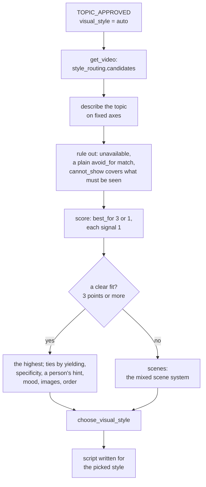
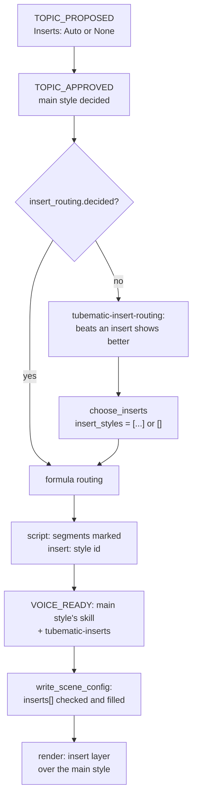
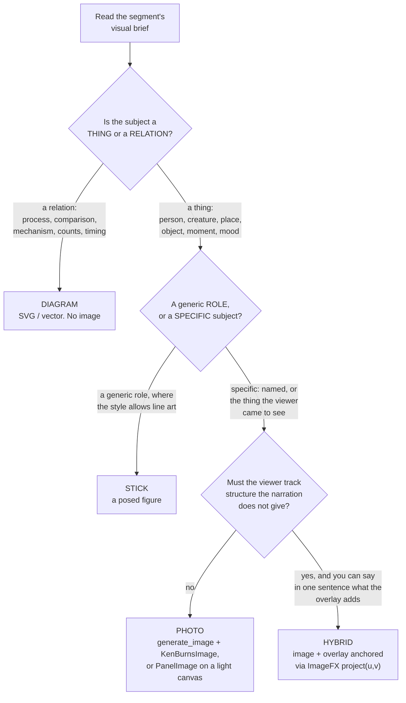
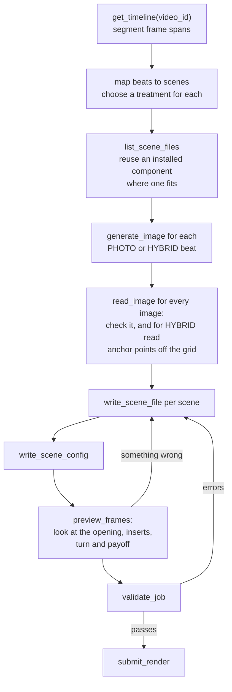
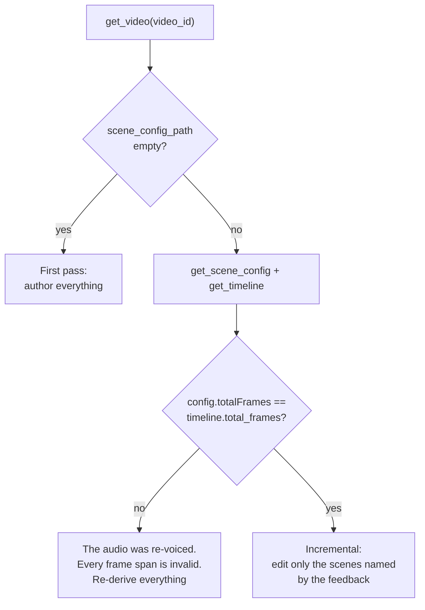

# Scene Authoring

A scene is a React component that renders one beat of a video's script. The agent writes scenes for
each video. You write the components, rules and examples the agent learns from.

Read [The Remotion Project](09-remotion-project.md) first for the frame model, the props a scene
receives and the `scene-config.json` shape. The authoring rules on this page are the
`tubematic-scene-config` skill's ([The Agent Layer](07-agent-layer.md#the-scene-config-skill)), and
the checks are the MCP tools'.

---

## The two kinds of scene

| | `installed` | `generated` |
|---|---|---|
| Lives in | `renderer/remotion/src/scenes/installed/` | `~/.tubematic-data/scenes/generated/<video_id>/` |
| Written by | You, committed to the repository | The agent, per video, with `write_scene_file` |
| Deployed by | Rebuilding the image | The write itself. The directory is a bind mount |
| Reused | By every video | By one video |

A third source, `external`, names a component of an installed
[external style](#external-styles) package.

Generated scenes are namespaced per video, so two videos that give a scene the same name do not
overwrite each other. Reuse across videos is by copy: the agent reads another video's scene with
`read_scene_file` and writes its own copy with `write_scene_file`.

### The `../../` rule

A generated scene sits two levels below `scenes/`, so it imports installed components two levels up,
with no extension:

```tsx
import ImageFX from "../../installed/ImageFX";     // correct
import ImageFX from "../installed/ImageFX";        // resolves to generated/installed/ and fails
import ImageFX from "../../installed/ImageFX.tsx"; // an extension fails tsc
```

Both wrong forms fail the typecheck in `validate_job`, before a render. If a scene fails with
`Cannot find module '../installed/...'`, check the depth first.

---

## Visual styles

Every video has a visual style, stored in `videos.visual_style`. A person picks it when approving the
topic and it is frozen after that ([Frozen choices](02-pipeline.md#frozen-choices)). A person who
leaves it on `auto` lets the agent pick one before the script is written
([How Auto picks a style](#how-auto-picks-a-style)). The code and the
skill also call a style a **register**.
[Visual Styles and Mascots](../user-guide/13-visual-styles-and-mascots.md#the-styles) shows what each
style looks like.

For the scene styles, a style is a set of permissions: which canvas, and which kinds of figure. It
does not decide any beat's treatment. `cartoon_3d`, `bean_explainer`, `whiteboard`,
`storybook_atlas`, `under_the_hood`, `case_file_story`, `paper_diorama`, `editorial_collage`,
`archive_engraving`, `storybook_reveal`, `puppet_history`, `midcentury_howto`, `comic_panels`, `process_cast`, `flat_vector_science`,
`isometric_infographic` and `night_signal` replace the scene system with one whole-video scene of
their own. `system_flow` and `terminal_doc` are insert styles: they draw short
scenes inside another style's video and are never a video's style
([Main styles and inserts](#main-styles-and-inserts)). A video voiced before that keeps its whole
System Flow or Terminal Doc scene, so both stay in the table below.

| `visual_style` | Canvas | Figures | Hand-drawn line art | Generated characters |
|---|---|---|---|---|
| `auto` (the default) | The agent chooses | Yes | Yes | Yes |
| `motion_graphics` | `dark` | No | No | No |
| `stick` | `light` | Yes | Yes | No |
| `illustrated` | The agent chooses | Yes | No | Yes |
| `system_flow` | `dark` | No | No | No |
| `bean_explainer` | `light`, painted over by its own colour field | Its own cast | No | No |
| `whiteboard` | `light` | No | No | No |
| `storybook_atlas` | `light`, painted over by its own paper | Its own cast | No | No |
| `terminal_doc` | `dark` | No | No | No |
| `under_the_hood` | `dark` | Its own presenter | No | No |
| `case_file_story` | `dark` | Its own lead, painted into the stills | No | No |
| `paper_diorama` | `light`, painted over by its own rooms | Its own critter | No | No |
| `archive_engraving` | `light`, painted over by its own parchment | Unnamed figures inside its engravings; people are name cards | No | No |
| `editorial_collage` | `light`, painted over by its own desk | Small unnamed figures inside its prints; people are named in text | No | No |
| `storybook_reveal` | `light`, painted over by its own page | Its own hero, painted into every page | No | No |
| `puppet_history` | `light`, painted over by its own sets | Its own cast | No | No |
| `midcentury_howto` | `light`, painted over by its step grounds | Its own presenter | No | No |
| `comic_panels` | `light`, painted over by its own newsprint | Its own cast | No | No |
| `process_cast` | `light`, painted over by its own paper | Its own cast | No | No |
| `flat_vector_science` | `dark` | Its own subjects | No | No |
| `isometric_infographic` | `light` | Its own billboard people | No | No |
| `night_signal` | `dark` | Its own pictograms | No | No |
| `cartoon_3d` | `dark`, never visible | Its own cast | No | No |
| `low_poly_skit` | `dark`, never visible | Its own cast | No | No |

The columns are `CANVAS_BY_STYLE`, `figures_allowed`, `line_art_allowed` and `characters_allowed`.

`characters_allowed` gates the `generate_character` tool. `figures_allowed` and `line_art_allowed` go
into the [AI review prompt](21-ai-review.md#the-prompts-guard-clauses), so the reviewer judges a video
against the look it was meant to have. `cartoon_3d` replaces the scene system with one 3D world
([Cartoon 3D](#cartoon-3d)), `low_poly_skit` does the same with its own kit ([Low-Poly Skit](#low-poly-skit)), `system_flow` (on a video voiced before it became an insert style)
with one diagram scene ([System Flow](#system-flow)),
`bean_explainer` with one cartoon-bean scene ([Bean Explainer](#bean-explainer)), `whiteboard`
with one board scene ([Whiteboard](#whiteboard)), `storybook_atlas` with one picture-book scene
([Storybook Atlas](#storybook-atlas)), `terminal_doc` (likewise) with one typographic scene
([Terminal Doc](#terminal-doc)), `under_the_hood` with one scene of annotated close-up
photographs ([Under the Hood](#under-the-hood)), `case_file_story` with one scene of painted
stills, meters and number cards ([Case File Story](#case-file-story)), and `paper_diorama` with one
scene of paper rooms, props and a critter ([Paper Diorama](#paper-diorama)), and `archive_engraving`
with one scene of engraved plates and museum cards ([Archive and Engraving](#archive-and-engraving)),
`editorial_collage` with one evidence-desk scene ([Editorial Collage](#editorial-collage)),
`storybook_reveal` with one picture-book scene ([Storybook Reveal](#storybook-reveal)), `puppet_history` with one
scene of puppets in era costumes acting out beats on sets, cards and maps
([Puppet History](#puppet-history)), `midcentury_howto` with
one scene of a cartoon presenter walking through numbered steps
([Mid-century How-To](#mid-century-how-to)), `comic_panels` with one scene of comic pages read
panel by panel ([Comic Panels](#comic-panels)), and `process_cast` with one scene of a drawn cast
acting out a process at stations ([Process Cast](#process-cast)), `flat_vector_science` with one
scene of flat props, pills and scale shots ([Flat Vector Science](#flat-vector-science)),
`isometric_infographic` with one isometric board scene ([Isometric Infographic](#isometric-infographic))
and `night_signal` with one scene of pictograms and cards ([Night Signal](#night-signal)). These last three
need neither an OpenAI key nor a GPU and take no mascot (`visual_styles.py::NO_MASCOT_STYLES`).

The API and `update_video` refuse a style whose pack needs something the install lacks, where it is
chosen. Seven styles have a need:

- `illustrated` needs a stored OpenAI key, because an OpenAI image model draws its characters
  (`ILLUSTRATED_NEEDS_OPENAI_KEY`).
- `under_the_hood` needs a stored OpenAI key, because its plates are generated photographs. The
  refusal text is its pack's `messages.openai_key`.
- `case_file_story` needs a stored OpenAI key, because its shots are generated paintings. The
  refusal text is its pack's `messages.openai_key`.
- `archive_engraving` needs a stored OpenAI key, because its plates are generated engravings. The
  refusal text is its pack's `messages.openai_key`.
- `editorial_collage` and `storybook_reveal` need a stored OpenAI key, because their prints, stickers
  and pages are generated. The refusal text is each pack's `messages.openai_key`.
- `cartoon_3d` needs a renderer whose [GPU test](20-gpu-and-remote-renderers.md#the-gpu-test) passed
  (`CARTOON3D_NEEDS_GPU`, `CARTOON3D_GPU_UNKNOWN`). Software WebGL can render the style, at about 50
  minutes for a 90-second Short, so the rule is a policy. `low_poly_skit` needs no GPU: its pack has
  `needs.gpu` false, because flat shading with no ink, shadow or lens pass renders at a small multiple of
  System Flow's cost per frame on a CPU.

`get_video` reports the two conditions to the agent as `illustrated_available` (true when an
OpenAI key is stored, which Under the Hood, Case File Story, Editorial Collage, Archive and Engraving
and Storybook Reveal need too) and
`cartoon_3d_available`, and gives the video's own style as `style`: its label, canvas, permissions
and `authoring_skill`.

### Style packs

Each style except `auto` is a style pack: one JSON file in `tubematic_core/style_packs/`, named for
the style's id. `tubematic_core/visual_styles.py` loads them at import and refuses a malformed pack,
so a bad file stops the process at start-up. The MCP server and the API import the same objects
from it (`VISUAL_STYLES`, `CANVAS_BY_STYLE`, the gates), and the dashboard reads the list from
[`GET /visual-styles`](05-http-api.md#get-visual-styles). `auto` is code: it is the absence of a
style.

| Field | Holds |
|---|---|
| `id`, `label`, `order`, `experimental` | The style's name in the code and on the dashboard, its place in the pickers, and whether the dashboard marks it experimental |
| `dimension` | `2d` or `3d`: the group the dashboard's style picker lists the style in. A style is `3d` when its world is a 3D scene |
| `preview` | The stem of the style's [preview files](#style-previews) in `dashboard/public/style-previews/` |
| `tagline` | One sentence under the preview: what the style is for, written for a person choosing it |
| `renderer` | `dom` for the scene system, `cartoon_3d` for the 3D world |
| `canvas` | The canvas the style fixes, or `null` when the agent chooses it |
| `allows` | `figures`, `line_art` and `generated_characters`: the three permission columns above |
| `needs`, `messages` | Whether the style needs an OpenAI key or a working GPU, and the refusal text for each |
| `mascot` | Optional. `false` when a video of the style may not carry a mascot, with the refusal in `messages.mascot`. A 3D-world style takes none by its renderer |
| `authoring_skill` | The skill that authors a video in this style; `get_video` returns it as `style.authoring_skill` |
| `review` | Optional. The style's own block for the [AI review prompt](21-ai-review.md#the-prompts-guard-clauses) |
| `captions` | Optional. The `subtitles` settings `write_scene_config` fills in when a config has none |
| `routing` | What Auto reads to pick a style: `best_for`, `avoid_for`, `cannot_show`, `signals`, and the optional `moods` and `images` (below) |
| `script` | Optional. How to write the narration and each segment's `visual` brief for this style; `get_video` returns it as `style.script` and the script-writing skill follows it |
| `picture` | `{opening, turn, payoff, ending}`: how the style shows the first frame, a turn or re-opening, the payoff, and how a video in it ends. `get_video` returns it as `style.picture`; [The opening and the beats](#the-opening-and-the-beats) says how it is used |
| `extra` | Style-specific data, such as System Flow's icon list, Bean Explainer's and Storybook Atlas's cast and prop catalogues, Puppet History's catalogues, Mid-century How-To's object library, Comic Panels' layout, cast and prop catalogues, Process Cast's body, station and prop catalogues or Whiteboard's doodle library |
| `role` | `main` for a style that carries a whole video, `insert` for one that draws only insert scenes ([Main styles and inserts](#main-styles-and-inserts)) |
| `inserts` | A main style only: `{host, transition}`, whether it takes insert scenes and how it goes into one |
| `insert` | An insert style only: `{max_seconds, palettes, props_key, component, review}` |

The `routing` block lists what the style suits (`best_for`), what it must not get (`avoid_for`),
one sentence saying what it cannot put on screen at all (`cannot_show`, such as "any picture of a
real thing" for a style that draws only text), and the signals in a topic or script that point to
it (`signals`). Three fields are optional: `moods`, the tones the style suits, `images`, a whole
number of generated images a video costs at most (0 when absent), and `yields_ties`, `true` on a
style that loses a close call to any style without it (`motion_graphics`, labelled Photo Explainer,
is the plain photo style the richer styles should win close calls from).
[How Auto picks a style](#how-auto-picks-a-style) reads all seven. An insert style's `routing`
describes beats, because the insert-routing skill scores beats
([Main styles and inserts](#main-styles-and-inserts)).

`tubematic_core/tests/test_style_packs.py` pins every gate's answer for each style, `auto`, a blank
value and an unknown one. Adding a style is a new pack file, the style's renderer work, its
authoring skill and its preview.

### Style previews

Every pack ships a preview: a short silent loop and a poster, shown when a person opens the style
in the dashboard's style picker. The files are `dashboard/public/style-previews/<preview>.mp4` and
`<preview>.webp`, served by the dashboard and built into its image (the release tarball carries no
dashboard files, so it does not grow).

Make them with `scripts/make_style_preview.py`, from any finished 9:16 video of the style:

```bash
python3 scripts/make_style_preview.py <video.mp4> <preview> --start 12.5
python3 scripts/make_style_preview.py <video.mp4> <preview> --start 1 --docker-image <image with ffmpeg>
```

It cuts 6 seconds (`--duration` changes it) to 540x960 at 30 fps, H.264 with no audio and the
index at the front, and takes the poster from the loop's first frame as WebP. It uses `ffmpeg` on
`PATH`, one named with `--ffmpeg`, or a Docker image that has it; every Tubematic backend image
does. The previews are part of every install's download, so each has a cap: the loop 400 KB and
the poster 40 KB. The script encodes again at a lower quality until a file fits.
`test_style_packs.py` checks that every pack's two files exist, each within its cap, and that the
folder stays under 12 MB. The script is a maintainer tool and is not in the release tarball.

### The canvas

The canvas is the ground the renderer paints under every scene: `dark` or `light`. It is one value
for the whole video, the top-level `canvas` key of `scene-config.json`, because a video that
alternates light and dark scenes flashes.

`server.py::effective_canvas` gives a video's canvas. A style in `CANVAS_BY_STYLE` fixes it. Under
`auto` and `illustrated` it is the value the agent recorded in `videos.resolved_visual_style`, which
is written once. [`write_scene_config`](09-remotion-project.md#canvas) rejects a contradicting value.

The figure vocabulary is independent of the canvas. A stick figure is black line art on a light
canvas and white on a dark one, so `StickFigure` and `StickScene` take a `theme` prop that must match
the canvas. A wrong `theme` typechecks and renders a figure that cannot be seen.

A scene leaves its own background transparent where the canvas should show through.

### How Auto picks a style

A video on `auto` gets its style before its script, at `TOPIC_APPROVED`, because the script is
written for the style: a walk through a system, a story, a list. The
`tubematic-style-routing` skill makes the choice and `choose_visual_style` records it once.



The candidates are data: `tubematic_core/visual_styles.py::routing_candidates` lists every main
style pack in pack order, then `scenes` (insert styles are decided after the main style, by
`choose_inserts`), each with its `routing` block and whether this install and this
video can have it. A style that needs an OpenAI key or a working GPU the install lacks is
unavailable, and so is a style that takes no mascot (a 3D world, or a pack with `"mascot": false`)
on a video with a mascot. The skill names no style, so a new
pack with a `routing` block is a candidate the day it ships.

The outcome is recorded in three columns ([`videos`](03-database.md#videos)):

| `visual_style` | `style_pick` | Meaning |
|---|---|---|
| a pack id | `''` | A person chose the style |
| a pack id | the same id | Auto picked it before the script |
| `auto` | `scenes` | Auto kept the mixed scene system |
| `auto` | `''` | Not decided. Before `TOPIC_APPROVED` it is routed when picked up; after it, the video takes the mixed scene system |

A pack Auto picks is written into `visual_style` itself, so the gates, the AI review prompt and the
authoring skill read it as if a person had chosen it. `style_runner_up` and `style_reason` are shown
on the dashboard, where a person can switch to the runner-up at `SCRIPT_READY`
([`POST /videos/<id>/switch-style`](05-http-api.md#post-videosvideo_idswitch-style)), which sends the
video back to `TOPIC_APPROVED` for a new script. A video moved back to `TOPIC_PROPOSED` returns to
`auto`, so its revised topic is routed again.

`scenes` is the mixed scene system: every beat drawn from any vocabulary, on a canvas the agent
chooses at `VOICE_READY`. Its routing block (`visual_styles.py::SCENES_ROUTING`) is scored like a
pack's. It is the best answer when full-frame pictures of real things carry some beats and roles
acted out by figures carry others (Photo Explainer draws no figures, Stick Explainer shows pictures
only in panels), and the fallback when nothing reaches 3 points. Its renderer is always `dom`, recorded in `videos.resolved_renderer`. The
agent chooses the canvas once, `update_video(resolved_visual_style="dark" | "light")`: `dark` when
images carry the video (about a third or more of the beats are PHOTO or HYBRID) and `light` when
roles, processes and diagrams carry it. A tie goes to `dark`. `write_scene_config` records it if the
agent wrote a config without recording it. On a revision the agent reads the recorded values and does
not choose again. An `auto` video whose `resolved_renderer` is `cartoon_3d` is a Cartoon 3D Short,
authored by the Cartoon 3D skill.

If a mixed-scenes video has character beats, the agent also chooses once between line-art figures
and generated characters. Generated characters are for recurring characters the viewer must
recognise, and only while `illustrated_available` is true.

Mixed scenes say which vocabularies are available. The skill tells the agent to use the fewest that
carry the video. A video that uses every vocabulary because it was allowed to is a defect.

The topic set in `tubematic_core/tests/fixtures/style_routing_cases.json` and the hand-run
`scripts/eval_style_routing.py` check the routing; see
[Style routing](test-suites/style-routing.md).

### Generated characters

Under `illustrated`, and under `auto` when the agent chose them, a character is a transparent PNG made
by `generate_character`, at one image call per pose. The scene places it with ``. It does not go
through `ImageFX` or `KenBurnsImage`, which fill the frame.

- The agent picks one drawing style from the topic (simple cartoon or rendered illustration) and holds
  it for every character in the video.
- The first call for a character makes its sheet: a plain standing pose, with the style stated in the
  prompt. Every later pose passes `reference=` naming that sheet, because chaining pose to pose
  compounds drift.
- The agent opens every asset with `read_image` and checks that it is still the same character.
- Generated characters and `StickFigure` line art are not mixed in one video. The tool enforces this
  under `stick`, and the skill under `auto`.

Under a forced `illustrated` the agent does not check for a key and does not fall back to line art.
If `generate_character` refuses, the agent comments on the video and ends the session.

---

## Main styles and inserts

Every video has one main style. It carries the opening, the payoff and the ending, and almost every
second of the video. A video may also carry a few short insert scenes from an insert style, shown
where the narration reaches what that style shows best: a request travelling between components (a
System Flow diagram), a password being hashed or a command being typed (a Terminal Doc string), a
few lines of code being read or fixed (a Code Scenes code card), or a scam text, a short list, a
quiz or a dated headline (a Format Packs format). A whole video in an insert style is plain, so an
insert style is never a video's style.

Each pack's `role` says which it is. `system_flow`, `terminal_doc`, `code_scenes` and `format_packs`
are insert styles; every other pack is a main style, and so is the mixed scene system (`scenes`).

### The limits

The limits live in `tubematic_core/inserts.py`. The script marks are checked when the script is
written (`inserts.mark_errors`); the windows are measured on the voiced timeline when the scenes are
written (`mcp/inserts.py::check`).

| Rule | Where it is checked |
|---|---|
| An insert is one script segment marked `"insert": "<style id>"`, with a style the video chose | Script write, scene write |
| Never the first or the last segment, never two marked segments in a row | Script write, scene write |
| A window starts within `WORD_SNAP_FRAMES` (2) of a word, lasts 2 seconds to its pack's `insert.max_seconds` (at most `MAX_SECONDS`, 9), and ends by the next segment's first word; the skills aim for `TARGET_SECONDS` (8) | Scene write |
| Never in the segment that opens the payoff (the first segment of the formula's payoff beat) | Script write, scene write |
| Never under the captions: an insert moves clear of them (`shift_for`), and captions placed where no move can clear them are refused (`caption_clash`) | Scene write |
| At least `MIN_MAIN_GAP_SECONDS` (1.5) of the main style before the first insert, after the last, and between two | Scene write |
| Inserts together take at most `MAX_SHARE` (a third) of `totalFrames` | Scene write |
| A marked segment whose words would run past 8 seconds | A script warning, `insert_long` |

### How a video gets its inserts



- A person sets the video's Inserts setting (`videos.insert_mode`, `auto` or `none`) at the topic
  checkpoint, on New Video, or through the domain's `default_insert_mode`, which seeds every new
  video. It is frozen after `TOPIC_PROPOSED`, like the style.
- At `TOPIC_APPROVED`, once the main style is decided, the
  [`choose_inserts`](06-mcp-server.md#choose_inserts) call records which insert styles the script may
  use (`videos.insert_styles`, a JSON list; `''` while undecided). `get_video`'s `insert_routing`
  says whether that is decided: it is when the setting is None or the main style takes no inserts.
  A new main style (a switch to the runner-up, a return to the topic) clears the choice.
- The script marks the segments an insert shows, and `get_timeline` returns each segment's `insert`.
- At `VOICE_READY` the main style's own skill authors the video and follows the `tubematic-inserts`
  skill for each marked segment; the insert's data is written with the insert style's own skill,
  in its insert mode.

### The config

Inserts sit in a top-level list of `scene-config.json`, beside `scenes`, and the main scene or scenes
still cover every frame ([scene-config.json](09-remotion-project.md#scene-configjson)).

| Key | Written by | Holds |
|---|---|---|
| `style` | The agent | The insert style's id |
| `startFrame`, `durationInFrames` | The agent | The window, on the video's own frames |
| `props` | The agent | The insert style's data under its props key (`systemFlow`, `terminalDoc`, `codeScenes`, `formatPacks`), timed on the video's frames |
| `src` | `write_scene_config` | The installed scene that draws the style, from the pack's `insert.component` |
| `palette` | `write_scene_config` | The video's canvas, which the insert follows |
| `shift` | `write_scene_config` | Pixels the insert's layout moves down (up when negative) to stay clear of the main style's captions |
| `firstFrames` | `write_scene_config` | Frames the insert's first element takes to settle; the renderer holds that frame through the way in, so no insert opens on an empty board ([Insert scenes](09-remotion-project.md#insert-scenes)) |

`write_scene_config` also fills the top-level `insertTransition` from the main pack's
`inserts.transition`. The agent writes none of the filled keys, so a revision cannot set a look the
main style did not choose.

The shift comes from `mcp/inserts.py::shift_for`: the band the captions take (`caption_box`, from
the `subtitles` position and size) against the band the insert style draws in, its pack's
`insert.block` (`[top, bottom]` in pixels; `inserts.BLOCKS` reads it from every insert pack). Captions in the upper half (Under the Hood's)
push the insert down; captions in the lower half that reach into it lift it a little. The captions
never move.

### How the renderer draws an insert

`CompositionBuilder` draws, bottom to top: the main style's scenes, the inserts, the mascot, the
captions and the watermark. Each insert is its own `Sequence` and runs the main style's transition
just outside its window, over the frames before it and after it, so the whole window is on screen
and the main style is already on its next picture as the insert leaves (`src/inserts/transitions.ts`):

| Transition | Frames | What it does |
|---|---|---|
| `cut` | 0 | The insert appears and disappears on a frame |
| `dip` | 8 | The main fades to the canvas colour, then the insert fades up; the reverse on the way out |
| `push` | 12 | The insert slides in from the right while the main slides out to the left |
| `wipe` | 12 | The insert is uncovered by an edge moving right to left |
| `glitch` | 4 | The insert shows in torn horizontal bands over the main picture, more of them each frame, shifted sideways a few pixels; the bands are seeded by the frame, so every render tears the same way |

While an insert covers the frame, the main layer is hidden with `visibility`: every main component is
a pure function of the frame, so it comes back on the picture its frame gives it, and hiding it skips
its paint, which is most of a frame's cost in software GL. The mascot is hidden for each window and
its transition frames on either side, and no cue may land there. The captions stay on screen, in the main style's look.

An insert style's scene takes an `insert` prop, `{origin, palette, shift}`. It adds `origin` to its
frame, so its data stays on the video's frames; it draws its light look on a light canvas; and it
moves its layout by `shift` with a positioned offset, never a CSS transform, which software GL
re-composites every frame.

### The checks

- `mcp/inserts.py::check` runs each window against the marks, the timeline and the limits, then the
  insert style's own check over the window: `system_flow.check_insert` (at most 3 boards, the first on
  the insert's first frame, the last board's events read before its final 6 frames),
  `terminal_doc.check_insert` (at most 3 beats, no custom moves, no skin), `code_scenes.check_insert`
  ([Code Scenes](#code-scenes)) and `format_packs.check_insert` ([Format Packs](#format-packs)).
  `server.py::_INSERT_CHECKS` maps each insert style to its check.
- The main style's validator gets the windows as `quiet` spans (`mcp/quiet_windows.py`): nothing of
  the main style starts inside one (no cut, no event), and its stillness rule skips them. Case File
  Story also refuses a window over a card, after the term card or over the choice. A scene system
  with several scenes may not start a scene inside a window.
- The text-layout audit samples each insert's boards or beats, and names a finding by its insert.
- The AI review prompt adds each insert's times and its pack's `insert.review` text
  ([AI review](21-ai-review.md)).

A whole System Flow or Terminal Doc video made before they became insert styles keeps its style and
its whole-video path: its stored `visual_style` still names the style, and the style's validator
still checks it as one scene. Migration `0029` sends such videos back to Auto while they are not
yet voiced, and leaves them alone from voicing on.

### Adding a main style

- The pack has `"role": "main"` and an `inserts` block: `{"host": true, "transition": <one of
  inserts.TRANSITIONS>}`, the transition chosen to match how the style cuts. A style that cannot take
  inserts (Cartoon 3D: one continuous 3D world) has `{"host": false}` and a `messages.inserts`
  refusal.
- A whole-video scene's validator takes `quiet=()` as its last keyword argument and applies
  `quiet_windows.window_at` to every cut and event frame and `quiet_windows.uncovered` to its
  stillness gaps; `write_scene_config` passes `quiet=inserts_mod.windows(config)`.
- Its authoring skill has an Inserts step that sends the agent to `tubematic-inserts` and names the
  style's own quiet rule.
- Its authoring skill has a numbered **Look before you submit** step before its `submit_render` step:
  `preview_frames` at frame 0, the turn and payoff, and each insert, naming `preview_not_taken`.
  `scripts/tests/test_look_step.py` fails for a main style without it. A style that draws its own world
  from source (Cartoon 3D, Low-Poly Skit) names its own look instead.
- A [character style](#character-styles) is one more module in `character_styles.py::STYLES`, and
  `write_scene_config`, `validate_job`, the picture checks and the text-layout audit reach it from
  there.

### Adding an insert style

- The pack has `"role": "insert"` and an `insert` block: `max_seconds`, the `palettes` it can follow,
  its `props_key`, the installed `component` that draws it, the `block` it draws in (`[top, bottom]`
  in pixels before the shift; keep its bottom near 1340 so captions at the usual 0.76 position clear
  it), and the `review` text for the AI review.
  Its `routing` describes beats, since insert routing scores beats; its `script` says how a marked
  segment is narrated.
- The scene takes the `insert` prop as above and has a look for every palette it lists.
- Its module has a `check_insert(entry, …)` over the window and an `insert_*_windows(entry)` for the
  text audit; register them in `server.py::_INSERT_CHECKS` and in `text_audit.plan_passes`. When
  its first element animates in, its module also has `insert_first_frames(entry)`, registered in
  `server.py::_INSERT_FIRST_FRAMES`, so the renderer holds the frame it has settled on. A style
  that was never a whole video also refuses its component in `scenes` (`check_scene_use`, called
  beside `code_scenes.check_scene_use` in `write_scene_config`).
- Its authoring skill opens with an **As an insert** section and ends with one **Check and submit**
  step that hands the entry back to `tubematic-inserts`.
- Its `routing.avoid_for` names the beats that belong to the other insert styles that also put text
  or pictures on a screen ("a command typed at a shell (Terminal Doc shows it)"): insert routing
  settles a beat that fits two candidates by those entries.

---

## External styles

An external style is a visual style installed from a package folder in `~/.tubematic-data/styles/`,
outside the release. The pipeline reads it at runtime: no image is rebuilt and the MCP server holds
no code for it. A package's drawing code runs in the renderer's Chromium and its guide is read by
the agent, and Tubematic does not sandbox either, so installing a package means trusting its author.
A person approves every package on the dashboard's install screen ([Installing a
package](#installing-a-package)).

### The package

| Path | Holds |
|---|---|
| `style.json` | The pack, in the [style pack](#style-packs) schema, plus an `external` block: `version`, `author`, `source`, `licence`, `scene_api` and `props_key` |
| `MANIFEST.json` | `{"files": {"<path>": "<sha256>"}}` for every other file of the package |
| `schema.json` | The JSON Schema each external scene's `props[props_key]` must match |
| `components/*.tsx` | The scene components of a scene style (`renderer` `dom`) |
| `runner/**` | The whole-video runner and kit of a 3D world style (`renderer` `cartoon_3d`) |
| `guide/guide.md`, `guide/example-config.json`, `guide/example-timeline.json` | What the agent reads through `get_style_guide`. The example timeline is optional |
| `preview.mp4`, `preview.webp` | The picker's loop and poster, within the built-in [preview](#style-previews) caps |
| `fonts/` | Optional font files, with a licence file |

`tubematic_core/external_styles.py::load` accepts a package when:

- the folder name is the style id, `ext_` followed by lowercase letters, digits and `_`, and the
  pack's `id` equals it;
- every file matches `MANIFEST.json`, no file is missing from it, and no entry is a symlink;
- the pack passes the built-in pack check, is a `main` style with `inserts` `{"host": false}`,
  `mascot` false, `authoring_skill` `tubematic-external-style` and the `scene_api` this version
  draws (`external_styles.SCENE_API`);
- the required files are there, the schema is a JSON object, and the code folder its renderer needs
  holds a `.tsx` file;
- no relative import in its code leaves the package folder, and no import names an absolute path.
  The fingerprint covers the folder alone and a remote renderer stages it alone, so a package
  reaches the rest of the renderer only through `@tubematic/scene-api` and its npm packages.

A package that passes is usable only once a person approved it: `~/.tubematic-data/styles/.installed.json` records
each approved package's fingerprint, and a package with no record, or whose files changed after
it was approved, is listed unavailable with `needs_review` set until someone reviews it again.

A package that fails is listed unavailable with the reason, and every other style keeps working.
A broken built-in pack stops the process at start-up because it ships with the release; a package
does not. The registry is read again whenever any file of the folder changes (its mtime or size), so
a new package needs no restart, and a file edited after install shows the package unavailable at once.

### How the pipeline sees one

`visual_styles.pack`, `is_main_style`, `is_world_style` and `fixed_canvas` read installed packages,
so a valid external style can be chosen for a video or as a domain's default like a built-in one.
Choosing a broken or missing one is refused with the reason (`visual_styles.external_style_error`).
`GET /visual-styles` lists them after the built-in styles with `external: true`, and the picker
tags them EXTERNAL. A `needs.gpu` pack is gated like Cartoon 3D. External styles take no mascot and
host no inserts. While a video's package is broken or gone, `get_video`'s `style` stays external
and carries `unavailable_reason`, and the skill stops there.

Auto picks an external style only once a person names it in the `external_styles_in_auto` setting,
because a package's routing text is its author's claim and Auto has never been measured on it.

### Authoring one

Every external pack names the one skill `tubematic-external-style`. The agent reads the package's
guide with `get_style_guide`, which hands it over as reference material that never overrides
Tubematic's rules, and reads the package's code files through the same tool. Tools made for one
built-in style, such as `render_style_parts`, refuse an external style's video; the agent looks with
`preview_frames` or `cartoon_still`.

- A scene style's scenes are `{"type": "generated", "source": "external", "src":
  "<style id>/components/<Name>", "props": {"<props_key>": {…}}}`. `write_scene_config` refuses a
  component of another style or one the package lacks, and props that break `schema.json`, naming the
  failing path (`mcp/external_style.py`). The video draws at least one of the package's
  components, and an `external` scene is always of type `generated`. A `$ref` is followed only inside the schema: the MCP
  container holds the database and the tokens, so a package's schema never makes it fetch a URL or
  read a file. The pack's captions fill the config. `validate_job` checks the props against the
  schema installed at that moment and typechecks every file of the package's `components/` with the
video, since webpack compiles each one. The
  video takes the `preview_frames` look before `submit_render`, and the look covers the package's
  fingerprint, so an updated package needs a new look.
- A world style's video is one generated `CartoonShort` scene that imports the package's runner as
  `../../external/<style id>/runner/<file>` and goes through the [beat gate](#cartoon-3d). The gate's
  verdict is keyed by every file of the package the source imports as well as the video's own source
  (`gate/sourceKey.ts`), so an updated package needs fresh judges.

### Rendering one

`submit_render` checks the package from disk and records its fingerprint in
`<jobs>/<video_id>/style-source.json`. The bundle carries that record and the one package, a remote
renderer stages it under `src/scenes/external/`, and every renderer compares the package it compiles
with the record before it renders and again before it uploads ([The bundle](11-rendering-and-review.md#the-bundle-staging-and-the-render-call)).
Each bundle compiles that one package and no other
([Dynamic import](09-remotion-project.md#dynamic-import-and-why-there-are-three-branches)).

### Scene API v1

A package imports the renderer through the alias `@tubematic/scene-api`, which resolves to
`renderer/remotion/src/sceneApi/v1.ts`: the caption and timeline types, the watermark keep-out,
`fitText`, the font helpers, and for world styles the Cartoon 3D engine, its video types and its
camera helpers. Every installed package compiles against these names, so a name is never removed or
changed: a breaking change is a `v2.ts` and a new `SCENE_API`. A package that targets another
`scene_api` is unavailable, and `upgrade.py` names each installed style the new version cannot use
before it upgrades.

### Installing a package

An install has two halves, in `tubematic_core/style_install.py`. Staging fetches a package, checks
it like the registry does, scans it and leaves it in `~/.tubematic-data/styles-pending/<id>/` for 24
hours. Staging the same style from the same source again replaces the older staged copy.
Confirming copies it into `styles/` and records its approval. Anything with the API or MCP
token can stage; only a person can confirm. Downloads are https only, redirects included.

| Source | Staged by | What staging does |
|---|---|---|
| A zip file | The dashboard's **Install from file** | Unpacks it (25 MB zip, 60 MB unpacked, 2000 files at most; no path outside the package, no symlink; one wrapping folder allowed) |
| A git repository | **Install from repo URL**, `stage_style_install("git:…")` | `git fetch --depth 1` of an https address at a commit or tag, and records the commit |
| The gallery | The **Gallery** tab, `stage_style_install("gallery:…")` | Downloads the archive the index at `style_gallery_url` names and refuses it unless its sha256 matches the index. The install is marked reviewed only when that index is the curated gallery's (`style_install.OFFICIAL_GALLERY_URL`), since anything with the API token can change the setting |
| A folder or zip on the host | `/tubematic-install-style`, `stage_style_install("incoming:…")` | Copies it from `~/.tubematic-data/styles-incoming/`, which only the MCP server mounts |
| An installed package waiting for review | The **Review** button on the Styles page | Copies it from `styles/` |

`tubematic_core/style_scan.py` scans the staged package. It refuses an import the renderer does not
ship to styles (`style_scan.ALLOWED_IMPORTS`; a package reaches the rest of the renderer through
`@tubematic/scene-api`) and a file type a style has no use for. It flags code that reaches the
network, evaluates strings, imports at run time, touches browser storage or reads the environment;
guide lines that read as shell commands, as calls to tools the authoring skill does not use, or as
instructions about secrets; large files; and a font licence it does not recognise. Flags never
block an install.

The install screen shows the source, the warning (a gallery package was reviewed by a person, and
nothing else was), the check, the scan, the agent's audit when an agent staged it, every file with a
viewer for text files, the imports and the guide. `POST /external-styles/pending/<id>/confirm`
installs only with the dashboard password in its body: the dashboard relays every request with the
same API token an agent on the host can read, so the token cannot tell a person from an agent, and
the password can. No MCP tool confirms. The confirm refuses a package whose files changed after the
scan, swaps the folder into place and records the fingerprint, so the approved bytes are the ones
that run.

Removing a style (`DELETE /external-styles/<id>`) is refused while an unfinished video or a domain's
default uses it, and takes it out of `external_styles_in_auto`.

### Making a style

The `tubematic-create-style` skill makes a package from reference videos, inside a person's own agent
session (`/tubematic-create-style`), never in a pipeline run. Its order is the contract that
`scripts/tests/test_create_style_skill.py` pins:

1. A disclaimer (token cost, scraping and terms-of-service risk, a throwaway Instagram account, what
   never ships, who installs) and nothing before the person's yes.
2. A tool check: yt-dlp, ffmpeg and ffprobe are required, gallery-dl and Agent-Reach optional. It
   installs nothing, because each of those changes the person's machine.
3. A study in `~/tubematic-style-studio/<id>/study/`: at most 12 videos, one download at a time and
   paced, frames, contact sheets, shot lengths, motion bursts and palettes with ffmpeg, written up as
   `findings.md`. Downloads are untrusted data and never leave that folder.
4. A package built from the skill's `template/ext_template/`. Its `reference/package-rules.md`
   states the loader's rules, the scan's allowed imports and the scene API v1 names (both pinned to
   the code by the test), and asks for a schema that carries the style's rules.
5. A check by staging it (`stage_style_install("incoming:<id>")`), which is the same check every
   install gets, then the agent's audit, then the person's install on the dashboard.
6. Voiced samples through the person's install: `create_video` in a `style-samples` domain set to the
   new style, with the cost said first, the topic and script approved by the person, and the
   pipeline's own agent writing it. The real preview is cut from a sample by the skill's
   `scripts/make_preview.py`
   and installed as a new version.
7. An HTML report in `report/`, iterations, and a zip for sharing (the skill's
   `scripts/zip_package.py`).

### The gallery

The curated gallery is its own repository, published on GitHub Pages at
`https://gallery.tubematic.ai/index.json`, the default of `style_gallery_url` and
`style_install.OFFICIAL_GALLERY_URL`. Its skeleton (README, submission guide, review checklist and
three workflows) is in `scripts/gallery/repo/`, and its tools are `scripts/gallery.py` in this
repository. Its workflows check out the newest published release and render examples with that
release's backend image (`.github/tubematic-release.sh` in the gallery repository), so a Tubematic
release needs no edit there. Before 2.4.0, the first release with these tools, they use `develop`
and render nothing:

| Command | What it does |
|---|---|
| `python3 scripts/gallery.py scan <styles> [--only ids]` | Checks and scans each submission as an install does and prints a Markdown report; exits 1 when one fails its check or the scan refuses it |
| `python3 scripts/gallery.py build <styles> <site> --base-url <url> [--repo-url <url>] [--authors <json>]` | Writes `archives/<id>-<version>.zip`, `previews/<id>.mp4` and `.webp`, `index.json` (each entry's `sha256` is of its archive's bytes) and `index.html`, the page people browse (search, a card per style, a preview modal), and refuses to publish a failing package. `--authors` maps style ids to GitHub logins |
| `python3 scripts/gallery.py render <package> <out.mp4> --image <backend image>` | Renders a scene style's example config, silent, in the backend image. A 3D world style exits 3 (rendered by hand); any other failure exits 1 and fails the pull request |
| `python3 scripts/gallery.py stage <styles> <out> [--only ids]` | Copies each submission's package to `<out>/<id>/` as plain files for the Claude review, fetching a pointer at its commit; exits 1 when one cannot be fetched or an id is submitted twice |

A submission is a package folder `styles/<id>/` or a pointer `styles/<id>.json`,
`{"repo": <https url>, "commit": <40-hex commit>}`, fetched with the installer's own pinned git
fetch. Every command refuses a submission, or a `styles` folder, that is a symlink, since
git checks symlinks out and one could point the scan at the runner's files, and a stray file that is
neither. The archive is written with fixed times and order, so a rebuild of the same package gives the
same bytes and the same checksum. A pull request runs `scan` and `render` (a 3D world style's example
needs generated source, so the maintainer renders it by hand); a merge to `main` runs `build` and
deploys the site.

The author the gallery shows is the GitHub account that submitted the style, linked to its profile,
since a package can write any name in `external.author`. Before `build`, the publish workflow runs
`.github/style-authors.sh`, which finds the commit that added each style's `style.json` or pointer
(following renames, the most recent addition) and asks the GitHub API for the merged pull request it
came in with. A commit's own linked account is not used, since GitHub matches it by an email anyone can
write. A style with no merged pull request, or whose lookup fails, keeps its package's name.

The third workflow, `claude-review.yml`, runs when a maintainer adds the `claude-review` label to a
pull request. Claude Code (`anthropics/claude-code-action`, logged in with the secret
`CLAUDE_CODE_OAUTH_TOKEN`) reads the submission against the base branch's review checklist and posts
one comment with a verdict per item; the workflow then removes the label, so adding it again runs a
new review. The review advises the maintainer and cannot approve or merge. A label starts it because
`pull_request_target` gives a run the repository's secrets, and only people with triage access can
add a label. The run is split into three jobs:

| Job | Can do | Does |
|---|---|---|
| `prepare` | Read the repository, no secrets | Checks out the pull request's commit as data, runs `stage` and `scan`, takes a frame per second of each `preview.mp4`, and uploads them |
| `review` | Read the repository and the pull request, hold the Claude token | Runs Claude with `Read`, `Glob`, `Grep` and `Write` only (`--tools`), in the `default` permission mode, with reads outside the workspace blocked, the submission's `CLAUDE.md` files excluded and `review.md` the only write approved; the review is withheld if it quotes a credential |
| `post` | Comment on the pull request, edit its labels | Posts `review.md` (or why there is none) and removes the label; runs no file from the pull request |

`stage` leaves symlinks out and renames a dot-file, `CLAUDE.md` or `AGENTS.md` to `*.submitted`,
since Claude Code loads a `CLAUDE.md` from any folder it reads. A dot-file also loses its dot, since
the artifact upload leaves hidden paths out.

### Making a test package

`python3 scripts/make_external_example.py night_signal <out>` and `… low_poly_skit <out> [--gpu]`
repackage Night Signal and Low-Poly Skit as `ext_night_signal`, `ext_low_poly_skit` and
`ext_low_poly_skit_gpu`, with their imports of the rest of the renderer rewritten to the alias. Zip
one and install it from the dashboard's **Install from file**, or copy it into
`~/.tubematic-data/styles/` and approve it with **Review**, to render it beside its built-in twin.

---

## Choosing a treatment

Every beat gets one treatment, decided from the beat's subject. The wording of the beat's `visual`
brief does not decide it.



| Treatment | The beat's subject | Built as |
|---|---|---|
| PHOTO | A named character or real person, a creature, a specific place or structure, a distinctive object, one dramatic moment, or an establishing mood | A generated image with a camera move and nothing drawn over it |
| HYBRID | A PHOTO subject, plus structure the viewer must follow that the words do not give: who moved where, in what order, from which direction, how many | A generated image with one overlay anchored to it |
| DIAGRAM | A relation: a process with stages, a comparison, a mechanism, a dataflow, quantities, timing, cause and effect, code or terminal output | A vector scene with no image |
| STICK | A generic role: "the user", "an attacker", anyone in a hypothetical or a walkthrough | A posed `StickFigure` |

PHOTO is the default for a photographic subject. HYBRID must pass a one-sentence test: what does the
overlay tell the viewer that the words and the picture do not? Without an answer the beat is PHOTO.

The skill forbids reducing a named character, creature or real place to an icon, a silhouette or a
marker. A battle, a siege or an ambush has stages and also has subjects the viewer came to see, so it
is PHOTO, or HYBRID where the beat turns on where or in what order.

STICK is available under `stick` and `auto`, for generic roles only. When the subject has a name, the
beat is PHOTO. Under `motion_graphics` a role beat is a DIAGRAM, or a PHOTO if the beat needs a
person shown. Under `illustrated` a role is a generated character.

The canvas changes how a treatment is built:

| Treatment | On a `dark` canvas | On a `light` canvas |
|---|---|---|
| STICK | `StickFigure theme="dark"` | `StickFigure theme="light"` |
| PHOTO, HYBRID | `ImageFX` or `KenBurnsImage`, full-bleed | `PanelImage`, framed on the canvas |
| DIAGRAM | A vector scene in a dark palette, or `StepFlowDiagram` | Black line art, or `StepFlowDiagram` with `theme: "light"` |

Figures move in discrete steps. A figure holds a pose and changes it in one frame, two to five times
per ten seconds of audio. Every other scene moves continuously.

### Worked examples

| Brief | Subject | Treatment |
|---|---|---|
| "Overhead tactical map, army icon crawls toward the castle" | A real army moving on a real place | HYBRID: a march-route overlay anchored to the map |
| "Split diagram: troops besieging the castle, dragon in the sky above" | A dragon, in one specific ambush | PHOTO: a camera move and no text. An arrow at the dragon tells the viewer nothing |
| "Establishing shot of the domed hall at night" | A real structure, a mood | PHOTO: a bare `KenBurnsImage` |
| The same shot with a reticle, a badge and a counter added | A dragon | The defect the taxonomy prevents |
| "Stat cards fade in: small garrison, minor holding, PERFECT BAIT" | The relative worth of a holding | DIAGRAM, no image |
| "Cut to terminal showing `whoami` output" | Command output | DIAGRAM, no image |

### The image floor

The floor applies to dark-canvas videos.

| PHOTO or HYBRID segments | Scenes that must use a generated image |
|---|---|
| 0 | 0. An image here is the defect |
| 1 | 1 |
| 2 or more | 2 |

At most half of a video's scenes may be a bare `KenBurnsImage` entry. Past that share, the agent
authors a scene around `ImageFX` and gives it more motion.

On a light canvas neither rule applies. A named, specific subject still gets a real generated image
there, in a panel.

Nothing checks the floor. `validate_job` verifies only that the image paths a config references
resolve, so a video with no images passes.

---

## On-screen text is the exception

The renderer draws the narration over every video as captions
([Captions](09-remotion-project.md#captions)). A scene therefore carries no text unless the text is
the content. Terminal Doc is the one style whose content is text ([Terminal Doc](#terminal-doc)). The skill's complete list of justified text:

- A number the viewer must read.
- A label pinned to part of a diagram or an image.
- A term being defined, shown once as it is introduced.
- Code, a command, a filename or an error string.
- A chart's axis, unit or legend.

A headline restating the narration, a title card, a lower third, a caption under a picture, a
pull-quote of the line being spoken and a closing slate all duplicate the captions.

The skill's test for each string: remove it, and ask whether any information is lost that the motion,
the image and the captions do not carry. A beat that would have been a headline over a picture needs
a better visual.

The skill, the installed `README.md` and the examples must agree on this rule, because an agent that
reads two conflicting paragraphs follows the one it read last.

The agent may set `"enabled": false` on `subtitles` only with a reason it states in its handback.

---

## Cadence

The skill sets no target scene count and no target scene length. A cut marks a change of visual idea.

The default is one script segment, one scene. The agent deviates only to:

1. Merge a very short segment into an adjacent one, when their visual briefs compose and the merge
   does not hide the start of a turn, a re-opening or the payoff inside a running scene.
2. Split a segment whose brief names distinct sub-beats, or whose one visual idea cannot carry the
   span. Sub-scenes of one segment hard-cut (`transitionToNext` of 0).
3. Reach the minimum of four `generated` entries. This is the only count-driven split. An installed
   scene counts toward it. A Cartoon 3D video is exempt, because it has one scene.

No scene spans parts of two different segments. The first scene starts at frame 0 and the last
ends at `totalFrames`. Scenes leave no gaps, even where the timeline has a short pause between
segments.

Nothing checks the four-scene minimum. Like the image floor, it is the skill's rule.

## The opening and the beats

The script's [formula](08-scripting-and-voice.md#formulas) marks which beats carry the video, and
[`get_timeline`](06-mcp-server.md#get_timeline) hands them to the scene author per segment. Each
segment carries its `beat` and a `role`, worked out by `picture_checks.py::annotate_segments`:

| `role` | Given to | What the picture owes it |
|---|---|---|
| `opening` | The first segment | Frame 0 shows what the first sentence names, already moving. No title card, no empty or black frame, no abstract gradient |
| `turn`, `reopen` | The first segment of a beat with that role | A visible change on its first word: a new scene, a new board, a cut, an event |
| `payoff` | The first segment of the payoff beat | The video's strongest picture |
| `""` | Every other segment | Its own `visual` brief only |

A beat split over several segments owes its change once, where it starts. A video with no formula on
record, or segments with no `beat`, has the opening role only. `get_timeline` also returns the
formula's `first_frame` line, which says what the first frame shows for that structure.

The video ends on the payoff picture, with no closing card after it, unless the style's pack says
otherwise: every pack's `picture` block states its opening, turn, payoff and ending, and three packs
end their own way. Case File Story ends on its choice card after the consequence, Whiteboard on its
recap pull-back, and Mid-century How-To may end on its summary card when the narration recounts the
steps. Mixed scenes take theirs from `visual_styles.py::SCENES_PICTURE`.

The voice starts a few frames into the video, so a picture on frame 0 cannot sit on a word. The
styles that time events to words accept an event at frame 0 for that reason: Bean Explainer,
Storybook Atlas, Puppet History, Mid-century How-To, Comic Panels and Process Cast take any event there, and Whiteboard takes region 1's first item. Whiteboard draws
that item from `TIMING.openLead` frames before frame 0 instead of `TIMING.lag` frames after its word,
so the first frame shows ink being drawn, and System Flow draws a node whose event is within
`TIMING.openWithin` frames of the start from frame 0, half grown. Both changes touch the opening
frames only and cost no measurable render time (frames 0 to 149 of each skill's example, whole-tree
CPU seconds, on software GL).

---

## The workflow



Before the first step the agent reads `visual_style` from `get_video` and settles the choices under
[Visual styles](#visual-styles). The tools are documented on [The MCP Server](06-mcp-server.md).

`read_image` returns the image with a UV coordinate grid drawn over it. The agent uses it to reject a
bad image before a render, and to read where the subject sits. It passes those coordinates to
`ImageFX`'s `project(u, v)`, which keeps an overlay attached as the camera moves. The grid is drawn
on an in-memory copy, because the file on disk is the render input. `read_image` does not take the
[scene-work claim](06-mcp-server.md#the-scene-work-claim), because it spends nothing and writes
nothing.

`preview_frames` renders chosen frames of the composed scene (main style, inserts, captions, mascot
and watermark, as the render draws them) and returns them as pictures, so the agent sees a label on
the wrong side or an empty board before a render and an AI review find it. The skills ask for the
opening, the way in and out of each insert, and the turn and payoff frames, and every revision looks
again. `submit_render` refuses a video whose current config nobody looked at (`preview_not_taken`), and
passes one whose look the tool recorded as unavailable, so a renderer that cannot draw never stops the
pipeline. Cartoon 3D and Low-Poly Skit keep `cartoon_still`, which their beat gate requires
([`preview_frames`](06-mcp-server.md#preview_frames)).

### Text-layout warnings

`validate_job` ends with the
[text-layout audit](11-rendering-and-review.md#the-text-layout-audit), which measures the text of
sampled frames in a browser. Its findings go to the `warnings` list of the result and do not change
`passed`. The agent is told to judge each warning, because one can be wrong.

| Warning starts with | Means |
|---|---|
| `Text overlap in scene` | Two text elements overlap. The line names both strings, their boxes, the frame and the overlap percentage |
| `Text outside the safe zone in scene` | Text crosses a safe-zone edge. The line names the edges, and says when the text runs past the frame |
| `Mascot over text in scene` | Text sits under the mascot's box |
| `Insert N (style) opens on an empty board` | An insert has no text of its own on the frame before its window or on its first frame: its first element does not start on the insert's first frame |
| `Text-layout audit` | The audit was skipped, could not run, or could not measure part of a scene. The line says which |
| `First frame (scene 0` | A mixed-scenes video's frame 0 shows nothing but text or a backdrop, or nothing moves between frame 0 and frame 6 |

The audit compares text with text only (`text_audit.py::find_overlaps`), so an arrow tip outside the
safe zone or an image under a label is not a finding. The captions are text in the same composition,
so scene text that collides with a caption is reported as an overlap.

The audit does not run when `validate_job` already has errors, or when the
`text_layout_audit_enabled` setting is off.

For a mixed-scenes video the audit adds a frame-0 pass (`text_audit.py::frame0_pass`). The probe
lists the pictures of the scene layer, the element `CompositionBuilder` marks
`data-tm-layer="scene"`, at frames 0 and 6. On those frames it holds the frame open and measures
again once the page has stopped changing, so a lazily loaded scene is seen. Each picture carries its
box, its opacity and a `look` (stroke offset, colours, background position, transform), so a line
drawing on or a colour change counts as movement, and any change of a box counts, however small: a
slow eased push-in moves an image a tenth of a pixel in its first frames.
`text_audit.py::frame0_findings` decides: an image, a canvas or a filled box counts as a subject
from `FRAME0_MIN_AREA` of the frame at `FRAME0_MIN_OPACITY`, and the shapes of one SVG count
together, by the box around them, so a figure drawn from a head, a torso and thin limbs is one
subject. A colour or gradient fill or an SVG rect covering `FRAME0_BACKDROP_AREA` of the frame is
the backdrop, and a filled card holding only text is a title card; neither is a subject. A canvas or
a video counts as moving, because its pixels change inside a box that stays still. The text checks
skip this pass, because text is mid-entrance on frame 0.

### Picture warnings

After the audit, `validate_job` adds the warnings of `picture_checks.py::check`, which reads the
scene-config and the timeline only. It runs whether or not the audit ran, and an error inside it
becomes one warning line.

| Warning starts with | Means |
|---|---|
| `First frame:` | A data-driven style's opening has no subject in its data (the list below) |
| `The turn`, `The re-opening`, `The payoff` | Nothing new starts on screen from `CHANGE_LEAD` frames before that segment's first word to `CHANGE_WINDOW` frames after it. The line names the segment, its time, its beat and its first words |

What counts as an opening with no subject, by style (`picture_checks.py::_first_frame_problem`,
with `FIRST_FRAME_WINDOW` as the early limit):

- System Flow: board 1 has no node by `TIMING.openWithin` (frame 3), so the video opens on the
  headline alone.
- Whiteboard: region 1 does not open on a doodle at frame 0 (an arrow joins two earlier items, so it
  cannot open a region).
- Bean Explainer: the first shot has no pose or prop by frame 3.
- Terminal Doc: beat 1 has nothing on stage by frame 3.
- Storybook Atlas: nothing moves in chapter 1 by frame 3.
- Under the Hood: plate 1 has no photograph.
- Puppet History: beat 1 is a set and no puppet is on it by frame 3, or the first beat does not
  start at frame 0 (`puppet_history.py::first_frame_problem`).
- Mid-century How-To: the title card has no object on stage by frame 3
  (`midcentury_howto.py::first_frame_problem`).
- Comic Panels: page 1, panel 1 has no character or prop by frame 3 or does not start at frame 0
  (`comic_panels.py::first_frame_problem`).
- Process Cast: no character enters by frame 3 (`process_cast.py::first_frame_problem`). Its
  validator already refuses a config where nothing enters at frame 0.
- Flat Vector Science: shot 1 is a `subject` with no item on screen by frame 3. A ladder, zoom, descent or
  stages shot shows its first picture from its start, so it never opens empty.

Case File Story's validator already requires a shot first, Night Signal's requires a picture scene at
frame 0, Isometric Infographic's requires board 1 at frame 0, and Cartoon 3D is not checked.

A change is a scene start in a mixed-scenes video, and in a data-driven style a unit start or an
event that changes the picture (`picture_checks.py::change_frames`). Events that change too little,
such as a System Flow chip, a Bean label, a Comic Panels caption box or a Process Cast look, do not count. A Cartoon 3D video is not checked: its
cuts live in its own TypeScript. Both checks are advisory for the same reason as the audit: a
picture is a judgement, and a warning that blocked a render would stop it on a false positive.

---

## Revising an existing video

When a video comes back at `REVISION_REQUESTED`, the agent edits the scenes the feedback named. It
runs this test first:



The test compares frame counts because `scene_config_path` alone does not tell a re-voice apart. A
pronunciation fix re-voices the video and returns with the path still set, while the old frame spans
are measured against audio that is gone.

On the incremental path:

- The agent maps each finding to a config entry by `src`, or by frame when the finding gives only a
  timestamp.
- It reads only those scenes and writes them back under the same `scene_name`, so `src` does not
  move. An `installed` entry has no TSX to edit, so the agent changes its `props` or replaces the
  entry.
- Every other config entry is written back unchanged: the same `startFrame`, `durationInFrames`,
  `src`, `source` and `props`.
- `generate_image` runs only for an image that was itself the defect, under the same `image_name`.

---

## Cartoon 3D

A Cartoon 3D video is code written for that one video: a `CartoonShort` scene that spans the whole
video, and TypeScript modules beside it under `scenes/generated/<video_id>/`. The agent writes them
with the `tubematic-cartoon3d` skill, against
[the Cartoon 3D kit](09-remotion-project.md#the-cartoon-3d-kit).

| Module | Holds |
|---|---|
| `story.ts` | The shots timed to the narration, and the camera built from the kit's grammar |
| `sets/*.ts` | The sets, as three.js code |
| `scenes.ts`, `stage/*.ts` | The cast, and who stands where doing what |
| `index.ts` | The `VideoDef` that ties them together |

The worked example the skill points at is `src/cartoon3d/examples/chicago/`.

The video's scene config holds one scene: `src` is `<video_id>/CartoonShort`, `startFrame` is 0 and
`durationInFrames` equals `totalFrames`. Its props carry `cartoon3d: {beats}`, the shots as beats,
which is the only per-video data in the config. `write_scene_config` refuses a config when:

- The beats do not cover the video in order from frame 0 to the last frame, with no gap and no
  overlap, each with integer `start` and `end` frames and a `shot` note.
- The scene does not start at frame 0 and span `totalFrames`, or the config has another scene.
- The scene is not this video's own generated `CartoonShort`.
- The scene kind disagrees with the video's renderer: a Cartoon 3D scene on a video that renders
  scene components, or scene components on a video that renders as Cartoon 3D.
- The video has a mascot.

The code is checked before it renders:

- The typecheck that `validate_job` runs covers the video's modules and what they import. The
  agent is given the file and line of an error.
- The beat gate (`src/cartoon3d/gate/beatGateCli.ts`) takes one frame from the middle of every beat
  and pairs it with the sentence the narrator speaks during it. Two judges say whether the picture
  shows the sentence, and a third decides a beat they split on. The verdict is keyed by a hash of the
  video's source files, its beats and the narration per beat, so any edit or re-voice opens the gate
  again. `validate_job` and `submit_render` refuse a video without a passing verdict.
- The look verifier is a step of the skill. A separate subagent scores the look and lists fixes, and
  it does not gate the render.

A judge is a separate subagent whose whole prompt is the gate's prompt, so the author does not grade
its own work. The tools are on [The MCP Server](06-mcp-server.md#cartoon-3d-authoring). The render
runs [in segments](11-rendering-and-review.md#segmented-cartoon-3d-renders). The text-layout audit
does not run for a Cartoon 3D video.

## Low-Poly Skit

Low-Poly Skit is a main style: a narrated story acted out by flat-shaded toy people in small 3D
dioramas, with a new shot about every second, hard cuts only and a camera jolt on every footstep and
hit. It has its own pack (`low_poly_skit.json`, `dimension: "3d"`, `experimental`, no mascot, no
inserts) and its own skill, `tubematic-lowpoly-skit`, and it takes the same path through the pipeline
as [Cartoon 3D](#cartoon-3d): one generated `CartoonShort` scene spanning the video, the beats in
`props.cartoon3d`, the beat gate, the soundtrack and the frozen source. The pack's `renderer` is
`cartoon_3d` for that reason, and `visual_styles.WORLD_STYLES` lists every pack that has it.
The scene-config check, the mascot refusal and the MCP tools (`cartoon_still`, `cartoon_beat_gate`,
`cartoon_soundtrack`, `cartoon_kit_list`, `cartoon_kit_read`) apply to both styles unchanged.

It is a separate style and not a mode of Cartoon 3D because the two share an engine and almost nothing
of a look: Cartoon 3D is inked cut-out characters under a lens and grade chain, and this style is
jointed 3D figures with no outline, shadow or lens pass. The kit and the runner
([the Low-Poly Skit kit](09-remotion-project.md#the-low-poly-skit-kit)) are new, and `camera.ts` and
the gate are shared.

| Module | Holds |
|---|---|
| `story.ts` | The shots timed to the narration, the camera built from the kit's moves, the jolt and hit frames |
| `sets.ts` or `sets/*.ts` | The sets, each a `SetPiece` that builds its figures, props and effects once and poses them per frame |
| `index.ts` | The `LowPolyDef` that ties them together |

The worked example the skill points at is `src/cartoon3d/lowpoly/examples/dig/`.

- The pack sets `needs.gpu` false, so `renderers.py::requires_gpu` reads the pack for a video of this
  style and any renderer can take it. Cartoon 3D keeps the GPU policy.
- A video of this style has a mascot refused by `NO_MASCOT_STYLES`, which includes every pack whose
  renderer is `cartoon_3d`.
- The captions use the `karaoke` look: the phrase on screen from its first frame, each word turning to
  the accent colour as it is spoken ([Grouping words](09-remotion-project.md#grouping-words)).
- Its pack carries a `review` block that tells the AI review the lack of outlines, shadows and mouth
  movement is the style, in place of the Cartoon 3D block that describes ink and grain
  ([The prompts](21-ai-review.md)).
- The script rules are in the pack's `script` text: a second-person chain with one new place or action
  per sentence. Nothing in the style filters or flags the words a script uses.

## System Flow

System Flow is an insert style: a `SystemFlow` insert draws one or more boards over a main style for
a few seconds ([Main styles and inserts](#main-styles-and-inserts)), with the same data and checks
as below over its window, at most 3 boards, in the light look on a light canvas. A whole System Flow
video, one made before it became an insert style, is one installed scene, `SystemFlow`, that spans
the whole video. The agent
writes no code for it. Its props carry `systemFlow: {boards}`: one diagram per subject, each with
nodes, edges and events timed to the narration's word frames. The agent writes them with the
`tubematic-system-flow` skill, whose `reference/contract.md` documents every field and whose
`reference/example-config.json` is the worked example.

| Event | What the scene draws |
|---|---|
| `node` | A line icon in a box fades and scales in, and its label types on |
| `edge` | A dotted connector draws from the source to the target |
| `packet` | A point of light travels the connector, or back along it with `reverse` |
| `focus` | Every other element dims to 0.35 and the node gets a glow |
| `chip` | A value (an address, a status code) appears beside the connector |
| `fault` | The node turns red and shakes once |

The renderer's side is `src/scenes/installed/SystemFlow.tsx` with `systemFlow/`:

- `contract.ts` holds the limits and timings.
- `layout.ts` runs dagre once per board. Each edge's `minlen` pins every node to the row the
  validator counts, and order constraints keep the listed left-to-right order within a row.
- `camera.ts` fits what is visible into the diagram band (27% to 69% of the height), between the
  headline and the captions.

The scene paints no CSS gradient, no SVG filter and no `stroke-dasharray`, and it places its camera
as an SVG transform attribute: in software GL each of those multiplied the render cost, which is
measured in `SystemFlow.tsx`'s header comment.

`mcp/system_flow.py` checks a config in `write_scene_config` and refuses it when:

- A `system_flow` video has anything but the one `SystemFlow` scene, from frame 0 for
  `totalFrames`, or another style uses `SystemFlow`.
- A board after the first does not start within 2 frames of a word, or lasts under 2 seconds.
- A board has more than 9 nodes, more than 3 in a row, or more than 3 rows; or its graph has a
  cycle or a node that is not connected.
- A label does not fit 2 lines of 14 characters, or an icon is not in the pack's list.
- An event falls outside its board, comes in an order the scene cannot draw (an edge before its
  source has landed, a packet before its edge has drawn), or starts too late to be drawn and read
  (a node's label included) before the board fades out at its cut.
- A chip or a focus comes so soon after the previous one that it replaces it before it is seen, or
  a node faults twice.
- Nothing changes for more than 3.5 seconds, measured at the narration's frame rate.

The limits make a full board readable: at the pull-back to a whole board of three rows of three,
labels stay at 40 px or more. `mcp/tests/test_system_flow.py` pins `system_flow.py` to `contract.ts`.
When the config has no `subtitles`, the pack's `captions` fill it. The text-layout audit samples
each board as if it were a scene.

## Code Scenes

Code Scenes is an insert style only: it has never been a video's style. A `CodeScenes` insert draws
an editor card with a few lines of real code over the main style for a few seconds
([Main styles and inserts](#main-styles-and-inserts)). The agent writes no code for the scene; its
props carry `codeScenes: {lang, file, tag, steps}`, written with the `tubematic-code-scenes` skill.
A step starts on a word of the narration and does one or more of these:

| Step key | What the scene draws |
|---|---|
| `code` | The card morphs into the new code: pieces present in both glide to their new place, removed pieces fade, new pieces fade in, unchanged code holds still |
| `focus` | A highlight bar on the listed lines; the other lines dim to 0.3 |
| `error` | A red squiggle under the matched characters and a red-ruled callout under the line, pushing the lines below down |
| `output` | A small OUTPUT pane under the card with up to 3 lines and a label; it clears when the code changes |
| `reveal: "type"` | Step 1 only: the code types in, one character a frame |

The renderer's side is `src/scenes/installed/CodeScenes.tsx` with `codeScenes/`:

- `contract.ts` holds the limits, the timings, the layout and the font-size rule: the code is drawn
  at the largest size, up to 40 px, at which the longest line and the line count fit; the limits
  (14 lines, 40 characters) keep it at 32 px or more.
- `tokens.ts` colours the code with Shiki's synchronous core and its JavaScript regex engine, so
  tokenising runs inside a frame's render with nothing async and no WASM. Each Shiki token is split
  again into words, numbers and punctuation, because Shiki merges same-coloured neighbours and the
  morph needs the pieces. `shiki.d.ts` types the four entry points it imports, because this
  project's TypeScript resolution does not read package `exports`.
- `morph.ts` pairs the pieces of two versions by a longest common subsequence over their text, so
  the morph is a pure function of the frame.

The validator never tokenises: the code font is monospace, so every fit check is characters times
the font's advance. `mcp/code_scenes.py::check_insert` refuses an insert when:

- The language is not one of the twelve in `LANGS`, there are more than 4 steps, or step 1 holds no
  code or does not start on the insert's first frame.
- A later step is under 45 frames after the one before, starts within 30 frames of the end, or does
  not start within 2 frames of a word.
- The code has more than 14 lines, a line over 40 characters, a tab, or an emoji, a wide letter, a
  combining mark or an invisible character (the card places every character on one column); or a
  step repeats the code before it (a step that only moves the focus leaves `code` out).
- An error message does not fit the callout at its smallest size, or the tag and a step's counter
  and label do not fit one row above the card.
- `focus` or `error.line` names a line the code does not have, or `error.match` is not on its line.
- An output pane has more than 3 lines of 40 characters, starts a line with a shell prompt, or has
  no lines and no label.
- A typed first step holds more than 120 characters or is still typing when step 2 starts.
- Nothing changes for more than 3 seconds.

An output pane must be what the code on screen prints. The pipeline agent has no shell and nothing
runs code inside the MCP container, which holds the credential database, so the check goes through
the code sandbox ([Infrastructure](16-infrastructure.md#tubematic-sandbox)).
`code_scenes.output_check(entry, run)` takes the runner as an argument and stays free of I/O;
`mcp/server.py::_snippet_runner` supplies it through `sandbox_client.run_snippet`. For a Python,
JavaScript or TypeScript insert it runs the code on screen at every step that has an output pane
with lines, with a 5-second limit and no input. A pane is refused when the code exits 0 and its
printed lines are not the pane's lines: the pane must equal the printed lines when the code prints at
most 3 lines, and must be their start when it prints more. The refusal quotes what the code printed.
A run that fails, is killed, takes too long or cannot start, a language that cannot run, a pane that
has only a label and a sandbox that is down or busy refuse nothing. The pack's `insert.review` still
tells the AI review to report a pane that does not match the code, and it is the only check for
those cases.
`mcp/tests/fixtures/code_scenes_contract.json` holds the limits, the timings, the band, font-size
cases and which output pane each step shows; `mcp/tests/test_code_scenes.py` runs it against
`code_scenes.py` and `codeScenes/codeScenes.test.ts` against `contract.ts`. The text-layout audit
samples each step as if it were a scene.

## Format Packs

Format Packs is an insert style only. A `FormatPacks` insert draws one phone-native format over the
main style for a few seconds ([Main styles and inserts](#main-styles-and-inserts)). The agent writes
no code for it; its props carry `formatPacks: {format, ...}`, written with the
`tubematic-format-packs` skill.

| `format` | What the scene draws |
|---|---|
| `chat` | A plain phone with a generic contact; bubbles arrive one by one, theirs after typing dots, and red underlines or rings draw on around the words that give the scam away, each with a short label |
| `list` | A title and two to four numbered rows, each arriving as it is read |
| `quiz` | A question, two to four options popping in as they are read, and the answer locking in amber |
| `strap` | A news strap with a kicker and the date, highlights on the headline's words, and an optional split-flap board flipping from one value to another |

The style must never pass for a real app or a real screenshot. The component draws a phone with no
notch, island or status bar, and an EXAMPLE tag on every chat and on every strap with no `source`,
which the data cannot remove. `mcp/format_packs.py::check_insert` refuses what data could add on
top: a phone number outside the ranges kept for fiction (UK `07700 900000` to `900999`, US
`555-0100` to `555-0199`), a tick or verified mark anywhere, and the name of a messaging or social
app in a contact, title or kicker. A run of seven or more digits counts as a phone number when it
has a plus sign or brackets, when its digit groups have a phone number's shape (`867.5309`,
`020 7946 0000`), or when it has ten digits or more, whatever joins them (spaces, dashes, dots,
slashes); a date, a price, a grouped count (`1-000-000`) or a bare short count passes.

Both styles accept only the characters every one of their bundled fonts draws, read from the
font files' Latin subsets: letters with Western European accents, digits, punctuation and the
common currency signs (`text_fit.SUPPORTED_RANGES`, `text_fit.unsupported_chars`). Another script, an
emoji, a combining mark or a control character would be drawn in a fallback font of another width,
or not at all, so the validators refuse it, and the width estimate only measures characters it
knows. A brand named inside a message cannot be caught by a list, so the
skill forbids it and the pack's `insert.review` tells the AI review to report it.

It also refuses an insert when:

- The first message, row or headline is not on the insert's first frame, or a later arrival, mark or
  lock is off a word, under 18 frames after the one before, or within 30 frames of the end.
- The messages do not fit the phone together, the list does not fit the frame, or a text runs past
  its line limit (lines are counted with a characters-per-line rule both sides share).
- A mark names words its message does not have, lands before its message, overlaps another mark on
  the same message or headline, or a message carries two labels; the quiz locks before its last
  option is read; the flap's changing tiles, which flip one after another, would still be flipping
  in the last 30 frames; a chat title or a quiz option does not fit its one line at its smallest
  size; a contact name, a list item's lead or a mark's words do not fit one line.
- Nothing changes for more than 3 seconds.

A character count cannot tell narrow letters from wide ones, so both styles measure text with one
width estimate on the wide side of Barlow's real widths: `mcp/text_fit.py` in the validators and
`src/scenes/installed/fitText.ts` in the renderer, pinned to each other by
`mcp/tests/fixtures/text_fit_contract.json`. A one-line text in a fixed box (a quiz option, the chat
title, Code Scenes' callout) shrinks to fit, and the validator refuses one that does not fit at the
smallest size. Wrapped text (a bubble, a list item, the question, the headline) is counted in lines
by the same estimate in the box each component gives it, so the browser wraps it in at most as many
lines as the validator made room for.

The renderer's side is `src/scenes/installed/FormatPacks.tsx` with `formatPacks/`: `contract.ts`
(limits, timings, the band and the line rule), a file per format, and `draw.ts`, whose rings and
underlines are one short path each, drawn on by growing a clip (no stroke dash array). The phone
screen has no rounded clip over its area: it cost about an eighth of a frame's render time in
software GL, so the header rounds its own corners. `mcp/tests/fixtures/format_packs_contract.json`
holds the limits, the band, the line cases, fiction and real-looking numbers and app names;
`mcp/tests/test_format_packs.py` runs it against `format_packs.py` and
`formatPacks/formatPacks.test.ts` against `contract.ts`. The text-layout audit samples the stretch
between every two changes as if it were a scene.

## Bean Explainer

A Bean Explainer video is one installed scene, `BeanExplainer`, that spans the whole video: a bald,
big-headed character (the bean) with a thick outline reacts to the narration on a flat colour field,
while props, labels and reaction marks build up beside it. The agent writes no code for it. Its props
carry `beanExplainer: {field, title, list, cast, sections, shots}`, written with the
`tubematic-bean-explainer` skill, whose `reference/contract.md` documents every field and the prop
catalogue, and whose `reference/example-config.json` is the worked example.

- A section has a header, a colour and a badge prop. With `list` on, a strip of badges slides to the
  next section at each section change (the badge carousel).
- A shot is a cut. Inside a shot every event stays on stage until the next cut (an additive build).
- The cast is one house bean, the narrator, and at most one other. The agent picks each one's
  accessory and tint; the drawing is fixed.

| Event | What the scene draws |
|---|---|
| `pose` | The bean swaps to a pose and a face in two frames, then holds. `at` aims a reaching arm at a prop |
| `prop` | A prop from the library, or one the agent drew, pops, drops, slides or rises in, with its text slot filled |
| `act` | The prop's own animation (a phone buzzes, a clock rings), for two seconds |
| `label` | A short handwritten note, ink or red |
| `mark` | A reaction beside the bean's head (sweat, question mark, alarm), until its next pose |
| `impact` | A short camera shake and zoom pulse |
| `strike`, `arrow` | A red X over a prop, a red arrow between two things on stage |

Most props come from a library of 42, drawn once in the bean's line and colours and checked by a
person on a model sheet (the `BeanPropSheet` composition). The agent picks a prop by id and fills its
text slot. For an object the viewer must recognise and the library lacks, the agent draws its own:
a TSX component it writes with `write_scene_file` as `generated/<video_id>/prop-<name>.tsx`,
modelled on the library props it reads with `read_scene_file`, and lists in the config's
`customProps` with its box, text limit and acts. The scene imports these files and treats them like
library props. The agent looks at them with [`render_bean_props`](06-mcp-server.md#render_bean_props)
before it submits, and `validate_job` typechecks them. A custom prop is held to the library's line and
palette by the skill and the preview; the checks below hold it to the library's render-cost rules.

The renderer's side is `src/scenes/installed/BeanExplainer.tsx` with `beanExplainer/`:

- `contract.ts` holds the limits, timings, geometry and catalogues, including `PROPS` (each prop's
  box, text limit and acts).
- `bean.tsx` is the rig: a two-bone arm and leg solver over a pose table, faces as lid, brow and mouth
  swaps.
- `sprite.tsx` draws each distinct look of the bean once, as a bitmap, and reuses it on every frame
  that looks the same.
- `stage.ts` works out what is on stage at a frame, and `props/` holds the library.
- `kit.ts` answers "draw this prop" and "how big is it" for library and custom props alike, and
  `fonts.tsx` loads the style's fonts apart from the scene, so the sheet and the preview do not bundle
  every agent-written prop the scene imports.
- `BeanPropPreview.tsx` is the picture `render_bean_props` returns.

The bean is a bitmap because on the CPU renderer the live SVG bean cost about 0.3 CPU-seconds per
frame whether or not it moved, and the bitmap about 0.07. Everything in the scene settles to a
resting value (a spring reaches 1 and stays there, an act stops after two seconds), so a held frame does not
repaint. The scene also follows System Flow's rules: no SVG filter, gradient, pattern or
`stroke-dasharray`. The measured costs are in `BeanExplainer.tsx`'s header comment. A bitmap that
cannot be drawn fails the render, so no frame goes out without the bean.

`mcp/bean_explainer.py` checks a config in `write_scene_config` and refuses it when:

- A `bean_explainer` video has anything but the one `BeanExplainer` scene, from frame 0 for
  `totalFrames`, or another style uses `BeanExplainer`.
- A shot or section after the first does not start within 2 frames of a word, a shot lasts under 1.5
  seconds or a section under 2, or a section does not start where a shot does.
- A pose is not on a word or at frame 0, or comes less than 8 frames after the same bean's last pose, or names
  `at` on a pose whose arm does not reach (only `point`, `present` and `lean` do).
- `list` is on with fewer than two sections.
- An event in a list video's section starts during the badge carousel, or within 6 frames of the
  next cut.
- A shot holds more than 6 props and labels, a label overlaps a prop, a bean or another label, a prop
  overlaps a bean, two beans overlap, or anything leaves the stage. A bean is checked only where it
  stands while the other thing is on stage, and a hop covers the ground between its two spots for
  its 8 frames. Props may overlap each other. Each prop's box in `contract.ts` is every pixel its
  drawing reaches, outline and act included, measured with `BeanPropSheet`'s measure mode.
- A label runs past 2 lines of 22 characters or repeats 4 narration words in a row.
- A field, pose, face, mark, accessory, tint, prop, act or text slot is not in the catalogue or the
  video's `customProps`, or an act starts before its prop has landed.
- A custom prop has more than 8 per video, an id a library prop has, a `src` that is not this video's
  `prop-<name>` file, a box outside 60 to 700 px a side, a text slot over 40 characters or more than 4
  acts. Its file is missing, has no default export, imports anything but `react`, `remotion` and the
  library's `props/common`, `bean` and `contract` (in an `import` or an `export ... from`), calls
  `require`, or uses an SVG filter, an SVG or CSS gradient, a backdrop filter or blend mode, a pattern,
  a dashed stroke, an image, embedded HTML, Remotion's media or render-control parts, a fetch, a
  dynamic import, randomness, the clock, `performance`, `crypto`, a timer, the page (`window`,
  `document`, `globalThis`), `eval` or a `Function` constructor (`bean_explainer.py::FORBIDDEN_SOURCE`).
  The patterns read the raw file, comments included.
- Nothing changes for more than 3 seconds.

`mcp/tests/test_bean_explainer.py` pins `bean_explainer.py` to `contract.ts` and to the pack. The
pack's `captions` fill every `subtitles` key the config leaves out. `validate_job` checks the custom
prop files again as they are on disk (`server.py::_bean_custom_prop_errors`), because the agent
redraws a prop after the config is written. The text-layout audit samples each shot
as if it were a scene, from the end of the badge carousel when the shot opens a list section. A Bean Explainer video can have a mascot; the skill keeps it small and to one
side.

## Terminal Doc

Terminal Doc is an insert style: a `TerminalDoc` insert draws one or more beats over a main style
for a few seconds ([Main styles and inserts](#main-styles-and-inserts)), with the same data and
checks as below over its window, at most 3 beats, shipped moves only, and the `house` skin on a dark
canvas or the `paper` skin on a light one. A whole Terminal Doc video, one made before it became an
insert style, is one installed scene, `TerminalDoc`, that spans the whole video: a dark
typographic documentary where the text is the picture. Sparse monospace capitals sit on near-black,
letters lift out of a word and arc into a new one, numbers resolve out of glyph noise, and one element
at a time glows red or blue. The agent writes `props.terminalDoc: {skin, beats, customMoves}` with the
`tubematic-terminal-doc` skill, whose `reference/contract.md` documents every field and whose
`reference/example-config.json` is the worked example.

`skin` is the house look (white and grey on near-black) or `crt` (amber phosphor with scanlines and a
vignette). The agent picks it per video; the captions follow it. A beat is a cut and starts empty.
Its events are moves, each placed in a named slot (a context line, three stage bands `a` to `c`, a
note line), never in pixels:

| Move | What the scene draws |
|---|---|
| `word` | A string scrambles, types or cuts in |
| `rearrange` | The letters of one element lift and arc into a new string; missing letters come out of noise |
| `encode` | A string flies into a box labelled with an operation (HASH, BASE64) and comes out as another |
| `number` | A number resolves out of glyph noise right to left, or counts up |
| `wall` | A grey ciphertext wall fades up behind the stage, and holds across beats |
| `grid` | An alphabet or table builds row by row across the stage |
| `stream` | Guesses race through a slot and lock on the target in red |
| `bracket` | A hairline under an element with a short label, and a quoted note with a citation |
| `glow` | One element, row or span turns red or blue; a later glow fades it out |
| `type` | A command typed behind a `$` prompt, then its output |
| `push` | A slow push-in over a held beat |
| `clear` | Elements fade out and free their slots |
| `custom` | A move the agent wrote for this video |

Where no shipped move can show a beat, the agent writes its own: a TSX component in
`generated/<video_id>/move-<name>.tsx` that draws from the frame it is given, built from
`terminalDoc/kit.tsx`, listed in `customMoves` and looked at with
[`preview_terminal_moves`](06-mcp-server.md#preview_terminal_moves) before it submits. It is held to
Bean Explainer's render-cost and import rules, and it may not read the frame itself, which is what lets
the preview show four moments of it in one picture.

The renderer's side is `src/scenes/installed/TerminalDoc.tsx` with `terminalDoc/`:

- `contract.ts` holds the slots, sizes, limits, timings and how long each move takes.
- `stage.ts` works out what is on stage at a frame; `moves.tsx` draws each move.
- `kit.tsx` holds the helpers the shipped moves and the agent's moves share, and the two skins.
- `backdrop.tsx` draws the ciphertext wall and the CRT glass on canvases.
- `fonts.tsx` loads IBM Plex Mono and VT323 apart from the scene, for the preview.

Every glyph sits in a cell 0.6 of its size wide whatever the font, so the validator's fit check is a
character count and a letter can leave its cell to fly somewhere else. The wall is drawn to a canvas
only when its flicker changes, with its fades baked into each glyph: in software GL a wall of DOM text
under a mask gradient cost about 1.6 CPU-seconds a frame. The measured costs are in
`TerminalDoc.tsx`'s header comment.

`mcp/terminal_doc.py` checks a config in `write_scene_config` and refuses it when:

- A `terminal_doc` video has anything but the one `TerminalDoc` scene, from frame 0 for
  `totalFrames`, or another style uses `TerminalDoc`.
- A beat after the first does not start within 2 frames of a word, or lasts under 2 seconds.
- A move names an unknown slot, size, tone or skin, a string does not fit the frame at its size, a
  note wraps past 2 lines of 36 characters, a word holds a `^` (a power is a `number`), or a value is
  out of its range.
- Two elements share a slot, more than 4 elements are on screen at once, or a bracket reaches into a
  taken slot below it. An `encode`'s box holds slot `b` while it plays and a bracket's note holds the
  note slot to the cut, a bracket that reaches below its slot holds the slot below, and a `rearrange`
  or `encode` holds its source's slot until the source's last letter has left it, against elements
  before and after them.
- A move acts on an element that is not on stage or has not finished its own move, or finishes less
  than 15 frames before its beat's cut. A typed command or a custom move is given a glow, which
  neither draws, or a custom move a bracket. A `rearrange` or `encode` takes its letters from a grid,
  a typed command, a custom move or a number with an exponent, whose letters the scene cannot fly, or
  from an element with a bracket, which would vanish in one frame.
- A beat's push would scale a string past the frame's edges, or the beat also has a custom move,
  which draws in fixed frame pixels and cannot follow the push.
- Stage text repeats 4 or more narration words in a row.
- A custom move has more than 6 per video, a shipped move's name, a `src` that is not this video's
  `move-<name>` file, or a source that breaks Bean Explainer's rules, uses a CSS gradient, backdrop
  filter or blend mode, a dynamic import, `performance.now`, Remotion's media or render-control parts,
  state, effects or timers, or reads the frame itself (`terminal_doc.py::FORBIDDEN_SOURCE`). The
  patterns read the raw file, comments included: a comment stripper that misreads a regex literal
  would blank real code.
- Nothing changes on stage for more than 3 seconds.

`mcp/tests/test_terminal_doc.py` pins `terminal_doc.py` to `contract.ts` and to the pack. The pack's
captions, with the skin's colours over them, fill every `subtitles` key the config leaves out: the
[`log` look](09-remotion-project.md#captions). `validate_job` checks the custom move files again as
they are on disk (`server.py::_td_custom_move_errors`). The text-layout audit samples each beat as if
it were a scene. A Terminal Doc video can have a mascot; the skill keeps it below the captions, off
the stage.

The section [On-screen text is the exception](#on-screen-text-is-the-exception) does not apply to this
style: its stage is text, and the echo rule above keeps it from repeating the captions.

---

## Whiteboard

A Whiteboard video is one installed scene, `Whiteboard`, that spans the whole video. The agent writes
no code and no coordinates for it. Its props carry `whiteboard: {regions, recapFrame}`. A region is
one screen of a large board; the camera rests on one region at a time, glides to the next when the
narration moves on, and from `recapFrame` pulls back to the whole board with a circled number on
each region, then keeps drifting out slowly to the last frame so the ending is never still. The agent writes the data with the `tubematic-whiteboard` skill, whose
`reference/contract.md` documents every field and whose `reference/example-config.json` is the
worked example.

Each region picks a layout, and each layout has named slots:

| Layout | Slots |
|---|---|
| `stack` | four rows, `1` to `4` |
| `pair` | `top`, `left`, `right`, `bottom` |
| `compare` | two titles and three cells per column |
| `focus` | `top`, a large `center`, `bottom` |

An item is placed in a slot (`text`, `formula`, `doodle`) or points at earlier items (`arrow`,
`highlight`, `underline`, `circle`, `box`, `cross`). Every item has an `at`, the start frame of the
word it shows. A doodle names a drawing from the shipped library (`whiteboard/doodles.json`, listed
in the style pack's `extra.doodles`) or one the video defines in `whiteboard.doodles`.

Both are written in the same format: strokes in a 100 x 100 box, each stroke a list of primitives
(`line`, `poly`, `curve`, `arc`, `circle`, `ellipse`, `rect`, `star`, `gear`) that `doodles.ts`
expands into a polyline. The skill ships a copy of the library as its reference, so the agent copies
the way a similar shipped doodle is built. The agent draws its own only for an object the library
lacks, at most 8 per video. Before it writes one, it looks at it with
[`preview_doodles`](06-mcp-server.md#preview_doodles), because no check can tell whether a drawing
reads as the object it is meant to be, and a drawing an agent writes blind often does not. The
validator checks only the geometry: the format, the limits, and every point inside the box.

One floating marker draws the items in the order listed, starting each 12 frames after its word.
Region 1's first item at frame 0 is the exception: the marker is already drawing it on the first
frame ([The opening and the beats](#the-opening-and-the-beats)). An
item gets its natural drawing time (about 16 characters a second for body text, a second for a
doodle), cut short so it finishes before the next item starts, but never below a floor that keeps
writing legible. The handwriting is the bundled Kalam font revealed left to right, with the marker
riding the edge of the reveal.

The renderer's side is `src/scenes/installed/Whiteboard.tsx` with `whiteboard/`:

- `contract.ts` holds the sizes, limits, timings, slot rectangles and inks, plus `wrapText` and the
  per-item drawing times. `glyphs.ts` holds Kalam's advance widths, read from the font.
- `layout.ts` places regions in a two-column grid in snake order and places each item's content in
  its slot.
- `schedule.ts` gives each item its start and duration.
- `camera.ts` keeps the resting region in the writing band (14% to 68% of the height, above the
  captions) and fits the whole board inside the safe zone and above the captions at the recap. Its
  creep while resting is at most 2%, because a larger push moves a full-width line into the side
  safe zone.
- `ink.ts` resamples each stroke once with a seeded wobble, so a line looks hand-drawn and is the
  same on every frame.

All ink is drawn on one canvas per frame with the camera as the canvas transform. Drawn as SVG
paths, the hand-drawn polylines made the scene cost about 1.7 times a System Flow render in software
GL, and a straight line of the same length cost almost nothing, so the cost is the path geometry.
On a canvas the scene costs 1.1 times System Flow. Text stays HTML, in screen coordinates at the
camera's scale, so the text-layout audit can measure it. Text wholly outside the frame (a region the
camera has left) is left out of the page, or the audit would report it as off-screen text.

`mcp/whiteboard.py` checks a config in `write_scene_config` and refuses it when:

- A `whiteboard` video has anything but the one `Whiteboard` scene, from frame 0 for `totalFrames`,
  or another style uses `Whiteboard`.
- There are fewer than 2 or more than 6 regions, a region after the first or the recap does not
  start within 2 frames of a word, a region is shorter than the camera's glide plus 2 seconds, or
  the recap is shorter than 2 seconds or than the time every region's number needs to pop and be
  read, or longer than 8 seconds.
- A field holds the wrong type, such as a list where a name belongs or a `big` that is not `true` or
  `false`. Each is reported as a refusal, since JavaScript and Python read some wrong types
  differently.
- An item's `at` is not on a word (region 1's first item may be at frame 0), comes before the previous item's, or comes before the camera has
  reached its region.
- A slot does not exist in the layout or is used twice; text, a formula or a label does not fit its
  slot; text uses a character the bundled font lacks; or a doodle is not in the pack's list.
- An arrow or mark points at an item that is missing or comes later, an arrow would cross another
  item, or a region has a second highlight.
- The next item comes before the marker could draw this one at its floor, or the last item of a
  region could not finish 15 frames before the camera leaves.
- Nothing starts for more than 3.5 seconds, measured at the narration's frame rate.

`mcp/whiteboard.py` mirrors `contract.ts`, `layout.ts` and `schedule.ts` step for step, so the two
sides agree on every line break and frame. `mcp/tests/test_whiteboard.py` and `whiteboard.test.ts`
run the same cases from `mcp/tests/fixtures/whiteboard_contract.json`. When the config has no
`subtitles`, the pack's `captions` fill it. The text-layout audit samples each region and the recap
as if each were a scene.

---

## Storybook Atlas

A Storybook Atlas video is one installed scene, `StorybookAtlas`, that spans the whole video: a vintage
picture book told in 3 to 5 chapters. Each chapter opens with a plaque (a Roman numeral, a typed title,
an italic byline, a wax seal) over a backdrop; a small mouse in a waistcoat, the guide, walks beside the
story, and flat picture-book people and hatched props arrive on the narrator's words. The agent writes no
scene code. Its props carry `storybookAtlas: {guide, cast, chapters, customProps}`, written with the
`tubematic-storybook-atlas` skill, whose `reference/contract.md` documents every field, the backdrops,
the people's knobs and the prop catalogue, and whose `reference/example-config.json` is the worked
example.

- A chapter has a `start` on a word, a `title`, a `byline`, a `backdrop` from a set of ten, and an
  `enter`: `push` through a prop with a portal (a door, a porthole, the relay cabinet) into white, or a
  hatched diagonal `wipe`.
- The cast is at most four people, each made of knobs (build, skin, hair, face, hat, garment, colour)
  on one rig and named by a tag printed under their feet. A person from history is shown by name and
  costume, never by likeness. The guide is the same house character in every video; only its waistcoat
  colour changes.

| Event | What the scene draws |
|---|---|
| `guide`, `person` | The actor walks on twos to `x` at 9 px a frame, then holds a pose; a person's first event walks them in from the nearer edge (to x 540 when it gives none), `exit` walks them off |
| `prop` | A library prop, or one the agent drew, pops, drops, slides, rises or fades in, and stays for the chapter |
| `act` | The prop moves once (wobble, bounce, shake, spin, swing, pulse), gets a halo (`glow`), switches to its second drawing (`switch`), or runs through its drawings (`cycle`) |
| `tag` | A small printed label under a prop |
| `constellation` | A plate: stars drift into letters and gold strokes join them, then optionally redraw a second set of words |
| `gauge` | A plate: a brass dial whose needle springs to a value past it and settles |
| `morph` | A plate: an ink-dot galaxy scatters and regroups as a prop's silhouette or a word, then the drawing fades in |

A plate opens over the stage behind brass shutters and nothing else happens on stage while it is open.

Most props come from a library of 43, drawn once in the book's ink and checked by a person on a model
sheet (the `StorybookSheet` composition, which also shows the guide, the people and the backdrops). For
an object the story is about that the library lacks, the agent draws its own as a TSX component in
`generated/<video_id>/prop-<name>.tsx`, lists it in `customProps` with its box, place, states and acts,
and looks at it with [`render_storybook_props`](06-mcp-server.md#render_storybook_props). A custom prop
can be a morph target and, with a `portal`, a push's way into the next chapter.

The renderer's side is `src/scenes/installed/StorybookAtlas.tsx` with `storybookAtlas/`:

- `contract.ts` holds the limits, timings and stage; the prop catalogue is written beside each drawing in
  `props/`, and the pack's `extra` (catalogue, backdrops, poses, knobs) is a copy the validator reads.
  `storybook-tools/sync-contract.mjs` writes that copy and the shared test cases from this code.
- `stage.ts` works out what is on stage at a frame: walks, props and their states, plates and
  transitions.
- `bitmap.tsx` draws each picture once and reuses it: every backdrop, prop state and look of the guide
  or a person is a bitmap, and a frame only moves, scales and fades bitmaps.
- `plates.tsx` draws the three plates, `glyphs.ts` the constellation lettering (A to Z and 0 to 9 as
  polylines on a 4 by 6 grid).
- `StorybookPropPreview.tsx` is the picture `render_storybook_props` returns.

On the CPU renderer a frame costs in proportion to how much fine detail the whole frame holds, because
every frame is screenshotted and encoded, and each full-frame textured layer adds about 0.13
CPU-seconds a frame however still it is. So the backdrop is the one full-frame picture: a canvas
painted once, with the book's frame and vignette drawn into it, and there is no paper grain (noise over
the hatching cost about 0.18 CPU-seconds a frame by itself). The live parts follow System Flow's
rules: no SVG filter, gradient, pattern or `stroke-dasharray`. A plate repaints its canvas only while
something on it moves. The whole worked example costs 0.34 CPU-seconds a frame (System Flow's 0.17,
Bean Explainer's 0.28): the picture-book detail is the price, since a settled chapter alone costs
about 0.30. The measurements are in `StorybookAtlas.tsx`'s header comment.

`mcp/storybook_atlas.py` checks a config in `write_scene_config` and refuses it when:

- A `storybook_atlas` video has anything but the one `StorybookAtlas` scene, from frame 0 for
  `totalFrames`, or another style uses `StorybookAtlas`.
- There are fewer than 3 or more than 5 chapters, the first does not start at frame 0, a later one does
  not start within 2 frames of a word, or a chapter lasts under 8 seconds.
- A title does not fit 2 lines of 18 characters, a byline runs past 28, or a backdrop, coat, knob, pose,
  prop, entrance or act is not in the catalogue or the video's `customProps`.
- An event is not on a word or at frame 0, or comes in its chapter's last 20 frames; an act starts before its prop has
  landed; a tag goes on a prop not yet on stage; a push has no portal prop on stage in the chapter
  before; the guide is told to exit. A prop shows its latest tag, and a tag is checked from its own
  frame. On one frame, a prop comes before an act or a tag that names it, in any listed order.
- A plate lasts under 2.5 or over 8 seconds, overlaps another, is not closed 20 frames before its
  chapter ends (the scene draws no plate during a push or a wipe), opens within 14 frames of a later
  chapter's start, or anything else happens on stage while it is open; a constellation's words are not 1 or 2
  words of letters and digits; a gauge's values are not between 0 and its maximum.
- The cast is over four, more than two people are on stage at once, or a chapter holds more than six
  props.
- A prop reaches outside the stage, floor props or wall props overlap each other, two people or a
  person and the guide stand in one place, someone stands inside a floor prop, two name tags touch, or
  a tag runs off the frame.
  Only where people stand still is checked; walking past is free.
- A custom prop breaks Bean Explainer's rules for one (its count, id, `src` and box) or its source
  imports anything but `react` and the style's `ink` and `palette`, or uses an SVG filter, a gradient,
  a pattern of its own, SVG text, an image, a fetch, randomness, the clock or a timer, the page
  (`window`, `document`, `globalThis`), `eval`, a `Function` constructor, a dynamic import or a network
  call (`storybook_atlas.py::FORBIDDEN_SOURCE`, checked with comments removed and strings kept). SVG
  text is refused because a prop is drawn into a bitmap, where the page's fonts do not reach. A dashed
  stroke is allowed, unlike in Bean Explainer, because a bitmap is drawn once. The checks keep an
  agent's ordinary mistakes out; they are not a sandbox, as for every agent-written scene.
- Nothing new happens on stage for more than 4 seconds.

`mcp/tests/test_storybook_atlas.py` pins `storybook_atlas.py` to `contract.ts` and `stage.ts` through
the shared cases in `fixtures/storybook_atlas_contract.json`, which `stage.ts` itself generated. The
pack's `captions` (the `label` caption background) fill every `subtitles` key the config leaves out.
`validate_job` checks the custom prop files again as they are on disk
(`server.py::_storybook_custom_prop_errors`). The text-layout audit samples each stretch between two
events once things have arrived, leaving out the frames of a push or a wipe, where two chapters' text
is on the page at once. A Storybook Atlas video can have a mascot; the skill keeps it small and
to one side, away from the guide.

## Under the Hood

An Under the Hood video is one installed scene, `UnderTheHood`, that spans the whole video: close-up
photographs of one physical object (plates), each pushing in slowly, with short capital labels joined
to its parts by leader lines, outlines, gold field arcs, ticking counters, a big stat, a line chart,
tiny footnotes and a house presenter who swaps whole poses in the bottom right. The captions are the
shared caption layer in its `selection` look near the top. The agent writes no code for it. Its props
carry `underTheHood: {plates}`, written with the `tubematic-under-the-hood` skill, whose
`reference/contract.md` documents every field and whose `reference/example-config.json` is the worked
example.

The frame has fixed zones, so nothing the agent places can land on another: captions centred at 19% of
the height, the plate band from 460 to 1350 px, the counter row and the footnote bottom left, the
presenter bottom right.

| Event | What the scene draws |
|---|---|
| `callout` | A capital label in a dark chip, with a line to a point of the photograph |
| `outline` | A box or corner brackets over a region of the photograph, drawn on in 8 frames |
| `arcs` | A fan of gold arcs rising from one point and bending toward another over 20 frames, with sparks; all of it holds still 65 frames after it starts |
| `counters` | Up to four monospace values ticking to new ones in 4-frame steps; changed ones turn bold white |
| `stat` | A huge numeral counting up, with a capital label and an optional chip |
| `chart` | A line drawing left to right on a plate with no photograph, its head value shown large |
| `footnote` | Tiny grey text such as "Magnified illustration" |
| `pose` | The presenter swaps to one of nine poses, with one 50/50 dissolve frame |

A plate is a photograph from `generate_image` or, for a chart, a plain dark panel. Every point the agent
pins is [u, v] in the photograph's own space, read off `read_image`'s grid, and the scene projects it
through the plate's camera (`contract.ts::projectAt`, the same mapping as
`ImageFX.project()`), so a label stays on its part as the plate pushes in about 1% a second. A plate
can enter by a zoom-through: the previous photograph rushes from 1x to 4x into a point over 6 frames,
and its labels fade with it.

The renderer's side is `src/scenes/installed/UnderTheHood.tsx` with `underTheHood/`:

- `contract.ts` holds the limits, timings, zones and the projection.
- `stage.ts` works out the plate, the camera and its transitions, the presenter's pose, mouth and
  blink at a frame.
- `presenter.tsx` draws the presenter from a pose table, and `sprite.tsx` draws each distinct look
  once as a bitmap, as Bean Explainer's bean is. The mouth moves only while a word is spoken; it does
  not lip-sync.
- `PresenterSheet.tsx` is the presenter's model sheet, the `PresenterSheet` composition.

The scene follows System Flow's rules (no SVG filter, gradient, pattern or `stroke-dasharray`; an
arc's glow is a wider translucent stroke and the band's fade into the canvas is a stack of flat
strips), sizes every overlay layer to the plate band, and holds the arcs and sparks still 65 frames
after they start.
Measured on the CPU renderer over the whole example video, it costs about 1.6 times System Flow's
example, about the ratio Bean Explainer measured. About three quarters of that is the slow push itself:
every frame is a new photograph to capture and encode, which the look requires.

`mcp/under_the_hood.py` checks a config in `write_scene_config` and refuses it when:

- An `under_the_hood` video has anything but the one `UnderTheHood` scene, from frame 0 for
  `totalFrames`, or another style uses `UnderTheHood`.
- A plate after the first does not start within 2 frames of a word, or lasts under 1.5 seconds, or the
  video has more than 30 plates or more than 12 different photographs.
- An image is not this video's `/public/<video_id>/images/` path, or a photograph at its `focus` and
  `zoom` does not cover the plate band, so its edge would show.
- A pinned point comes within 45 px of the band's edge (half its darkened fade) before its plate ends
  (or, on a plate that zooms in, during its settle), or sits under a chip or the stat; a chip leaves the band or the side margins, sits within
  40 px of its point, or overlaps another chip, the stat or the chart.
- A plate holds more than 6 callouts, outlines, arc fans, stats and charts, or more than one counter
  row, stat, chart or footnote; a callout, outline or arc is on a plate with no photograph, or a chart
  on one with a photograph.
- A pose is off a word or within 8 frames of the last; an event starts too late to finish and be read
  before its plate ends (20 frames for text, plus the count of a stat or counters and the draw of a
  chart; 6 frames earlier on a plate a zoom-through ends).
- A stat or chart number is beyond 9999999 either way, a stat or a chart's value is too wide for the
  frame, or a counter row's digits do not fit their columns. The widths are estimates from the bundled
  fonts' typical characters, not their widest: a label of all M or W can still run past its chip, and
  the text-layout audit reports that only when the overflow reaches other text.
- Nothing new happens for more than 3 seconds, the stretch the AI review is told to report. A pose
  that repeats the presenter's current pose does not count as new and is refused.

`write_scene_config` reads each photograph's height over width from its file into the plate's
`aspect`, because every pinned-point check depends on it; the agent never writes it. `validate_job`
reads the photographs again and refuses a config whose stored aspect differs from its photograph's,
which happens when a photograph is regenerated after the config was written.
`generate_image` refuses a 13th new image name on an Under the Hood video before the paid call, and
allows regenerating an existing one. `mcp/tests/test_under_the_hood.py` pins `under_the_hood.py` to
`contract.ts` and to the pack. The pack's `captions` fill every `subtitles` key the config leaves out.
The text-layout audit samples each plate as if it were a scene, and stops before a zoom-through.

## Case File Story

A Case File Story video is one installed scene, `CaseFileStory`, that spans the whole video: a
suspense story told to the viewer in the second person, in painted stills that fill the frame and
push in slowly. A row of two or three meters near the top changes with the plot. Cards between the
shots make the numbers physical, and the video ends on the last painting with two choice buttons.
The captions are the shared caption layer in its `fill` look at 72% of the height. The agent writes
no code for it. Its props carry `caseFile: {accent, hud, beats}`, written with the
`tubematic-case-file-story` skill, whose `reference/contract.md` documents every field and whose
`reference/example-config.json` is the worked example.

| Beat | What the scene draws |
|---|---|
| `shot` | A painted still covering the frame, pushing in 2.5% a second. `punch` cuts 1.5 times tighter on a word, `set` changes meters on the cut, `panel` shows one meter large while it counts, and `hud: false` hides the meter row |
| `count` | A cream card: a title, a grid of up to 40 icons that fills while a counter climbs, and a result line |
| `bars` | A cream card: black bars that appear one per counted word under a dashed threshold line with its label, and a payoff line |
| `term` | A near-black card: a term in the accent colour, a one-sentence definition, a tilted stamp that slams in and a citation line |
| `choice` | The last beat: a still with two buttons naming the options the narration asks about |

The frame has fixed zones, so nothing the agent places can land on another: the meter row from 232
to 338 px, the picture or a card's panel down to 1240 px, the captions centred at 72% of the height
and the choice buttons from 1500 px. A cream card stops above the captions, which sit on the dark
band under it, so one caption colour reads on every beat.

The pack's `script` text sets the story's form, because Auto picks the style before the script is
written: second person and present tense, two or three quantities that move, one number made
physical, the real name of what happened with its definition, and a last sentence that is only the
two options (a closing line the preferences ask for comes after it). It also sets the subject's limits: invented people with no names, real limits, terms and
laws, a scheme explained as a news report would and never as instructions, an ending in which the
scheme is found out or named as a crime, and no violence.

### The lead and the stills

The person in every painting is one house character, the lead, who stands in for the viewer. The
lead is painted into each still by the image model from a reference picture, which is what keeps
the same character from one still to the next:

1. `mcp/case_file_assets/lead.png` is the house lead's sheet. It ships in the image beside
   `mcp/server.py`.
2. `generate_image(video_id, "lead", <the outfit>, reference="house")` makes the video's own lead
   sheet from it: the same head and build in the clothes the story calls for.
3. `generate_image(video_id, <name>, <the scene>, reference="lead")` paints that character into a
   scene. A still with no lead in it takes no reference.

A call with a reference goes to OpenAI's image edits endpoint with the reference as a file part,
using the `image_model` setting. `server.py::_image_plan` adds the pack's `pictures` text to every
prompt: the lead's description before the scene and the painting style after it. The house look is then the same whatever the agent writes, and the agent's prompt is only the
scene. The lead sheet is always 16:9 and a still always 9:16, because a still covers the frame and
its `focus` is a fraction of that frame. The same function refuses, before any paid call, a
`reference` on a video of another style, a lead sheet asked for without `reference="house"`, the
house sheet used for anything else, and a reference that is not yet a picture of this video.

`generate_image` refuses a new still once the video holds 16, and allows regenerating an existing
name. The lead sheet has a slot of its own, which makes the pack's `routing.images` 17
([`generate_image`](06-mcp-server.md#generate_image)). The skill has the agent open every still with
`read_image` and compare the lead with the sheet.

### The scene and its checks

The renderer's side is `src/scenes/installed/CaseFileStory.tsx` with `caseFileStory/`:

- `contract.ts` holds the limits, timings, zones, the number format, the camera on a still and the
  frames at which a beat's parts appear (`partFrames`).
- `stage.ts` works out the beat on screen, the view of its still, each meter's value and its
  dissolve, and how far a card has built.
- `icons.ts` draws the count card's icons on one Canvas 2D layer.

A still is an `<image>` in an SVG the size of the frame whose `viewBox` selects the part on screen.
A scaled-up `` is dropped by the CPU renderer past about 3000 px a side, which a punch-in on a
push reaches. The scene uses no SVG filter, gradient, pattern or `stroke-dasharray`: the threshold's
dashes are rectangles. Measured on the CPU renderer over the whole example video, it costs about
1.6 times System Flow's example, the ratio Under the Hood measured. Nearly all of that is the slow
push: every frame is a new full-frame painting to capture and encode, which the look requires.

`mcp/case_file_story.py` checks a config in `write_scene_config` and refuses it when:

- A `case_file_story` video has anything but the one `CaseFileStory` scene, from frame 0 for
  `totalFrames`, or another style uses `CaseFileStory`.
- The accent is not one of the pack's four, or `hud` is not 2 or 3 meters with an id of their own, a
  label of at most 12 capitals, a kind and a whole-number value (a percentage at most 100).
- The first beat is not a shot at frame 0, a later beat does not start within 2 frames of a word,
  the video has more than 48 beats, or a beat carries a field its type does not take.
- The last beat is not the only `choice`, or no `term` card comes before it. The consequence is
  shown before the viewer is asked to choose.
- An image is not this video's `/public/<video_id>/images/` path, is the lead sheet, or the beats
  use more than 16 different stills.
- A shot lasts under 1 second, a punch-in is off a word or within 12 frames of the shot's start or
  end, `set` names a meter `hud` does not list, or `panel` names a meter the shot's `set` does not
  change.
- A card's text is over its limit (a title, a unit, a result, a term and a choice option are drawn
  smaller when they would run past their width, and a payoff line wraps, so the limits are counts of
  characters), an icon or a kind is not in the pack's list, a bar, a result, a
  payoff line, a definition, a stamp or a choice button is timed off a word or out of order, or a
  card's last part appears less than 20 frames before the beat ends.
- More than 4 seconds pass between one part of a beat and the next, or between the last part and
  the beat's end, the stretch the AI review is told to report.

`mcp/tests/test_case_file_story.py` pins `case_file_story.py` to `contract.ts` and to the pack. The
pack's `captions` fill every `subtitles` key the config leaves out. The text-layout audit samples
each beat as if it were a scene, from the frame its last part has appeared.

## Character styles

A character style draws its whole video from data with a cast and objects drawn in code, and lets
the agent draw an object the library lacks. They are Puppet History, Mid-century How-To, Comic Panels and Process Cast;
`mcp/character_styles.py` lists them (`STYLES`, by pack order). Each has its own section below, and
they share this machinery.

On the renderer's side the shared parts are in `src/scenes/installed/characterKit/`:

- `sprite.tsx` draws every character, object, prop and medallion once per distinct look from its SVG,
  rasterises it to a PNG and reuses it on every frame that looks the same. A live SVG character cost
  about 0.3 CPU-seconds a frame on the CPU renderer (measured for Bean Explainer), and a cached bitmap
  costs nothing measurable. Mid-century How-To's wobble steps through three fixed phases on twos,
  so a held picture has three looks to cache, Process Cast's wobble is seeded once per drawing,
  so a held picture has one, and Comic Panels draws a character once per pose, face and blink; motion that changes every frame (a pop, a slide, a press) is a
  transform on the bitmap. A cache miss holds the frame with `delayRender`, and a drawing that cannot
  be rasterised fails the render. The cache key holds the drawing's box as well as its id and scale,
  so two looks that share an id but need different boxes never share a bitmap.
- `fonts.ts` loads a style's bundled faces from `public/fonts/` before the first frame
  (`useStyleFonts`). An SVG drawn as an image cannot see the page's fonts, so `fontFaceCss` inlines
  the same files as data URLs into a sprite that holds text.
- `customProps.ts` imports the video's own `generated/<video_id>/prop-<name>.tsx` files; the frame
  waits for them, and one that does not load fails the render.
- `geometry.ts` holds seeded randomness, easing and the shape helpers the drawings share.

On the MCP side:

- `mcp/character_kit.py` holds the custom-prop checks every character style applies
  (`custom_prop_errors`): the id, `src`, box, text and acts limits the style passes in, and the
  source rules, which are Bean Explainer's `FORBIDDEN_SOURCE`, no React or Remotion hook (any
  `use<Name>` word, with or without a call after it), no `require`, `eval`, `Function`, `constructor`
  lookup or `React[...]` (`STRICT_SOURCE`), and no `import` other than a static `import ... from` at the
  top of the file, so a dynamic import and `import.meta` are refused. The rules read raw text, so each
  looks for the bare word: a name split from its call by a comment or a bracket must not slip past. A
  drawing is rasterised outside the render's React tree, so a hook has no frame or state there; it
  draws from the props it is given (`phase`, `act`, `actT` and `text` in Mid-century How-To, `text`
  alone in Comic Panels and Process Cast). Each style names the imports it
  allows. The rules read the raw file, comments included.
- Each style's module exposes the same names (`STYLE_ID`, `SCENE_SRC`, `PROPS_KEY`, `check`,
  `check_scene_use`, `custom_prop_errors`, `audit_windows`, `change_frames`, `first_frame_problem`,
  `sample_text`, `CHANGE_FIX`, listed in `character_kit.py`'s header).
  `write_scene_config` runs `check_scene_use` and `check` for each style in `STYLES`, `validate_job`
  checks the prop files again as they are on disk (`server.py::_character_custom_prop_errors`), the
  picture checks read `first_frame_problem` and `change_frames`, and the text-layout audit samples
  each window `audit_windows` returns.
- One tool previews the agent's own props for every character style:
  [`render_style_props`](06-mcp-server.md#render_style_props). It runs
  `renderer/remotion/character-tools/render-props.mjs`, which draws them on the style's preview
  component named in its `STYLES` table.
- `renderer/remotion/character-tools/sync-contract.mjs` writes each style's pack `extra` (the
  catalogues) and `mcp/tests/fixtures/<style>_contract.json` (the constants and worked cases) from
  the style's `contract.ts` and `stage.ts`. Run it after changing a catalogue, a limit, a box or
  `stage.ts`; the tests on both sides fail until it has run. Never edit either file by hand.

A new character style is a pack, an installed scene and its folder, one module added to
`character_styles.py::STYLES`, an entry in each of the two `character-tools` scripts, and its
authoring skill.

## Puppet History

A Puppet History video is one installed scene, `PuppetHistory`, that spans the whole video: "you are
now a..." history told by round-headed cut-out puppets in era costumes, framed from the waist up. The
video is a run of beats joined by hard cuts. A beat is a set (a flat illustrated place where puppets
slide in, act and hold up signs and props), a card (a typed document where a stamp lands and a number
is struck out and a new one scrawled) or a map (today's countries, where regions fill in and arrows
grow). The captions are the shared caption layer in its `outline` look, near the top of the frame, in
capitals, in Fredoka. The agent writes no scene code. Its props carry
`puppetHistory: {cast, beats, customProps}`, written with the `tubematic-puppet-history` skill, whose
`reference/contract.md` documents every field and catalogue, and whose `reference/example-config.json`
is the worked example.

- `cast` lists 1 to 4 puppets, each `{id, costume, name}`. There is one puppet design: a big round
  white head, dot eyes, mitten hands and pill arms. `costume` is one of 17 generic era costumes
  (`contract.ts::COSTUMES`) and `name` is an optional name plate of at most 18 characters.
- `beats` lists 1 to 14 beats, each `{type, start, events}`, in order. The first starts at frame 0 and
  every other starts on a word. A beat lasts at least 1.5 seconds. A `set` beat names one of 12 sets
  (`farm`, `street`, `office`, `palace`, `castle`, `deck`, `market`, `factory`, `camp`, `lab`,
  `classroom`, `field`). A `map` beat names a `focus` of 1 to 8 countries. A `card` beat has a
  `title` of at most 22 characters and 1 to 5 `lines` of at most 26.
- A video has at most 100 events. Each is listed in frame order, lands within 2 frames of a word (or
  at its beat's start) and at least 6 frames before its beat ends. A beat takes only its kind's
  events: a card takes stamps, strike-outs and dates.

| Event | What the scene draws |
|---|---|
| `enter`, `move`, `exit` | A puppet slides in from the nearest edge and stops dead, pops in or cuts in, in slot 0, 1 or 2 (left, middle, right); walks to another slot; or slides out |
| `act` | The puppet changes its pose (10 poses), its face (8 faces) or both |
| `swap` | Its costume changes on the spot, for the rest of the video |
| `sign` | It holds a cream sign of up to 14 characters in front of its chest (`""` lowers it) |
| `hold` | It holds a hand prop from the library of 14, or the video's own, in its raised hand, with an optional label (`""` drops it) |
| `stamp` | A rubber stamp of up to 10 characters lands with a kick, in `red`, `green` or `blue` |
| `date` | The hand-lettered date in the corner changes (up to 12 characters) |
| `strike` | A card line is struck out and a new value of up to 12 characters scrawled in red |
| `fill`, `arrow`, `label` | A focus country fills with one of six colours, a curved arrow grows from one focus country to another (at most 6 a beat), or a hand-lettered label of up to 18 characters appears on a country |

A real, historical person is the house puppet in a generic costume of their era, with their name on
the plate, because the rig has no likeness to draw and the style never invents one. The pack, the
skill and the AI review carry the same rules: never a living person or a leader of a regime still in
power, no costume or prop that copies a real uniform, insignia or signature feature, and never a
tragedy played for laughs (a war's dead, a disaster, a persecution or a famine is told plainly or
left out).

Maps show today's countries (the 1:110m Natural Earth data in `world-atlas`, public domain), because
the atlas has no historical borders. A historical region is named by the modern countries it covers
(Gaul is France, Mesopotamia is Iraq and Syria) and given its old name with a `label`. The map
fits and labels each focus country by its largest landmass (`map.tsx::mainland`), because a far
territory such as France's French Guiana would stretch the fit across an ocean and pull the label out
to sea. `extra.countries` in the pack lists the names the tools accept.

A held sign is drawn in front of the chest (`GEOMETRY.signY`) with both hands at its sides, because the
rig's straight arms cannot reach above the head. A wide sign held from a side slot is pulled in from
the frame's edges (`contract.ts::signX`), and the validator refuses a sign that would overlap the sign
another puppet on stage holds. A puppet that holds the video's own prop draws it, reading its box from
`customProps`. The map fills the area from y 500 to 1080 (`GEOMETRY.map`), under the date tag, and a
card's stamp lands at y 1285 (`GEOMETRY.cardStampY`), under the card's lines. Nobody carries over a hard cut, so each beat's
puppets `enter` in it (a puppet is busy for 16 frames after a slide-in or a move and 8 after a
pop-in), while a costume swap lasts into later beats. A puppet in the right slot faces left and the
others face right, so every puppet looks toward the middle of the frame. What starts at frame 0 is
drawn finished: beat 1 is a card or a map, or a puppet enters at frame 0, so the video never opens
on an empty set.

Its `routing` gives Auto history addressed to the viewer in a past era (a Roman legionary, a medieval
peasant, a 1920s factory worker), why an event happened told with light humour and a reversal, and a
march or a trade route across a map. A calm history of an invention or one person's life stays with
Storybook Atlas, a scam or a money dilemma with Case File Story, a real event told through pictures of
the real things with Photo Explainer and an invented hero with Illustrated. A living person, a
regime still in power and any tragedy are outside it. The `scene-story`, `result-then-rewind` and
`why-dont-they-just` formulas list the style.

The library holds 14 hand props (`contract.ts::PROPS`, each with its box and label limit), checked by
a person on the `PuppetHistorySheet` composition. For a prop the viewer must recognise and the library
lacks, the agent draws its own as `generated/<video_id>/prop-<name>.tsx`, modelled on
`puppetHistory/props.tsx` and drawn with `ink.tsx`'s helpers, lists it in `customProps` with its box
and label limit, and looks at it with [`render_style_props`](06-mcp-server.md#render_style_props)
before it submits. A Puppet History prop has no acts and draws from its `text` alone.

The renderer's side is `src/scenes/installed/PuppetHistory.tsx` with `puppetHistory/`:

- `contract.ts` holds the limits, timings, geometry and catalogues, and the country list read from the
  atlas.
- `stage.ts` works out what is on stage at a frame: the beat, each puppet's slot, entrance, pose, face,
  costume, sign and prop, the stamps, the strike-outs, the date and the map's fills and arrows.
- `puppet.tsx` and `torso.ts` draw the puppet, `costumes.tsx` the costumes, `sets.tsx` the sets,
  `props.tsx` the hand props, `map.tsx` the map and `ink.tsx` the palette and the ink helpers.
- `PuppetHistorySheet.tsx` holds the model sheet and `PuppetHistoryPropPreview`, the picture
  `render_style_props` returns.

Every puppet look, prop, sign, stamp and decor piece is a [cached bitmap](#character-styles). A set's
background is flat colour bands drawn as plain page boxes, plus decor pieces of at most about 640 by
640 units, because a full-frame bitmap costs about 0.2 CPU-seconds per frame on the CPU renderer. The
camera never moves, so a held shot repaints only what changes. Measured on the CPU renderer over the
whole example video, it costs 0.26 CPU-seconds a frame, the same as System Flow's example rendered
under the same load. A card's title and lines, the name plates, the date and the map labels are page text, so the
text-layout audit measures them; signs and stamps are pictures, sized by the validator.

`mcp/puppet_history.py` checks a config in `write_scene_config` and refuses it when:

- A `puppet_history` video has anything but the one `PuppetHistory` scene, from frame 0 for
  `totalFrames`, or another style uses `PuppetHistory`.
- A cast, beat or event count or a text runs past its limit above, a costume, pose, face, set,
  entrance, stamp colour, fill colour or hand prop is not in the catalogue or the video's
  `customProps`, a map names a country the atlas lacks, or a fill, label or arrow names a country
  outside the beat's `focus`.
- Beats start out of order or off a word, a beat lasts under 1.5 seconds, an event is out of frame
  order, outside its beat, not within 2 frames of a word, or in a beat that does not take its kind,
  or a card repeats 5 narration words in a row.
- A puppet acts while it is not on stage, still entering or moving, or less than 6 frames after its
  last change, two puppets share a slot, or a puppet that has left acts again.
- Beat 1 is a set with no puppet entering at frame 0.
- A beat or event starts inside an insert window.
- A custom prop breaks the [shared rules](#character-styles): at most 6 a video, a box of 50 to 300
  units a side, a label of at most 10 characters, no acts, and imports of `react`, `remotion` and the
  style's `ink` or `contract` only.
- Nothing changes for more than 3 seconds. An insert window is not counted as still.

`mcp/tests/test_puppet_history.py` pins `puppet_history.py` to `contract.ts` through the shared cases
in `fixtures/puppet_history_contract.json`, and to the pack. The pack's `captions` fill every
`subtitles` key the config leaves out. The text-layout audit samples each beat as if it were a scene,
from the frame its entrances have landed. A Puppet History video takes no mascot (`"mascot": false`),
because its whole cast is house puppets and one more character would be confused with them. Its pack
hosts inserts with a `cut` transition.

## Mid-century How-To

A Mid-century How-To video is one installed scene, `MidcenturyHowTo`, that spans the whole video: a
1950s classroom-film cartoon in which a geometric presenter with white gloves walks the viewer
through a task in numbered steps. Each step has its own flat ground colour, a numbered medallion, a
slab-serif header and, when it has a `tag`, a tag card. Flat objects (phones, keypads, locks, paper) pop in, and every
filled shape is printed a few pixels off its broken ink line, the offset stepping every two frames.
The captions are the shared caption layer in its `label` look. The agent writes no scene code. Its
props carry `midcenturyHowTo: {title, kicker, presenter, steps, summary, shots, customProps}`,
written with the `tubematic-midcentury-howto` skill, whose `reference/contract.md` documents every
field and the object library, and whose `reference/example-config.json` is the worked example.

- The video opens on a title card (the running title, the `kicker` and a sunburst) that lasts at
  least 1.5 seconds before step 1, the first sentence or two on why the task matters.
- `steps` lists 2 to 6 steps, each `{start, header, tag, ground}`, with `ground` one of `mustard`,
  `blue`, `olive`, `rose` and `sea`. A step lasts at least 3 seconds.
- `summary`, when given, is the frame a summary card starts: every step listed beside a teal
  medallion, to the end of the video.
- `shots` are cuts, each `{start, presenter, events}`; `presenter` is `left`, `right` or `none`
  for a close-up without him. A step starts where a shot starts. The summary card's shot always has
  him on the right, so its `presenter` is `right` or left out, and `left` or `none` is refused.
- `presenter` picks the presenter's `outfit` and `hair`; the drawing is fixed.

| Event | What the scene draws |
|---|---|
| `pose` | The presenter's arm, glove, eye and brow change to a pose and a face on a word. `at` aims a `point` or `present` pose at an object on stage |
| `object` | An object from the library, or one the agent drew, pops, drops, slides or rises in at `x`, `y`, with its text slot filled |
| `act` | The object's own animation (a screen row lights, a keypad types, a toggle flips) for 20 frames, then it holds |
| `press` | A gloved hand pulls back and presses the object on a word, with a ring burst |
| `check`, `cross` | A teal check or a coral cross medallion on the object |
| `inset` | A circle holding a short number or word, joined to its object by a dashed line |
| `label` | A tag card with a turning star |

The presenter never moves his mouth to the words: the narrator is off screen, and the mouth shows
only his expression. His body holds still while his hand, eye and brow act. A press uses his own hand when
the point is within `GEOMETRY.armReach` (430 px) of his shoulder, and otherwise a rubber-hose arm
reaching in from the frame's edge, which is also how a shot with no presenter presses
(`stage.ts::stageAt`). On a screen the press lands on the row that a `row1` to `row3` act on the
same frame lights.

The library holds 29 objects (`contract.ts::OBJECTS`, each with its box, text limit and acts),
checked by a person on the `MidcenturySheet` composition. For an object the viewer must recognise
and the library lacks, the agent draws its own as `generated/<video_id>/prop-<name>.tsx`, modelled
on `midcenturyHowTo/objects/` and drawn with `cel.tsx`'s `Cel`, lists it in `customProps` with its
box, text limit and acts, and looks at it with
[`render_style_props`](06-mcp-server.md#render_style_props) before it submits.

The renderer's side is `src/scenes/installed/MidcenturyHowTo.tsx` with `midcenturyHowTo/`:

- `contract.ts` holds the limits, timings, geometry and catalogues.
- `stage.ts` works out what is on stage at a frame: the step, the shot, the presenter's pose and
  blink, the objects and their acts, the presses and the medallions.
- `presenter.tsx` draws the presenter and the hose arm, `cel.tsx` the palette and the off-register
  fill, and `objects/` the library.
- `MidcenturySheet.tsx` holds the model sheet and `MidcenturyPropPreview`, the picture
  `render_style_props` returns.

The presenter, the objects, the hose arm and the medallions are [cached bitmaps](#character-styles),
and the scene uses no SVG filter or CSS gradient; the sunburst is flat wedges that never turn. The
text the layout audit measures (the title, the step header, tags, labels and insets) is HTML.
Measured on the CPU renderer over the whole example video, it costs 0.35 CPU-seconds a frame against
System Flow's example at 0.25 the same day. The scene has no paper grain, because a full-frame
grain layer, tiled or as one cached bitmap, cost about 0.24 CPU-seconds a frame more; the
off-register fills carry the printed look. The measurements are in `MidcenturyHowTo.tsx`'s header comment.

`mcp/midcentury_howto.py` checks a config in `write_scene_config` and refuses it when:

- A `midcentury_howto` video has anything but the one `MidcenturyHowTo` scene, from frame 0 for
  `totalFrames`, or another style uses `MidcenturyHowTo`.
- The title runs past 30 characters, the kicker past 22, a step header past 18 or a tag past 26, or
  a ground, outfit, hair, pose, face, entrance, object or act is not in the catalogue or the video's
  `customProps`.
- There are fewer than 2 or more than 6 steps or more than 30 shots, the first shot does not start
  at frame 0, a later shot or a step does not start within 2 frames of a word, a step starts where no
  shot does, step 1 starts before 1.5 seconds, a shot lasts under 1.5 seconds, a step under 3 or the
  summary under 2.
- A pose or a press is not on a word or at frame 0, poses come less than 8 frames apart or presses
  less than 16, a press starts less than 6 frames into its shot, an `at` names an object not yet on
  stage or a pose that does not aim, an act, press, medallion or inset starts before its object has
  landed, or an event starts less than 6 frames before its shot ends.
- A shot puts more than 4 objects, labels and insets on stage, one of them reaches outside the stage
  (from the header band to the floor, inside the side margins) or overlaps the presenter, a label or
  an inset overlaps an object or another label or inset, or the summary card's shot holds anything
  but the presenter's poses.
- A label runs past 22 characters or repeats 4 narration words in a row, or an inset's text past 10.
- A custom prop breaks the [shared rules](#character-styles): at most 8 a video, a box of 60 to 700
  px a side, a text slot of at most 80 characters, at most 4 acts, and imports of `react`,
  `remotion` and the style's `cel` or `contract` only.
- Nothing changes for more than 3 seconds.

`mcp/tests/test_midcentury_howto.py` pins `midcentury_howto.py` to `contract.ts` and `stage.ts`
through the shared cases in `fixtures/midcentury_howto_contract.json`, and to the pack. The pack's
`captions` fill every `subtitles` key the config leaves out. The text-layout audit samples each shot
as if it were a scene, from the frame its header and entrances have settled. A Mid-century How-To
video takes no mascot (`"mascot": false`), because its presenter holds the stage a mascot would
take. Its pack hosts inserts with a `wipe` transition.

## Comic Panels

A Comic Panels video is one installed scene, `ComicPanels`, that spans the whole video: the topic told
as a comic. A page of cream newsprint under a title bar holds 3 or 4 panels with thick black borders,
flat colour and halftone dots. A panel inks in on the word that starts it (its border draws, the art
wipes in, then the tone lands), and the camera reads the page one panel at a time, then pulls back to
show the whole finished page. The captions are the shared caption layer in its `label` look, in
capitals, in Comic Neue. The agent writes no scene code. Its props carry
`comicPanels: {cast, pages, splash, customProps}`, written with the `tubematic-comic-panels` skill,
whose `reference/contract.md` documents every field and catalogue, and whose
`reference/example-config.json` is the worked example.

The characters are the style's own cast, made for each video, and have nothing to do with the
install's [mascots](#mascots).

- `cast` lists 1 to 4 characters, each `{id, kind, hair, outfit, skin}`. `kind` is `hero` (the house
  hero: a big round head and spiky black hair, at most one a video), `person` (an invented person
  built from the hair, outfit and skin knobs) or `villain` (a hooded silhouette with a grin). The
  knobs apply to a `person` only. A character is drawn from the waist up, because panels frame people
  that way, and never as a likeness of anyone real.
- `pages` lists 1 to 3 pages in order, each `{start, layout, title, panels}`. A `layout` is `stack3`,
  `stack4`, `2+1`, `1+2` or `2+2` (`contract.ts::LAYOUTS`), which fixes the number of panels and their
  rectangles on the 1000 by 1700 page; `title` is at most 28 characters. The first page starts at
  frame 0.
- A panel is `{start, tone, items}`. A panel or item that starts at frame 0 is drawn finished at
  frame 0, so the video never opens on an empty page. It starts on a word, is read for at least 1.5 seconds and holds
  at most 8 items. `tone` is `cream`, `pink`, `blue`, `yellow`, `green` or `dark`.
- `splash` is optional: a frame on the last page, at least 1.5 seconds before the end, where the camera
  pulls back to the whole page over 20 frames.

| Item | What the scene draws |
|---|---|
| `actor` | A cast member in a pose (`stand`, `point`, `panic`, `cheer`, `think`, `type`, `shrug`, `facepalm`) with a face (`neutral`, `happy`, `shocked`, `worried`, `angry`, `smug`, `sad`, `grin`) at `x`, `y`, optionally scaled 0.5 to 1.6 and flipped |
| `prop` | A prop from the library or the video's own at `x`, `y`, optionally scaled 0.5 to 1.6 and with text of up to the prop's text limit |
| `balloon` | A `speech`, `thought` or `shout` balloon of up to 40 characters with a tail to the character or prop named in `to` |
| `caption` | A yellow caption box of up to 40 characters in the panel's top-left corner, for the scene or the time |
| `sfx` | A sound word of up to 10 characters, slammed in as burst-shaped lettering |
| `lines` | Speed lines (action) or focus lines (a shock) |
| `hit` | The camera punches in and shakes for 8 frames |

`x` and `y` are fractions of the panel. Every item has a `frame`, the items of a panel are listed in
frame order, and a panel's items appear on words. A balloon is a short line a character says or
thinks, and never repeats the narration (no 5 narration words in a row): the captions already carry
the narrator's words, so a balloon that echoed them would say everything twice. The narrator is off
screen and no character is presented as speaking the narration.

The camera holds still on each panel and moves only between panels, on a hit and at the splash,
because a push-in on every frame cost about half as much CPU again. A panel in a page's top row is
framed together with the title bar across the page's whole width (`stage.ts::readRect`), because
framing a half-width top panel alone cut the page title off at the frame edges. The two top panels of
a `2+2` or `2+1` page therefore share one framing, and the change between them is the ink-in with no
camera move. A panel that has not been read yet
is blank paper, because drawing a pencil sketch of every panel to come cost more still.

Its `routing` gives Auto a fight or a showdown told round by round (a defender against an invader, an
arms race, a rivalry), and a short punchy story of an invented hero and villain carried by dialogue
and sound effects. A process with no fight in it, its parts passing work along, stays with Process
Cast. A process or an attack walked through by people or roles stays with Stick Explainer, a scam or a
money dilemma with Case File Story, a calm story about an invented hero with Illustrated and a list of
named items with Bean Explainer. The `incident-file` and `normal-world-exploit` formulas list the
style.

The library holds 22 props (`contract.ts::PROPS`, each with its box and text limit), checked by a
person on the `ComicPanelsSheet` composition. For a prop the viewer must recognise and the library
lacks, the agent draws its own as `generated/<video_id>/prop-<name>.tsx`, modelled on
`comicPanels/props/` and drawn with `ink.tsx`'s helpers, lists it in `customProps` with its box and
text limit, and looks at it with [`render_style_props`](06-mcp-server.md#render_style_props) before it
submits. A Comic Panels prop has no acts and draws from its `text` alone.

The renderer's side is `src/scenes/installed/ComicPanels.tsx` with `comicPanels/`:

- `contract.ts` holds the limits, timings, layouts, catalogues and the box helpers (a character is 260
  by 300 units at scale 1 and its box grows per pose with `POSE_REACH`: a cheer's hands rise above the
  hair, and a shrug or a point spreads past the shoulders. A balloon is sized from its text at about
  16 characters a line, and a sound effect's box (`sfxSize`) covers both its capitals and the burst
  behind them, centred on the item. A balloon or caption box sets smaller text when a line is longer
  than the box takes).
- `stage.ts` works out the camera at a frame (the panel it frames with `readRect`, its glide, a hit's punch and
  shake, the splash), how far a panel has inked in and which items have appeared.
- `cast.tsx` draws the hero, the invented people and the villain, `ink.tsx` the palette, the halftone
  dots, the burst shapes, the speed and focus lines and the lettering, and `props/` the library.
- `ComicPanelsSheet.tsx` holds the model sheet and `ComicPanelsPropPreview`, the picture
  `render_style_props` returns.

Every panel ground, character, prop, balloon, caption box and sound effect is a
[cached bitmap](#character-styles), drawn at 1.2 pixels per page unit, and the camera is one
transform on the page layer. The halftone dots sit on a fixed grid inside each bitmap, so a camera
move never makes them crawl. A panel is clipped only while it wipes in. Measured on the CPU renderer
over the whole example video, it costs 0.43 CPU-seconds a frame against System Flow's example at 0.24
the same day, and the camera layer is most of the difference. The page titles and the captions are
page text, so the text-layout audit measures those; the balloons, caption boxes and sound effects are
drawn inside bitmaps, so the validator sizes their boxes itself.

`mcp/comic_panels.py` checks a config in `write_scene_config` and refuses it when:

- A `comic_panels` video has anything but the one `ComicPanels` scene, from frame 0 for `totalFrames`,
  or another style uses `ComicPanels`.
- A count or a text runs past its limit above, a layout, tone, hair, outfit, skin, kind, pose, face,
  balloon kind or lines kind is not in the catalogue, `layout` is not text, a cast id is repeated,
  there is more than one hero, or a prop is not in the library or the video's `customProps`.
- Pages or panels start out of order, a panel's start is not on a word, a layout has the wrong number
  of panels, a panel is read for under 1.5 seconds, or the splash is not on the last page.
- An item is out of frame order, outside the frames its panel is read, within 6 frames of the panel's
  end, not within 2 frames of a word, or less than 4 frames after the item before it. Two hits on a
  page within 8 frames blur into one shake, so the check spans the page's panels, as the shake does.
- A character, with its hands and hair in its pose, reaches past its panel's top or sides, or a prop, balloon or sound effect reaches past
  any edge. A character may be cut off at the bottom, because panels frame people from the waist up.
- A balloon or sound effect overlaps another in its panel, because they are the panel's words and one
  hidden behind another cannot be read. A balloon's `to` names nothing in its panel.
- A balloon or caption box repeats the narration, or a panel has no character or prop.
- A page, panel or item starts inside an insert window.
- A custom prop breaks the [shared rules](#character-styles): at most 8 a video, a box of 60 to 500
  units a side, a text slot of at most 24 characters, no acts, and imports of `react`, `remotion` and
  the style's `ink` or `contract` only.
- Nothing changes for more than 3 seconds. A caption box is not a change, and an insert window is not
  counted as still.

`mcp/tests/test_comic_panels.py` pins `comic_panels.py` to `contract.ts` and `stage.ts` through the
shared cases in `fixtures/comic_panels_contract.json`, and to the pack. The pack's `captions` fill
every `subtitles` key the config leaves out. The text-layout audit samples each panel from the frame
the camera has arrived and the panel has inked in. A Comic Panels video takes no mascot
(`"mascot": false`), because its whole cast is drawn characters and one more would be confused with
them. Its pack hosts inserts with a `push` transition.

## Process Cast

A Process Cast video is one installed scene, `ProcessCast`, that spans the whole video: an invisible
process acted out by a cast of little drawn parts with faces on warm grey paper. The parts stand at
stations along one ground line, each station with a hanging sign and a piece of furniture or an open
stage, and the camera shows one station at a time, gliding or cutting between them. Outlines are a
thick wobbly ink and fills are coloured-pencil hatching. The captions are the shared caption layer
with no background. The agent writes no scene code. Its props carry
`processCast: {cast, stations, events, customProps}`, written with the `tubematic-process-cast`
skill, whose `reference/contract.md` documents every field and catalogue, and whose
`reference/example-config.json` is the worked example.

The characters are the style's own cast, made for each video, and have nothing to do with the
install's [mascots](#mascots). The style is named Process Cast so that it is never confused with the
mascot feature.

- `cast` lists 1 to 6 characters, each `{id, name, body, tint, units, accessory}`. `body` is `bean`,
  `blob`, `block`, `gem` or `units`; a `units` body has `units`, 1 to 16 cubes in a near-square grid,
  and is sized by its count. `name` is the tag over its head, at most 14 characters. An `id` does
  not end in a digit, because a character's clones are named `<id>2` and `<id>3`.
- `stations` lists 1 to 6 stations in order along the line, each `{id, kind, sign}`. `kind` is
  `desk`, `board`, `door`, `shelf`, `machine`, `server`, `cell` or `stage`, and `sign` is at most 14
  characters. A station has 3 slots to the left of its furniture; a `stage` has no furniture and 5
  slots, where the characters are drawn at 0.9 size.
- `events` lists at most 120 events in frame order, each with `type` and `frame`.

| Event | What the scene draws |
|---|---|
| `enter` | A character pops, drops or slides into a slot at a station |
| `move` | A hop to another slot at the same station (10 frames), or a trip to another station (20 frames) |
| `exit` | The character leaves the stage |
| `clone` | The character splits into 2 or 3 look-alikes in free slots at its station. They show as flat silhouettes for 2 frames before their outline and face pop on |
| `merge` | The clones hop back into the original over 12 frames |
| `join` | Two `units` bodies at one station become one, and the cubes add up |
| `react` | A face, and optionally a mark beside the head for 45 frames |
| `look` | The eyes turn to another character, a station or the viewer (`front`) |
| `carry` | A task card of up to 18 characters over the character's head. `""` puts it down |
| `hand` | The card flies to another character at the same station over 12 frames |
| `prop` | A prop from the library or the video's own appears at a station, replacing the one there |
| `focus` | One character grows and the others at its station shrink. `""` ends it |
| `camera` | The camera glides (20 frames) or cuts to another station |

A focus ends when its actor leaves, so the others at that station are not left shrunk. A station id
that is not text is refused with a message that says so.

A face shows a feeling and never moves to the words: the narrator is off screen. The camera starts
at the first station, and everything happens at the station it shows. Slots are never shared, and no two bodies at a station, nor a body and the furniture,
overlap (`process_cast.py::crowding`), so a wide `units` body needs the slot beside it free.

Its `routing` gives Auto processes whose actors are things: units that add up, cells and organs, the
parts of a system met one by one, a pipeline of named stages. A process acted out by people or
roles, and a request walked through a system's parts as roles, stay with Stick Explainer. The
`follow-the-flow` and `escalating-ladder` formulas list the style.

The library holds 22 props (`contract.ts::PROPS`, each with its box and text limit) and 7 kinds of
furniture (`contract.ts::STATIONS`), checked by a person on the `ProcessCastSheet` composition. For a
prop the viewer must recognise and the library lacks, the agent draws its own as
`generated/<video_id>/prop-<name>.tsx`, modelled on `processCast/props/` and drawn with `ink.tsx`'s
`Inked` and `Hatches`, lists it in `customProps` with its box and text limit, and looks at it with
[`render_style_props`](06-mcp-server.md#render_style_props) before it submits. A Process Cast prop
has no acts and draws from its `text` alone.

The renderer's side is `src/scenes/installed/ProcessCast.tsx` with `processCast/`:

- `contract.ts` holds the limits, timings, geometry and catalogues.
- `stage.ts` works out what is on stage at a frame: where the camera is, each character's station,
  slot, hop, face, blink, mark, card and focus, the clones and joins, the props and the cards in
  flight.
- `actor.tsx` draws the bodies, faces and accessories, `ink.tsx` the palette, the seeded wobbly ink
  and the hatching, `stations.tsx` the furniture, the signs and the ground, and `props/` the library.
- `ProcessCastSheet.tsx` holds the model sheet and `ProcessCastPropPreview`, the picture
  `render_style_props` returns.

Every character, piece of furniture, sign, card, mark and prop is a
[cached bitmap](#character-styles), and the camera moves the bitmaps by their position. Measured on
the CPU renderer over the whole example video, it costs 0.21 CPU-seconds a frame against System
Flow's example at 0.25 the same day. The paper is one flat colour, because a full-frame image layer
of any kind cost about 0.2 CPU-seconds a frame more. The name tags, cards, signs and prop labels are
drawn inside the bitmaps, so the text-layout audit measures only the captions in this style. A tag,
card or sign is sized to its text, and a prop's label is fitted to its prop.

`mcp/process_cast.py` checks a config in `write_scene_config` and refuses it when:

- A `process_cast` video has anything but the one `ProcessCast` scene, from frame 0 for
  `totalFrames`, or another style uses `ProcessCast`.
- A count or a text runs past its limit above, a body, tint, accessory, station kind, face, mark,
  entrance, camera move or prop is not in the catalogue or the video's `customProps`, `units` is set
  on a body that is not `units`, or a station's id is also a cast id.
- Nothing enters at frame 0, the events are out of frame order, an event is not within 2 frames of a
  word or at frame 0, or an event starts less than 8 frames before the end.
- The camera moves less than 1.5 seconds after its last move, or never shows one of the stations.
- Anything happens at a station the camera does not show: an entrance, a prop, a hand-over, a focus
  or anything a character does there. A trip is refused only when the camera shows neither end.
- A slot is taken, or bodies overlap each other or the furniture by more than 12 px. A slot an
  actor is leaving, an exit and its clones, stays taken until the exit's slide-out ends (`TIMING.enter`
  frames). A body would reach past the frame's edge from an outer slot (`crowding`).
- A character acts again while it is still entering, hopping, travelling, handing over, merging or
  joining, or less than 6 frames after its last change. A reaction or a look may come sooner.
- A card is handed by a character that holds none or between two stations, or to itself, a clone splits, a split
  has too few free slots, a merge has no clones, or a join is not two `units` bodies at one station
  of at most 16 cubes together.
- An event starts inside an insert window.
- A custom prop breaks the [shared rules](#character-styles): at most 8 a video, a box of 60 to 400
  px a side, a text slot of at most 18 characters, no acts, and imports of `react`, `remotion` and
  the style's `ink` or `contract` only.
- Nothing changes for more than 3 seconds. A `look` is not a change, and an insert window is not
  counted as still.

`mcp/tests/test_process_cast.py` pins `process_cast.py` to `contract.ts` and `stage.ts` through the
shared cases in `fixtures/process_cast_contract.json`, and to the pack. The pack's `captions` fill
every `subtitles` key the config leaves out. The text-layout audit samples each stretch the camera
holds a station, from the frame the glide and the entrances have settled. A Process Cast video takes
no mascot (`"mascot": false`), because its whole cast is drawn characters and one more would be
confused with them. Its pack hosts inserts with a `cut` transition.

---

## Paper Diorama

A Paper Diorama video is one installed scene, `PaperDiorama`, that spans the whole video: a playful
explainer told inside paper rooms. Each set is a room with a cream banner taped across the top; props
of cut paper enter named slots on the stage, the house critter (a boxy clay creature with eyes and no
mouth) reacts with its face, and stamps, rings, label pills, a paper route and a snap zoom land on the
stressed words. The captions are the shared caption layer in its `tags` look: one torn coral tag per
word. The agent writes no code for it. Its props carry `paperDiorama: {critter, customProps, sets}`,
written with the `tubematic-paper-diorama` skill, whose `reference/contract.md` documents every field
and whose `reference/example-config.json` is the worked example.

| Piece | What the scene draws |
|---|---|
| A set | One of 8 paper rooms (a JPEG), its banner, and a hard cut or a torn reveal from the bottom |
| An item | A prop standing in a slot (`l` to `r`) at a level (`floor`, `shelf`, `air`) and a scale, entering with a pop, a slide or a drop |
| The critter | The house critter in a slot, in one of 6 expressions, with an accessory for the whole video |
| An event | An exit, a move to another slot, a swap to the prop's other state, a face, a hop, a stamp, a ring, a route, a label or a snap zoom |

The agent never writes a coordinate. A prop stands in a slot, so the server can tell from the data
alone whether two things cover each other, whether one runs off the frame and whether one reaches the
banner. A prop the library lacks is written as paper pieces in `customProps` (rects, ellipses,
polygons and text in palette colours), which the scene paints with the same rough edge, grain and
shadow as the shipped props; the agent looks at them with
[`render_paper_props`](06-mcp-server.md#render_paper_props).

The pack's `script` text sets the register, because Auto picks the style before the script is
written: one concrete situation the viewer recognises, plain objects standing in for the idea, a
two-to-five-word banner per beat, short sentences with one stressed word each, a light tone, and no
brand, logo or real person.

### The scene and its checks

The renderer's side is `src/scenes/installed/PaperDiorama.tsx` with `paperDiorama/`:

- `contract.ts` holds the palette, the rooms and their floor lines, the slots, levels and scales, the
  zones, the limits, the timings and the data's types.
- `paint.ts` paints a prop's pieces onto a canvas once: a jittered outline for the rough cut edge, a
  darker or lighter strip, grain specks painted over the paper only, and one canvas shadow for the
  whole prop.
- `critter.ts` builds the critter's pieces for each expression and accessory.
- `stage.ts` works out where every prop and the critter stand at a frame, the stage's snap zoom,
  and how far a ring, a route or the torn cut has drawn.
- `props.json` is the shipped prop library; the pack's `extra.props` lists each prop's size, which the
  server checks against.
- `PaperPropSheet.tsx` paints props twelve to a page, for a person to approve the library and for
  `render_paper_props`.

The rooms are the papercut-explainer kit's eight code-drawn sets, rendered once to JPEGs in
`public/paperDiorama/rooms/`. A room is drawn onto a canvas once, and every prop and every critter
pose is painted once onto a canvas and copied onto a canvas of its own that a frame only moves. The
kit's live SVG displacement filters and CSS drop shadows cost 10 to 100 times more per frame on the
CPU renderer, and the same picture as an `` or Remotion's `` costs about twice a canvas.
The stage is transformed only while a snap zoom runs, and there is no slow camera push, because
scaling the stage makes every prop redraw on every frame. Measured on the CPU renderer over the
whole example video, the style costs about 1.9 times System Flow's example on the same day: the
detailed paper rooms are captured and encoded on every frame, and the torn-tag captions add about a
tenth of a CPU-second a frame.

`mcp/paper_diorama.py` checks a config in `write_scene_config` and refuses it when:

- A `paper_diorama` video has anything but the one `PaperDiorama` scene, from frame 0 for
  `totalFrames`, or another style uses `PaperDiorama`.
- The first set does not start at frame 0, a later set does not start within 2 frames of a word, a set
  lasts under 1.2 seconds, or the video has more than 24 sets.
- A room, a slot, a level, a scale, an entrance, a cut, a face, an accessory or a colour is
  not one of the contract's, or a set, an item or an event carries a field it does not take.
- An item's prop is neither shipped nor in `customProps`, an item or an event is off a word or less
  than 8 frames before its set ends, an event names an item that has not entered or has left, or a
  swap changes a prop to one of another size.
- Two things on stage at once (the critter counts) overlap by more than 18% of the smaller one, a
  prop runs off the frame's edge, or one reaches up into the banner.
- A banner is over 28 characters, a label over 16, a stamp over 12, or the video has more than 3
  snap zooms.
- A custom prop is over 520 x 620 pixels, has more than 60 pieces, a piece outside its box, a colour
  outside the palette, or text over 14 characters.
- More than 3 seconds pass in a set with nothing new: no cut, entrance or event. The critter's idle
  bob does not count, and a silent pause in the narration is not counted.
- A set, an entrance or an event lands inside an insert window, where the stage is hidden.

A silent pause (a gap of 24 frames or more between two words of the narration, such as a `[long pause]`)
does not count as nothing happening, in this style and in Archive and Engraving, Editorial Collage and
Storybook Reveal. Every event sits on a word, so nothing can be placed inside a pause, and without this
rule a pause longer than the style's stillness limit made the config impossible to write.
`write_scene_config` reads the pauses from `timeline.json` (`server.py::_timeline_silences`, built by
`quiet_windows.silent_windows`) and the validators take the silent frames out of a stretch before
they compare it with the limit, so a pause shortens what counts and a comma does not reset it.

`mcp/tests/test_paper_diorama.py` pins `paper_diorama.py` to `contract.ts`, to the pack and to the
shipped props. The pack's `captions` fill every `subtitles` key the config leaves out. The text-layout
audit samples each set as if it were a scene, from the frame its last entrance or event has played
out.

---

## Archive and Engraving

An Archive and Engraving video is one installed scene, `ArchiveEngraving`, that spans the whole
video: a documentary page on warm parchment for the history of an idea, a dated biography, economic
history or a voyage. Each beat has a serif title with one red word and one museum card: an
engraved plate, an antique chart with a route, a person's name card, a row of name cards joined by
red connectors, or a recreated document. On the stressed words a red line strikes a word of the title
and a new italic word rises under it, a stamp lands, a magnifier roundel opens on a detail, a route
draws across a chart, and a timeline ruler slides to the year. The captions are the shared caption
layer in its `fill` look on a `chip` background. The agent writes no code for it. Its props carry
`archive: {header, beats}`, written with the `tubematic-archive-engraving` skill, whose
`reference/contract.md` documents every field and whose `reference/example-config.json` is the worked
example.

### The pictures and the people

The plates are stills the agent makes with `generate_image` (at most 10 a video, the pack's
`pictures` block) in an engraving style the pack adds to every prompt, then bakes with
[`treat_image`](06-mcp-server.md#treat_image) `"engraving"`; the scene draws only the baked copy, and
the validator refuses any other path. A real person never has a face. A person is a name card (name,
dates, role) with an engraved emblem or their initials in a roundel, drawn in code, and the card has
no field for a picture. The scene draws "Illustration" under every plate and chart and "Recreation"
under every document, and the data has no way to turn either off, because a generated engraving could
otherwise pass for a real archive print or a real record.

### The scene and its checks

The renderer's side is `src/scenes/installed/ArchiveEngraving.tsx` with `archiveEngraving/`:
`contract.ts` holds the zones, limits, timings, the title sizes, the card kinds, emblems and events;
`stage.ts` lays the title out, works out the plate's slow push and view, the timeline ruler, the
route's dots and the magnifier; `emblems.ts` draws the roundel and its ten emblems. A plate is an
`<image>` in an SVG whose `viewBox` selects the part on screen, as in Case File Story, and the
parchment's grain and vignette are painted once on a canvas, under the page: laid over content that
changes, a canvas is blended again on every frame. Measured on the CPU renderer over the whole
example video, the style costs about 2.1 times System Flow's example on the same day. Nearly all of
that is the plate's slow push, a new picture on every frame; a beat with no plate costs about what
System Flow does.

`mcp/archive_engraving.py` checks a config in `write_scene_config` and refuses it when:

- An `archive_engraving` video has anything but the one `ArchiveEngraving` scene, from frame 0 for
  `totalFrames`, or another style uses `ArchiveEngraving`.
- The first beat does not start at frame 0, a later beat does not start within 2 frames of a word, a
  beat lasts under 1.5 seconds, or the video has more than 32 beats.
- A title is over 48 characters, does not fit two lines at the smallest size, or its red word is not
  one of its words; the header, a date, a name, a note, a role, a document line or a stamp is over its
  limit.
- A plate or chart image is not this video's `images/treated/<name>.engraving.png`, the video uses
  more than 10 engravings, or a focus, a magnifier point or a route point is off the part of the still
  on screen.
- A person card carries a picture or a face, or has neither an emblem from the list nor 1 to 3
  initials; a card carries a footnote field or any field its kind does not take.
- People or document lines arrive off a word or out of order, the first person of a people card
  arrives more than 1.5 seconds after the beat starts (the card would sit empty), a chart has no route
  event, or a beat has more than one strike, stamp or magnifier.
- An event is off a word or less than 8 frames before its beat ends, or names a word that is not in
  the title.
- More than 3.5 seconds pass in a beat with nothing new (a silent pause is not counted).
- A beat, a card part or an event lands inside an insert window, where the page is hidden.

`mcp/tests/test_archive_engraving.py` pins `archive_engraving.py` to `contract.ts` and to the pack.
The pack's `captions` fill every `subtitles` key the config leaves out. The text-layout audit samples
each beat as if it were a scene.

---

## Editorial Collage

An Editorial Collage video is one installed scene, `EditorialCollage`, that spans the whole video: a
real incident or company story laid out as an evidence desk. Each station is a part of the desk with
a headline (a torn newspaper clipping, a black label bar, or a black card for a dark beat) and a hero:
a grey halftone print, a cut-out sticker with a white edge, a typed index card, a big figure that
counts up, or a stack of two or three small prints. One camera glides from station to station while a
red string draws from the last one, and pieces move on twelve steps a second. On the stressed words a
red pen circles the hero or underlines a word, a highlighter wipes behind a word, a stamp lands, an
arrow points or a word is struck out. The captions are the shared caption layer in its `highlight`
look. The agent writes no code for it. Its props carry `collage: {stations}`, written with the
`tubematic-editorial-collage` skill, whose `reference/contract.md` documents every field and whose
`reference/example-config.json` is the worked example.

The agent writes no coordinates: the code lays the stations out on the desk in a zig-zag and places
every piece. The prints and stickers are stills the agent makes with `generate_image` (at most 10 a
video, the pack's `pictures` block) and bakes with [`treat_image`](06-mcp-server.md#treat_image),
`"print"` or `"sticker"`; the scene draws only the baked copy. A real person is named in text and
never shown with a face. The scene draws "Illustration" on every print and "Recreation" on an index
card marked as a recreated document, and the data has no way to turn either off. Headlines carry the
video's own words, never a publication's name or masthead.

### The scene and its checks

The renderer's side is `src/scenes/installed/EditorialCollage.tsx` with `editorialCollage/`:
`contract.ts` holds the zones, limits, timings, headline sizes and the hero and event kinds;
`stage.ts` lays the desk out and works out the camera, the twelve-step motion, the headline layout,
typing, counting and the string's sag; `paint.ts` paints every piece once onto a canvas. The desk
layer is translated only while the camera glides, and the camera never scales, because a scaled
layer redraws every piece on every frame. Measured on the CPU renderer over the whole example video,
the style costs about 2.2 times System Flow's example on the same day; the detailed desk, captured and
encoded on every frame, and the glides are most of it.

`mcp/editorial_collage.py` checks a config in `write_scene_config` and refuses it when:

- An `editorial_collage` video has anything but the one `EditorialCollage` scene, from frame 0 for
  `totalFrames`, or another style uses `EditorialCollage`.
- The first station does not start at frame 0, a later one does not start within 2 frames of a word,
  a station lasts under 1.5 seconds, or the video has more than 20 stations.
- A headline, kicker, caption, label, index line, figure label, prefix, suffix or stamp is over its
  limit, or a headline does not fit at its smallest size.
- A station has no hero (only a black headline card may stand alone), an image is not this video's
  baked print or sticker, or the video uses more than 10 stills.
- A field names a person's face, a note, or a position on the desk: the code places everything and
  draws the notes.
- An index line or a count is off a word or out of order, or a line is still typing when its station
  ends.
- An event is off a word or less than 8 frames before its station ends, marks a word that is not in
  the headline, puts a highlight on anything but a clipping, or repeats (one circle, stamp, arrow and
  strike per station).
- More than 3.5 seconds pass in a station with nothing new (a silent pause is not counted).
- A station's glide, an event, a line or a count lands inside an insert window, where the desk is
  hidden.

`mcp/tests/test_editorial_collage.py` pins `editorial_collage.py` to `contract.ts` and to the pack.
The pack's `captions` fill every `subtitles` key the config leaves out. The text-layout audit samples
each station once its glide, landings, events, typing and count have finished.

---

## Storybook Reveal

A Storybook Reveal video is one installed scene, `StorybookReveal`, that spans the whole video: a
fable, myth or moral story told as a picture book. Each page has a hand-lettered title and one square
painted picture in a rounded panel on a cream page. The picture arrives in three steps on the
narration's words: the title wipes in, a pencil plate of the picture wipes in, then the colour floods
over it, and the picture pushes in slowly once the colour has landed. A page turns in with a hard cut
or, at most twice a video, with a page curl. The captions are the shared caption layer in its `fill`
look. The agent writes no code for it. Its props carry `reveal: {pages}`, written with the
`tubematic-storybook-reveal` skill, whose `reference/contract.md` documents every field and whose
`reference/example-config.json` is the worked example.

### The hero and the pages

The story's hero looks the same on every page because every page is painted from one reference:

1. `generate_image(video_id, "hero", <who the hero is and what they wear>)` makes the video's hero
   sheet from the description alone, three views at 16:9. It has a slot of its own.
2. `generate_image(video_id, <name>, <the moment>, reference="hero")` paints the hero into a page,
   always square, with the pack's picture-book style added to the prompt (at most 12 pages).
3. [`treat_image`](06-mcp-server.md#treat_image) `(video_id, <name>, "pencil")` makes the page's pencil
   plate, which lines up with the colour picture pixel for pixel, so the colour floods over it.

A real or named person is never drawn: the style's people are the story's own characters.

### The scene and its checks

The renderer's side is `src/scenes/installed/StorybookReveal.tsx` with `storybookReveal/`:
`contract.ts` holds the zones, limits and timings; `stage.ts` works out the title's size, the
picture's box in the panel, the reveal's wipes, the push and the curl. Each picture is scaled once to
its panel box on a canvas, and the panel is one canvas redrawn each frame from those copies, so the
push scales only the picture inside its panel. Measured on the CPU renderer over the whole example
video, the style costs about 2.4 times System Flow's example on the same day; most of it is the push
redrawing the panel on every frame after the colour lands.

`mcp/storybook_reveal.py` checks a config in `write_scene_config` and refuses it when:

- A `storybook_reveal` video has anything but the one `StorybookReveal` scene, from frame 0 for
  `totalFrames`, or another style uses `StorybookReveal`.
- The first page does not start at frame 0, a later one does not start within 2 frames of a word, a
  page lasts under 2.5 seconds, or the video has more than 24 pages.
- A title is over 3 words or 24 characters.
- An image is not one of this video's stills, is the hero sheet, or the pages show more than 12
  different stills; a pencil plate is not the page's own image's plate.
- The pencil plate wipes in off a word and outside a silent pause, sooner than 6 or later than 30 frames of
  narration into the page (page 1 may open on it at frame 0), the colour floods in off a word and outside a
  silent pause, less than 12 or more than 30 frames after the pencil,
  or too close to the page's end to be seen. From the first pencil line to the finished colour takes
  at most about 1.6 seconds, so the picture never waits half-drawn.
- The first page turns in with a curl, or more than 2 pages do.
- More than 6 seconds pass on a page with nothing new (the push does not count, nor does a silent pause).
- A page, its pencil or its colour lands inside an insert window, where the page is hidden. The pencil
  and the colour may also start inside a silent pause, which keeps a page from staying an empty card
  until the next word after it.

`mcp/tests/test_storybook_reveal.py` pins `storybook_reveal.py` to `contract.ts` and to the pack. The
pack's `captions` fill every `subtitles` key the config leaves out. The text-layout audit samples each
page once its colour has landed.

## Night Signal

A Night Signal video is one installed scene, `NightSignal`, that spans the whole video: a deadpan
warning in the second person, told in flat warm-white pictograms on near-black, with one red threat
per scene. A case-file row near the top shows a file number, a short title, a row of small squares (one
per scene) and a running timecode. The captions are the shared caption layer in spaced white capitals
at 70% of the height (`letterSpacing`). The agent writes no code for it. Its props carry
`nightSignal: {file, clock, scenes, customParts}`, written with the `tubematic-night-signal` skill, whose
`reference/contract.md` documents every field and whose `reference/example-config.json` is the worked
example. The style needs no OpenAI key and no GPU, takes no mascot and draws no photographs.

| Scene kind | What the scene draws |
|---|---|
| `tableau` | Up to 4 pictograms in named slots on a ground line, in a setting (`night`, `street`, `room`, `plain`); a dotted connector between two of them; a thought or speech bubble holding an icon |
| `camera` | A doorbell-camera panel (REC dot, clock, a label) framing a smaller tableau, with an optional button that a red stroke crosses out |
| `phone` | A large phone showing a message, a link, a QR code being scanned, a call or an alert, with an optional mark |
| `rule` | A RULE card: one or two short lines and the forbidden thing inside a red prohibition ring that draws on, then its slash |
| `case` | A case card: a label and name, a pictogram ID photo, grey redaction bars and an optional red stamp |
| `steps` | A navy card with a title and 2 to 4 numbered steps, each appearing on its word |

People, animals and objects come from the library in the pack's `extra`, or from the video's own
`customParts`: up to 6 parts of up to 40 flat shapes (`circle`, `rect`, `line`, `poly`), each in a tone
(`ink`, `grey`, `dim`, `core`, `red` or `hole`, the black field, to cut a gap) inside a 400 px box. A
part is JSON, not code, so nothing runs and the checks are on the shapes.
[`render_style_parts`](06-mcp-server.md#render_style_parts) draws them for a person to check.

The renderer's side is `src/scenes/installed/NightSignal.tsx` with `nightSignal/`:

- `contract.ts` holds the limits, timings and geometry.
- `parts.ts` holds the pictogram library as shape lists.
- `stage.ts` works out an item's position, the scene on screen, the redden and the tear at a frame.
- `draw.ts` paints a scene on a Canvas 2D band of 1080 by 780 px.
- `NightSignalPartsSheet.tsx` is the `render_style_parts` sheet.
- `nightsignal-tools/sync-contract.mjs` writes the pack's `extra` and the test fixture from the
  renderer's own library, so the validator reads the catalogues the renderer draws.

Scenes change through a glitch tear of two to four frames drawn by the scene itself. The pictograms
are drawn on a canvas because the same shapes as SVG under a blur filter cost several times System
Flow. The scanlines, the vignette and one grain tile are drawn once into a finish layer and laid over
the band: a full-frame scanline and grain layer redrawn every frame cost about 0.47 CPU seconds a
frame, and grain that changed every frame made the encoded video about ten times larger. The threat's
blurred head is a gradient disc, because a canvas blur on one small head cost about 0.18 CPU seconds
a frame. Measured on the CPU renderer over the whole example video, the style costs about 1.7 times
System Flow's example.

`mcp/night_signal.py` checks a config in `write_scene_config` and refuses it when:

- A `night_signal` video has anything but the one `NightSignal` scene, from frame 0 for
  `totalFrames`, or another style uses `NightSignal`.
- The video has fewer than 3 or more than 14 scenes, the first is not a picture (`tableau`, `camera`
  or `phone`) at frame 0, a later scene does not start within 2 frames of a word, or a scene lasts
  under 1.5 seconds.
- A frame the config gives (an item's `at`, `redAt`, `to.at`, a slash, a cross, a mark, a stamp, a
  step) is outside its scene or off a word.
- A scene holds more than 4 items or two in one slot, an item's step ends on another item or starts
  before the item appears, a
  connector joins or a bubble sits over a slot with no item, or a `what` or `icon` is neither in the
  library nor in `customParts`.
- A scene has more than one item marked `threat`, or `redAt` is on another item; the video has more
  than one green `check`.
- A text is over its limit (the file title 16 characters, a camera label 22, a button 6, a phone title
  12 and up to 3 lines of 16, a rule's 2 lines of 12, a case label 10 and name 12, a stamp 10, a steps
  title 20 and steps of 24).
- A card's last part has finished arriving (its slash, mark, stamp, step, phone line or case bar drawn)
  less than 20 frames before the scene ends.
- A custom part has more than 40 shapes, leaves its box (a circle's radius and a line's width count), or
  the video has more than 6.
- Nothing new arrives for more than 5 seconds. The small running loops (stars, a marching dotted line,
  the REC dot) do not count.

`write_scene_config` fills the pack's `captions` into every `subtitles` key the config leaves out.
The pack's `inserts.transition` is `glitch`, so the style tears into and out of an insert in torn bands
over 4 frames. The pictograms are hidden while an insert plays, so no scene starts and nothing lands
inside an insert's window (`quiet`), nor in the frame before one, since a tear runs one frame past its
scene's start; the next scene starts on the window's end. The text-layout audit
samples each scene once its text has arrived. `mcp/tests/test_night_signal.py` pins `night_signal.py`
to `contract.ts`, `stage.ts` and the pack through the shared cases in
`fixtures/night_signal_contract.json`.

## Flat Vector Science

A Flat Vector Science video is one installed scene, `FlatVectorScience`, that spans the whole video:
the look of a calm science channel, about scale. Flat, outline-free subjects shaded in two tones
(creatures, cells, organs, planets, rockets, mountains, and a bus or a person for scale) drift on a
dark backdrop with specks floating past, and words the narrator says light up white in dark rounded
pills on a leader line to the thing they name. The captions are the shared caption layer in small
white words low in the frame. The agent writes data and, when the library lacks a prop, a still
drawing. Its props carry `flatVector: {shots, customProps}`, written with the
`tubematic-flat-vector-science` skill, whose `reference/contract.md` documents every field,
`reference/example-config.json` is the worked example and `reference/example-prop-octopus.tsx` is a
finished drawing. The style needs no OpenAI key and no GPU, takes no mascot and draws no photographs.

| Shot kind | What the scene draws |
|---|---|
| `subject` | 1 to 3 props in named slots, up to 2 word-lit pills on leader lines and an optional measuring rule beside a prop |
| `ladder` | 2 to 5 rungs: each larger thing grows in from beyond the frame while the last shrinks to a small mark, its name and size in a title pill |
| `zoom` | 2 to 6 levels of a power-of-ten zoom: the last thing shrinks away tenfold and the scale bar snaps to the next label |
| `descent` | 2 to 6 layers going down: the backdrop darkens, a depth counter rolls, a gauge fills and each layer's thing rises in |
| `stages` | 2 to 5 stages of a process: each stage's thing pops in large while the earlier ones line up small along the bottom, joined by arrows |

Any shot may also carry a rolling `counter`. A shot has a backdrop (`abyss`, `ocean`, `night`, `sky`,
`strata` or `inside`), props have a size (`s`, `m` or `l`) and a shot arrives by a `cut`, `lens`,
`flash` or `push`. At most one number or word in a shot may be red.

A prop the library lacks is a still React component in `generated/<video_id>/prop-<name>.tsx`, written
with `write_scene_file`, modelled on the library, and listed in `customProps` as `{id, src, box,
light?}` (at most 8). It imports only `react` and `flatVector/toon` (`Toon`, `GlowDot`, `Eye` and the
path helpers), default-exports a function, draws flat two-tone shapes centred on (0, 0) inside its box,
and may not use hooks, the
frame, text, images, filters or gradients of its own: the renderer draws it once and moves it. The
source checks are Bean Explainer's `FORBIDDEN_SOURCE` plus hooks and the frame and SVG text
(`flat_vector_science.py::FORBIDDEN_SOURCE`), and `validate_job` runs them again on the files as they
are now (`server.py::_fv_custom_prop_errors`). [`render_style_parts`](06-mcp-server.md#render_style_parts)
draws the props as the scene will, with their box outlined.

The renderer's side is `src/scenes/installed/FlatVectorScience.tsx` with `flatVector/`:

- `contract.ts` holds the limits, timings and geometry.
- `props.tsx` and `toon.tsx` hold the prop library and the flat two-tone shape kit.
- `sprites.ts` rasterises each prop once to a bitmap at the largest size it is drawn.
- `stage.ts` works out each shot's arrivals, depth and scale at a frame.
- `draw.ts` paints the backdrop, specks, props and halos on a Canvas 2D layer; the pills, counter,
  rule and scale bar are DOM text, so the text audit can measure them.
- `FlatVectorPartsSheet.tsx` is the `render_style_parts` sheet, and
  `flatvector-tools/sync-contract.mjs` writes the pack's `extra` and the test fixture.

A live SVG drawing is paid for on every frame on the CPU renderer, a bitmap costs one image draw, so
every prop is a cached bitmap. Measured on the CPU renderer over the whole example video, the style
costs about 1.5 times System Flow's example.

`mcp/flat_vector_science.py` checks a config in `write_scene_config` and refuses it when:

- A `flat_vector_science` video has anything but the one `FlatVectorScience` scene, from frame 0 for
  `totalFrames`, or another style uses `FlatVectorScience`.
- The video has fewer than 3 or more than 12 shots, the first is not at frame 0 on a `cut`, a later
  shot does not start within 2 frames of a word or lasts under 1.5 seconds, or a shot carries a field
  its kind does not take.
- A frame the config gives (an item, a pill part, a rule, a counter, a rung, a level, a layer, a stage)
  is outside its shot, off a word or out of order.
- A `subject` has more than 3 items or two in one slot, a pill names a slot with no item, has no part
  or more than 2, or does not fit the frame, or a rule is not beside an item.
- A label, value, rule label or unit is over its limit (1 to 14, 1 to 12 and at most 4 characters), or
  a descent's layers do not get deeper.
- A shot has more than one red part.
- A ladder, zoom, descent or stages shot keeps its last arrival on screen under 20 frames, or a subject
  shot's last pill word or rule is still lighting when the shot ends.
- A custom prop breaks the id, `src`, box or source rules above, or the video has more than 8.
- A lens or push transition runs inside an insert's window.
- Nothing new arrives for more than 4 seconds. The drift does not count.

`write_scene_config` fills the pack's `captions` into every `subtitles` key the config leaves out. The
pack's `inserts.transition` is `dip`. The world is hidden while an insert plays, so no shot starts and
nothing arrives inside a window. A picture check adds a warning when shot 1 has no subject on screen
by frame 3. The text-layout audit samples each shot once its text has arrived.
`mcp/tests/test_flat_vector_science.py` pins `flat_vector_science.py` to `contract.ts`, `stage.ts` and
the pack through `fixtures/flat_vector_science_contract.json`.

## Isometric Infographic

An Isometric Infographic video is one installed scene, `IsometricInfographic`, that spans the whole
video: one thing's journey through a system of places on a floating isometric board of 10 by 10 tiles
on cream paper, drawn in flat three-tone blocks. The followed thing travels a route that draws itself
ahead of it, buildings drop in with a squash, pins name places with a big number, the camera glides in
on one place, a building lifts while the rest fades back, a wall cuts away to show what is inside and
a stack explodes into layers. A title and a readout (a big number with a row of small cubes counting it)
sit at the top and a legend can rise in at the foot. The engine fills free land with trees and free
city with blocks, so a handful of props make a full board. The captions are the shared caption layer on a
warm-white card (the `card` background) under the board. The agent writes data. Its props carry
`isometric: {title, readout, boards, legend, customProps}`, written with the
`tubematic-isometric-infographic` skill, whose `reference/contract.md` documents every field and
whose `reference/example-config.json` is the worked example. The style needs no OpenAI key and no GPU,
takes no mascot and draws no photographs.

A board holds up to 8 ground areas (`land`, `forest`, `city`, `sand`, `water`, `road`, `plaza`,
`field`), 1 to 14 props from the library on tiles, up to 3 routes of 2 to 8 points, up to 4 movers,
up to 4 pins, up to 8 camera moves and up to 3 lifts, cutaways and explodes each. A video has 1 to 3
boards, and a new board is a hard cut. Colours are named (`red`, `gold`, `slate`, `teal`, `green`,
`blue`, `cream`, `grey`, `plum`).

A prop the library lacks is JSON, not code: up to 6 `customProps`, each up to 16 solids (`box`, `cyl`,
`cone`, `pyr`, `gable`) inside the prop's own footprint, coloured `main`, `accent` or a palette name.
[`render_style_parts`](06-mcp-server.md#render_style_parts) draws them on a patch of board beside a
house.

The renderer's side is `src/scenes/installed/IsometricInfographic.tsx` with `isometric/`:

- `contract.ts` holds the limits, timings and geometry.
- `kit.ts` holds the projection, the palette, the prop library and the solid painter.
- `stage.ts` works out the view, the lifts, the dimming, the drops and the routes at a frame.
- `draw.ts` paints a board on a Canvas 2D layer, and holds the `BoardCache`; the title, readout, pins
  and legend are DOM text, so the text audit can measure them.
- `pins.ts` lays a board's pins out once, in the order the config lists them, for the whole board in
  view: a pin keeps its default (or `side`) place while that is free, then tries the other side, then
  rises one label height at a time (up to 3), so labels of props that stand close never overlap. It
  prefers a place inside the safe margins and off the title and readout, and keeps the last resort
  for a clash with no clear place. Two leaders or rules that run together are not a clash. The
  layout does not depend on the frame, so a label never moves when another pin builds or the camera
  glides, and a zoom only spreads the props further apart than the layout assumed.
- `IsometricPartsSheet.tsx` is the `render_style_parts` sheet, and
  `isometric-tools/sync-contract.mjs` writes the pack's `extra` and the test fixture.

A board is a few hundred flat faces, which as SVG paths cost about 1.7 times System Flow, so the
board is a canvas. Redrawing every face each frame still cost about twice System Flow, so the still
part (slab, areas, routes, scenery and settled props) is drawn once into a `BoardCache` and reused until
the camera, a prop, a dimming or a route drawing on changes. Routes lie under the props and the movers. Routes are drawn as dashes segment by segment, never with `stroke-dasharray`.
Measured on the CPU renderer over the whole example video, the style costs about 1.6 times System
Flow's example.

`mcp/isometric_infographic.py` checks a config in `write_scene_config` and refuses it when:

- An `isometric_infographic` video has anything but the one `IsometricInfographic` scene, from frame 0
  for `totalFrames`, or another style uses `IsometricInfographic`.
- The title is not 1 to 22 characters, the video has no board or more than 3, the first board does not
  start at frame 0, a later board does not start within 2 frames of a word, or a board lasts under 2
  seconds.
- A frame the config gives is outside its board or off a word.
- A board has more areas, props, routes, route points, movers, pins, camera moves, lifts, cutaways or
  explodes than its limit, a prop stands off the board (0.4 to 9.6), its footprint at its scale (from the
  pack's `extra.footprints`, written from `kit.ts::footprint`) hangs off the board or stands on another
  prop's ground, it shares an id, or a route leaves the board.
- A mover sets off before its route starts to draw (going `back` or not), or names no route of the board.
- A pin names no prop of its board or builds before that prop lands, or its label (1 to 12), value (1 to
  8) or unit (4) is over its limit.
- A camera move's zoom is outside 1 to 2 or its focus is not a prop of the board, a cutaway opens a
  building with no inside or shows other than 1 to 3 props, an explode separates something that is
  not a stack, or a lift, cutaway or explode starts before its prop lands or out of time order.
- The readout has more than 8 steps or turns red more than once, its cubes count fewer than 1 unit each
  or would need more than 12, or the legend has more than 5 entries of 12 characters or does not fit the
  frame.
- A board's last change finishes (a route drawn, a mover arrived, a pin built, a glide, a lift, a cutaway
  or an explode done) less than 20 frames before the board ends, or the readout finishes rolling or the
  legend finishes rising less than 20 frames before the video ends.
- A custom prop breaks the solid, footprint (a solid's size counts, not only its centre) or count rules.
- Nothing new arrives for more than 4 seconds. The drift, the clouds and things already moving do not
  count.

`write_scene_config` fills the pack's `captions` (the `card` background) into every `subtitles` key the
config leaves out. The pack's `inserts.transition` is `push` and its canvas is `light`. The board is
hidden while an insert plays, so nothing on the board, the readout or the legend changes inside a
window. The text-layout audit samples each board once its text has arrived.
`mcp/tests/test_isometric_infographic.py` pins `isometric_infographic.py` to `contract.ts`, `stage.ts`
and the pack through `fixtures/isometric_infographic_contract.json`.

---

## Mascots

A mascot is an optional on-screen character that reacts to the narration: it walks on, shows an
emotion, glances at something, hops and walks off. It does not speak and is not the narrator. A video
has one when a person picked it at the topic approval
([Mascots](../user-guide/13-visual-styles-and-mascots.md#mascots)).

The video's agent writes no drawing code. The mascot's code was written once and approved by a person
([Mascot authoring](06-mcp-server.md#mascot-authoring)). The agent writes a cue track, under the
top-level `mascot` key of the scene config:

```jsonc
"mascot": [
  { "frame": 0,   "on": true, "x": 0.5, "y": 0.62, "emotion": "happy", "facing": "front" },
  { "frame": 240, "emotion": "surprised", "look": "right", "jump": true },
  { "frame": 600, "x": 0.25, "emotion": "thinking" }
]
```

| Cue field | Accepted |
|---|---|
| `frame` | Required. A whole number from 0 to the last frame. No two cues share a frame |
| `on` | `true` walks the mascot in from the nearer edge. `false` walks it off |
| `x`, `y` | 0 to 1. Where the feet stand, as fractions of the frame |
| `scale` | 0.4 to 1.2 (`SCALE_MIN`, `SCALE_MAX`) |
| `emotion` | One of `EMOTIONS` |
| `look` | One of `LOOKS` |
| `facing` | One of `FACINGS` |
| `jump` | `true` or `false` |

A field that a cue omits keeps the value the previous cue set. An unknown key is refused (`CUE_KEYS`),
and there is no `talk` cue. The mascot starts off screen. The constants are in
`tubematic_core/mascots.py`, and the `write_scene_config` tool description repeats the allowed
values, because the agent learns them from the description.

`write_scene_config` runs `tubematic_core/mascots.py::cue_errors` over the track and refuses it with
one sentence per problem. The function plays the track the way `driver.js` does, frame by frame, and
checks:

- At least one cue brings the mascot on, and every field has the right type and range.
- The mascot's box stays clear of the caption band, at rest and while walking. A walk is tested along
  its whole path, so two clear positions on either side of the band are refused. With captions off
  there is no band.
- At rest, and during a walk that does not cross a frame edge, the box lies inside the safe zone
  (x 60 to 1020, y 150 to 1750; see [Safe zones](09-remotion-project.md#safe-zones)). A walk on or
  off across an edge is exempt from the safe zone, and is still held to the caption band.
- The mascot stands still on screen for at least `MIN_REST_FRAMES` (30 frames, one second) in one
  unbroken run. A walk resets the count, so short stops between walks do not add up.

The box is the engine's whole 560 by 640 canvas scaled by the cue's `scale`, including the headroom
that emotes float into. The caption band is sized from the video's `subtitles` settings
(`mascots.py::caption_band`): its line count follows `maxWords` and `fontSize`, with a minimum of two
lines.

The first `write_scene_config` of a mascot video records the mascot's approved version in
`videos.mascot_version`. Later writes and revisions keep it, so a person approving a changed mascot
does not alter a video already being authored.

The geometry constants in `mascots.py` are copies of the engine's, of `Subtitles.tsx`'s and of
`text_audit.py`'s. Agreement tests keep them in step.

The mascot is drawn under the captions, so it cannot hide one. It can hide a scene's text, which
[`validate_job` reports as a warning](#text-layout-warnings). A Cartoon 3D, Under the Hood or Case
File Story video cannot have a mascot: the first has no mascot layer, the second's presenter stands
where a mascot would, and the third has its own lead and fills the frame with meters and cards.

---

## Writing a component

```tsx
import { AbsoluteFill, useCurrentFrame, interpolate, spring, useVideoConfig } from "remotion";

export default function DnsLookup({ durationInFrames, title }: {
  durationInFrames: number;
  title: string;
}) {
  const frame = useCurrentFrame();
  const { fps } = useVideoConfig();

  const enter = spring({ frame, fps, config: { damping: 200 } });
  const exit  = interpolate(frame, [durationInFrames - 20, durationInFrames], [1, 0], {
    extrapolateLeft: "clamp",
  });

  return (
    <AbsoluteFill style={{ backgroundColor: "#0a0a0f", opacity: exit }}>
      <h1 style={{ transform: `scale(${enter})`, color: "#fff" }}>{title}</h1>
    </AbsoluteFill>
  );
}
```

The rules, for a generated scene and an installed component alike:

- Everything derives from `useCurrentFrame()`
  ([The frame model](09-remotion-project.md#the-frame-model)). In 3D, use it in place of `useFrame`.
- Use `spring()`, or `interpolate()` with an `Easing.bezier` curve, for entrances, exits and state
  changes. Clamp the extrapolation.
- Motion spans the scene. Key it to `durationInFrames`, so that a long scene does not finish its
  entrance and then hold still.
- Do not fake motion by mounting one component at several `startFrame` positions with different
  props. Write one scene that animates through every state.
- Keep text inside the [safe zone](09-remotion-project.md#safe-zones), and do not put text over other
  text.

---

## Adding an installed component

1. Write it in `renderer/remotion/src/scenes/installed/`, with a default export and a typed props
   interface. Accept `durationInFrames`. Keep it generic and driven by props.
2. Pass asset paths through unchanged. Do not wrap them in `staticFile()`
   ([`ImageFX`](09-remotion-project.md#imagefx)).
3. Document it in `renderer/remotion/src/scenes/installed/README.md`, which the agent reads when it
   decides what to use.
4. If it is the right answer for a class of beat, add it to the scene-config skill's tables. The
   agent does not use a component the skill does not name.
5. Run `npx tsc --noEmit`. `validate_job` typechecks what each video's scenes import, so a type
   error in an installed component fails the validation of every video that uses it.
6. Rebuild the image. Installed components are baked into it.

No tool promotes a generated scene. Copy it from `~/.tubematic-data/scenes/generated/<video_id>/`,
move its hardcoded content into props and commit it.

---

## Example scenes

`agent_files/skills/tubematic-scene-config/examples/` holds six reference scenes. The skill tells the
agent to read all of them before it writes a scene, so keep them current.

| File | Technique |
|---|---|
| `ex-ken-burns.tsx` | An image beat: `ImageFX` and its camera move. It also shows spring-animated children over the picture, which is the exception case |
| `ex-hybrid-anchored.tsx` | An anchored overlay: `project(u,v)`, an `evolvePath` leader line, and a label kept in the safe zone while the arrow tip is free |
| `ex-spring-stagger.tsx` | A spring entrance and a staggered list reveal with per-item delays |
| `ex-path-draw.tsx` | One SVG diagram that draws itself with `evolvePath`, with nodes springing in as the line reaches them |
| `ex-noise-background.tsx` | Organic background motion, animated SVG shapes and a number ticker |
| `ex-three-intro.tsx` | 3D through React Three Fiber, driven by `useCurrentFrame()`. Opt-in, for a topic that 3D improves |

---

## Rules that must survive an edit

Keep these rules when you edit the scene-config skill. Each one stops an abstract marker from
standing in for a real subject:

- The image floor stays as it is.
- The rule that a battle, siege or ambush with named subjects is "never DIAGRAM" stays.
- At least one HYBRID row stays in the worked-example table, with `ex-hybrid-anchored.tsx` as its
  template. It is the only thing that exercises `ImageFX.project()`.
- STICK stays limited to generic roles. A named character drawn as a figure is the same defect.

The AI review prompt has matching rules: it must keep saying that the captions and the watermark are
intended, or every video returns a finding. They are on
[AI Review](21-ai-review.md#the-prompts-guard-clauses).
