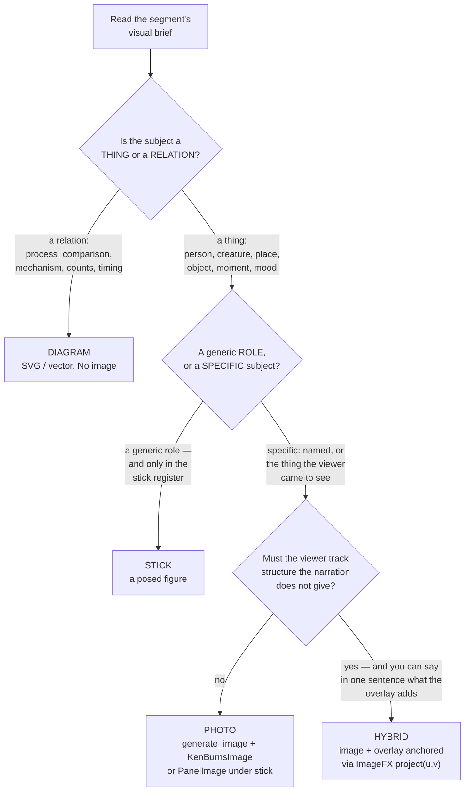
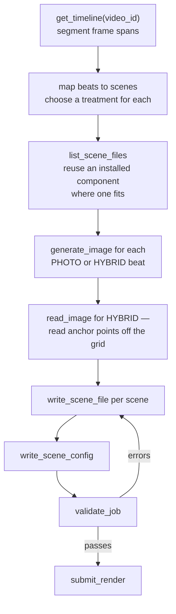
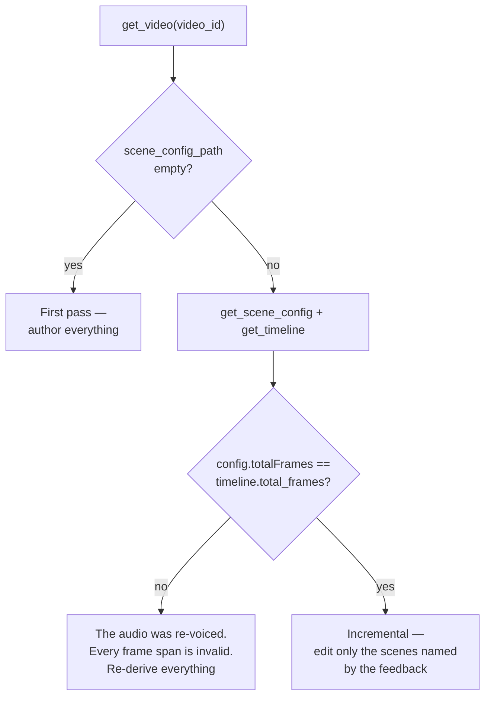

# Scene Authoring

This is where a video actually gets its look. A scene is a React component, written for one specific
video, that renders one beat of the script. The AI agent writes them; you write the components,
rules and examples it learns from.

If you are extending Tubematic, this and [The Agent Layer](07-agent-layer.md) are the two surfaces
that matter most.

Read [The Remotion Project](09-remotion-project.md) first for the frame model and the props contract.

---

## The two kinds of scene

| | `installed` | `generated` |
|---|---|---|
| Lives in | `renderer/remotion/src/scenes/installed/` | `~/.tubematic-data/scenes/generated/<video_id>/` |
| Written by | You, committed to the repo | The agent, per video |
| Deployed by | Rebuilding the image | Written immediately — it is a bind mount |
| Reused | Across every video | Never |

**Generated scenes are namespaced per video, and cross-video reuse is copy, not reference.** Two
videos naming a scene the same thing used to silently overwrite each other — and a per-video lock
cannot fix that, because it also happens *sequentially*, weeks apart, between sessions that never
overlap. When the agent wants a prior video's scene, it reads that file and writes its own copy.

### The `../../` rule

Because generated scenes sit two levels down, they import installed components with **two** levels
up and **no extension**:

```tsx
import ImageFX from "../../installed/ImageFX";   // correct
import ImageFX from "../installed/ImageFX";      // resolves to generated/installed/ — fails
import ImageFX from "../../installed/ImageFX.tsx"; // extension — fails tsc
```

Both wrong forms fail `validate_job`'s typecheck rather than the render, which is the good outcome.
If a scene fails with `Cannot find module '../installed/...'`, check the depth before anything else.

---

## Writing a component

```tsx
import { AbsoluteFill, useCurrentFrame, interpolate, spring, useVideoConfig } from "remotion";

export default function DnsLookup({ durationInFrames, title }: {
  durationInFrames: number;
  title: string;
}) {
  const frame = useCurrentFrame();
  const { fps } = useVideoConfig();

  const enter = spring({ frame, fps, config: { damping: 200 } });
  const exit  = interpolate(frame, [durationInFrames - 20, durationInFrames], [1, 0], {
    extrapolateLeft: "clamp",
  });

  return (
    <AbsoluteFill style={{ backgroundColor: "#0a0a0f", opacity: exit }}>
      <h1 style={{ transform: `scale(${enter})`, color: "#fff" }}>{title}</h1>
    </AbsoluteFill>
  );
}
```

Rules that come out of the frame model:

- Everything derives from `useCurrentFrame()`. No timers, no CSS transitions, no
  `requestAnimationFrame`.
- Frame 0 is the scene's own first frame, not the video's.
- Use `spring()` for entrances and `interpolate()` for anything with a fixed span. Clamp your
  extrapolation.
- **Motion must span the scene.** A scene that animates its entrance in 1.5 seconds and then holds
  static for twelve is the over-correction to watch for when scene lengths grow.
- Read `durationInFrames` from props rather than assuming a length.
- Keep text inside the safe zone: 150px top, 170px bottom, 60px each side.

---

## Visual registers

A video is produced in one of three registers, pinned per video and chosen by a human at the topic
checkpoint (`videos.visual_style`, frozen there — see [Frozen
choices](02-pipeline.md#frozen-choices)):

| | Canvas | Output reads as |
|---|---|---|
| **Motion graphics** | Dark | Generated imagery with continuous camera moves, animated vector diagrams. Image-led |
| **Stick explainer** | White | Black **hand-drawn** line art, figures with attire overlays and standardised faces, discrete poses. Animation-led |
| **Illustrated** | Agent's choice | Characters are **generated illustrated assets** rather than hand-drawn line art, held consistent across scenes by editing every pose from one canonical character sheet. It fixes neither the drawing style nor the canvas: the agent picks cartoon or rendered, and light or dark, from the topic. Costs an image call per pose, and needs an OpenAI key — see [Settings](../user-guide/05-settings.md#images) for why there is no Gemini fallback. Without one the style cannot be chosen |

A third value, `auto`, defers the choice: the agent classifies every beat and picks the register
once, video-wide, then records it in `resolved_visual_style` so the dashboard can say what a video
actually is. It never re-decides — see [Frozen choices](02-pipeline.md#frozen-choices).

**A permission is not an instruction.** `auto` says which vocabularies are *available*; each beat's
treatment is still decided by its subject. A video that uses every vocabulary because it was
allowed to is a defect — it reads as several half-finished videos spliced together rather than a
rich one. The rule the skill enforces is to default to the fewest vocabularies that carry the
video, and to be able to say in one sentence why any beat needs a different one from the beats
around it. Variety is never itself a reason.

**The register pins the canvas and how a role is drawn. It does not restrict what a beat may be.**
This is the most common way to misread it. Under the stick register:

- **Diagrams stay.** A process or a dataflow is still a diagram, drawn as black line art on white.
- **Generated images stay.** A beat whose subject is a real, specific person, creature or place
  still gets a real generated image — contained in a panel on the white ground rather than
  full-bleed.
- **Mixing treatments within one video is normal.** A video can open with a figure for "the user
  clicks the link", cut to a vector diagram for the lookup, and show a real place. Treatment has
  always been per beat.

**The canvas is the one thing that cannot vary per beat.** Alternating white and dark scenes
flashes, and a viewer reads that as a broken render rather than a style. It is therefore a single
top-level `canvas` key in the render manifest rather than a per-scene choice, and the write path
rejects a value that contradicts the video's register.

## Choosing a treatment

Every beat gets exactly one treatment, and the taxonomy is the most opinionated part of the system
because it is what stops the output looking like a slideshow or a clip-art deck.



**STICK is available only under the stick register, and only for generic roles** — "the user", "an
attacker", "a scientist", anyone in a hypothetical or a walkthrough. The moment the subject has a
name, the beat is PHOTO again. This is a carve-out from the rule below, not an exception to it: a
stick figure *is* an abstract marker, and the thing that rule protects is a subject somebody came
to see. Nobody came to see a particular "the user".

**PHOTO is the default for anything photographic.** A named character, a real person, a creature, a
specific place or structure, a distinctive object, one dramatic moment, or an establishing mood.
What goes *over* the picture is, normally, **nothing** — see
[On-screen text is the exception](#on-screen-text-is-the-exception). What it is never is annotation
of the picture itself.

**HYBRID is the exception, not PHOTO's peer.** It needs the same photographic subject *plus*
structure the viewer must follow that the words do not supply: who moved where, in what order, from
which direction, how many. It must pass a one-sentence test — *what does the overlay tell the viewer
that the words and the picture do not?* If you cannot answer it, the beat is PHOTO.

The failure mode HYBRID exists to prevent is decoration: a reticle, a badge and a counter piled onto
a picture that was already carrying the beat. Draw the minimum — one anchored element and maybe a
label.

**DIAGRAM is for relations, not things.** A process with stages, a before-and-after, a mechanism, a
dataflow, quantities, timing, cause and effect, code or terminal output. No image.

### Worked examples

| Brief | Subject | Treatment |
|---|---|---|
| "Overhead tactical map, army icon crawls toward the castle" | A real army moving on a real place | **HYBRID** — a march-route overlay anchored to the map |
| "Split diagram: troops besieging the castle, dragon in the sky above" | A dragon, in one specific ambush | **PHOTO** — Ken Burns move, no text. An arrow pointing at the dragon tells the viewer nothing, and neither does a caption naming it |
| "Establishing shot of the domed hall at night" | A real structure, a mood | **PHOTO** — a bare `KenBurnsImage`. Nothing to label |
| *the same shot, with a reticle, a badge and a counter added* | A dragon | **The defect this taxonomy exists to prevent** |
| "Stat cards fade in: small garrison, minor holding, PERFECT BAIT" | The relative worth of a holding | **DIAGRAM** — no image |
| "Cut to terminal showing `whoami` output" | Command output | **DIAGRAM** — no image |
| "Memory allocation diagram, 4 boxes filled of 8" | An allocator's behaviour | **DIAGRAM** — no image |

### The image floor

**Motion-graphics register only.**

| PHOTO or HYBRID segments | Scenes that must use a generated image |
|---|---|
| 0 | **0** — an image here is the defect |
| 1 | 1 |
| 2 or more | 2 |

At most **half** a video's scenes may be a bare `KenBurnsImage` with no authored scene around it.
This is a motion-graphics explainer, not a photo slideshow.

Neither rule applies under the stick register: a role beat is a figure by design, not a photograph
withheld, and `KenBurnsImage` is not used there at all. What does carry across is the floor's
*reason* — a named, specific subject still gets a real generated image, framed in a panel.

**The floor is self-enforced.** `validate_job` cannot detect a missing image — it only checks that
referenced image paths resolve. Nothing but the skill and a human reviewer will catch a video that
should have had a picture and did not.

---

## On-screen text is the exception

The narration is burned into every video as subtitles — see
[Captions](09-remotion-project.md#captions). Every spoken word is already on screen, in sync, drawn
above the scenes by the renderer rather than by anything a scene author writes.

So a scene should carry **no text at all** unless the text is itself the content. The justified
cases are a closed list: a number the viewer must read, a label pinned to part of a diagram or
image, a term being defined as it is introduced, code or a command or a literal error string, and a
chart's axis, unit or legend. Everything else — a headline restating the narration, a title card, a
lower third, a caption under a picture, a pull-quote of the line being spoken, a closing slate — is
duplication. The viewer reads the same sentence twice, and the animation competes with it.

**The test, applied per string before it is written:** remove it — is any information lost that the
motion, the image and the subtitles do not already carry?

**This reverses the previous house style, and the reversal is the point.** Before subtitles existed,
a headline springing in over a drifting image *was* the default image beat, and the guidance said
so. Both skills and this page said it in several places, which is exactly why the new rule had to be
written as a reversal rather than added alongside: an agent reading two paragraphs that disagree
follows whichever it read last. If a future edit re-introduces "give the beat typographic content",
it is restoring the thing this section removed.

The consequence for authoring is not "the same scene, minus its caption". A beat that would have
been a headline over a picture needs a **better visual** — the thing changing, the diagram building,
the figure moving — because the text was standing in for motion that was never made.

The AI review is told the same thing from both sides: that the captions themselves are correct by
design and must never be reported as clutter, and that a scene *also* writing out the narration is a
suggestion. The first half matters more than the second. Every video is captioned, so a reviewer
that read captions as duplicated text would return a finding on every video — and any finding routes
a video to `REVISION_REQUESTED`, which is a wedged pipeline rather than a missed check.

---

## Cadence

There is **no target scene count and no target scene length.** Cut when the visual idea changes, not
on a timer.

The default is one segment, one scene. Deviate only to:

1. Merge a very short segment into an adjacent one when their visual briefs compose.
2. Split a segment when its brief names distinct sub-beats, or one visual idea cannot carry the span.
3. Reach the floor of **4 generated scenes** — the only count-driven split there is.

Never let one scene span parts of two different segments. Clamp the first and last scene to exactly
0 and `totalFrames`. Leave **no gaps** between scenes, even where the timeline has small
text-to-speech pauses.

---

## The workflow



`read_image` is the interesting step. It returns the actual image with an optional UV coordinate
grid drawn over it, so the agent can *look* at the picture and read off where the subject is —
then hand those coordinates to `ImageFX`'s `project(u, v)` so the overlay stays attached as the
camera moves.

The grid is drawn on an **in-memory copy**. The file on disk is the render input, so annotating it in
place would bake a coordinate grid into the finished video — silently, visible only after a render.

`read_image` is also deliberately exempt from the scene-work claim: looking at a picture spends
nothing and writes nothing.

---

## Revising an existing video

When a video comes back at `REVISION_REQUESTED`, rewriting every scene is wasteful and risks
regressing scenes nobody complained about. The entry test decides:



On the incremental path, every other config entry must be written back **byte-identical**, and no
`generate_image` should fire for a beat whose image was not the defect.

> **Do not substitute "was a revision requested?" for this test, and do not key it on
> `scene_config_path` alone.** A pronunciation fix re-voices and returns with that field still
> populated — keying on it would route every re-voice down the incremental path and leave the whole
> video misaligned against a timeline that changed length.

---

## Adding an installed component

For anything worth reusing across videos:

1. Write it in `renderer/remotion/src/scenes/installed/`, with a default export and a fully typed
   props interface. Accept `durationInFrames`.
2. Do **not** wrap asset paths in `staticFile()` — the `public_path` values from `generate_image` are
   already rooted at `/public`, and double-prefixing throws.
3. Document it in `renderer/remotion/src/scenes/installed/README.md`, which is what the agent reads
   when deciding what to reach for.
4. If it should be the default answer for some class of beat, add a row to the scene-config skill's
   worked-example table. A component the skill never names will not get used.
5. `npx tsc --noEmit` must pass — `validate_job` runs it for every video, so an error here blocks
   *every* render, not just one.
6. Rebuild the image. Installed components are baked in, unlike generated ones.

### Do not remove these three guards

They are what keeps the PHOTO default from swinging back into the failure mode it was introduced to
fix — an abstract vector silhouette standing in for a real subject:

- The image floor stays as it is.
- "Never DIAGRAM for a photographic subject" survives verbatim in both skills that say it.
- At least one HYBRID row stays in the worked-example table, with a real anchored-overlay template
  named as its answer. It is the only thing that keeps `ImageFX.project()` exercised.

A fourth, from the subtitle layer, with the same shape: **the review prompt's statement that the
captions are correct by design stays.** It is the negative control for the whole feature — without
it a reviewer flags the captions on every video, and every video loops to `REVISION_REQUESTED`.
Deleting it looks like tightening the review and is actually how the pipeline stops producing
finished videos.

A fifth, identical in shape: **the review prompt's statement that the watermark is intentional
stays.** The mark is in every frame of every video and scenes are never laid out around it, so a
reviewer without that paragraph reports it — as clutter, as a safe-zone breach, or as something
covering the scene — on every video.

**The stick register was added without weakening any of the three, and that was deliberate.** The
temptation was to soften the silhouette rule, because a stick figure is plainly an abstract marker.
Instead the rule is unchanged and the register carves out **generic roles only** — the class of
subject the rule was never protecting. The floor is scoped to the motion-graphics register rather
than relaxed, and the HYBRID row is untouched. A future edit that reaches for "well, sometimes a
named character can be a figure" is reopening the exact defect these guards exist to close.

---

## Example scenes

`agent_files/skills/tubematic-scene-config/examples/` holds six reference implementations. They are
what the agent copies from, so they are worth keeping current.

| File | Technique |
|---|---|
| `ex-ken-burns.tsx` | The default image beat — `ImageFX` and its camera move. It still demonstrates spring-animated children over the picture, which is now the exception rather than the default; read it for the mechanics, not as a licence to add a headline |
| `ex-hybrid-anchored.tsx` | The anchored-overlay exception — `project(u,v)`, an `evolvePath` leader line, the label kept in the safe zone while the arrow tip is free |
| `ex-spring-stagger.tsx` | Spring entrance and staggered list reveal, with per-item index delays |
| `ex-path-draw.tsx` | A self-drawing SVG diagram via `evolvePath`, with nodes springing in as the line reaches them |
| `ex-noise-background.tsx` | Organic background motion, animated SVG shapes, a number ticker |
| `ex-three-intro.tsx` | 3D via React Three Fiber. Animation driven by `useCurrentFrame()`, **never** `useFrame` |

`ex-path-draw.tsx` is the antidote to a common anti-pattern: a static diagram remounted with
different props for each step, instead of one continuous diagram that draws itself.

`ex-three-intro.tsx` is opt-in only, for when 3D genuinely elevates the topic.
