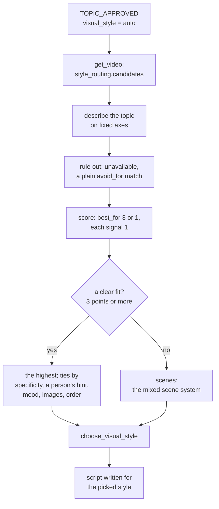
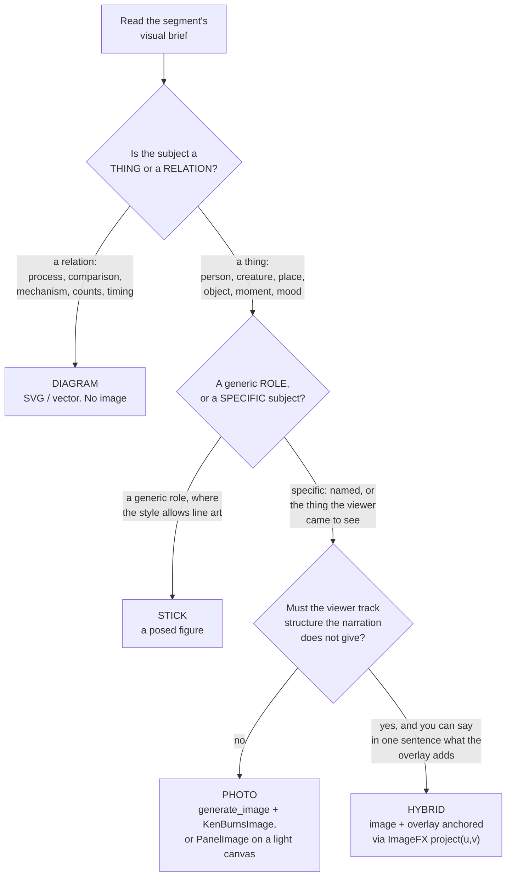
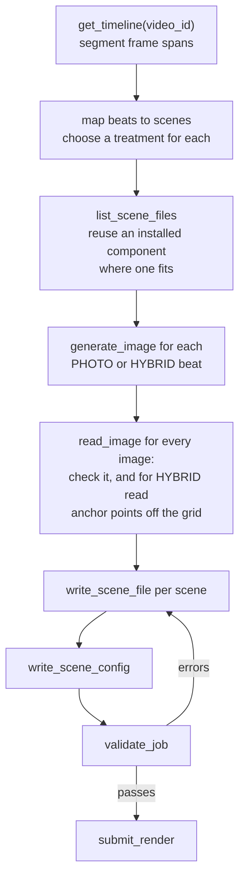
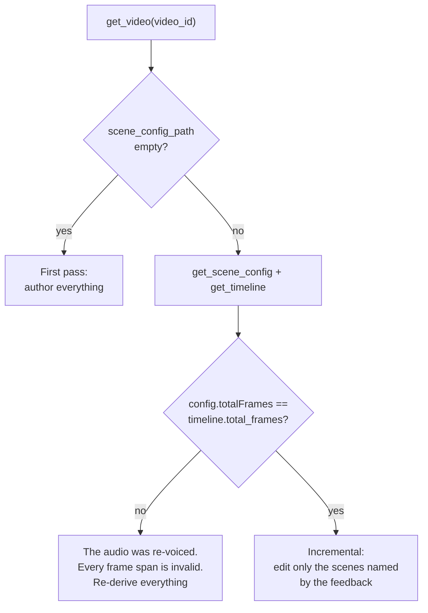

# Scene Authoring

A scene is a React component that renders one beat of a video's script. The agent writes scenes for
each video. You write the components, rules and examples the agent learns from.

Read [The Remotion Project](09-remotion-project.md) first for the frame model, the props a scene
receives and the `scene-config.json` shape. The authoring rules on this page are the
`tubematic-scene-config` skill's ([The Agent Layer](07-agent-layer.md#the-scene-config-skill)), and
the checks are the MCP tools'.

---

## The two kinds of scene

| | `installed` | `generated` |
|---|---|---|
| Lives in | `renderer/remotion/src/scenes/installed/` | `~/.tubematic-data/scenes/generated/<video_id>/` |
| Written by | You, committed to the repository | The agent, per video, with `write_scene_file` |
| Deployed by | Rebuilding the image | The write itself. The directory is a bind mount |
| Reused | By every video | By one video |

Generated scenes are namespaced per video, so two videos that give a scene the same name do not
overwrite each other. Reuse across videos is by copy: the agent reads another video's scene with
`read_scene_file` and writes its own copy with `write_scene_file`.

### The `../../` rule

A generated scene sits two levels below `scenes/`, so it imports installed components two levels up,
with no extension:

```tsx
import ImageFX from "../../installed/ImageFX";     // correct
import ImageFX from "../installed/ImageFX";        // resolves to generated/installed/ and fails
import ImageFX from "../../installed/ImageFX.tsx"; // an extension fails tsc
```

Both wrong forms fail the typecheck in `validate_job`, before a render. If a scene fails with
`Cannot find module '../installed/...'`, check the depth first.

---

## Visual styles

Every video has a visual style, stored in `videos.visual_style`. A person picks it when approving the
topic and it is frozen after that ([Frozen choices](02-pipeline.md#frozen-choices)). A person who
leaves it on `auto` lets the agent pick one before the script is written
([How Auto picks a style](#how-auto-picks-a-style)). The code and the
skill also call a style a **register**.
[Visual Styles and Mascots](../user-guide/13-visual-styles-and-mascots.md#the-styles) shows what each
style looks like.

For the scene styles, a style is a set of permissions: which canvas, and which kinds of figure. It
does not decide any beat's treatment. `cartoon_3d`, `system_flow`, `bean_explainer`, `whiteboard`,
`storybook_atlas`, `terminal_doc`, `under_the_hood` and `case_file_story` replace the scene system
with one whole-video scene of their own.

| `visual_style` | Canvas | Figures | Hand-drawn line art | Generated characters |
|---|---|---|---|---|
| `auto` (the default) | The agent chooses | Yes | Yes | Yes |
| `motion_graphics` | `dark` | No | No | No |
| `stick` | `light` | Yes | Yes | No |
| `illustrated` | The agent chooses | Yes | No | Yes |
| `system_flow` | `dark` | No | No | No |
| `bean_explainer` | `light`, painted over by its own colour field | Its own cast | No | No |
| `whiteboard` | `light` | No | No | No |
| `storybook_atlas` | `light`, painted over by its own paper | Its own cast | No | No |
| `terminal_doc` | `dark` | No | No | No |
| `under_the_hood` | `dark` | Its own presenter | No | No |
| `case_file_story` | `dark` | Its own lead, painted into the stills | No | No |
| `cartoon_3d` | `dark`, never visible | Its own cast | No | No |

The columns are `CANVAS_BY_STYLE`, `figures_allowed`, `line_art_allowed` and `characters_allowed`.

`characters_allowed` gates the `generate_character` tool. `figures_allowed` and `line_art_allowed` go
into the [AI review prompt](21-ai-review.md#the-prompts-guard-clauses), so the reviewer judges a video
against the look it was meant to have. `cartoon_3d` replaces the scene system with one 3D world
([Cartoon 3D](#cartoon-3d)), `system_flow` with one diagram scene ([System Flow](#system-flow)),
`bean_explainer` with one cartoon-bean scene ([Bean Explainer](#bean-explainer)), `whiteboard`
with one board scene ([Whiteboard](#whiteboard)), `storybook_atlas` with one picture-book scene
([Storybook Atlas](#storybook-atlas)), `terminal_doc` with one typographic scene
([Terminal Doc](#terminal-doc)), `under_the_hood` with one scene of annotated close-up
photographs ([Under the Hood](#under-the-hood)), and `case_file_story` with one scene of painted
stills, meters and number cards ([Case File Story](#case-file-story)).

The API and `update_video` refuse a style whose pack needs something the install lacks, where it is
chosen. Four styles have a need:

- `illustrated` needs a stored OpenAI key, because an OpenAI image model draws its characters
  (`ILLUSTRATED_NEEDS_OPENAI_KEY`).
- `under_the_hood` needs a stored OpenAI key, because its plates are generated photographs. The
  refusal text is its pack's `messages.openai_key`.
- `case_file_story` needs a stored OpenAI key, because its shots are generated paintings. The
  refusal text is its pack's `messages.openai_key`.
- `cartoon_3d` needs a renderer whose [GPU test](20-gpu-and-remote-renderers.md#the-gpu-test) passed
  (`CARTOON3D_NEEDS_GPU`, `CARTOON3D_GPU_UNKNOWN`). Software WebGL can render the style, at about 50
  minutes for a 90-second Short, so the rule is a policy.

`get_video` reports the two conditions to the agent as `illustrated_available` (true when an
OpenAI key is stored, which Under the Hood and Case File Story need too) and
`cartoon_3d_available`, and gives the video's own style as `style`: its label, canvas, permissions
and `authoring_skill`.

### Style packs

Each style except `auto` is a style pack: one JSON file in `tubematic_core/style_packs/`, named for
the style's id. `tubematic_core/visual_styles.py` loads them at import and refuses a malformed pack,
so a bad file stops the process at start-up. The MCP server and the API import the same objects
from it (`VISUAL_STYLES`, `CANVAS_BY_STYLE`, the gates), and the dashboard reads the list from
[`GET /visual-styles`](05-http-api.md#get-visual-styles). `auto` is code: it is the absence of a
style.

| Field | Holds |
|---|---|
| `id`, `label`, `order`, `experimental` | The style's name in the code and on the dashboard, its place in the pickers, and whether the dashboard marks it experimental |
| `renderer` | `dom` for the scene system, `cartoon_3d` for the 3D world |
| `canvas` | The canvas the style fixes, or `null` when the agent chooses it |
| `allows` | `figures`, `line_art` and `generated_characters`: the three permission columns above |
| `needs`, `messages` | Whether the style needs an OpenAI key or a working GPU, and the refusal text for each |
| `mascot` | Optional. `false` when a video of the style may not carry a mascot, with the refusal in `messages.mascot`. A 3D-world style takes none by its renderer |
| `authoring_skill` | The skill that authors a video in this style; `get_video` returns it as `style.authoring_skill` |
| `review` | Optional. The style's own block for the [AI review prompt](21-ai-review.md#the-prompts-guard-clauses) |
| `captions` | Optional. The `subtitles` settings `write_scene_config` fills in when a config has none |
| `routing` | What Auto reads to pick a style: `best_for`, `avoid_for`, `signals`, and the optional `moods` and `images` (below) |
| `script` | Optional. How to write the narration and each segment's `visual` brief for this style; `get_video` returns it as `style.script` and the script-writing skill follows it |
| `extra` | Style-specific data, such as System Flow's icon list, Bean Explainer's and Storybook Atlas's cast and prop catalogues or Whiteboard's doodle library |

The `routing` block lists what the style suits (`best_for`), what it must not get (`avoid_for`) and
the signals in a topic or script that point to it (`signals`). Two fields are optional: `moods`, the
tones the style suits, and `images`, a whole number of generated images a video costs at most (0
when absent). [How Auto picks a style](#how-auto-picks-a-style) reads all five.

`tubematic_core/tests/test_style_packs.py` pins every gate's answer for each style, `auto`, a blank
value and an unknown one. Adding a style is a new pack file, the style's renderer work and its
authoring skill.

### The canvas

The canvas is the ground the renderer paints under every scene: `dark` or `light`. It is one value
for the whole video, the top-level `canvas` key of `scene-config.json`, because a video that
alternates light and dark scenes flashes.

`server.py::effective_canvas` gives a video's canvas. A style in `CANVAS_BY_STYLE` fixes it. Under
`auto` and `illustrated` it is the value the agent recorded in `videos.resolved_visual_style`, which
is written once. [`write_scene_config`](09-remotion-project.md#canvas) rejects a contradicting value.

The figure vocabulary is independent of the canvas. A stick figure is black line art on a light
canvas and white on a dark one, so `StickFigure` and `StickScene` take a `theme` prop that must match
the canvas. A wrong `theme` typechecks and renders a figure that cannot be seen.

A scene leaves its own background transparent where the canvas should show through.

### How Auto picks a style

A video on `auto` gets its style before its script, at `TOPIC_APPROVED`, because the script is
written for the style: a walk through a system, a story, a list. The
`tubematic-style-routing` skill makes the choice and `choose_visual_style` records it once.



The candidates are data: `tubematic_core/visual_styles.py::routing_candidates` lists every style
pack in pack order, then `scenes`, each with its `routing` block and whether this install and this
video can have it. A style that needs an OpenAI key or a working GPU the install lacks is
unavailable, and so is a style that takes no mascot (a 3D world, or a pack with `"mascot": false`)
on a video with a mascot. The skill names no style, so a new
pack with a `routing` block is a candidate the day it ships.

The outcome is recorded in three columns ([`videos`](03-database.md#videos)):

| `visual_style` | `style_pick` | Meaning |
|---|---|---|
| a pack id | `''` | A person chose the style |
| a pack id | the same id | Auto picked it before the script |
| `auto` | `scenes` | Auto kept the mixed scene system |
| `auto` | `''` | Not decided. Before `TOPIC_APPROVED` it is routed when picked up; after it, the video takes the mixed scene system |

A pack Auto picks is written into `visual_style` itself, so the gates, the AI review prompt and the
authoring skill read it as if a person had chosen it. `style_runner_up` and `style_reason` are shown
on the dashboard, where a person can switch to the runner-up at `SCRIPT_READY`
([`POST /videos/<id>/switch-style`](05-http-api.md#post-videosvideo_idswitch-style)), which sends the
video back to `TOPIC_APPROVED` for a new script. A video moved back to `TOPIC_PROPOSED` returns to
`auto`, so its revised topic is routed again.

`scenes` is the mixed scene system: every beat drawn from any vocabulary, on a canvas the agent
chooses at `VOICE_READY`. Its routing block (`visual_styles.py::SCENES_ROUTING`) is scored like a
pack's. It is the best answer when full-frame pictures of real things carry some beats and roles
acted out by figures carry others (Motion Graphics draws no figures, Stick Explainer shows pictures
only in panels), and the fallback when nothing reaches 3 points. Its renderer is always `dom`, recorded in `videos.resolved_renderer`. The
agent chooses the canvas once, `update_video(resolved_visual_style="dark" | "light")`: `dark` when
images carry the video (about a third or more of the beats are PHOTO or HYBRID) and `light` when
roles, processes and diagrams carry it. A tie goes to `dark`. `write_scene_config` records it if the
agent wrote a config without recording it. On a revision the agent reads the recorded values and does
not choose again. An `auto` video whose `resolved_renderer` is `cartoon_3d` is a Cartoon 3D Short,
authored by the Cartoon 3D skill.

If a mixed-scenes video has character beats, the agent also chooses once between line-art figures
and generated characters. Generated characters are for recurring characters the viewer must
recognise, and only while `illustrated_available` is true.

Mixed scenes say which vocabularies are available. The skill tells the agent to use the fewest that
carry the video. A video that uses every vocabulary because it was allowed to is a defect.

The topic set in `tubematic_core/tests/fixtures/style_routing_cases.json` and the hand-run
`scripts/eval_style_routing.py` check the routing; see
[Style routing](test-suites/style-routing.md).

### Generated characters

Under `illustrated`, and under `auto` when the agent chose them, a character is a transparent PNG made
by `generate_character`, at one image call per pose. The scene places it with ``. It does not go
through `ImageFX` or `KenBurnsImage`, which fill the frame.

- The agent picks one drawing style from the topic (simple cartoon or rendered illustration) and holds
  it for every character in the video.
- The first call for a character makes its sheet: a plain standing pose, with the style stated in the
  prompt. Every later pose passes `reference=` naming that sheet, because chaining pose to pose
  compounds drift.
- The agent opens every asset with `read_image` and checks that it is still the same character.
- Generated characters and `StickFigure` line art are not mixed in one video. The tool enforces this
  under `stick`, and the skill under `auto`.

Under a forced `illustrated` the agent does not check for a key and does not fall back to line art.
If `generate_character` refuses, the agent comments on the video and ends the session.

---

## Choosing a treatment

Every beat gets one treatment, decided from the beat's subject. The wording of the beat's `visual`
brief does not decide it.



| Treatment | The beat's subject | Built as |
|---|---|---|
| PHOTO | A named character or real person, a creature, a specific place or structure, a distinctive object, one dramatic moment, or an establishing mood | A generated image with a camera move and nothing drawn over it |
| HYBRID | A PHOTO subject, plus structure the viewer must follow that the words do not give: who moved where, in what order, from which direction, how many | A generated image with one overlay anchored to it |
| DIAGRAM | A relation: a process with stages, a comparison, a mechanism, a dataflow, quantities, timing, cause and effect, code or terminal output | A vector scene with no image |
| STICK | A generic role: "the user", "an attacker", anyone in a hypothetical or a walkthrough | A posed `StickFigure` |

PHOTO is the default for a photographic subject. HYBRID must pass a one-sentence test: what does the
overlay tell the viewer that the words and the picture do not? Without an answer the beat is PHOTO.

The skill forbids reducing a named character, creature or real place to an icon, a silhouette or a
marker. A battle, a siege or an ambush has stages and also has subjects the viewer came to see, so it
is PHOTO, or HYBRID where the beat turns on where or in what order.

STICK is available under `stick` and `auto`, for generic roles only. When the subject has a name, the
beat is PHOTO. Under `motion_graphics` a role beat is a DIAGRAM, or a PHOTO if the beat needs a
person shown. Under `illustrated` a role is a generated character.

The canvas changes how a treatment is built:

| Treatment | On a `dark` canvas | On a `light` canvas |
|---|---|---|
| STICK | `StickFigure theme="dark"` | `StickFigure theme="light"` |
| PHOTO, HYBRID | `ImageFX` or `KenBurnsImage`, full-bleed | `PanelImage`, framed on the canvas |
| DIAGRAM | A vector scene in a dark palette, or `StepFlowDiagram` | Black line art, or `StepFlowDiagram` with `theme: "light"` |

Figures move in discrete steps. A figure holds a pose and changes it in one frame, two to five times
per ten seconds of audio. Every other scene moves continuously.

### Worked examples

| Brief | Subject | Treatment |
|---|---|---|
| "Overhead tactical map, army icon crawls toward the castle" | A real army moving on a real place | HYBRID: a march-route overlay anchored to the map |
| "Split diagram: troops besieging the castle, dragon in the sky above" | A dragon, in one specific ambush | PHOTO: a camera move and no text. An arrow at the dragon tells the viewer nothing |
| "Establishing shot of the domed hall at night" | A real structure, a mood | PHOTO: a bare `KenBurnsImage` |
| The same shot with a reticle, a badge and a counter added | A dragon | The defect the taxonomy prevents |
| "Stat cards fade in: small garrison, minor holding, PERFECT BAIT" | The relative worth of a holding | DIAGRAM, no image |
| "Cut to terminal showing `whoami` output" | Command output | DIAGRAM, no image |

### The image floor

The floor applies to dark-canvas videos.

| PHOTO or HYBRID segments | Scenes that must use a generated image |
|---|---|
| 0 | 0. An image here is the defect |
| 1 | 1 |
| 2 or more | 2 |

At most half of a video's scenes may be a bare `KenBurnsImage` entry. Past that share, the agent
authors a scene around `ImageFX` and gives it more motion.

On a light canvas neither rule applies. A named, specific subject still gets a real generated image
there, in a panel.

Nothing checks the floor. `validate_job` verifies only that the image paths a config references
resolve, so a video with no images passes.

---

## On-screen text is the exception

The renderer draws the narration over every video as captions
([Captions](09-remotion-project.md#captions)). A scene therefore carries no text unless the text is
the content. Terminal Doc is the one style whose content is text ([Terminal Doc](#terminal-doc)). The skill's complete list of justified text:

- A number the viewer must read.
- A label pinned to part of a diagram or an image.
- A term being defined, shown once as it is introduced.
- Code, a command, a filename or an error string.
- A chart's axis, unit or legend.

A headline restating the narration, a title card, a lower third, a caption under a picture, a
pull-quote of the line being spoken and a closing slate all duplicate the captions.

The skill's test for each string: remove it, and ask whether any information is lost that the motion,
the image and the captions do not carry. A beat that would have been a headline over a picture needs
a better visual.

The skill, the installed `README.md` and the examples must agree on this rule, because an agent that
reads two conflicting paragraphs follows the one it read last.

The agent may set `"enabled": false` on `subtitles` only with a reason it states in its handback.

---

## Cadence

The skill sets no target scene count and no target scene length. A cut marks a change of visual idea.

The default is one script segment, one scene. The agent deviates only to:

1. Merge a very short segment into an adjacent one, when their visual briefs compose.
2. Split a segment whose brief names distinct sub-beats, or whose one visual idea cannot carry the
   span. Sub-scenes of one segment hard-cut (`transitionToNext` of 0).
3. Reach the minimum of four `generated` entries. This is the only count-driven split. An installed
   scene counts toward it. A Cartoon 3D video is exempt, because it has one scene.

No scene spans parts of two different segments. The first scene starts at frame 0 and the last
ends at `totalFrames`. Scenes leave no gaps, even where the timeline has a short pause between
segments.

Nothing checks the four-scene minimum. Like the image floor, it is the skill's rule.

---

## The workflow



Before the first step the agent reads `visual_style` from `get_video` and settles the choices under
[Visual styles](#visual-styles). The tools are documented on [The MCP Server](06-mcp-server.md).

`read_image` returns the image with a UV coordinate grid drawn over it. The agent uses it to reject a
bad image before a render, and to read where the subject sits. It passes those coordinates to
`ImageFX`'s `project(u, v)`, which keeps an overlay attached as the camera moves. The grid is drawn
on an in-memory copy, because the file on disk is the render input. `read_image` does not take the
[scene-work claim](06-mcp-server.md#the-scene-work-claim), because it spends nothing and writes
nothing.

### Text-layout warnings

`validate_job` ends with the
[text-layout audit](11-rendering-and-review.md#the-text-layout-audit), which measures the text of
sampled frames in a browser. Its findings go to the `warnings` list of the result and do not change
`passed`. The agent is told to judge each warning, because one can be wrong.

| Warning starts with | Means |
|---|---|
| `Text overlap in scene` | Two text elements overlap. The line names both strings, their boxes, the frame and the overlap percentage |
| `Text outside the safe zone in scene` | Text crosses a safe-zone edge. The line names the edges, and says when the text runs past the frame |
| `Mascot over text in scene` | Text sits under the mascot's box |
| `Text-layout audit` | The audit was skipped, could not run, or could not measure part of a scene. The line says which |

The audit compares text with text only (`text_audit.py::find_overlaps`), so an arrow tip outside the
safe zone or an image under a label is not a finding. The captions are text in the same composition,
so scene text that collides with a caption is reported as an overlap.

The audit does not run when `validate_job` already has errors, or when the
`text_layout_audit_enabled` setting is off.

---

## Revising an existing video

When a video comes back at `REVISION_REQUESTED`, the agent edits the scenes the feedback named. It
runs this test first:



The test compares frame counts because `scene_config_path` alone does not tell a re-voice apart. A
pronunciation fix re-voices the video and returns with the path still set, while the old frame spans
are measured against audio that is gone.

On the incremental path:

- The agent maps each finding to a config entry by `src`, or by frame when the finding gives only a
  timestamp.
- It reads only those scenes and writes them back under the same `scene_name`, so `src` does not
  move. An `installed` entry has no TSX to edit, so the agent changes its `props` or replaces the
  entry.
- Every other config entry is written back unchanged: the same `startFrame`, `durationInFrames`,
  `src`, `source` and `props`.
- `generate_image` runs only for an image that was itself the defect, under the same `image_name`.

---

## Cartoon 3D

A Cartoon 3D video is code written for that one video: a `CartoonShort` scene that spans the whole
video, and TypeScript modules beside it under `scenes/generated/<video_id>/`. The agent writes them
with the `tubematic-cartoon3d` skill, against
[the Cartoon 3D kit](09-remotion-project.md#the-cartoon-3d-kit).

| Module | Holds |
|---|---|
| `story.ts` | The shots timed to the narration, and the camera built from the kit's grammar |
| `sets/*.ts` | The sets, as three.js code |
| `scenes.ts`, `stage/*.ts` | The cast, and who stands where doing what |
| `index.ts` | The `VideoDef` that ties them together |

The worked example the skill points at is `src/cartoon3d/examples/chicago/`.

The video's scene config holds one scene: `src` is `<video_id>/CartoonShort`, `startFrame` is 0 and
`durationInFrames` equals `totalFrames`. Its props carry `cartoon3d: {beats}`, the shots as beats,
which is the only per-video data in the config. `write_scene_config` refuses a config when:

- The beats do not cover the video in order from frame 0 to the last frame, with no gap and no
  overlap, each with integer `start` and `end` frames and a `shot` note.
- The scene does not start at frame 0 and span `totalFrames`, or the config has another scene.
- The scene is not this video's own generated `CartoonShort`.
- The scene kind disagrees with the video's renderer: a Cartoon 3D scene on a video that renders
  scene components, or scene components on a video that renders as Cartoon 3D.
- The video has a mascot.

The code is checked before it renders:

- The typecheck that `validate_job` runs covers the video's modules and what they import. The
  agent is given the file and line of an error.
- The beat gate (`src/cartoon3d/gate/beatGateCli.ts`) takes one frame from the middle of every beat
  and pairs it with the sentence the narrator speaks during it. Two judges say whether the picture
  shows the sentence, and a third decides a beat they split on. The verdict is keyed by a hash of the
  video's source files, its beats and the narration per beat, so any edit or re-voice opens the gate
  again. `validate_job` and `submit_render` refuse a video without a passing verdict.
- The look verifier is a step of the skill. A separate subagent scores the look and lists fixes, and
  it does not gate the render.

A judge is a separate subagent whose whole prompt is the gate's prompt, so the author does not grade
its own work. The tools are on [The MCP Server](06-mcp-server.md#cartoon-3d-authoring). The render
runs [in segments](11-rendering-and-review.md#segmented-cartoon-3d-renders). The text-layout audit
does not run for a Cartoon 3D video.

## System Flow

A System Flow video is one installed scene, `SystemFlow`, that spans the whole video. The agent
writes no code for it. Its props carry `systemFlow: {boards}`: one diagram per subject, each with
nodes, edges and events timed to the narration's word frames. The agent writes them with the
`tubematic-system-flow` skill, whose `reference/contract.md` documents every field and whose
`reference/example-config.json` is the worked example.

| Event | What the scene draws |
|---|---|
| `node` | A line icon in a box fades and scales in, and its label types on |
| `edge` | A dotted connector draws from the source to the target |
| `packet` | A point of light travels the connector, or back along it with `reverse` |
| `focus` | Every other element dims to 0.35 and the node gets a glow |
| `chip` | A value (an address, a status code) appears beside the connector |
| `fault` | The node turns red and shakes once |

The renderer's side is `src/scenes/installed/SystemFlow.tsx` with `systemFlow/`:

- `contract.ts` holds the limits and timings.
- `layout.ts` runs dagre once per board. Each edge's `minlen` pins every node to the row the
  validator counts, and order constraints keep the listed left-to-right order within a row.
- `camera.ts` fits what is visible into the diagram band (27% to 69% of the height), between the
  headline and the captions.

The scene paints no CSS gradient, no SVG filter and no `stroke-dasharray`, and it places its camera
as an SVG transform attribute: in software GL each of those multiplied the render cost, which is
measured in `SystemFlow.tsx`'s header comment.

`mcp/system_flow.py` checks a config in `write_scene_config` and refuses it when:

- A `system_flow` video has anything but the one `SystemFlow` scene, from frame 0 for
  `totalFrames`, or another style uses `SystemFlow`.
- A board after the first does not start within 2 frames of a word, or lasts under 2 seconds.
- A board has more than 9 nodes, more than 3 in a row, or more than 3 rows; or its graph has a
  cycle or a node that is not connected.
- A label does not fit 2 lines of 14 characters, or an icon is not in the pack's list.
- An event falls outside its board, comes in an order the scene cannot draw (an edge before its
  source has landed, a packet before its edge has drawn), or starts too late to be drawn and read
  (a node's label included) before the board fades out at its cut.
- A chip or a focus comes so soon after the previous one that it replaces it before it is seen, or
  a node faults twice.
- Nothing changes for more than 3.5 seconds, measured at the narration's frame rate.

The limits make a full board readable: at the pull-back to a whole board of three rows of three,
labels stay at 40 px or more. `mcp/tests/test_system_flow.py` pins `system_flow.py` to `contract.ts`.
When the config has no `subtitles`, the pack's `captions` fill it. The text-layout audit samples
each board as if it were a scene.

## Bean Explainer

A Bean Explainer video is one installed scene, `BeanExplainer`, that spans the whole video: a bald,
big-headed character (the bean) with a thick outline reacts to the narration on a flat colour field,
while props, labels and reaction marks build up beside it. The agent writes no code for it. Its props
carry `beanExplainer: {field, title, list, cast, sections, shots}`, written with the
`tubematic-bean-explainer` skill, whose `reference/contract.md` documents every field and the prop
catalogue, and whose `reference/example-config.json` is the worked example.

- A section has a header, a colour and a badge prop. With `list` on, a strip of badges slides to the
  next section at each section change (the badge carousel).
- A shot is a cut. Inside a shot every event stays on stage until the next cut (an additive build).
- The cast is one house bean, the narrator, and at most one other. The agent picks each one's
  accessory and tint; the drawing is fixed.

| Event | What the scene draws |
|---|---|
| `pose` | The bean swaps to a pose and a face in two frames, then holds. `at` aims a reaching arm at a prop |
| `prop` | A prop from the library, or one the agent drew, pops, drops, slides or rises in, with its text slot filled |
| `act` | The prop's own animation (a phone buzzes, a clock rings), for two seconds |
| `label` | A short handwritten note, ink or red |
| `mark` | A reaction beside the bean's head (sweat, question mark, alarm), until its next pose |
| `impact` | A short camera shake and zoom pulse |
| `strike`, `arrow` | A red X over a prop, a red arrow between two things on stage |

Most props come from a library of 42, drawn once in the bean's line and colours and checked by a
person on a model sheet (the `BeanPropSheet` composition). The agent picks a prop by id and fills its
text slot. For an object the viewer must recognise and the library lacks, the agent draws its own:
a TSX component it writes with `write_scene_file` as `generated/<video_id>/prop-<name>.tsx`,
modelled on the library props it reads with `read_scene_file`, and lists in the config's
`customProps` with its box, text limit and acts. The scene imports these files and treats them like
library props. The agent looks at them with [`render_bean_props`](06-mcp-server.md#render_bean_props)
before it submits, and `validate_job` typechecks them. A custom prop is held to the library's line and
palette by the skill and the preview; the checks below hold it to the library's render-cost rules.

The renderer's side is `src/scenes/installed/BeanExplainer.tsx` with `beanExplainer/`:

- `contract.ts` holds the limits, timings, geometry and catalogues, including `PROPS` (each prop's
  box, text limit and acts).
- `bean.tsx` is the rig: a two-bone arm and leg solver over a pose table, faces as lid, brow and mouth
  swaps.
- `sprite.tsx` draws each distinct look of the bean once, as a bitmap, and reuses it on every frame
  that looks the same.
- `stage.ts` works out what is on stage at a frame, and `props/` holds the library.
- `kit.ts` answers "draw this prop" and "how big is it" for library and custom props alike, and
  `fonts.tsx` loads the style's fonts apart from the scene, so the sheet and the preview do not bundle
  every agent-written prop the scene imports.
- `BeanPropPreview.tsx` is the picture `render_bean_props` returns.

The bean is a bitmap because on the CPU renderer the live SVG bean cost about 0.3 CPU-seconds per
frame whether or not it moved, and the bitmap about 0.07. Everything in the scene settles to a
resting value (a spring reaches 1 and stays there, an act stops after two seconds), so a held frame does not
repaint. The scene also follows System Flow's rules: no SVG filter, gradient, pattern or
`stroke-dasharray`. The measured costs are in `BeanExplainer.tsx`'s header comment. A bitmap that
cannot be drawn fails the render, so no frame goes out without the bean.

`mcp/bean_explainer.py` checks a config in `write_scene_config` and refuses it when:

- A `bean_explainer` video has anything but the one `BeanExplainer` scene, from frame 0 for
  `totalFrames`, or another style uses `BeanExplainer`.
- A shot or section after the first does not start within 2 frames of a word, a shot lasts under 1.5
  seconds or a section under 2, or a section does not start where a shot does.
- A pose is not on a word, or comes less than 8 frames after the same bean's last pose, or names
  `at` on a pose whose arm does not reach (only `point`, `present` and `lean` do).
- `list` is on with fewer than two sections.
- An event in a list video's section starts during the badge carousel, or within 6 frames of the
  next cut.
- A shot holds more than 6 props and labels, a label overlaps a prop, a bean or another label, a prop
  overlaps a bean, two beans overlap, or anything leaves the stage. A bean is checked only where it
  stands while the other thing is on stage, and a hop covers the ground between its two spots for
  its 8 frames. Props may overlap each other. Each prop's box in `contract.ts` is every pixel its
  drawing reaches, outline and act included, measured with `BeanPropSheet`'s measure mode.
- A label runs past 2 lines of 22 characters or repeats 4 narration words in a row.
- A field, pose, face, mark, accessory, tint, prop, act or text slot is not in the catalogue or the
  video's `customProps`, or an act starts before its prop has landed.
- A custom prop has more than 8 per video, an id a library prop has, a `src` that is not this video's
  `prop-<name>` file, a box outside 60 to 700 px a side, a text slot over 40 characters or more than 4
  acts. Its file is missing, has no default export, imports anything but `react`, `remotion` and the
  library's `props/common`, `bean` and `contract` (in an `import` or an `export ... from`), calls
  `require`, or uses an SVG filter, an SVG or CSS gradient, a backdrop filter or blend mode, a pattern,
  a dashed stroke, an image, embedded HTML, Remotion's media or render-control parts, a fetch, a
  dynamic import, randomness, the clock, `performance`, `crypto`, a timer, the page (`window`,
  `document`, `globalThis`), `eval` or a `Function` constructor (`bean_explainer.py::FORBIDDEN_SOURCE`).
  The patterns read the raw file, comments included.
- Nothing changes for more than 3 seconds.

`mcp/tests/test_bean_explainer.py` pins `bean_explainer.py` to `contract.ts` and to the pack. The
pack's `captions` fill every `subtitles` key the config leaves out. `validate_job` checks the custom
prop files again as they are on disk (`server.py::_bean_custom_prop_errors`), because the agent
redraws a prop after the config is written. The text-layout audit samples each shot
as if it were a scene, from the end of the badge carousel when the shot opens a list section. A Bean Explainer video can have a mascot; the skill keeps it small and to one
side.

## Terminal Doc

A Terminal Doc video is one installed scene, `TerminalDoc`, that spans the whole video: a dark
typographic documentary where the text is the picture. Sparse monospace capitals sit on near-black,
letters lift out of a word and arc into a new one, numbers resolve out of glyph noise, and one element
at a time glows red or blue. The agent writes `props.terminalDoc: {skin, beats, customMoves}` with the
`tubematic-terminal-doc` skill, whose `reference/contract.md` documents every field and whose
`reference/example-config.json` is the worked example.

`skin` is the house look (white and grey on near-black) or `crt` (amber phosphor with scanlines and a
vignette). The agent picks it per video; the captions follow it. A beat is a cut and starts empty.
Its events are moves, each placed in a named slot (a context line, three stage bands `a` to `c`, a
note line), never in pixels:

| Move | What the scene draws |
|---|---|
| `word` | A string scrambles, types or cuts in |
| `rearrange` | The letters of one element lift and arc into a new string; missing letters come out of noise |
| `encode` | A string flies into a box labelled with an operation (HASH, BASE64) and comes out as another |
| `number` | A number resolves out of glyph noise right to left, or counts up |
| `wall` | A grey ciphertext wall fades up behind the stage, and holds across beats |
| `grid` | An alphabet or table builds row by row across the stage |
| `stream` | Guesses race through a slot and lock on the target in red |
| `bracket` | A hairline under an element with a short label, and a quoted note with a citation |
| `glow` | One element, row or span turns red or blue; a later glow fades it out |
| `type` | A command typed behind a `$` prompt, then its output |
| `push` | A slow push-in over a held beat |
| `clear` | Elements fade out and free their slots |
| `custom` | A move the agent wrote for this video |

Where no shipped move can show a beat, the agent writes its own: a TSX component in
`generated/<video_id>/move-<name>.tsx` that draws from the frame it is given, built from
`terminalDoc/kit.tsx`, listed in `customMoves` and looked at with
[`preview_terminal_moves`](06-mcp-server.md#preview_terminal_moves) before it submits. It is held to
Bean Explainer's render-cost and import rules, and it may not read the frame itself, which is what lets
the preview show four moments of it in one picture.

The renderer's side is `src/scenes/installed/TerminalDoc.tsx` with `terminalDoc/`:

- `contract.ts` holds the slots, sizes, limits, timings and how long each move takes.
- `stage.ts` works out what is on stage at a frame; `moves.tsx` draws each move.
- `kit.tsx` holds the helpers the shipped moves and the agent's moves share, and the two skins.
- `backdrop.tsx` draws the ciphertext wall and the CRT glass on canvases.
- `fonts.tsx` loads IBM Plex Mono and VT323 apart from the scene, for the preview.

Every glyph sits in a cell 0.6 of its size wide whatever the font, so the validator's fit check is a
character count and a letter can leave its cell to fly somewhere else. The wall is drawn to a canvas
only when its flicker changes, with its fades baked into each glyph: in software GL a wall of DOM text
under a mask gradient cost about 1.6 CPU-seconds a frame. The measured costs are in
`TerminalDoc.tsx`'s header comment.

`mcp/terminal_doc.py` checks a config in `write_scene_config` and refuses it when:

- A `terminal_doc` video has anything but the one `TerminalDoc` scene, from frame 0 for
  `totalFrames`, or another style uses `TerminalDoc`.
- A beat after the first does not start within 2 frames of a word, or lasts under 2 seconds.
- A move names an unknown slot, size, tone or skin, a string does not fit the frame at its size, a
  note wraps past 2 lines of 36 characters, a word holds a `^` (a power is a `number`), or a value is
  out of its range.
- Two elements share a slot, more than 4 elements are on screen at once, or a bracket reaches into a
  taken slot below it. An `encode`'s box holds slot `b` while it plays and a bracket's note holds the
  note slot to the cut, a bracket that reaches below its slot holds the slot below, and a `rearrange`
  or `encode` holds its source's slot until the source's last letter has left it, against elements
  before and after them.
- A move acts on an element that is not on stage or has not finished its own move, or finishes less
  than 15 frames before its beat's cut. A typed command or a custom move is given a glow, which
  neither draws, or a custom move a bracket. A `rearrange` or `encode` takes its letters from a grid,
  a typed command, a custom move or a number with an exponent, whose letters the scene cannot fly, or
  from an element with a bracket, which would vanish in one frame.
- A beat's push would scale a string past the frame's edges, or the beat also has a custom move,
  which draws in fixed frame pixels and cannot follow the push.
- Stage text repeats 4 or more narration words in a row.
- A custom move has more than 6 per video, a shipped move's name, a `src` that is not this video's
  `move-<name>` file, or a source that breaks Bean Explainer's rules, uses a CSS gradient, backdrop
  filter or blend mode, a dynamic import, `performance.now`, Remotion's media or render-control parts,
  state, effects or timers, or reads the frame itself (`terminal_doc.py::FORBIDDEN_SOURCE`). The
  patterns read the raw file, comments included: a comment stripper that misreads a regex literal
  would blank real code.
- Nothing changes on stage for more than 3 seconds.

`mcp/tests/test_terminal_doc.py` pins `terminal_doc.py` to `contract.ts` and to the pack. The pack's
captions, with the skin's colours over them, fill every `subtitles` key the config leaves out: the
[`log` look](09-remotion-project.md#captions). `validate_job` checks the custom move files again as
they are on disk (`server.py::_td_custom_move_errors`). The text-layout audit samples each beat as if
it were a scene. A Terminal Doc video can have a mascot; the skill keeps it below the captions, off
the stage.

The section [On-screen text is the exception](#on-screen-text-is-the-exception) does not apply to this
style: its stage is text, and the echo rule above keeps it from repeating the captions.

---

## Whiteboard

A Whiteboard video is one installed scene, `Whiteboard`, that spans the whole video. The agent writes
no code and no coordinates for it. Its props carry `whiteboard: {regions, recapFrame}`. A region is
one screen of a large board; the camera rests on one region at a time, glides to the next when the
narration moves on, and from `recapFrame` pulls back to the whole board with a circled number on
each region, then keeps drifting out slowly to the last frame so the ending is never still. The agent writes the data with the `tubematic-whiteboard` skill, whose
`reference/contract.md` documents every field and whose `reference/example-config.json` is the
worked example.

Each region picks a layout, and each layout has named slots:

| Layout | Slots |
|---|---|
| `stack` | four rows, `1` to `4` |
| `pair` | `top`, `left`, `right`, `bottom` |
| `compare` | two titles and three cells per column |
| `focus` | `top`, a large `center`, `bottom` |

An item is placed in a slot (`text`, `formula`, `doodle`) or points at earlier items (`arrow`,
`highlight`, `underline`, `circle`, `box`, `cross`). Every item has an `at`, the start frame of the
word it shows. A doodle names a drawing from the shipped library (`whiteboard/doodles.json`, listed
in the style pack's `extra.doodles`) or one the video defines in `whiteboard.doodles`.

Both are written in the same format: strokes in a 100 x 100 box, each stroke a list of primitives
(`line`, `poly`, `curve`, `arc`, `circle`, `ellipse`, `rect`, `star`, `gear`) that `doodles.ts`
expands into a polyline. The skill ships a copy of the library as its reference, so the agent copies
the way a similar shipped doodle is built. The agent draws its own only for an object the library
lacks, at most 8 per video. Before it writes one, it looks at it with
[`preview_doodles`](06-mcp-server.md#preview_doodles), because no check can tell whether a drawing
reads as the object it is meant to be, and a drawing an agent writes blind often does not. The
validator checks only the geometry: the format, the limits, and every point inside the box.

One floating marker draws the items in the order listed, starting each 12 frames after its word. An
item gets its natural drawing time (about 16 characters a second for body text, a second for a
doodle), cut short so it finishes before the next item starts, but never below a floor that keeps
writing legible. The handwriting is the bundled Kalam font revealed left to right, with the marker
riding the edge of the reveal.

The renderer's side is `src/scenes/installed/Whiteboard.tsx` with `whiteboard/`:

- `contract.ts` holds the sizes, limits, timings, slot rectangles and inks, plus `wrapText` and the
  per-item drawing times. `glyphs.ts` holds Kalam's advance widths, read from the font.
- `layout.ts` places regions in a two-column grid in snake order and places each item's content in
  its slot.
- `schedule.ts` gives each item its start and duration.
- `camera.ts` keeps the resting region in the writing band (14% to 68% of the height, above the
  captions) and fits the whole board inside the safe zone and above the captions at the recap. Its
  creep while resting is at most 2%, because a larger push moves a full-width line into the side
  safe zone.
- `ink.ts` resamples each stroke once with a seeded wobble, so a line looks hand-drawn and is the
  same on every frame.

All ink is drawn on one canvas per frame with the camera as the canvas transform. Drawn as SVG
paths, the hand-drawn polylines made the scene cost about 1.7 times a System Flow render in software
GL, and a straight line of the same length cost almost nothing, so the cost is the path geometry.
On a canvas the scene costs 1.1 times System Flow. Text stays HTML, in screen coordinates at the
camera's scale, so the text-layout audit can measure it. Text wholly outside the frame (a region the
camera has left) is left out of the page, or the audit would report it as off-screen text.

`mcp/whiteboard.py` checks a config in `write_scene_config` and refuses it when:

- A `whiteboard` video has anything but the one `Whiteboard` scene, from frame 0 for `totalFrames`,
  or another style uses `Whiteboard`.
- There are fewer than 2 or more than 6 regions, a region after the first or the recap does not
  start within 2 frames of a word, a region is shorter than the camera's glide plus 2 seconds, or
  the recap is shorter than 2 seconds or than the time every region's number needs to pop and be
  read, or longer than 8 seconds.
- A field holds the wrong type, such as a list where a name belongs or a `big` that is not `true` or
  `false`. Each is reported as a refusal, since JavaScript and Python read some wrong types
  differently.
- An item's `at` is not on a word, comes before the previous item's, or comes before the camera has
  reached its region.
- A slot does not exist in the layout or is used twice; text, a formula or a label does not fit its
  slot; text uses a character the bundled font lacks; or a doodle is not in the pack's list.
- An arrow or mark points at an item that is missing or comes later, an arrow would cross another
  item, or a region has a second highlight.
- The next item comes before the marker could draw this one at its floor, or the last item of a
  region could not finish 15 frames before the camera leaves.
- Nothing starts for more than 3.5 seconds, measured at the narration's frame rate.

`mcp/whiteboard.py` mirrors `contract.ts`, `layout.ts` and `schedule.ts` step for step, so the two
sides agree on every line break and frame. `mcp/tests/test_whiteboard.py` and `whiteboard.test.ts`
run the same cases from `mcp/tests/fixtures/whiteboard_contract.json`. When the config has no
`subtitles`, the pack's `captions` fill it. The text-layout audit samples each region and the recap
as if each were a scene.

---

## Storybook Atlas

A Storybook Atlas video is one installed scene, `StorybookAtlas`, that spans the whole video: a vintage
picture book told in 3 to 5 chapters. Each chapter opens with a plaque (a Roman numeral, a typed title,
an italic byline, a wax seal) over a backdrop; a small mouse in a waistcoat, the guide, walks beside the
story, and flat picture-book people and hatched props arrive on the narrator's words. The agent writes no
scene code. Its props carry `storybookAtlas: {guide, cast, chapters, customProps}`, written with the
`tubematic-storybook-atlas` skill, whose `reference/contract.md` documents every field, the backdrops,
the people's knobs and the prop catalogue, and whose `reference/example-config.json` is the worked
example.

- A chapter has a `start` on a word, a `title`, a `byline`, a `backdrop` from a set of ten, and an
  `enter`: `push` through a prop with a portal (a door, a porthole, the relay cabinet) into white, or a
  hatched diagonal `wipe`.
- The cast is at most four people, each made of knobs (build, skin, hair, face, hat, garment, colour)
  on one rig and named by a tag printed under their feet. A person from history is shown by name and
  costume, never by likeness. The guide is the same house character in every video; only its waistcoat
  colour changes.

| Event | What the scene draws |
|---|---|
| `guide`, `person` | The actor walks on twos to `x` at 9 px a frame, then holds a pose; a person's first event walks them in from the nearer edge (to x 540 when it gives none), `exit` walks them off |
| `prop` | A library prop, or one the agent drew, pops, drops, slides, rises or fades in, and stays for the chapter |
| `act` | The prop moves once (wobble, bounce, shake, spin, swing, pulse), gets a halo (`glow`), switches to its second drawing (`switch`), or runs through its drawings (`cycle`) |
| `tag` | A small printed label under a prop |
| `constellation` | A plate: stars drift into letters and gold strokes join them, then optionally redraw a second set of words |
| `gauge` | A plate: a brass dial whose needle springs to a value past it and settles |
| `morph` | A plate: an ink-dot galaxy scatters and regroups as a prop's silhouette or a word, then the drawing fades in |

A plate opens over the stage behind brass shutters and nothing else happens on stage while it is open.

Most props come from a library of 43, drawn once in the book's ink and checked by a person on a model
sheet (the `StorybookSheet` composition, which also shows the guide, the people and the backdrops). For
an object the story is about that the library lacks, the agent draws its own as a TSX component in
`generated/<video_id>/prop-<name>.tsx`, lists it in `customProps` with its box, place, states and acts,
and looks at it with [`render_storybook_props`](06-mcp-server.md#render_storybook_props). A custom prop
can be a morph target and, with a `portal`, a push's way into the next chapter.

The renderer's side is `src/scenes/installed/StorybookAtlas.tsx` with `storybookAtlas/`:

- `contract.ts` holds the limits, timings and stage; the prop catalogue is written beside each drawing in
  `props/`, and the pack's `extra` (catalogue, backdrops, poses, knobs) is a copy the validator reads.
  `storybook-tools/sync-contract.mjs` writes that copy and the shared test cases from this code.
- `stage.ts` works out what is on stage at a frame: walks, props and their states, plates and
  transitions.
- `bitmap.tsx` draws each picture once and reuses it: every backdrop, prop state and look of the guide
  or a person is a bitmap, and a frame only moves, scales and fades bitmaps.
- `plates.tsx` draws the three plates, `glyphs.ts` the constellation lettering (A to Z and 0 to 9 as
  polylines on a 4 by 6 grid).
- `StorybookPropPreview.tsx` is the picture `render_storybook_props` returns.

On the CPU renderer a frame costs in proportion to how much fine detail the whole frame holds, because
every frame is screenshotted and encoded, and each full-frame textured layer adds about 0.13
CPU-seconds a frame however still it is. So the backdrop is the one full-frame picture: a canvas
painted once, with the book's frame and vignette drawn into it, and there is no paper grain (noise over
the hatching cost about 0.18 CPU-seconds a frame by itself). The live parts follow System Flow's
rules: no SVG filter, gradient, pattern or `stroke-dasharray`. A plate repaints its canvas only while
something on it moves. The whole worked example costs 0.34 CPU-seconds a frame (System Flow's 0.17,
Bean Explainer's 0.28): the picture-book detail is the price, since a settled chapter alone costs
about 0.30. The measurements are in `StorybookAtlas.tsx`'s header comment.

`mcp/storybook_atlas.py` checks a config in `write_scene_config` and refuses it when:

- A `storybook_atlas` video has anything but the one `StorybookAtlas` scene, from frame 0 for
  `totalFrames`, or another style uses `StorybookAtlas`.
- There are fewer than 3 or more than 5 chapters, the first does not start at frame 0, a later one does
  not start within 2 frames of a word, or a chapter lasts under 8 seconds.
- A title does not fit 2 lines of 18 characters, a byline runs past 28, or a backdrop, coat, knob, pose,
  prop, entrance or act is not in the catalogue or the video's `customProps`.
- An event is not on a word, or comes in its chapter's last 20 frames; an act starts before its prop has
  landed; a tag goes on a prop not yet on stage; a push has no portal prop on stage in the chapter
  before; the guide is told to exit. A prop shows its latest tag, and a tag is checked from its own
  frame. On one frame, a prop comes before an act or a tag that names it, in any listed order.
- A plate lasts under 2.5 or over 8 seconds, overlaps another, is not closed 20 frames before its
  chapter ends (the scene draws no plate during a push or a wipe), opens within 14 frames of a later
  chapter's start, or anything else happens on stage while it is open; a constellation's words are not 1 or 2
  words of letters and digits; a gauge's values are not between 0 and its maximum.
- The cast is over four, more than two people are on stage at once, or a chapter holds more than six
  props.
- A prop reaches outside the stage, floor props or wall props overlap each other, two people or a
  person and the guide stand in one place, someone stands inside a floor prop, two name tags touch, or
  a tag runs off the frame.
  Only where people stand still is checked; walking past is free.
- A custom prop breaks Bean Explainer's rules for one (its count, id, `src` and box) or its source
  imports anything but `react` and the style's `ink` and `palette`, or uses an SVG filter, a gradient,
  a pattern of its own, SVG text, an image, a fetch, randomness, the clock or a timer, the page
  (`window`, `document`, `globalThis`), `eval`, a `Function` constructor, a dynamic import or a network
  call (`storybook_atlas.py::FORBIDDEN_SOURCE`, checked with comments removed and strings kept). SVG
  text is refused because a prop is drawn into a bitmap, where the page's fonts do not reach. A dashed
  stroke is allowed, unlike in Bean Explainer, because a bitmap is drawn once. The checks keep an
  agent's ordinary mistakes out; they are not a sandbox, as for every agent-written scene.
- Nothing new happens on stage for more than 4 seconds.

`mcp/tests/test_storybook_atlas.py` pins `storybook_atlas.py` to `contract.ts` and `stage.ts` through
the shared cases in `fixtures/storybook_atlas_contract.json`, which `stage.ts` itself generated. The
pack's `captions` (the `label` caption background) fill every `subtitles` key the config leaves out.
`validate_job` checks the custom prop files again as they are on disk
(`server.py::_storybook_custom_prop_errors`). The text-layout audit samples each stretch between two
events once things have arrived, leaving out the frames of a push or a wipe, where two chapters' text
is on the page at once. A Storybook Atlas video can have a mascot; the skill keeps it small and
to one side, away from the guide.

## Under the Hood

An Under the Hood video is one installed scene, `UnderTheHood`, that spans the whole video: close-up
photographs of one physical object (plates), each pushing in slowly, with short capital labels joined
to its parts by leader lines, outlines, gold field arcs, ticking counters, a big stat, a line chart,
tiny footnotes and a house presenter who swaps whole poses in the bottom right. The captions are the
shared caption layer in its `selection` look near the top. The agent writes no code for it. Its props
carry `underTheHood: {plates}`, written with the `tubematic-under-the-hood` skill, whose
`reference/contract.md` documents every field and whose `reference/example-config.json` is the worked
example.

The frame has fixed zones, so nothing the agent places can land on another: captions centred at 19% of
the height, the plate band from 460 to 1350 px, the counter row and the footnote bottom left, the
presenter bottom right.

| Event | What the scene draws |
|---|---|
| `callout` | A capital label in a dark chip, with a line to a point of the photograph |
| `outline` | A box or corner brackets over a region of the photograph, drawn on in 8 frames |
| `arcs` | A fan of gold arcs rising from one point and bending toward another over 20 frames, with sparks; all of it holds still 65 frames after it starts |
| `counters` | Up to four monospace values ticking to new ones in 4-frame steps; changed ones turn bold white |
| `stat` | A huge numeral counting up, with a capital label and an optional chip |
| `chart` | A line drawing left to right on a plate with no photograph, its head value shown large |
| `footnote` | Tiny grey text such as "Magnified illustration" |
| `pose` | The presenter swaps to one of nine poses, with one 50/50 dissolve frame |

A plate is a photograph from `generate_image` or, for a chart, a plain dark panel. Every point the agent
pins is [u, v] in the photograph's own space, read off `read_image`'s grid, and the scene projects it
through the plate's camera (`contract.ts::projectAt`, the same mapping as
`ImageFX.project()`), so a label stays on its part as the plate pushes in about 1% a second. A plate
can enter by a zoom-through: the previous photograph rushes from 1x to 4x into a point over 6 frames,
and its labels fade with it.

The renderer's side is `src/scenes/installed/UnderTheHood.tsx` with `underTheHood/`:

- `contract.ts` holds the limits, timings, zones and the projection.
- `stage.ts` works out the plate, the camera and its transitions, the presenter's pose, mouth and
  blink at a frame.
- `presenter.tsx` draws the presenter from a pose table, and `sprite.tsx` draws each distinct look
  once as a bitmap, as Bean Explainer's bean is. The mouth moves only while a word is spoken; it does
  not lip-sync.
- `PresenterSheet.tsx` is the presenter's model sheet, the `PresenterSheet` composition.

The scene follows System Flow's rules (no SVG filter, gradient, pattern or `stroke-dasharray`; an
arc's glow is a wider translucent stroke and the band's fade into the canvas is a stack of flat
strips), sizes every overlay layer to the plate band, and holds the arcs and sparks still 65 frames
after they start.
Measured on the CPU renderer over the whole example video, it costs about 1.6 times System Flow's
example, about the ratio Bean Explainer measured. About three quarters of that is the slow push itself:
every frame is a new photograph to capture and encode, which the look requires.

`mcp/under_the_hood.py` checks a config in `write_scene_config` and refuses it when:

- An `under_the_hood` video has anything but the one `UnderTheHood` scene, from frame 0 for
  `totalFrames`, or another style uses `UnderTheHood`.
- A plate after the first does not start within 2 frames of a word, or lasts under 1.5 seconds, or the
  video has more than 30 plates or more than 12 different photographs.
- An image is not this video's `/public/<video_id>/images/` path, or a photograph at its `focus` and
  `zoom` does not cover the plate band, so its edge would show.
- A pinned point comes within 45 px of the band's edge (half its darkened fade) before its plate ends
  (or, on a plate that zooms in, during its settle), or sits under a chip or the stat; a chip leaves the band or the side margins, sits within
  40 px of its point, or overlaps another chip, the stat or the chart.
- A plate holds more than 6 callouts, outlines, arc fans, stats and charts, or more than one counter
  row, stat, chart or footnote; a callout, outline or arc is on a plate with no photograph, or a chart
  on one with a photograph.
- A pose is off a word or within 8 frames of the last; an event starts too late to finish and be read
  before its plate ends (20 frames for text, plus the count of a stat or counters and the draw of a
  chart; 6 frames earlier on a plate a zoom-through ends).
- A stat or chart number is beyond 9999999 either way, a stat or a chart's value is too wide for the
  frame, or a counter row's digits do not fit their columns. The widths are estimates from the bundled
  fonts' typical characters, not their widest: a label of all M or W can still run past its chip, and
  the text-layout audit reports that only when the overflow reaches other text.
- Nothing new happens for more than 3 seconds, the stretch the AI review is told to report. A pose
  that repeats the presenter's current pose does not count as new and is refused.

`write_scene_config` reads each photograph's height over width from its file into the plate's
`aspect`, because every pinned-point check depends on it; the agent never writes it. `validate_job`
reads the photographs again and refuses a config whose stored aspect differs from its photograph's,
which happens when a photograph is regenerated after the config was written.
`generate_image` refuses a 13th new image name on an Under the Hood video before the paid call, and
allows regenerating an existing one. `mcp/tests/test_under_the_hood.py` pins `under_the_hood.py` to
`contract.ts` and to the pack. The pack's `captions` fill every `subtitles` key the config leaves out.
The text-layout audit samples each plate as if it were a scene, and stops before a zoom-through.

## Case File Story

A Case File Story video is one installed scene, `CaseFileStory`, that spans the whole video: a
suspense story told to the viewer in the second person, in painted stills that fill the frame and
push in slowly. A row of two or three meters near the top changes with the plot. Cards between the
shots make the numbers physical, and the video ends on the last painting with two choice buttons.
The captions are the shared caption layer in its `fill` look at 72% of the height. The agent writes
no code for it. Its props carry `caseFile: {accent, hud, beats}`, written with the
`tubematic-case-file-story` skill, whose `reference/contract.md` documents every field and whose
`reference/example-config.json` is the worked example.

| Beat | What the scene draws |
|---|---|
| `shot` | A painted still covering the frame, pushing in 2.5% a second. `punch` cuts 1.5 times tighter on a word, `set` changes meters on the cut, `panel` shows one meter large while it counts, and `hud: false` hides the meter row |
| `count` | A cream card: a title, a grid of up to 40 icons that fills while a counter climbs, and a result line |
| `bars` | A cream card: black bars that appear one per counted word under a dashed threshold line with its label, and a payoff line |
| `term` | A near-black card: a term in the accent colour, a one-sentence definition, a tilted stamp that slams in and a citation line |
| `choice` | The last beat: a still with two buttons naming the options the narration asks about |

The frame has fixed zones, so nothing the agent places can land on another: the meter row from 232
to 338 px, the picture or a card's panel down to 1240 px, the captions centred at 72% of the height
and the choice buttons from 1500 px. A cream card stops above the captions, which sit on the dark
band under it, so one caption colour reads on every beat.

The pack's `script` text sets the story's form, because Auto picks the style before the script is
written: second person and present tense, two or three quantities that move, one number made
physical, the real name of what happened with its definition, and a last sentence that is only the
two options (a closing line the preferences ask for comes after it). It also sets the subject's limits: invented people with no names, real limits, terms and
laws, a scheme explained as a news report would and never as instructions, an ending in which the
scheme is found out or named as a crime, and no violence.

### The lead and the stills

The person in every painting is one house character, the lead, who stands in for the viewer. The
lead is painted into each still by the image model from a reference picture, which is what keeps
the same character from one still to the next:

1. `mcp/case_file_assets/lead.png` is the house lead's sheet. It ships in the image beside
   `mcp/server.py`.
2. `generate_image(video_id, "lead", <the outfit>, reference="house")` makes the video's own lead
   sheet from it: the same head and build in the clothes the story calls for.
3. `generate_image(video_id, <name>, <the scene>, reference="lead")` paints that character into a
   scene. A still with no lead in it takes no reference.

A call with a reference goes to OpenAI's image edits endpoint with the reference as a file part,
using the `image_model` setting. For this style `server.py::_case_file_image_plan` adds the pack's
`extra` text to every prompt: the lead's description before the scene and the painting style after
it. The house look is then the same whatever the agent writes, and the agent's prompt is only the
scene. The lead sheet is always 16:9 and a still always 9:16, because a still covers the frame and
its `focus` is a fraction of that frame. The same function refuses, before any paid call, a
`reference` on a video of another style, a lead sheet asked for without `reference="house"`, the
house sheet used for anything else, and a reference that is not yet a picture of this video.

`generate_image` refuses a new still once the video holds 16, and allows regenerating an existing
name. The lead sheet has a slot of its own, which makes the pack's `routing.images` 17
([`generate_image`](06-mcp-server.md#generate_image)). The skill has the agent open every still with
`read_image` and compare the lead with the sheet.

### The scene and its checks

The renderer's side is `src/scenes/installed/CaseFileStory.tsx` with `caseFileStory/`:

- `contract.ts` holds the limits, timings, zones, the number format, the camera on a still and the
  frames at which a beat's parts appear (`partFrames`).
- `stage.ts` works out the beat on screen, the view of its still, each meter's value and its
  dissolve, and how far a card has built.
- `icons.ts` draws the count card's icons on one Canvas 2D layer.

A still is an `<image>` in an SVG the size of the frame whose `viewBox` selects the part on screen.
A scaled-up `` is dropped by the CPU renderer past about 3000 px a side, which a punch-in on a
push reaches. The scene uses no SVG filter, gradient, pattern or `stroke-dasharray`: the threshold's
dashes are rectangles. Measured on the CPU renderer over the whole example video, it costs about
1.6 times System Flow's example, the ratio Under the Hood measured. Nearly all of that is the slow
push: every frame is a new full-frame painting to capture and encode, which the look requires.

`mcp/case_file_story.py` checks a config in `write_scene_config` and refuses it when:

- A `case_file_story` video has anything but the one `CaseFileStory` scene, from frame 0 for
  `totalFrames`, or another style uses `CaseFileStory`.
- The accent is not one of the pack's four, or `hud` is not 2 or 3 meters with an id of their own, a
  label of at most 12 capitals, a kind and a whole-number value (a percentage at most 100).
- The first beat is not a shot at frame 0, a later beat does not start within 2 frames of a word,
  the video has more than 48 beats, or a beat carries a field its type does not take.
- The last beat is not the only `choice`, or no `term` card comes before it. The consequence is
  shown before the viewer is asked to choose.
- An image is not this video's `/public/<video_id>/images/` path, is the lead sheet, or the beats
  use more than 16 different stills.
- A shot lasts under 1 second, a punch-in is off a word or within 12 frames of the shot's start or
  end, `set` names a meter `hud` does not list, or `panel` names a meter the shot's `set` does not
  change.
- A card's text is over its limit (a title, a unit, a result, a term and a choice option are drawn
  smaller when they would run past their width, and a payoff line wraps, so the limits are counts of
  characters), an icon or a kind is not in the pack's list, a bar, a result, a
  payoff line, a definition, a stamp or a choice button is timed off a word or out of order, or a
  card's last part appears less than 20 frames before the beat ends.
- More than 4 seconds pass between one part of a beat and the next, or between the last part and
  the beat's end, the stretch the AI review is told to report.

`mcp/tests/test_case_file_story.py` pins `case_file_story.py` to `contract.ts` and to the pack. The
pack's `captions` fill every `subtitles` key the config leaves out. The text-layout audit samples
each beat as if it were a scene, from the frame its last part has appeared.

---

## Mascots

A mascot is an optional on-screen character that reacts to the narration: it walks on, shows an
emotion, glances at something, hops and walks off. It does not speak and is not the narrator. A video
has one when a person picked it at the topic approval
([Mascots](../user-guide/13-visual-styles-and-mascots.md#mascots)).

The video's agent writes no drawing code. The mascot's code was written once and approved by a person
([Mascot authoring](06-mcp-server.md#mascot-authoring)). The agent writes a cue track, under the
top-level `mascot` key of the scene config:

```jsonc
"mascot": [
  { "frame": 0,   "on": true, "x": 0.5, "y": 0.62, "emotion": "happy", "facing": "front" },
  { "frame": 240, "emotion": "surprised", "look": "right", "jump": true },
  { "frame": 600, "x": 0.25, "emotion": "thinking" }
]
```

| Cue field | Accepted |
|---|---|
| `frame` | Required. A whole number from 0 to the last frame. No two cues share a frame |
| `on` | `true` walks the mascot in from the nearer edge. `false` walks it off |
| `x`, `y` | 0 to 1. Where the feet stand, as fractions of the frame |
| `scale` | 0.4 to 1.2 (`SCALE_MIN`, `SCALE_MAX`) |
| `emotion` | One of `EMOTIONS` |
| `look` | One of `LOOKS` |
| `facing` | One of `FACINGS` |
| `jump` | `true` or `false` |

A field that a cue omits keeps the value the previous cue set. An unknown key is refused (`CUE_KEYS`),
and there is no `talk` cue. The mascot starts off screen. The constants are in
`tubematic_core/mascots.py`, and the `write_scene_config` tool description repeats the allowed
values, because the agent learns them from the description.

`write_scene_config` runs `tubematic_core/mascots.py::cue_errors` over the track and refuses it with
one sentence per problem. The function plays the track the way `driver.js` does, frame by frame, and
checks:

- At least one cue brings the mascot on, and every field has the right type and range.
- The mascot's box stays clear of the caption band, at rest and while walking. A walk is tested along
  its whole path, so two clear positions on either side of the band are refused. With captions off
  there is no band.
- At rest, and during a walk that does not cross a frame edge, the box lies inside the safe zone
  (x 60 to 1020, y 150 to 1750; see [Safe zones](09-remotion-project.md#safe-zones)). A walk on or
  off across an edge is exempt from the safe zone, and is still held to the caption band.
- The mascot stands still on screen for at least `MIN_REST_FRAMES` (30 frames, one second) in one
  unbroken run. A walk resets the count, so short stops between walks do not add up.

The box is the engine's whole 560 by 640 canvas scaled by the cue's `scale`, including the headroom
that emotes float into. The caption band is sized from the video's `subtitles` settings
(`mascots.py::caption_band`): its line count follows `maxWords` and `fontSize`, with a minimum of two
lines.

The first `write_scene_config` of a mascot video records the mascot's approved version in
`videos.mascot_version`. Later writes and revisions keep it, so a person approving a changed mascot
does not alter a video already being authored.

The geometry constants in `mascots.py` are copies of the engine's, of `Subtitles.tsx`'s and of
`text_audit.py`'s. Agreement tests keep them in step.

The mascot is drawn under the captions, so it cannot hide one. It can hide a scene's text, which
[`validate_job` reports as a warning](#text-layout-warnings). A Cartoon 3D, Under the Hood or Case
File Story video cannot have a mascot: the first has no mascot layer, the second's presenter stands
where a mascot would, and the third has its own lead and fills the frame with meters and cards.

---

## Writing a component

```tsx
import { AbsoluteFill, useCurrentFrame, interpolate, spring, useVideoConfig } from "remotion";

export default function DnsLookup({ durationInFrames, title }: {
  durationInFrames: number;
  title: string;
}) {
  const frame = useCurrentFrame();
  const { fps } = useVideoConfig();

  const enter = spring({ frame, fps, config: { damping: 200 } });
  const exit  = interpolate(frame, [durationInFrames - 20, durationInFrames], [1, 0], {
    extrapolateLeft: "clamp",
  });

  return (
    <AbsoluteFill style={{ backgroundColor: "#0a0a0f", opacity: exit }}>
      <h1 style={{ transform: `scale(${enter})`, color: "#fff" }}>{title}</h1>
    </AbsoluteFill>
  );
}
```

The rules, for a generated scene and an installed component alike:

- Everything derives from `useCurrentFrame()`
  ([The frame model](09-remotion-project.md#the-frame-model)). In 3D, use it in place of `useFrame`.
- Use `spring()`, or `interpolate()` with an `Easing.bezier` curve, for entrances, exits and state
  changes. Clamp the extrapolation.
- Motion spans the scene. Key it to `durationInFrames`, so that a long scene does not finish its
  entrance and then hold still.
- Do not fake motion by mounting one component at several `startFrame` positions with different
  props. Write one scene that animates through every state.
- Keep text inside the [safe zone](09-remotion-project.md#safe-zones), and do not put text over other
  text.

---

## Adding an installed component

1. Write it in `renderer/remotion/src/scenes/installed/`, with a default export and a typed props
   interface. Accept `durationInFrames`. Keep it generic and driven by props.
2. Pass asset paths through unchanged. Do not wrap them in `staticFile()`
   ([`ImageFX`](09-remotion-project.md#imagefx)).
3. Document it in `renderer/remotion/src/scenes/installed/README.md`, which the agent reads when it
   decides what to use.
4. If it is the right answer for a class of beat, add it to the scene-config skill's tables. The
   agent does not use a component the skill does not name.
5. Run `npx tsc --noEmit`. `validate_job` typechecks what each video's scenes import, so a type
   error in an installed component fails the validation of every video that uses it.
6. Rebuild the image. Installed components are baked into it.

No tool promotes a generated scene. Copy it from `~/.tubematic-data/scenes/generated/<video_id>/`,
move its hardcoded content into props and commit it.

---

## Example scenes

`agent_files/skills/tubematic-scene-config/examples/` holds six reference scenes. The skill tells the
agent to read all of them before it writes a scene, so keep them current.

| File | Technique |
|---|---|
| `ex-ken-burns.tsx` | An image beat: `ImageFX` and its camera move. It also shows spring-animated children over the picture, which is the exception case |
| `ex-hybrid-anchored.tsx` | An anchored overlay: `project(u,v)`, an `evolvePath` leader line, and a label kept in the safe zone while the arrow tip is free |
| `ex-spring-stagger.tsx` | A spring entrance and a staggered list reveal with per-item delays |
| `ex-path-draw.tsx` | One SVG diagram that draws itself with `evolvePath`, with nodes springing in as the line reaches them |
| `ex-noise-background.tsx` | Organic background motion, animated SVG shapes and a number ticker |
| `ex-three-intro.tsx` | 3D through React Three Fiber, driven by `useCurrentFrame()`. Opt-in, for a topic that 3D improves |

---

## Rules that must survive an edit

Keep these rules when you edit the scene-config skill. Each one stops an abstract marker from
standing in for a real subject:

- The image floor stays as it is.
- The rule that a battle, siege or ambush with named subjects is "never DIAGRAM" stays.
- At least one HYBRID row stays in the worked-example table, with `ex-hybrid-anchored.tsx` as its
  template. It is the only thing that exercises `ImageFX.project()`.
- STICK stays limited to generic roles. A named character drawn as a figure is the same defect.

The AI review prompt has matching rules: it must keep saying that the captions and the watermark are
intended, or every video returns a finding. They are on
[AI Review](21-ai-review.md#the-prompts-guard-clauses).
