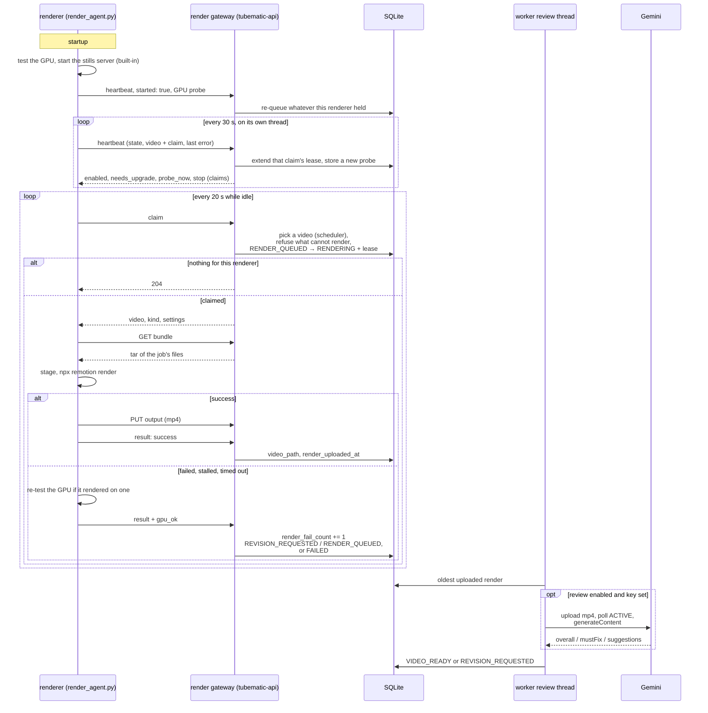

# Rendering and Review

Rendering is split across three processes, so that the one that renders is never the one that decides
what happens to the video:

| Process | Container | What it does |
|---|---|---|
| The renderer, `renderer/api/render_agent.py` | `tubematic-renderer` (the built-in renderer), and `tubematic-remote-renderer` on each [remote renderer](#remote-renderers) | Runs Remotion. It has **no database**: it asks the render gateway for work, downloads the job's files, renders, uploads the mp4 and reports how the render ended. It also tests its GPU and, built-in only, runs the Cartoon 3D stills server |
| The render gateway, `renderer/api/render_gateway.py` | `tubematic-api`, HTTPS port 4443 | Everything a renderer asks for: which video it gets, the job's files, where the mp4 goes, and what a failed render does to its video (`renderer/api/render_results.py`) |
| The worker, `renderer/api/worker.py` | `tubematic-worker` | The AI review of every uploaded render, and two backstops: a render whose renderer stopped reporting, and a GPU-only video no renderer can take. See [The Worker](12-the-worker.md) |

**Why the renderer has no database.** A renderer can be another machine. One that read SQLite would
need the database file, the jobs volume and the output volume on that machine, and every renderer
would hold every stored API key. Through the gateway a renderer holds one credential and the
gateway's certificate, sees one job's files at a time, and can move a video only by reporting on a
render it holds. The built-in renderer goes through exactly the same routes as a remote one, so the
path every remote renderer depends on is the one every install runs every day. How a remote
renderer is set up and runs is in [Remote renderers](#remote-renderers) below; the gateway's side of
enrollment is in [HTTP API — The render gateway](05-http-api.md#the-render-gateway).

The renderer runs in its own container so that a render crash or an out-of-memory kill restarts only
the renderer, leaving the API, the MCP server, the worker — and any agent session connected to them —
untouched.



---

## The renderer's loop

| Step | Symbol | Runs |
|---|---|---|
| Who it is | `_load_identity` | once, at start: the built-in renderer, or a remote one from its state file, enrolling first when it has an unused token |
| GPU test | `_run_gpu_probe` | at start, before the first heartbeat, so no render ever runs on an unverified GPU; then on request and after a render on the GPU fails |
| First heartbeat | `_beat` | at start, with `started: true`, retried every 30 seconds until it gets through. Nothing is claimed before it |
| Heartbeat thread | `_heartbeat_loop` | every `HEARTBEAT_SECS` (30) on its own thread, whatever the loop is doing |
| Stills server | `_ensure_stills_server` | built-in only, at start and every pass; see [The stills server](#the-stills-server) |
| Claim and render | `_loop_once`, `_run_job` | every pass, while the gateway says the renderer is enabled and on main's version |

The loop itself is `render_agent.py::main`. The idle poll interval is `RENDER_POLL_INTERVAL_SECS`,
default 20 seconds, a plain environment variable. A gateway that cannot be reached is never fatal:
the error is logged, sent as the renderer's `last_error` on the next heartbeat that gets through,
and the call is tried again 30 seconds later.

**The heartbeat is a thread of its own, not a step of the loop**, because a render holds the loop
for as long as it takes, and the lease on the video it renders is kept alive only by heartbeats
(below). It carries the renderer's state (`idle` or `rendering`, and which video under which claim), its version, its
compute (CPUs, memory, GPUs), its last error and any GPU probe no heartbeat has carried yet. The
reply can tell the renderer to stop a render, to test its GPU, or that it needs an upgrade.

**A renderer that runs a different version from main gets no work.** The heartbeat reply says
`needs_upgrade` and a claim answers `409 needs_upgrade`, so the renderer keeps heartbeating and
claims nothing until it is upgraded. Versions must match exactly: the scenes a video's agent wrote import
the components of main's version, and a renderer built from another version would compile them
against different ones.

## The claim

A claim is one `POST /v1/claim`. The gateway, not the renderer, picks the video:

1. It refuses a disabled renderer (`409 disabled`) and one on another version (`409 needs_upgrade`).
   **A renderer that still holds an unfinished claim** (a `RENDERING` video under its id with nothing
   uploaded) is answered that claim again — the same reply, the same claim id — and never handed a
   second video. That is what a renderer whose claim reply was lost on the network needs, and it keeps
   a renderer to one render at a time whatever it asks for.
2. It lists the `RENDER_QUEUED` videos in `ORDER BY updated_at, id` and asks the scheduler
   (`tubematic_core/renderers.py::pick_video`, below) which one this renderer should take.
3. It makes the [pre-render checks](#refused-before-anything-renders) on that video. A video they
   refuse leaves the queue with its comment and is never handed out; the claim moves to the next.
4. It claims the video with one guarded `UPDATE`: `status = 'RENDERING'`, the renderer's id, a new
   random claim id (`render_claim_id`), a lease, `render_started_at`, `WHERE id = ? AND status =
   'RENDER_QUEUED' AND archived_at IS NULL`, the renderer still enabled, and `NOT EXISTS` an unfinished
   claim of the same renderer. The `WHERE` clause *is* the lock — two renderers that picked the
   same video cannot both get it, two claims from one renderer cannot both succeed, and the loser
   simply tries again (and is then answered the claim it holds).
5. It answers with the video's id, its claim id, its kind (`dom`, `cartoon_3d` or `mascot`), whether it needs the
   GPU, its frame count, the lease length, and the render settings: `render_timeout_secs`,
   `render_stall_timeout_secs` and the watermark. **The renderer reads no settings**; each claim
   carries their values at the moment it was made.

For the built-in renderer the same `UPDATE` also refuses while the settings row
`render_claim_hold_until` holds a time still in the future. `onboard.py --step gpu` writes it before
it looks for a running render and clears it once it has recreated the renderer. Looking first and
recreating second would otherwise let a render be claimed in between and then killed. SQLite has a
single writer, so a claim either committed before the hold (and the look sees it) or sees the hold
(and does not happen). The time is a ceiling of ten minutes, so an onboarding run that dies holding
it delays renders, never stops them. The row is shared, so two overlapping runs would release each
other's hold; a lock file next to the database (`.gpu-recreate.lock`) lets only one run recreate at a
time, and the other defers. The hold applies to the built-in renderer only, because the GPU step
recreates only that container.

Queue order is FIFO on `updated_at`. **Anything that writes `updated_at` changes render order**,
which is why the publishing poll (where it exists) deliberately keys its own timeouts off a different
column.

### Which renderer gets which video

With one renderer the scheduler hands it the oldest video it may take. With several it weighs who
would finish first:

- **It skips a video this renderer may not take**: a GPU-only video (Cartoon 3D, or one with a
  mascot — `renderers.py::requires_gpu`) goes only to a renderer whose last GPU test passed. A
  scene-config whose scene is a Cartoon 3D world counts as Cartoon 3D too, so an `auto` video that
  resolved to the style is GPU-only from the moment its scene-config is written.
- **For each candidate it estimates every eligible renderer's finish**: the time until it is free
  (its estimate for the render it holds, minus the time already spent) plus its estimate for this
  video. Eligible means enabled, on main's version, online (a heartbeat within `ONLINE_SECS`, 120
  seconds) and, for a GPU video, GPU-verified. The caller counts as online and free — it is calling,
  and it only claims when idle.
- **The caller gets the video if its finish is within `FINISH_TOLERANCE` (1.25×) of the best**, or
  if the video has waited longer than `STARVATION_SECS` (600 seconds). Otherwise the scheduler
  moves to the next video. So a slow machine never takes a job a much faster one would finish
  sooner, and still no video waits forever for the fast machine.

An estimate (`estimate_secs`) is the median seconds per frame of that renderer's last five renders of
the same kind, from `render_timings`, times the video's frames. A median, so one render that stalled
and was retried does not make a machine look slow for the next five jobs. A renderer with no timings
of that kind uses a prior: 0.25 s a frame on a verified GPU, else 1.5 s a frame scaled by its core
count around a four-core machine. One render runs at a time per renderer.

### Refused before anything renders

These checks used to run after a render was claimed. They run inside the claim now, so a video that
cannot render is never handed out, and the statuses and comments are the ones they always were:

- **A video whose id, or whose project's id, cannot be used as a path goes straight to `FAILED`**,
  before anything is staged — a project id such as `..` would put the output outside
  `/output_videos`. A revision cannot fix an id and a retry would only refuse again, so neither is
  attempted. A legacy project id with a dot is fine; only one that would leave the output directory
  is refused. A symlink in place of a job file, or anywhere on the way to it (the video's job
  directory, `images/`, the project's output directory), is refused the same way.
- **A missing job file goes to `REVISION_REQUESTED`** with a comment naming it: `audio.mp3`,
  `timeline.json` or `scene-config.json` is not in the job directory, or its path column is still
  empty because that step never finished. Images are optional and are not part of that check.
- **A Cartoon 3D video that also holds a mascot, and a mascot video whose pinned drawing code cannot
  be read, go to `FAILED`** — see [Videos that render on the GPU only](#videos-that-render-on-the-gpu-only).

**The sources are derived from the video's id, never read from its path columns**
(`tubematic_core/jobfiles.py`). Those columns were once writable through `PATCH` and `update_video`,
so a row could name any file the renderer can read and have it copied into a render; a row tampered
with before that was closed now simply renders the video's own files. The columns still say whether
each step completed. The video's id is checked as a single path component, not against the rule
for a new id, so a video filed earlier under an id such as `a.b`, or one longer than the 128
characters a new id may have, still renders, while one that would leave the jobs directory (`..`,
`a/b`) moves to `FAILED` with nothing staged. See [`videos`](03-database.md#videos) for the one race
these checks leave open.

## Retention

Rendered videos and their job directories (audio, timeline, scene config, images) are kept until
something deletes them. The retention sweep does that for **published** videos, `retention_days`
(default 7, see [Settings](../user-guide/05-settings.md#video-retention)) after they were published. If
`unpublished_retention_days` is set (default 0, off), it does the same for **failed and rejected**
videos that many days after they last changed. Either way it removes the mp4 and the job directory,
clears `video_path`, and sets `archived_at`. The status is left as it was. The row is kept, and so are
its comments, publication links and analytics — the dashboard's Archive page lists them. The same
operation backs the dashboard's Delete action (`DELETE /videos/<id>`, see
[HTTP API](05-http-api.md#videos)), so "delete" means one thing everywhere.

It is a pass of the worker (`worker.py::_sweep_retention`, in `tubematic-worker`, see
[The Worker](12-the-worker.md)), not of the renderer, so a render never delays it. It lives in a
continuously running process because it needs both database and filesystem access; the cron poller
deliberately has no database access. Decisions that look arbitrary and are not:

- **Unpublished output is swept only when you ask for it.** A video that ages out unpublished still
  holds an mp4 that cost real ElevenLabs and render time, and losing it would be unrecoverable. So
  `FAILED` and `TOPIC_REJECTED` have their own key, off by default, instead of sharing
  `retention_days`, which covers output a human has already seen published. Every other status is
  never swept. **Settings → Retention** shows how many such videos there are and what they hold
  (`GET /retention/backlog`), because nobody turns on an opt-in they cannot see a reason for.
- **Their clock is `updated_at`.** A failed or rejected video has no better timestamp, and its
  `updated_at` is when it last moved.
- **A rejected video is not assumed to be file-free.** The dashboard only rejects a video at
  `TOPIC_PROPOSED`, but a direct `PATCH` can reject one at any stage, with its mp4 still on disk.
  Every eligible row is archived, including one that never had files. That moves an old rejected
  topic from the board's Rejected column to the Archive, and the comment says "any" files were
  deleted.
- **There is no "delete" route through `TOPIC_REJECTED`.** Deleting a failed video from the
  dashboard already archives it directly. Rejecting it instead would mark it as a topic a human
  turned down. Mining shows Gemini the 200 most recent videos as already covered, so the label
  matters: `TOPIC_REJECTED` has to keep meaning "a human did not want this", not "this broke".
- **Archived videos still count as covered for mining.** That query filters neither status nor
  `archived_at`, and that is deliberate: a deleted or swept video was still proposed once, and
  proposing it again would bring the churn back.
- **The two passes are independent.** Setting either key to 0 turns off its own pass only. They
  share one hourly stamp.
- **A retry or an edit racing the sweep wins.** `archive_video` checks both the status and the
  cutoff inside its own `UPDATE`. A video retried out of `FAILED`, or edited (which restarts its
  clock), between the sweep's `SELECT` and the archive is therefore left alone.
- **The clock is `MAX(video_publications.published_at)` over successful publications**, not
  `created_at` — age since the topic was proposed says nothing about how long the file has sat
  unused. A second platform published yesterday resets it.
- **`published_at` is `NOT NULL DEFAULT ''`**, and `''` sorts before any timestamp, so the query
  filters it out explicitly. A published video with no usable publish time is never swept.
- **Hourly, with a settings-row stamp** (`last_retention_sweep_at`), the same pattern as the metrics
  pass, so a frequently restarted container does not sweep on every start.
- **It never raises.** The worker's loop has no error handling of its own, and an escaping exception
  ends every other pass with it, publishing included. Errors are logged per video and the pass moves
  on.

`python scripts/cleanup_jobs.py` is the manual complement: it frees job directories only, keeping the
mp4, for anything you want to reclaim earlier.

## Leases, restarts and lost renderers

A claimed video is held by a **lease**: `videos.render_lease_until`, set to `LEASE_SECS` (300
seconds) from the claim. Each heartbeat from the renderer that holds it, while it reports that video
**and that claim id** as the one it is rendering, extends the lease by the same amount. A renderer
that went idle never keeps a lease alive, and neither does a heartbeat for an earlier claim of the
same video: one sent while the renderer was still on claim A, delayed until A had been re-queued
and the video claimed again as claim B, leaves B's lease alone.

**Every claim has its own id.** The claim reply carries `claim_id`, a random id the gateway stores in
`videos.render_claim_id`, and the renderer names it on the bundle, the upload and the result (the
`X-Render-Claim` header). Each is refused (`403 not_lease_holder`) unless the caller holds that very
claim, so a renderer that lost its lease cannot touch the claim that took the video over — even when
the one that took over is the same renderer, claiming the video again, which a renderer id alone
could not tell apart. Two moments matter because a lease can run out while a request is in flight:

- **An upload is checked again before it lands.** The body streams into a temporary file; then, in one
  write transaction, the gateway checks the claim still holds and renames the file into place. If the
  claim was lost meanwhile the file is discarded and the upload answered `409 claim_lost`, so a slow
  upload can never replace the mp4 a newer claim already delivered.
- **A failure result moves the video only while its claim holds.** The retry count, the status change,
  the comment and the release of the claim are one transaction guarded on `status = 'RENDERING'`, the
  renderer and the claim id (`render_results.py::_claim_guard`). A result whose claim was lost between
  the gateway's check and the routing changes nothing at all.

There are three ways a held render ends without a result, and each re-queues the video the same way
(`render_results.py::requeue_interrupted`): `render_fail_count` goes up by one and the video goes
back to `RENDER_QUEUED`, or to `FAILED` once the count passes `max_render_retries`. **A lost render
counts as a failure**, which matters with the default cap of 1: two interruptions across one video's
life will escalate it. Without the count, a render that reliably kills its renderer (an
out-of-memory) would loop for ever and never reach the `FAILED` backstop.

| How | Who notices | Comment |
|---|---|---|
| The renderer's process restarted (a crash, a container restart, `--step gpu`) | The gateway, at the restarted renderer's first heartbeat, which carries `started: true` | "Render interrupted by renderer restart — automatically re-queued." |
| The renderer stopped heartbeating (a host switched off, a network gone, or the renderer removed on the dashboard, after which its heartbeats get `401`) | The worker's lease sweep, once the lease has run out | "Render lost: <renderer> stopped reporting — automatically re-queued." |
| A render was in flight across the upgrade that introduced the gateway (the row has no renderer) | The worker's lease sweep, on its first pass | "Render interrupted by the upgrade — automatically re-queued." |

Past the cap the comment's first part is kept and ends "N times (limit M) — giving up."

**Re-queue only when it is known the render is gone.** A restarted renderer says so itself in its
first heartbeat, so its renders are re-queued at once instead of waiting out the lease; the renderer
claims nothing until that heartbeat has gone through. A renderer that never comes back says so by
its silence, which is what the lease measures. A restart of the worker or the API says nothing about
a render still running, so neither re-queues anything on its own start. The lease sweep's `UPDATE`
re-checks that the lease is still past, so a heartbeat that extended it after the sweep looked wins.

**An uploaded render is never re-queued.** Once its mp4 has arrived the video is the review's, and
re-rendering it would throw a finished render away.

**The gateway can stop a render.** The heartbeat reply's `stop` list names, as `{video_id, claim_id}`
pairs, every claim this renderer reports or holds that no longer holds its video: archived, moved by
a human, or re-queued because its lease ran out. The renderer kills that render's process group and
discards it without a result. **A stop names a claim, not a video, and the renderer applies a reply
only to the job its request reported** (the `_Job` the heartbeat thread read before sending), never
to whatever job is current when the reply arrives. Without both, the delayed heartbeat above would
stop claim B: the reply says "vid-1 is over", and vid-1 is what the renderer is rendering again by
then. Each retry burnt that way counts towards `max_render_retries`, so a slow network at that
moment could fail a healthy video.

## The bundle, staging and the render call

A renderer gets a job's files as one **bundle**: `GET /v1/jobs/<video_id>/bundle` answers an
uncompressed tar, streamed one chunk of one file at a time, so neither side ever holds a whole job in
memory. Its members are:

| Member | When |
|---|---|
| `audio.mp3`, `timeline.json`, `scene-config.json` | always |
| `images/**` | when the video has generated images |
| `cartoon/source.json` | a Cartoon 3D video: the fingerprint of the source `submit_render` queued |
| `cartoon/audio/mix/mix.wav` | a Cartoon 3D soundtrack, only when it is at least as new as `audio.mp3` |
| `mascot.js` | a mascot video: the pinned version's drawing code |
| `scenes/<video_id>/**` | the video's generated scene tree |
| `scenes/_flat/<name>.tsx` | each legacy flat generated scene its scene-config names |

Every file keeps its modification time, which is what lets the mix-versus-voice comparison still
mean what it did. The gateway never follows a symlink: a job file that is one makes the bundle
unavailable (`409`), and one inside `images/` or a scene tree is skipped. The renderer unpacks it
into a job directory of its own, `/tmp/tubematic-render/<video_id>/` (`TUBEMATIC_RENDER_TMP`),
refusing a member whose name is absolute, holds `..`, is not one it expects, or is not a regular
file, and creating every file fresh.

Remotion serves assets from its `public/` directory, so the renderer then copies the job into
`/app/remotion/public/<video_id>/` (symlinks inside `images/` are skipped, because `copytree` would
otherwise copy whatever they point at). Where the scenes come from depends on the renderer:

- **The built-in renderer ignores the bundle's scenes.** It mounts the shared
  `src/scenes/generated/` volume the agent writes, and compiles that tree, as renders always did.
- **A remote renderer stages them into its own image's `src/scenes/generated/`**, and empties that
  directory before and after every job, because Remotion compiles every file under it into every
  render: a scene left from another job could break or leak into the next one. It refuses to empty
  a mounted directory, so it can never clear a shared tree.

```
npx remotion render Composition /tmp/tubematic-render/<video_id>/output.mp4 \
    --props '{"sceneConfigPath": …, "timelinePath": …, "audioPath": …, "watermark": …}' \
    --browser-executable-path /usr/bin/chromium
```

`watermark` is the `watermark_enabled` setting, carried by the claim. It travels as a render prop and
not inside `scene-config.json` because the agent writes that file — see
[Watermark](09-remotion-project.md#watermark).

It is launched with `start_new_session=True`, which puts npx, node, Chromium and ffmpeg in one
process group.

**The finished mp4 is uploaded, not written into the library.** `PUT /v1/jobs/<video_id>/output`
streams it from disk; the gateway writes it to a temporary file in its own directory on the output
volume, `<output>/.gateway-uploads/`, flushes it to disk and renames it to
`<output>/<project_id>/<video_id>.mp4`, so a reader never sees half a video. The temporary files
never sit beside a video, so nothing that lists a project's videos meets one, and the gateway clears
the leftovers a crash mid-upload leaves there when it starts (see
[Infrastructure](16-infrastructure.md#tubematic-api)). An upload is at most `TUBEMATIC_MAX_OUTPUT_BYTES` (default 8 GiB, set in
`tubematic-api`'s environment): a larger `Content-Length` is refused with `413 output_too_large` before
anything is read, and a body sent without one (chunked) is counted as it arrives and abandoned, its
temporary file deleted, the moment it passes the limit. A renderer's body is untrusted input, and the
output volume is the one the database lives on.

A size limit per request bounds one upload, not the disk: parallel uploads would each write up to it
before any reached the final claim check. So the gateway also bounds what is in flight:

- **One upload at a time per claim.** A second `PUT` for a claim whose first upload is still
  streaming (a renderer retrying one it gave up on) is refused with `409 upload_in_progress`.
- **`TUBEMATIC_MAX_CONCURRENT_UPLOADS` (default 4) at once in all.** Past it, `503 busy` with
  `Retry-After`. Only one claim per renderer exists, so this caps the temporary files across every
  renderer.
- **A free-space floor, `TUBEMATIC_MIN_FREE_BYTES` (default 2 GiB).** An upload whose declared size
  would leave less than that free on the output filesystem is refused with `507 insufficient_storage`,
  and the free space is checked again every 64 MiB as the body streams (a chunked body declares
  nothing, and the disk is shared), which abandons the upload and deletes its temporary file.

The first two are decided before the body is read or a temporary file made; the slot is released
however the upload ends, a stalled one included: a body that stops arriving for 60 seconds ends the
upload with `408 body_timeout` (see [the gateway's time bounds](05-http-api.md#time-bounds)). An
upload has no total deadline, because a long video over a slow home link is a legitimate reason for a
long upload.

The renderer treats the two kinds of answer differently:

- **A failure is tried three times.** A network error, or any answer not listed below, counts as a
  failed attempt; after the third the render is reported as an `error` (the video goes back to the
  queue).
- **`409 upload_in_progress` and `503 busy` are not failures.** They mean "wait": every slot is held
  by other renders' uploads, or the gateway is still receiving this claim's earlier attempt. The
  renderer waits the `Retry-After` the gateway asks for (at most 60 seconds) and tries again, for up
  to two hours (`render_agent.py::UPLOAD_WAIT_SECS`), without spending an attempt. Its heartbeat keeps
  the lease alive meanwhile, and a heartbeat that stops the job, or an upload answered `403` because
  the claim was lost, ends the wait. Counting these as failures would turn ordinary contention — four
  multi-hundred-megabyte uploads over home links hold every slot for minutes — into a discarded
  render and a spent render retry, and repeated contention into a `FAILED` video.
- **`413` and `507` are not tried again** and are reported as the render's error; a `403` or
  `409 claim_lost` throws the render away. Then it reports the result. A result's `error` is cut to its first 8,000
characters (`render_agent.py::RESULT_ERROR_CHARS`) so the body fits the gateway's 64 KiB JSON limit;
the comment it becomes keeps far fewer. The job directory, the staged `public/<video_id>/` and (remote) the staged scenes
are removed however the job ended.

### The result

`POST /v1/jobs/<video_id>/result` says how the render ended:

| `outcome` | Sent when | The gateway |
|---|---|---|
| `success` | Remotion exited 0 and the upload landed | Records `video_path` and `render_uploaded_at`, a `render_timings` row (frames, seconds, on the GPU or not) and releases the lease. The [AI review](#ai-review) finishes the video |
| `failed` | Remotion exited non-zero | `REVISION_REQUESTED` |
| `stalled`, `timeout` | The render stopped advancing, or ran past the ceiling | `RENDER_QUEUED` |
| `error` | Anything else: the bundle could not be fetched, the renderer raised | `RENDER_QUEUED` |

A failure goes through `render_results.py::after_render_failure`, which counts the retry and posts
the error as the comment ("Render failed: …", capped at 2000 characters). A `success` whose mp4 is
missing or empty is routed as an `error`. A result is retried three times; one that never arrives is
left to the lease, whose expiry re-queues the video. A result for a claim the renderer no longer holds
is dropped and logged — refused (`403`) when the claim was lost before it arrived, a no-op when it
was lost while the result was being routed (see [Leases](#leases-restarts-and-lost-renderers)).

**A render that cannot run at all is that video's error, not the renderer's exit.** `_run_job` is the
per-video boundary: whatever escapes the download, the staging or the render (no `npx`, a full disk,
a bug) is reported as `error` ("The renderer hit an error: …") and requeued, so a row never stays
`RENDERING` with the renderer gone.

## The GL renderer

Chromium draws every frame, and WebGL (three.js scenes, and Chromium's own compositing) needs an
OpenGL implementation. There are two paths, and each renderer picks one per render from its own GPU
test.

**The CPU path is the default**, set in `renderer/remotion/remotion.config.ts`:
`setChromiumOpenGlRenderer("swangle")`, ANGLE over SwiftShader. It works on any machine, which is
why it is the file's setting and not the renderer's. The render command above is exactly what runs.

> **`--browser-executable-path` is not a Remotion flag.** The CLI's flag is `--browser-executable`,
> and an unknown flag is ignored, so a CPU render does not use the image's Debian Chromium: it uses
> the headless shell Remotion downloads into the container on its first render. That has always
> been so, and the CPU path is left exactly as it was. The GPU path names the browser with the real
> flag.

**The GPU path** adds five settings, from `render_agent.py::_gl_options` (`_gl_args` turns them into
flags):

| Setting | Why it is needed |
|---|---|
| `--browser-executable=/usr/bin/chromium` | The image's Debian Chromium, which reaches the GPU with nothing to download. Without it Remotion downloads its own Chrome for Testing (about 177 MB) on the first GPU render |
| `--gl=angle-egl` | Hardware OpenGL through EGL. The other values Remotion accepts either fail to get a context in the container or stay in software |
| `--chrome-mode=chrome-for-testing` | With a named browser this only switches it to `--headless=new`. In the old headless mode a single tab gets a GPU WebGL context but several tabs at once cannot (`BindToCurrentSequence failed`), so a real multi-tab three.js render fails in every tab |
| `--enable-multiprocess-on-linux` | Already Remotion's default in 4.x. Stated so a default change cannot put Chromium in `--single-process`, which disables its GPU process |
| `__EGL_VENDOR_LIBRARY_FILENAMES=/usr/share/glvnd/egl_vendor.d/10_nvidia.json` | Points libglvnd at NVIDIA's EGL. Without it EGL may load another vendor's (Mesa's is in the image), and the render succeeds on the wrong device |

**None of these is ever used on the CPU path.** New headless rendering in software is about five
times slower than old headless rendering, measured on a 2D scene.

How the GPU reaches the container is the Compose override written by the `gpu` onboarding step
([Infrastructure](16-infrastructure.md#gpu-override)). That override also sets
`TUBEMATIC_GPU_UUID` and `TUBEMATIC_GPU_NAME`, which is how the renderer knows a GPU is meant to be
there.

### The probe decides, never the configuration

Being configured is not the same as working. A driver update, an old Container Toolkit, or a hand-run
`docker compose up` that skipped the override all leave the container believing in a GPU that
Chromium cannot use, and **a render on the wrong GL device still succeeds**, only several times
slower. So nothing about a finished render counts as evidence.

`render_agent.py::_run_gpu_probe` renders one still of the `GpuProbe` composition through a small Node
driver, `renderer/remotion/gpu-probe/run-gpu-probe.mjs`, given exactly the options and environment
`_gl_options` gives a render. The composition creates a WebGL context, reads
`WEBGL_debug_renderer_info`'s unmasked renderer string and prints it on a tagged console line; the
driver catches that line through Remotion's `onBrowserLog` and writes it to a JSON file, never to
stdout, which Remotion fills with page output. It is a driver and not `npx remotion still` because
the CLI never passes a still's page console output on, so the answer could not get out. The Node API
does not read `remotion.config.ts`, which is why the CPU options spell out `swangle` (a test pins
them to the config file). `_judge_probe` passes it only if the string names NVIDIA **and** the configured GPU,
so SwiftShader, Mesa/llvmpipe and an integrated GPU all fail. The renderer renders on the GPU only
while its last probe passed (`_render_on_gpu`); otherwise it takes the CPU path.

- **It bundles its own entry point**, `src/gpu-probe/index.ts`. The main entry bundles every
  agent-written scene, and one broken scene fails the whole bundle, which would then read as a broken
  GPU.
- **It runs once at startup, before the first claim**, so no render ever runs on an unverified GPU,
  and every container start (which is when a GPU change applies) leaves a fresh answer.
- **It runs again after a render on the GPU fails, stalls or times out**, before the result is sent,
  and the result carries the answer as `gpu_ok`. If the GPU is what broke, the gateway stops sending
  this renderer GPU work and its next render falls back to the CPU, instead of failing the same way;
  a GPU-only video goes to `FAILED` (see [Videos that render on the GPU only](#videos-that-render-on-the-gpu-only)).
- **It runs on request**: `POST /renderers/<id>/gpu-test` (the dashboard's **Test GPU** on a
  renderer's card; `POST /render/gpu/test` for the built-in one) stamps that renderer's
  `renderers.gpu_probe_requested_at`, and the next heartbeat reply says `probe_now` while that stamp is
  newer than the last probe's start. Both stamps carry microseconds, because they are compared as
  strings. The renderer probes between renders, so the request waits behind a render in progress, and
  `GET /renderers` reports it as pending meanwhile.
- **It runs on a CPU-only renderer too**, with the CPU path, so the probe records what Chromium gets
  there (SwiftShader).
- **It never raises.** A probe that cannot start, times out (180 s, with the same process-group kill
  as a render) or writes no answer reports a failed result with the reason.

**The result travels in the heartbeat.** The renderer keeps it until a heartbeat (or a result) has
carried it; the gateway stores it in that renderer's row as `renderers.gpu_probe`, the same JSON shape
for every renderer, and sets `gpu_verified` exactly when the probe's `ok` is true. The API container
has no GPU and no override, so it never guesses: every GPU gate reads the renderers table.

- **"The install has a working GPU" means some renderer does.** `tubematic_core/renderers.py::gpu_status`
  answers `working` while any enabled renderer is GPU-verified, `unknown` while an enabled renderer has
  not probed yet, `not_usable` while one has a GPU configured whose probe failed, and `not_configured`
  otherwise. Those are the values the gates already used (`pipeline.py::gpu_probe_status` reads one
  probe the same way), and the Cartoon 3D and mascot gates in the API and the MCP server
  (`_cartoon3d_gpu_error`, `mascot_gpu_error`) read this aggregate. A gate that looked only at the
  built-in renderer would refuse a style another renderer can render.
- **`GET /render/gpu` describes the built-in renderer** for every field but `status`: its probe, its
  configured GPU, its Test request — the built-in renderer is the only one onboarding's `gpu` step
  configures. The dashboard's Renderers panel shows every renderer's probe from `GET /renderers`
  instead ([HTTP API — Renderers](05-http-api.md#renderers)). `upgrade.py --check` and
  `scripts/service.py status` read the built-in renderer's row (`onboard/gpu.py::report_lines`).

The text-layout audit stays on `swangle` whatever the install has. It runs in the MCP container,
which never gets a GPU, and it measures text, which comes out the same on either path.

### The timeout, and why it is more than a kill

Two settings bound one render. `render_stall_timeout_secs` (default 600) is the one that matters: the
renderer reads Remotion's progress counters (`Bundling N%`, `Rendered N/M`, `Encoded N/M`) from the
render's own output as it runs, and a render whose count stops advancing for that long is judged
hung, whatever its style or length — the number must advance, since real logs repeat a line.
`render_timeout_secs` (default 10800) is the absolute ceiling, for a render that advances
pathologically slowly. On either the renderer:

1. `SIGKILL`s the whole **process group** — one signal reaches every descendant.
2. Reaps the direct child.
3. Runs a non-blocking `waitpid(-1, WNOHANG)` loop until no child but the stills server is left
   (`_kill_group_and_reap`).

Step 3 is the non-obvious one. The moment their parent dies, the SIGKILLed grandchildren reparent to
the renderer process — which is PID 1 in its container — and reaping the direct child by PID cannot
touch them. Without the wildcard loop they become permanent zombies. This was observed, not
theorised. It polls rather than blocks because the stills server is a long-lived child too: a
blocking wait on any child would sit on the healthy stills server forever.

**Do not copy this pattern into the MCP server.** The loop is safe here only because the renderer
runs one render subprocess at a time, and its one other thread, the heartbeat, starts none (it only
kills the current render's group when the gateway says stop). The MCP server is multi-threaded with concurrent
subprocess users, where a wildcard reap can steal a different call's child; it uses the process-group
kill alone. The general lesson: a reaping strategy relies on a concurrency invariant, and moving it
to a different concurrency model breaks it silently.

### Logs

The renderer captures the render's stdout and stderr, logs failures to its own stdout
(`docker compose logs tubematic-renderer`, every line prefixed `[renderer]`, and the `renderer`
service on the dashboard's Logs page), and sends the error with its result; the gateway writes it,
capped at 2000 characters, into the video's comment thread. There is no persisted full-text render
log. The gateway's side — claims, refusals, uploads, a renderer that needs an upgrade or was told to
stop — is in `tubematic-api`'s log. Problems that are the renderer's rather than one video's (a
gateway it cannot reach, a refused credential) are logged and also sent as its `last_error`, stored
on its row in `renderers`.

A remote renderer's log stays on its own machine: it has no `/logs` mount, so the JSONL file the
built-in renderer writes for the dashboard's Logs page is not written, and its lines are in
`docker logs tubematic-remote-renderer` there. Its `last_error`, on its row, is what main sees.

## Remote renderers

A remote renderer is `render_agent.py` in the same backend image, run as one container,
`tubematic-remote-renderer`, on another machine. It is the built-in renderer minus four things: it
has no `/jobs` volume (so no stills server), no shared generated-scene volume (it stages each job's
scenes from the bundle — [above](#the-bundle-staging-and-the-render-call)), no
`builtin_renderer_token`, and no copy of the gateway's certificate. What it has instead is a state
volume, `tubematic-renderer-state` at `/state` (`TUBEMATIC_RENDERER_STATE`), holding
`renderer.json`, mode 0600.

**Who it is: `render_agent.py::_load_identity`.** With `TUBEMATIC_RENDERER_BUILTIN` unset it reads
the state file. On the first start the file holds no credential and `TUBEMATIC_ENROLL_TOKEN` holds a
token, so it enrolls (`render_agent.py::enroll`): fetch the certificate with a bare handshake,
refuse it unless its sha256 is the token's pin, `POST /v1/enroll`, and write the credential, the
certificate, the pin, the gateway URL, a `machine_id` and the hash of the token's secret
(`enrolled_with`) into the state file. The host script then recreates the container without the
token (below), so a later start normally sees none; when one is still set (a container started by
hand), its secret's hash matches `enrolled_with`, so it is ignored and the saved credential is used
— a used token would be refused anyway. A different token re-enrolls the same
machine (same `machine_id`); if that fails while a usable credential is saved, the renderer carries
on with it. With neither a credential nor a token it cannot start, and retries every
`ENROLL_RETRY_SECS` (60), logging why. `TUBEMATIC_GATEWAY_URL`, when set, overrides the saved
address; the host script always sets it to the one it was installed with.

**What it reports.** Its enrollment and every heartbeat carry its compute
(`render_agent.py::_compute_report`: CPU count, `MemTotal`, and every GPU `nvidia-smi` lists inside
the container), its version and its name (`TUBEMATIC_RENDERER_NAME`, else the container's host
name). The scheduler's prior for a renderer with no timings reads that compute.

**Rotation.** A rotated credential from a heartbeat reply is written to the state file before it is
used (`RemoteIdentity.save_rotated`), so a crash between the two never leaves it holding a
credential the gateway does not know. When the gateway answers `401 credential_expired` the
renderer logs and reports `credential expired: …`; it cannot recover on its own.

**The log lines the host script waits for.** `scripts/tubematic_remote_renderer.py install` and
`upgrade` watch the container's log for up to 60 seconds for `enrolled` or `first heartbeat` (success;
for `install` this is also the moment the token-bearing container may be replaced),
`enrollment_invalid` or `credential expired` (refused), and `needs upgrade`. Those words are a
contract between the two files, kept in `render_agent.py`'s log calls with a comment saying so.

### The host script

`scripts/tubematic_remote_renderer.py` is what an operator runs on the remote machine: `install`,
`upgrade`, `remove` and `status`, documented for users in
[Remote renderers](../user-guide/11-remote-renderers.md). It is **standard library only**, Python
3.10+, because that machine has no checkout and nothing installed but Docker; a test fails the build
if it imports anything else. It is shipped twice: in the release tarball's `scripts/`, and as a
release asset of its own covered by the release's `CHECKSUMS.txt`
([Releases](18-releases.md#what-a-release-consists-of)).

- **The pin is checked before anything is sent.** `fetch_pinned_cert` reads the certificate with
  `ssl.get_server_certificate` and compares its sha256 with the token's pin; only then is
  `GET /v1/version` read, over a context that trusts that certificate alone. A wrong address, a
  TLS-terminating proxy or an impostor gets a TLS handshake and nothing else.
- **The image is main's version**: `ghcr.io/<owner>/tubematic-backend:<version>`, the owner hardcoded
  from `tubematic_core.version.GITHUB_REPO` (the script cannot import it; a test pins the two) and
  overwritten by the release workflow with the owner that release pushed its images under, before
  the tarball and the asset are built from it — so a fork's renderers pull the fork's image, not
  upstream's of the same version ([Releases](18-releases.md#what-a-release-consists-of)), or
  `--image`. `upgrade` reads the version again, so a remote renderer follows main only when its
  operator runs it.
- **The container is the composed renderer's twin**: the same command, `shm_size` 2g and
  `PUPPETEER_EXECUTABLE_PATH`, `--restart unless-stopped`, and with a GPU `--gpus device=<uuid>` plus
  the environment `onboard/gpu.py`'s override gives the built-in renderer
  (`NVIDIA_DRIVER_CAPABILITIES=graphics,utility`, `TUBEMATIC_GPU_UUID`, `TUBEMATIC_GPU_NAME`,
  `TUBEMATIC_HOST_GPUS`). Tests pin each against its source.
- **The token never touches a command line or a file, and does not outlive enrollment.** The
  dashboard's command is a bare `install`; the script reads the token with `getpass` (or one line of
  stdin with `--token-stdin`; `--token <value>` is refused before anything is sent — declared, so
  argparse does not read it as an abbreviation of `--token-stdin`), because a command line is readable
  by every user of the machine (`ps`, `/proc/<pid>/cmdline`) and kept in shell history while the
  token stays redeemable for an hour. `docker run` gets a bare `-e TUBEMATIC_ENROLL_TOKEN`, so Docker
  copies the value from the script's own environment — but Docker then stores it in the container's
  configuration (`docker inspect`). So `install` runs that container with `--restart no` only until
  the log shows the renderer has enrolled (`enroll_container`), removes it, and starts the real one
  from the same argv minus the token, `--restart unless-stopped`. Any other outcome (refused, the
  container stopped, no sign within 60 s, a failed `docker run`, Ctrl-C) removes the token-bearing
  container (`discard_enrollment`) and the state volume too, unless an earlier install left it. The
  local state file, `~/.tubematic-remote-renderer.json` (0600), holds the gateway URL, the pin, the
  image, the name and the GPU choice. `upgrade` recreates the container without the token, from that
  file, keeping the state volume and therefore the credential.

## The stills server

The MCP container's Cartoon 3D tools (`cartoon_beat_gate`, `cartoon_still`) need stills of a
video's composition, and the built-in renderer's is the one container on this machine with the GPU.
So the built-in renderer (only it: a remote renderer has no `/jobs` volume) runs
`renderer/remotion/cartoon-tools/stills-server.mjs` as a child process beside its renders: the
project is bundled once, one Chromium stays open, and a still takes a few seconds instead of the
25 to 30 seconds a cold software-GL still costs in the MCP container. It is started with exactly
the GL options a render gets (`_gl_options`), so a passing GPU test moves it onto the GPU and a
failing one moves it back, and it serves the shared `/jobs` volume (mounted read-only) as its public directory, so a
video's files are `/public/<video_id>/…` to the composition with nothing copied. It listens on
`TUBEMATIC_STILLS_PORT` (4455) on the Compose network only and is never published; the MCP
container reaches it as `TUBEMATIC_STILLS_SERVER`, and when it does not answer the tools render
their stills locally instead. Renders and stills share the GPU; the server renders one still at a
time. `_ensure_stills_server` starts it at startup and checks it every tick: it starts it again
when it has died (at most once a minute) or when a GPU test moved renders between the GPU and the
CPU, and does nothing when `TUBEMATIC_STILLS_PORT` is unset (Compose sets it). It is also why the
reaper that follows a killed render (`_kill_group_and_reap`) drains the killed group's orphans
without blocking — see [the timeout](#the-timeout-and-why-it-is-more-than-a-kill). The generated
source tree (`src/scenes/generated/`, the agents' per-video TypeScript) is part of the bundle, so before
every still the server compares a stamp of that tree (every file's path, size and mtime) with the one its
bundle was made from and re-bundles when it differs: an edit to a video's code is seen by its next still
(about twenty seconds, once), an unchanged tree costs a directory walk.

## Videos that render on the GPU only

A Cartoon 3D video and a video with a mascot are both **GPU-only by policy**, not because the CPU path
cannot draw them: a mascot adds about a tenth of a second of drawing to every frame, which on software
GL would turn a 90-second Short into hours. The choice is refused where it is made (the dashboard, the
API and the MCP server) unless some renderer's GPU test passed, so everything below is for a video
approved *before* the GPU stopped working.

**Such a video is only ever handed to a renderer whose last GPU test passed.** Waiting for one is
bounded by the worker's GPU-wait sweep (`worker.py::_sweep_gpu_waits`):

- **No GPU-capable renderer at all** (none enabled with a passing test, online or not): the video goes
  to `FAILED` at once.
- **One exists, but none is online and on main's version**: the video waits up to `GPU_WAIT_SECS`
  (30 minutes) from when it was queued, then goes to `FAILED`.
- **An enabled renderer has not tested its GPU yet**: the video waits as if a GPU renderer were
  offline, rather than failing at once. This is deliberate. Right after an upgrade or a renderer
  restart the built-in renderer's row has no probe yet (the probe runs at start and arrives with the
  first heartbeat), so for those minutes no renderer counts as GPU-capable even on a machine whose GPU
  works; failing every queued GPU video then would throw away work the renderer is about to take. The
  wait is still capped by `GPU_WAIT_SECS` from when the video was queued, so an install with no
  working GPU fails it at most 30 minutes later, with the same comment.

`FAILED` bypasses `max_render_retries` and is terminal: a requeue would fail the same way, and sending
the video to `REVISION_REQUESTED` would hand it to an agent that cannot repair a GPU. So the comment is
the only thing the human gets, and it names every renderer and its state
(`renderers.py::gpu_unavailable_reason`: "offline since …", "needs upgrade", "disabled", "GPU test
failed: …"). The video is created again once the GPU works.

**The GPU can also stop working during such a render.** When a render on the GPU fails, stalls or
times out, the renderer re-tests the GPU before it reports. If the re-test fails, the gateway moves a
GPU-only video straight to `FAILED` with the same comment plus the render's error
(`render_results.py::after_render_failure` → `fail_without_gpu`), again without spending a retry or an
agent session. If it still passes, the failure is the video's own and takes the usual path. An
ordinary video takes the usual path either way, and its retry can fall back to the CPU. A renderer
handed a GPU-only video whose GPU no longer passes when it starts re-tests too; if the test still
fails it reports an error, which re-queues the video (counting a retry) and marks that renderer's GPU
unverified, so the video goes to another GPU renderer or, if there is none, the GPU-wait sweep fails it.

A mascot video is rendered with the version pinned in `videos.mascot_version`, never the mascot's
current approved version. The gateway reads that version's code (`tubematic_core/mascots.py::code_for`)
into the bundle as `mascot.js`; the renderer stages it as `public/<video_id>/mascot.js` and passes
`mascotPath` as a render prop (see [the Remotion project](09-remotion-project.md#the-mascot-layer)). A
version of `0` (never pinned) or a version with no code fails the video at the claim, with a comment
saying the drawing code cannot be staged. A Cartoon 3D video that also holds a mascot (the API and the
MCP server refuse the pair, so only a row written some other way can) goes to `FAILED` the same way,
with `MASCOT_NOT_ON_CARTOON_3D` in its comment, rather than rendering without the mascot a human chose.

## Segmented Cartoon 3D renders

A Cartoon 3D video is not rendered as one `remotion render`: a long single render of one hung silently
part way on the GPU (most likely GPU memory, as every tab accumulates every set's textures and a
crossfade opens a second WebGL context). `_render_cartoon` renders segments of `CARTOON_CHUNK_FRAMES`
(450) frames, each its own Remotion process with a fresh browser, `--frames=a-b --muted` and
`--concurrency=2`, under the same stall watcher as any render; a segment that stalls or fails is tried
once more, fresh, and a second failure is the render's (a stall is reported as a timeout is, requeued
and the GPU re-tested; an error goes to the agent). The segments are joined with ffmpeg's concat
demuxer without re-encoding, and the soundtrack is muxed on: the synthesised mix
(`cartoon/audio/mix/mix.wav`, written by the MCP server's `cartoon_soundtrack` and carried in the
bundle) when it exists and is at least as new as the voice, else `audio.mp3` alone. Both ffmpeg steps run
as a segment does: in a process group of their own and registered as the job's live process, so a stop
from the gateway kills the step at once, and a step past its timeout has its group killed and reaped. The
work directory beside the output is removed either way.

`render_timeout_secs` caps the whole segmented render, every segment, retry and ffmpeg step included, as it
caps an ordinary render: each segment gets what is left of the one deadline, and the concat and the mux get
the lesser of what is left and `FFMPEG_TIMEOUT_SECS`. Every segment bundles the generated
source tree afresh, so what is rendered has to be what the beat gate judged: `submit_render` recorded that
tree's fingerprint under `<jobs>/<video_id>/cartoon/source.json`, and the renderer compares the tree
Remotion compiles (the shared generated tree on the built-in renderer, the copy staged from the bundle on a
remote one) with it before every segment and again before the join. A tree that differs (edited after the
gate) or holds a symlink fails the render to the agent with the reason, and so does a missing or symlinked
record (the record's and the mix's paths are built with `join_below`, so a link in any component on the way
is refused too): only `submit_render` queues a Cartoon 3D video, and it always writes one.

## Status transitions

| From → To | Trigger |
|---|---|
| `RENDER_QUEUED → RENDERING` | A claim (the gateway's guarded `UPDATE`) |
| `RENDER_QUEUED → REVISION_REQUESTED` | Refused at the claim: a job file is missing |
| `RENDER_QUEUED → FAILED` | Refused at the claim (an unusable id or path, Cartoon 3D with a mascot, no mascot code), or a GPU-only video no renderer can take (the worker's GPU-wait sweep) |
| `RENDERING → REVISION_REQUESTED` | The render failed (Remotion exited non-zero) under the cap; or an unexpected exception in the review tail |
| `RENDERING → RENDER_QUEUED` | A stall, a timeout or a renderer error under the cap; a restarted renderer; an expired lease |
| `RENDERING → FAILED` | `render_fail_count > max_render_retries`, or a GPU-only render whose GPU failed its re-test |
| `RENDERING → VIDEO_READY` | Uploaded, and: review disabled, no key, review errored, review clean, or the review loop cap was exceeded |
| `RENDERING → REVISION_REQUESTED` | Review returned **any** finding, under the cap |

Every write out of `RENDERING` is guarded with `only_if="RENDERING"` or the same clause in its own
`UPDATE`, and every write out of `RENDER_QUEUED` on `RENDER_QUEUED`.

**A crash and a timeout are routed differently on purpose.** A timeout returns to `RENDER_QUEUED`
for an automatic retry, because nothing about the job is known to be wrong. A crash returns to
`REVISION_REQUESTED`, because something probably is, and an agent should look at it.

**Both caps compare with `>`, not `>=`.** With `max_render_retries = 1`, the *first* failure retries
and the second escalates. Using `>=` would escalate on the first failure and grant zero retries.

---

## AI review

**AI review is experimental and off by default.** It runs only when `gemini_review_enabled` is on
*and* a Gemini key is stored; otherwise a successful render goes straight to `VIDEO_READY` for a
human to watch. It is off by default because of how it fails: it fails open (see
[Fail-open, loudly](#fail-open-loudly) below), so with review on and something wrong — a quota gap, a
broken upload — a video still arrives at `VIDEO_READY` looking reviewed. The dashboard says so beside
the switch. Installs set up before 2.0.0 keep whatever they had: their setting is stored explicitly,
and the new default reaches only an install that never answered.

When it is on, `renderer/api/ai_review.py` uploads each finished mp4 to the Gemini Files API and
asks a model to watch it.

**The review runs in the worker, not the renderer**, on a thread of its own
(`worker.py::_start_review_thread`). A video is reviewable once its render has been uploaded: still
`RENDERING`, with `render_uploaded_at` set. The thread takes the oldest upload first and reviews one at
a time (`render_results.py::finish_render`), because a review is a paid Gemini call that takes
minutes and several at once would only race for the same quota. It is a thread so a slow review never
holds up a publish or an Auto Pilot approval, and it is in the worker so that the renderer needs no
database and no Gemini key, and is free for the next render the moment its upload lands. A worker
restart mid-review simply reviews again: the row is still `RENDERING` and uploaded, and the lease
sweep never touches an uploaded row. The scene-config the review is given is the job's own copy, the
file the bundle was built from.

The module takes its model, fps and API key as **arguments** — it never reads the database. That
keeps it testable and reusable, and it is why `vqa/review_video.py` can call `run_ai_review()`
directly from a host script.

### The call

1. **Resumable upload.** `POST /upload/v1beta/files` with `X-Goog-Upload-Protocol: resumable` and
   `X-Goog-Upload-Command: start`. The real upload URL comes back in the **`x-goog-upload-url`
   response header**, not in the JSON body. The bytes then go to that URL with
   `X-Goog-Upload-Command: "upload, finalize"`.
2. **Poll until `ACTIVE`.** Up to 60 attempts, 5 seconds apart. A `FAILED` state or an exhausted
   budget returns an error result.
3. **`generateContent`** with `temperature: 0.0` and `response_mime_type: "application/json"`.

```jsonc
{
  "file_data":      { "mime_type": "video/mp4", "file_uri": "…" },
  "video_metadata": { "fps": 10 }        // sibling of file_data, NOT nested inside it
}
```

**`video_metadata` is a sibling of `file_data` on the part.** Google's own documentation shows it
nested inside `file_data`, where it is silently ignored — you get a full-rate sample and a token
bill to match, with nothing reporting a problem.

### What it is given

- The rendered video, sampled at `ai_review_fps`.
- The full `scene-config.json`.
- **Both forms of the script** — the authored `videos.script` and the spoken `videos.tts_text`.
- **The video's intended style** — its canvas, whether it may contain figures, and whether those
  figures may be line art.

Those last three are separate flags rather than one register name, and the split is load-bearing.
The canvas and the figures are independent: an `auto` video can be dark *and* full of held,
discretely-posed figures. Figures and line art are independent too, and this is the easier one to
get wrong — the illustrated register **has** figures, but they are generated character artwork and
hand-drawn line art is exactly what it excludes. Telling the reviewer that simple line art is
intended on an illustrated video would license the one mistake that register forbids.

The two figure clauses therefore have different scopes, and collapsing them costs something in
either direction. Every register that may contain figures gets the **discrete-motion** clause,
because both pose their characters discretely and without it a held pose reads as broken animation —
and since any finding routes the video to `REVISION_REQUESTED`, dropping it for a register would
wedge that register rather than merely mis-grade it. Only a register that actually draws line art
gets the clause licensing flat, unshaded figures as intended rather than unfinished. The error
directions are not symmetric: over-sending the line-art clause costs a missed catch, while
under-sending the discrete-motion clause costs false positives on every video in that register.

The prompt also states that the "Made with tubematic.ai" watermark is intentional: its presence,
position and size, and scene content visible through or beneath it, are not to be reported, and
neither is its absence on a video rendered with the mark switched off. This is a negative control
of the same kind as the captions clause. The mark is on every video, so without the paragraph every
review returns a finding and every video loops.

The prompt likewise states that a video's **mascot** is intentional: a small watercolour character drawn
over the picture, reacting to the narration with emotions and emotes, never speaking. Its presence,
position, size, art style, walking on and off, emotions and emotes, and the captions and watermark
being drawn over it are not to be reported, and neither is a mouth that does not move with the words
(it has no lip sync, by design) or a video without a mascot. Only a mascot that covers something the
viewer needs (on-screen text, or the subject being narrated), or whose reaction clearly contradicts
the narration (a delighted mascot during a tragedy), is reported. This is a negative control of
the same kind as the captions and watermark clauses: a reviewer that read a mascot as stray artwork
would return a finding on every mascot video, and any finding routes the video to a revision round,
so the video would loop.

An unknown canvas produces **no** style contract at all rather than a guessed one, because a wrong
contract tells the reviewer to accept defects the video has no licence to contain.

The two-script rule is the whole negative control for pronunciation. When they differ, the prompt
states that audio matching the *spoken* form is correct by design, with the exemption scoped to the
words that actually differ. It also says that an IPA transcription between slashes in the spoken
form (what an `<ipa>` tag becomes on `eleven_v3` and `eleven_v4`) is pronounced rather than read out. Without that
clause the model reports every working respelling or IPA term as a defect — which, under the routing
rule below, costs a paid re-voice and then recurs forever.

`tts_text` is **persisted rather than re-derived** for the same reason: the question is "did
ElevenLabs honour the respelling we sent", so the reference must record what was actually sent. The
lexicon is install-wide and mutable, so a re-derivation could reconstruct an instruction that was
never issued.

### The response

```jsonc
{
  "overall": "a few sentences, always present",
  "mustFix": [ { "type", "timestamp", "scene", "description", "suggestedFix" } ],
  "suggestions": [ { "area", "timestamp", "scene", "description", "suggestedFix" } ]
}
```

Defined finding types: `text_offscreen`, `sync_drift`, `blank_frames`, `audio_drop`,
`safe_zone_violation`, `animation_defect`, `mispronunciation`. The model may add its own
`snake_case` types. `mustFix` is uncapped; `suggestions` is capped at 5 by the prompt.

Findings are normalised defensively: a bare string, a well-formed object, or malformed input all
parse without raising. A bare must-fix string becomes a `type`; a bare suggestion string becomes a
`description`, since a free-form critique is not an area label.

### The mispronunciation bar is deliberately narrow

Objectively wrong proper nouns and technical terms only. Accent, cadence, prosody and regional
variants are explicitly excluded, and every mispronounced word is grouped into **one** finding
rather than one per word. A loosening was tried and reverted after live runs showed the unchanged
prompt already caught the cases the loosening was meant to catch. A test pins the wording.

### Routing

**Any finding routes to `REVISION_REQUESTED`** — a review with zero must-fix items but a non-empty
suggestions list still loops. The alternatives were both worse: acting on suggestions from inside
`VIDEO_READY` would mean the agent crossing a human checkpoint alone, and letting suggestions ship
silently reproduces the "no discernible defects" non-answer the reviewer exists to replace.

**The review at the cap runs anyway; only its routing changes.** Do not add an early return that
skips the review once the cap is hit — that shipped renders carrying the *previous* round's stale
feedback.

### Fail-open, loudly

A review that errors advances the video to `VIDEO_READY`. That is deliberate — a broken reviewer
should not wedge the pipeline — but it went unnoticed for the feature's entire early lifetime, which
is how an upload bug survived undetected.

The mitigation is that the review tail now writes `videos.gemini_feedback` and posts a comment on
**every** outcome: pass, defects, or error. An error is stored as `AI review did not run: <reason>`,
so a review that is silently failing open is visible in the dashboard rather than only in logs. Grep
for that prefix if you suspect the reviewer is not actually running.

`gemini_feedback` is stored **uncapped** — it is what the agent reads to fix the video. Only the
comment copy is truncated, and the formatter orders *overall → must-fix → suggestions* so that
truncation drops suggestions first and must-fix items last.

### Cost

**Every review is recorded against the video**, with the token counts Gemini reports in
`usageMetadata` — so a video that loops through two reviews shows two review calls, and a reply
that failed to parse is still recorded, because it was still billed. The Files API upload is free
and is not recorded. `ai_review.py` stays DB-free: it returns the usage and the worker's review tail records it.
See [Settings — Costs](../user-guide/05-settings.md#costs) for how tokens become dollars.

Video tokens scale with sampled frames, so `ai_review_fps` is the cost dial.

| | `gemini-2.5-flash` | `gemini-3.5-flash` / `gemini-3.6-flash` |
|---|---|---|
| Tokens per frame | 263 | 71 |

Audio is a flat 32 tokens per second and does not scale with fps. For a 250-second video on
`gemini-2.5-flash`, 20 fps is roughly 1.32M tokens — over the 1M context window. 10 fps is about
665k, which is why 10 is the highest default that fits on the default model.

Per second of reviewed video the 3.x models cost only about 1.4× the 2.5 model, not the 5× their
headline pricing implies, because they tokenise video far more cheaply.

> **The default of 10 fps fits the window; it was not shown to improve accuracy.** Measured against
> real videos, raising the rate from 1 fps bought nothing and cost precision: one run missed a
> mispronunciation and another fabricated a safe-zone violation on a video with no subtitles at all
> — which, under the any-finding rule, burns a revision round on a non-defect. Recall is fine;
> precision is the weak point. Prompt changes produced the reproducible gains, not the sampling rate.

---

## The text-layout audit

Independent of the AI reviewer, `validate_job` can measure text geometry directly, in the browser,
before a render happens. `mcp/text_audit.py` holds the decision layer; the Remotion side measures.

- `renderer/remotion/src/audit/TextLayoutProbe.tsx` walks the DOM on every commit, finds leaf text
  elements, and reports each one's ink rectangle, font size, line height, accumulated opacity, and
  whether it or an ancestor is rotated. It waits on `document.fonts.ready` first — a font load does
  not trigger a React re-render on its own.
- `renderer/remotion/audit/run-text-layout-audit.mjs` bundles the project, selects the
  `TextLayoutAudit` composition, and samples frames.

A Cartoon 3D video skips the audit: its one scene is a painted canvas with no text rects to measure (the captions are drawn by the composition, not the scene), so its checks are the typecheck and the beat gate in `mcp/cartoon.py`.

Every threshold lives in Python: an opacity floor of 0.9, a minimum overlap of 15% of the smaller
box's area, five samples per scene, a 45-frame allowance at scene start before anything counts as
settled, the 150/170/60/60 safe zone, and a 180-second timeout.

### Three measurement traps

These are the reason the probe looks the way it does.

1. **`getBoundingClientRect()` on a block element measures its *container*, not its text.** A
   `left: 350; width: 780` div holding one short word measures 780px wide. That produced six false
   "runs off the right edge" findings on a clean video. Measure a `Range` over the element's
   contents instead.
2. **A `Range` rect is glyph-tight and carries no line-height leading.** The usual "subtract half the
   leading" correction is right for element rects and becomes a double-correction here, shrinking
   boxes by around 44% and losing real overlaps. Pick one basis and know which you are on.
3. **Remotion's stdout is not a usable data channel.** It forwards every browser console line to its
   own stdout, and the probe communicates *through* console logs. The driver writes its result to a
   file; an earlier version printed JSON to stdout and it could never be parsed back out.

### Text under a mascot

For a video with a mascot, the audit also computes the mascot's box from the cue track
(`tubematic_core/mascots.py::boxes_at_frames`) at the sampled frames and reports measured text that
sits beneath it (`text_audit.py::mascot_overlaps`), as the warning "Mascot over text". The box is the
engine's whole canvas, emote headroom included, so the warning says the text *may* be covered. The
audit never boots the mascot itself, which is why the cue track, not a rendered frame, is the source.

### It is advisory, on purpose

Findings go to `validate_job`'s `warnings` and can never change `passed`. A geometric check that
*blocks* on a false positive is worse than no check, and routing it through AI-review feedback would
put it under the any-finding rule, where one systematic false positive wedges every video.
Promotion to a hard gate is deliberately conditional on seeing it run clean across real videos.

The probe measures and decides nothing. That split is not half-finished work: `mcp/text_audit.py` is
the only layer with test coverage, because `renderer/remotion/` has no JavaScript test runner at
all. Moving a threshold into the probe moves it out of the tested layer.

### Disk

Per call the audit stages a copy of the job's files into `remotion/public/<video_id>/` and builds a
~17 MB webpack bundle in `/tmp`. Both are removed on the normal path. Two choices keep it cheap and
must not be "simplified": `symlinkPublicDir: true` stops the bundle copying the staged assets a
third time, and `imageFormat: "none"` with `outputDir: null` means **zero frames are ever encoded or
written** — a real render writes thousands of PNGs; the audit writes none.

A timeout leaks the bundle and nothing else: the kill is an uncatchable `SIGKILL`, so the driver's
own cleanup never runs, while the Python-side cleanups sit in a `finally` and still execute. Sweep
`/tmp/tubematic-audit-bundle-*` if audits have been timing out.

> The renderer removes its own staging (`public/<video_id>/` and its job directory under
> `/tmp/tubematic-render/`) after every job, and clears `/tmp/tubematic-render/` at start, so a job
> killed half-way does not accumulate either. The audit cannot clobber it — `public/` is not a shared
> volume, so the MCP container and the renderer hold separate copies.
