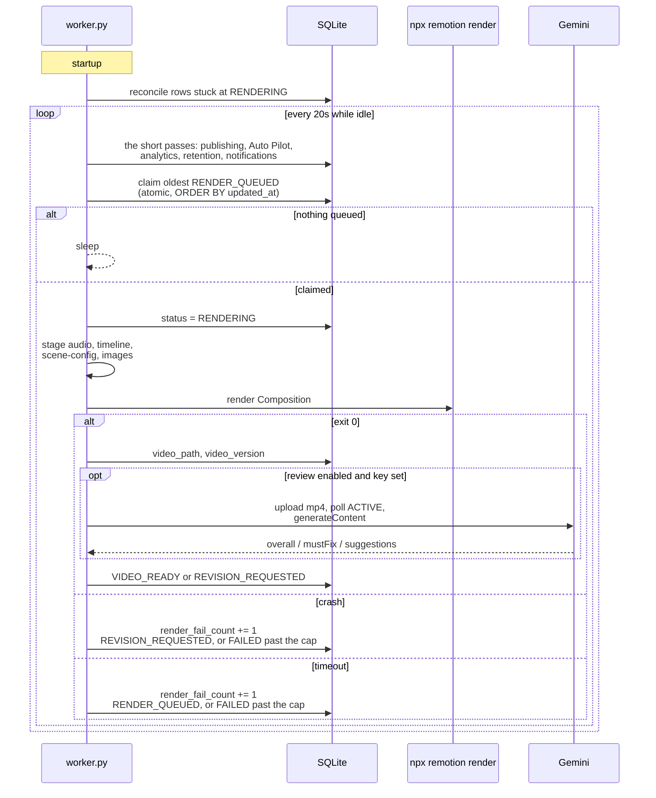

# Rendering and Review

Rendering happens in `tubematic-renderer`, a container with no HTTP server and no exposed ports. It
is a poll loop over the database: claim a video at `RENDER_QUEUED`, stage its files, run Remotion,
optionally send the result to Gemini for review, and write back a status.

That loop does more than render. Every pass it runs, in order, is on
[The Worker](12-the-worker.md); this page is the render pass and the review that follows it.

It runs in its own container so that a render crash or an out-of-memory kill restarts only the
renderer, leaving the API and the MCP server — and any agent session connected to them — untouched.



---

## The claim

```sql
SELECT id FROM videos WHERE status = 'RENDER_QUEUED'
ORDER BY updated_at ASC, id ASC LIMIT 1;
```

followed by `UPDATE videos SET status = 'RENDERING' WHERE id = ? AND status = 'RENDER_QUEUED'`. The
`WHERE` clause *is* the lock — there is no window between reading and claiming.

Ordering is FIFO on `updated_at`. **Anything that writes `updated_at` changes render order**, which
is why the publishing poll (where it exists) deliberately keys its own timeouts off a different
column.

The idle poll interval is `RENDER_POLL_INTERVAL_SECS`, default 20 seconds. It is a plain environment
variable, not a settings row.

> Rendering is one pass of several. Every pass the worker runs, their order and how often each
> runs are on [The Worker](12-the-worker.md).

## Retention

Rendered videos and their job directories (audio, timeline, scene config, images) are kept until
something deletes them. The retention sweep does that for **published** videos, `retention_days`
(default 7, see [Settings](../user-guide/05-settings.md#video-retention)) after they were published. If
`unpublished_retention_days` is set (default 0, off), it does the same for **failed and rejected**
videos that many days after they last changed. Either way it removes the mp4 and the job directory,
clears `video_path`, and sets `archived_at`. The status is left as it was. The row is kept, and so are
its comments, publication links and analytics — the dashboard's Archive page lists them. The same
operation backs the dashboard's Delete action (`DELETE /videos/<id>`, see
[HTTP API](05-http-api.md#videos)), so "delete" means one thing everywhere.

The Discord notification sweep shares this loop and the same reasoning — see
[Notifications](02-pipeline.md#notifications). Both run *before* the render claim, so a render,
which holds the loop for twenty minutes, delays them by at most one render rather than blocking
them behind two.

It lives in the render worker because this is the only continuously running process with both
database and filesystem access; the cron poller deliberately has no database access. Decisions that
look arbitrary and are not:

- **Unpublished output is swept only when you ask for it.** A video that ages out unpublished still
  holds an mp4 that cost real ElevenLabs and render time, and losing it would be unrecoverable. So
  `FAILED` and `TOPIC_REJECTED` have their own key, off by default, instead of sharing
  `retention_days`, which covers output a human has already seen published. Every other status is
  never swept. **Settings → Retention** shows how many such videos there are and what they hold
  (`GET /retention/backlog`), because nobody turns on an opt-in they cannot see a reason for.
- **Their clock is `updated_at`.** A failed or rejected video has no better timestamp, and its
  `updated_at` is when it last moved.
- **A rejected video is not assumed to be file-free.** The dashboard only rejects a video at
  `TOPIC_PROPOSED`, but a direct `PATCH` can reject one at any stage, with its mp4 still on disk.
  Every eligible row is archived, including one that never had files. That moves an old rejected
  topic from the board's Rejected column to the Archive, and the comment says "any" files were
  deleted.
- **There is no "delete" route through `TOPIC_REJECTED`.** Deleting a failed video from the
  dashboard already archives it directly. Rejecting it instead would mark it as a topic a human
  turned down. Mining shows Gemini the 200 most recent videos as already covered, so the label
  matters: `TOPIC_REJECTED` has to keep meaning "a human did not want this", not "this broke".
- **Archived videos still count as covered for mining.** That query filters neither status nor
  `archived_at`, and that is deliberate: a deleted or swept video was still proposed once, and
  proposing it again would bring the churn back.
- **The two passes are independent.** Setting either key to 0 turns off its own pass only. They
  share one hourly stamp.
- **A retry or an edit racing the sweep wins.** `archive_video` checks both the status and the
  cutoff inside its own `UPDATE`. A video retried out of `FAILED`, or edited (which restarts its
  clock), between the sweep's `SELECT` and the archive is therefore left alone.
- **The clock is `MAX(video_publications.published_at)` over successful publications**, not
  `created_at` — age since the topic was proposed says nothing about how long the file has sat
  unused. A second platform published yesterday resets it.
- **`published_at` is `NOT NULL DEFAULT ''`**, and `''` sorts before any timestamp, so the query
  filters it out explicitly. A published video with no usable publish time is never swept.
- **Hourly, with a settings-row stamp** (`last_retention_sweep_at`), the same pattern as the metrics
  pass, so a frequently restarted container does not sweep on every start.
- **It never raises.** The loop has no error handling of its own, and an escaping exception restarts
  the container — which startup reconciliation counts as a render failure against whatever was
  rendering. Errors are logged per video and the pass moves on.

`python scripts/cleanup_jobs.py` is the manual complement: it frees job directories only, keeping the
mp4, for anything you want to reclaim earlier.

## Startup reconciliation

The worker registers no signal handlers. A container stop kills it mid-render, and recovery happens
on the next start rather than through a graceful drain.

On startup it finds every row still at `RENDERING` — which can only mean a previous worker died
holding it — increments `render_fail_count`, and applies the same escalation as any other failure:
back to `RENDER_QUEUED`, or to `FAILED` if the retry cap is now exceeded. A restart mid-render
therefore *counts as a failure*, which matters with the default cap of 1: two container restarts
across one video's life will escalate it.

## Staging and the render call

Remotion serves assets from its `public/` directory, so the worker copies the job's files in first:

| Source | Destination |
|---|---|
| `/jobs/<video_id>/scene-config.json` | `/app/remotion/public/<video_id>/scene-config.json` |
| `/jobs/<video_id>/timeline.json` | `/app/remotion/public/<video_id>/timeline.json` |
| `/jobs/<video_id>/audio.mp3` | `/app/remotion/public/<video_id>/audio.mp3` |
| `/jobs/<video_id>/images/`, if present | `/app/remotion/public/<video_id>/images/` |

**The sources are derived from the video's id, never read from its path columns**
(`tubematic_core/jobfiles.py`). Those columns were once writable through `PATCH` and `update_video`,
so a row could name any file the worker can read and have it copied into a render; a row tampered
with before that was closed now simply stages the video's own files. The columns still say whether
each step completed. If any of the first three is missing, or its column is still empty, the worker
posts a comment naming them and sets `REVISION_REQUESTED` without launching Chromium. Images are
optional and are not part of that check. Symlinks are never staged: one in place of a job file, or
anywhere on the way to it (the video's job directory, `images/`, the project's output directory),
fails the render, and one inside `images/` is skipped, because `copytree` would otherwise copy
whatever it points at. The video's id is checked as a single path component, not against the rule
for a new id, so a video filed earlier under an id such as `a.b`, or one longer than the 128
characters a new id may have, still renders, while one that
would leave the jobs directory (`..`, `a/b`) moves to `FAILED` with nothing staged. See
[`videos`](03-database.md#videos) for the one race these checks leave open.

**A video whose id, or whose project's id, cannot be used as a path goes straight to `FAILED`** with
a comment, before anything is staged — a project id such as `..` would put the output outside
`/output_videos`. A revision cannot fix an id and a retry would only refuse again, so neither is
attempted. A legacy project id with a dot is fine; only one that would leave the output directory
is refused.

```
npx remotion render Composition /output_videos/<project_id>/<video_id>.mp4 \
    --props '{"sceneConfigPath": …, "timelinePath": …, "audioPath": …, "watermark": …}' \
    --browser-executable-path /usr/bin/chromium
```

`watermark` is the `watermark_enabled` setting, read when the render starts. It travels as a render
prop and not inside `scene-config.json` because the agent writes that file — see
[Watermark](09-remotion-project.md#watermark).

It is launched with `start_new_session=True`, which puts npx, node, Chromium and ffmpeg in one
process group.

### The timeout, and why it is more than a kill

`render_timeout_secs` (default 2400) bounds one render. On expiry the worker:

1. `SIGKILL`s the whole **process group** — one signal reaches every descendant.
2. Reaps the direct child.
3. Runs a blocking `waitpid(-1, …)` loop until it raises `ChildProcessError`.

Step 3 is the non-obvious one. The moment their parent dies, the SIGKILLed grandchildren reparent to
the worker process — which is PID 1 in its container — and reaping the direct child by PID cannot
touch them. Without the wildcard loop they become permanent zombies. This was observed, not
theorised.

**Do not copy this pattern into the MCP server.** The loop is safe here only because the worker is
single-threaded and runs one subprocess at a time. The MCP server is multi-threaded with concurrent
subprocess users, where a wildcard reap can steal a different call's child; it uses the process-group
kill alone. The general lesson: a reaping strategy relies on a concurrency invariant, and moving it
to a different concurrency model breaks it silently.

### Logs

The worker captures the render's stdout and stderr, logs failures to its own stdout
(`docker compose logs tubematic-renderer`), and writes a truncated copy — capped at 2000 characters
— into the video's comment thread. There is no persisted full-text render log.

## Status transitions

| From → To | Trigger |
|---|---|
| `RENDER_QUEUED → RENDERING` | Atomic claim |
| `RENDERING → REVISION_REQUESTED` | A job file was missing; the render exited non-zero under the cap; or an unexpected exception in the post-render path |
| `RENDERING → RENDER_QUEUED` | Timeout under the cap, or startup reconciliation |
| `RENDERING → FAILED` | `render_fail_count > max_render_retries` |
| `RENDERING → VIDEO_READY` | Render succeeded and: review disabled, no key, review errored, review clean, or the review loop cap was exceeded |
| `RENDERING → REVISION_REQUESTED` | Review returned **any** finding, under the cap |

Every write is guarded with `only_if="RENDERING"`.

**A crash and a timeout are routed differently on purpose.** A timeout returns to `RENDER_QUEUED`
for an automatic retry, because nothing about the job is known to be wrong. A crash returns to
`REVISION_REQUESTED`, because something probably is, and an agent should look at it.

**Both caps compare with `>`, not `>=`.** With `max_render_retries = 1`, the *first* failure retries
and the second escalates. Using `>=` would escalate on the first failure and grant zero retries.

---

## AI review

**AI review is experimental and off by default.** It runs only when `gemini_review_enabled` is on
*and* a Gemini key is stored; otherwise a successful render goes straight to `VIDEO_READY` for a
human to watch. It is off by default because of how it fails: it fails open (see
[Fail-open, loudly](#fail-open-loudly) below), so with review on and something wrong — a quota gap, a
broken upload — a video still arrives at `VIDEO_READY` looking reviewed. The dashboard says so beside
the switch. Installs set up before 2.0.0 keep whatever they had: their setting is stored explicitly,
and the new default reaches only an install that never answered.

When it is on, after a successful render `renderer/api/ai_review.py` uploads the mp4 to the Gemini
Files API and asks a model to watch it.

The module takes its model, fps and API key as **arguments** — it never reads the database. That
keeps it testable and reusable, and it is why `vqa/review_video.py` can call `run_ai_review()`
directly from a host script.

### The call

1. **Resumable upload.** `POST /upload/v1beta/files` with `X-Goog-Upload-Protocol: resumable` and
   `X-Goog-Upload-Command: start`. The real upload URL comes back in the **`x-goog-upload-url`
   response header**, not in the JSON body. The bytes then go to that URL with
   `X-Goog-Upload-Command: "upload, finalize"`.
2. **Poll until `ACTIVE`.** Up to 60 attempts, 5 seconds apart. A `FAILED` state or an exhausted
   budget returns an error result.
3. **`generateContent`** with `temperature: 0.0` and `response_mime_type: "application/json"`.

```jsonc
{
  "file_data":      { "mime_type": "video/mp4", "file_uri": "…" },
  "video_metadata": { "fps": 10 }        // sibling of file_data, NOT nested inside it
}
```

**`video_metadata` is a sibling of `file_data` on the part.** Google's own documentation shows it
nested inside `file_data`, where it is silently ignored — you get a full-rate sample and a token
bill to match, with nothing reporting a problem.

### What it is given

- The rendered video, sampled at `ai_review_fps`.
- The full `scene-config.json`.
- **Both forms of the script** — the authored `videos.script` and the spoken `videos.tts_text`.
- **The video's intended style** — its canvas, whether it may contain figures, and whether those
  figures may be line art.

Those last three are separate flags rather than one register name, and the split is load-bearing.
The canvas and the figures are independent: an `auto` video can be dark *and* full of held,
discretely-posed figures. Figures and line art are independent too, and this is the easier one to
get wrong — the illustrated register **has** figures, but they are generated character artwork and
hand-drawn line art is exactly what it excludes. Telling the reviewer that simple line art is
intended on an illustrated video would license the one mistake that register forbids.

The two figure clauses therefore have different scopes, and collapsing them costs something in
either direction. Every register that may contain figures gets the **discrete-motion** clause,
because both pose their characters discretely and without it a held pose reads as broken animation —
and since any finding routes the video to `REVISION_REQUESTED`, dropping it for a register would
wedge that register rather than merely mis-grade it. Only a register that actually draws line art
gets the clause licensing flat, unshaded figures as intended rather than unfinished. The error
directions are not symmetric: over-sending the line-art clause costs a missed catch, while
under-sending the discrete-motion clause costs false positives on every video in that register.

The prompt also states that the "Made with tubematic.ai" watermark is intentional: its presence,
position and size, and scene content visible through or beneath it, are not to be reported, and
neither is its absence on a video rendered with the mark switched off. This is a negative control
of the same kind as the captions clause. The mark is on every video, so without the paragraph every
review returns a finding and every video loops.

An unknown canvas produces **no** style contract at all rather than a guessed one, because a wrong
contract tells the reviewer to accept defects the video has no licence to contain.

The two-script rule is the whole negative control for pronunciation. When they differ, the prompt
states that audio matching the *spoken* form is correct by design, with the exemption scoped to the
words that actually differ. It also says that an IPA transcription between slashes in the spoken
form (what an `<ipa>` tag becomes on `eleven_v3` and `eleven_v4`) is pronounced rather than read out. Without that
clause the model reports every working respelling or IPA term as a defect — which, under the routing
rule below, costs a paid re-voice and then recurs forever.

`tts_text` is **persisted rather than re-derived** for the same reason: the question is "did
ElevenLabs honour the respelling we sent", so the reference must record what was actually sent. The
lexicon is install-wide and mutable, so a re-derivation could reconstruct an instruction that was
never issued.

### The response

```jsonc
{
  "overall": "a few sentences, always present",
  "mustFix": [ { "type", "timestamp", "scene", "description", "suggestedFix" } ],
  "suggestions": [ { "area", "timestamp", "scene", "description", "suggestedFix" } ]
}
```

Defined finding types: `text_offscreen`, `sync_drift`, `blank_frames`, `audio_drop`,
`safe_zone_violation`, `animation_defect`, `mispronunciation`. The model may add its own
`snake_case` types. `mustFix` is uncapped; `suggestions` is capped at 5 by the prompt.

Findings are normalised defensively: a bare string, a well-formed object, or malformed input all
parse without raising. A bare must-fix string becomes a `type`; a bare suggestion string becomes a
`description`, since a free-form critique is not an area label.

### The mispronunciation bar is deliberately narrow

Objectively wrong proper nouns and technical terms only. Accent, cadence, prosody and regional
variants are explicitly excluded, and every mispronounced word is grouped into **one** finding
rather than one per word. A loosening was tried and reverted after live runs showed the unchanged
prompt already caught the cases the loosening was meant to catch. A test pins the wording.

### Routing

**Any finding routes to `REVISION_REQUESTED`** — a review with zero must-fix items but a non-empty
suggestions list still loops. The alternatives were both worse: acting on suggestions from inside
`VIDEO_READY` would mean the agent crossing a human checkpoint alone, and letting suggestions ship
silently reproduces the "no discernible defects" non-answer the reviewer exists to replace.

**The review at the cap runs anyway; only its routing changes.** Do not add an early return that
skips the review once the cap is hit — that shipped renders carrying the *previous* round's stale
feedback.

### Fail-open, loudly

A review that errors advances the video to `VIDEO_READY`. That is deliberate — a broken reviewer
should not wedge the pipeline — but it went unnoticed for the feature's entire early lifetime, which
is how an upload bug survived undetected.

The mitigation is that the worker now writes `videos.gemini_feedback` and posts a comment on
**every** outcome: pass, defects, or error. An error is stored as `AI review did not run: <reason>`,
so a review that is silently failing open is visible in the dashboard rather than only in logs. Grep
for that prefix if you suspect the reviewer is not actually running.

`gemini_feedback` is stored **uncapped** — it is what the agent reads to fix the video. Only the
comment copy is truncated, and the formatter orders *overall → must-fix → suggestions* so that
truncation drops suggestions first and must-fix items last.

### Cost

**Every review is recorded against the video**, with the token counts Gemini reports in
`usageMetadata` — so a video that loops through two reviews shows two review calls, and a reply
that failed to parse is still recorded, because it was still billed. The Files API upload is free
and is not recorded. `ai_review.py` stays DB-free: it returns the usage and the worker records it.
See [Settings — Costs](../user-guide/05-settings.md#costs) for how tokens become dollars.

Video tokens scale with sampled frames, so `ai_review_fps` is the cost dial.

| | `gemini-2.5-flash` | `gemini-3.5-flash` / `gemini-3.6-flash` |
|---|---|---|
| Tokens per frame | 263 | 71 |

Audio is a flat 32 tokens per second and does not scale with fps. For a 250-second video on
`gemini-2.5-flash`, 20 fps is roughly 1.32M tokens — over the 1M context window. 10 fps is about
665k, which is why 10 is the highest default that fits on the default model.

Per second of reviewed video the 3.x models cost only about 1.4× the 2.5 model, not the 5× their
headline pricing implies, because they tokenise video far more cheaply.

> **The default of 10 fps fits the window; it was not shown to improve accuracy.** Measured against
> real videos, raising the rate from 1 fps bought nothing and cost precision: one run missed a
> mispronunciation and another fabricated a safe-zone violation on a video with no subtitles at all
> — which, under the any-finding rule, burns a revision round on a non-defect. Recall is fine;
> precision is the weak point. Prompt changes produced the reproducible gains, not the sampling rate.

---

## The text-layout audit

Independent of the AI reviewer, `validate_job` can measure text geometry directly, in the browser,
before a render happens. `mcp/text_audit.py` holds the decision layer; the Remotion side measures.

- `renderer/remotion/src/audit/TextLayoutProbe.tsx` walks the DOM on every commit, finds leaf text
  elements, and reports each one's ink rectangle, font size, line height, accumulated opacity, and
  whether it or an ancestor is rotated. It waits on `document.fonts.ready` first — a font load does
  not trigger a React re-render on its own.
- `renderer/remotion/audit/run-text-layout-audit.mjs` bundles the project, selects the
  `TextLayoutAudit` composition, and samples frames.

Every threshold lives in Python: an opacity floor of 0.9, a minimum overlap of 15% of the smaller
box's area, five samples per scene, a 45-frame allowance at scene start before anything counts as
settled, the 150/170/60/60 safe zone, and a 180-second timeout.

### Three measurement traps

These are the reason the probe looks the way it does.

1. **`getBoundingClientRect()` on a block element measures its *container*, not its text.** A
   `left: 350; width: 780` div holding one short word measures 780px wide. That produced six false
   "runs off the right edge" findings on a clean video. Measure a `Range` over the element's
   contents instead.
2. **A `Range` rect is glyph-tight and carries no line-height leading.** The usual "subtract half the
   leading" correction is right for element rects and becomes a double-correction here, shrinking
   boxes by around 44% and losing real overlaps. Pick one basis and know which you are on.
3. **Remotion's stdout is not a usable data channel.** It forwards every browser console line to its
   own stdout, and the probe communicates *through* console logs. The driver writes its result to a
   file; an earlier version printed JSON to stdout and it could never be parsed back out.

### It is advisory, on purpose

Findings go to `validate_job`'s `warnings` and can never change `passed`. A geometric check that
*blocks* on a false positive is worse than no check, and routing it through AI-review feedback would
put it under the any-finding rule, where one systematic false positive wedges every video.
Promotion to a hard gate is deliberately conditional on seeing it run clean across real videos.

The probe measures and decides nothing. That split is not half-finished work: `mcp/text_audit.py` is
the only layer with test coverage, because `renderer/remotion/` has no JavaScript test runner at
all. Moving a threshold into the probe moves it out of the tested layer.

### Disk

Per call the audit stages a copy of the job's files into `remotion/public/<video_id>/` and builds a
~17 MB webpack bundle in `/tmp`. Both are removed on the normal path. Two choices keep it cheap and
must not be "simplified": `symlinkPublicDir: true` stops the bundle copying the staged assets a
third time, and `imageFormat: "none"` with `outputDir: null` means **zero frames are ever encoded or
written** — a real render writes thousands of PNGs; the audit writes none.

A timeout leaks the bundle and nothing else: the kill is an uncatchable `SIGKILL`, so the driver's
own cleanup never runs, while the Python-side cleanups sit in a `finally` and still execute. Sweep
`/tmp/tubematic-audit-bundle-*` if audits have been timing out.

> Separately and larger: the render worker never cleans its own staging directory. One copy of each
> rendered video's assets accumulates in the renderer container's writable layer indefinitely. The
> audit cannot clobber it — `public/` is not a shared volume, so the two containers hold separate
> copies.
