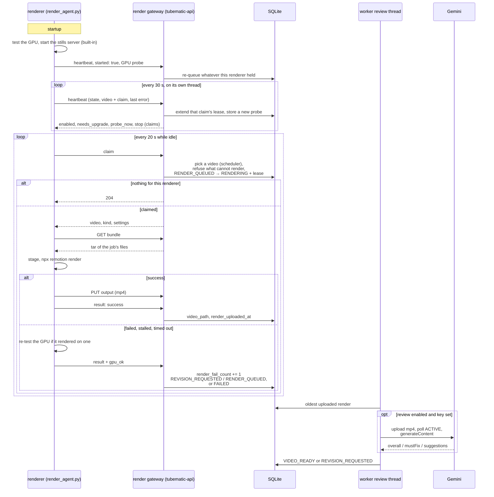

# Rendering and Review

A video at `RENDER_QUEUED` is rendered by a renderer: a process that runs Remotion and takes its
work from the render gateway. This page follows one render on one machine, from the claim to the
status the video is left in, and ends with the text-layout audit that measures a video before it is
queued. The review of a finished render is on [AI Review](21-ai-review.md).

| Process | Container | What it does |
|---|---|---|
| The renderer, `renderer/api/render_agent.py` | `tubematic-renderer` (the built-in renderer), or `tubematic-remote-renderer` on a [remote renderer](20-gpu-and-remote-renderers.md#remote-renderers) | Claims a video, downloads its files, runs Remotion, uploads the mp4 and reports how the render ended. It also tests its GPU |
| The render gateway, `renderer/api/render_gateway.py` | `tubematic-api`, HTTPS port 4443 | Picks the video a renderer gets, serves the files, receives the mp4, and decides what a failed render does to its video (`renderer/api/render_results.py`). See [The Render Gateway](19-render-gateway.md) |
| The worker, `renderer/api/worker.py` | `tubematic-worker` | Reviews each uploaded render when AI review is on, re-queues a render whose renderer stopped reporting, and fails a GPU-only video no renderer can take. See [The Worker](12-the-worker.md) |

The renderer has no database, because a renderer can be another machine. It holds one credential,
sees one job's files at a time, and can move a video only by reporting on a render it holds. The
built-in renderer uses the same routes as a remote one. It runs in its own container, so a render
killed for running out of memory restarts only that container.

"The main install" below is the machine with the dashboard and the database.



---

## The renderer's loop

The loop is `render_agent.py::main`.

| Step | Symbol | Runs |
|---|---|---|
| Identity | `_load_identity` | Once, at start: the built-in renderer, or a remote one from its state file |
| GPU test | `_run_gpu_probe` | At start, before the first heartbeat. Then on request, and after a render on the GPU fails |
| First heartbeat | `_beat` | At start, with `started: true`, retried every 30 seconds. The renderer claims nothing before it gets through |
| Heartbeat thread | `_heartbeat_loop` | Every `HEARTBEAT_SECS` (30), on its own thread |
| Stills server | `_ensure_stills_server` | Built-in renderer only, at start and on every pass. See [The stills server](#the-stills-server) |
| Claim and render | `_loop_once`, `_run_job` | Every pass, while the gateway says the renderer is enabled and on the main install's version |

An idle renderer claims every `RENDER_POLL_INTERVAL_SECS` (default 20, an environment variable). At
start it deletes what a previous run left in its job directory. An unreachable gateway does not stop
it: the renderer logs the error, sends it as `last_error` on the next heartbeat that gets through,
and retries the call 30 seconds later.

The heartbeat has its own thread because a render holds the loop, and only heartbeats keep the
video's [lease](20-gpu-and-remote-renderers.md#leases-restarts-and-lost-renderers) alive. It carries
the renderer's state (`idle` or `rendering`, with the video and claim), version, compute (CPUs,
memory, GPUs), last error and any GPU test result not yet sent. The reply can tell the renderer to
stop a render, to test its GPU, or that it
[needs an upgrade](20-gpu-and-remote-renderers.md#version-mismatch).

## The claim

A claim is one `POST /v1/claim`. The gateway picks the video (`render_gateway.py::claim_route`):

1. It refuses a disabled renderer (`409 disabled`) and one on another version
   (`409 needs_upgrade`).
2. A renderer that still holds an unfinished claim (a `RENDERING` video under its id with nothing
   uploaded) gets that claim again, with the same claim id. This serves a renderer whose claim
   reply was lost, and keeps each renderer to one render at a time.
3. It lists the `RENDER_QUEUED` videos in `ORDER BY updated_at, id` and asks the scheduler which one
   this renderer should take
   ([Which renderer gets which video](20-gpu-and-remote-renderers.md#which-renderer-gets-which-video)).
   With one renderer that is the oldest video it may render. With none to take, the answer is `204`.
4. It runs the [pre-render checks](#refused-before-anything-renders). A refused video leaves the
   queue with its comment, and the claim moves to the next one (at most `MAX_CLAIM_ATTEMPTS`, 50,
   per request).
5. It claims the video with one guarded `UPDATE` that sets `status = 'RENDERING'`, the renderer's
   id, a new random `render_claim_id`, a lease and `render_started_at`.
6. It answers with the video's id, the claim id, its kind (`dom`, `cartoon_3d` or `mascot`), whether
   it needs the GPU, its frame count, the lease length and three settings: `render_timeout_secs`,
   `render_stall_timeout_secs` and the watermark. The renderer reads no settings itself.

The `UPDATE` is the lock. Its `WHERE` clause requires `status = 'RENDER_QUEUED'`,
`archived_at IS NULL`, the renderer still enabled, and no unfinished claim of the same renderer. Two
renderers that picked the same video cannot both get it, and the loser tries again.

The queue is first in, first out on `updated_at`, so a write to `updated_at` on a queued video moves
it to the back.

For the built-in renderer the `UPDATE` also refuses while the settings row
`render_claim_hold_until` holds a future time. `onboard.py --step gpu` sets it while it recreates
the renderer container; see
[The Compose override](20-gpu-and-remote-renderers.md#the-compose-override).

### Refused before anything renders

The checks run inside the claim (`render_gateway.py::pre_render_refusal`), so a video that cannot
render is not handed out.

- A video whose id, or whose domain's `project_id`, cannot be a path component goes to `FAILED`
  with nothing staged. A `project_id` such as `..` would put the output outside `/output_videos`,
  and neither a revision nor a retry can fix an id. A symlink in place of a job file, or on the way
  to it (the job directory, `images/`, the domain's output directory), is refused the same way.
- A missing job file sends the video to `REVISION_REQUESTED`. The comment names the path column
  (`voice_file_path`, `timeline_path`, `scene_config_path`) whose file (`audio.mp3`,
  `timeline.json`, `scene-config.json`) is absent, or whose value is empty because that step did not
  finish. Images are optional and are not checked.
- A Cartoon 3D video that also holds a mascot, and a mascot video whose pinned code cannot be read,
  go to `FAILED`
  ([The mascot's code](20-gpu-and-remote-renderers.md#the-mascots-code)).

The gateway derives every source path from the video's id (`tubematic_core/jobfiles.py`) and does
not read the row's path columns, so a row cannot name another video's files. The columns only say
whether each step completed. The id is checked as a single path component and is not held to the
rule for new ids: a video filed as `a.b`, or under an id longer than the 128 characters a new id may
have, still renders. See [`videos`](03-database.md#videos) for the one race these checks leave open.

## The bundle, staging and the render call

A renderer gets a job's files as one bundle: `GET /v1/jobs/<video_id>/bundle` answers an
uncompressed tar, streamed so that neither side holds a whole job in memory.

| Member | When |
|---|---|
| `audio.mp3`, `timeline.json`, `scene-config.json` | Always |
| `images/**` | The video has generated images |
| `cartoon/source.json` | A Cartoon 3D video: the fingerprint of the source `submit_render` queued |
| `cartoon/audio/mix/mix.wav` | A Cartoon 3D soundtrack at least as new as `audio.mp3` |
| `mascot.js` | A mascot video: the pinned version's drawing code |
| `scenes/<video_id>/**` | The video's generated scene tree |
| `scenes/_flat/<name>.tsx` | Each legacy flat generated scene the scene-config names |

Every file keeps its modification time. The gateway does not follow symlinks: a job file that is one
makes the bundle unavailable (`409`), and one inside `images/` or a scene tree is skipped.

The renderer unpacks the bundle (`_download_bundle`) into its own job directory,
`/tmp/tubematic-render/<video_id>/` (`TUBEMATIC_RENDER_TMP`). It creates every file fresh and
refuses a member whose name is absolute, holds `..`, is not listed above, or is not a regular file.

Remotion serves assets from `public/`, so the renderer copies the job into
`/app/remotion/public/<video_id>/` (`_stage`), skipping symlinks inside `images/`. The built-in
renderer ignores the bundle's scenes and compiles the shared `src/scenes/generated/` volume the
agent writes. A remote renderer
[stages them from the bundle](20-gpu-and-remote-renderers.md#scenes-on-a-remote-renderer).

The render command on the CPU path:

```
npx remotion render Composition /tmp/tubematic-render/<video_id>/output.mp4 \
    --props '{"sceneConfigPath": …, "timelinePath": …, "audioPath": …, "watermark": …}' \
    --browser-executable-path /usr/bin/chromium
```

- The paths are `/public/<video_id>/scene-config.json`, `timeline.json` and `audio.mp3`. A mascot
  video also gets `mascotPath`, pointing at the staged `mascot.js`.
- `watermark` is the `watermark_enabled` setting. It is a render prop because the agent writes
  `scene-config.json` ([Watermark](09-remotion-project.md#watermark)).
- `--browser-executable-path` is not a Remotion flag (the flag is `--browser-executable`), and the
  CLI ignores an unknown flag. A CPU render therefore runs in the headless shell Remotion downloads
  into the container on its first render.
- The GL renderer is `swangle` (software), from `renderer/remotion/remotion.config.ts`. A renderer
  whose GPU test passed adds the flags under
  [The GL renderer](20-gpu-and-remote-renderers.md#the-gl-renderer).
- `start_new_session=True` puts npx, node, Chromium and ffmpeg in one process group.

A Cartoon 3D video is rendered [in segments](#segmented-cartoon-3d-renders).

`_run_job` is the per-video boundary. Whatever escapes the download, the staging or the render (no
`npx`, a full disk, a bug) is reported as the outcome `error` ("The renderer hit an error: …"), so a
row does not stay `RENDERING` after its render is gone. The job directory, the staged
`public/<video_id>/` and (on a remote renderer) the staged scenes are removed however the job ends.

### Where the output goes

The renderer uploads the mp4 with `PUT /v1/jobs/<video_id>/output`, streamed from disk. The gateway
writes it to a temporary file in `<output>/.gateway-uploads/`, checks that the claim still holds,
and renames it to `<output>/<project_id>/<video_id>.mp4`, so a reader does not see half a video. The
gateway's upload limits are under [Limits](19-render-gateway.md#limits). The renderer
(`render_agent.py::_upload`) reacts to each answer:

| Answer | The renderer |
|---|---|
| A network error, or any answer not listed here | Counts a failed attempt. After three (`UPLOAD_ATTEMPTS`) it reports the render as an `error` |
| `409 upload_in_progress`, `503 busy` | Waits the `Retry-After` (5 to 60 seconds) and tries again, for up to two hours (`UPLOAD_WAIT_SECS`), without counting an attempt |
| `413 output_too_large`, `507 insufficient_storage` | Does not retry. Reports the render as an `error` |
| `403`, `409 claim_lost` | Discards the render and sends no result |

The two waiting answers mean that other uploads hold every slot, or that the gateway is still
receiving this claim's earlier attempt. They are not failures, because a counted attempt would
discard a finished render and use a render retry. The heartbeat keeps the lease alive during the
wait, and a stop from the gateway ends it.

### The result

`POST /v1/jobs/<video_id>/result` says how the render ended:

| `outcome` | Sent when | The gateway |
|---|---|---|
| `success` | Remotion exited 0 and the upload landed | Records `video_path` and `render_uploaded_at`, adds a `render_timings` row (frames, seconds, GPU or CPU) and releases the claim. The [AI review](21-ai-review.md) finishes the video |
| `failed` | Remotion exited non-zero | `REVISION_REQUESTED` |
| `stalled`, `timeout` | The render stopped advancing, or ran past the ceiling | `RENDER_QUEUED` |
| `error` | Anything else: no bundle, a failed upload, an exception in the renderer | `RENDER_QUEUED` |

- A failure goes through `render_results.py::after_render_failure`, which counts the retry and
  posts the error as a comment ([Status transitions](#status-transitions)).
- A GPU-only video whose render failed on a GPU that then failed its re-test goes to `FAILED`
  ([A GPU that stops working](20-gpu-and-remote-renderers.md#a-gpu-that-stops-working)).
- A `success` whose mp4 is missing or empty is routed as an `error`.
- The renderer cuts `error` to 8,000 characters (`render_agent.py::RESULT_ERROR_CHARS`) so the body
  fits the gateway's 64 KiB JSON limit.
- The renderer sends a result up to three times. One that does not arrive is left to the lease,
  whose expiry re-queues the video.
- A result for a claim the renderer has lost changes nothing.

## Progress and the two timeouts

Two settings bound a render, each with a minimum of 60 seconds:

- `render_stall_timeout_secs` (default 600) detects a hung render: Remotion's progress has not
  advanced for that long.
- `render_timeout_secs` (default 10800) is the ceiling on the whole render, for one that advances
  too slowly.

The renderer reads Remotion's counters (`Bundling N%`, `Rendered N/M`, `Encoded N/M`) from the
render's output as it runs (`_wait_for_render`). The phase and count must increase, because Remotion
repeats lines and a stalled render that reprints its count would look alive. Each of the process's
two pipes is read on its own thread, because reading stdout alone deadlocks once the stderr pipe
fills.

On a stall or a timeout the renderer (`_kill_group_and_reap`):

1. Sends `SIGKILL` to the whole process group.
2. Reaps the direct child.
3. Runs a non-blocking `waitpid(-1, WNOHANG)` loop until no child other than the stills server is
   left, for at most `REAP_TIMEOUT_SECS` (60).

Step 3 exists because the renderer is PID 1 in its container. The killed grandchildren reparent to
it when their parent dies, and without the loop they stay as zombies. The loop polls because a
blocking wait would wait on the stills server, which is a long-lived child.

Do not copy this loop into the MCP server. It is safe here because the renderer runs one render
subprocess at a time. The MCP server runs subprocesses on several threads, where a wildcard reap can
take another call's child, so it uses the process-group kill alone.

## Status transitions

| From → To | Trigger |
|---|---|
| `RENDER_QUEUED → RENDERING` | A claim |
| `RENDER_QUEUED → REVISION_REQUESTED` | Refused at the claim: a job file is missing |
| `RENDER_QUEUED → FAILED` | Refused at the claim (an unusable id or path, Cartoon 3D with a mascot, no mascot code), or a GPU-only video no renderer can take |
| `RENDERING → REVISION_REQUESTED` | A failed render (Remotion exited non-zero) within `max_render_retries`, except a video's first page timeout |
| `RENDERING → RENDER_QUEUED` | A stall, a timeout or a renderer error within `max_render_retries`. Also a restarted renderer, an expired lease, and a video's first page timeout |
| `RENDERING → FAILED` | `render_fail_count > max_render_retries`, or a GPU-only render whose GPU failed its re-test |
| `RENDERING → VIDEO_READY` | Uploaded, and the review is off, failed, found nothing, or ran past `ai_review_max_loops` |
| `RENDERING → REVISION_REQUESTED` | Uploaded, and the review returned a finding within `ai_review_max_loops`. Also an unexpected exception in the review step |

Every write out of `RENDERING` is guarded with `only_if="RENDERING"` or the same clause in its own
`UPDATE`, and every write out of `RENDER_QUEUED` on `RENDER_QUEUED`. A failure result is also
guarded on the renderer and the claim id.

A hung render and a failed render take different routes. A stall or a timeout returns to
`RENDER_QUEUED` for an automatic retry, because nothing about the job is known to be wrong. A render
in which Remotion exited non-zero goes to `REVISION_REQUESTED`, because an agent can read the error
and fix a scene.

A page timeout is the exception. When Remotion exits because the page did not answer in time
("Timeout (30000ms) exceeded rendering the component", "Timed out evaluating page function";
`render_results.py::is_page_timeout`), the cause is as often a machine short of memory or CPU as a
scene that never finishes loading. The first time a video fails this way it returns to
`RENDER_QUEUED` as it is, with a comment that starts "Render timed out inside the browser, so it was
re-queued once as it is" (`requeue_page_timeout`). That retry adds nothing to `render_fail_count`:
with the default cap of 1, a counted retry would send the next failure to `FAILED`, and a scene
that hangs would never reach the agent. The comment is what bounds it, so a second page timeout of
the same video takes the usual counted route, with a "Render failed" comment that says it timed out
a second time: `REVISION_REQUESTED`, or `FAILED` when earlier failures (a stall, a lost renderer)
already used `max_render_retries`. A GPU-only render whose GPU failed its re-test goes to `FAILED`
before this rule applies.

`max_render_retries` (default 1) caps render retries only. Each failed result and each
[lost render](20-gpu-and-remote-renderers.md#leases-restarts-and-lost-renderers) adds one to
`videos.render_fail_count`, which is not reset. The test is `render_fail_count > max_render_retries`,
so with the default the first failure is retried and the second moves the video to `FAILED`.

The comment is "Render failed: …" with the error, cut to 2,000 characters. Past the cap it gives the
count, the limit and the last error. `FAILED` is terminal, and a human creates the video again.

## Segmented Cartoon 3D renders

A Cartoon 3D video is rendered in segments (`render_agent.py::_render_cartoon`), because one long
render of a Cartoon 3D world can hang part way on the GPU.

- A segment is `CARTOON_CHUNK_FRAMES` (450) frames in its own Remotion process with a fresh browser,
  run with `--frames=a-b --muted --concurrency=2` under the stall watcher. A tail shorter than a
  third of a segment joins the one before it.
- A segment that stalls or fails is tried once more (`CARTOON_CHUNK_ATTEMPTS`). A second stall ends
  the render as `stalled`, and a second failure as `failed`.
- ffmpeg's concat demuxer joins the segments without re-encoding, then muxes the soundtrack: the
  synthesised mix (`cartoon/audio/mix/mix.wav`, written by the MCP server's `cartoon_soundtrack`)
  when it is at least as new as the voice, else `audio.mp3`.
- Both ffmpeg steps run in their own process group as the job's live process, so a stop from the
  gateway kills them.
- `render_timeout_secs` caps the whole render. Each segment gets what is left of the one deadline,
  and each ffmpeg step the lesser of what is left and `FFMPEG_TIMEOUT_SECS` (900).

Every segment bundles the generated source afresh, so the renderer checks that the tree is the one
the beat gate judged (`_cartoon_source_error`). `submit_render` records the tree's fingerprint in
`<jobs>/<video_id>/cartoon/source.json`, and the renderer compares the tree Remotion compiles with
it before every segment and before the join. A tree that differs or holds a symlink fails the render
to the agent, and so does a missing or symlinked record. The record's and the mix's paths are built
with `jobfiles.py::join_below`, which refuses a symlink in any component.

## The stills server

The MCP container's Cartoon 3D tools (`cartoon_beat_gate`, `cartoon_still`) need stills of a video's
composition, and the built-in renderer's container is the one on the main install that can have the
GPU. The built-in renderer therefore runs `renderer/remotion/cartoon-tools/stills-server.mjs` as a
child process. A remote renderer has no `/jobs` volume and runs none.

- It starts with nothing bundled and no browser. The first still bundles the project and opens one
  Chromium, which then stay, so the stills after it take a few seconds each. A cold software-GL
  still in the MCP container takes 25 to 30.
- Ten minutes after the last request (`STILLS_IDLE_MS`) it closes the browser and deletes the
  bundle, and the next still builds them again. Only Cartoon 3D authoring asks it for stills, so on
  an install that never uses Cartoon 3D it stays a Node process of about 100 MB.
- If that first bundle or the browser fails, it answers `503` with `startFailed` and exits. The
  client (`src/cartoon3d/gate/stills.ts`) then renders the stills itself, as it does when no server
  answers or the server dies in the middle of a request, and `_ensure_stills_server` starts the
  server again.
- It starts with the GL options a render gets (`_gl_options`), so a GPU test that passes moves it
  onto the GPU and one that fails moves it back.
- It serves the `/jobs` volume as its public directory, so a video's files are
  `/public/<video_id>/…` with nothing copied.
- It writes each still to the path the request names, so the renderer mounts `/jobs` read-write.
  Its port takes requests with no credential, so `cartoon-tools/out-path.mjs::planRequest` checks
  every file a request would write before it bundles or opens a browser, and the server answers 400
  to a path outside `/jobs/<video_id>/cartoon/` (symlinks resolved) or to frames that are not
  non-negative integers. The server then writes only the files that were checked.
- It listens on `TUBEMATIC_STILLS_PORT` (4455) on the Compose network only. The MCP container
  reaches it as `TUBEMATIC_STILLS_SERVER`, and renders its stills locally when it does not answer.
- It renders one still at a time and shares the GPU with renders.
- Before every still it compares a stamp of the generated source tree (each file's path, size and
  mtime) with the one its bundle was made from, and bundles again when they differ. An edit to a
  video's code costs its next still about twenty seconds.

`_ensure_stills_server` starts it again when it has died (at most once every
`STILLS_SERVER_RETRY_SECS`, 60) or when a GPU test moved renders between the GPU and the CPU. With
`TUBEMATIC_STILLS_PORT` unset it does nothing.

## Logs

The renderer logs a failed render's output to its own stdout
(`python3 scripts/service.py logs tubematic-renderer`, lines prefixed `[renderer]`, and the
`renderer` service on the dashboard's Logs page) and sends the error with its result. The gateway writes the error, cut to 2,000 characters,
into the video's comments. No full render log is stored.

Claims, refusals, uploads and stop or upgrade instructions are in `tubematic-api`'s log. A problem
that belongs to the renderer and not to one video (an unreachable gateway, a refused credential) is
also sent as `last_error` and stored on its row in `renderers`.

---

## The text-layout audit

`validate_job` measures text geometry in the browser before a render is queued. `mcp/text_audit.py`
decides, and the Remotion side measures:

- `renderer/remotion/src/audit/TextLayoutProbe.tsx` walks the DOM on every commit, finds leaf text
  elements, and reports each one's ink rectangle, font size, line height, accumulated opacity and
  whether it or an ancestor is rotated. It waits on `document.fonts.ready` first, because a font
  load does not trigger a React re-render.
- `renderer/remotion/audit/run-text-layout-audit.mjs` bundles the project, selects the
  `TextLayoutAudit` composition and samples frames.

The thresholds are in `mcp/text_audit.py`: an opacity floor of 0.9, a minimum overlap of 15% of the
smaller box's area, five samples per scene, a 45-frame allowance at a scene's start before anything
counts as settled, the 150/170/60/60 safe zone, and a 180-second timeout.

A System Flow video's one scene changes its diagram at every board, so the audit samples each board
as if it were a scene, with the same allowance at each board's start.

A Cartoon 3D video skips the audit. Its one scene is a painted canvas with no text rectangles, and
the composition draws its captions. Its checks are the typecheck and the beat gate in
`mcp/cartoon.py`.

The audit runs on `swangle` in the MCP container, which has no GPU. Text measures the same on either
GL path.

### Three measurement traps

1. `getBoundingClientRect()` on a block element measures its container. A `left: 350; width: 780`
   div holding one short word measures 780 pixels wide and reads as running off the right edge. The
   probe measures a `Range` over the element's contents.
2. A `Range` rectangle is tight to the glyphs and has no line-height leading. Subtracting half the
   leading is right for element rectangles. On a `Range` rectangle it shrinks boxes by about 44% and
   loses real overlaps.
3. Remotion's stdout cannot carry data, because Remotion forwards every browser console line to it
   and the probe reports through console logs. The driver writes its result to a file.

### Text under a mascot

For a mascot video the audit computes the mascot's box from the cue track
(`tubematic_core/mascots.py::boxes_at_frames`) at the sampled frames and reports measured text
beneath it (`text_audit.py::mascot_overlaps`) as the warning "Mascot over text". The box is the
engine's whole canvas, emote headroom included, so the warning says the text may be covered. The
audit does not run the mascot's drawing code.

### The audit is advisory

Findings go to `validate_job`'s `warnings` and cannot change `passed`. A geometric check that blocks
on a false positive is worse than no check. As AI-review feedback its findings would fall under the
rule that any finding sends the video to revision, and one systematic false positive would stop
every video.

The probe measures and decides nothing. `mcp/text_audit.py` is the layer with tests:
`renderer/remotion/`'s JavaScript tests (vitest) run in Node without a browser and cannot reach the
probe. A threshold moved into the probe leaves the tested layer.

### Disk

Each audit stages a copy of the job's files into `remotion/public/<video_id>/` and builds a webpack
bundle of about 17 MB in `/tmp`, and removes both on the normal path. Two options keep it cheap:

- `symlinkPublicDir: true` stops the bundle copying the staged assets again.
- `imageFormat: "none"` with `outputDir: null` means no frame is encoded or written.

A timeout leaks the bundle. The kill is `SIGKILL`, so the driver's cleanup does not run, while the
Python cleanup sits in a `finally` and does. Delete `/tmp/tubematic-audit-bundle-*` if audits have
been timing out.

The audit and the renderer hold separate staged copies, because `public/` is not a shared volume.

## Related pages

- [The Render Gateway](19-render-gateway.md): routes, TLS, credentials and limits.
- [GPU and Remote Renderers](20-gpu-and-remote-renderers.md): the GPU test, GPU-only videos,
  scheduling, leases and remote renderers.
- [AI Review](21-ai-review.md): the review of an uploaded render and how its findings route the
  video.
- [The Worker](12-the-worker.md): the review thread, the lease and GPU-wait sweeps, and retention.
