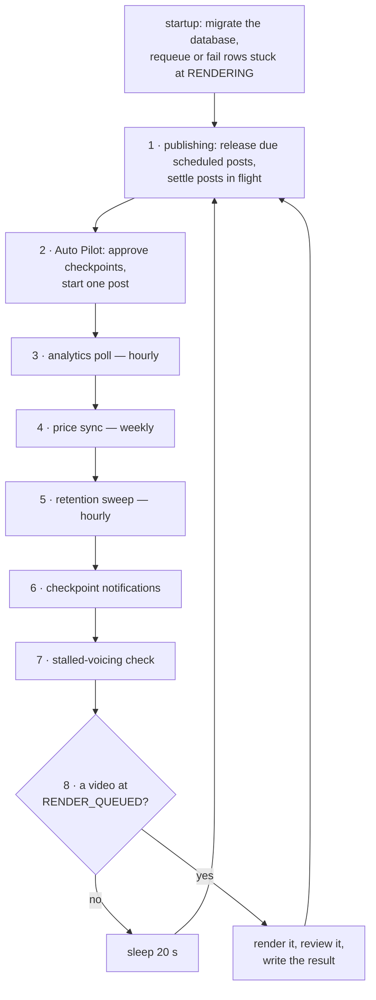

# The Worker

`renderer/api/worker.py` is the process that advances the pipeline without an agent. It runs in the
`tubematic-renderer` container, has no HTTP server and no exposed ports, and is one endless loop
over the database. Rendering is the pass it is named for, but most of what it does on a given tick
is not rendering: it settles published posts, runs Auto Pilot, polls analytics, deletes old output,
sends checkpoint notifications and flags stalled videos.

It is one of the two loops that advance the pipeline with nobody watching. The other is the poller,
which starts agent sessions. See [The Poller](13-the-poller.md). The two never call each other; they
meet only in the database, through a video's status.

This page is the loop: what runs, in what order, how often, and the rules every pass follows. What
each pass decides is on the page that owns that subject, linked from the table below.

---

## One tick



| # | Pass | Symbol | Runs | Does nothing unless | Owned by |
|---|---|---|---|---|---|
| 0 | Startup reconciliation | `_reconcile_rendering_videos` | once, at start | a row is at `RENDERING` | [Rendering and Review](11-rendering-and-review.md#startup-reconciliation) |
| 1 | Publishing | `_poll_publishing_videos` | every tick | publishing is on and a postforme key is stored | [Publishing](14-publishing.md#the-worker) |
| 2 | Auto Pilot | `_sweep_auto_pilot` | every tick | Auto Pilot is on, the pipeline is not paused, a project is selected. The [in-progress limit](14-publishing.md#the-in-progress-limit) holds back only new scripts and topics, never finished videos or scheduling | [Publishing](14-publishing.md#auto-pilot) |
| 3 | Analytics poll | `_poll_video_metrics` | hourly | publishing is on and a postforme key is stored | [Publishing](14-publishing.md#the-worker) |
| 4 | Price sync | `_sync_prices_if_due` | weekly | always runs when due | [Settings](../user-guide/05-settings.md#costs) |
| 5 | Retention sweep | `_sweep_retention` | hourly | either retention key is above 0 | [Rendering and Review](11-rendering-and-review.md#retention) |
| 6 | Checkpoint notifications | `_sweep_notifications` | every tick | a webhook and at least one trigger are set | [The Pipeline](02-pipeline.md#notifications) |
| 7 | Stalled-voicing check | `_sweep_stalled_voicing` | every tick | the pipeline is not paused | [The Pipeline](02-pipeline.md#script_ready--the-money-checkpoint) |
| 8 | Render | `_claim_next`, `_stage_and_render` | every tick | a video is at `RENDER_QUEUED` | [Rendering and Review](11-rendering-and-review.md) |

The loop itself is `worker.py::main`.

## What a tick is

A tick is one trip round the loop. How long it takes depends on step 8:

- **Nothing to render:** the worker sleeps `RENDER_POLL_INTERVAL_SECS` (default 20 seconds) and goes
  round again. So an idle worker runs every pass about every 20 seconds. The interval is a plain
  environment variable, not a settings row.
- **A video to render:** the render runs inside the loop and holds it until it finishes: typically
  around twenty minutes, and at most `render_timeout_secs` (default 40 minutes) plus the AI review.
  There is no sleep afterwards; the next tick starts at once.

**So every pass waits behind a running render.** A post that falls due, a checkpoint Auto Pilot
should approve, a notification: none of them happen until the render in progress ends. That is the
cost of one loop, and it is accepted because the alternative is two writers racing on the same
rows. Nothing is lost by the wait: every pass works from the database's current state, not from a
queue of events, so it simply catches up on the next tick.

"Hourly" and "weekly" mean *at most* that often. Those passes are checked every tick and skipped
until their interval has passed, so with a render in the way they run late, never early.

## The order, and why

The order is not arbitrary, and three positions are load-bearing.

- **Everything runs before the render claim.** A render is the one step that can take the loop away
  for half an hour, so the short passes go first. A publish is then never delayed by more than one
  render, and rendering is never starved, because every other pass returns quickly.
- **Publishing runs before Auto Pilot.** The publishing pass releases scheduled posts that are due
  and settles posts in flight. Auto Pilot's slot calculation reads those same rows to see when each
  account last posted, so it must see them settled first. The in-progress limit counts posts
  waiting at `SCHEDULED` and settled ones leave it, so the count must also be read after that pass,
  or a new video would wait one tick longer than it should.
- **Auto Pilot runs before notifications.** A checkpoint Auto Pilot approves has already moved on by
  the time the notification sweep looks, so it is never also announced as waiting for a human.
  Swap the two and every auto-approved script sends a "needs your approval" message.

## Rules every pass follows

**A pass never raises into the loop.** `main` has no exception handler, deliberately: an escaping
exception ends the process, the container restarts, and startup reconciliation counts that restart
as a failed render for whatever was at `RENDERING`. With the default retry cap of 1, two such
restarts fail a video that did nothing wrong. So each pass catches its own exceptions, logs them and
returns. A broken sweep costs that sweep, not a render.

**A throttled pass stamps its time before it does its work.** The hourly and weekly passes record
"last run" in a settings row first, then run. A pass that dies half-way is therefore not retried
twenty seconds later, and again twenty seconds after that. The stamp rows are listed under
[Settings](04-settings.md#undeclared-rows).

**Settings are read on every use, never cached.** Each pass reads what it needs from the settings
table when it runs. Turning Auto Pilot off, changing a retention period or rotating a key applies
on the next tick, with no restart.

**Every status change is guarded on the status it expects.** A pass moves a video with
`UPDATE … WHERE id = ? AND status = ?`, so a human or an agent who acted first wins and the pass
does nothing. This is what makes it safe for the worker, the API and the MCP server to all write the
same table.

**A pass that only observes must not touch `updated_at`.** That column is the render queue's
ordering key and the stalled-voicing clock. The notification sweep and the stalled-voicing check
record what they have seen in their own columns for that reason.

**Pausing the pipeline stops very little here.** Pause is an instruction to the poller not to start
agent sessions. In the worker only two passes read it: Auto Pilot does nothing while paused, and
the stalled-voicing check stops its clock. Rendering, publishing, analytics, retention and
notifications all carry on, because a video already queued or a post already scheduled is work the
human has asked for.

## What it never does

- **It never starts an agent.** Agent sessions are the poller's. When the worker needs agent work
  done, for example after a failed review, it sets `REVISION_REQUESTED` and the poller picks the
  video up.
- **It never takes a request.** The dashboard's Publish, Retry and Cancel actions go to the Flask
  API, which acts at once and leaves rows for the worker to settle. The one thing the two share in
  code is `pipeline.py::start_publish`, which the API calls for a human and the worker calls for
  Auto Pilot, so both run the same claim, upload and reconciliation rules.
- **It never renders two videos at once.** One loop, one render. Videos queue at `RENDER_QUEUED` in
  `updated_at` order.
- **It never trusts a stored file path.** Every job file it stages and the mp4 it writes are found
  from the video's and project's ids, not from the row's path columns. A video whose id or project
  id would lead outside the jobs or output directory goes to `FAILED` with a comment, unrendered —
  see [Staging and the render call](11-rendering-and-review.md#staging-and-the-render-call).

## Watching it

```bash
docker compose logs -f tubematic-renderer
```

Every line is prefixed `[worker]`, and a line about one video carries its id in brackets. The same
records go to the structured log the dashboard's Logs page reads, under the `renderer` service; see
[Troubleshooting](../user-guide/08-troubleshooting.md#logs). A render's own output is not kept in full: a failure
is logged here and a truncated copy goes into the video's comment thread — see
[Rendering and Review](11-rendering-and-review.md#logs).

A quiet log on an idle install is normal: a pass with nothing to do logs nothing.

## Adding a pass

1. Write `_your_pass_once()` and a wrapper `_your_pass()` that calls it inside `try`/`except
   Exception` and logs the exception. Copy `_sweep_stalled_voicing` for the shape.
2. If it should not run every tick, gate it on a settings-row stamp written before the work, as
   `_sweep_retention` does.
3. Call it from `main`, before `_claim_next`, and decide its position against the three ordering
   rules above.
4. Guard every status write on the status you expect, and do not write `updated_at` unless the pass
   really is advancing the video.
5. Add the row to the table on this page, and document what the pass decides on the page that owns
   the subject.
