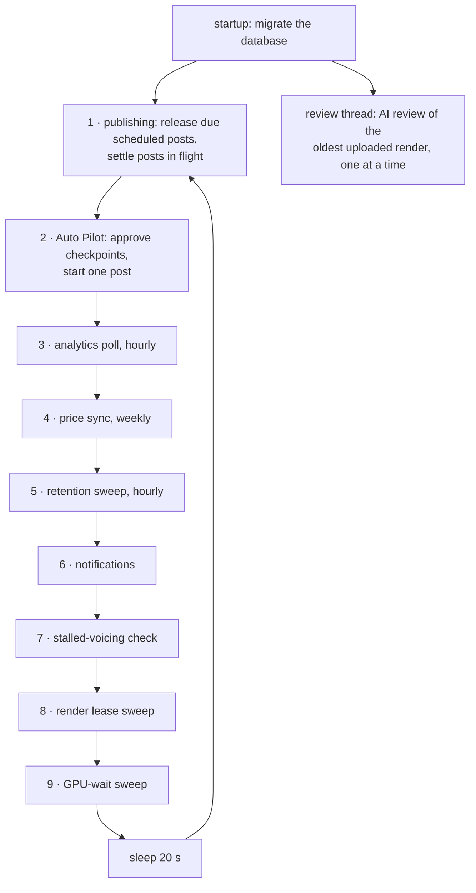

# The Worker

`renderer/api/worker.py` does the pipeline's background work that needs no agent. It runs in the
`tubematic-worker` container, has no HTTP server and no published port, and is one loop over the
database. The loop settles published posts, runs Auto Pilot, records analytics, syncs prices,
deletes old output, sends Discord notifications, flags stalled videos and keeps two backstops for
rendering. A thread beside the loop runs the AI review of each uploaded render.

The worker does not render. Renderers (`renderer/api/render_agent.py`) do, and they reach the
database only through the render gateway in `tubematic-api`
([Rendering and Review](11-rendering-and-review.md)). A render therefore does not delay a post that
falls due or an approval, and recreating the renderer container does not interrupt them.

The poller starts agent sessions ([The Poller](13-the-poller.md)). The worker, the poller and the
renderers do not call each other. The worker and the poller meet in the database through a video's
status, and a renderer meets them through the gateway.

---

## One tick



The loop is `worker.py::main`.

| # | Pass | Symbol | Runs | Acts when | Detail |
|---|---|---|---|---|---|
| 1 | Publishing | `_poll_publishing_videos` | Every tick | Publishing is on and a postforme key is stored | [Publishing](14-publishing.md#the-worker) |
| 2 | Auto Pilot | `_sweep_auto_pilot` | Every tick | Auto Pilot is on, the pipeline is not paused and a domain is selected | [Auto Pilot](14-publishing.md#auto-pilot) |
| 3 | Analytics poll | `_poll_video_metrics` | Hourly | Publishing is on and a postforme key is stored | [Capture](14-publishing.md#capture) |
| 4 | Price sync | `_sync_prices_if_due` | Weekly | Its interval has passed | [Settings](../user-guide/05-settings.md#costs) |
| 5 | Retention sweep | `_sweep_retention` | Hourly | Either retention key is above 0 | [Retention](#retention) |
| 6 | Notifications | `_sweep_notifications` | Every tick | A webhook and at least one trigger are set | [Notifications](#notifications) |
| 7 | Stalled-voicing check | `_sweep_stalled_voicing` | Every tick | The pipeline is not paused and a video has sat at `VOICING` for three poll intervals | [The stalled-voicing check](#the-stalled-voicing-check) |
| 8 | Render lease sweep | `_sweep_render_leases` | Every tick | A `RENDERING` video with nothing uploaded has a lease that ran out, or no renderer | [Leases](20-gpu-and-remote-renderers.md#leases-restarts-and-lost-renderers) |
| 9 | GPU-wait sweep | `_sweep_gpu_waits` | Every tick | A GPU-only video is queued and no renderer that could take it is online | [Waiting for a GPU renderer](20-gpu-and-remote-renderers.md#waiting-for-a-gpu-renderer) |
| | AI review | `_review_once`, on the thread `_start_review_thread` starts | Every 5 seconds when idle, 1 second after a review | A `RENDERING` video has `render_uploaded_at` set | [AI Review](21-ai-review.md) |

- Publishing moves a `SCHEDULED` video to `PUBLISHING` when its time has come, and settles each
  `PUBLISHING` video from postforme's results.
- Auto Pilot approves `TOPIC_PROPOSED`, `SCRIPT_READY` and `VIDEO_READY` in the selected domains and
  starts at most one post per tick. The
  [in-progress limit](14-publishing.md#the-in-progress-limit) holds back new scripts and topics only.
- The analytics poll stores a snapshot of each published post's figures.
- The price sync refreshes the model price table that cost figures are computed from.
- The stalled-voicing check flags a video that no agent session has voiced.
- The lease sweep re-queues a render whose renderer stopped reporting. A renderer that restarts says
  so in its first heartbeat and the gateway re-queues its renders at once, so the sweep covers the
  renderer that does not come back.
- The GPU-wait sweep fails a queued GPU-only video that no renderer can take, which would otherwise
  wait indefinitely.
- The review runs on a thread because one review is a paid Gemini call that takes minutes. It
  reviews one video at a time, oldest upload first, and a worker restart during a review reviews the
  video again.

## What a tick is

A tick is one trip round the loop. After the last pass the worker sleeps
`WORKER_POLL_INTERVAL_SECS` (default 20) and starts again. The interval is an environment variable.
When it is unset the worker reads `RENDER_POLL_INTERVAL_SECS`, so an install that set that variable
keeps its interval.

Every pass is short, with one exception: an Auto Pilot post uploads inside its pass and holds the
loop for about a minute ([Posting](14-publishing.md#posting)).

"Hourly" and "weekly" mean at most that often. Those passes are checked every tick and skipped until
their interval has passed.

A late tick loses nothing. Every pass works from the database's current state, so it catches up on
the next tick.

## The order, and why

- Publishing runs before Auto Pilot. Auto Pilot's slot calculation reads the publication rows to see
  when each account last posted, and the in-progress limit counts posts waiting at `SCHEDULED`. Both
  must read those rows after the publishing pass has settled them, or a new video waits one tick
  longer than it should.
- Auto Pilot runs before notifications. A checkpoint Auto Pilot approves has moved on by the time the
  notification sweep looks, so it is not announced as waiting for a human.

## Rules every pass follows

- A pass does not raise into the loop. `main` has no exception handler, so an escaping exception
  ends the process and every other pass with it until the container restarts. Each pass catches its
  own exceptions, logs them and returns.
- A throttled pass stamps its time before it does its work. The hourly and weekly passes write
  "last run" to a settings row first, so a pass that fails half-way is not retried 20 seconds later.
  The rows are listed under [Settings internals](04-settings.md#undeclared-rows).
- Settings are read on every use. Turning Auto Pilot off, changing a retention period or rotating a
  key applies on the next tick with no restart.
- Every status change is guarded on the status it expects: `UPDATE … WHERE id = ? AND status = ?`. A
  human or an agent who acted first wins. This is what lets the worker, the render gateway, the rest
  of the API and the MCP server all write the same table.
- A pass that only observes does not write `updated_at`. That column orders the render queue and is
  the stalled-voicing clock. The notification sweep and the stalled-voicing check record what they
  have seen in `videos.notified_status`.

Pausing the pipeline stops little here, because pause tells the poller not to start agent sessions.
Two passes read it: Auto Pilot does nothing while paused, and the stalled-voicing check stops its
clock. Publishing, analytics, retention, notifications, the render sweeps and the review thread keep
running, and so do the renderers.

## Retention

Rendered videos and their job directories (audio, timeline, scene-config, images) stay until
something deletes them. The retention sweep (`worker.py::_sweep_retention`) deletes them for two
groups of videos:

| Setting | Default | Sweeps | Clock |
|---|---|---|---|
| `retention_days` | 7 | `PUBLISHED` videos | `MAX(video_publications.published_at)` over successful publications |
| `unpublished_retention_days` | 0 (off) | `FAILED` and `TOPIC_REJECTED` videos | `videos.updated_at` |

Both accept 0 to 365, and 0 turns that pass off. The sweep calls `pipeline.py::archive_video`,
which removes the mp4 and the job directory, clears `video_path`, sets `archived_at` and adds a
comment. The status stays as it was. The row, its comments, its publication links and its analytics
are kept, and the dashboard's Archive page lists them. The dashboard's Delete action
(`DELETE /videos/<id>`, [HTTP API](05-http-api.md#videos)) calls the same function.

The sweep is in the worker because it needs the database and the filesystem, and the poller has no
database access. It runs hourly, with the stamp row `last_retention_sweep_at` shared by both passes.

### Rules of the sweep

- Unpublished output is swept only when you ask for it. A failed video's mp4 cost ElevenLabs credits
  and render time and cannot be recovered. **Settings → Retention** shows how many such videos there
  are and what they hold (`GET /retention/backlog`).
- Statuses other than `PUBLISHED`, `FAILED` and `TOPIC_REJECTED` are not swept.
- A published video's clock is its latest successful publication, so a second platform published
  yesterday restarts it. `published_at` is `NOT NULL DEFAULT ''`, and `''` sorts before any
  timestamp, so the query excludes it. A published video with no usable publish time is not swept.
- Every eligible failed or rejected row is archived, including one that never had files. A direct
  `PATCH` can reject a video at any stage, so a rejected video may still have an mp4. Archiving moves
  an old rejected topic from the board to the Archive.
- A retry or an edit that races the sweep wins. `archive_video` checks the status and the cutoff
  inside its own `UPDATE`, so a video retried out of `FAILED`, or edited, between the sweep's
  `SELECT` and the archive is left alone.
- The sweep finds the mp4 and the job directory from the video's and the domain's ids and does not
  read the row's path columns
  ([Refused before anything renders](11-rendering-and-review.md#refused-before-anything-renders)).
- Errors are logged per video and the pass moves on.
- Archived videos still count as covered for topic mining, whose query filters neither status nor
  `archived_at`. A swept video was proposed once, and mining would otherwise propose it again.
- Deleting a failed video archives it and does not pass through `TOPIC_REJECTED`. That status means
  a human turned the topic down.

`python3 scripts/cleanup_jobs.py` frees job directories only and keeps the mp4.

## Notifications

`worker.py::_sweep_notifications` announces videos to a Discord channel. A message is sent when a
video arrives at one of five statuses, each with its own setting:

| Status | Setting | Message |
|---|---|---|
| `TOPIC_PROPOSED` | `notify_topic_proposed` | One message for all the topics waiting, sent once the newest has been still for `TOPIC_SETTLE_SECS` (120) |
| `SCRIPT_READY` | `notify_script_ready` | One per video, naming its voice |
| `VIDEO_READY` | `notify_video_ready` | One per video, with its duration and the first line of the stored AI review |
| `PARTIALLY_PUBLISHED` | `notify_partially_published` | One per video, naming each account that failed with its error, and linking the posts that went out |
| `FAILED` | `notify_failed` | One per video, for any cause, with the reason |

Nothing is sent unless `discord_webhook_url` is set and at least one of the five is on, both on
**Settings → Notifications**. `dashboard_base_url` supplies the links. The keys are under
[Settings internals](04-settings.md#notifications).

The sweep is one pass in the worker because the five statuses are written by different processes:
the MCP server, the Flask API, the review thread, the publishing pass and the render gateway. One
sweep over the database sees them all. It also keeps a slow Discord out of every MCP call and
dashboard save, and a message arrives within about 20 seconds. A render does not delay it, because
the worker does not render.

A research run files several topics seconds apart, which is why `TOPIC_PROPOSED` waits for the
newest to settle. A run that spaces its proposals further apart than `TOPIC_SETTLE_SECS` produces
two messages.

### What counts as announced

`videos.notified_status` records what has been announced. It holds an arrival,
`<status>@<updated_at>`:

- A video is pending when its status is one of the five and `notified_status` differs from its
  current arrival. Every status write sets `updated_at`, so a video that goes
  `SCRIPT_READY → REVISION_REQUESTED → SCRIPT_READY` is announced both times. Two changes within the
  same second cannot be told apart.
- The marker advances only after a successful send (`_mark_notified`), so a failed send is retried
  on the next tick. `discord_notify.send` retries once on `429`.
- `_mark_notified` is a raw `UPDATE` guarded on `updated_at`. It does not write `updated_at`. If the
  video moved between the read and the mark, nothing is written and the new arrival is announced on
  the next tick.
- While a trigger is off, or no webhook is set, the sweep stamps arrivals as announced without
  sending (`_mark_seen`). Switching a trigger on therefore starts from that moment and sends no
  backlog.

### Auto Pilot and `FAILED`

- A `VIDEO_READY` video in an Auto Pilot domain is skipped while Auto Pilot is on and the pipeline is
  not paused, because Auto Pilot approves it within seconds. It is not marked, so it is announced if
  Auto Pilot is switched off before it acts.
- `FAILED` has one switch for every cause: a render past the retry cap, a publish where every
  account failed, a publish that never created a post, a refused job path, and a GPU-only video
  with no working GPU. Each needs a person, so the cause goes in the message.
- The `FAILED` message's reason is the newest agent comment written no earlier than
  `FAILURE_REASON_WINDOW_SECS` (120) before the arrival (`_failure_reason`). An agent that escalates
  writes its comment and the status as two tool calls in either order, and the bound keeps an
  earlier retry's "Render failed: …" from being reported as the reason. The message reads the
  publication rows to say whether the video failed while publishing, and only then offers **Retry
  publishing**.

## The stalled-voicing check

`VOICING` is agent work, so the poller starts a session for a video at `VOICING` on every pass. An
agent that declines `generate_voice`, a voicing error that keeps recurring and a poller that has
stopped all look the same from outside. `worker.py::_sweep_stalled_voicing` reports the stall.

- A video is stalled when it has been at `VOICING` for `VOICING_STALL_TICKS` (3) poll intervals,
  measured from `updated_at`. The interval is the settings row `poll_interval_mins` (default 30).
- The check adds a "Stuck in VOICING" comment to the video and logs an error. It sends a Discord
  alert whenever a webhook is set, whatever the notification triggers say.
- It reports once per arrival. It writes `VOICING@<updated_at>` to `videos.notified_status` in the
  same transaction as the comment, guarded on the status and on `updated_at`. A failed Discord send
  is not retried, because the comment is the record.
- While the pipeline is paused it flags nothing and stamps the settings row
  `voicing_stall_paused_at` on every pass. After a resume it waits the same three intervals from the
  last stamp, so a video approved during a long pause is not flagged before the poller has had a
  chance to voice it.

What the operator does about it is under
[A video is stuck in Voicing](../user-guide/08-troubleshooting.md#a-video-is-stuck-in-voicing).

## What it never does

- It does not render or claim. A `RENDER_QUEUED` video goes to a renderer only through the
  gateway's claim. The worker moves a render-stage video in three cases: the review thread finishes
  an uploaded render, the lease sweep re-queues a lost one, and the GPU-wait sweep fails a queued
  GPU-only video. Each is guarded on the status and columns it expects, so a renderer's result that
  arrived first wins.
- It does not start an agent. When work needs an agent, the video's status says so and the poller
  picks it up.
- It does not take requests. The dashboard's Publish, Retry and Cancel actions go to the Flask API,
  which acts at once and leaves rows for the worker to settle. The two share
  `pipeline.py::start_publish`, which the API calls for a human and the worker calls for Auto Pilot.

## Watching it

```bash
python3 scripts/service.py logs tubematic-worker -f
```

Every line is prefixed `[worker]`, and a line about one video carries its id in brackets. The same
records go to the structured log the dashboard's Logs page reads, under the `worker` service
([The log files](16-infrastructure.md#the-log-files)). A pass with nothing to do logs nothing, so a
quiet log on an idle install is normal.

## Adding a pass

1. Write `_your_pass_once()` and a wrapper `_your_pass()` that calls it inside
   `try`/`except Exception` and logs the exception. Copy `_sweep_stalled_voicing` for the shape.
2. If it should not run every tick, gate it on a settings-row stamp written before the work, as
   `_sweep_retention` does.
3. Call it from `worker.py::main`, and place it against the two ordering rules above. It must not
   block: a pass that waits on something slow delays every other pass by as long.
4. Guard every status write on the status you expect, and write `updated_at` only when the pass
   advances the video.
5. Add the row to the table on this page, and document what the pass decides on the page that owns
   the subject.
