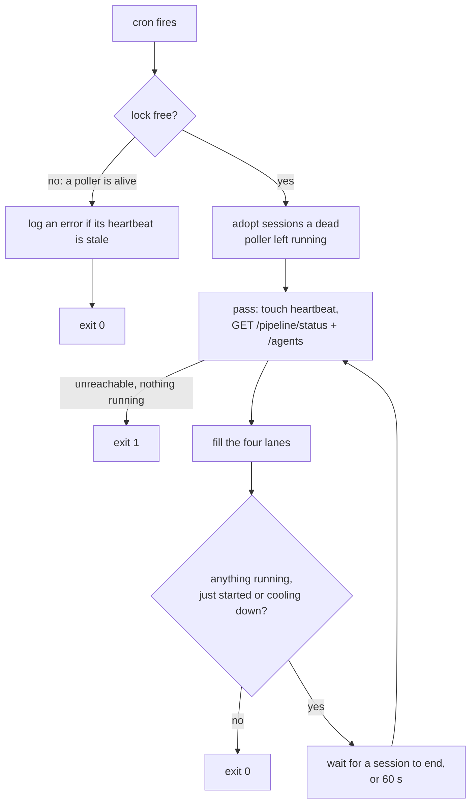

# The Poller

`scripts/poll.py` turns a pipeline status into an agent session. Cron starts it. It decides which
videos need an agent, starts one session per video and stage, watches each session to its end, and
records what the session cost and whether it moved the video. Nothing else starts an agent
unattended.

The poller is one of three loops that advance the pipeline with nobody watching. The
[worker](12-the-worker.md) owns publishing, Auto Pilot and the timed sweeps, and the
[renderer](11-rendering-and-review.md) owns rendering. The loops do not call each other. The poller
reaches the rest only through the Flask API, and it stops at human checkpoints.

[The Agent Layer](07-agent-layer.md) covers how agents are installed and assigned.
[Agent CLI Reference](22-agent-cli-reference.md) covers each CLI's command line, rejection
messages and usage format.

---

## The cron entry

```
*/30 * * * * <python> <repo>/scripts/poll.py >> ~/.tubematic-agent/logs/cron.log 2>&1
```

`python3 onboard.py --step cron` writes this line with the interval you chose and records the
interval in `poll_interval_mins`. Editing that setting alone does not change the crontab.

- The line names no agent. The poller asks the API which agent each video runs under (binary,
  workspace and model) on every pass, so installing or uninstalling an agent does not touch cron.
- The poller has no database access. Everything, including which agents are installed, reaches it
  through the Flask API.
- Its only argument is `--dry-run`. It ignores `--agent-run-path` and `--agent-binary` with a
  warning, so a crontab line that still carries them keeps running until the cron step rewrites it.
- An opener installed at start-up adds the API token to requests for `RENDERER_URL` and to no other
  URL. It reads `~/.tubematic-data/secrets/api_token` on each request, because a poller can outlive
  a token rotation. With no token the poller logs an error and exits with code 1.
- The log directory is fixed at `~/.tubematic-agent/logs` (`scripts/config.py::POLL_LOG_DIR`,
  mirrored in `onboard/config.py`), because logging starts before the first request and cron
  strips the environment.
- The poller runs from no workspace. It starts each agent in that agent's own workspace,
  `~/.tubematic-agent/<agent>/` by default ([Deployment](07-agent-layer.md#deployment)).

## The loop

Cron is the watchdog, and the poller sets its own pace. The tick that takes the lock keeps looping
until nothing is running and nothing is left to start. The code calls that process the supervisor
(`poll.py::_Supervisor`). A tick that finds the lock held exits at once. The poll interval is
therefore how soon an idle install notices new work. While there is work, the next session follows
a finished one within seconds.



## One pass, in order

`poll.py::_Supervisor.run` repeats the pass. Each pass reads what it needs over HTTP, so a changed
setting or a newly installed agent applies on the next one.

| # | Step | Symbol | What it does |
|---|---|---|---|
| 1 | Adopt | `_Supervisor._adopt` | Before the first pass only: takes over sessions a dead poller left running |
| 2 | Heartbeat | `_touch_heartbeat` | Touches `poll.heartbeat` |
| 2a | Disk-usage snapshot | `_refresh_disk_snapshot` | When `~/.tubematic-data/data/disk-usage.json` is an hour old, starts a detached measurement. See [Disk usage](#disk-usage) |
| 3 | Reap | `_Supervisor._reap` | Collects finished sessions, and starts the wait for a video whose scene-work claim may still be held |
| 4 | Read state | `_Supervisor._pass` | `GET /pipeline/status` and `GET /agents`. If either fails, nothing starts this pass |
| 5 | Tend adopted sessions | `_Supervisor._tend_adopted` | Stops an adopted session past its deadline, and scores one that has ended |
| 6 | Script profiles lane | `_Supervisor._profiles` | Starts the next pending profile build |
| 7 | Mascots lane | `_Supervisor._mascots` | Starts the next pending mascot build |
| 8 | Pause check | `_Supervisor._pass` | While the pipeline is paused, steps 9 and 10 are skipped |
| 9 | Pipeline lane | `_Supervisor._pipeline` | `GET /videos/workable`, oldest first. Starts one session per video up to the cap |
| 10 | Research lane | `_Supervisor._research` | Starts one research session if the caps allow |
| 11 | Exit or wait | `_Supervisor.run`, `_Supervisor._wait` | Exits, or waits for the first session to end, at most 60 seconds (`LOOP_WAIT_SECS`), then goes to step 2 |

`/settings` is read at most once a pass, and only by a lane that is about to start a session, so
an idle pass costs two requests. If the read fails, the pass uses the defaults and no user
preferences, and logs a warning. Sessions run on a thread pool, so a pass stays short however long
they are.

### When it exits

With nothing running and nothing started in the pass just finished, the poller:

- exits with code 1 if the API or `/agents` was unreachable;
- exits with code 0 if no agent is installed;
- exits with code 0 if the pipeline is paused, even when a video is waiting out a claim. The poller
  holds the lock for its whole life, and `upgrade.py` and `service.py stop` wait on that lock;
- otherwise keeps looping while a video is waiting out a claim, then exits with code 0.

### `--dry-run`

`--dry-run` runs one pass, logs what each lane would start, and starts nothing. It skips adoption,
the heartbeat and the disk-usage snapshot, and records no research run and no build attempt. It still needs the API token
and takes the lock, so beside a live poller it exits at once like any other tick.

## Disk usage

The dashboard's disk figure ([Dashboard internals](15-dashboard.md#disk-usage)) needs sizes that no
container can measure, because no container has the Docker socket. The poller runs on the host on a
schedule, so it starts the measurement: `python3 -m tubematic_core.disk_usage`. That command runs
`docker ps`, `docker container inspect --size`, `docker image ls` and `docker system df` (all
read-only), walks the install folder, and writes the result atomically to
`~/.tubematic-data/data/disk-usage.json` for the API. It touches Docker and files only, so the
poller still has no database access.

- `_refresh_disk_snapshot` runs before the poller reads state, so a paused pipeline, an unreachable
  API or an install with no agent still gets a fresh figure.
- It acts when the file is an hour old. `upgrade.py` and onboarding measure again after they change
  images.
- The measurement runs in a detached process (`start_new_session`), because Docker can take minutes
  to size containers on a slow storage driver. A file lock lets one measurement run at a time.
- A poller starts at most one measurement an hour. The measurement's errors go to
  `~/.tubematic-agent/logs/disk-usage.log`, and a failure to start one is logged once as a warning.

## Lock and heartbeat

- The lock is `~/.tubematic-agent/poll.lock`, held with `flock`. It sits beside the logs so that
  pollers sharing one home directory (several containers that mount the same home, for example)
  share one lock.
- The lock file is not deleted. If it were unlinked while locked, a poller holding the old file
  and a poller creating a new one would both hold a lock.
- The kernel releases `flock` when its holder dies, so a held lock means a live poller.
- The poller touches `~/.tubematic-agent/poll.heartbeat` on every pass. A tick that finds the lock
  held logs an error if the heartbeat is more than five minutes old (`HEARTBEAT_STALE_SECS`). It
  kills nothing, because a session of the hung poller may be in the middle of a paid call.

## The four lanes

| Lane | Sessions at once | Starts | While paused |
|---|---|---|---|
| Pipeline | Up to `max_concurrent_agent_sessions` (default 3, at most 10), one per video | The oldest workable videos that are not running or waiting out a claim | Nothing new |
| Research | One | At most one run per poller process, when both research caps allow | Nothing new |
| Script profiles | One | The next pending profile | Still runs |
| Mascots | One | The next pending mascot (`PENDING` or `BUILDING`) | Still runs |

A pause stops new pipeline and research sessions, and running sessions finish. The two build lanes
run while paused because a build spends no ElevenLabs credit and produces no video, so pausing it
would only leave a dashboard row at Pending.

Every prompt carries the `user_preferences` setting as a fenced block when it is set
([User preferences](07-agent-layer.md#user-preferences)).

### Which agent runs a session

- The default agent is the live `is_default` row, else the oldest live one. Research and
  script-profile builds run under it, with its default model (`models[0]`) and its `effort`.
- A workable video runs under `videos.agent_id`, or the default agent when that is empty. The
  model is `videos.agent_model` or the agent's `models[0]`, and the effort is
  `videos.agent_effort` or the agent's `effort`.
- A video pinned to an uninstalled or unknown agent is logged as an error once per poller process
  and skipped until that agent is installed again. The poller does not hand it to another agent
  ([Assignment](07-agent-layer.md#assignment)).
- No agent installed is the normal state before `--install-agent` has run, and is logged once as a
  warning that names the command. An unreachable `/agents` is an outage, and a poller with nothing
  running exits with code 1.
- An unreachable `/videos/workable` starts no pipeline session, because without the list the
  poller cannot tell which agent a video belongs to.
- A video at a status with no entry in `poll.py::STAGES` is logged as an error once and skipped.

### Research caps

Research starts only when both caps pass. `/pipeline/status` reports the figures.

- `proposed_count` is below `research_pending_cap`.
- `research_runs_today` is below `max_research_runs_per_day`.

Three more rules apply:

- Research runs at most once per poller process. A poller lives as long as there is work, and a
  run after every finished session would spend the daily cap back to back.
- The run is recorded with `POST /research/record-run` before the agent starts. Counted on
  completion, a run that died would leave the counter unchanged and start again on every pass. If
  the request fails, this poller runs no research.
- With no research mode active (only mining is on and no Gemini key is stored, for example), the
  run is skipped before it is recorded.

### Script profiles

The lane builds one profile at a time under the default agent. A session starts only after
`POST /script-profiles/<id>/record-attempt` has counted the attempt. When the answer is `FAILED`
(the attempt cap is used up), the lane tries the next pending profile
([Script profiles](08-scripting-and-voice.md#script-profiles)).

### Mascots

The lane builds a mascot's drawing code (`_Supervisor._mascots`), one session at a time.

- A session starts only after `POST /mascots/<id>/record-attempt` has counted the attempt.
- At the attempt cap (`tubematic_core/mascots.py::MAX_MASCOT_ATTEMPTS`) the server marks the
  mascot `FAILED`. If an approved version exists, the error says it is still in use, and videos
  keep rendering with it.
- The session runs under the agent pinned on the mascot (by the dashboard's create form or
  `POST /mascots`), else the default agent, with the mascot's model and effort or that agent's.
- A mascot pinned to an uninstalled agent is skipped with one logged line and no recorded attempt.
  The poller does not hand it to another agent.
- The prompt carries only the mascot's id. The brief, any change request and the rendered sheets
  travel over MCP ([Mascot authoring](06-mcp-server.md#mascot-authoring)).
- Usage is recorded under the operation `agent_mascot`.

## One stage per session

The prompt (`poll.py::build_pipeline_prompt`) tells a pipeline session which video it is for, the
status the video is at, and the status at which to stop. The next stage starts in a new session.

| Starts at | Stage | Stops when the status reaches |
|---|---|---|
| `TOPIC_APPROVED` | scripting | `SCRIPT_READY` |
| `VOICING` | voicing | `VOICE_READY` |
| `VOICE_READY` | scene work | `RENDER_QUEUED` |
| `REVISION_REQUESTED` | a revision | `TOPIC_PROPOSED`, `SCRIPT_READY`, `VOICING` or `RENDER_QUEUED` |

A session does one stage because its cost is recorded under the status it started at. The scope
is in the prompt and the operator skill is unchanged, so an interactive session can still work
several videos and stages.

- A pronunciation revision stops at `VOICING`. The prompt says to fix the lexicon or the
  respelling, set `VOICING` and end the session, so the re-voice and the scene work each get their
  own session and their cost is not recorded as the revision's.
- A revision does not stop at `VOICE_READY`. An animation revision goes `REVISION_REQUESTED` →
  `VOICE_READY` → `RENDER_QUEUED`, and the
  [scene-work claim](06-mcp-server.md#the-scene-work-claim) spans that window and is keyed to the
  MCP session. A second session would be refused by the first one's claim.
- The prompt forbids looking for more work with `list_videos` or `get_pipeline_status`. It allows
  reading install settings from `get_pipeline_status`, because the skills read the pronunciation
  lexicon and the voice roster from that tool.
- The prompt says that `VOICING` is not a checkpoint: the script approval authorizes the
  `generate_voice` call, and no person is present to ask.
- A `VOICING` session that ends at `RENDER_QUEUED`, `RENDERING` or `VIDEO_READY` ran on into scene
  work, and its whole cost is recorded as voicing. The poller logs a warning (`poll.py::OVERRUN`).
  A revision's route is not visible in its end status, so no other overrun is detected.

## Success is read from the database

A CLI's exit code does not say whether a session did its work. Claude can exit 0 on an unknown
model, and Codex exits 0 with every MCP call refused. After each pipeline session the poller
reports the status the session started at to
[`POST /videos/<id>/agent-outcome`](05-http-api.md#post-videosvideo_idagent-outcome), and the API
compares it with the video's status now:

| Status now, against the start | Exit code | Verdict |
|---|---|---|
| Changed, by anyone | any | Progress. The no-progress count resets to 0 |
| Unchanged | 0, or unknown for an adopted session | No progress. The count goes up by 1, logged as a warning |
| Unchanged | non-zero | No progress. The count goes up by 1, logged as an error |

The exit code and stderr are logged for diagnosis and do not decide the verdict. If the report
cannot be made, the count is left alone. Each report carries the session's key, and the API
ignores a key it has already counted, so a session finished by a second poller is counted once.

### Stuck videos

Three sessions in a row without progress flag the video stuck (`AGENT_NO_PROGRESS_CAP`). The video
keeps its status, gets a comment that says why, and drops out of `/videos/workable`. The usual
cause is a lapsed agent login or a withdrawn model. A human releases the video by changing its
status or with **Retry agent** on the dashboard. The cap keeps the loop from running the same
video every few minutes. It is a constant because a human releases the video whatever its value.

### The scene-work claim wait

A session that started at `VOICE_READY` or `REVISION_REQUESTED` and left the video at either (or
at an unknown status, when its outcome could not be recorded) may still hold its scene-work claim.
The MCP server keeps a claim for `SCENE_CLAIM_TTL_SECS` (15 minutes) after its last use, and a
session started sooner would be refused with `scene_work_claimed` and count as one without
progress. The poller waits 15 minutes (`CLAIM_COOLDOWN_SECS`) before that video's next session,
and keeps running until the wait is over.

## Timeouts and orphans

- `agent_session_timeout_secs` (default 90 minutes) bounds one session, retries included. Each
  agent process starts in its own process group. Past the deadline the group gets `SIGTERM`, then
  `SIGKILL` ten seconds later (`KILL_GRACE_SECS`), so anything the agent started stops with it.
- The grace is measured on the whole group, because an agent that exits on `SIGTERM` can leave a
  child that ignored it and can still change the video.
- `PR_SET_PDEATHSIG` is not used, because it fires when the thread that started the process exits,
  and sessions run on a thread pool.
- Agent output goes to files in `~/.tubematic-agent/sessions/`. A pipe would kill an agent with
  `SIGPIPE` when its poller died. The files are deleted once that run's usage is recorded.
- Every running agent process is listed in `~/.tubematic-agent/poll-sessions.json`, with its pid,
  its start time from `/proc` (another process can reuse a pid), its video and its deadline.

If a poller dies, the next one adopts what is still running:

- An adopted session takes a slot and keeps its video out of dispatch. It is stopped only when it
  passes its own deadline, because it may be half-way through a paid call.
- When it ends, its usage and outcome are recorded from its output files, and its retries are not
  resumed.
- A registry entry outlives its process. It is removed when the whole session is scored, so a
  poller that dies while recording usage or an outcome (a usage read can take minutes) leaves the
  rest to the next one.
- An entry's run id is also the usage record's `session_id`, and the ledger is idempotent on it, so
  a run the dead poller had recorded is counted once.
- Nothing signals the end of a process that is not the poller's child, so the loop checks adopted
  sessions every second. That also keeps an overdue orphan's `SIGKILL` on the ten-second grace.
- Before the poller signals an orphan's group, it compares the pid with the recorded start time
  (`poll.py::_entry_group_alive`). A live process that holds the pid under another start time
  means the pid was reused, and the poller does not signal that group.

## Running one agent process

`poll.py::invoke_agent` builds the command through the agent's adapter
(`scripts/agent_adapters.py`) and runs it from the agent's workspace (`run_path`), with stdin
closed.

- The binary is resolved through `which` on every run. The stored value arrives over HTTP, and
  running a stored path unchecked would be a way to execute arbitrary code.
- `_usable_model` drops a model string that would corrupt the command line (an embedded space or a
  leading dash), and the CLI falls back to its own default. It does not catch a well-formed name
  that is misspelled.
- `_usable_effort` drops an effort that is not one of the five levels, and the run uses the CLI's
  default effort.
- A run passes the video's model, else the agent's `models[0]`.

### Rejected model or effort

A CLI can refuse the model or the effort level it was given. Each adapter declares how to
recognise that in its CLI's output ([Agent CLI Reference](22-agent-cli-reference.md)), and
`invoke_agent` retries with the refused flag dropped:

1. The first run passes both flags.
2. If the effort was rejected, the run did nothing. The poller runs again with no effort flag.
3. If the model was rejected, it runs again with no model flag, so the CLI's own default model
   does the work. The effort that survived step 2 is kept.
4. If the CLI's default model rejects an effort that the chosen model accepted, it runs once more
   with neither flag.

- A session makes at most three runs, because each flag is dropped at most once.
- Effort is dropped first, because an effort rejection means the CLI refused to start and nothing
  else about that run can be relied on.
- A model rejection is read from the output, because the Claude CLI can exit 0 on a model it does
  not recognise. An effort rejection also requires a non-zero exit and is matched only against
  the CLI's own error text, so a session that discusses the flag cannot strip it from later runs.
- OpenCode names a rejected effort and a rejected model differently, so an effort retry keeps the
  chosen model. Its effort rides on the model string, so a run without a model has no effort and
  step 4 cannot occur for it.
- A run that was killed at the deadline is not retried. Its output says nothing about its flags,
  and a retry would start a process past the session's deadline.

The installer probes each model and the default effort at install time
([Models](07-agent-layer.md#models), [Effort](07-agent-layer.md#effort)). The retries cover what
that probe cannot see, such as a per-video model or a model that was withdrawn later.

### Usage

Every run's usage is recorded, retries included, because each was billed separately. A run that
never started reports none.

- The CLIs run in their JSON output modes so that `_report_usage` can parse what a run used. It
  posts the result to [`/usage/agent-session`](05-http-api.md#post-usageagent-session).
- The record names the kind of run: `agent_pipeline`, `agent_research`, `agent_profile` or
  `agent_mascot`. A pipeline session also names its video and the status the video was at when the
  session started, which is the stage the dashboard labels the cost with.
- Claude and OpenCode sessions carry their own cost at list price, and a Codex session's tokens
  are priced from the price table.
- A failed POST does not fail the session. The poller logs it with the full payload, so the units
  can be sent again. A `200` that recorded fewer events than were sent counts as a failure too.
  Sending a payload again is safe, because the route is idempotent per session and event.
- For OpenCode the poller reads the session's own message record, a call that costs nothing,
  because the JSON stream can omit the last step's usage. It tries up to three times, five seconds
  apart, and logs each miss with its reason. If every try fails it uses the stream and marks the
  figures estimated.

## Logs

The poller writes to `~/.tubematic-agent/logs/poll.log`, rotated at midnight with 14 days kept.
`cron.log` in the same directory receives raw cron output: anything written before logging starts,
such as an import error. An empty `cron.log` is normal.

- Every `poll.log` line names the session it came from, because several sessions write at once:
  `[video=<id>]`, `[research]`, `[profile=<id>]`, `[mascot=<id>]` or `[supervisor]`. The JSONL
  entries carry the same in their `video_id` and `profile_id` fields.
- At `DEBUG` level `poll.log` holds each full prompt and each command line, with the prompt shown
  as `<prompt>`.
- Every prompt gives the agent the absolute `poll.log` path, so it can read recent entries when
  something unexpected happens.

A run's output in the JSON modes is the entire session, with every tool call's arguments and
results, so it is not logged whole. Each adapter's `summarize_output` reduces it to one entry that
starts with `Agent result` and the tool trace, followed by any error the CLI reported and the
agent's final message, clipped at 4,000 characters (`LOG_OUTPUT_CAP`).

| | Final message | Tool trace |
|---|---|---|
| Claude | The JSON object's `result` | Its turn count and any `permission_denials`. The object lists no individual tool calls |
| Codex | The last completed `agent_message` | Every completed tool item, counted by name. A call also appears as `item.started`, so only `item.completed` is read |
| OpenCode | The last `text` event | Every `tool_use`, keyed by its call id, so a call reported twice counts once |

- Output in none of these shapes, such as an old CLI's or a crash banner, is logged clipped.
- Stderr keeps its last 4,000 characters, because a crash's error lands at the end.
- The raw stream is not kept. The CLI's own session history holds the full transcript.
- The clipping applies to the log only. The model and effort verdicts and the usage parsers read
  the complete output, so a rejection printed after 4,000 characters of other output is still
  caught.

The poller also writes a structured `poll.<date>.jsonl` to the shared log directory, so its
sessions show on the dashboard's Logs page ([The log files](16-infrastructure.md#the-log-files)).
It is the one writer there that runs as the host user, so it needs write access to
`~/.tubematic-data/logs`. If it has none, `poll.log` says so each time the poller starts.
