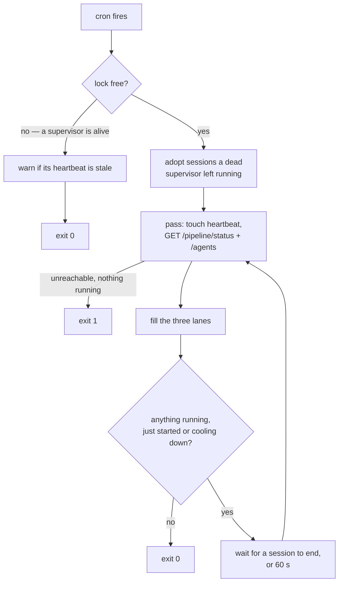

# The Poller

`scripts/poll.py` is what turns a pipeline status into an agent session. Cron starts it; it decides
which videos need an agent, starts one session per video and stage, watches each session to the
end, and records what it cost and whether it moved the video. It is the only thing that ever starts
an agent unattended.

It is one of the two loops that advance the pipeline with nobody watching. The other is the render
worker, which owns everything that is not agent work: rendering, review, publishing and Auto Pilot.
See [The Worker](12-the-worker.md). The two never call each other; they meet only in the database,
through a video's status.

| The poller | The worker |
|---|---|
| Runs on the host, started by cron | Runs in the `tubematic-renderer` container, always on |
| Talks to the Flask API over HTTP, never the database | Reads and writes the database directly |
| Starts agents for `TOPIC_APPROVED`, `VOICING`, `VOICE_READY`, `REVISION_REQUESTED` | Renders `RENDER_QUEUED`, settles `PUBLISHING`, and approves checkpoints under Auto Pilot |
| Stops at human checkpoints | Is what moves a video past one, when Auto Pilot is on |

How agents are installed, which agent a video is assigned to, and what the skills tell an agent to
do are in [The Agent Layer](07-agent-layer.md). This page is the poller itself.

---

## The cron entry

`scripts/poll.py` is the cron entry point. It has **no database access by design** — everything,
including which agents are installed, reaches it through the Flask API. Its only argument is
`--dry-run`.

Every request it makes to the API carries the API token. One opener, installed at start-up, adds it
to each request for `RENDERER_URL` and to nothing else, and reads `~/.tubematic-data/secrets/api_token`
per request rather than once, because a supervisor outlives a token rotation. With no token at all
it logs an error and exits before doing anything.

```
*/30 * * * * <python> <repo>/scripts/poll.py >> ~/.tubematic-agent/logs/cron.log 2>&1
```

**The line names no agent.** Which agent runs — its binary, workspace and model — is resolved per
video over HTTP on every pass, so installing, re-installing or uninstalling an agent never touches
cron. The one input the poller cannot get over HTTP is where to log: logging starts before the first
request, and cron strips the environment, so the directory is fixed at `~/.tubematic-agent/logs`
(`scripts/config.py::POLL_LOG_DIR`, mirrored in `onboard/config.py`).

**Each agent's workspace is a sibling of that directory**, `~/.tubematic-agent/<agent>/` by default,
and the installer refuses a workspace that is, contains, or sits inside the logs directory or any
other agent's workspace (an uninstalled agent's included, since a re-install reuses it). A workspace
is the agent's working directory, holds whatever per-agent configuration that agent keeps there
(for Claude Code its `.claude/settings.json`, for OpenCode its `.opencode/opencode.json` and `.opencode/opencode.jsonc`; Codex keeps none), and is the unit a wipe deletes, so a shared or nested one would let reinstalling one agent delete another agent's
files or the logs. The poller itself runs from no workspace at all — only the agent it launches
does, with its own workspace as the working directory.

**A workspace is not a read sandbox.** The allowlist's `Read` rule is unscoped, so an agent can read
files outside its workspace without a prompt — `poll.log` included. The installer still lists the
logs directory in each workspace's `permissions.additionalDirectories`, so the prompts' pointer to
`poll.log` keeps working if `Read` is ever narrowed to the workspace.

A crontab written by an older version still passes `--agent-run-path` and `--agent-binary`. They are
ignored with a warning rather than rejected — failing on them would stop the pipeline on an upgrade
that has not re-run the cron step yet. `python onboard.py --step cron` rewrites the line.

## The supervisor loop

**Cron is a watchdog, not a clock.** The tick that takes the lock becomes the **supervisor** and
keeps looping until nothing is running and nothing is left to start. A tick that finds the lock
held exits at once. So the poll interval is how soon an idle install notices new work, not how often
work advances: while there is work, a finished session is followed by the next one within seconds.



## One pass, in order

`poll.py::_Supervisor.run` repeats this until it has nothing running, nothing just started and
nothing worth waiting for. Every step re-reads what it needs over HTTP, so a changed setting or a
newly installed agent applies on the next pass with no restart.

| # | Step | Symbol | What it does |
|---|---|---|---|
| 0 | Adopt, once | `_Supervisor._adopt` | Before the first pass only: take over sessions a dead supervisor left running. See [Timeouts and orphans](#timeouts-and-orphans) |
| 1 | Heartbeat | `_touch_heartbeat` | Touches `poll.heartbeat`, so a later tick can tell a live supervisor from a hung one |
| 2 | Reap | `_Supervisor._reap` | Collects sessions that finished since the last pass, and starts the 15-minute wait for a video whose scene-work claim may still be held |
| 3 | Read state | `_Supervisor._pass` | `GET /pipeline/status` and `GET /agents`. Either unreachable starts nothing this pass. No agent installed is logged once and is not an error |
| 4 | Tend adopted sessions | `_Supervisor._tend_adopted` | Stops an adopted session that is past its deadline, and scores one that has ended |
| 5 | Script profiles lane | `_Supervisor._profiles` | Starts the next pending profile build if the lane is free. **Runs before the pause check, on purpose** |
| 6 | Pause check | `_Supervisor._pass` | Paused: steps 7 and 8 are skipped. Sessions already running carry on |
| 7 | Pipeline lane | `_Supervisor._pipeline` | `GET /videos/workable`, oldest first, and starts one session per video up to `max_concurrent_agent_sessions`, skipping videos already running or waiting out a claim |
| 8 | Research lane | `_Supervisor._research` | Starts one research session if both caps allow and this supervisor has not run one yet |
| 9 | Exit or wait | `_Supervisor.run`, `_Supervisor._wait` | Nothing running and nothing started: exit. Otherwise wait for the first session to end, at most 60 seconds (`LOOP_WAIT_SECS`), then go to step 1 |

`/settings` is read lazily, at most once a pass, and only by a lane that is about to start a
session, so an idle pass costs two requests.

**When it exits.** With nothing running and nothing started in the pass just finished:

- exit `1` if the API or `/agents` was unreachable;
- exit `0` if no agent is installed;
- exit `0` if the pipeline is paused, even when a video is waiting out a claim. The supervisor holds
  the lock for its whole life, and `upgrade.py` and `service.py stop` wait on that lock, so a paused
  supervisor must not sit on it for fifteen minutes with nothing it is allowed to start;
- otherwise keep looping while any video is still waiting out a claim, then exit `0`.

**How long a step can take.** Steps 1 to 8 are a handful of HTTP requests and return at once: a
session is started on a thread pool, never run inline. So a pass is quick however long the sessions
are, and the wait in step 9 is what paces the loop. With adopted sessions present the wait checks
them every second, because nothing signals the supervisor when a process that is not its child ends.

**`--dry-run`** runs exactly one pass, logs what each lane would start, and starts nothing. It skips
adoption and the heartbeat. It still takes the lock, so beside a live supervisor it exits at once
like any other tick.

## The three lanes

Each pass fills three lanes:

| Lane | Sessions | Starts | Paused? |
|---|---|---|---|
| Pipeline | up to `max_concurrent_agent_sessions` (default 3), one per video | the oldest workable videos not already running or cooling down, each under its own agent, model and effort | starts nothing new |
| Research | one | at most **once per supervisor**, when both research caps allow | starts nothing new |
| Script profiles | one | the next pending profile, one after another | **still runs** |

- **The lock** is `~/.tubematic-agent/poll.lock`. It sits beside the logs rather than in `/tmp` so
  every Tubematic file lives at a known location, and so pollers that share a home directory — Kasm
  sessions on one persistent profile — share one lock. The file is never deleted: unlinking a locked
  file would let a poller still holding the old one and a poller creating a fresh one both hold "the"
  lock. `flock` is released by the kernel when its holder dies, so a held lock always means a live
  supervisor.
- **The heartbeat**, `~/.tubematic-agent/poll.heartbeat`, is touched on every pass. A tick that
  finds the lock held logs an error if the heartbeat is more than five minutes old — a live but hung
  supervisor — and **kills nothing**: one of its sessions may be in the middle of a paid call.
- **No agent installed is not an error.** It is the normal state between setting up the project and
  running `--install-agent`; the log line names the command to run. An *unreachable* `/agents` is
  different — a transient outage — and a supervisor with nothing running exits 1 on it.
- **The default agent** is the live `is_default` row, else the oldest live one. Script-profile builds
  and research run under it, with its default model (`models[0]`) and its `effort`.
- **Script profiles run while paused** on purpose — see [Scripting and Voice](08-scripting-and-voice.md).
- **A pause stops dispatch, not work.** Sessions already running finish; nothing new starts in the
  pipeline or research lanes until the pipeline is resumed.
- **Each workable video runs under its own agent** — `videos.agent_id`, or the default agent when that
  is empty — with `videos.agent_model` or the agent's `models[0]`, and `videos.agent_effort` or the
  agent's `effort`. A video pinned to an uninstalled or unknown agent is logged as an error once per
  supervisor and skipped until that agent is re-installed. It is never rerouted
  ([Assignment](07-agent-layer.md#assignment)).
- **An unreachable `/videos/workable` starts no pipeline session.** There is no longer a fallback that
  asks one agent to work "every workable video": without the list the poller cannot tell whose videos
  they are, and such a session crosses agent boundaries.
- **Research is gated by two independent caps**, both of which must pass: `proposed_count` below
  `research_pending_cap`, and `research_runs_today` below `max_research_runs_per_day`. On top of that
  it runs **at most once per supervisor**: a supervisor lives as long as there is work, and starting
  a research run after every finished session would spend the daily cap back to back.
- **The run is recorded before the agent is invoked.** Counting completions instead would fail open
  exactly when the cap matters — a crashed run would leave the counter at zero and re-fire forever.
  Recording also *fails closed*: if `POST /research/record-run` is unreachable, this supervisor runs
  no research.

## One stage per session

A pipeline session is told which video it is for, the status it starts at, and the status at which
to stop. It works on nothing else and ends there; the next stage starts in a new session.

| Starts at | Stage | Stops when the status reaches |
|---|---|---|
| `TOPIC_APPROVED` | scripting | `SCRIPT_READY` |
| `VOICING` | voicing | `VOICE_READY` |
| `VOICE_READY` | scene work | `RENDER_QUEUED` |
| `REVISION_REQUESTED` | a revision | `TOPIC_PROPOSED`, `SCRIPT_READY`, `VOICING` or `RENDER_QUEUED` |

**A pronunciation revision stops at `VOICING`,** and the prompt says so in so many words: fix the
lexicon or respelling, set `VOICING`, end the session. The operator skill's pronunciation row tells
an interactive session to carry straight on into the re-voice and the scene work, and a scheduled
session given only the stop list followed the skill — re-voicing and redoing every scene in one
session, all of it recorded as the revision's cost. The skill row now makes the same exception.

**A revision does not stop at `VOICE_READY`.** An animation revision goes `REVISION_REQUESTED` →
`VOICE_READY` → `RENDER_QUEUED`, and the [scene-work claim](06-mcp-server.md#the-scene-work-claim)
spans that whole window and is keyed to the MCP session. Splitting it would hand the second half to
a session the claim refuses.

The scope lives in the poller's prompt, not in the operator skill, so an interactive session still
works several videos and stages at once. The prompt forbids *looking for more work* with
`list_videos` or `get_pipeline_status`, and says in the same breath that reading install settings
from `get_pipeline_status` is fine. That second sentence is deliberate: the skills read the
pronunciation lexicon and the voice roster from that tool, and a flat "do not call it" made agents
skip steps their skill required rather than break the rule. Why one stage: a session's cost is recorded under the
status it started at, which is exact only if it does one stage; and the next stage no longer waits
for another tick. A `VOICING` session that ends at `RENDER_QUEUED` or later has run on into scene work
and is logged as a warning, because its whole cost is labelled as voicing. That is the one overrun
visible from statuses alone: a revision's route is not visible in where it ends.

## Success is read from the database

The CLIs are unreliable reporters. Claude exits 0 on an unknown model; Codex exits 0 with every MCP
call refused. So after each pipeline session the supervisor reports the status the session started
at to [`POST /videos/<id>/agent-outcome`](05-http-api.md#post-videosvideo_idagent-outcome), and the API compares it with the
video's status now:

| Status now vs at the start | Exit code | Verdict |
|---|---|---|
| changed, by anyone | any | progress: the no-progress count resets to 0 |
| unchanged | 0 | no progress: the count goes up by 1, logged as a warning |
| unchanged | non-zero | no progress: the count goes up by 1, logged as an error |

The exit code and stderr are logged for diagnosis but never decide the verdict, and usage is
recorded for every session either way. If the report cannot be made, the count is left alone and
the supervisor carries on. Each report carries the session's key, and the API ignores a key it has
already counted, so a successor finishing a dead supervisor's session never counts it twice.

**Three sessions in a row without progress flag the video stuck** (`AGENT_NO_PROGRESS_CAP`). It stays
at its status — nothing about the video is broken; more often the agent's login lapsed or its model
was withdrawn — gets a comment saying why, and drops out of `/videos/workable`, so no session is
started for it. A human releases it by changing its status or with **Retry agent** on the
dashboard. The cap replaces the cron tick as the throttle on a video the agent cannot move: without
it the loop would re-run that video every few minutes. It is a constant rather than a setting — a
human releases a stuck video either way, so there is little to tune.

**A scene-work session that ends inside the claim window waits 15 minutes before its video's next
session.** A session that started at `VOICE_READY` or `REVISION_REQUESTED` and left the video at
either may still hold its scene-work claim, which the MCP server keeps for `SCENE_CLAIM_TTL_SECS`
after its last use. A new session started sooner would be refused with `scene_work_claimed` and
count as another session without progress. The TTL was sized for the 30-minute gap between cron
ticks, which the loop removed, so the supervisor waits it out itself — and stays running until the
wait is over, rather than leaving the video to a later tick.

## Timeouts and orphans

- **`agent_session_timeout_secs`** (default 90 minutes) bounds one session, retries included. Each
  agent process starts in its own process group; past the deadline the group gets `SIGTERM`, then
  `SIGKILL` ten seconds later, so anything the agent started goes with it. The grace is measured on
  the **whole group**, not its leader: an agent that exits promptly on `SIGTERM` can leave a child
  that ignored it, still spending and still able to change the video after a replacement session
  has started. `PR_SET_PDEATHSIG` is not used: it fires when the *thread* that started the process
  exits, and sessions run on a thread pool.
- **Agent output goes to files** in `~/.tubematic-agent/sessions/`. A pipe would kill an agent with
  `SIGPIPE` the moment its supervisor died. The files are deleted once that run's usage is recorded.
- **Every running agent process is listed** in `~/.tubematic-agent/poll-sessions.json`, with its
  pid, its start time from `/proc` (a pid alone can be reused by an unrelated process), its video and
  its deadline. **An entry outlives its process**: it is removed only once the whole session is
  scored, so a supervisor that dies while recording a finished session's usage or outcome — a usage
  read can take minutes — leaves its successor the rest of the job. The run id each entry is
  registered under is also the usage record's `session_id`, on which the ledger is idempotent, so a
  run the dead supervisor had already recorded is not counted twice. If a supervisor dies, the next
  one **adopts** what is still running: an adopted session takes a slot and keeps its video out of
  dispatch, is stopped only once past its own deadline, and has its usage and outcome recorded from
  its output files when it ends. Adoption rather than killing, because the orphan may be half-way
  through a paid call. An adopted process is not the supervisor's child, so nothing signals its end;
  the loop checks adopted sessions every second instead of once a pass, which also keeps an overdue
  orphan's `SIGKILL` on the ten-second grace. Before signalling an orphan's group, the pid is checked
  against its recorded start time: a live process now holding the pid under a different start time
  means the pid was reused, and that group is not ours.

## Running one agent process

- `invoke_agent` builds the command through the agent's adapter and runs it from the agent's own
  workspace (`run_path`). The binary is re-resolved through `which` on every run, never exec'd as
  stored: the value arrives over HTTP, and running an arbitrary stored path unchecked would be a new
  code-execution surface.
- `_usable_model` **drops** a model string that would corrupt argv (an embedded space, a leading
  dash), letting the CLI fall back to its own default rather than issuing a broken command. A
  misspelled but well-formed name is deliberately *not* caught before the run.
- `_usable_effort` is the same idea but a **membership** check, which the model cannot be: the five
  levels are a closed set the CLI documents in its own `--help`, so a wrong one is knowable before
  the run. Anything else is dropped and the run uses the CLI's own default effort.
- **A rejected model is detected from the agent's output, never its exit code** — the Claude CLI
  exits **0** on a model it does not recognise ([Models](07-agent-layer.md#models)). A returncode check would log
  success for a run that did nothing, every session, indefinitely. `invoke_agent` matches the markers
  the agent's own adapter declares (`scripts/agent_adapters.py`), logs an error, and re-runs once
  with no model flag so the CLI's own default does the work.
- **A rejected `--effort` is the opposite shape, and that is the point.** A CLI that knows the flag
  but not the *value* warns on stderr, exits **0** and does the work at its own default effort — so
  there is nothing to fall back from. A CLI too old to know the flag at all exits **non-zero** with
  `unknown option` and runs nothing. Only the second is worth a retry, so `effort_rejected` requires
  a non-zero exit, an unknown-option marker, and the flag's own name, and **never reads the agent's
  own words** — matching the session's text would let one that merely *discusses* the flag strip it
  from every run that followed. For Claude that means stderr only. Codex and OpenCode, in their JSON
  output modes, move their own error messages onto stdout as `error` / `turn.failed` events (with
  stderr empty or a one-line notice), so their matchers read stderr **plus those events only** —
  the agent's text lives in other event types and is never looked at.
- **Every run's usage is recorded, retries included** — each was a separately billed session. The
  CLIs run in their JSON output modes (listed under [Agents](07-agent-layer.md#agents)) so `_report_usage` can parse what each run used
  and POST it to `/usage/agent-session`, tagged with the kind of run (`agent_pipeline`,
  `agent_research`, `agent_profile`) and, for a pipeline session, **its video with the status it was
  at when the session started** — the stage the dashboard labels that session with. Sessions recorded
  before the poller ran one video per session (`agent_unscoped` among them) could cover several
  videos; those are split evenly across their videos when a video's cost is shown. Claude and OpenCode sessions carry their own
  list-price cost; a Codex session's tokens are priced from the table (see
  [Settings — Costs](../user-guide/05-settings.md#costs)). A failed POST never costs the session: it is logged, with
  the full payload so the units can be re-sent. A `200` that recorded fewer events than were sent
  counts as a failure too. Resending is safe: the route is idempotent per session and event, so
  events the first attempt did record are not counted twice. OpenCode needs one extra, free call for this —
  its JSON stream sometimes omits the last step's usage, so the session's own message record is
  read instead — retried up to three times, each miss logged with its reason, since the read was seen
  to fail right after a run that ended on a provider error and succeed moments later — falling back to
  the stream (marked estimated) only if every attempt fails.
- **A killed run is never retried.** Its output says nothing about its flags, and a retry would start
  another process past the session's deadline.
- **At most three runs, ever, and effort is dropped before the model.** The real run, then one
  retry per dropped flag. Effort goes first because its rejection means the CLI refused to start, so
  nothing else about that run can be believed; the model retry keeps whatever effort survived.
  Without a cap this shape loops.
- **Codex fails the same way for a different reason.** It cannot reject the effort *flag* — that
  rides on a generic `-c` override every version accepts — but the API rejects a level the chosen
  **model** does not support, exits non-zero and does nothing, which is the same shape and deserves
  the same retry. Its marker is the rejected parameter's own name on stderr, covering both the
  unsupported-for-this-model case and a malformed value. A bad value is still dropped by
  `_usable_effort` before the run, so in practice this fires on a legal level meeting the wrong
  model.
- **OpenCode fails the same way again, and recovers better.** Its effort is a `#variant` on the
  model, and a variant the model does not define is rejected before any API call:
  `Error: Variant unavailable for <model>: <variant>`, non-zero exit, nothing run. Unlike Codex's,
  that wording is distinct from its rejected-*model* wording (`Model unavailable`), so the retry
  keeps the chosen model instead of falling back to the CLI's default as well. The mirror of that
  is that dropping OpenCode's model necessarily drops its effort, since the effort has nowhere else
  to live — which makes the ladder's model-then-effort round unreachable for this agent.
- **The effort is also probed at install time**, with that agent's one-word probe prompt and its
  **default model**, whether or not the effort question was asked — the default install is the one
  that never asks and is also the common one. A bad combination warns there rather than first
  appearing as a silently wasted 3am session. It never blocks the install: the runtime fallback still
  produces a working run. The model matters because the two agents fail differently — Claude rejects
  the flag regardless of model, Codex and OpenCode reject the model/effort *pair* — so an agent
  whose rejection needs a model (`PROBES_EFFORT_WITHOUT_A_MODEL = False`) is not probed without one,
  which would be a billed run that could never produce a verdict.
- **Every run now passes a model.** Before agents were rows, the install-wide model defaulted to
  empty and most runs passed no `--model` at all. Now a run passes the agent's validated `models[0]`
  unless the video names another. The rejected-model fallback above is the safety net if that model
  later disappears.

## Logs

Logs go to `~/.tubematic-agent/logs/poll.log`, rotated at midnight with 14 days kept, and
`cron.log` in the same directory for raw cron output — anything written before logging starts, such
as an import error. Every `poll.log` line names the session it came from — `[video=<id>]`,
`[research]`, `[profile=<id>]` or `[supervisor]` — because several sessions write at once. The JSONL
sink carries the same as its `video_id` / `profile_id` fields. Every prompt gives the agent the absolute `poll.log` path so it can read recent
entries when something unexpected happens.

An agent run does not write its whole output to the log. Every CLI runs in a JSON output mode, so
that usage can be read. For Codex and OpenCode, that output is the entire session, every tool
call's arguments and results included, and it used to bury a session in tens of kilobytes. Each adapter's
`summarize_output` reduces it to one entry: `Agent result — <tool trace>`, then any error the CLI
reported, then the agent's final message, clipped at 4,000 characters (`LOG_OUTPUT_CAP`).

| | Final message | Tool trace |
|---|---|---|
| Claude | the JSON object's `result` | its turn count and any `permission_denials`; the object lists no individual tool calls |
| Codex | the last completed `agent_message` | every completed tool item, counted by name. A call also appears as `item.started`, so only `item.completed` is read |
| OpenCode | the last `text` event | every `tool_use`, keyed by its call id, so a call reported twice counts once |

Output in none of these shapes, such as an old CLI or a crash banner, is logged clipped rather than
dropped. Stderr keeps its **last** 4,000 characters, because that is where a crash's error lands.
The raw stream is kept nowhere, deliberately; the CLI's own session history holds the full
transcript. **The trimming is for the log only.** The model and effort verdicts and the usage
parsers still read the complete output. A rejection printed after 4,000 characters of noise must
still be caught.

The poller also writes a structured `poll.<date>.jsonl` to the shared log directory, so its sessions
show on the dashboard's Logs page — see [Troubleshooting](../user-guide/08-troubleshooting.md#logs). It is the one
writer there that runs as the host user rather than as root in a container, so it needs write access
to `~/.tubematic-data/logs`. If it does not have it, `poll.log` says so every time the poller starts.
