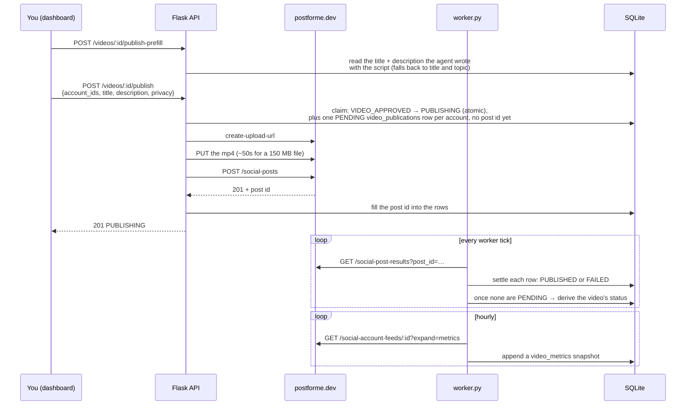
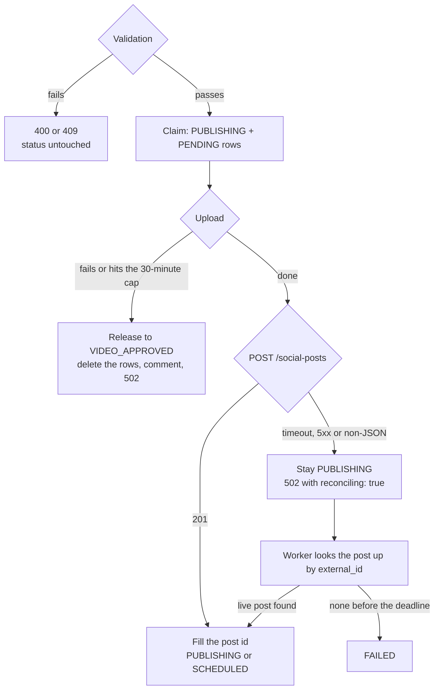
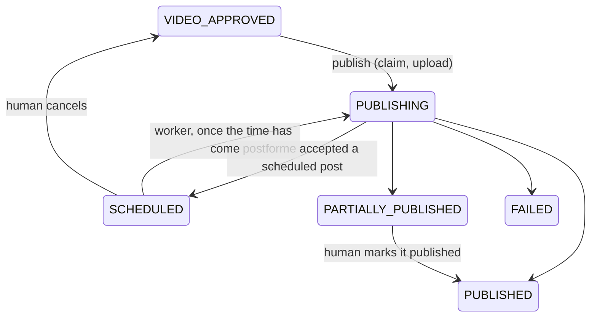

# Publishing internals

The user guide covers connecting accounts, publishing and scheduling a post
([Publishing](../user-guide/06-publishing.md)) and running Auto Pilot
([Auto Pilot](../user-guide/14-auto-pilot.md)). The sections below describe the code behind them: the
publish flow, the worker's passes, Auto Pilot, analytics capture and the postforme client.

Tubematic holds no OAuth grants for the platforms. It talks to
[postforme.dev](https://postforme.dev), an aggregator that owns the connections, and addresses each
account by postforme's id. The codebase contains no OAuth flow.

Publishing is off by default (`publishing_enabled`). While it is off, `VIDEO_APPROVED` is the last
status a video reaches.

---

## The agent cannot publish

No MCP tool can publish. `VIDEO_APPROVED` is absent from `WORKABLE_STATUSES`, because the poller
would otherwise start a paid agent session on every pass for a video the agent may not act on. The
operator skill tells the agent to leave `SCHEDULED`, `PUBLISHING`, `PUBLISHED` and
`PARTIALLY_PUBLISHED` alone. `set_video_status` refuses `SCHEDULED` with `human_only_status`: a
video there needs a post that postforme is holding, and no tool can create one.

A publish starts in one of two places. By default a person starts it in the Publish dialog. With
[Auto Pilot](#auto-pilot) on for the video's domain, the [worker](12-the-worker.md) starts it by
calling the publish code directly. The agent's tools and instructions are the same either way.

---

## The flow

`pipeline.py::start_publish` holds the whole path after request parsing. The publish route and Auto
Pilot both call it, so one copy of the claim, the upload and the failure handling serves both.

A human publish uploads inside the Flask request, which takes about 50 seconds for a 150 MB file,
so the person who clicked gets the result or the error in the same response. A scheduled publish
uploads at the click too. An Auto Pilot post has nobody waiting, so its upload runs on the worker.

### Concepts

- **Claim**: one `UPDATE`, guarded on the status, moves the video from `VIDEO_APPROVED` to
  `PUBLISHING`. It runs after validation, which has no side effects, and before any call that
  changes something at postforme. If it ran after the upload, two overlapping requests could both
  create a post before one lost the race.
- **Publication rows**: the claim's transaction inserts one `video_publications` row per target
  account, `PENDING`, with an empty `postforme_post_id`. One `POST /social-posts` covers every
  target, so the rows of a publish share one post id. The route fills it into the rows it inserted
  itself, matched by row id, and resets their `created_at`.
- **In flight**: a row with an empty post id belongs to a publish that is still running. The worker
  leaves it alone until the deadline, because an upload can outlast many ticks.
- **Completion**: postforme's result payload has no pending state: a target that has not published
  yet has no result. The worker counts settled rows and derives the video's status once no row is
  `PENDING`.
- **Deadline**: a row still `PENDING` one hour after its `created_at` has timed out
  (`worker.py::_PUBLISH_TIMEOUT_SECS`). The clock reads `video_publications.created_at` because
  `videos.updated_at` orders the render queue, and a polling pass that wrote to it would reorder
  renders. It is a wall clock because a publish that stopped leaves no retries to count.
- **`external_id`**: every post carries the video id as its `external_id`. When the worker or a
  retry cannot tell whether a post exists, it asks postforme for the posts with that id and adopts a
  live one.
- **Upload cap**: `postforme.UPLOAD_MAX_SECS` stops an upload after 30 minutes in total, so a publish
  request ends before the deadline and its post id lands on rows that are still in flight.
  `renderer/api/tests/test_worker.py::test_a_publish_request_always_finishes_before_the_worker_deadline`
  pins the arithmetic.

### The ambiguity split

A publish can fail in two places, and only the first leaves no doubt about what happened.

If the upload fails, nothing was posted. The route releases the claim, clears any schedule and
deletes the in-flight rows. It deletes them only if it won the release: if the worker already failed
the video, the rows stay, because they are what offers **Retry publishing**.

A failed `POST /social-posts` can arrive after postforme accepted the post. The route keeps the
claim, answers `502` with `{"reconciling": true}` and writes a comment that says to wait before
retrying. Releasing the claim would invite a second, real post.

Every failure writes its reason to the video's comments (`pipeline.py::_publish_note`), so the
reason outlives the dialog that reported it.

---

## Scheduling a post

What a user picks and sees is in the user guide:
[Scheduling a post](../user-guide/06-publishing.md#scheduling-a-post). A schedule arrives as a
wall-clock date and time plus an IANA timezone. postforme holds the post and sends it at that time.
Tubematic waits for the results.

- A scheduled publish runs the same claim, upload and `POST /social-posts` as an immediate one.
  Once postforme holds the post, the video moves to `SCHEDULED`. Its rows stay `PENDING` and
  already carry the post id.
- postforme keeps media attached to a scheduled post until the post goes out. Uploaded media with no
  post attached is deleted after 24 hours.
- `pipeline.py::resolve_schedule` converts `{local, timezone}` to UTC with `zoneinfo`, so the offset
  is the one in force on the scheduled day. The browser sends the wall time and the zone and
  converts nothing.
- A wall time that the clocks skip for daylight saving is refused. A repeated hour takes its first
  occurrence. If that is less than 5 minutes away, it takes the second, which is what **In 1 hour**
  produces during the first occurrence.
- The browser lists CLDR zone names (`Asia/Calcutta`). The API image installs PyPI's `tzdata`, so
  `zoneinfo` accepts that spelling and `Asia/Kolkata` on a base image whose OS ships the old names
  in a separate package.
- A schedule must be at least 5 minutes and at most 365 days ahead (`SCHEDULE_MIN_LEAD_SECS`,
  `SCHEDULE_MAX_LEAD_DAYS`). The floor leaves time to cancel and keeps the upload inside the lead.
  The ceiling catches typos. postforme sets no limit.
- If the upload ends within 60 seconds of the scheduled time (`SCHEDULE_POST_NOW_SECS`), the post is
  sent with no `scheduled_at` and goes out at once. postforme refuses a `scheduled_at` in the past,
  and the route would have to treat that refusal as ambiguous.
- When `scheduled_at` has passed, `worker.py::_release_due_schedules` moves the video to
  `PUBLISHING` and resets its pending rows' `created_at`, so the deadline counts from the due time.
  postforme checks for due posts about every two minutes, so a post can go out a couple of minutes
  after its time.
- A post adopted by `external_id` whose time has not come goes back to `SCHEDULED`
  (`worker.py::_schedule_pending`). An ambiguous `POST /social-posts` for a scheduled publish
  recovers this way without timing out before the post is sent.
- There is no reschedule. postforme's update is a full-replace `PUT` that posts immediately when
  `scheduled_at` is missing from it. To change the time, cancel and schedule again, which uploads
  again.
- `SCHEDULED` is outside `DELETABLE_STATUSES`. postforme would still send the post, and nothing
  local would be left to settle or cancel it.

---

## A partial publish

Once every publication row has settled, `worker.py::_derive_video_status` sets the video's status:

| Rows | Video |
|---|---|
| Every target published | `PUBLISHED` |
| Some published, some failed | `PARTIALLY_PUBLISHED` |
| Every target failed | `FAILED` |

A mix is `PARTIALLY_PUBLISHED` because no platform offers an un-publish: the video is live on the
accounts that succeeded, and the failed accounts still need an upload that somebody has to own. The
worker's comment counts both and says what to do.

The human downloads the video, posts it to the failed accounts by hand and clicks
**Mark as published** in the video window. That is a `PATCH /videos/<id>` to `PUBLISHED` guarded by
`onlyIfCurrentStatus`, and it is the only way out of the status.

- Neither retention sweep touches the status. `_sweep_published` takes `PUBLISHED` and
  `_sweep_unpublished` takes `FAILED` and `TOPIC_REJECTED`, so the mp4 and the job directory stay
  for the manual upload.
- Marking the video published hands it to retention, which dates from the latest successful post
  (`MAX(published_at)`). A partial publish older than `retention_days` therefore loses its files on
  the worker's next retention pass, which is why the confirm dialog says to download first.
- The video keeps its slot in Auto Pilot's [in-progress limit](#the-in-progress-limit), so Auto
  Pilot slows down while an account is broken.
- `notify_partially_published` (off by default) sends a Discord message that names each failed
  account and its error, links the posts that went out and says what to do next. See
  [Notifications](12-the-worker.md#notifications).

No migration adds the status and nothing is backfilled. A database copied to a version that does
not know the status strands such a video: that version's dashboard leaves it off the board and the
Library, its `PATCH` refuses the value, and no sweep matches it.

---

## The worker

`worker.py::_poll_publishing_videos` runs on every tick while publishing is enabled and a postforme
key is stored. Where it sits among the other passes is on [The Worker](12-the-worker.md). It first
moves due `SCHEDULED` videos to `PUBLISHING`, then settles each `PUBLISHING` video
(`_settle_publication`):

- Rows with a post id: the pass fetches the post's results and writes `PUBLISHED` with the post URL
  or `FAILED` with the error to each row that has a result. A row with no result stays `PENDING`
  until the deadline and then fails.
- Rows with no post id (`_settle_in_progress`): the pass looks for a post by `external_id` and
  adopts a live one at once. With no post and the deadline passed, it fails the rows and the video.
- A dead post (every target failed) is adopted only after the deadline, so the rows settle with the
  platforms' own errors. Before then it may be an earlier attempt's post under the same
  `external_id`.
- `_adopt_post` fills the post id into the in-flight rows, inserts a row for any target the post has
  that no row covers, and resets `created_at`.
- Failing an expired publish is one transaction whose writes each re-check that the rows still have
  no post id. A post id that Flask fills in at that moment is never left pending under a `FAILED`
  video.
- A postforme outage is logged and the video is left for the next tick. The video may already be
  live, so an outage does not fail it.
- A `PUBLISHING` video with no rows at all gets one lookup by `external_id`. If postforme has a
  post, the worker rebuilds the rows from it. If not, the video fails.
- Errors written to `video_publications.error` pass through `postforme.scrub` first.

Do not replace the one-hour wait for in-flight rows with a shorter grace period. A shorter wait
would fail videos whose upload is still running and whose post goes live moments later. The cost is
that a publish that stopped is noticed after up to an hour.

---

## HTTP routes

Request bodies, response fields and status codes are in the
[HTTP API reference](05-http-api.md#publishing-and-analytics). This section covers what the routes
do inside.

The routes that call postforme, and `POST /publishing/accounts`, start with `_publishing_context`.
It answers `503` when `publishing_enabled` is false or `postforme_api_key` is unset, before any
outbound call. `GET /videos/<id>/publications`, `publish-prefill`, `GET /analytics`,
`GET /analytics/watch-time` and the two `/autopilot` routes read local data only and skip the
check.

### `POST /videos/<id>/publish-prefill`

The route returns `publish_title` and `publish_description`, which the agent writes in the same
`update_video` call as the script ([MCP server](06-mcp-server.md)). `PATCH /videos/<id>` holds a
script to the same rule, so neither write path can leave the pair empty or describing an older
script. `videos.title` is the pipeline's own short display name and is a different field.

A video with nothing stored falls back to its title and topic (`pipeline.py::publish_text`). The
fallback is not written back, so it cannot pass for the agent's text. The route calls no model, so
the dialog opens at once. It also returns the video's duration and whether YouTube would treat it
as a Short (`YOUTUBE_SHORTS_MAX_SECS`, 180 seconds).

### `POST /videos/<id>/publish`

`start_publish` validates in this order: the video exists, is unarchived and is at
`VIDEO_APPROVED`, every account id is on the allowlist, the rendered mp4 exists, the privacy values
are supported, and the schedule resolves. It then asks postforme which platform each target is on,
claims the video and continues as [The ambiguity split](#the-ambiguity-split) describes.

The allowlist is enforced here as well as in the dialog. The route is reachable through the
dashboard proxy, and the allowlist keeps output off a personal account connected to the same
postforme project.

### `POST /videos/<id>/publish/retry`

The route accepts a `FAILED` video that has publication rows. Every publish writes its rows at the
claim and a failed render writes none, so the rows identify a video that failed while publishing.

1. The route asks postforme for a post by `external_id`. The lookup is a read, so it runs before the
   claim.
2. If a live post exists, nothing is posted again. The video returns to `PUBLISHING`, its rows are
   rebuilt from the post with a fresh `created_at`, and the worker settles it. The response is
   `{"outcome": "reconciling"}`.
3. If no live post exists (none at all, or one where every target failed), the video returns to
   `VIDEO_APPROVED`, its schedule is cleared and its rows are deleted. A comment keeps each
   account's error. The response is `{"outcome": "republish"}`, and the dashboard opens the Publish
   dialog. The failed attempt's account and privacy choices are not stored, so the route cannot
   post again with them.

Both moves are an atomic claim on `FAILED`, so a double click acts once. If postforme cannot be
asked, the route answers `502` and changes nothing, because a failed lookup says nothing about
whether a post exists.

### `POST /videos/<id>/schedule/cancel`

The route deletes the post at postforme, then returns the video to `VIDEO_APPROVED`, clears its
schedule and deletes its rows, with a comment. postforme goes first, so a post it still holds always
has the rows that settle it. The route also sets `videos.auto_pilot_hold`
([Stopping one video](#stopping-one-video)).

- The release matches `PUBLISHING` as well as `SCHEDULED`. The worker can move a due video to
  `PUBLISHING` while the cancel is talking to postforme. If postforme deleted the post, nothing
  will go out, whichever status the worker left.
- A `400` from postforme means the post is already going out. The route answers `409`.
- A `404` from postforme releases the video only after a lookup by `external_id` confirms the post
  is gone. postforme sends its webhook after deleting and can answer `500` at that point, so a
  second cancel gets `404` for a post the first one deleted. postforme also answers `404` when its
  own lookup fails. In that case the post is still listed and the route answers `502`.
- Any other failure, including postforme's `200 {"success": false}`, answers `502`. The post is
  still scheduled and the cancel can be repeated.

### `GET /autopilot` and `POST /autopilot`

Auto Pilot approves videos with publishing off, and they then stop at `VIDEO_APPROVED`, so these
routes work without it.

`GET` adds two computed fields to the stored configuration: `in_flight`
([the in-progress limit](#the-in-progress-limit)) and `waiting`, the number of unarchived videos per
domain at each of `TOPIC_PROPOSED`, `SCRIPT_READY`, `VIDEO_READY` and `VIDEO_APPROVED`. The
dashboard's confirmation counts from `waiting`.

`POST` validates the whole document and writes it in one transaction, so the switch cannot be saved
as on over a domain list that was refused. A request without `max_in_flight` keeps the stored
limit.

Each account in `projects` must be on the Socials allowlist, the same check a human publish gets.
An account already stored for the same domain is accepted even after it leaves the allowlist.
Refusing it would refuse every later save of that configuration, including the one that turns Auto
Pilot off. The worker re-checks the allowlist before each post, so such an account receives nothing.

`auto_pilot_enabled`, `auto_pilot_gap_mins` and `auto_pilot_max_in_flight` are ordinary settings,
so `POST /settings` accepts them too, without the dashboard's confirmation.

---

## Auto Pilot

What Auto Pilot does, how to size it and the warning to read before turning it on are in the user
guide: [Auto Pilot](../user-guide/14-auto-pilot.md).

Auto Pilot is one worker pass, `worker.py::_sweep_auto_pilot`, which runs after the publishing pass
on every tick (about every 20 seconds). It returns at once unless `auto_pilot_enabled` is on,
`pipeline_paused` is off and at least one domain is selected. Pause stops it because pause is the
switch for stopping spend, and approving a script spends.

| Stored in | Holds |
|---|---|
| `auto_pilot_enabled` | The switch. Default off |
| `auto_pilot_gap_mins` | Minutes between two posts on one account. Default 240, from 0 to 10080 |
| `auto_pilot_max_in_flight` | The in-progress limit. Default 0 (no limit), up to 500 |
| `auto_pilot_config` | The selected domains with their accounts (`projects`) and each account's posts per day (`account_limits`, 0 to 50). See [Settings internals](04-settings.md#undeclared-rows) |

An account with no stored number posts once a day (`AUTO_PILOT_DEFAULT_DAILY`).

The pass runs in the worker so that the agent's rule holds without exception: the agent never moves
a video out of a human checkpoint, and no MCP tool can approve or publish.

### Approval

The pass reads the selected domains' videos at `TOPIC_PROPOSED`, `SCRIPT_READY` and `VIDEO_READY`,
oldest first, and moves each one on as the dashboard's approval does. It adds a comment saying Auto
Pilot approved it and no human reviewed it. The update is guarded on the status it read, so a human
who acted first wins.

- Auto Pilot does not make an approval the dashboard would refuse
  (`worker.py::_auto_pilot_block_reason`): an `illustrated` topic with no OpenAI key stored, a topic
  whose mascot was archived or withdrawn, a Cartoon 3D or Under the Hood topic that holds a mascot, and a script its
  voice's model cannot speak. The video stays where it is with one comment.
- `videos.auto_pilot_blocked` records `<status>@<updated_at>` for the arrival that was commented on,
  so the comment is written once per arrival. The check itself runs on every tick, so the video is
  approved once the cause is fixed. Do not turn the mark into a skip.
- The worker does not render, so an approval waits at most one tick.
- Auto Pilot sends no "waiting for you" notification for a video it approves. The pass runs before
  the [notification sweep](12-the-worker.md#notifications), and by then the video has moved on.

### Posting

For a `VIDEO_APPROVED` video in a selected domain, `_auto_pilot_publish` picks a time and starts
the post.

- One post goes to all of the domain's usable accounts at once, through `start_publish`. A post in
  the future becomes a [scheduled post](#scheduling-a-post). Privacy is public on every platform.
- The title and description come from `pipeline.py::publish_text`.
- Each tick starts at most one post, because the upload holds the worker's loop for about a minute.
- An account is usable when it is chosen for the domain, on the Socials allowlist, has a daily
  number above 0 and is connected at postforme. The first three checks are local and run first.
  postforme is asked which accounts are connected only when some video has a target left, so a
  video that waits at `VIDEO_APPROVED` for weeks costs no request per tick.
- With no usable account, or with publishing disabled, the video waits at `VIDEO_APPROVED`.
- A video on [hold](#stopping-one-video) is skipped.

`autopilot.py::next_slot` computes the time: the earliest moment that is free for every account of
the post. A moment is free for an account when no post of that account is closer than the gap,
before or after, and the account has fewer posts than its daily number on that day in the host's
timezone. Starting from now, the candidate moves to the end of the gap of any post that is too
close, and to the next local midnight when the day is full, until neither rule moves it. If the
result is now, the video is posted immediately. The search stops 365 days ahead, the same horizon
as a human schedule.

Every publication that has not failed counts as an account's post, whoever started it
(`worker.py::_account_post_times`). A published one counts at the time it was seen published, a
scheduled one at its scheduled time, and one in flight at the time it started.

### The in-progress limit

The user guide has the diagram and the sizing advice:
[The in-progress limit](../user-guide/14-auto-pilot.md#the-in-progress-limit).

With `auto_pilot_max_in_flight` set to N, the pass budgets one transition: `SCRIPT_READY → VOICING`,
the paid gate. It approves one script per free slot and uses every free slot in the same pass.

- Topic approvals stop while the limit is full, because each one starts a paid scripting session.
  They are not counted one by one.
- Approving `VIDEO_READY` and scheduling `VIDEO_APPROVED` run regardless. Neither adds a video to
  the count, and scheduling is what drains it.
- A video that already has a voice file passes the gate without using a slot, because it already
  holds one. If it had to win a slot again, N revisions waiting at `SCRIPT_READY` would fill the
  count and none could be voiced.
- The limit cannot overshoot: a video enters the count only by passing the gate, and the gate is
  budgeted against the count.

`pipeline.py::in_flight_count` counts a video once if it matches either group, however many
accounts it posts to:

1. In the Auto Pilot domains: every video that has been voiced and is not `PUBLISHED`, `FAILED` or
   `TOPIC_REJECTED`. "Voiced" means `voice_file_path` is set or the status is one of
   `AUTO_PILOT_PAST_GATE`. The test reads the voice file because a revision can send a voiced video
   back to `SCRIPT_READY` or `TOPIC_PROPOSED`, and it must keep its slot there. A
   `PARTIALLY_PUBLISHED` video counts until a human marks it published.
2. Install-wide: every `SCHEDULED` video with a future `scheduled_at`, whoever scheduled it, because
   the accounts' calendar is shared.

Rows that would never leave the count by themselves are left out:

- an archived video
- in an Auto Pilot domain, a `VIDEO_APPROVED` video on hold, which cannot be scheduled
- in any other domain, a `SCHEDULED` row whose time has passed and a `PUBLISHING` row that is being
  reconciled

Videos outside the Auto Pilot domains enter the count only through the second group, so unrelated
manual work does not stop Auto Pilot.

### Stopping one video

`POST /videos/<id>/schedule/cancel` sets `videos.auto_pilot_hold`, and nothing clears it. Without
the hold, the cancelled video would return to `VIDEO_APPROVED` and be scheduled again on the
worker's next tick. Retry publishing sets no hold: a video it returns to `VIDEO_APPROVED` is posted
again by Auto Pilot.

### When a post cannot be started

A failed upload returns the video to `VIDEO_APPROVED`, where the next tick would try again and
comment again. Auto Pilot backs off per video (`worker.py::_AUTO_PILOT_BACKOFF_SECS`): 15 minutes,
then an hour, then six hours after each later failure. The count is kept in the worker's memory, so
a restart tries once more straight away.

- A video that cannot be published at all, such as one with no rendered file, gets one comment
  saying so.
- An unreachable postforme defers the whole pass with no comment.
- A post left for reconciliation is not backed off. The worker settles it.
- When no slot is free within 365 days, the worker logs a warning and backs off.

---

## Connecting accounts

The steps a user takes are in the user guide:
[Connecting accounts](../user-guide/06-publishing.md#connecting-accounts).

The Socials page's **Connect** button calls `POST /publishing/accounts/connect` and opens the
consent URL it returns in a new tab. postforme owns the connection and the OAuth callback, so the
consent ends on postforme.dev's own page. postforme ignores `redirect_url`, `redirect_uri` and
`return_url`, so the flow cannot return to the dashboard by itself. The browser does all the
redirecting, so Tubematic needs no inbound endpoint and a dashboard reachable only from its own
machine works.

- The URL's `state` token is single-use and expires. The route mints one per click, does not cache
  it and does not log the URL.
- For a platform that is not enabled on the postforme project, postforme answers `404` with a
  message that says where to enable it, and the route passes the message on. postforme gives an
  unknown platform the same answer.
- Tubematic stores account ids only: in the allowlist, in Auto Pilot's configuration and in each
  publication row. An account connected on postforme.dev directly works the same way.

### Why `feeds` is always requested

postforme grants two permissions at connect time, `posts` and `feeds`, and its default is `posts`
alone. `feeds` adds the analytics scope on the platform. The choice is made when the consent URL is
generated. The API fixes the pair as `postforme.CONNECT_PERMISSIONS` and ignores the request body,
so no caller can mint a posts-only URL.

| Platform | Scope added by `feeds` |
|---|---|
| Instagram | `instagram_business_manage_insights`, on top of `instagram_business_basic` and `instagram_business_content_publish` |
| YouTube | `yt-analytics.readonly`, alongside the readonly and upload scopes |
| TikTok | None. The requested scopes are the same with and without it |

An account without the grant still posts. On Instagram the feed request still returns `200` with
the complete list of posts, and each entry carries an empty `metrics` object. The hourly pass
matches those entries and writes a snapshot for each with every figure null, a manual refresh counts
them as captured, and the Analytics page shows a dash in every column. A metric that a platform did
not report looks the same.

A permission changes only by going through the platform's consent screen again. Reconnecting keeps
the account's id: postforme updates the existing record and issues a new token, so nothing in
Tubematic needs redoing.

### What the Socials badges mean

`GET /publishing/accounts` returns postforme's list projected through `postforme.public_account`,
with three fields added:

- `allowed`: the id is on the allowlist.
- `available`: postforme lists the account. An allowlisted id that postforme does not list comes
  back as a `disconnected` entry with `available: false`, so the page can show `NOT CONNECTED` and
  the entry can be unticked.
- `analytics`: `true`, `false` or `null`, from `pipeline.py::_feeds_available`, a one-entry feed read made for
  allowlisted accounts only. Only a `4xx` other than `429` reads as `false`, which the page shows
  as `NO ANALYTICS`. A `429`, a `5xx` or a timeout says nothing about permissions and reads as
  `null`.

`analytics: true` does not prove metrics will arrive, because a missing grant on Instagram is not a
rejection. postforme's account record lists no granted permissions, so whether metrics come back is
the only signal. `_feeds_available` does not infer a missing grant from empty metrics: a new account
with no posts, or a platform that has not computed insights yet, looks the same, and the page would
tell someone to reconnect an account that is fine.

`?feeds=0` skips the probe. The Analytics page uses it because it needs only account names, and a
probe per page load would spend the rate limit.

---

## Analytics

### Capture

`worker.py::_poll_video_metrics` runs hourly, gated on the `last_metrics_poll_at` settings row. The
row is written before the work, so a pass that dies partway does not run again 20 seconds later.
`POST /analytics/refresh` runs the same capture on request.

`renderer/api/metrics.py::poll` makes one feed request per account and matches entries to local rows
by postforme's post id, because platforms rewrite URLs. One request per publication would exceed the
rate limit past the fifth target and lose those readings, and a time series cannot be backfilled.

- Only `PUBLISHED` rows with a post id are read.
- The feed is requested 100 entries at a time and stops after 20 pages per account, so a cursor that
  never ends cannot hold the worker's loop.
- One unreachable account counts as an error and the other accounts are still read. `poll` does not
  raise.
- `postforme.extract_metrics` maps each platform's names onto `views`, `likes`, `comments` and
  `shares`. TikTok reports `view_count`, `like_count`, `comment_count` and `share_count`. Facebook
  has no likes or views field: `reactions_total` is stored as likes and `video_views` (or
  `media_views`) as views. An absent metric is stored as null, and an unknown platform yields all
  nulls.
- The whole payload is kept in `raw_json`. The [watch figures](#watch-figures) are read from it.
- The same pass first stores the length of published videos that have none
  (`worker.py::_fill_video_durations`, see [Watch figures](#watch-figures)).

### `GET /analytics`

The route reads local snapshots only. Each snapshot is a cumulative reading, so the query joins a
publication to its latest snapshot with a `LIMIT 1` subquery. Summing snapshots would multiply the
view count by the number of polls. Only views, likes, comments and shares are summed across
platforms. Platform-specific metrics stay in `raw_json`, and each publication row carries its own
[watch figures](#watch-figures) read from there.

`by_month` holds the views gained in each of the last 12 months (`ANALYTICS_MONTHS`). A month's
figure is every post's latest reading before the month ended minus its latest reading before the
month began, which costs one indexed lookup per post per month boundary. Months are cut in the
host's timezone.

- Nothing is known about a post before its first snapshot, so the views it already had count in the
  month of that snapshot. The first month of tracking can look like a spike.
- Months before any snapshot are left out.
- A month can be negative, because platforms remove views. The dashboard draws no bar for it and
  shows the number on hover.
- A reading with no view count is skipped, so the one before it stands.

### Watch figures

`postforme.py::extract_retention` reads six figures from a snapshot's `raw_json`. The table
`_RETENTION_FIELDS` names each platform's keys and units.

| Figure | YouTube | Instagram | Facebook | TikTok |
|---|---|---|---|---|
| `avg_watch_secs` | `averageViewDuration` (seconds) | `ig_reels_avg_watch_time` (milliseconds) | `video_avg_time_watched` (milliseconds) | None |
| `watched_pct` | `averageViewPercentage` | `avg_watch_secs` over `videos.duration_secs` | `avg_watch_secs` over its own `video_length` | None |
| `stayed_pct` | `engagedViews` over `views` | None | None | None |
| `engaged_views` | `engagedViews` | None | None | None |
| `reach` | None | `reach` | `reach` | None |
| `saves` | None | `saved` | None | None |

- A figure a platform does not report is null. Zero views gives a null `stayed_pct`.
- A `watched_pct` of 0 is null, and so is an `avg_watch_secs` of 0 that comes with no share of the
  platform's own. A platform sends 0 for a post it has not measured yet, and a 0 would enter a
  group's median as a video nobody watched. Both are judged after rounding to one decimal. YouTube
  reports whole seconds, so 0 seconds beside a share above 0 is kept.
- A count of 0 (`reach`, `saves`, `engaged_views`) is kept, and so is a `stayed_pct` of 0 when the
  post has views.
- A value that is not a number, is negative or is above `_MAX_READING` is null, and so is a
  computed figure above it. No payload makes the function raise.
- A `watched_pct` above 100 is kept, because a looping Short is watched more than once.
- A payload with seconds and no share or length of its own takes `videos.duration_secs` as the
  length. A share of 0 counts as no share. Instagram's payloads are always in that case.
- TikTok's metrics hold four counts and no watch figure. postforme reports more for a TikTok
  Business connection, which Tubematic does not support.
- Facebook's key names come from postforme's API reference.

The figures are read when a route asks for them and are stored in no column. Every snapshot already
holds its payload, so the figures cover the whole history, and a change to the mapping applies to
every snapshot.

Three routes return them: `GET /analytics` and `GET /videos/<id>/publications` on each publication
row, and `GET /analytics/watch-time` grouped. `pipeline.py::_watch_figures` is the one place that
parses a payload for them.

Instagram reports no share and no video length, so its `watched_pct` needs `videos.duration_secs`.
Two places store it from the video's `timeline.json`:

- `pipeline.py::fill_video_durations`, called by the worker with the hourly analytics poll and by
  `POST /analytics/refresh`, covers every video that has a publication, is not archived and has no
  length yet. The share then shows while the video is still on disk.
- `pipeline.py::archive_video` stores it in the statement that archives the video, because
  archiving deletes `timeline.json`. This covers the retention sweep and a delete from the
  dashboard.

A timeline that cannot be read, or that gives a length above `MAX_STORED_DURATION_SECS`, leaves the
length null. A video whose files were deleted before its length was stored keeps a null length, and
its Instagram posts report no `watched_pct`.

### `GET /analytics/watch-time`

The route groups one account's published posts by visual style, script profile, domain and script
length, and returns all four groupings in one response. `social_account_id` selects the account.
Without it the route answers for the account with the most published posts. One account is read at
a time because each platform counts a view and a watched second in its own way.

- A group's figure for a measure is the median of the posts that report it, with `n`, the number of
  those posts. `videos` counts every post in the group.
- `min_group` is `pipeline.py::WATCH_MIN_GROUP` (20). The dashboard marks a group with fewer videos.
- `pipeline.py::_watch_group_of` places a post in a group. A `visual_style` of `auto` or `''` reads
  as "Mixed scenes", or as Cartoon 3D when `resolved_renderer` is `cartoon_3d`.
- Script length is the word count of `videos.script` without its markup (`_script_words`), in the
  bands of `SCRIPT_LENGTH_BANDS`.
- Groups come largest first. Script length bands come shortest first.

### Analytics outlive the files

The [retention sweep](12-the-worker.md#retention) deletes a published video's files and archives
its row. It leaves `video_publications` and `video_metrics` alone, metrics keep being polled, and
the video still appears on the Analytics and Archive pages with its numbers.

---

## Design decisions and their reasons

- `PUBLISHING` is set by Flask and observed by the worker. Every other automatic status is claimed
  and written by the process that does the work. The exception is a scheduled post falling due,
  which the worker moves itself because no request is in flight.
- `videos.youtube_url` is retired as a read path. The column, its writers and `update_video`'s
  argument stay: dropping a column is a one-way `ALTER`, and removing the argument would break agent
  sessions in flight. `GET /videos/<id>/publications` is the read path, since one column cannot hold
  four platform URLs.
- The AI-disclosure flags, `youtube.contains_synthetic_media` and `tiktok.is_ai_generated`, are
  hardcoded true. The platforms require the disclosure, so no setting turns it off.
- `postforme.py` does not fail open. Every failure raises `PostformeError`, because a publish that
  did not happen and reported nothing leaves a video its owner believes went out.

---

## Credentials in responses

postforme responses embed live OAuth credentials. `GET /social-accounts` and the
`POST /social-posts` response both carry the connected channel's `access_token` and a
`refresh_token` with no expiry. The second one is on the write path, and write-path errors are saved
to the `comments` table, which the dashboard shows.

Three defences, each with a test (`renderer/api/tests/test_postforme.py` for the first two,
`renderer/api/tests/test_pipeline.py::test_accounts_never_returns_oauth_credentials` for the third):

1. `postforme.scrub` runs on every response, success and error, inside the client before anything is
   returned. It replaces non-empty `access_token` and `refresh_token` values with `<redacted>` and
   leaves empty ones alone.
2. `_error_message` scrubs an error body before it reads a field out of it, because an error payload
   can echo the submitted request.
3. `GET /publishing/accounts` projects each account through an allowlist of fields
   (`PUBLIC_ACCOUNT_FIELDS`: `id`, `platform`, `username`, `profile_photo_url`, `status`). A
   credential field that postforme adds later is dropped by default.

The API key travels in the `Authorization` header and never in a URL, because httpx puts the request
URL in its error strings.

---

## The client

`renderer/api/postforme.py` takes the API key and base URL as arguments and never reads the
database, so a rotated key applies on the next call.

| Function | Purpose |
|---|---|
| `list_accounts` | `GET /social-accounts` |
| `create_auth_url` | `POST /social-accounts/auth-url`, with the platform and permissions |
| `create_upload_url` | `POST /media/create-upload-url` |
| `upload_media` | `PUT` to the pre-signed URL. Sends no `Authorization` header, because the URL points at a storage host |
| `create_post` | `POST /social-posts`. Sends `scheduled_at` (UTC, ending in `Z`) for a scheduled post and omits it to post now |
| `delete_post` | `DELETE /social-posts/{id}`. Raises on an error status and on `200 {"success": false}`, and keeps the status code |
| `find_post_by_external_id` | `GET /social-posts?external_id=…`, for reconciliation |
| `publication_targets` | `[(account_id, platform)]` from a post's `social_accounts`, which are objects on a fetched post and bare ids on a request |
| `get_post_results` | `GET /social-post-results?post_id=…` |
| `get_account_feed` | `GET /social-account-feeds/{id}?expand=metrics` |
| `scrub`, `public_account` | The first and third credential defences above |
| `compose_caption`, `build_platform_configurations`, `extract_metrics` | Per-platform shaping |

`find_post_by_external_id` reads every page of matches (up to 500 posts) and fetches each match's
results. It returns a live post (a target succeeded, or one has yet to report) in preference to a
dead one, then the newest by `created_at`. More than one post can carry a video's id: a video that
failed everywhere and was published again has two, and the dead one must not hide the live one.

Timeouts are 30 seconds, and 600 for an upload, about ten times the measured time for a 150 MB file
at 3 MB/s. They apply per network operation, which is why the upload also has the 30-minute total
cap, enforced between chunks of the streamed body. The body is sent with an explicit
`Content-Length`. Without one, httpx sends it chunked, which pre-signed storage URLs commonly
reject.

### postforme API behaviour

The client depends on the following behaviour. Some of it differs from postforme's published spec.

- `create-upload-url` takes no request body.
- `create-upload-url` and `POST /social-posts` answer `201`. The spec documents `200`.
- The API allows 5 requests per second and states the limit only in a response header. The client
  enforces it in `_throttle`. The API container and the worker each keep their own window, so a
  simultaneous burst from both can exceed it.
- `scheduled_at` is optional. Omitting it publishes immediately.
- Unknown keys in `platform_configurations` are accepted and stored as sent, with no validation. A
  typo in `contains_synthetic_media` would therefore mean the disclosure is not sent, and nothing
  would report it.

`renderer/api/tests/fixtures/postforme_platform_fields.json` lists every field name each platform's
schema accepts, generated from postforme's spec. A test asserts that every field the builder emits
is in it. No other check catches a misspelled field.

---

## Platforms

`postforme.py::build_platform_configurations` emits, per platform:

| Platform | Fields emitted | Privacy options |
|---|---|---|
| `youtube` | `title`, `description`, `contains_synthetic_media` (true), `privacy_status` | public, unlisted, private |
| `tiktok` | `title`, `caption`, `is_ai_generated` (true), `privacy_status` | public, private |
| `instagram` | `caption`, `placement: "reels"` | None. A Reel is public or not posted |
| `facebook` | `caption`, `placement: "reels"` | None |

`compose_caption` builds the caption as the title, a blank line and the description. An unsupported
privacy value raises `ValueError`, which `start_publish` turns into a `400` before the claim.
postforme would store the value and ignore it, and the post would come out public.

postforme supports more platforms than these four. An account on one of them can be listed and
posted to, and receives no per-platform fields.

YouTube has no Shorts flag, in postforme or in YouTube's own API. `publish-prefill` returns the
duration and Shorts eligibility for the dialog's warning. See
[Platforms](../user-guide/06-publishing.md#platforms) for what a user sees.

---

## Schema

The `videos` columns that publishing uses (`publish_title`, `publish_description`, `scheduled_at`,
`scheduled_timezone`, `auto_pilot_hold`, `auto_pilot_blocked`) are in the
[database reference](03-database.md). `scheduled_at` is UTC, and `scheduled_timezone` is the zone
the time was picked in, kept so the dashboard can show the time back in that zone. Both are `''`
when the video is not scheduled. `update_video` and `PATCH /videos/<id>` refuse a script without
`publish_title` and `publish_description` (see
[`publish-prefill`](#post-videosidpublish-prefill)).

`video_publications` has one row per (video, account) target.

| Column | Type | Notes |
|---|---|---|
| `id` | TEXT PK | |
| `video_id` | TEXT → `videos.id` | Indexed |
| `platform` | TEXT | |
| `social_account_id` | TEXT | |
| `postforme_post_id` | TEXT | Shared by every target of a publish. Empty while the publish is in flight |
| `status` | TEXT | `PENDING`, then `PUBLISHED` or `FAILED` |
| `post_url` | TEXT | |
| `error` | TEXT | |
| `published_at` | TEXT | Set when the worker saw the target published |
| `created_at` / `updated_at` | TEXT | `created_at` starts the deadline. Set at the claim, and reset when the post id is attached and when a scheduled post falls due |

`video_metrics` is a time series with one snapshot per capture per publication.

| Column | Type | Notes |
|---|---|---|
| `id` | INTEGER PK | |
| `publication_id` | TEXT → `video_publications.id` | `ON DELETE CASCADE`, indexed with `fetched_at` |
| `fetched_at` | TEXT | |
| `views`, `likes`, `comments`, `shares` | INTEGER | Nullable. Null means the platform did not report the metric |
| `raw_json` | TEXT | The whole payload |

Three settings rows sit outside `SETTINGS_SPEC`: `publishing_accounts` (the allowlist of postforme
account ids), `last_metrics_poll_at` (the hourly stamp) and `auto_pilot_config`.

---

## Setup

Onboarding asks "Enable publishing to social platforms?" and asks for the postforme key only after a
yes. Neither field is required, because no video needs a publish to be produced. A bad key is
rejected at the prompt. postforme's `401` has two meanings that are told apart by `error.code`: see
[Rejection signatures](04-settings.md#rejection-signatures).

The dashboard's side of publishing (the Publish dialog, the Publishing Results tab, Socials,
Analytics and the Auto Pilot tab) is in
[Dashboard internals](15-dashboard.md#publishing-surfaces).
