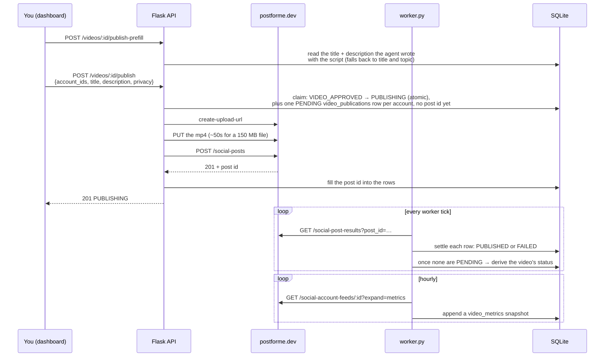
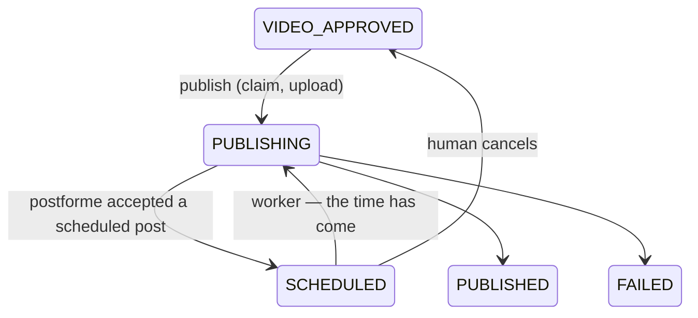

# Publishing internals

What publishing looks like from the dashboard — connecting accounts, publishing and scheduling a
post, and running Auto Pilot — is on [Publishing](../user-guide/06-publishing.md). This page is how
it is built: the flow, the design decisions behind it, the postforme client, the schema, the routes,
the worker's passes and the dashboard's pieces.

Tubematic does **not** hold OAuth grants for the platforms. It talks to
[postforme.dev](https://postforme.dev), an aggregator that owns the connections, and addresses
accounts by postforme's id. There is no OAuth flow in this codebase.

Publishing is **off by default** (`publishing_enabled`). With it off, `VIDEO_APPROVED` is terminal
and the system behaves exactly as it did before the feature existed.

---

## The agent never publishes, and that is structural

No MCP tool can publish. The agent cannot publish. `VIDEO_APPROVED` is **not** in
`WORKABLE_STATUSES`, and the operator skill is explicitly told never to write `SCHEDULED`,
`PUBLISHING` or `PUBLISHED`. `set_video_status` refuses `SCHEDULED` outright: a video there needs a
post that postforme is holding, and no tool can create one.

Removing `VIDEO_APPROVED` from the workable set was mandatory rather than tidy-mindedness: with the
agent's old placeholder action gone, leaving it there would make the poller wake an agent on
every pass for a video it is not allowed to act on — a paid session burned each time, forever.

A publish therefore starts in one of two places, and neither is the agent. By default it is a
person, in the Publish dialog. With [Auto Pilot](#auto-pilot) on for a video's project it is the
render worker. Auto Pilot is opt-in, per project, and changes none of the above: the worker calls
the publish code directly, and the agent's tools and instructions are the same either way.

---

## The flow

**The upload runs inline in the Flask request**, not on the worker, and that is true of a scheduled
post too — see [Scheduling a post](#scheduling-a-post). It takes about 50 seconds for a
150 MB file. The worker renders one video at a time for around twenty minutes, so a human-clicked
publish queued behind a render would look broken. An [Auto Pilot](#auto-pilot) post is the
exception: nobody is waiting on it, so its upload runs on the worker.

---

## Scheduling a post

What a user picks and sees is on [Scheduling a post](../user-guide/06-publishing.md#scheduling-a-post).
A schedule arrives as a wall-clock date and time plus an IANA timezone; postforme holds the post and
sends it at that time, and Tubematic only waits for the results.

- **The upload happens at the click, not at the scheduled time.** A scheduled publish runs the whole
  claim → upload → `POST /social-posts` path above, under the same `PUBLISHING` claim and the same
  ambiguity split; only its last step differs. The video then waits in `SCHEDULED`, with its
  publication rows `PENDING` and already carrying the post id. postforme keeps media attached to a
  scheduled post until it goes out (only *unattached* uploads expire after 24 hours), so there is no
  horizon beyond which the upload would be lost.
- **The API converts the wall time, never the browser.** `pipeline.py::resolve_schedule` turns
  `{local, timezone}` into UTC with `zoneinfo`, so the offset is the one in force on the scheduled day,
  not today's. A wall time the clocks skip for daylight saving is refused rather than shifted by an
  hour, and a repeated hour takes its first occurrence — or the second, once the first is already too
  soon, which is what *In 1 hour* produces during the first occurrence. The browser's zone list is CLDR's
  (`Asia/Calcutta`, not `Asia/Kolkata`); the API accepts either spelling, and ships PyPI's `tzdata` so
  that stays true on a base image whose OS moved the old names into a separate package.
- **At least 5 minutes ahead, at most 365 days** (`SCHEDULE_MIN_LEAD_SECS`, `SCHEDULE_MAX_LEAD_DAYS`).
  The floor leaves a real window to cancel in and keeps the upload well inside the lead. The ceiling
  is a typo guard; postforme sets no limit.
- **A post the upload leaves within a minute of its time is sent as publish-now**
  (`SCHEDULE_POST_NOW_SECS`, 60 seconds), whether the time has already passed or is still a few
  seconds away. postforme refuses a `scheduled_at` in the past, the route would have to treat that
  refusal as ambiguous, and a time a few seconds ahead could pass before postforme reads it.
- **The worker moves a due video to `PUBLISHING` and resets the rows' `created_at`.** The one-hour
  deadline is measured from that column; left at the time the post was scheduled, every target of a
  post scheduled more than an hour out would fail on the first pass. The move happens only while
  publishing is enabled, like every other postforme poll. postforme itself checks for due posts about
  every two minutes, so a post can go out a couple of minutes after its time.
- **A post adopted by `external_id` whose time has not come waits in `SCHEDULED`.** That is how an
  ambiguous `POST /social-posts` for a scheduled publish recovers; settling it at once would fail it at
  the deadline, before it was ever sent.
- **Cancel, never reschedule.** postforme's update is a full-replace `PUT` that posts **immediately**
  when `scheduled_at` is missing from it, and it would have to resend every field. To change the time,
  cancel and schedule again, which uploads again.
- **`SCHEDULED` cannot be deleted** (it is outside `DELETABLE_STATUSES`). postforme would still send
  the post, and nothing local would be left to settle or cancel it.

---

## Auto Pilot

What Auto Pilot does, what is configured, how it behaves and how to size it are on
[Auto Pilot](../user-guide/06-publishing.md#auto-pilot), including the warning a user should read
before turning it on. This section is how it is built.

It is one pass in the render worker, `worker.py::_sweep_auto_pilot`, run right after the publishing
pass on every tick. It returns at once unless `auto_pilot_enabled` is on, the pipeline is not paused
and a project is selected. The project list and the per-account daily numbers are the
`auto_pilot_config` settings row ([Settings internals](04-settings.md#undeclared-rows)); the three
scalar keys are ordinary settings.

**It runs in the worker, and not in the agent, deliberately.** The agent's rule that it never moves a
video out of a checkpoint stays whole, no MCP tool gains the power to approve or publish, and the
decision is a few lines of code rather than a paid session that might read its instructions
differently one day.

**Pausing the pipeline pauses Auto Pilot.** Pause is the switch an operator reaches for to stop
spend, and approving a script spends, so the pass checks `pipeline_paused` before anything else.

### Approval

The pass looks for videos of the selected projects at `TOPIC_PROPOSED`, `SCRIPT_READY` and
`VIDEO_READY` and moves each one on exactly as the dashboard's approval does, with a comment saying
Auto Pilot did it and that no human reviewed it. The update is guarded on the status it read, so a
human who acted first wins.

- **Two approvals the dashboard would refuse are not made**: an `illustrated` topic on an install
  with no OpenAI key, and a script its voice's model cannot speak. The video stays at its checkpoint
  with one comment. `videos.auto_pilot_blocked` records `<status>@<updated_at>` for the arrival that
  was commented on, so the comment is not repeated on every tick. **The check itself is repeated**,
  so the video is approved once the cause is fixed — do not turn the mark into a skip, or a fixed
  cause never unblocks.
- **An approval can wait behind a render.** The worker is one loop and a render holds it.
- **No checkpoint notification is sent** for a video Auto Pilot approves: the pass runs before the
  [notification sweep](02-pipeline.md#notifications), so by then the video has moved on.

### Posting

For a `VIDEO_APPROVED` video in a selected project, the same pass picks a time and starts the post.

- **One post per video, to all of its project's accounts at once**, through
  `pipeline.py::start_publish`, the same function behind `POST /videos/<id>/publish`. The claim, the
  upload, the ambiguity split and the settling are the ones this page describes for a human publish,
  not a second copy. A post in the future becomes a [scheduled post](#scheduling-a-post).
- **The upload runs on the worker here**, because nobody is waiting on it. It holds the loop for
  about a minute, so each tick starts at most one post.
- **Usable accounts are re-checked at posting time**: chosen for the project, still on the Socials
  allowlist, still connected at postforme, and with a daily number above 0. If none is left, or
  publishing is disabled, the video waits at `VIDEO_APPROVED`.
- **A video with nowhere to post costs no postforme request.** The allowlist and the daily numbers
  are local, so they are checked first, and postforme is asked which accounts are connected only
  when some video has a target left. Waiting at `VIDEO_APPROVED` can last indefinitely, and the
  pass runs every twenty seconds.
- **The title and description** come from `pipeline.py::publish_text`: the ones the agent wrote with
  the script, or the video's title and topic for a video that has none. Privacy is always public.

**The time** is computed by `autopilot.py::next_slot`, the earliest moment free for every account of
the post: no post of the account closer than the gap **before or after** it, and fewer posts than its
daily number on that day in the host's timezone. Starting from now, the time moves to just past the
gap of any post that is too close, and to the next local midnight when the day is full, until
neither rule moves it. If that is now, the video is posted immediately. It gives up beyond 365 days,
the same horizon a human schedule is held to.

What counts as an account's post: every publication that has not failed, whoever started it. A
published one counts at the time it was seen published, a scheduled one at its scheduled time, and
one in flight at the time it started.

### The in-progress limit

With `auto_pilot_max_in_flight` set to N, only the **paid gate**, `SCRIPT_READY → VOICING`, is
budgeted: one video per free slot, every free slot used in the same pass. Topic approvals stop while
the limit is full, because each one starts a paid scripting session, but they are not counted one by
one. Approving `VIDEO_READY` and scheduling `VIDEO_APPROVED` never wait, because neither adds a video
to the count and scheduling is the only thing that drains it. The earlier scheduled-post ceiling
stopped both at the limit, which left approved videos stranded at `VIDEO_APPROVED` with nothing
moving. The limit cannot overshoot: a video enters the count only by passing the gate, and the gate is
budgeted against the count.

**The count** (`pipeline.py::in_flight_count`) is two groups, OR-ed so a video in both counts once. A
video posting to two accounts also counts once.

- **Every video in an Auto Pilot project that has been voiced and has not published, failed or been
  rejected.**
  - **Keyed on the voice, not on a status** (`voice_file_path` set, or a status past the gate). A
    revision can send a voiced video back to `SCRIPT_READY` or `TOPIC_PROPOSED`. It keeps its slot
    there, because otherwise it would free one for a brand-new script and then queue behind it.
  - **A voiced video passes the gate without using a slot.** It already holds one. If it had to
    win a slot a second time, N revisions waiting at `SCRIPT_READY` would fill the count and none
    of them could ever be voiced again.
  - **Only Auto Pilot projects count**, so a human's unrelated work cannot hold Auto Pilot shut.
- **Every `SCHEDULED` post with a future `scheduled_at`, install-wide**, whoever scheduled it,
  because the accounts' calendar is shared.

**Some rows never count**, because none of them leaves the count by itself. Counting one would hold
Auto Pilot shut for good with nothing to say why.

- an archived video
- a `VIDEO_APPROVED` video on [hold](#stopping-one-video). It cannot be scheduled, and nothing in
  the dashboard clears the hold.
- outside Auto Pilot projects, a `SCHEDULED` row whose time has passed, and a `PUBLISHING` row whose
  `create_post` was ambiguous and is being reconciled

`GET /autopilot` returns the count as `in_flight`; the Auto Pilot tab polls it every 20 seconds.

### Stopping one video

`POST /videos/<id>/schedule/cancel` sets `videos.auto_pilot_hold`, and nothing clears it. Without it
the cancelled video would return to `VIDEO_APPROVED` and be scheduled again on the worker's next tick,
so a cancel could never stick. Retry publishing deliberately sets no hold: a video it returns to
`VIDEO_APPROVED` is posted again by Auto Pilot.

### When a post cannot be started

A failed upload returns the video to `VIDEO_APPROVED`, where the next tick would try again twenty
seconds later, and comment again. Auto Pilot instead backs off per video
(`worker.py::_AUTO_PILOT_BACKOFF_SECS`: 15 minutes, an hour, then six hours for each later failure).
The count is kept in the worker's memory, so a restart tries once more straight away. A video that
cannot be published at all, such as one with no rendered file, gets one comment saying so. An
unreachable postforme defers the whole pass without a comment.

---

## Design decisions that will look wrong later

Each of these is deliberate. Reversing one reintroduces a specific failure.

**A partial publish derives to `PUBLISHED`.** There is no un-publish on any of these platforms, so a
video live on two of four accounts genuinely *is* published. Reporting `FAILED` would lie about the
two that went out, and the failures are already recorded on their own rows. `FAILED` is reserved for
the case where every target failed.

**Completion is a row count, not a status read.** postforme's result payload has no pending state —
a target that has not published yet simply has no row. The worker counts non-`PENDING`
`video_publications` rows against the expected number of targets.

**The backstop is a wall clock, measured from `video_publications.created_at`.** One hour.
`created_at` is reset when the post id is attached, so the platforms get a full hour to report from
the post's creation rather than from before the upload. It is a
wall clock rather than a retry counter because a publish has no crash to count, and it keys off that
column rather than `videos.updated_at` because `updated_at` is the FIFO ordering key for the render
worker's atomic claim — a polling loop writing to it would reorder the render queue.

**The publication rows are written at the claim, before the upload, with an empty post id.** An empty
`postforme_post_id` means "a publish is in flight", and the worker leaves such rows alone until the
publish deadline. The rows used to be written only after `POST /social-posts` returned, so for the
whole upload the worker saw a `PUBLISHING` video with no rows, took that for a crashed publish, found
no post at postforme yet, and failed a video that went live moments later. Do not replace this with a
short grace period: the upload has no hard upper bound (its timeout applies per operation, not in
total), so any fixed number is a guess. The cost is that a genuinely crashed publish is noticed after
up to an hour instead of twenty seconds. Failing slowly is safe; failing fast abandoned live posts.

**The upload is capped at 30 minutes in total, so a publish request always ends before that hour.**
Without the cap, a very slow upload could outlive the deadline: the worker would fail the video,
Retry could move it on, and the original request's post would then arrive with nothing correct to
attach to, or attach to a second attempt's rows. The cap makes that impossible by construction, which
is simpler and safer than handling each late-response case. A test pins the arithmetic: the cap, plus
one stalled write and the response read at the per-operation timeout, plus the short calls around
them, must stay under the deadline. The cap is still about 35 times the measured upload time.

**`PUBLISHING` is set by Flask and otherwise only observed by the worker.** It is the first status
shaped that way; every other automatic transition is claimed and written by the same process that
does the work. The one exception is a scheduled post falling due, which the worker moves from
`SCHEDULED` to `PUBLISHING` itself — there is no request in flight to do it.

**`videos.youtube_url` is retired as a *read* path only.** The column, its writers, and
`update_video`'s kwarg all stay. Dropping the column is a one-way `ALTER`, and removing the kwarg
would be an MCP signature change that breaks in-flight agent sessions.

**AI-disclosure flags are hardcoded true** — `youtube.contains_synthetic_media` and
`tiktok.is_ai_generated`. That is platform policy, not a preference, and a setting would only be an
invitation to turn it off.

---

## Credentials in responses

> **postforme responses embed live OAuth credentials.** `GET /social-accounts` **and the
> `POST /social-posts` response** both carry the connected channel's `access_token` and a
> `refresh_token` with no expiry. The create-post one is the dangerous one: it is on the write path,
> and this pipeline persists write-path errors into the dashboard-visible `comments` table.

Three defences, each with a test:

1. **`postforme.scrub()` runs on every response** — success and error alike — inside the client,
   before anything is returned. Not at a display boundary, which is one forgotten log line away from
   failing. It replaces only truthy credential values, leaving empty ones alone rather than
   inventing the appearance of a secret.
2. **Nothing from a response body reaches an error column or a comment unscrubbed.** `_error_message`
   scrubs before it reads a field out, because an error payload can echo the submitted request.
3. **`GET /publishing/accounts` projects through an allowlist**, never a blocklist — `id`,
   `platform`, `username`, `profile_photo_url`, `status`. A new credential-bearing field added
   upstream cannot leak by default.

`postforme.py` **does not fail open**, unlike `ai_review.py`. Every failure path raises. A review
that silently does not happen costs nothing; a publish that silently does not happen strands a video
the human believes went out.

---

## The client

`renderer/api/postforme.py` is DB-free by design — the API key and base URL are always passed in.

| Function | Purpose |
|---|---|
| `list_accounts` | `GET /social-accounts` |
| `create_upload_url` | `POST /media/create-upload-url` |
| `upload_media` | `PUT` to the pre-signed URL. **Sends no `Authorization` header** — the URL is pre-signed and points at storage |
| `create_post` | `POST /social-posts`. Sends `scheduled_at` (UTC, `…Z`) only for a scheduled post; absent means post now |
| `delete_post` | `DELETE /social-posts/{id}` — cancels a scheduled post. Raises on postforme's `200 {"success": false}` as well as on an error status, and keeps the status: `400` means the post is already going out, `404` that it was not found |
| `find_post_by_external_id` | `GET /social-posts?external_id=…`, for reconciliation. Reads every page of matches (capped), then checks every match's results and returns a **live** post (any target succeeded, or one has not reported yet) in preference to a dead one (every target failed), then the newest by `created_at`. More than one post can carry a video's id: one that failed everywhere and was published again has two, and the dead one must never hide the live one |
| `publication_targets` | `[(account_id, platform)]` from a post's `social_accounts`, which are objects on a fetched post and bare ids on a request |
| `get_post_results` | `GET /social-post-results?post_id=…` |
| `get_account_feed` | `GET /social-account-feeds/{id}?expand=metrics` |
| `scrub` / `public_account` | The two credential defences above |
| `compose_caption` / `build_platform_configurations` / `extract_metrics` | Per-platform shaping |

Timeouts are 30 seconds normally and **600 for an upload** — roughly a tenfold margin over a
measured 150 MB file at 3 MB/s. Those apply per network operation, so the upload also has a
**30-minute total cap** (`UPLOAD_MAX_SECS`), enforced between chunks of a streamed body; see the
design decisions above for why. The body is streamed with an explicit `Content-Length`, because
without one httpx sends it chunked, which pre-signed storage URLs commonly reject.

### Things the live API does that its documentation does not say

These were established by probing, not by reading a spec. Do not "correct" them back.

- **`create-upload-url` takes no request body.**
- **Both `create-upload-url` and `POST /social-posts` answer `201`**, though the spec documents
  `200`. A client checking `== 200` breaks on the happy path.
- **There is a 5-requests-per-second rate limit** that appears only in a response header. It is
  enforced client-side. Note that the API container and the worker each keep their own window, so a
  simultaneous burst can still exceed it.
- `scheduled_at` is optional; omitting it publishes immediately. A scheduled post sends it, except
  when the upload leaves it within a minute of its time: that one is sent as publish-now, with no
  `scheduled_at` (see [Scheduling a post](#scheduling-a-post)). Uploaded media that no post is attached to is
  deleted after 24 hours.
- **Unknown keys in `platform_configurations` are silently accepted and stored verbatim.** There is
  no server-side validation at all — which is why a *typo* in `contains_synthetic_media` would mean
  the disclosure is never sent, with nothing reporting a problem.

That last point is why `renderer/api/tests/fixtures/postforme_platform_fields.json` exists: a fixture
of every field name each platform's schema accepts, generated from the live spec, with a test
asserting every field the builder emits is a member. **It is the only safety net there is.**

---

## Platforms

`postforme.py::build_platform_configurations` emits, per platform:

| Platform | Fields emitted | Privacy options |
|---|---|---|
| `youtube` | `title`, `description`, `contains_synthetic_media` (always true), `privacy_status` | public · unlisted · private |
| `tiktok` | `title`, `caption`, `is_ai_generated` (always true), `privacy_status` | public · private |
| `instagram` | `caption`, `placement: "reels"` | none — a Reel is public or not posted |
| `facebook` | `caption`, `placement: "reels"` | none |

An unsupported privacy value **raises** rather than silently downgrading. postforme would store it
and then ignore it, and the post would come out public with nothing saying why.

postforme supports more platforms than these four; an account on one of them is listable and
postable but receives no per-platform content override.

**YouTube has no Shorts flag** — not in postforme and not in YouTube's own API, so there is nothing
to send. `publish-prefill` returns the duration and Shorts eligibility for the dialog's warning; see
[Platforms](../user-guide/06-publishing.md#platforms) for what a user sees.

---

## Schema

**`video_publications`** — one row per (video, account) target.

| Column | Type | Notes |
|---|---|---|
| `id` | TEXT PK | |
| `video_id` | TEXT → `videos.id` | Indexed |
| `platform` | TEXT | |
| `social_account_id` | TEXT | |
| `postforme_post_id` | TEXT | One post id shared by every target of a publish. **Empty while the publish is in flight**, before `POST /social-posts` has returned |
| `status` | TEXT | `PENDING` → `PUBLISHED` \| `FAILED` |
| `post_url` | TEXT | |
| `error` | TEXT | |
| `published_at` | TEXT | |
| `created_at` / `updated_at` | TEXT | `created_at` drives the wall-clock backstop. Set at the claim, and reset when the post id is attached |

**`video_metrics`** — a time series, one snapshot per poll per publication.

| Column | Type | Notes |
|---|---|---|
| `id` | INTEGER PK | |
| `publication_id` | TEXT → `video_publications.id` | `ON DELETE CASCADE`, indexed with `fetched_at` |
| `fetched_at` | TEXT | |
| `views` · `likes` · `comments` · `shares` | INTEGER | **Nullable** — "not reported" is not "reported as zero" |
| `raw_json` | TEXT | The whole payload, so a later column can be backfilled |

**`videos.scheduled_at` and `videos.scheduled_timezone`** (migration `0008`) — when a scheduled post
goes out, as UTC, and the IANA zone it was picked in, so the dashboard can show it back in that zone.
Both are `''` when the video is not scheduled; they are cleared when a schedule is cancelled or an
upload fails.

**New `videos` columns:** `publish_title` and `publish_description` — what the publish dialog opens
on, distinct from `videos.title`, which is the pipeline's own short display name. The agent writes
both in the same `update_video` call as the script, and that call refuses a script without them (see
[MCP server](06-mcp-server.md)). `PATCH /videos/<id>` holds a script to the same rule, so neither write
path can leave the pair empty or describing an older script. They used to come from a Gemini call made when the dialog first
opened; that put a paid, slow, fallible call in front of the one irreversible human action, to
re-read a script the agent had just written.

**`videos.auto_pilot_hold` and `videos.auto_pilot_blocked`** (migration `0009`) — Auto Pilot's two
per-video marks. `auto_pilot_hold` is `1` once a human has cancelled the video's scheduled post, and
is never cleared. `auto_pilot_blocked` is `''`, or `<status>@<updated_at>` for the arrival Auto
Pilot last commented it could not approve. See [Auto Pilot](#auto-pilot).

Three settings rows outside `SETTINGS_SPEC`: `publishing_accounts` (the allowlist of postforme
account ids), `last_metrics_poll_at` (the worker's hourly stamp) and `auto_pilot_config` (Auto
Pilot's projects and per-account daily numbers).

---

## HTTP routes

Every route below except the two `/autopilot` ones returns `503` if `publishing_enabled` is false or
`postforme_api_key` is unset — checked before any outbound call.

| Route | Behaviour |
|---|---|
| `GET /publishing/accounts` | Live accounts reconciled against the allowlist. Each carries `allowed`, `available`, and a tri-state `analytics` — `false` only where postforme *rejects* a feed read, so `true` does not prove metrics will arrive ([why](#connecting-accounts)). An allowlisted account missing upstream is synthesised as disconnected rather than dropped. `?feeds=0` skips the feed probe (every `analytics` is `null`): the Analytics page only needs names for its account filter, and a probe per page load would spend the 5-requests-per-second limit on a question it does not ask. `502` if postforme is unreachable |
| `POST /publishing/accounts` | Body `{account_ids: [...]}`. Replaces the allowlist wholesale |
| `POST /publishing/accounts/connect` | Body `{platform}`, one of `youtube`, `instagram`, `tiktok`, `facebook` (`400` otherwise, before any outbound call). Returns `{platform, url}`: a postforme consent URL that always requests `posts` and `feeds` ([why](#connecting-accounts)). Stores nothing. `502` with postforme's own message on a failure, which for a platform not enabled on the postforme project says where to enable it; `502` too if the answer holds no `https` URL |
| `GET /videos/<id>/publications` | The publication rows for a video |
| `POST /videos/<id>/publish-prefill` | A read, despite the verb: returns the stored `publish_title` / `publish_description`, plus duration and Shorts eligibility. Calls no model. **Always `200`** — a video with nothing stored (scripted before the agent wrote these) falls back to its own title and topic, and that fallback is never written back, so it cannot pass for the agent's |
| `POST /videos/<id>/publish` | The publish. See below |
| `POST /videos/<id>/publish/retry` | Recovers a video that failed while publishing, without posting twice. See below |
| `POST /videos/<id>/schedule/cancel` | Cancels a scheduled post. See below |
| `GET /analytics` | Totals, per-platform aggregates, every publication with its latest reading, and `by_month` — views gained in each of the last 12 months — **served entirely from local snapshots**; it never calls postforme. Optional `platform` and `social_account_id` filters, which apply to all of it. `timezone` names the zone the months were cut in |
| `POST /analytics/refresh` | Polls metrics for every account now, instead of waiting for the worker's hourly pass |
| `GET /autopilot` | The [Auto Pilot](#auto-pilot) configuration. See below |
| `POST /autopilot` | Replaces it. See below |

`analytics` joins each published row to its *latest* snapshot with a `LIMIT 1` subquery rather than
summing — each snapshot is a cumulative reading, so summing them would multiply the view count by
the number of polls.

`by_month` follows from the same fact. A month's figure is the difference between every post's
latest reading before the month ended and its latest reading before it began, which costs one
indexed lookup per post per month boundary rather than a pass over the hourly history. Months are
the **host's**, like the Spend tab's days, so a reading at 02:00 UTC on the 1st still closes the
previous month in New York. Three consequences to know when reading the graph:

- **Nothing is known about a post before its first snapshot**, so the views it already had count in
  the month of that snapshot. The first month of tracking — and the month an older post was first
  read — can therefore look like a spike.
- **Months before any snapshot are left out**, not shown as 0.
- **A month can be negative.** Platforms do remove views (spam filtering), and the figure stays
  true; the dashboard draws no bar for it and shows the number on hover. A reading with no view
  count is skipped, so the one before it stands, rather than showing a drop of every view the post
  had.

### `POST /videos/<id>/publish`

Body: `account_ids` (required, non-empty), `title`, `description`, `privacy` (a map of platform to
choice), and optionally `schedule: {local: "YYYY-MM-DDTHH:MM", timezone: "<IANA>"}`.

| Status | Cause |
|---|---|
| `201` | `{status, postforme_post_id, scheduled_at, scheduled_timezone, publications}` — `status` is `SCHEDULED` for a scheduled post and `PUBLISHING` otherwise |
| `400` | Malformed body; an account id not on the allowlist; no rendered mp4 found; an unsupported privacy value; a schedule with an unknown zone, a malformed time, a time the clocks skip, or less than 5 minutes or more than 365 days ahead |
| `404` | Video not found |
| `409` | The video is not at `VIDEO_APPROVED`, or the claim was lost to a concurrent request |
| `502` | postforme rejected or was unreachable |

**The claim happens before any postforme call.** Validation is side-effect-free, so failing it leaves
the status untouched; claiming *after* the upload would let two overlapping requests both create real
posts before racing on the status write.

### The ambiguity split

Failure is handled in two phases, because they are not equally knowable.

**Phase 1 — upload.** Unambiguous. Nothing was posted. The claim is released back to
`VIDEO_APPROVED`, the in-flight rows are deleted, a comment is written, and the response is `502`.
An upload stopped by the 30-minute cap is handled the same way.

**Phase 2 — creating the post.** Ambiguous. A timeout or a `5xx` can arrive *after* postforme has
already accepted the post. The claim is deliberately **not** released: the video stays `PUBLISHING`,
the response is `502` with `{"reconciling": true}`, and the comment tells you not to retry. On its
next pass the worker looks the post up by the video id it was given as an `external_id` and, if a
live one exists, fills its id into the rows. If none exists it waits for the publish deadline and
then fails the video.

On success the route fills the post id into **only the rows it inserted itself**, matched by row id,
never into any in-flight row of the video. Because of the upload cap it always does so before the
deadline, while those rows are still in flight.

### `POST /videos/<id>/publish/retry`

Offered from `FAILED` for a video that **failed while publishing**, which means `FAILED` with
publication rows. Every publish writes its rows at the claim, and a render failure never writes any,
so the rows are the signal and no extra column is needed. A video that failed with no rows (only
possible for a publish that was already in flight when a pre-1.0.1 install was upgraded) can only be
deleted.

1. **Ask postforme first**, by `external_id`. The lookup is read-only, so it runs before the claim.
2. **A live post exists:** nothing is re-posted. The video goes back to `PUBLISHING`, its rows are
   rebuilt from the post with a fresh `created_at` (restarting the deadline), and the worker settles
   it to `PUBLISHED` with each post URL. Response `{"outcome": "reconciling"}`.
3. **No live post** (none at all, or one where every target failed): the video goes back to
   `VIDEO_APPROVED` and its rows are deleted, with a comment preserving each account's error. The
   dashboard then opens the normal Publish dialog. This path is chosen over re-posting with the
   original parameters because the account and privacy choices are not stored; the title and
   description come back from the prefill. Response `{"outcome": "republish"}`.

Both moves are an atomic claim on `FAILED`, so a double click cannot act twice. The `republish` path
also clears any schedule the failed attempt carried.

| Status | Cause |
|---|---|
| `200` | `{outcome: "reconciling" \| "republish", status}` |
| `404` | Video not found |
| `409` | Archived; not `FAILED`; `FAILED` without publication rows; or the claim was lost to a concurrent retry |
| `502` | postforme could not be asked. Nothing changes, because "could not check" must never be read as "nothing was posted" |

### `POST /videos/<id>/schedule/cancel`

Deletes the post at postforme, then returns the video to `VIDEO_APPROVED`, clears its schedule and
deletes its rows, with a comment. **postforme goes first**: a post it still holds must never be left
without the rows that settle it.

It also sets `videos.auto_pilot_hold`, so [Auto Pilot](#stopping-one-video) does not schedule the
video again.

The release matches `PUBLISHING` as well as `SCHEDULED`. The worker moves a video to `PUBLISHING`
when it falls due, which can happen while the cancel is talking to postforme; if postforme still
deleted the post, nothing will go out, whichever status the worker left.

A `404` from postforme releases the video only after a lookup by `external_id` confirms the post is
gone. It is what a second cancel gets after a first one that deleted the post but answered badly —
postforme fires its webhook after deleting, and can answer `500` then — but postforme also answers
`404` when its own lookup fails.

| Status | Cause |
|---|---|
| `200` | `{status: "VIDEO_APPROVED"}` |
| `404` | Video not found |
| `409` | Not `SCHEDULED`; postforme has already started sending the post (it answered `400`); or the video changed status meanwhile |
| `502` | postforme failed or answered `success: false`. The post is still scheduled, and the cancel can be tried again |

### `GET /autopilot` and `POST /autopilot`

Not gated on publishing: Auto Pilot approves checkpoints with publishing off, and its videos then
stop at `VIDEO_APPROVED`.

`GET` returns:

| Field | Meaning |
|---|---|
| `enabled` | `auto_pilot_enabled` |
| `gap_mins` | `auto_pilot_gap_mins` |
| `max_in_flight` | `auto_pilot_max_in_flight`. 0 means no limit |
| `in_flight` | How many videos are in progress, as the [in-progress limit](#the-in-progress-limit) counts them |
| `projects` | `{project_id: [account_id, …]}`. A project being a key is what puts it on Auto Pilot; its list may be empty |
| `account_limits` | `{account_id: posts per day}`, only for accounts that have been set |
| `default_daily_limit` | What an account with no entry gets |
| `waiting` | `{project_id: {status: count}}` for every project's unarchived videos at `TOPIC_PROPOSED`, `SCRIPT_READY`, `VIDEO_READY` and `VIDEO_APPROVED`. It is what the dashboard's confirmation counts from |

`POST` takes `enabled`, `gap_mins`, `projects` and `account_limits`, all four required, plus an
optional `max_in_flight`, and returns the same document as `GET`. A missing `max_in_flight` keeps
the stored limit, so a dashboard tab opened before the limit existed, or before it was renamed from
`max_scheduled` (which is now ignored), cannot reset it. It is validated whole and written whole in one transaction, so the
switch can never be saved on over a project list that was refused.

| Status | Cause |
|---|---|
| `200` | Saved |
| `400` | `enabled` is not a boolean; `gap_mins` is outside 0 to 10080 (a week); `max_in_flight` is outside 0 to 500; `projects` is not a map of project id to a list of account ids; a project does not exist; an account newly added to a project is not on the Socials allowlist; or a daily number is not a whole number from 0 to 50 |

The allowlist check is the same one a human publish is held to: Auto Pilot must never be a way to
post to an account the Socials page has switched off. An account already stored for the same
project is accepted even if it has since left the allowlist. Refusing it would refuse every later
save of that configuration, turning Auto Pilot off included, and it cannot be posted to either way
because the worker re-checks the allowlist. The three scalar keys are ordinary settings, so
`POST /settings` accepts them too, without the dashboard's confirmation.

---

## The worker

The publishing passes run on every tick, **before** the render claim, so publishing never starves
rendering and a long render delays a publish by at most one tick. Where they sit among the worker's
other passes is on [The Worker](12-the-worker.md).

**Scheduled posts.** First, every `SCHEDULED` video whose `scheduled_at` has passed moves to
`PUBLISHING`, with its rows' `created_at` reset so the deadline counts from now — see
[Scheduling a post](#scheduling-a-post).

**Settling.** For each video at `PUBLISHING` whose rows carry a post id, fetch the post's results
and settle each publication row. Rows with no post id are a publish still in flight: the worker only
adopts a live post it finds by `external_id`, and fails the video only once the rows are past the
one-hour deadline with no post at all. A dead post (every target failed) is adopted only after the
deadline, so it settles with the platforms' real errors; before then it may be an earlier attempt's
post under the same `external_id`. Failing an expired publish is one transaction whose writes each
re-check that the rows still have no post id, so a post filled in at that moment is never left
pending under a `FAILED` video. A transient postforme outage is logged and deferred to the next tick rather than failing the
video. Once no row is `PENDING`, derive the video's status by the any-succeeded rule.

**Metrics.** Hourly, gated on a settings-row timestamp that is written **before** the work runs — a
pass that dies partway must not retry twenty seconds later.

`renderer/api/metrics.py` walks **one feed request per account**, not per publication, and matches
entries back to local rows by postforme's own post id rather than by URL, because platforms rewrite
URLs. That shape is load-bearing: an earlier per-publication version hit the rate limit past the
fifth target and **silently lost snapshots permanently** — a time series cannot be backfilled. It
pages at 100 entries, capped at 20 pages per account so a runaway cursor cannot spin inside a loop
that also has renders to claim.

**Analytics survive deletion.** Published videos are exactly what the
[retention sweep](11-rendering-and-review.md#retention) deletes, but it removes only files: the
`video_publications` and `video_metrics` rows are untouched, metrics keep being polled, and an
archived video still appears on the Analytics page and the Archive page with its numbers. The mp4 is
not needed to show them, so published videos are deliberately not exempted to "protect" analytics.

**Auto Pilot.** One more pass, `worker.py::_sweep_auto_pilot`, right after the publishing pass. It
does nothing unless Auto Pilot is on, the pipeline is not paused and a project is selected. See
[Auto Pilot](#auto-pilot).

---

## Dashboard

| Surface | What it does |
|---|---|
| **Socials** (`/socials`) | A **Connect** button per platform that opens a consent page granting `posts` and `feeds` ([Connecting accounts](#connecting-accounts)). Lists postforme accounts by platform with a checkbox each. Shows `NOT CONNECTED` for an allowlisted account missing upstream — untickable only, which is how a stale entry is cleared — and `NO ANALYTICS` where postforme **rejects** the feed request. See [Connecting accounts](#connecting-accounts): a missing `feeds` grant is not always a rejection, so the absence of this badge does not prove analytics work |
| **Analytics** (`/analytics`) | The **Videos** tab: totals, platform and account filters, a **Sort by** menu (newest first, or highest views, likes, comments or shares, with an unreported metric below a real `0`), a per-publication table linking to each live post, and graphs beside it: views per platform, per account and gained per month. Clicking a platform or account bar sets that filter. The table scrolls in its own box and renders 50 rows at a time as you scroll. `—` for an unreported metric, never `0`. The account filter and graph name each account `<username> (<Platform>)` from `GET /publishing/accounts?feeds=0`; the usernames are looked up live rather than stored, like the Socials page's, so when that lookup fails (publishing off, postforme down, the account disconnected) it shows the account id with the platform instead. Spend is on the page's other tab |
| **Settings → Auto Pilot** | The whole [Auto Pilot](#auto-pilot) configuration, under a warning that is always on screen. See [Dashboard — The settings page](../user-guide/04-dashboard.md#the-settings-page) for what a user sees, and [Dashboard internals](15-dashboard.md#the-settings-page) for how it is built |
| **`PublishDialog`** | Opens from a `VIDEO_APPROVED` video. Clears its state **synchronously** on open so a previous video's data is never briefly visible — publishing is irreversible. Nothing is pre-ticked: every target is an explicit choice. **When** offers Publish now (the default, on every open) or Schedule: a timezone picker defaulting to the browser's zone, native date and time inputs, and presets (*In 1 hour*, *Tomorrow 9:00*, *Tomorrow 18:00*) computed in the picked zone. It sends the wall time and the zone; the API converts |
| **Pipeline board** | A **Scheduled** column between Video Approved and Publishing. Its cards, and the Library's, show when each post goes out, in the zone it was picked in |
| **`VideoModal`** | Gains a **Publishing Results** tab once a video has any publications — one row per target with its platform, status, live URL and, for a failure, the reason. It shows *where the video went*, not how it is performing; view counts live on the Analytics page. A video that failed while publishing gets **Retry publishing** next to Delete: it refreshes in place when a live post was found, and opens `PublishDialog` when nothing was live. A `SCHEDULED` video shows **Scheduled for** — the time in the zone it was picked in, and in the host's when that differs — wherever the modal opens, and **Cancel schedule** (after a confirm) where publishing controls are offered; its waiting targets read `SCHEDULED` |

> **The dashboard action `"publish"` was renamed `approve-video`.** It never published anything — it
> is, and always was, the `VIDEO_READY → VIDEO_APPROVED` human approval, behind a button that used to
> be labelled "Publish to YouTube". Real publishing now lives only behind `PublishDialog`, reachable
> only from `VIDEO_APPROVED` and only when publishing is enabled.

---

## Setup

Onboarding asks **"Enable publishing to social platforms?"** first, and asks for the postforme key
**only if you say yes**. Neither field is required — a publish is never needed to produce a video.

That gate needed a change to the prompt mechanism, not just a condition on the field. Conditions used
to be evaluated once, before a step asked anything, so a field gated on an answer given in the *same*
step was filtered out before that answer existed — enabling publishing would have silently never
prompted for a key. Conditions are now evaluated per field as each is reached, and the progress
denominator recomputes, so answering the gate grows the count rather than leaving a gap.

A bad key is rejected at the prompt. postforme's `401` has two meanings that must be told apart by
`error.code` — see [Rejection signatures](04-settings.md#rejection-signatures).

### Connecting accounts

The steps a user takes, and what to do about an account with no analytics, are on
[Connecting accounts](../user-guide/06-publishing.md#connecting-accounts). This is the mechanism.

The Socials page's **Connect** button asks the API to mint a consent URL
(`POST /publishing/accounts/connect`) and opens it in a new tab. Tubematic only starts the flow:
postforme owns the connection and the OAuth callback, so the consent ends on postforme.dev's own page.
postforme accepts no redirect parameter — `redirect_url`, `redirect_uri` and `return_url` are all
silently ignored — so there is no way to land back in the dashboard automatically. Because the
browser does all the redirecting, no inbound endpoint is needed, and a dashboard reachable only from
its own machine works.

Details that look odd and are deliberate:

- **The tab opens before the URL exists.** A popup blocker allows `window.open` only during the
  click, and the URL cannot be fetched in advance: its `state` token is single-use and expires, so
  one is minted per click and never cached. The page opens a blank tab inside the click and points
  it at the URL once the API answers, or closes it on an error. If the browser blocks even that,
  the page shows the URL as a link instead.
- **The URL is never logged.** It carries that `state` token.
- **A platform not enabled on the postforme project answers `404`** with postforme's own message
  ("Social provider app credentials not found for facebook. Please set up or enable this platform
  in Project Setup."), which the page shows as it is. postforme gives a bogus platform the same
  answer, so the two cannot be told apart, but the message says what to do.

Tubematic stores only account **ids** — in the allowlist, Auto Pilot's limits and project map, and
each publication row — so where an account was connected (this button or postforme.dev directly)
makes no difference to it.

**The Connect button always asks for the `feeds` permission, and that is why it exists.**
postforme grants two permissions separately at connect time — `posts` and `feeds` — and **defaults
to `posts` only**. `feeds` is what buys the analytics scope on the underlying platform. The two are
chosen when the connect URL is generated, so this is a decision made *before* the account exists, not
a setting that can be found afterwards. The API fixes the pair as `["posts", "feeds"]`
(`postforme.CONNECT_PERMISSIONS`) and ignores anything the request body says, so no caller can mint
a posts-only URL by accident.

What `feeds` actually adds, per platform:

| Platform | Scope added by `feeds` |
|---|---|
| Instagram | `instagram_business_manage_insights`, on top of `instagram_business_basic` and `instagram_business_content_publish` |
| YouTube | `yt-analytics.readonly`, alongside the readonly and upload scopes |
| TikTok | Nothing — the requested scopes are identical with and without it |

**A missing grant does not announce itself.** On Instagram the feed request still returns `200` with
the complete list of posts — every entry simply carries an empty `metrics` object. Nothing rejects
and nothing errors, so the hourly pass matches those entries to the publications exactly as it
would normally and writes a snapshot for each, in which every figure is null. A manual refresh
reports those as snapshots captured, because rows genuinely were written; they just hold nothing.
The Analytics page then shows `—` in every column, indefinitely, which is the same thing it shows
for a metric a platform genuinely did not report.

This is why the `NO ANALYTICS` badge cannot be relied on to catch it: the badge comes from a probe
that reads a durable rejection, and there is no rejection to read. postforme's account record
carries no list of granted permissions either, so nothing can be asked directly — **whether metrics
come back is the only available signal**. Inferring a missing grant from empty metrics was rejected
(`pipeline.py::_feeds_available`): a brand-new account with no posts, or a platform that has not
computed insights yet, looks exactly the same, and the failure would be telling someone to reconnect
an account that is fine.

**A permission changes only by reconnecting.** It is part of the OAuth grant, so it changes only by
going through the platform's consent screen again; there is no toggle on a live connection.
**Reconnecting keeps the account's id**: postforme updates the existing account record and issues it
a new token, rather than creating a second account. Since Tubematic refers to accounts only by that
id, nothing needs redoing. This was checked by reconnecting an Instagram account first connected
directly on postforme.dev.
