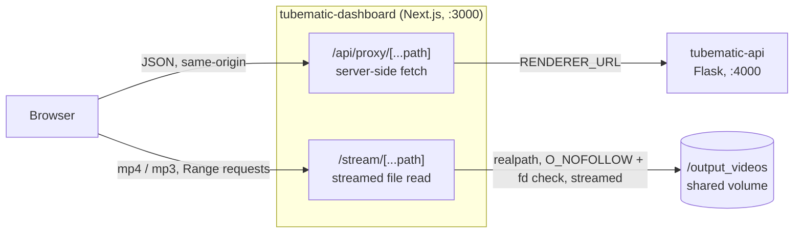

# Dashboard internals

> What each page is for and how to use it is in the user guide:
> [The Dashboard](../user-guide/04-dashboard.md). This page is how it is built.

The dashboard is the human half of Tubematic: every decision the agent may not make alone goes
through it. It is a Next.js app in `dashboard/`, served on **port 3000**.

---

## Stack

| | |
|---|---|
| Framework | Next.js 15, App Router, Turbopack |
| React | 19 |
| Styling | Tailwind CSS v4 (CSS-first config in `dashboard/app/globals.css`) plus inline `style` objects driven by CSS custom properties — a dark "CRT" theme |
| Primitives | shadcn/ui on top of `@base-ui/react`, in `dashboard/components/ui/`. The `shadcn` package itself is a **devDependency**: it is the CLI that copied those components in, and the only thing read from it is a stylesheet `globals.css` imports at build time. As a runtime dependency it pulled an HTTP server stack (via its MCP SDK) into the production dependency tree for nothing |
| Data | Client-side `fetch` + `setInterval` polling. No server components fetch data, no server actions, no WebSockets, no React Query |
| Build output | `output: "standalone"` (`dashboard/next.config.ts`) — produces a self-contained server bundle for the container image |

Everything that displays live data is a `"use client"` component. This is deliberate: the pipeline
is a slow, human-paced system, and a 5-second poll is simpler than a subscription and survives the
API container restarting underneath it.

### Poll intervals

| What | Interval |
|---|---|
| Pipeline board, Library, Projects, Script Profiles | 5s |
| Settings page's pipeline-status readout, top-bar health indicator, top-bar version badge | 30s |
| Settings values themselves, timezone, voice roster, script-profile list, agent list | fetched once on mount |

---

## Signing in

What a user sees — one password, a seven-day sign-in, **Sign out**, the backoff — is in
[the user guide](../user-guide/04-dashboard.md#signing-in). The password is set on the host with
`python onboard.py --set-password`; nothing in the dashboard can set or reset it. Signing in at
`/login` sets `tm_session`, an HS256-signed JWT that lasts **seven days, fixed** — use does not
extend it. It is `HttpOnly` and `SameSite=Strict` always, and `Secure` when the browser came over
HTTPS (directly, or per a reverse proxy's `X-Forwarded-Proto`), because a `Secure` cookie could
never be set over plain HTTP on a LAN. The top bar's **Sign out** clears it.

| Piece | File | Job |
|---|---|---|
| Login page | `app/login/page.tsx` | The form. After signing in it does a full page load, so the top bar and its pollers mount fresh; the `next` it returns to is same-site only (`lib/sessionCookie.ts::safeNext`), so the login page cannot be used as an open redirect |
| Login route | `app/api/auth/login/route.ts` | Sends the password to Flask's `POST /auth/login` with the API token — the hash is in the database, which this container cannot read — and sets the cookie on a `200`. A wrong password (`401`) and the backoff (`429` with `Retry-After`) pass straight through |
| Logout route | `app/api/auth/logout/route.ts` | Clears the cookie. `POST` only, so a link or an image cannot sign anyone out, and same-origin only, like every state-changing route (see below) |
| Middleware | `middleware.ts` | Redirects a page load with **no** cookie to `/login?next=…` |
| Session | `lib/session.ts` | Signs and verifies the cookie. Reads `session_secret` and `api_token` on every call, so a new password (which rotates `session_secret`) or a token rotation takes effect without a restart, and a missing secret means no session is valid |

**The middleware is a convenience, not the lock.** It runs on the Edge runtime, which cannot read
the secret the cookie is signed with, so it only checks that a cookie is present. The real check
is in the two routes below, on every request: every page fetches its data client-side through
`/api/proxy`, and a page shell without data shows nothing. A forged cookie therefore gets an empty
page that is sent to `/login` on the next poll. The middleware's matcher leaves out the API routes,
`/stream`, Next's assets, static files and `/login` itself, so a `fetch()` or a `<video>` gets a
`401` rather than an HTML login page.

**A session that ends mid-use is noticed by the top bar.** Its system-status poll runs every 30
seconds on every page; a `401` there sends the browser to `/login`, keeping the page it was on.

**Cross-site request forgery.** `SameSite=Strict` stops a request started by a different *site*,
but not one from the same site: a page on another port of the same host, or on a sibling subdomain,
is same-site, so the browser attaches the cookie to its request. The login route, the logout route
and the API proxy therefore check two more things on every request that is not `GET` or `HEAD`
(`lib/requestGuard.ts::guardRequest`):

- **`Sec-Fetch-Site` must be `same-origin` when it is present**, or the answer is `403`. The browser
  sets this header itself and a page cannot forge or remove it. A request without it (curl, a
  browser old enough to predate it) passes this check.
- **The body must be JSON.** A non-`GET` whose `Content-Type` is present must be `application/json`
  (parameters such as `; charset=utf-8` are allowed), and one with a body must carry that type;
  anything else is a `415`. An HTML form can only send urlencoded, multipart or plain-text bodies,
  and always sends a `Content-Type`, even for an empty form. A cross-origin `fetch()` that sets
  `application/json` needs a CORS preflight, which nothing here answers. A request with neither a
  body nor a `Content-Type` passes, because the dashboard's own bodiless `POST`s and `DELETE`s
  (Retry, Delete, Sync now, Sign out) look like that; the only cross-origin request of that shape is
  a `no-cors` `fetch()`, which current browsers mark with `Sec-Fetch-Site`.

Neither check reads `Host`, which is why there is still no `Origin`-against-`Host` comparison: a
reverse proxy in front rewrites `Host`, and that comparison would refuse every request through it.
Reaching the dashboard from another machine: see
[Infrastructure — Authentication](16-infrastructure.md#authentication).

---

## How the browser reaches the API

The browser never talks to the Flask API directly. Two catch-all route handlers stand in between,
and they exist for different reasons.



### `dashboard/app/api/proxy/[...path]/route.ts`

Forwards `GET`, `POST`, `PATCH` and `DELETE` to `${RENDERER_URL}/<path>`, preserving the query
string. `RENDERER_URL` defaults to `http://localhost:4000` and is set to the Docker-internal
hostname in production, so the browser never learns it.

- **No valid session, no request:** it answers `401` without calling Flask. This is where the
  login is actually enforced.
- **Same-origin JSON only for anything but `GET`:** another origin's request is a `403` and a
  non-JSON body a `415`, both before Flask is called (see *Cross-site request forgery* above). The
  browser's own `Content-Type` is forwarded with the body; a bodiless request is forwarded bodiless.
- Every upstream request carries `Authorization: Bearer <api_token>`. A `401` *from Flask* can only
  mean Flask refused the dashboard's own token, so it becomes a `502` that names the fix — relayed
  as a `401` it would send the browser to `/login` in an endless loop.
- Marked `export const dynamic = "force-dynamic"` and fetches with `cache: "no-store"`; every
  response carries `Cache-Control: no-store`. A cached pipeline board would be actively misleading.
- An unreachable upstream returns `502 {"error": "Upstream unreachable: …"}`; a non-JSON upstream
  body returns `502 {"error": "Upstream returned non-JSON response"}`. Otherwise the upstream's JSON
  body and status code are relayed verbatim.

**Security posture:** there is no path allow-list. The proxy joins whatever segments the browser
sends into the upstream URL. That is acceptable because only a signed-in browser gets this far, the
Flask API is an internal service on the Docker network, and the API validates its own inputs — a
signed-in user can do through the proxy exactly what the API allows, and nothing the dashboard would
otherwise hide.

### `dashboard/app/stream/[...path]/route.ts`

Rendered videos and cached voice previews live on the `/output_videos` volume, which the dashboard
container mounts read-only. This route reads them off disk directly rather than proxying megabytes
through Flask.

- `runtime = "nodejs"` — it uses `fs` and Node streams, which the Edge runtime lacks.
- **No valid session, no file:** `401` before the filesystem is touched. A `<video>` or `<audio>`
  `src` sends the cookie like any same-site request.
- **Only `.mp4` (`video/mp4`) and `.mp3` (`audio/mpeg`) are served**, with
  `X-Content-Type-Options: nosniff`. Any other extension is a `404`, so nothing else that lands on
  the volume can be fetched, or rendered by the browser as something else.
- **Containment is checked twice, and every failure is a `404`.** First lexically: the resolved
  path must start with `OUTPUT_DIR + path.sep`, because a voice id is free text a human types into
  the roster editor and it ends up as a path segment. Then on the real file: both `OUTPUT_DIR` and
  the target go through `realpath`, the real target must still be under the real root, and its real
  name must carry the same allowed extension. The file is opened `O_NOFOLLOW` (a leaf swapped for a
  symlink after the check is refused) and `O_NONBLOCK` (a FIFO cannot hang the open). Then the
  opened descriptor itself is checked, because `O_NOFOLLOW` covers only the last component: a
  directory on the way, swapped for a symlink between the `realpath` and the `open`, would otherwise
  be followed, and the descriptor is what gets streamed. On every platform the real path is
  `lstat`ed just before the open, and the descriptor's `fstat` must name the same file (device and
  inode); a swapped directory lands on a different file, so this closes the race wherever the
  dashboard runs, `npm run dev` on macOS included. On Linux the descriptor's path as the kernel
  reports it (`/proc/self/fd/<n>`) must also be exactly the real path that passed — stronger, as it
  names where the file is rather than which file it is — and an unreadable `/proc` there is a `404`
  (fail closed). Finally anything but a regular file — a directory, a FIFO — is a `404`.
  **Why the second check exists:** the volume is mounted read-write by the API, MCP and renderer
  containers, so a symlink planted there is not under the dashboard's control. A lexical check
  alone follows it, and the dashboard container also holds the session secret and the API token
  under `/run/secrets`.
- **The file is streamed, never buffered.** The response body is the open handle's read stream
  (`Readable.toWeb`), so memory use does not grow with the file, and the handle is closed when the
  stream ends, fails, the body is cancelled, or the browser goes away (a seek cancels the old
  request). Every earlier way out closes it too. A browser that went away while the route was still
  checking the session or the file fired its abort before any listener existed, so `req.signal.aborted`
  is checked once the stream exists, with nothing awaited in between. A browser's first
  request for a video is `Range: bytes=0-`, which is the whole file; reading that into one buffer
  per request is what this replaced.
- **`Range`:** one range per request, as `bytes=a-b`, `bytes=a-` or the suffix `bytes=-n` (the
  last *n* bytes). The end is clamped to the file. A valid range is a `206` with `Content-Range`; an
  inverted, malformed or past-the-end one is a `416` with `Content-Range: bytes */<size>`. A
  multi-range request gets the whole file as a `200`, which the standard allows and no media
  element asks for. No header returns the whole file with `Accept-Ranges: bytes`. This is what lets
  the browser seek in a video without downloading it first.
- **Revalidated, not cached:** `Cache-Control: private, no-cache` with an `ETag` built from the
  opened file's device, inode, size, modification time and change time (`ctime`), all at nanosecond
  precision. A revision re-renders the video into the same file, at the same URL, so a time-based
  cache (this route once sent `max-age=3600`) would replay the old render. The browser may keep its
  copy but must ask first; a matching `If-None-Match` is a bodiless `304`. The tag is strong, so a
  `Range` that carries `If-Range` is honoured only while it still matches; otherwise the whole new
  file comes back as a `200`. **Why not just size and mtime:** a strong tag must change whenever the
  bytes do, or an old `If-Range` splices cached ranges of the old render onto the new one. A
  same-size file renamed into place, or rewritten, with its old mtime put back keeps both; the
  rename changes the inode, and the rewrite changes `ctime`, which no program can set back. The one
  case left is a same-size rewrite within a single tick of the filesystem's clock. There is no `Last-Modified`: it has one-second
  resolution, so a file replaced within the same second would validate the old copy. `private`, so
  only the signed-in browser keeps a copy and no shared cache in between does.

The modal's player builds a rendered video's URL from the video's own ids,
`/stream/<project_id>/<id>.mp4` (`default_proj` for a project-less video), in
`dashboard/lib/utils.ts::videoStreamUrl`. `videos.video_path` is only the marker that a render exists:
it is never read for the location, because a tampered or legacy row could name another video's file,
and a path written on the host never mapped to `/stream` at all. Voice previews, whose path the API
returns, go through `videoToStreamUrl()`, which rewrites an `/output_videos/…` path into a
`/stream/…` URL.

---

## Pages

What each page is for, from the user's side, is in
[The Dashboard — Pages](../user-guide/04-dashboard.md#pages). This table maps each route to its
file and records the implementation choices behind it.

| Path | File | Notes |
|---|---|---|
| `/` | `dashboard/app/page.tsx` → `dashboard/components/PipelineClient.tsx` | See [The pipeline board](#the-pipeline-board) |
| `/new-video` | `dashboard/app/new-video/page.tsx` | See [The New Video page](#the-new-video-page) |
| `/library` | `dashboard/app/library/page.tsx` | Lists `VIDEO_READY`, `VIDEO_APPROVED`, `SCHEDULED`, `PUBLISHING` and `PUBLISHED`. It never shows a video at a voice checkpoint, which is why it does not hand the modal the voice roster |
| `/archive` | `dashboard/app/archive/page.tsx` | Videos with `archived_at` set — by the Delete action or the [retention sweep](11-rendering-and-review.md#retention). A row opens the modal read-only |
| `/topics` | `dashboard/app/topics/page.tsx` | The add form's description is a textarea on its own row below the name, with a counter that stops input at the API's 2000-character limit and counts code points as the API does. A three-row box beside the one-line name made that row ragged. The domain rows keep the description on one truncated line on purpose: the list is an index, and on Projects the one-line description in the 340px column is what keeps that column from growing and crushing the video pane. A domain's defaults (visual style, voice, script profile) are set on its row rather than in an edit form because the dashboard has none: `POST /projects` is an upsert, so the row selects save through it and a domain created before a default existed can still be set. Because that route is a full replace, every row edit re-sends every field. A deleted default profile shows as "Unavailable profile" because the list omits deleted profiles, so there is no name to show, and the id is a UUID. The profile picker is capped at 220px in the add form too, since profile names have no length limit. Each picker on a row sits in a fixed 150px field: a select is otherwise as wide as its longest option, and three at that width crushed a seed domain's name to about 70px at 1280px. On a narrower screen the row wraps (the pause button moves to a second line) rather than letting the name shrink under the pickers. Illustrated is disabled while no OpenAI key is stored, and a refused change is alerted rather than silently reverted. The Mining toggle is greyed out, with the reason on hover, while `GET /research/strategies` reports `mining_available: false` — read from that route rather than from the masked `/settings` key, so a key supplied only through the API's environment still counts — and a refused toggle shows the API's message and changes nothing. The **Topic cap** field saves on blur or Enter, and an out-of-range entry reverts. "N filed" is `topic_count`, which counts archived and rejected videos, so it can read higher than the video count after it. On an expired seed the ACTIVE badge is hidden, because beside EXPIRED it read as a contradiction; PAUSED still shows, since resuming alone would not re-open the domain. The cap field sizes to its content with "N filed" kept on one line, so a seed row with a three-digit count still fits on one line at 1280px. See [Topic cap](02-pipeline.md#topic-cap) |
| `/projects` | `dashboard/app/projects/page.tsx` | Two-pane drill-down with its own action dispatcher (see [Actions](#actions)). An expired domain carries a badge |
| `/script-profiles` | `dashboard/app/script-profiles/page.tsx` | Create, poll and delete through `/script-profiles`. See [Scripting and Voice — Script profiles](08-scripting-and-voice.md#script-profiles) |
| `/socials` | `dashboard/app/socials/page.tsx` | The publishing-account allowlist, and a Connect button per platform that always requests the `feeds` permission ([Publishing](14-publishing.md#connecting-accounts)) |
| `/analytics` | `dashboard/app/analytics/page.tsx` | **Videos**: an unreported metric sorts below a real 0. The graphs are `AnalyticsCharts.tsx`; below 1100px wide they sit between the filters and the table. The table scrolls in its own box with a sticky header and renders 50 rows at a time, adding 50 more as its end scrolls into view; every row is still fetched, because the totals and graphs need them all, so this bounds the page's size, not the request. **Spend**: `SpendCard.tsx`, which mounts only while its tab is open |
| `/logs` | `dashboard/app/logs/page.tsx` | Filters by service, minimum level, free text and row limit. Refreshes on a filter change or the button; there is no live tail |
| `/settings` | `dashboard/app/settings/page.tsx` | See [The settings page](#the-settings-page). The Auto Pilot tab is `dashboard/components/AutoPilotPanel.tsx` |
| `/login` | `dashboard/app/login/page.tsx` | See [Signing in](#signing-in) |

Apart from the login and logout routes, there is no other `app/api/` route — the proxy and stream
handlers above are the only server-side endpoints the dashboard defines. The Logs page is no exception: it reads through the proxy like every
other page, which is what keeps the dashboard free of a log mount or a Docker socket.

### The New Video page

`/new-video` submits a video without an agent harness, through
[`POST /videos/manual`](05-http-api.md#post-videosmanual). What it asks for is in
[the user guide](../user-guide/04-dashboard.md#new-video). Its own route exists, rather than reusing
`POST /videos`, because the two disagree on purpose: an over-long title is refused here instead of
clipped, and a picked `agent_id` is kept.

The agent picker defaults to **Automatic (dealt by weight)**. That option sends no `agent_id`, so
the video is dealt by the same weighted deck as every other new video, and a person who never
touches the picker doesn't quietly override the weights. The model picker is disabled under
Automatic, because the agent isn't known until it is dealt. Once an agent is picked, its default
model is pinned the same way approving a topic pins it.

The voice picker's **Default** names the voice the API will actually give the video: the Manual
Videos domain's default voice while that voice is on the roster, else the install default.

Every submission is filed into the **Manual Videos** domain and left unscored, shown as "—". Why it
works that way is explained in [Where topics come from](02-pipeline.md#where-topics-come-from).

### The pipeline board

`dashboard/components/KanbanBoard.tsx` renders 11 main columns in pipeline order plus 3 side columns
(Rejected, Revision Requested, Failed). `RENDER_QUEUED` is folded into the Rendering column via
`extraStatuses` — a video waiting for the worker and a video being rendered are the same thing from
a human's point of view.

`dashboard/components/ActionPane.tsx` is the more important surface: a "Quick Actions" inbox listing only
videos sitting at a human checkpoint, grouped under a heading per checkpoint in pipeline order
(`TOPIC_PROPOSED`, `SCRIPT_READY`, `VIDEO_READY`). Inside a group the API's oldest-first order is
kept. A row of toggle pills above the list, one per status with its count, hides or shows each
status. The filter lives in component state only and resets on reload, so a filter forgotten in
one browser can never leave videos waiting on a human unseen. The filter is stored as the set of
statuses switched *off*, so a status the API adds later is shown by default rather than hidden.
Each row carries the controls that decision needs attached inline —
a script-profile picker, a visual-style picker, a voice picker with an audio preview button, and
agent, model and effort dropdowns at `TOPIC_PROPOSED`; the same voice picker and agent, model and
effort dropdowns at `SCRIPT_READY`; watch/approve/revise at `VIDEO_READY`. The title column keeps
at least 220px and the controls take the rest, wrapping onto further lines, right-aligned, when they
do not fit — a `TOPIC_PROPOSED` row carries eight controls, and letting them take their full width
crushed the title to nothing and pushed Revise off-screen at 1280px. The voice, script-profile and visual-style pickers are capped (220px, 220px and 150px; profile names are user-supplied with no length limit): a select is as wide as its longest option, and each has one long *disabled* option — a voice's conflict reason, "Illustrated (needs an OpenAI key)" — that would otherwise widen it for every row and push Revise onto a second line even on a 1920px screen. Every
**Revise** button opens the video's modal straight into the Request Revision dialog. The modal's
Actions block offers the same pickers stacked. On both surfaces each picker is wrapped in a
`<label>` carrying a small caption, so the caption is also the control's accessible name — the
model and effort dropdowns in particular hold look-alike values and cannot be told apart by
position alone. A video can arrive at `TOPIC_PROPOSED` already holding a profile — a curriculum
video seeded from its domain's default — that has been deleted since. The profile picker then shows
it as "Unavailable profile" (in the modal, by name with "(deleted)") rather than reading as "No profile" while
still sending it, and stays visible even when no `READY` profile is left, so it can be cleared.

**The voice picker appears at both checkpoints because the script is written for its voice's
model.** Each voice is labelled with its model. A voice whose model cannot speak the script is
disabled, with the reason, from the video's `voice_conflicts` — so at `SCRIPT_READY` a switch
between `eleven_v3` and any other model is almost always refused, since nearly every script carries
that model's pause markup. `TOPIC_PROPOSED` is where such a switch belongs: the script does not
exist yet, the API lists no conflicts there (even when a topic revision left an old script stored,
because approving has it rewritten), and nothing is disabled. The two pickers send differently.
Approve Topic sends `voice_id` only when the human picked one: the video already carries the voice
it was created with — its project's default voice, or none — and an untouched picker must not pin
the install default over it. Approve Script always sends the shown voice, because the API checks
every voice it receives against the script, and that check is what catches a voice whose model
was edited in Settings after scripting. The shown voice is derived on every render from the pick,
the video and the install default, never captured when the row mounts, since the roster arrives
from `/settings` independently of the video list. A shown voice that is not on the roster (removed
since it was chosen, or no voice at all) is listed first and disabled rather than letting the
browser display a different voice. The Pipeline and Projects pages hand the modal the roster;
Library does not, because it only lists videos past both voice checkpoints.

**The visual-style picker disables Illustrated when no OpenAI key is stored**, labelled *needs an
OpenAI key*. The page reads that from `GET /settings`, whose masked `openai_api_key` is `""` exactly
when no key is set, so the key itself never reaches the browser. The API refuses the style either
way, so a page that has not loaded settings leaves the option enabled rather than greying out a
choice that may be valid. A video that already holds `illustrated` still shows it, so the human can
see why its approval is refused. A key supplied only through the API container's environment
(the e2e stack does this for other keys) reads as unset here while the API accepts it.

**The agent control lists every live agent**, starting on the video's own. An
uninstalled agent is never offered; when it is the one the video is on, it is shown as a disabled
`<name> (uninstalled)` option so the select still says where the video stands. Without an agent
list — before `GET /agents` answers, or when it fails — the agent is shown read-only instead.
**Picking a different agent restarts the model dropdown at that agent's default** and says
*Model reset to …'s default* on the spot: a model belongs to one agent's list, and the server clears
it on a change anyway. Effort keeps its value. The pickers exist at every checkpoint whose next step
is agent work: `TOPIC_PROPOSED` and `SCRIPT_READY` inline and in the modal, and `VIDEO_READY` in the
modal only — approving a video hands nothing to an agent, so there the pickers serve Request
Revision alone. A row's **Revise** hands any picks made on the row to the modal it opens, so a
choice is not dropped on the way into the dialog.

The model control is a **dropdown of the video's (picked) agent's models**, with that agent's default
(`models[0]`) preselected. It is not free text because the list is exactly what `--install-agent`
validated against the real CLI, and the API rejects anything outside it. The control is disabled —
and the approval sends `""`, meaning the agent's default — when the agent is uninstalled, not
installed, or the agent list has not loaded. A pinned agent the list cannot resolve is deliberately
**not** replaced by the default agent: the API checks the model against the video's own agent, so
another agent's list would only produce a rejected approval. Between checkpoints the modal shows
the agent, model and effort read-only, and a blank model reads as the agent's default. These rules live in
`dashboard/lib/agents.ts`, shared by `ActionPane.tsx` and `VideoModal.tsx`.

The modal's Details also shows a read-only **Voice** and **Voice model** wherever no voice picker is
shown: everywhere except `TOPIC_PROPOSED` and `SCRIPT_READY` on a page that hands the modal the
roster, plus on every archived video. Both come from the video's `voice_info`. The model is the one
ElevenLabs was actually called with. Before voicing, it is the voice's current setting, marked
"(current setting)". A voice that has left the roster shows as its id, marked "(not in roster)".
See [HTTP API — `GET /videos/<id>`](05-http-api.md#get-videosvideo_id) for why the model comes from
the usage ledger. `voice_info` comes only with the single-video fetch, not the list row the modal
opens on, so the two rows appear once that fetch answers.

The effort control sits beside it and differs in two ways. **In the modal it is never disabled**:
its five levels come from the CLI rather than from what this install probed, so there is always a
valid list to offer — even before `GET /agents` resolves, or when the video's agent is uninstalled.
**On a Quick Actions row it is greyed out together with the model**, and so is a read-only agent
name. The reason (*Agent not installed*, *Agent uninstalled*, *Agent list not loaded*) is in each
control's hover text rather than in a line of text on the row: that line was wide enough to push
the row's buttons onto a second line, and with no agent able to run the video an effort level
records nothing useful. The row's agent *dropdown* stays live, because switching to an installed
agent is the way out, and it re-enables both controls.

**And it carries a blank option, which the model picker does not.** Blank is a real choice, not an
absence: it is what `videos.agent_effort` stores to mean "use this video's agent's level", the same
way `""` on `script_profile_id` means the generic style. An untouched approval therefore submits
`""`, and the option's label names the level that will actually result — `high (agent default)`
when the agent is known, and only `Agent default` when it is not.

That asymmetry with the model picker is deliberate. Resolving the model to `models[0]` and pinning
it at approval is right, because the list is per-install and the pin records which model actually
made the video. Resolving an *effort* the same way means **guessing** wherever the agent row is
unavailable — on any page before `GET /agents` answers, or when it fails. A guess submitted as an
explicit value silently overrides an agent configured for anything else.

**Only approving the topic pins; everything else sends what was touched.** Approve Script and every
Request Revision carry `agent_id` only when a *different* agent was picked, `agent_model` only when
it was picked or the agent changed, and `agent_effort` only when it was picked
(`agentPicksPayload`; approve-topic uses `topicApprovalPayload`). An untouched picker therefore
sends nothing at all, whatever the state of the agent list — which is what keeps a slow or failed
fetch from moving a video or blanking the model chosen at the topic. The voice at approve-topic
follows the same rule (`lib/voices.ts::topicVoicePayload`). Pipeline, Projects and Library
all fetch `/agents` once, so every surface that shows a checkpoint offers the same pickers; a test
drives the real modal on Projects and approves without touching them, before and after the list
answers.

---

## Components

| Component | Purpose |
|---|---|
| `PipelineClient.tsx` | Root client component for `/`. Owns all polling and the single `handleAction` dispatcher |
| `KanbanBoard.tsx` / `KanbanColumn.tsx` / `KanbanCard.tsx` | The board. A card shows a score dot (or "—" for an unscored video from the New Video page), the display name, strategy tag, relative age, a **STUCK** tag when the scheduled agent has stopped retrying the video, when a `SCHEDULED` post goes out (in the zone it was picked in), a progress bar for in-flight statuses, and inline actions at checkpoint statuses |
| `ActionPane.tsx` | The checkpoint inbox described above. Flashes green or red and hides the row after an action |
| `VideoModal.tsx` | Full detail dialog — Topic / Script / Video / Publishing Results / Comments / Logs tabs, plus a sidebar with status-appropriate actions (including Delete), a separate **Published to** section linking to each live post (kept out of Actions because opening a post changes nothing about the video), metadata, the video's cost breakdown (`CostBreakdown.tsx`), and the AI review feedback with expand/collapse. Script, Video and Publishing Results appear only once they have content; **Logs is always present**, because a per-video log matters most when nothing else about the video worked. **Comments is a read-only thread** — see `ReviseDialog.tsx` |
| `CostBreakdown.tsx` | A video's cost per provider and per model, from `GET /videos/<id>/costs`. ElevenLabs shows plan credits, never dollars. The poller runs one session per video and stage, so a session belongs to this video alone. Sessions recorded before that could cover a batch of videos, so the card shows this video's even share beside the whole session — `≈ $0.05 (of $0.15 · 1 session)` — and expands into one row per session, labelled by the stage the video was at (script writing, voicing, scene writing, revision) with the split written out. A voicing session recorded before one-stage sessions also covered the scene writing that followed it, and reads "Voicing & scene writing" (migration `0007` relabelled those rows `VOICING_WITH_SCENES`). The total adds the **share**, never whole sessions, which would count a session once per video. Unpriced calls are counted beside the total, never shown as `$0`; a video from before cost tracking says it has no usage recorded. Always carries the API-list-price disclaimer |
| `AnalyticsCharts.tsx` | The Analytics page's graphs: views per platform and per account as horizontal bars, and views gained per month as columns. They follow the page's filters, and clicking a platform or account bar sets that filter (clicking it again clears it); hovering a bar or column gives its exact figure. The platform and account bars are summed from the page's rows rather than the API's `by_platform`, which counts an unreported view count as 0 — here an entry nothing was reported for reads `—` with no bar, since an empty bar would claim nobody watched. The month columns come from `by_month` (see [Publishing](14-publishing.md#http-routes)); a month where views fell keeps its negative figure on hover and draws no height. No charting library: three single-series bar charts do not need one, and plain elements are testable in the unit suite |
| `SpendCard.tsx` | The Analytics page's **Spend** tab — the one place spend that belongs to no video shows up: research and topic mining, script-profile builds, voice previews, and sessions from the retired unscoped agent fallback. A range picker (Today, This week, This month — the default — or a custom from/to) re-fetches on change; presets are sent by name and resolved by the API, and the label shows the days the response says it summed; a custom range that is backwards or half-filled is flagged and never sent. Tiles for the total, videos, research & mining and other agent runs, plus the ElevenLabs credit pool when the key has the optional `user_read` permission (recorded credits for the range otherwise). The pool is ElevenLabs' own **billing-period** counter and does not follow the range, which the tile and note both say. Unpriced calls are called out beside the total with where to add a price |
| `CostsPanel.tsx` | The Settings → Costs tab. See [The settings page](#the-settings-page) |
| `LogList.tsx` | Record rendering shared by the Logs page and the modal's Logs tab, so the two cannot drift |
| `ReviseDialog.tsx` | The mandatory-comment prompt. Every "Request Revision" path routes through it, and it is the **only** way a human comment is added — the modal's Comments tab has no compose box. A free-form box let a note land at any status with nothing acting on it; here every human comment comes with the status change that makes the agent read it |
| `PublishDialog.tsx` | Destination selection, per-platform privacy, the title and description the agent wrote with the script, and when: now, or a scheduled date, time and timezone (the browser's by default). Opens from a `VIDEO_APPROVED` video's window, wherever that window is opened: the Pipeline board, the Library or Projects (each fetches `publishing_enabled` and passes it to `VideoModal`; the Archive's window is read-only). See [Publishing](14-publishing.md#dashboard) |
| `VoicePreviewButton.tsx` | Generates (or replays a cached) voice sample and plays it inline. One button toggles play (▶) and pause (❚❚), following the audio's own events. Given a `modelId`, it previews that model — the Settings page passes each row's current pick — and a change of voice or model resets it, so the next play is a fresh sample |
| `MiningSources.tsx` | Add/remove YouTube URLs for the mining strategy. It mirrors the API's URL rule so Add lights only for a YouTube video URL, and adds it in the canonical `watch?v=` form, so a second spelling of a listed video is a duplicate. The Topics page shows the API's 400 message when a save is refused, and lists what the API stored after one succeeds — see [HTTP API — Mining sources](05-http-api.md#mining-sources) |
| `TimeZoneProvider.tsx` | Fetches the host's timezone once and provides it via context. See below |
| `Toast.tsx` | `useToasts()` plus a stack renderer. Success toasts auto-dismiss after 3s; error toasts persist |
| `SummaryStrip.tsx` | Six stat tiles: Topics Awaiting, Scripts Ready, Videos Ready, In Pipeline, Published, Failed |
| `StatusBadge.tsx` | Colored dot and label for any of the 15 statuses |
| `SectionLabel.tsx` | Section heading rule with an optional count |
| `TopBar.tsx` | Sticky nav across every page, plus a version badge, timezone badge and health indicator. See below. One unwrapped row needs about 1510px plus the gutters; below a 1640px viewport (the bar's own max-width) the tabs drop to a second row (`.tm-topbar-*` in `globals.css`, which also raises `--hd-height`), because the row used to squeeze its text onto several lines and then make every page scroll sideways. The breakpoint leaves room for the scrollbar, which the media query counts, a longer timezone label and the version string; the row is `nowrap`, so it never wraps text |
| `components/ui/*` | shadcn/ui primitives — `badge`, `button`, `dialog`, `tabs`, `textarea` |

---

## Actions

Everything the UI can do to a video is an action string handled by one dispatcher
(`PipelineClient.handleAction`, mirrored for their own scope in the Library and Projects pages).
What each action means to the person clicking it is in
[The Dashboard — Making decisions](../user-guide/04-dashboard.md#making-decisions).

| Action | Available at | Sets status to | Comment required | Also sends |
|---|---|---|---|---|
| `approve-topic` | `TOPIC_PROPOSED` | `TOPIC_APPROVED` | no | `script_profile_id`, `agent_model`, `agent_effort`, `visual_style` — atomically, in the same request — plus `agent_id` when a different agent was picked and `voice_id` when a voice was picked. `agent_model` is one of the (picked) agent's models, or `""` when the picker is disabled; `agent_effort` is always one of the five levels |
| `reject-topic` | `TOPIC_PROPOSED` | `TOPIC_REJECTED` | no | — |
| `revise-topic` | `TOPIC_PROPOSED` | `REVISION_REQUESTED` | **yes** | Touched agent picks |
| `approve-script` | `SCRIPT_READY` | `VOICING` | no | `voice_id`, plus touched agent picks |
| `revise-script` | `SCRIPT_READY` | `REVISION_REQUESTED` | **yes** | Touched agent picks |
| `approve-video` | `VIDEO_READY` | `VIDEO_APPROVED` | no | — |
| `delete` | Any status except `VOICING`, `RENDER_QUEUED`, `RENDERING`, `SCHEDULED`, `PUBLISHING`, `VOICE_READY`, `REVISION_REQUESTED`; never on an archived video | *unchanged* — sets `archived_at` | no, but confirmed in a dialog | `DELETE /videos/<id>` rather than a `PATCH`. Removes the mp4 and job directory; the record moves to the Archive. `dashboard/lib/videoStatus.ts` holds the allowed set, mirroring the API's — see [HTTP API](05-http-api.md#videos) for why the last two statuses are blocked |
| `revise-video` | `VIDEO_READY` | `REVISION_REQUESTED` | **yes** | Touched agent picks. Library handles it too — it used to drop it, so its Request Revision posted the comment and never moved the video |
| Retry agent | Any status, when the scheduled agent flagged the video stuck (`agent_stuck_at` set); not archived | *unchanged* — clears the flag | no | Not an action string: `VideoModal` calls `POST /videos/<id>/agent-retry` itself, and a banner above it says how many sessions made no progress. `isAgentStuck` in `dashboard/lib/videoStatus.ts`. See [The Poller](13-the-poller.md#success-is-read-from-the-database) |
| Retry publishing | `FAILED` with publication rows, publishing enabled, not archived | `PUBLISHING` or `VIDEO_APPROVED`, decided by the server | no | Not an action string: `VideoModal` calls `POST /videos/<id>/publish/retry` itself. On `republish` it opens `PublishDialog`. `canRetryPublish` in `dashboard/lib/videoStatus.ts` mirrors the server's rule. See [Publishing](14-publishing.md#post-videosidpublishretry) |
| Cancel schedule | `SCHEDULED`, publishing enabled, not archived | `VIDEO_APPROVED`, once postforme has deleted the post | no, but confirmed | Not an action string: `VideoModal` calls `POST /videos/<id>/schedule/cancel` itself and shows a refusal (the post is already going out) inline. See [Publishing](14-publishing.md#post-videosidschedulecancel) |

Two details worth knowing before you add an action of your own:

- **Every PATCH carries `onlyIfCurrentStatus`.** The server rejects the write with `409` if the
  video has moved on since the page last polled, and the client surfaces that as
  *"Status conflict — action already taken"*. Without it, two people looking at a 5-second-stale
  board could both approve the same video. Any other refusal — say, a picked agent uninstalled
  since the page loaded — is shown in the API's own words. Pipeline, Projects and Library all go
  through `patchVideo` in `dashboard/lib/videoStatus.ts`, so none of them can treat a refused action
  as done.
- **Choices that freeze travel with the action.** `script_profile_id` and `visual_style` are frozen
  server-side once a video leaves `TOPIC_PROPOSED`; `agent_id`, `agent_model` and `agent_effort`
  whenever it is not at a checkpoint. So each action sends them in the *same* request as the status
  change rather than in a prior one. Wherever a choice has no picker, it is shown read-only on the
  card and in the modal, so it never vanishes at the checkpoints where knowing it matters. A video left on **Auto** shows what the agent
  actually chose, marked as automatic — without that the board cannot explain why two videos look
  different, which is the whole reason the resolution is recorded. See
  [The Pipeline](02-pipeline.md).

> **`approve-video` was called `publish` until publishing actually existed.** It never published
> anything — it is the `VIDEO_READY → VIDEO_APPROVED` human approval, and the button that used to say
> "Publish to YouTube" now says "Approve". Real publishing lives behind `PublishDialog`.

The three revise actions never fire from a button directly — they open `ReviseDialog`, which posts
the comment first and only then issues the status change. The modal's **Request Revision** button
opens it; the Quick Actions **Revise** button opens the modal with it already open (`VideoModal`'s
`openRevise` prop), on the tab being revised, which is what shows if the dialog is cancelled. At
`VIDEO_READY` that tab is named explicitly as Video, because a rendered video also has a script and
the modal's default tab prefers Script. The two requests are not atomic: if the status change is refused with `409`,
the comment has already been saved.

---

## The settings page

What each tab holds, from the user's side, is in
[The Dashboard — The settings page](../user-guide/04-dashboard.md#the-settings-page), and every key
is in [Settings](../user-guide/05-settings.md).

**The pause switch sits above the tabs and applies immediately with no Save button.** Pause and
resume is an operational action against its own endpoint, and staging it behind a tab and a Save
would make stopping the scheduler a three-click operation.

Everything else is staged. Edits accumulate in a local draft; nothing reaches the API until that
tab's **Save** is pressed, and a save sends only the fields belonging to that tab. Each entry in
`app/settings/page.tsx::TABS` lists its `fields`, and that list is load-bearing: it scopes both what
the tab's Save sends and what counts as unsaved on that tab, so the two can never drift apart. A tab
with unsaved edits shows an amber dot, and switching away asks for confirmation. The tab row wraps
onto a second line on a narrow window rather than scrolling, because the page body clips horizontal
overflow and a single row would hide the last tabs entirely.

On Voice, each roster row carries its own model picker and preview button — there is no
install-wide model. Preferences is one large textbox with a live character count against the
6000-character cap; see [the agent layer](07-agent-layer.md#user-preferences) for how the agent
receives it.

**The Auto Pilot tab saves as one document, behind a confirmation.** It sits outside the per-tab
draft like Agents and Costs, with its own **Save** that sends everything to `POST /autopilot` at
once. What the settings mean is in [Auto Pilot](14-publishing.md#auto-pilot). Four things about the
tab itself:

- **The warning is always on screen**, above the switch, and is repeated in the confirmation. Its
  wording lives once, in `dashboard/lib/autoPilot.ts::AUTO_PILOT_DISCLAIMER`.
- **A save that widens what Auto Pilot acts on is confirmed first**: turning it on, or adding a
  project while it is on (`autoPilot.ts::needsConfirmation`). The dialog says how many videos are
  waiting at a checkpoint in the newly covered projects, because they are approved the moment the
  save lands. Turning it off, removing a project, or changing accounts, numbers or the gap saves
  straight away.
- **It refuses to render a response that is not an Auto Pilot configuration.** A proxy error read as
  "off, nothing selected" could be saved straight back over the real configuration.
- **An account chosen earlier that is no longer offered** (switched off on Socials, disconnected, or
  publishing turned off) stays listed under its project, ticked and marked as not available, so it
  can be unticked. Hiding it would leave it in every save with no way to remove it.

While Auto Pilot is on, the pipeline board shows a one-line notice above Quick Actions, read from
`auto_pilot_enabled` in `GET /settings`. It reflects the switch, not whether any project is selected.

**The Agents tab is the exception to staging.** Agents are rows in their own table, not settings, so
the tab sits outside the Save and dirty-dot machinery entirely. Choosing the default agent, picking
an agent's default model from its select, and each weight's own Save button write immediately
through `PATCH /agents/<id>`. **The model list itself is read-only here**: the dashboard container
has no agent binary to validate a new model against, so models are added or removed only by
re-running `python onboard.py --install-agent <name>` on the host. There is no uninstall control
either — that is `python onboard.py --uninstall-agent <name>`, which also removes files the
dashboard cannot reach. See [HTTP API](05-http-api.md#agents).

**The Costs tab is outside staging too**, for the same reason: model prices are rows in their own
table. See [Settings — Costs](../user-guide/05-settings.md#costs) and [HTTP API](05-http-api.md#costs).

API keys render through a `SecretInput`, which is a password field that unmasks only while focused.
The value it displays is whatever the server returned — a mask or an empty string, never a usable
key. Re-submitting an unchanged mask is a server-side no-op; clearing the field and blurring commits
an empty string, which removes the key.

**The Notifications tab holds the Discord webhook URL rather than the API Keys tab**, even though it
is a secret and renders through the same `SecretInput`. It is grouped with the three triggers it
configures, so someone looking for notification settings finds all of them in one place. Saving a
non-empty URL probes it — see [Notifications](../user-guide/05-settings.md#notifications) — so a revoked or
mistyped webhook is rejected there and then rather than discovered as messages that never arrive.

---

## Version

The top bar's version badge (`TopBar.tsx::VersionBadge`) shows the installed version; what a user
reads from it is in [the user guide](../user-guide/04-dashboard.md#the-top-bar).

The value comes from `GET /pipeline/status`, re-read every 30s alongside the health indicator. It is
polled rather than read once because the case this badge exists for is an upgrade, and an upgrade
restarts the API underneath a page someone left open — a value read once at mount would still be
showing the version from *before* the upgrade at exactly the moment it is being used to check. The
same polling covers a first load that raced the API's own startup.

It arrives over HTTP rather than being baked into the dashboard image for two reasons. The dashboard's build context is `dashboard/` alone, so it cannot read the
repository's `VERSION` file at all; and in a source install the dashboard and API images are rebuilt
independently, so a baked value could silently disagree with the stack it is describing.
`tubematic_core/version.py` stays the single definition — nothing else in the tree, including
`dashboard/package.json`, records a Tubematic version.

**Nothing is rendered when the version is unavailable** — an unreachable API, or one predating this
feature. There is no `unknown` and no fallback number, because a wrong version in a bug report is
worse than no version at all. The badge therefore disappears while the API is down, including during
an upgrade, and comes back showing whatever is serving afterwards: the last version it saw is a
stale value like any other. The health indicator beside it turns red over the same window.

A source install is **not** marked as such. Its `VERSION` holds the next version being worked on
rather than one that was ever released, so the badge is not exactly what is running there. Marking
it would mean recording the install mode a second time, in the database, purely so the API container
could read it back; setting `TUBEMATIC_VERSION` on the API service is the existing way to override
the string if you want one.

---

## Time

Every timestamp shown is in the **pipeline host's** timezone, not the viewer's browser timezone
(what that looks like to a user: [Times](../user-guide/04-dashboard.md#times)).
`TimeZoneProvider` fetches the host's IANA zone name and human label from `GET /pipeline/status` on
mount and provides it via context; on any failure it degrades to UTC and sets a `degraded` flag.

`dashboard/lib/datetime.ts` enforces this structurally: every formatter takes `timeZone` as an
explicit parameter and none of them reads the ambient browser zone. `parseIso()` treats a bare
`YYYY-MM-DDTHH:MM:SS` with no zone designator as UTC, matching what the backend stores. Every
formatter returns `"—"` rather than throwing on unparseable input.

`formatRelative(iso, now)` takes `now` as a parameter rather than calling `Date.now()`, which is
what makes it testable.

The Spend tab's ranges follow the same rule with **no date arithmetic in the browser at all**. A
preset (Today, This week, This month) is sent by name — `GET /usage/summary?preset=week` — and the
API decides which days it covers in the host zone; the card labels itself with the `from`/`to` the
response echoes. It does not work "today" out from `TimeZoneProvider`, because that context is UTC
until the host zone arrives and stays UTC if the lookup fails: a range derived from it would name the
wrong days on a direct load, and keep naming them if `/pipeline/status` never answered. A custom
range is the user's own days and is sent as `from`/`to`, which the API also cuts in the host zone.

---

## Working on the dashboard

```bash
cd dashboard
npm install
npm run dev          # http://localhost:3000
```

Point it at a running API with `RENDERER_URL=http://localhost:4000`.

### Tests

```bash
npm test             # vitest, single run
npm run test:watch
npx tsc --noEmit     # typecheck
```

Unit tests live in `dashboard/tests/unit/` and run under happy-dom with `TZ=UTC` forced by
`vitest.config.ts`. They cover the date formatters and the UTC-degradation matrix, both catch-all
routes (including the path-traversal cases), every page's fetch/poll/error behaviour, the settings
save model, the action set per status, and the display-name fallback logic.

```bash
npm run test:e2e         # headless
npm run test:e2e:headed
npm run test:e2e:ui
npx playwright show-report
```

The Playwright suite is heavier: its `globalSetup` runs
`docker compose -f docker-compose.test.yml up -d --build --wait` from the repo root, which builds
the full stack. It waits on the test API's health endpoint and the test dashboard, runs with a
single worker (the suite shares one database), and tears the stack down afterwards. Specs live in
`dashboard/tests/e2e/specs/`; `dashboard/tests/e2e/fixtures/seed.ts` seeds data by calling the test
API directly and UUID-prefixes it for isolation.

The e2e browser is deliberately set to a timezone that matches neither UTC nor the API's configured
zone. That is the assertion: if the dashboard ever started formatting in the browser's zone instead
of the host's, this suite would catch it.
