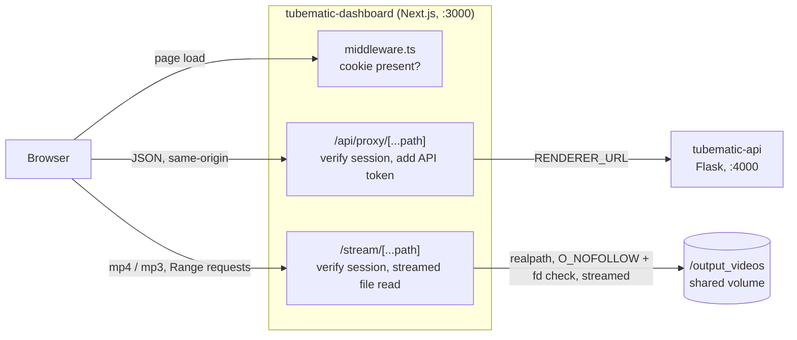

# Dashboard internals

What each page is for and how to use it is in the user guide:
[The Dashboard](../user-guide/04-dashboard.md).

The dashboard is a Next.js app in `dashboard/`, served on port 3000. Every decision the agent may
not make alone goes through it. A request takes this path:

- Each page is a client component that fetches JSON from `/api/proxy/<path>` and polls it.
- The proxy checks the session cookie, adds the API token and forwards the request to the Flask API.
- Videos and voice previews are read from disk by `/stream/<path>`, which checks the same cookie.
- `middleware.ts` sends a page load that has no cookie to `/login`.

File paths below that start with `app/`, `components/`, `lib/` or `tests/` are relative to
`dashboard/`.

---

## Stack

| Part | Choice |
|---|---|
| Framework | Next.js 15 with the App Router, React 19, Turbopack for `dev` and `build` |
| Styling | Tailwind CSS v4, configured in `dashboard/app/globals.css`, plus inline `style` objects that read CSS custom properties. The theme is dark only |
| Primitives | shadcn/ui on `@base-ui/react`, in `dashboard/components/ui/`. The `shadcn` package is a devDependency: it is the CLI that copied the components in, and `globals.css` imports one stylesheet from it at build time |
| Data | Client-side `fetch` and `setInterval` polling in `"use client"` components. No server component fetches data, and the app uses no server actions, WebSockets or query library |
| Build output | `output: "standalone"` in `dashboard/next.config.ts`, a self-contained server bundle for the container image |

The pipeline moves at human pace, and a 5-second poll keeps working when the API container restarts
under an open page.

### Poll intervals

| What | Interval |
|---|---|
| Pipeline board, Library, Projects, Script Profiles, Mascots | 5 s |
| Settings page's pipeline status, top-bar health indicator, top-bar version badge | 30 s |
| Renderers panel, and the renderer list behind the **Nothing can render** banner | 20 s. The panel polls every 3 s while a GPU test it asked for is outstanding |
| Auto Pilot tab's in-progress count | 20 s |
| Top-bar disk figure (`/storage`) | 5 min, and each time its popup opens. The API keeps its own walk for 60 s |
| Update banner (`/api/update-check`) | 10 min. GitHub is asked at most every 2 hours |
| Settings values, timezone, voice roster, script-profile list, agent list | Once on mount |

---

## Signing in

What a user sees is in [the user guide](../user-guide/04-dashboard.md#signing-in). The password is
set on the host with `python3 onboard.py --set-password`. Nothing in the dashboard can set or reset
it.

Signing in at `/login` sets `tm_session`, an HS256-signed JWT that lasts seven days from the
sign-in. Use does not extend it. The cookie is `HttpOnly` and `SameSite=Strict`. It is `Secure` when
the browser came over HTTPS, directly or according to a reverse proxy's `X-Forwarded-Proto`, so that
sign-in still works over plain HTTP on a LAN. See
[Infrastructure](16-infrastructure.md#using-the-dashboard-from-another-machine) for the dashboard
behind a proxy.

| Piece | File | Job |
|---|---|---|
| Login page | `app/login/page.tsx` | The form. After sign-in it does a full page load, so the top bar and its pollers mount fresh. `lib/sessionCookie.ts::safeNext` accepts only a same-site path to return to |
| Login route | `app/api/auth/login/route.ts` | Sends the password to Flask's `POST /auth/login` with the API token, because this container cannot read the database that holds the hash. Sets the cookie on a `200`. A `401` and the backoff's `429` with `Retry-After` pass through |
| Logout route | `app/api/auth/logout/route.ts` | Clears the cookie. `POST` only, so a link or an image cannot sign anyone out |

- `lib/session.ts` signs and verifies the cookie. It reads `session_secret` and `api_token` from `/run/secrets` on every call, so a
  new password (which rotates `session_secret` and signs every browser out) and a rotated token
  apply without a restart. A missing or empty secret means no session is valid.
- `middleware.ts` redirects a page load with no cookie to `/login?next=…`. It runs on the Edge
  runtime, which cannot read the signing secret, so it only checks that a cookie is present. The
  proxy, the stream route, the mascot-sheet route and the update-check
  route verify the signature on every request. A forged cookie gets a page shell with no data.
- The middleware's matcher leaves out the API routes, `/stream`, `/mascot-sheets`, Next's assets,
  static files and `/login`, so a `fetch()` or a `<video>` without a session gets a `401` and never
  the login page's HTML.
- The top bar's health poll sends the browser to `/login` on a `401` and keeps the page it was on.
  This is how a session that ends mid-use is noticed.

### Cross-site request forgery

`SameSite=Strict` stops a request started by a different site. A page on another port of the same
host, or on a sibling subdomain, is same-site, and the browser attaches the cookie to its requests.
The login route, the logout route and the proxy therefore run `lib/requestGuard.ts::guardRequest`
on every request that is not `GET` or `HEAD`:

- If `Sec-Fetch-Site` is present, it must be `same-origin`, or the answer is `403`. The browser sets
  this header and a page cannot change or remove it. A request without it (curl, an old browser)
  passes.
- A `Content-Type`, if present, must be `application/json` (parameters such as `; charset=utf-8`
  are allowed), and a request with a body must carry that type. Anything else is a `415`. An HTML
  form cannot send JSON, and a cross-origin `fetch()` that sets `application/json` needs a CORS
  preflight, which no route here answers.
- A request with neither a body nor a `Content-Type` passes, because the dashboard's own bodiless
  `POST` and `DELETE` requests look like that. The one cross-origin request of that shape is a
  `no-cors` `fetch()`, which current browsers mark with `Sec-Fetch-Site`.

Neither check reads `Host`. A reverse proxy rewrites `Host`, so a comparison of `Origin` against
`Host` would refuse every request that comes through one. When you add a `fetch()` that sends a
body, set `Content-Type: application/json`.

---

## How the browser reaches the API

The browser has no direct route to the Flask API. Route handlers in the dashboard's server stand in
between.



### `dashboard/app/api/proxy/[...path]/route.ts`

The proxy forwards `GET`, `POST`, `PATCH` and `DELETE` to `${RENDERER_URL}/<path>` and keeps the
query string. `RENDERER_URL` defaults to `http://localhost:4000` and is set to the Docker-internal
hostname in the container, so the browser never learns it.

- A request without a valid session gets `401` and Flask is not called. The login is enforced here.
- A request that fails `guardRequest` gets `403` or `415` before Flask is called.
- Every upstream request carries `Authorization: Bearer <api_token>`.
- A `401` from Flask means Flask refused the dashboard's own token. The proxy turns it into a `502`
  whose message names the fix. Relayed as a `401`, it would send the browser to `/login` in a loop.
- The route is `force-dynamic`, fetches with `cache: "no-store"` and sends `Cache-Control: no-store`,
  so the board always shows the database's current state.
- An unreachable upstream returns `502 {"error": "Upstream unreachable: …"}`. A non-JSON upstream
  body returns `502 {"error": "Upstream returned non-JSON response"}`. Otherwise the upstream's JSON
  body and status code are relayed unchanged.

The proxy has no path allowlist: it joins the segments the browser sends into the upstream URL.
Only a signed-in browser gets this far, and the API validates its own inputs.

### `dashboard/app/stream/[...path]/route.ts`

Rendered videos and cached voice previews live on the `/output_videos` volume, which the dashboard
container mounts read-only. The stream route reads them from disk, so video bytes do not pass
through Flask. It sets `runtime = "nodejs"` because it uses `fs` and Node streams.

The API, MCP and renderer containers mount the volume read-write, so a symlink planted there is
outside the dashboard's control, and the dashboard container holds the session secret and the API
token under `/run/secrets`. The route therefore checks the real file as well as the requested path.
Every failed check is a `404`.

1. The session must be valid, or the answer is `401` before the filesystem is touched. A `<video>`
   or `<audio>` element sends the cookie like any same-site request.
2. The resolved path must start with `OUTPUT_DIR + path.sep`. A voice id is free text typed into
   the roster editor, and it ends up in a path segment.
3. The extension must be `.mp4` (`video/mp4`) or `.mp3` (`audio/mpeg`).
4. `OUTPUT_DIR` and the target go through `realpath`. The real target must be under the real root
   and carry the same extension.
5. The real path is `lstat`ed, then opened with `O_NOFOLLOW`, which refuses a last component swapped
   for a symlink after the check, and `O_NONBLOCK`, which keeps a FIFO from hanging the open.
6. The descriptor's `fstat` must name the same device and inode as the `lstat`. This catches a
   swapped directory on the way, which `O_NOFOLLOW` does not cover, on every platform.
7. On Linux, `/proc/self/fd/<n>` must equal the real path that passed. An unreadable `/proc` is a
   `404`.
8. The descriptor must be a regular file.

Responses:

- The body is the open handle's read stream (`Readable.toWeb`), so memory use does not grow with
  the file. A browser's first request for a video is `Range: bytes=0-`, the whole file.
- The handle is closed when the stream ends or fails, when the body is cancelled and when the
  browser goes away. `req.signal.aborted` is checked once the stream exists, with nothing awaited
  in between, because a browser that left during the checks aborted before any listener existed.
- One range per request is honoured: `bytes=a-b`, `bytes=a-` or the suffix `bytes=-n`, clamped to
  the file. A valid range is a `206` with `Content-Range`. An inverted, malformed or past-the-end
  range is a `416` with `Content-Range: bytes */<size>`. A multi-range request gets the whole file
  as a `200`.
- Every response carries `Accept-Ranges: bytes` and `X-Content-Type-Options: nosniff`.
- Caching is `Cache-Control: private, no-cache` with a strong `ETag`, because a revision renders
  into the same file at the same URL. A matching `If-None-Match` is a bodiless `304`. A `Range` with
  `If-Range` is honoured only while the tag matches. Otherwise the whole file comes back as a `200`.
- The `ETag` is built from the open file's device, inode, size, modification time and change time,
  in nanoseconds. Size and mtime alone survive a same-size file renamed into place or rewritten with
  its old mtime restored. The rename changes the inode, and the rewrite changes `ctime`, which no
  program can set back.
- No `Last-Modified` is sent. Its one-second resolution would validate an old copy of a file
  replaced within the same second.

`dashboard/lib/utils.ts::videoStreamUrl` builds a rendered video's URL from the video's own ids:
`/stream/<project_id>/<id>.mp4`, with `default_proj` for a video that has no domain.
`videos.video_path` only marks that a render exists. It is not read for the location, because a
tampered row could name another video's file. Voice previews, whose path the API returns, go through
`videoToStreamUrl`, which rewrites an `/output_videos/…` path into a `/stream/…` URL.

### `dashboard/app/mascot-sheets/[...path]/route.ts`

An `` tag cannot send the API token, the proxy relays JSON only and the stream route serves
only mp4 and mp3. This `GET`-only route relays one mascot's model-sheet image from the API's
`/mascots/<id>/versions/<n>/sheets/<name>`. It checks the session like the proxy, accepts only that
path shape, adds the bearer token and passes through only `image/png` and `image/jpeg`.

---

## Pages

What each page is for is in [The Dashboard: Pages](../user-guide/04-dashboard.md#pages).

| Path | File | Notes |
|---|---|---|
| `/` | `app/page.tsx`, which renders `components/PipelineClient.tsx` | See [The pipeline board](#the-pipeline-board) |
| `/new-video` | `app/new-video/page.tsx` | See [The New Video page](#the-new-video-page) |
| `/library` | `app/library/page.tsx` | Lists `VIDEO_READY`, `VIDEO_APPROVED`, `SCHEDULED`, `PUBLISHING`, `PARTIALLY_PUBLISHED` and `PUBLISHED`. It shows no video at a voice checkpoint, so it passes no voice roster to the video window |
| `/archive` | `app/archive/page.tsx` | Videos with `archived_at` set, by the Delete action or the [retention sweep](12-the-worker.md#retention). A row opens the video window read-only |
| `/topics` | `app/topics/page.tsx` | See [The Topics page](#the-topics-page) |
| `/projects` | `app/projects/page.tsx` | Two panes, with its own action dispatcher (see [Actions](#actions)). An expired domain carries a badge |
| `/script-profiles` | `app/script-profiles/page.tsx` | Creates, polls and deletes through `/script-profiles`. See [Script profiles](08-scripting-and-voice.md#script-profiles) |
| `/mascots` | `app/mascots/page.tsx` | The mascot library. `ProfilesNav.tsx` switches between it and Script Profiles under the one **Profiles** tab. Model sheets are `` tags that point at `/mascot-sheets/...` |
| `/socials`, `/analytics` | `app/socials/page.tsx`, `app/analytics/page.tsx` | See [Publishing surfaces](#publishing-surfaces). The Spend tab is `SpendCard.tsx` and the Watch time tab is `WatchTimePanel.tsx` |
| `/logs` | `app/logs/page.tsx` | Filters by service, minimum level, free text and row limit, with no live tail. It reads through the proxy, so the container needs no log mount |
| `/settings` | `app/settings/page.tsx` | See [The settings page](#the-settings-page) |
| `/login` | `app/login/page.tsx` | See [Signing in](#signing-in) |

The server-side endpoints are the login and logout routes, the proxy, the stream route, the
mascot-sheet route and `/api/update-check`.

Projects (340px) and Script Profiles have a fixed-width list column beside a detail pane. The column
carries `minWidth: 0` so that a long description or an unbroken name wraps inside it and the pane
keeps its width. `tests/e2e/specs/projects.spec.ts` ("a long project description does not crush the
video pane") and `tests/e2e/specs/script-profiles.spec.ts` ("a long unbroken profile name does not
crush the detail pane") fail without it.

### The New Video page

`/new-video` submits a video through [`POST /videos/manual`](05-http-api.md#post-videosmanual). What
it asks for is in [the user guide](../user-guide/04-dashboard.md#new-video). The page has its own
route because an over-long title is refused where `POST /videos` clips it, and a picked `agent_id`
is kept.

- The agent picker's blank choice sends no `agent_id`, so the API picks the agent as it does for
  every other new video ([Assignment](07-agent-layer.md#assignment)). The choice reads
  **Automatic (dealt by weight)**, or **Domain default** with the agent's name while the Manual
  Videos domain names a live agent. While the agent list has not loaded, it reads **Domain default**
  with no name, because the page cannot tell whether that agent is live. The model picker is
  disabled while no agent is picked.
- Once an agent is picked, its default model is pinned, as approving a topic pins it.
- The voice picker's **Default** names the voice the API will give the video: the Manual Videos
  domain's default voice while it is on the roster, otherwise the install default.
- The title counter counts code points, as the API does.
- Every submission is filed into the Manual Videos domain and is unscored, which the board shows as
  a dash. See [Where topics come from](02-pipeline.md#where-topics-come-from).

The Mascots page's create form uses the same agent, model and effort controls
(`components/AgentPickers.tsx`).

### The Topics page

- The dashboard has no edit form for a domain. `POST /projects` is an upsert, so a domain's defaults
  are controls in a panel under its row, opened by **Edit defaults**, and each change is saved at
  once. The route replaces the whole row, so every edit sends every field again.
  `lib/domains.ts::domainDefaults` is the list of defaults.
- Writes to one domain run one at a time: each change on its row, and a pause or resume. Each is
  built from the row as the write before it left it, because the route replaces the whole row. Two
  changes sent side by side would each carry the other's field as it was, and one would be lost.
  A refused change, or one that did not reach the API within 30 seconds, is reported in an alert
  and the row keeps what is stored.
- A closed row is one line: the name, a chip for each default the domain sets
  (`lib/domains.ts::domainChips`), the topic and video counts, the status and the pause button. The
  panel is rendered only while its row is open.
- The panel groups the controls as Look, Narration, Agent and Limits, each with a sentence that
  says which videos it reaches. The add form renders the Look, Narration and Agent groups from the
  same component, `DomainDefaults`.
- The agent picker lists the live agents after **Automatic (dealt by weight)**. Changing the agent
  clears the model in the same save, because the API refuses a model from another agent's list. A
  blank model follows the agent's default at the time each video is filed. An agent that is
  uninstalled, or a model the agent dropped, stays selected and cannot be picked again.
- The add form's description is a textarea whose counter stops at the API's 2000-character limit
  and counts code points. On a domain row the description stays on one truncated line.
- A deleted default profile shows as "Unavailable profile", because the profile list omits deleted
  profiles.
- Illustrated is disabled while no OpenAI key is stored. A refused change is shown in an alert.
- The Mining toggle is disabled, with the reason on hover, while `GET /research/strategies` reports
  `mining_available: false`. The masked key in `/settings` reads as unset for a key supplied only
  through the API's environment, so the page does not use it.
- The **Topic cap** field saves on blur or Enter, and an out-of-range entry reverts. "N filed" is
  `topic_count`, which includes archived and rejected videos ([Topic cap](02-pipeline.md#topic-cap)).
- An expired seed domain shows EXPIRED without ACTIVE. PAUSED still shows, because resuming alone
  would not reopen the domain.
- Each picker fills its field, because a select sized by its content is as wide as its longest
  option. The row's line wraps on a narrow screen. `tests/e2e/specs/topics.spec.ts` ("a domain row
  stays one line at 1280px and opens its labelled defaults under it") fails if the chips push the
  name or the buttons out, or if a control leaves the panel.

---

## The pipeline board

`components/PipelineClient.tsx` is the root of `/`. It owns the polling, the action dispatcher and
the **Nothing can render** banner.

`components/KanbanBoard.tsx` renders 11 main columns in pipeline order and 3 side columns
(Rejected, Revision Requested, Failed). Two statuses share a column through `extraStatuses`:
`RENDER_QUEUED` sits in Rendering, and `PARTIALLY_PUBLISHED` sits in Published with a **PARTIAL**
tag in place of LIVE. A status with no column and no `extraStatuses` entry does not appear on the
board, and `tests/unit/kanban-board.test.tsx` guards `PARTIALLY_PUBLISHED` against that.

The banner shows when `stats.RENDER_QUEUED` is above zero and no renderer from `GET /renderers` is
enabled, online, on the main install's version and holding a valid credential
(`lib/renderers.ts::nothingCanRender`). A renderer list that has not loaded, or failed to load, does
not raise it.

While Auto Pilot is on, the board shows a one-line notice above Quick Actions, read from
`auto_pilot_enabled` in `GET /settings`. It does not check whether any domain is selected.

### Quick Actions

`components/ActionPane.tsx` lists the videos at a human checkpoint, grouped under a heading per
status in pipeline order (`TOPIC_PROPOSED`, `SCRIPT_READY`, `VIDEO_READY`). Inside a group the
API's oldest-first order is kept.

- A row of toggle pills, one per status with its count, hides or shows each group. The filter lives
  in component state and resets on reload, so a forgotten filter cannot keep waiting videos hidden.
  It is stored as the set of statuses switched off, so a status the API adds later is shown.
- A `TOPIC_PROPOSED` row carries script-profile, visual-style, mascot and voice pickers, a voice
  preview button and the agent, model and effort pickers. A `SCRIPT_READY` row carries the voice
  picker and the agent pickers. A `VIDEO_READY` row has Watch, Approve and Revise.
- Each picker sits in a `<label>` with a small caption, which is also the control's accessible
  name. The model and effort selects hold similar values and cannot be told apart by position.
- **Revise** opens the video window with the Request Revision dialog already open, and passes on
  any picks made on the row.
- After an action the row flashes and hides. If the action was refused, the row comes back.
- The row grid is `4px minmax(220px, 1fr) minmax(0, auto)`: the title keeps a minimum width and the
  controls wrap, right-aligned, into the rest. The voice, script-profile and visual-style selects
  are width-capped, because a select is as wide as its longest option and each has one long disabled
  option. `tests/e2e/specs/pipeline.spec.ts` ("the row's buttons stay on screen at 1280px") fails
  if the buttons leave the screen or the title is squeezed.

The video window's Actions block offers the same pickers, stacked.

### What each approval sends

A picker holds `null` until a person picks, and the shown value is recomputed on every render from
the video, the settings and the agent list. Those arrive separately, so a value captured when the
row mounted could show one choice and send another.

| Field | Approve Topic | Approve Script | Request Revision |
|---|---|---|---|
| `script_profile_id`, `visual_style` | Always | No | No |
| `mascot_id` | When the mascot picker is shown. `""` for a style that takes no mascot (Cartoon 3D, Under the Hood, Case File Story) | No | No |
| `voice_id` | Only when a voice was picked | Always, the shown voice | No |
| `agent_id` | Only when a different agent was picked | Same | Same |
| `agent_model` | Always: the picked model, or the agent's default (`""` when the picker is disabled) | When picked, or when the agent changed | Same as Approve Script |
| `agent_effort` | Always: the picked level, or the stored value | Only when picked | Only when picked |

`lib/agents.ts::topicApprovalPayload` builds the agent fields for Approve Topic,
`agentPicksPayload` builds them for the other actions, and `lib/voices.ts::topicVoicePayload`
builds the voice at Approve Topic.

- Approve Topic pins the model so that the row records which model made the video.
- On the other actions an untouched picker sends nothing, so a slow or failed `GET /agents` cannot
  move a video to another agent or blank the model chosen at the topic.
- Approve Topic sends `voice_id` only when picked. The video already carries the voice it was
  created with (its domain's default, or none), and an untouched picker must not pin the install
  default over it.
- Approve Script always sends the shown voice. The API checks every voice it receives against the
  script, which catches a voice whose model was edited in Settings after scripting.

Pipeline, Projects and Library each fetch `/agents` once, so every surface that shows a checkpoint
offers the same pickers. `tests/unit/projects-page-agent-picker.test.tsx` approves from the video
window on Projects without touching them.

### Voice picker

The rules are in `lib/voices.ts`. The picker appears at `TOPIC_PROPOSED` and `SCRIPT_READY` because
a script is written for its voice's model.

- Each voice is labelled with its model.
- A voice whose model cannot speak the script is disabled, with the reason from the video's
  `voice_conflicts`. The API decides the conflicts and refuses such a voice with `409`.
- At `SCRIPT_READY` a switch between `eleven_v3` or `eleven_v4` and any other model is almost always
  refused, since nearly every script carries its model's pause markup.
- At `TOPIC_PROPOSED` the API lists no conflicts, even when a topic revision left an old script
  stored, because approving has the script rewritten.
- A shown voice that is not on the roster (removed since it was chosen, or none) is listed first and
  disabled, so the select cannot display a different voice from the one in force.
- The Pipeline and Projects pages pass the roster to the video window. Library does not.

Wherever no voice picker is shown, and on every archived video, the video window's Details shows a
read-only **Voice** and **Voice model** from the video's `voice_info`. The model is the one
ElevenLabs was called with. Before voicing it is the voice's current setting, marked "(current
setting)". A voice that has left the roster shows as its id, marked "(not in roster)". `voice_info`
comes with the single-video fetch only, so the two rows appear once that fetch answers. See
[`GET /videos/<id>`](05-http-api.md#get-videosvideo_id) for why the model comes from the usage
ledger.

Once a video has rendered, Details also shows **Rendered by** (the renderer's name at render time,
then GPU or CPU) and **Render time** (`lib/renderers.ts::formatRenderDuration`, a dash when the
renderer reported no time). Both come from the video's `last_render_*` columns and describe the
last successful render. A video with no render recorded, including every video rendered before
2.2.0, shows neither row.

### Visual-style picker

The style list comes from [`GET /visual-styles`](05-http-api.md#get-visual-styles), fetched once by
`components/VisualStylesProvider.tsx` at the app root and read with `useVisualStyles()`. The list
changes only with the installed version. Until it loads, a picker offers only the value it holds.
The rules are in `lib/visualStyles.ts`.

- A style whose pack needs an OpenAI key (Illustrated) is disabled, labelled "needs an OpenAI key",
  while no key is stored. The page reads `GET /settings`, whose masked `openai_api_key` is `""` when
  no key is set, so the key never reaches the browser.
- A style whose pack needs a GPU (Cartoon 3D) is disabled while no renderer's GPU is working,
  labelled "needs a working GPU", or "GPU not tested yet" when `GET /render/gpu` says `unknown`.
- Each page loads the settings and the GPU status itself, so a key added in Settings counts on the
  next page without a reload.
- A style marked experimental in its pack is labelled "(experimental)".
- Settings or GPU status that have not loaded count as available. The API refuses the style either
  way.
- A video that already holds a disabled style still shows it selected, so the person can see why its
  approval is refused.
- A key supplied only through the API container's environment reads as unset here while the API
  accepts it. The e2e stack supplies other keys that way.
- Once the pickers are gone, `videoStyleLabel` decides how the style reads on a card. A video left
  on Auto shows what the agent chose after the word Auto (the picked style's label, or Mixed scenes
  with its canvas), or "Auto (not yet chosen)".

### Auto's style pick

When Auto picked the style (`style_pick` is set), the video modal shows a **Why this style** row
with `style_reason` and the runner-up. At Script Ready, when there is a runner-up, it adds a
**Switch to …** button. After a confirm it calls
[`POST /videos/<id>/switch-style`](05-http-api.md#post-videosvideo_idswitch-style), which sends the
video back to its agent to rewrite the script, and shows the server's reason when it refuses. The
Quick Actions row shows the label only: its controls already wrap at narrow widths.

### Mascot picker

The rules are in `lib/mascots.ts`. A mascot is drawn on the GPU only, so the mascots are selectable
only while `GET /render/gpu` says `working`. A page that has not loaded the GPU status counts
mascots as unavailable, the opposite of the visual-style rule, so that an untouched picker cannot
send a mascot the API would refuse. "No mascot" stays selectable, and a held mascot that is not
offered shows as unavailable. `approvalMascot` sends `""` for a style that takes no mascot
(`styleTakesMascot`): Cartoon 3D, and any style the served list marks `mascot: false`.

### Agent, model and effort pickers

The rules are in `lib/agents.ts`, shared by `ActionPane.tsx` and `VideoModal.tsx`. The pickers exist
at every checkpoint whose next step is agent work: `TOPIC_PROPOSED` and `SCRIPT_READY` on the row
and in the video window, and `VIDEO_READY` in the video window only, where they serve Request
Revision. Between checkpoints the video window shows agent, model and effort read-only.

Agent:

- The select lists every installed agent and starts on the video's own. An uninstalled agent is not
  offered. When the video is on one, it is shown as a disabled `<name> (uninstalled)` option.
- Before `GET /agents` answers, or when it fails, the agent is shown read-only.
- Picking a different agent restarts the model select at that agent's default and shows "Model reset
  to …'s default", because a model belongs to one agent's list. Effort keeps its value.
- A pinned agent that the list cannot resolve is not replaced by the default agent
  (`effectiveAgent`). The API checks the model against the video's own agent, so another agent's
  list would produce a refused approval.

Model:

- The select lists the picked agent's models, with its default (`models[0]`) preselected. The list
  is what `--install-agent` validated against the CLI, and the API refuses anything outside it.
- The select is disabled, and the approval sends `""`, when the agent is uninstalled, not installed
  or the agent list has not loaded. A blank stored model reads as the agent's default.

Effort:

- The five levels (`AGENT_EFFORTS`) come from the CLI and are the same on every install, so the
  video window's select is always enabled.
- On a Quick Actions row it is disabled together with the model when the agent cannot run the
  video, and each control's hover text gives the reason (*Agent not installed*, *Agent uninstalled*,
  *Agent list not loaded*). The row's agent select stays enabled, because switching to an installed
  agent re-enables both.
- The select carries a blank option, which is what `videos.agent_effort` stores to mean "use this
  video's agent's level". An untouched approval sends `""`. The option's label names the level that
  will result: `high (agent default)` when the agent is known, `Agent default` when it is not.
- Effort is not resolved and pinned the way the model is. Resolving it without the agent row would
  be a guess, and a guess sent as an explicit value would override the agent's configured level.

---

## The video window

`components/VideoModal.tsx` is the detail dialog that every page opens.

- Tabs: Topic, Script, Video, Publishing Results, Comments and Logs. Script, Video and Publishing
  Results appear once they have content. Logs is always present.
- The Script tab opens with what the agent recorded with the script (`components/ScriptRecord.tsx`):
  the formula, the type of the opening in use, the three openings drafted and the
  [script warnings](08-scripting-and-voice.md#script-warnings). It is read-only and renders nothing
  for a script with no record. It takes the labels from
  [`GET /script-formulas`](05-http-api.md#get-script-formulas), fetched when a record is shown, and
  shows the ids until that answers. A segment that carries a `beat` shows it above its text.
- The sidebar holds the actions for the video's status (including Delete), a **Published to**
  section with a link to each live post, metadata, the cost breakdown (`CostBreakdown.tsx`) and the
  AI review feedback.
- Comments is a read-only thread. The only way to add a human comment is `ReviseDialog`, so every
  human comment comes with the status change that makes the agent read it.
- The component stays mounted between videos. Each refresh (the video, its publications, its logs)
  is numbered, and a response is dropped unless it is the newest of its kind for the video on
  screen. Without that, a late response could swap the window back to the previous video.
- State from the previous video (picks, open dialogs, publications, logs) is cleared when a new
  video opens.
- A profile the video holds that has since been deleted is shown by name with "(deleted)", and the
  picker stays visible so the profile can be cleared. On a Quick Actions row it reads "Unavailable
  profile".

---

## Publishing surfaces

How publishing works behind these controls is in [Publishing internals](14-publishing.md). The
pages that open the video window (Pipeline, Library, Projects) fetch `publishing_enabled` and pass
it in. The Archive's window is read-only.

`components/PublishDialog.tsx` opens from a `VIDEO_APPROVED` video's window.

- It clears its state synchronously on open and disables the confirm button while loading, so a
  previous video's accounts, title and description are never on screen for the new one. A publish
  cannot be undone.
- No account is pre-ticked.
- Publish now is the default on every open. Schedule uses a timezone picker that defaults to the
  browser's zone, native date and time inputs, and presets (**In 1 hour**, **Tomorrow 9:00**,
  **Tomorrow 18:00**) computed in the picked zone with `lib/datetime.ts::wallClock`. The dialog
  sends the wall time and the zone, and the API converts.

The video window adds, by status:

| Status | Control |
|---|---|
| Any, once the video has publications | The Publishing Results tab: one row per target with platform, status, live URL, the reason for a failure and, for a published post, its latest figures |
| `FAILED` with publication rows | **Retry publishing**, where publishing is enabled. It refreshes in place when a live post was found and opens `PublishDialog` on `republish` |
| `PARTIALLY_PUBLISHED` | **Mark as published…**, whether or not publishing is enabled, since it is the only way out. The confirm dialog shows the account count, the download-first warning and a **Download video** link, and waits until the publication rows have loaded |
| `SCHEDULED` | **Scheduled for**, in the zone the time was picked in and in the host's zone when they differ. **Cancel schedule** (after a confirm) where publishing is enabled. A refusal is shown inline |

The board has a **Scheduled** column between Video Approved and Publishing. Its cards, and the
Library's, show when each post goes out, in the zone it was picked in
(`lib/datetime.ts::formatScheduled`). The Library lists a partial publish under its own
**Partially published** state.

The Socials page lists postforme accounts by platform with a checkbox each, which edits the
allowlist.

- It shows `NOT CONNECTED` for an allowlisted account that postforme does not list. Such an entry
  can only be unticked.
- It shows `NO ANALYTICS` where the API reports `analytics: false`. The absence of the badge does
  not prove analytics work: see [Publishing internals](14-publishing.md#what-the-socials-badges-mean).
- **Connect** opens a blank tab inside the click and points it at the consent URL once the API
  answers, or closes it on an error. A popup blocker allows `window.open` only during the click, and
  the URL is minted per click. If the browser blocks the tab, the page shows the URL as a link. An
  error from postforme is shown as it is.

The Analytics page's **Videos** tab:

- An unreported metric shows a dash and sorts below a real 0. The watch columns (**Watched**,
  **% watched**, **Stayed**) follow the same rule, and `lib/format.ts` formats them.
- The graphs are `AnalyticsCharts.tsx`: views per platform, per account and gained per month. They
  follow the filters, and clicking a platform or account bar sets or clears that filter.
- The platform and account bars are summed from the page's rows. The API's `by_platform` counts an
  unreported view count as 0, and an entry nothing was reported for must read as a dash with no bar.
- The month columns come from `by_month` ([Analytics](14-publishing.md#get-analytics)). A month
  where views fell draws no column and shows its figure on hover.
- The table renders 50 rows and adds 50 more as its end scrolls into view (`IntersectionObserver`).
  Every row is still fetched, because the totals and graphs need them all.
- The account filter and graph name each account `<username> (<Platform>)`. The names come from
  `GET /publishing/accounts?feeds=0` and are not stored. When that lookup fails,
  `lib/platforms.ts::accountLabel` shows the account id with the platform.
- The charts use plain elements and no charting library, so the unit suite can test them.

The **Watch time** tab is `WatchTimePanel.tsx`, mounted while the tab is open:

- Its first request names no account, and the API answers for the account with the most posts. The
  account select re-reads for the account picked.
- One response holds every grouping, so **Group by** changes the table without a request.
- A group with fewer videos than the response's `min_group` is tagged `TOO FEW`. A figure reported
  by only some of the group's videos shows `(n of videos)`, with `too few` added when `n` is under
  `min_group`.
- The table is drawn only while the response's account is the account the select names. A pick
  that is still loading, or that failed, shows no table.
- A measure no video reports shows a dash. When no measure is reported at all, a line names the
  platform.

In the video window, `PublicationFigures.tsx` lists a published post's counts and watch figures
from `GET /videos/<id>/publications`. A figure the platform did not report reads "not reported", and
a post with no snapshot yet shows one line saying so.

---

## Components

Components that a section above covers are left out of this table.

| Component | Purpose |
|---|---|
| `KanbanBoard.tsx`, `KanbanColumn.tsx`, `KanbanCard.tsx` | The board. A card shows a score dot (a dash when unscored), the display name, the `strategy` tag, relative age, a **STUCK** tag (`agent_stuck_at`), a scheduled post's time, a progress bar for in-flight statuses, and inline actions at checkpoints |
| `AgentPickers.tsx` | Agent, model and effort controls for the New Video page and the Mascots create form |
| `MascotPicker.tsx` | The per-video mascot select. A style that takes no mascot locks it on "No mascot" |
| `CostBreakdown.tsx` | A video's cost per provider and model, from `GET /videos/<id>/costs` |
| `SpendCard.tsx` | The Analytics page's **Spend** tab |
| `CostsPanel.tsx`, `AutoPilotPanel.tsx`, `RenderersPanel.tsx` | See [The settings page](#the-settings-page) |
| `LogList.tsx` | Record rendering shared by the Logs page and the video window's Logs tab |
| `ReviseDialog.tsx` | The mandatory-comment prompt behind every Request Revision |
| `ScriptRecord.tsx` | The Script tab's read-only block for what a script recorded: formula, openings and warnings. See [The video window](#the-video-window) |
| `VoicePreviewButton.tsx` | Generates or replays a cached voice sample. One button toggles play and pause and follows the audio's own events. A change of voice or model resets it. Given a `modelId`, it previews that model |
| `MiningSources.tsx` | Adds and removes YouTube URLs for mining. It mirrors the API's URL rule and adds a URL in the canonical `watch?v=` form. See [Mining sources](05-http-api.md#mining-sources) |
| `TimeZoneProvider.tsx` | Fetches the host's timezone once and provides it through context. See [Time](#time) |
| `VisualStylesProvider.tsx` | Fetches the visual-style list once and provides it through context. See [Visual-style picker](#visual-style-picker) |
| `Toast.tsx` | `useToasts()` and a stack renderer. Success toasts dismiss after 3 s. Error toasts stay |
| `SummaryStrip.tsx` | Six stat tiles: Topics Awaiting, Scripts Ready, Videos Ready, In Pipeline, Published, Failed |
| `StatusBadge.tsx`, `SectionLabel.tsx` | The coloured dot and label for each of the 16 statuses, and the section heading rule |
| `TopBar.tsx` | Sticky navigation, the disk figure (`DiskUsage.tsx`), version badge, timezone badge, health indicator and **Sign out**. Renders nothing on `/login` |
| `components/ui/*` | shadcn/ui primitives: `badge`, `button`, `dialog`, `tabs`, `textarea` |

`TopBar.tsx` keeps its content on one row down to a 1640px viewport, the bar's own maximum width.
Below that, `.tm-topbar-*` in `globals.css` moves the tabs to a second row and raises `--hd-height`.
The row is `nowrap`, so its text never wraps. `tests/e2e/specs/topbar.spec.ts` checks both sides of
the breakpoint and that the page does not scroll sideways.

Rules in `CostBreakdown.tsx`:

- ElevenLabs is shown in plan credits, never dollars.
- The poller runs one session per video and stage, so a session normally belongs to one video. For
  a session that covered several videos, the card shows this video's even share beside the whole
  session, `≈ $0.05 (of $0.15 · 1 session)`, and the total adds the share.
- Sessions expand into one row each, labelled by `lib/costs.ts::stageLabel`: Script writing,
  Voicing, Scene writing, Revision, and "Voicing & scene writing" for a `VOICING_WITH_SCENES` row.
- Unpriced calls are counted beside the total and are not shown as `$0`. A video with no usage
  recorded says so.
- The card always carries `lib/costs.ts::COST_DISCLAIMER`, the API-list-price note.

Rules in `SpendCard.tsx`:

- It is the one place that shows spend that belongs to no video: research and mining,
  script-profile builds, voice previews and other agent runs.
- It mounts only while its tab is open.
- This month is the default range. See [Time](#time) for how ranges are sent.
- It shows the ElevenLabs credit pool when the key has the optional `user_read` permission, and the
  recorded credits for the range otherwise. The pool is ElevenLabs' billing-period counter and does
  not follow the range, which the tile says.

---

## Actions

One dispatcher handles everything the UI can do to a video: `PipelineClient.tsx::handleAction`, with
a copy scoped to their own lists in the Library and Projects pages. What each action means to the
person clicking is in [Making decisions](../user-guide/04-dashboard.md#making-decisions).

| Action | Available at | Sets status to | Comment |
|---|---|---|---|
| `approve-topic` | `TOPIC_PROPOSED` | `TOPIC_APPROVED` | No |
| `reject-topic` | `TOPIC_PROPOSED` | `TOPIC_REJECTED` | No |
| `revise-topic` | `TOPIC_PROPOSED` | `REVISION_REQUESTED` | Required |
| `approve-script` | `SCRIPT_READY` | `VOICING` | No |
| `revise-script` | `SCRIPT_READY` | `REVISION_REQUESTED` | Required |
| `approve-video` | `VIDEO_READY` | `VIDEO_APPROVED` | No |
| `revise-video` | `VIDEO_READY` | `REVISION_REQUESTED` | Required |
| `delete` | Statuses in `DELETABLE_STATUSES`, video not archived | Unchanged. Sets `archived_at` | No. Confirmed in a dialog |

What each approval and revision sends with the status is in
[What each approval sends](#what-each-approval-sends). `approve-video` moves a video to
`VIDEO_APPROVED` and publishes nothing. Publishing starts in `PublishDialog`.

`delete` calls `DELETE /videos/<id>`, which removes the mp4 and the job directory and moves the
record to the Archive. `lib/videoStatus.ts::DELETABLE_STATUSES` leaves out `VOICING`,
`RENDER_QUEUED`, `RENDERING`, `SCHEDULED`, `PUBLISHING`, `VOICE_READY` and `REVISION_REQUESTED`.
The API holds the real rule: see [HTTP API](05-http-api.md#videos).

Four controls call their own route from `VideoModal` and are not action strings:

| Control | Offered when | Route |
|---|---|---|
| Retry agent | `agent_stuck_at` is set and the video is not archived (`isAgentStuck`). A banner says how many sessions made no progress | `POST /videos/<id>/agent-retry`. See [The Poller](13-the-poller.md) |
| Retry publishing | `canRetryPublish` and publishing enabled | `POST /videos/<id>/publish/retry`. See [Publishing internals](14-publishing.md#post-videosidpublishretry) |
| Cancel schedule | `SCHEDULED`, publishing enabled, not archived | `POST /videos/<id>/schedule/cancel`. See [Publishing internals](14-publishing.md#post-videosidschedulecancel) |
| Mark as published | `canMarkPublished` | `PATCH /videos/<id>` to `PUBLISHED`, guarded on `PARTIALLY_PUBLISHED` (`markPublished`) |

Rules to follow when you add an action:

- Every `PATCH` carries `onlyIfCurrentStatus`. The API answers `409` if the video has moved since
  the page last polled, and the client reports a status conflict and says the action was already
  taken. Without it, two people looking at a board that is 5 seconds old could both approve the same
  video.
- Any other refusal, such as a picked agent that was uninstalled since the page loaded, is shown in
  the API's own words. Pipeline, Projects and Library all go through
  `lib/videoStatus.ts::patchVideo`, so none of them treats a refused action as done.
- Choices that freeze travel in the same request as the status change. The API freezes
  `script_profile_id` and `visual_style` once a video leaves `TOPIC_PROPOSED`, and `agent_id`,
  `agent_model` and `agent_effort` whenever it is not at a checkpoint. See
  [The Pipeline](02-pipeline.md).
- Where a choice has no picker, the card and the video window show it read-only.

The three revise actions open `ReviseDialog`, which posts the comment first and then sends the
status change. The video window's **Request Revision** button opens it. The Quick Actions **Revise**
button opens the window with the dialog already open (`VideoModal`'s `openRevise` prop), on the tab
being revised. At `VIDEO_READY` that tab is set to Video, because the window's default tab prefers
Script. The two requests are not atomic: if the status change is refused with `409`, the comment has
already been saved.

---

## The settings page

What each tab holds is in [Settings](../user-guide/05-settings.md).

The pause switch sits above the tabs and applies at once through its own endpoint, with no Save.

Most tabs are staged. Edits collect in a local draft, and nothing reaches the API until that tab's
**Save** is pressed. Each entry in `app/settings/page.tsx::TABS` lists its `fields`. That list
scopes both what the tab's Save sends and what counts as unsaved on the tab, so the two cannot
differ. A tab with unsaved edits shows an amber dot, and switching away asks for confirmation. The
tab row wraps onto a second line on a narrow window, because the page body clips horizontal
overflow.

- On Voice, each roster row has its own model picker and preview button.
- Preferences is one textbox with a live count against the 6000-character cap. See
  [User preferences](07-agent-layer.md#user-preferences).
- API keys render through `SecretInput`, a password field that unmasks only while focused. It shows
  what the server returned: a mask or an empty string. Sending an unchanged mask changes nothing on
  the server. Clearing the field and leaving it sends an empty string, which removes the key.
- The Discord webhook URL is on the Notifications tab, beside the triggers it serves, and renders
  through the same `SecretInput`. Saving a non-empty URL probes it: see
  [Notifications](../user-guide/05-settings.md#notifications).

Four tabs hold rows from their own tables and write outside the staging.

### Agents

Choosing the default agent, picking an agent's default model and saving a weight each write at once
through `PATCH /agents/<id>`. The model list is read-only: the dashboard container has no agent
binary to validate a new model against, so models change only when you run
`python3 onboard.py --install-agent <name>` again on the host. Uninstalling is
`python3 onboard.py --uninstall-agent <name>`, which also removes files the dashboard cannot reach.
See [HTTP API](05-http-api.md#agents).

### Renderers

`RenderersPanel.tsx` reads `GET /renderers`, and each button (Enable or Disable, Rename, Remove for
a remote renderer, Test GPU) writes at once through the [renderers routes](05-http-api.md#renderers).
Its rules are pure functions in `lib/renderers.ts`.

- One card per renderer, the built-in one first.
- `rendererStatus` picks the status chip: the first of *disabled*, *credential expired*, *needs
  upgrade*, *offline*, *busy* and *online* that applies, so the chip names the first thing that
  stops the renderer from taking work.
- The card shows Chromium's WebGL renderer string beside a plain reading of it (`describeDevice`).
  "Verified" is the renderer's verdict from that string. A finished render proves nothing, because a
  render on the wrong device still finishes.
- **Test GPU** shows only for a renderer that reports or is configured with a GPU (`hasGpu`).
- The dashboard has no Docker access, so the panel cannot start, stop or reconfigure a renderer.
  The card names the host command that does: `python3 onboard.py --step gpu` for the built-in
  renderer, and the remote host script's `upgrade` for one that needs an upgrade.
- **Add renderer** is disabled, with the command that fixes it, until `GET /renderers` reports
  `remote_enabled`. Its dialog asks for a name, calls `POST /renderers/enrollments` and shows the
  token and the host command once, each with a copy button. The text is selectable, because
  `navigator.clipboard` is absent on a plain-HTTP page that is not `localhost`. Only the secret's
  hash is stored, so closing the dialog discards them for good.
- `isRenderersList` checks the response's shape, so a proxy error is not drawn as a renderer list.

### Costs

Model prices are rows in their own table. See [Costs](../user-guide/05-settings.md#costs) and
[HTTP API](05-http-api.md#costs).

### Auto Pilot

`AutoPilotPanel.tsx` saves the whole configuration to `POST /autopilot` in one request. What the
settings mean is in [Auto Pilot](14-publishing.md#auto-pilot).

- The warning stays on screen above the switch and is repeated in the confirmation. Its wording is
  `lib/autoPilot.ts::AUTO_PILOT_DISCLAIMER`.
- A save that widens what Auto Pilot acts on is confirmed first: turning it on, or adding a domain
  while it is on (`needsConfirmation`). The dialog says how many videos wait at a checkpoint in the
  newly covered domains (`newlyApproved`), because they are approved as soon as the save lands.
  Turning it off, removing a domain, or changing accounts, numbers or the gap saves at once.
- The panel refuses to render a response that is not an Auto Pilot configuration. A proxy error
  read as "off, nothing selected" could otherwise be saved over the real configuration.
- An account chosen earlier that is not offered any more (switched off on Socials, disconnected, or
  publishing turned off) stays listed under its domain, ticked and marked as not available, so it
  can be unticked.
- The panel re-reads the in-progress count every 20 seconds and updates only that number, so
  unsaved edits survive. `ceilingStatus` says when the limit is holding new videos back.

---

## Version

The top bar's version badge (`TopBar.tsx::VersionBadge`) shows the installed version. What a user
reads from it is in [the user guide](../user-guide/04-dashboard.md#the-top-bar).

- The value comes from `GET /pipeline/status` and is read again every 30 seconds. An upgrade
  restarts the API under an open page, and a value read once would still show the version from
  before the upgrade.
- The dashboard's build context is `dashboard/` alone, so the image cannot read the repository's
  `VERSION` file. In a source install the dashboard and API images are also rebuilt separately.
  `tubematic_core/version.py` is the only definition of the version, and `dashboard/package.json`
  records none.
- The badge renders nothing when the version is unavailable. It shows no "unknown" and no fallback
  number, because a wrong version in a bug report is worse than none. It disappears while the API is
  down, including during an upgrade, and the health indicator beside it turns red.
- A source install is not marked. A checkout of a release tag carries that release's number, and a
  checkout of the development branch carries `develop`, so the badge reads `vdevelop` there. Set
  `TUBEMATIC_VERSION` on the API service to override the string.

---

## Update check

What a user sees is in [the user guide](../user-guide/04-dashboard.md#the-update-banner).

| Piece | Role |
|---|---|
| `lib/updateCheck.ts` | Version parsing and SemVer ordering, which releases count, and the cache of GitHub's release list |
| `app/api/update-check/route.ts` | `GET /api/update-check`, session-checked. Answers `{"available": false}`, or `{"available": true, "current", "latest", "release_url", "upgrade_url"}` |
| `components/UpdateBanner.tsx` | Mounted in `app/layout.tsx` under the top bar. Polls the route and renders its answer |

The check runs in the dashboard's server, so every open tab shares one cache, no browser talks to
GitHub, and GitHub's unauthenticated limit (60 requests an hour per IP) stays far away. The route
reads `version` and `github_repo` from `GET /pipeline/status` on every request and caches only
GitHub's list, so the banner disappears as soon as an upgrade lands. The repository name is
`tubematic_core.version.GITHUB_REPO`, which the dashboard's image cannot import. If the API sends no
repository, the route answers "no update" and does not ask GitHub.

The route asks `GET https://api.github.com/repos/<repo>/releases?per_page=100`.

- A release counts only if it is not a draft, GitHub does not flag it as a prerelease and its tag
  has the form `vX.Y.Z`. The tag rule exists because a release can be published without GitHub's
  prerelease flag.
- The highest such version by SemVer wins (`newestStable`). GitHub orders releases by creation date,
  so a patch to an older line published later would otherwise hide a newer major.
- The banner shows only when that version is higher than the installed one under SemVer precedence,
  so an install on `2.1.0-rc.1` is offered `2.1.0`.
- An installed version that does not parse as a release, `develop` included, triggers no request.
- GitHub is asked at most once every 2 hours per dashboard process (`CHECK_INTERVAL_MS`), and
  concurrent requests share one call. A failure (offline, rate-limited, a body that is not a list)
  keeps the last good list and is retried after 15 minutes (`RETRY_AFTER_FAILURE_MS`).
- Every failure answers "no update", so a network problem cannot raise the banner. The cache is in
  memory, and restarting the dashboard clears it.
- `release_url` is built from the repository name
  (`https://github.com/<repo>/releases/tag/v<latest>`), so the banner links only to this project's
  release page. `upgrade_url` is the docs site's upgrade guide (`UPGRADE_GUIDE_URL`). The banner
  refuses to render a link that is not `https://`.
- Dismissal is per browser and per version. ✕ stores the version under the localStorage key
  `tubematic.update-dismissed`, and a different `latest` brings the banner back. If storage throws
  (a privacy mode), the dismissal lasts for the page only.

---

## Disk usage

The top bar's disk figure (`components/DiskUsage.tsx`) shows how much disk Tubematic takes up and
opens a breakdown on click, in a `@base-ui/react` Popover. What a user reads from it is in
[the user guide](../user-guide/04-dashboard.md#the-disk-figure). It reads
[`GET /storage`](05-http-api.md#get-storage) every 5 minutes and when the popup opens.

The figure has two halves because no container can see Docker. The API measures the data folders it
mounts. Images, the containers' writable layers and the install folder exist on the host, so the
poller (hourly), `upgrade.py` and onboarding measure them into
`~/.tubematic-data/data/disk-usage.json`, which the API passes on as `host`. A container with the
Docker socket would have root on the machine, which is too high a price for a disk figure.

- Until a snapshot exists, the figure is the data alone, and the popup says the Docker half is not
  measured yet.
- A host figure Docker could not give reads "unknown".
- With two or more old images, their size and the total show "≥". The reason is on
  [`GET /storage`](05-http-api.md#get-storage).
- The component renders nothing when `/storage` answers with anything other than the expected
  shape: a `404` from an older API during an upgrade, a network error, or any other body.
- It sits first in the right-hand cluster, so a test that sequences `fetch` answers for another
  badge answers `/storage` separately (`tests/unit/topbar-version.test.tsx::besideDiskUsage`).

---

## Time

Every timestamp is shown in the host's timezone, whatever the browser's zone is (what a user sees:
[Times](../user-guide/04-dashboard.md#times)). `TimeZoneProvider` fetches the host's IANA zone name
and label from `GET /pipeline/status` on mount and provides them through context. On any failure it
falls back to UTC and sets a `degraded` flag.

`dashboard/lib/datetime.ts` holds the formatters:

- Every formatter takes `timeZone` as a parameter, and none reads the browser's zone.
- `parseIso` treats a bare `YYYY-MM-DDTHH:MM:SS` with no zone designator as UTC, which is what the
  backend stores.
- A formatter returns a dash for input it cannot parse and does not throw.
- `formatRelative(iso, now)` takes `now` as a parameter, which keeps it testable.

The Spend tab does no date arithmetic in the browser. A preset (Today, This week, This month) is
sent by name, as in `GET /usage/summary?preset=week`, and the API decides which days it covers in
the host zone. The card labels itself with the `from` and `to` the response returns. The page does
not compute "today" from `TimeZoneProvider`, because that context is UTC until the host zone arrives
and stays UTC if the lookup fails. A custom range is sent as `from` and `to`, which the API also
cuts in the host zone. A custom range that is backwards or half-filled is flagged and not sent.

---

## Shared libraries

Rules that more than one component needs live in `dashboard/lib/` as plain functions, so the unit
suite can test them without React.

| File | Rule it holds |
|---|---|
| `agents.ts` | Which agent a video runs under, what the agent, model and effort pickers show, and what an approval sends for them |
| `voices.ts` | Voice labels and conflicts, the shown voice, and what Approve Topic sends for the voice |
| `visualStyles.ts` | Picker options and labels built from the fetched style list, when a style is disabled, and how a frozen style reads on a card |
| `mascots.ts` | The GPU gate for mascot pickers, their options and the mascot an approval sends |
| `videoStatus.ts` | Which statuses can be deleted, when Retry publishing, Mark as published and Retry agent are offered, and `patchVideo` |
| `autoPilot.ts` | The disclaimer, the bounds, when a save needs confirmation and how many videos it would approve |
| `renderers.ts` | The renderer status chip, the GPU verdict, the device description and the **Nothing can render** condition |
| `costs.ts` | The cost disclaimer, and money, credit, service, operation and stage labels |
| `datetime.ts` | Timestamp formatting with an explicit timezone |
| `format.ts` | `formatBytes`, in binary units so a figure matches `du -h` on the host. `formatWatchSeconds` and `formatShare`, which render an unreported watch figure as a dash |
| `platforms.ts` | Platform display names and the account label |
| `utils.ts` | `cn`, `codePoints`, the stream URLs, and `isScored` and `scoreLabel` (a score of 0 means unscored) |
| `session.ts`, `sessionCookie.ts`, `requestGuard.ts` | The session, the cookie name and lifetime with the post-login redirect rule, and the same-origin JSON check. `sessionCookie.ts` is separate because `middleware.ts` imports it and cannot read the secret files |
| `updateCheck.ts` | See [Update check](#update-check) |
| `types.ts` | The API's shapes, including the `VideoStatus` union |

### Copied constants

The dashboard cannot import Python, so some constants exist in more than one process. Change every
copy together. Where the API is the real gate, a stale dashboard copy shows a control the API then
refuses.

| Constant | Copies | Pinned by |
|---|---|---|
| The status list | `lib/types.ts` (`VideoStatus`), `renderer/api/pipeline.py` and `mcp/server.py` (`VALID_VIDEO_STATUSES`) | `mcp/tests/test_pipeline_status.py::test_every_copy_of_the_status_list_agrees` |
| `DELETABLE_STATUSES` | `lib/videoStatus.ts`, `renderer/api/pipeline.py` | `renderer/api/tests/test_retention.py::test_the_dashboard_copy_of_the_deletable_set_matches` |
| `AGENT_EFFORTS` | `lib/agents.ts`, `renderer/api/pipeline.py`, `mcp/server.py`, `scripts/agent_adapters.py` | `renderer/api/tests/test_pipeline.py::test_the_effort_levels_and_default_match_the_other_two_copies` |
| Auto Pilot bounds | `lib/autoPilot.ts` (`MAX_AUTO_PILOT_GAP_MINS`, `MAX_AUTO_PILOT_DAILY`, `MAX_AUTO_PILOT_IN_FLIGHT`), `renderer/api/pipeline.py` | Comment only. The API enforces them |
| Title length | `TITLE_MAX` in `app/new-video/page.tsx`, `VIDEO_TITLE_MAX_LEN` in `renderer/api/pipeline.py` | Comment only. The API enforces it |
| Manual domain id | `MANUAL_PROJECT_ID` in `app/new-video/page.tsx` and `renderer/api/pipeline.py` | Comment only |
| Stream path | `lib/utils.ts::videoStreamUrl`, `tubematic_core/jobfiles.py::output_file` | Comment only |
| Version grammar | `VERSION_RE` in `lib/updateCheck.ts` and `tubematic_core/version.py` | Comment only |
| Upgrade guide URL | `UPGRADE_GUIDE_URL` in `lib/updateCheck.ts`, `UPGRADE_GUIDE` in `kasm_workspace/image/tubematic_bootstrap.py` | Comment only |

---

## Working on the dashboard

```bash
cd dashboard
npm install
npm run dev          # http://localhost:3000
```

Point it at a running API with `RENDERER_URL=http://localhost:4000`. The server reads `api_token`
and `session_secret` from `/run/secrets`, or from the directory named in `TUBEMATIC_SECRETS_DIR`.

### Tests

```bash
npm test             # vitest, single run
npm run test:watch
npx tsc --noEmit     # typecheck
```

Unit tests live in `dashboard/tests/unit/` and run under happy-dom with `TZ=UTC` set by
`vitest.config.ts`. What each file guards is in
[the unit suite's page](test-suites/dashboard-unit.md).

```bash
npm run test:e2e         # headless
npm run test:e2e:headed
npm run test:e2e:ui
npx playwright show-report
```

The Playwright suite builds and starts the Docker test stack first, runs with one worker because the
specs share one database, and stops the stack afterwards. Its browser runs in a timezone that
matches neither UTC nor the test API's zone, so a timestamp formatted in the browser's zone fails a
spec. Specs live in `dashboard/tests/e2e/specs/`. `dashboard/tests/e2e/fixtures/seed.ts` seeds data
by calling the test API and prefixes it with a UUID for isolation. More detail is in
[the e2e suite's page](test-suites/dashboard-e2e.md).
