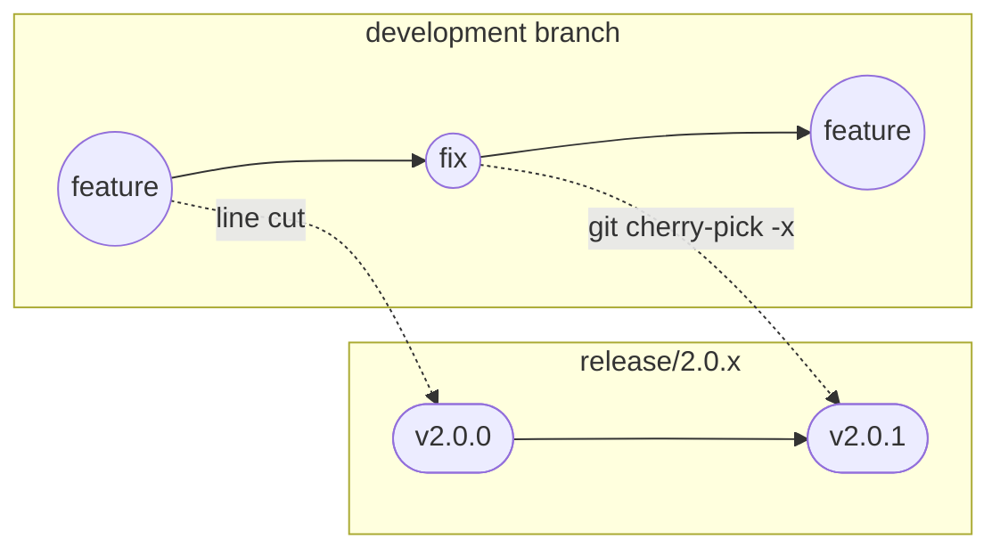
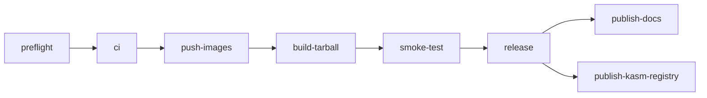

# Releases

What a release is and how one is built: its artifacts, version numbers, release lines, the
tarball, image tags, the release scripts, the CI workflows and the internals of `upgrade.py`.
To move an install to a new version, read [Upgrading](../user-guide/07-upgrading.md), which also
owns the versioning policy and the rollback policy.

---

## What a release consists of

A maintainer creates and pushes a `vX.Y.Z` tag by hand. The tag push starts one run of
`.github/workflows/release.yml`, which produces three things and then publishes that release's
docs and its Kasm registry entry.

| Artifact | What it is |
|---|---|
| A GitHub Release | The release notes and three files: the tarball, `tubematic_remote_renderer.py`, and a `CHECKSUMS.txt` with the sha256 of both |
| Two GHCR images | `tubematic-backend` (built from `renderer/Dockerfile`) and `tubematic-dashboard`, each under one version tag. See [Image tags](#image-tags) |
| The release tarball | `tubematic-vX.Y.Z.tar.gz`, the bundle a release install downloads. See [The release tarball](#the-release-tarball) |

- `tubematic-backend` is the image that runs as `tubematic-api`, `tubematic-mcp`,
  `tubematic-worker` and `tubematic-renderer`.
- `tubematic_remote_renderer.py` is an asset of its own because the machine a
  [remote renderer](../user-guide/11-remote-renderers.md) runs on downloads it alone, with no
  tarball and no checkout. It is also in the tarball's `scripts/`.
- A version with a `-prerelease` suffix is published as a GitHub prerelease, so GitHub does not
  list it as Latest.

The Release body is the matching `## vX.Y.Z` section of
[Release Notes](../release-notes.md), extracted by `scripts/release_notes.py` and published
unchanged. The notes are written as changes land. `scripts/check_release.py` fails a release
whose section is missing or is an unfilled skeleton, because a Release without notes cannot be
repaired for anyone who has downloaded it. A prerelease without a section uses its base
version's.

### Cutting a release

Pushing the tag is the only thing that builds images or creates a Release. The sequence:

1. Check out the release line, `release/X.Y.x`. For the first release of a minor version, create
   it from the development branch.
2. Bring in the changes (see [Release branches](#release-branches)), fill the `## vX.Y.Z` section
   of `docs/release-notes.md`, and set `VERSION` to the number in a commit of its own.
3. Run `python3 scripts/release.py X.Y.Z`. It runs the pre-flight checks, builds a local copy of
   the tarball and prints the git commands.
4. Push the line, then create and push the tag:

   ```bash
   git tag -a vX.Y.Z -m "Tubematic vX.Y.Z"
   git push origin vX.Y.Z
   ```

On a fork, the images, the release compose file and the remote renderer script carry the fork
owner's GHCR namespace. The two jobs after the Release (docs and Kasm registry) need tokens a
fork does not have. They fail and leave the Release intact.

---

## Writing release notes

`docs/release-notes.md` is the only source of release notes. Write the entry in the commit that
makes the change, under the heading of the version in development.

The page has one `## vX.Y.Z` heading per version, the newest first.

- `scripts/release_notes.py` reads a section from its heading to the next version heading or the
  next `---` line. Keep `---` lines out of a section.
- The section of the version in development has the same heading form as a released one. The
  page's opening says that the first section can be unreleased, so no section carries a mark that
  someone has to remove at release time.
- A section whose bullets are all empty counts as missing, and `check_release.py` fails on it.

A section has these subsections, in this order. Leave out a subsection that would be empty.

- Upgrade notes: what a person has to do, or has to know before deciding to upgrade. That covers
  manual steps, migrations that cannot be reversed, changed defaults that alter a running install,
  and removed configuration. Put the actions first, as a list, each with its command. If an upgrade
  cannot be reversed safely, say so here.
- Added: capabilities that are new.
- Changed: behaviour that existed and now works differently. State the earlier behaviour too, so
  that a reader can tell whether the change affects them.
- Fixed: defects. Describe the symptom the user saw, such as "the first click on SAVE in Settings
  did nothing", and leave out the internal cause.
- Removed: capabilities that are gone.

`release.py` prints a skeleton with the Upgrade notes, Added, Changed and Fixed headings. Check
before a release that Upgrade notes lists every manual step.

Rules for an entry:

- Write for someone who does not follow this repository. Use no ticket IDs and no commit SHAs, and
  name a file only when the reader has to touch it. "Every install must re-enter its API keys"
  helps a reader. "`apply_pipeline_settings` now writes an explicit subset" does not.
- Say each thing once. When a change needs an action, describe the change under Added or Changed
  and put the action under Upgrade notes.
- A change a user would notice gets an entry: a changed default, a new flag, a fixed defect, a
  removed capability. A refactor, a test or an internal rename gets none.
- Inside a version section, write every link as an absolute URL on the documentation site. The
  section becomes the body of a GitHub Release, where a relative link does not resolve. The site
  drops a page's number prefix and its `.md`, so `docs/user-guide/07-upgrading.md#backups` is
  `https://docs.tubematic.ai/user-guide/upgrading#backups`. Links in the page's introduction stay
  relative.

---

## Version numbers in the code

The version lives in the `VERSION` file at the repository root. Every reader goes through
`tubematic_core.version.version()`, so the release tooling and the running services report the
same version. `scripts/print_version.py` prints it.

`tubematic_core/version.py::VERSION_RE` defines a release version: `MAJOR.MINOR.PATCH` with an
optional `-prerelease` suffix in SemVer's prerelease alphabet. It rejects `+build metadata`, which
is legal SemVer and illegal in a Docker image tag.
`scripts/gen_release_compose.py::check_version_is_tag_safe` applies the rule wherever a version
becomes an image tag, and `check_release.py` reuses it.

On the development branch, `VERSION` holds the marker `develop`
(`tubematic_core.version.DEV_VERSION`) and no number. A release's number is chosen when its
release line is cut.

- The marker is valid wherever a version is used: an image tag, a backup's file name, the
  dashboard's version badge (`version.py::is_valid`).
- It is refused where a version is released. `check_release.py`'s version-format check fails on
  it (`version.py::is_release`), so the development branch cannot be tagged.
- The number is set on the release line, in a commit of its own. That commit is not
  cherry-picked back, so the development branch keeps its marker.

The install and upgrade commands in the docs name a real version, so that they can be pasted:
that line's release on a release line, and the newest published release on the development
branch. GitHub's `releases/latest/download/` URL cannot replace the number, because the
tarball's file name carries the version.

---

## Release branches

Every published release is a tag on a release line: one long-lived branch per `MAJOR.MINOR`,
named `release/X.Y.x` (`version.py::release_line`). For example:



The line is cut once, when that minor version first ships, and patches are committed to it.
`2.0.1` is the next tag on `release/2.0.x`. The name ends in `.x` because the branch moves: a
branch named for one point release would stop describing its contents once a patch landed on it.

A published tag points at one commit for good, and `check_release.py` refuses a version whose
tag exists at a different commit than `HEAD`. A tag whose `release.yml` run failed before the
Release step shipped nothing a user could download. Delete it (locally and on the remote) and
recreate it at the commit that fixes the failure. The re-run pushes the images under the same
tag again. Once a Release is published, fix a problem with it in the next patch.

### The one rule

Do not merge the development branch into a release line. Merging brings in every feature landed
since the line was cut, and the result is a minor release with a patch's version number. A patch
is its predecessor plus the fix.

A fix normally lands on the development branch first and reaches the line by
`git cherry-pick -x <sha>`, which records the commit it came from, so the defect cannot return in
the next minor release. A fix that applies only to a released line is committed there directly,
and nothing is picked back.

---

## Image tags

`<owner>` on this page is the GitHub account or organization that published the release. It
stays a placeholder because a release can come from a fork.

Each of the two GHCR images is pushed under one tag: `X.Y.Z`, the version with no `v`. It is the
only image tag the project publishes. The commit an image was built from is the one the git tag
`vX.Y.Z` points at.

The tag has no `v` because `scripts/gen_release_compose.py::generate` writes
`ghcr.io/<owner>/tubematic-<role>:<version>` into the tarball's `docker-compose.yml` with the
bare version string, the same string as `build_release_tarball.py --version`. The `v` appears
only in the tarball's file name, `tubematic-v<version>.tar.gz`. If `release.yml` pushed another
form, a release install's `docker compose pull` would fail on a missing tag, so
`scripts/tests/test_workflows.py` checks that the workflow pushes the bare tag.

`release.yml` passes `--owner` to each script as the lower-cased
`${{ github.repository_owner }}` (GHCR requires lower case), so a fork publishes to its own
namespace. The packages are public, so a release install pulls them without logging in.

---

## The release tarball

`scripts/build_release_tarball.py` builds `dist/tubematic-v<version>.tar.gz`, the artifact a
release install downloads (see
[Installing](../user-guide/02-installing.md#ways-to-install)). Everything in it sits under one
directory, `tubematic-v<version>/`.

The builder copies an explicit allowlist. The checkout also holds `renderer/`, `dashboard/`,
`mcp/`, `vqa/`, `.env` and local state, which a public download must not carry.

| List in the script | Contents |
|---|---|
| `_ROOT_FILES` | `VERSION`, `onboard.py`, `upgrade.py`, `uninstall.py`, `INSTALL.md`, `USAGE.md`, `UNINSTALL.md`, `LICENSE` |
| `_SCRIPTS_FILES` | The host scripts an install uses: `poll.py`, `status.py`, `config.py`, `agent_adapters.py`, `requirements.txt`, `migrate_db.py`, `backup_db.py`, `print_version.py`, `mcp_auth_header.py`, `service.py`, `collect_diagnostics.py`, `tubematic_remote_renderer.py` |
| `_DIR_TREES` | `onboard/`, `tubematic_core/`, `agent_files/`, `docs/user-guide/`, `docs/developer/`, `docs/images/`, without `tests`, `__pycache__` and `.pytest_cache` |
| `_DOC_FILES` | `docs/README.md`, `docs/quickstart.md`, `docs/release-notes.md` |

It also writes the generated release `docker-compose.yml` (see
[`gen_release_compose.py`](#gen_release_composepy)).

- A missing allowlisted path raises `ReleaseBuildError`, so the build ships no partial archive.
- After staging, `_assert_no_forbidden_names` fails the build if a staged path has a basename in
  `_FORBIDDEN_NAMES` (source trees, `node_modules`, `.git`, `.env`, `tests` and others), in case
  a later allowlist entry copies one in.
- The archive's own `CHECKSUMS.txt` holds the sha256 of every other file in it and is written
  last.
- The build is reproducible: the same commit built twice gives identical bytes. Entries are
  written in sorted order with a fixed mtime, owner and mode, and the gzip header carries no file
  name or time.
- `scripts/tests/test_build_release_tarball.py` fails when a shipped page links to a file or an
  image that is not in the archive.

The `CHECKSUMS.txt` attached to the GitHub Release is a different file. `release.yml` writes it
with the sha256 of the tarball and of the remote renderer script.

---

## Release tooling

Host scripts for building a release. None runs inside a container or during a normal install.
[Tests: `scripts`](test-suites/scripts.md) lists the cases their tests cover.

| Script | What it does |
|---|---|
| `scripts/print_version.py` | Prints the current version |
| `scripts/gen_release_compose.py` | Turns `docker-compose.yml` into the file a release install runs |
| `scripts/build_release_tarball.py` | Builds [the release tarball](#the-release-tarball) |
| `scripts/release_notes.py <version>` | Prints one version's section of `docs/release-notes.md` |
| `scripts/check_release.py <version>` | Runs the pre-flight checks and reports every failure in one pass |
| `scripts/release.py <version>` | Runs the checks, builds the tarball, prints the git commands |
| `scripts/migrate_db.py` | Runs `tubematic_core.db.migrate()` on a database from the host |
| `scripts/backup_db.py` | Takes a snapshot now with `tubematic_core.db.backup_db()` |

`gen_release_compose.py`, `build_release_tarball.py`, `check_release.py` and `release.py` need
`pip install pyyaml`, which is left out of `scripts/requirements.txt` because nothing needs it at
runtime. `migrate_db.py` and `backup_db.py` ship in the tarball. `migrate_db.py --allow-no-backup`
skips the pre-migration snapshot and prints a warning, because the database's `settings` table is
the credential store.

### `gen_release_compose.py`

It applies two transformations to `docker-compose.yml`:

- Every `build:` section becomes a pinned `ghcr.io/<owner>/tubematic-<role>:<version>` image, and
  so does every service that reuses the locally built `tubematic-renderer-image` tag. A service
  with a `build:` key that is not in `_ROLE_BY_SERVICE` raises, so a new one cannot get a wrong
  role.
- Every published port gets a `127.0.0.1:` binding.

Volumes, environment, healthchecks, `depends_on`, `restart`, `container_name` and the top-level
`name:` pass through unchanged, so the release file cannot drift from the development one. A
header marks the file as generated.

`generate` calls `check_version_is_tag_safe` first, because it writes the version into the image
tag with no escaping. The `develop` marker passes here, and `check_release.py` refuses it.

### `check_release.py`

It accepts `1.2.3` or `v1.2.3` and exits non-zero when a check fails. A warning does not fail it.

| Check | Result when it does not hold |
|---|---|
| The git working tree is clean | Fail |
| `VERSION` matches the requested version | Fail |
| The version is a tag-safe release version, and is not the `develop` marker | Fail |
| The tag `vX.Y.Z` does not point at a commit other than `HEAD` | Fail |
| Migrations are ordered, parseable and free of duplicate numbers (`tubematic_core.db.discover`) | Fail |
| No committed migration file is modified in the working tree | Fail |
| The release compose generates and holds no `build:` key | Fail |
| Every allowlisted tarball path exists | Fail |
| A real tarball build into a scratch directory stages no forbidden path | Fail |
| The release notes hold a written section for the version | Fail |
| `HEAD` is contained in the version's release line | Warning |
| The workflow files `ci.yml` and `release.yml` exist | Warning |

- A tag that points at `HEAD` passes, because `release.yml` runs the script after the checkout
  has fetched the tag that started the run.
- The release-line check is a warning because the line does not exist before the first release
  of a minor version, and a CI checkout may have fetched no branches.
- The checks import the tarball builder's lists and the compose generator's version rule, so the
  script holds no copy of either.

### `release.py`

It runs `check_release`'s checks, stops if one fails, builds the tarball into `dist/`, and prints
a release-notes skeleton and the git commands for the first release of a line and for a patch on
an existing line.

- It does not change `VERSION`. A script that set the version and then checked it would make the
  "VERSION matches" check meaningless.
- It does not tag or push, because a script that tagged could publish a release nobody approved.

---

## Continuous Integration

Three GitHub Actions workflows: `.github/workflows/ci.yml`, `.github/workflows/release.yml` and
`.github/workflows/docs-site.yml`.

Workflows run only on GitHub. Before a real run, the one automated check on the files is
`scripts/tests/test_workflows.py`, which parses the YAML and asserts structure: every `needs:`
resolves, every action is pinned to a version, the Python matrix matches the suite directories on
disk, and the `e2e` job does not run on a pull request. See
[Tests: `scripts`](test-suites/scripts.md).

### `ci.yml`: pull requests and pushes

It runs on `pull_request`, on a `push` to any branch, on `workflow_call` (so that `release.yml`
reuses these jobs and there is one definition of them) and on `workflow_dispatch` (to run `e2e`
on demand).

- The `push` trigger ignores `v*.*.*` tags, because a tag reaches these jobs through
  `release.yml`. It lists `branches: ["**"]` beside `tags-ignore`: with `tags-ignore` alone,
  GitHub runs nothing on a branch push.
- Its permissions are `contents: read`, stated so that a `workflow_call` does not inherit the
  caller's `packages: write`.

| Job | What it runs |
|---|---|
| `python-tests` | A matrix with one entry per suite directory: `tubematic_core/tests`, `mcp/tests`, `renderer/api/tests`, `onboard/tests`, `scripts/tests`, `vqa/tests`, `renderer/remotion/cartoon-tools/audio/tests` |
| `dashboard` | `npm ci`, `npx vitest run`, `npm run build` |
| `remotion` | `npm ci --ignore-scripts`, `npx tsc --noEmit` |
| `compose-check` | `docker compose config` on `docker-compose.yml`, then on a release compose generated by `scripts/gen_release_compose.py` |
| `e2e` | Playwright against `docker-compose.test.yml`, on a tag push or a manual dispatch only |

- `python-tests` runs on Python 3.12 and installs `pytest`, `pyyaml` and all three requirements
  files for every entry, because several suites import across them. The suites cannot be
  collected together (see [Development: Tests](17-development.md#tests)).
- `remotion` does not run `npm run lint`. That script also runs eslint, which has two errors
  unrelated to type safety, and `validate_job` runs `tsc`.
- `compose-check` validates both files because the generator could introduce an error of its own
  into the release compose.
- `e2e` needs no secrets: the test stack passes the literal string `test` for every API key. It
  stays off pull requests because `global-setup.ts` builds the backend and dashboard images from
  nothing, which takes 12 to 20 minutes.
- `e2e` blocks like every other job. `scripts/tests/test_workflows.py` fails if any job in `ci.yml`
  or `release.yml` sets `continue-on-error`.

### `release.yml`: version tags

It runs only on a `v*.*.*` tag push. Its permissions are `contents: write`, to create the
Release, and `packages: write`, to push images.



1. `preflight` derives the version from the tag (without the `v`) and the lower-cased owner, and
   runs `scripts/check_release.py`. Its "VERSION matches" check is the assertion that the tag
   matches `VERSION`.
2. `ci` reuses `ci.yml` through `workflow_call`, with the `e2e` job enabled. A failed job here,
   `e2e` included, stops the run before any image is pushed.
3. `push-images` builds and pushes `tubematic-backend` and `tubematic-dashboard` to GHCR, each
   under the bare tag `X.Y.Z`.
4. `build-tarball` stamps the owner into the remote renderer script, builds the tarball, copies
   the script beside it, writes `CHECKSUMS.txt` with the sha256 of both, and extracts the release
   notes for the Release body.
5. `smoke-test` brings up the published artifact and checks it (see below).
6. `release` creates the GitHub Release and attaches the tarball, the remote renderer script and
   `CHECKSUMS.txt`.
7. `publish-docs` syncs this tag's `docs/` into the documentation site. See
   [Publishing the docs](#docs-siteyml-publishing-the-docs).
8. `publish-kasm-registry` puts the release on the Kasm workspace's launch form. A prerelease
   skips it. See [Publishing the Kasm registry entry](#publishing-the-kasm-registry-entry).

The remote renderer script has no checkout to ask whose images to pull, so `build-tarball`
writes the owner into the script's `GITHUB_OWNER` line before it builds the tarball. A fork's
renderers then pull the fork's backend image. The step fails unless that line is found once, and
a later step compares the Release asset with the tarball's copy.

The smoke test does not check out the repository. It tests the artifact a user downloads:

1. It extracts the tarball into a new temporary directory.
2. It creates the six data directories, then the service tokens and the render gateway's TLS
   pair with `python3 -m tubematic_core.auth ensure`, as onboarding would. It installs
   `cryptography` first, because the runner's Python does not ship it.
3. It runs `docker compose pull` and `docker compose up -d --wait` on the tarball's own
   `docker-compose.yml`, against the images just pushed.
4. It requests the API's `/health` and the dashboard, with retries.
5. It compares the newest migration in the tarball with `current_schema_version`, read inside the
   `tubematic-api` container. The runner cannot read the WAL-mode database across the mount.
6. It prints container state and logs on failure, then runs `docker compose down -v`.

The smoke test sits between the image push and the Release, because it has to pull the images
and a broken artifact must not become a published Release. A failure leaves images on GHCR under
a tag with no Release, and a package version can be deleted. A downloaded Release cannot be
withdrawn.

### `docs-site.yml`: publishing the docs

The documentation site, docs.tubematic.ai, is a Docusaurus project in its own repository
(`tubematic-docs`). This repository's `docs/` is its only source. The site holds a synced copy
per release line and one of `develop`, and Vercel deploys the site on every push to it.

Both sync paths use the composite action `.github/actions/sync-docs-site`. It checks out the
site, runs the site's `scripts/sync-docs.mjs` against a tubematic checkout, builds the site, and
commits and pushes if something changed.

- `release.yml`'s `publish-docs` job runs after `release`, for the tag being released. Nothing
  depends on it, so a docs failure does not block or undo a release. Re-run the job, or run
  `docs-site.yml` by hand with the version.
- `docs-site.yml` runs on a push that touches `docs/`, to `develop` (the site's "develop
  (unreleased)" version) or to a release line such as `release/2.0.x` (that line's version). It
  also runs by hand (`workflow_dispatch`) with `develop`, a released version or a release line.
- `docs-site.yml` checks out its own commit for the action and the requested ref separately,
  because an older release tag does not contain the action.

A docs fix on a release line needs no patch release. A correction pushed to `release/X.Y.x`
replaces that line's version on the site, labelled with the newest stable `vX.Y.*` release the
branch contains, so the site's pages for a line can be ahead of the tarball.

A line with no release is not synced, because it would publish documentation for a version nobody
can install and, as the highest line, would become Latest. A push to such a line syncs nothing,
its first release syncs it through `publish-docs`, and asking for one by hand fails.

The action builds the site before it pushes. The build fails on a broken link or anchor, so a
page with one does not reach the site.

The site repository is reached with `TUBEMATIC_DOCS_TOKEN`, a fine-grained token with Contents
read and write on that repository only, stored in the `TubeMatic` environment.

- Only a job that names the environment can read the token, so both jobs declare it.
- The shared logic is a composite action because a reusable workflow sees an environment secret
  only when its caller passes it through, and a missing one becomes an empty string. The action
  refuses an empty token.
- Both jobs share one concurrency group, so two syncs queue. This repository is only read
  (`contents: read`).

### Publishing the Kasm registry entry

`release.yml`'s `publish-kasm-registry` job runs after `release`, through the composite action
`.github/actions/sync-kasm-registry`. It writes the Tubematic entry into the workspace registry
repository (the one the
[install guide](../user-guide/02-installing.md#installing-in-kasm-workspaces) tells people to
add) with `kasm_workspace/sync_registry.py`, on the registry's schema branch `1.1`, and pushes if
something changed. The registry's own build then republishes its `list.json`. The entry and the
workspace image are described in
[Development](17-development.md#kasm_workspace-the-published-workspace).

- The version list is every published Release, newest first, without drafts and prereleases. It
  is not every tag, because a release-method install downloads the Release's assets. A
  prerelease tag skips the job.
- The entry comes from the newest release's tree, so a patch on an older line adds its version
  without rolling back a newer entry's description or image.
- The job checks the workspace image first. No workflow builds that image, so the job runs
  `docker manifest inspect` on it without logging in, as Kasm pulls it, and writes nothing if
  that fails.
- The job gates nothing. A failure leaves the release intact, and re-running the job recovers.

The registry is reached with `TUBEMATIC_KASM_REGISTRY_TOKEN`, a fine-grained token with Contents
read and write on that repository only, in the same `TubeMatic` environment. Its push also
triggers the registry's build, which a push made with a workflow's own `GITHUB_TOKEN` would not.

---

## Migrations

[Database: Migrations](03-database.md#migrations) describes how migrations are stored and
applied, and [Development: Schema changes](17-development.md#schema-changes) has the checklist
for writing one. For a release:

- A shipped migration is immutable. A schema change is a new file.
- `scripts/check_release.py` runs `git diff HEAD` and fails if a migration file that git has
  history for is modified in the working tree. It catches uncommitted edits only. Review is what
  protects a shipped migration once an edit is committed.
- Migrations apply when the containers start, so `upgrade.py` runs none. See
  [What the containers do on the first start](#what-the-containers-do-on-the-first-start).
- `scripts/migrate_db.py` migrates a database from the host, outside any container, with the same
  pre-migration backup. A normal upgrade does not use it, and neither `check_release.py` nor the
  smoke test calls it.

What a migration means for someone upgrading is in
[Upgrading: Rollback policy](../user-guide/07-upgrading.md#rollback-policy).

---

## `upgrade.py` in detail

[Upgrading](../user-guide/07-upgrading.md) has the procedure a user follows, and the
[Command Reference](../user-guide/15-command-reference.md#upgradepy) lists the flags. You run
`upgrade.py` from the directory of the version you are upgrading to. It asks no questions.

### The sequence

`upgrade.py::run_upgrade` does the following and returns the exit code:

1. Runs the pre-flight refusals below. None of them changes the install.
2. Takes the poller's lock (`stack.poll_lock`) and holds it to the end, so no agent run starts
   during the upgrade. It refuses when work is in flight (`stack.gate`), unless `--force` is
   given.
3. Installs the Python dependencies into this directory's `.venv`, which cron will use.
4. Pulls the images on a release install, or builds them on a source install (`_fetch_images`).
   The old stack keeps serving, because a running container keeps the image it started from.
5. Checks for in-flight work and for the removed component again. A refusal here leaves the new
   images in place and stops nothing.
6. Stops the whole stack (`stack.stop`), so new code does not migrate the database while old code
   runs against it.
7. Starts it (`stack.start`): data directories, volume reconciliation, any missing secret,
   `up -d`, health. The containers apply pending migrations.
8. Rewrites the cron entry to point at this directory.
9. Redeploys each installed agent's skills and commands and registers the MCP server again with
   the token (`_redeploy_agents`), from the stored agent row.
10. Records the steps it ran in this directory's `.onboard-state.json` (`_carry_state`,
    `UPGRADE_STEPS`), starting from the previous install's file when this directory has none.
11. Prints the report (`stack.report`): version, schema, cron, containers.
12. Removes the previous version's images when the report found no fault and every agent is
    registered (`_finish_images`), then measures disk use again for the dashboard. A faulty
    upgrade keeps the images. The rule for which images are old is in
    [Infrastructure](16-infrastructure.md#old-images).

The exit code is non-zero when the report finds a fault, or when an agent is left without a
working MCP registration. Such an agent is refused on every tool call, so the pipeline would
stall while the containers look healthy.

`--check` (`run_check`) prints the same report and an authentication section (`_report_auth`):
the password, the tokens, a live probe that the MCP server refuses a request without the token
and accepts one with it, and each agent's MCP registration.

### Pre-flight refusals

In order, `run_upgrade` refuses when:

- no database exists at the data root (the command upgrades an existing install),
- the database's schema is newer than this version's migrations, which is the rollback case,
- no dashboard password is set (`tubematic_core.auth.has_admin_password`),
- no OpenAI key is stored (`_has_openai_key`), because every scene image comes from OpenAI,
- a generated scene imports the removed component (next section),
- the GPU override or the remote-renderers override has a problem (`gpu.override_problems`,
  `remote_renderers.override_problems`), because the later `up` would fail after the stop,
- `--no-stop` was given and this upgrade needs a full stop (see [`--no-stop`](#--no-stop)),
- a prerequisite check reports an error.

The user-facing remedies are in [When it stops](../user-guide/07-upgrading.md#when-it-stops).

### The removed-component check

`_check_removed_giffx` refuses when a `.tsx` file under `~/.tubematic-data/scenes/generated/`
imports the removed `GifFX` component. The renderer compiles every generated scene together, so
one such file would fail every render on the install. The message lists each file and the
reason. Delete the files or fix them, then run the upgrade again.

A video whose `scene-config.json` names `GifFX` gets a warning only. If it is rendered again, the
renderer skips the scene it cannot load and leaves that overlay out.

`_SceneScan` reads a scene as the bundler does. It is a small lexer that skips comments and
strings, so an old import kept in a comment or a string does not refuse.

What counts as an import of the component:

- A module path that resolves to `installed/GifFX` in an `import`, an `export … from`, a dynamic
  `import()` or a `require()`. That includes `(require)(…)`, `require?.(…)`,
  `require.resolve(…)`, `require.resolveWeak(…)` and their bracket spellings
  (`require["resolve"](…)`), which webpack bundles the same way.
- The path is normalised, so `installed/./GifFX`, `installed//GifFX` and `installed/GifFX.tsx`
  count. The match is case-sensitive, like module resolution on the Linux renderer.
- String escapes are decoded (`G`, `\u{47}`, `\x47`, a line continuation), comments between
  the keyword and the path are skipped, and a template string with no `${…}` counts as a string.
- A computed argument to `import()` or `require()` (`"../../installed/" + "GifFX"`, a template
  with a `${…}`) refuses when its string parts, joined, spell `GifFX`. Webpack folds constant
  parts into one path, which would then fail the bundle.

It is a lexer and not a TypeScript parser, so it can misread unusual code as JSX. Each misreading
errs towards refusing. It recognises a generic arrow function's type parameters (`<T,>`,
`<T extends …>`, `<T = …>`), which TSX does not read as JSX. The known costs:

- A computed path is not resolved, so `import("./" + "GifFX")` refuses although it names a
  sibling `./GifFX`. The static `import … from "./GifFX"` passes.
- A method named `require` on another object (`loader.require(…)`) and a call on any other
  bracket key of `require` (`require["cache"](…)`, `require[key](…)`) are not told apart from
  webpack's. They refuse when the argument names `GifFX`.
- JSX text is lexed as code too, in case it was code. Each piece of text runs to the next `<` or
  `{`. A piece that cuts off an `import()` or `require()` call, or that ends while `import` or
  `require` still awaits its path, cannot be judged and refuses. JSX text whose last word before
  a tag or a `{…}` is `import` or `require` (`<p>The modules you require.</p>`) therefore
  refuses. `from` in prose (`<p>Packets from {src}</p>`) passes, unless a comment follows it.
- A comment, template or attribute value that never closes is not treated as one, so what follows
  it is lexed as code. A stray quote does not hide the lines after it.

Two more cases refuse for the same reason as an import, because the renderer could not compile
the file either:

- a generated scene the upgrade cannot read (fix the file's permissions),
- a module path with an escape that cannot be decoded (an octal escape, or a malformed `\x` or
  `\u`), which TypeScript also rejects.

### `--no-stop`

`--no-stop` skips the stop, so `up -d` recreates the containers one at a time and old code runs
for a moment against the new schema. Use it only for an upgrade whose migrations are additive.
`run_upgrade` refuses it in four cases:

| Refused while | Why |
|---|---|
| A service token file is missing | The upgrade creates the tokens, and old and new containers would refuse each other's calls |
| The running `tubematic-renderer` was not started with `render_agent.py` (`_worker_split_pending`) | That renderer also publishes, runs Auto Pilot and sends notifications, and would keep doing so beside the new `tubematic-worker` |
| The schema is below `OPENAI_ONLY_IMAGES_MIGRATION` | Old containers would keep reading the `image_provider` setting that migration deletes |
| The schema is below `RENDER_GATEWAY_MIGRATION` | An old renderer would keep claiming from the database beside the render gateway |

`_worker_split_pending` decides from the command the running renderer was created with. A
leftover `tubematic-worker` container says nothing about which code the renderer runs. A renderer
whose command cannot be read counts as old. Without `--no-stop`, each of these upgrades proceeds
normally.

### What the containers do on the first start

Take a release whose one migration adds a nullable column.

Each of `tubematic-api`, `tubematic-mcp` and `tubematic-worker` calls `migrate()` on its first
database access and finds the migration missing from `schema_migrations`. `tubematic-renderer`
has no database. Each container backs up before it takes the write lock, so more than one often
writes a `tubematic-before-v<version>-<timestamp>.db` into `backups-data`. The first to take the
lock applies the migration, and the others then find nothing pending. See
[Infrastructure: Backups](16-infrastructure.md#backups).

An additive migration changes the schema and touches no existing row and no file outside the
database. Afterwards, `python3 scripts/service.py logs tubematic-api` shows no migration error,
one or more new files are in `~/.tubematic-data/backups/`, existing videos keep their status, and
the new column is empty on every existing row.
