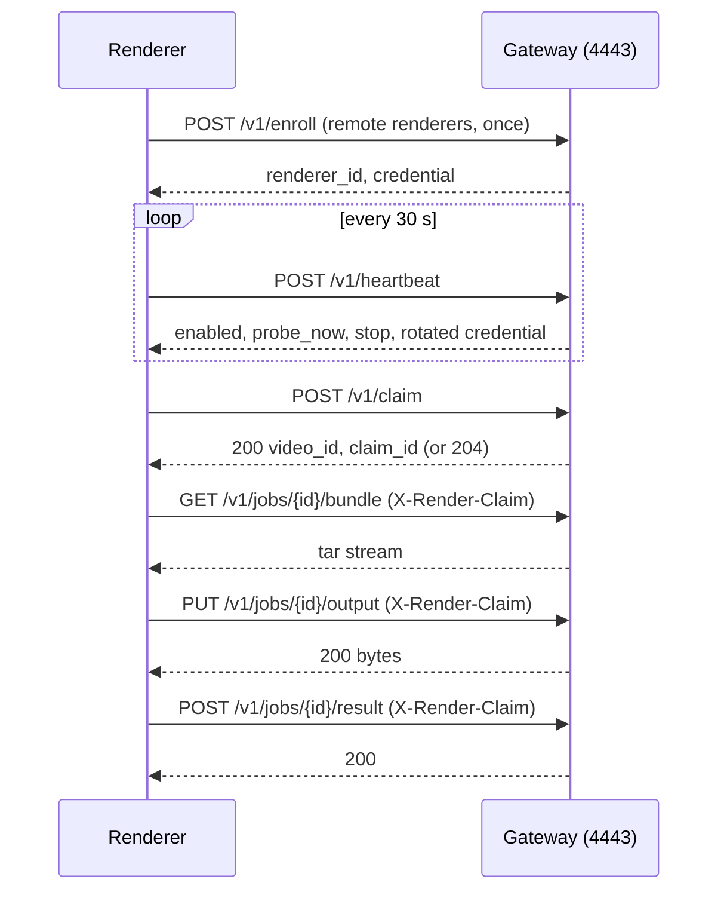

# The Render Gateway

The render gateway is the HTTPS listener that renderers call to claim a video, fetch its files,
upload the mp4 and report the result. This page covers its routes, its TLS certificate and pin,
enrollment tokens, renderer credentials, leases and the limits it places on a caller.

| | |
|---|---|
| Code | `renderer/api/render_gateway.py::create_gateway_app` |
| Container | `tubematic-api`, in a thread started by `server.py::start_render_gateway` |
| Port | 4443 (`TUBEMATIC_GATEWAY_PORT`), TLS 1.2 or newer |
| Prefix | `/v1` |
| Authentication | `Authorization: Bearer <renderer credential>`, except on `GET /v1/version` and `POST /v1/enroll` |

A renderer has no database connection. The gateway reads and writes the database for it, on the
main install (the machine with the dashboard and the database). Related pages:
[Rendering and Review](11-rendering-and-review.md) for how a video is rendered and routed,
[GPU and Remote Renderers](20-gpu-and-remote-renderers.md) for scheduling and remote machines, and
[Infrastructure](16-infrastructure.md#tubematic-api) for how the port is published.

## Why the gateway is a separate listener

The [HTTP API](05-http-api.md) on port 4000 is bound to loopback and takes the API token, which can
change any setting, approve paid work and publish. A renderer on another machine needs a port it can
reach and far fewer rights: claim, fetch one job, upload one mp4, report.

The gateway is therefore a second Flask app with its own credentials. It refuses the API token, and
port 4000 refuses a renderer credential, so a leaked renderer credential cannot reach the
dashboard's API.

## A render, request by request



## Routes

| Method | Path | Purpose |
|---|---|---|
| `GET` | [`/v1/version`](#get-v1version) | Report the main install's version |
| `POST` | [`/v1/enroll`](#post-v1enroll) | Redeem a one-time enrollment secret |
| `POST` | [`/v1/heartbeat`](#post-v1heartbeat) | Report state, extend the lease |
| `POST` | [`/v1/claim`](#post-v1claim) | Take the next video |
| `GET` | [`/v1/jobs/<video_id>/bundle`](#get-v1jobsvideo_idbundle) | Download the job's files |
| `PUT` | [`/v1/jobs/<video_id>/output`](#put-v1jobsvideo_idoutput) | Upload the rendered mp4 |
| `POST` | [`/v1/jobs/<video_id>/result`](#post-v1jobsvideo_idresult) | Report how the render ended |

An error is `{"error": "<code>"}`, sometimes with extra fields. Answers that several routes share:

| Answer | Routes | Cause |
|---|---|---|
| `401 unauthorized` | All but the two open ones | No bearer credential, or an unknown one |
| `401 credential_expired` | All but the two open ones | A remote renderer's credential is past its expiry |
| `503 busy`, `Retry-After: 10` | All but the two open ones | The renderer already has 8 requests in the gateway |
| `403 not_lease_holder` | The three `/v1/jobs/` routes | The caller does not hold the claim it names (see [Leases](#leases)) |
| `413 body_too_large {limit}` | Enroll, heartbeat, claim, result | The JSON body is over 64 KiB |
| `408 body_timeout` | Every route that reads a body | The body stopped arriving in time |
| `400 body_incomplete` | Every route that reads a body | The client left before the body arrived |

A JSON body that is not an object reads as `{}`.

### `GET /v1/version`

Open. `200 {"version", "gateway": 1}`. `version` is the main install's version. The host script
reads it to pick the renderer image.

### `POST /v1/enroll`

Open, because the body carries the one-time secret. Body:
`{secret, machine_id, name, host, version, compute}`.

| Status | Body |
|---|---|
| `200` | `{renderer_id, credential, credential_expires_at}` |
| `403` | `enrollment_invalid`: the secret is unknown, used or expired. One answer covers all three |
| `503` | `busy`: 4 enrollment bodies are already being read |

See [Enrollment](#enrollment).

### `POST /v1/heartbeat`

A renderer sends one every 30 seconds (`renderers.py::HEARTBEAT_SECS`).

Body: `{started, version, compute, state, video_id, claim_id, last_error, gpu_probe?}`.

- `started` is `true` on the first heartbeat after the renderer process starts. The gateway then
  re-queues every video that renderer held without an upload, and counts a retry.
- `state` is `idle` or `rendering`. Any other value reads as `idle`.
- `video_id` and `claim_id` name the claim being rendered, and are `""` when idle. The gateway
  extends that claim's lease while the claim still holds the video.
- `version`, `compute` (`{cpus, memory_bytes, gpus}`), `last_error` and `gpu_probe` are stored on
  the renderer's row.

Reply: `200 {enabled, needs_upgrade, main_version, probe_now, stop, credential_expires_at,
credential?}`.

- `needs_upgrade` is true when the reported version differs from `main_version`.
- `probe_now` is true when a GPU test was requested after the renderer's last probe.
- `stop` lists `{video_id, claim_id}` for claims the renderer reported or held and does not hold
  now.
- `credential` is present only after a rotation (see [Credentials](#credentials)).

### `POST /v1/claim`

| Status | Meaning |
|---|---|
| `200` | A claim, shaped as below |
| `204` | Nothing for this renderer now |
| `409` | `disabled`, or `needs_upgrade` when the renderer's version differs from the main install's |

```json
{"video_id": "vid_abc", "claim_id": "<32 hex>", "kind": "dom", "needs_gpu": false,
 "cartoon": false, "mascot": false, "total_frames": 2700, "lease_secs": 300,
 "settings": {"render_timeout_secs": 10800, "render_stall_timeout_secs": 600, "watermark": true}}
```

`kind` is `dom`, `cartoon_3d` or `mascot`.

- A renderer that holds an unfinished claim gets that claim again, with the same `claim_id` and an
  extended lease, and no second video. If that video was archived meanwhile, the answer is `204`
  until the lease runs out.
- The claim is one `UPDATE` guarded on `RENDER_QUEUED`, on the renderer being enabled and on it
  holding no unfinished claim, so two renderers cannot take one video.
- The built-in renderer gets `204` while the settings row `render_claim_hold_until` names a future
  time. `onboard.py --step gpu` writes that row before it recreates the renderer container.
- A queued video that cannot be rendered is moved out of the queue with a comment, and the claim
  tries the next one, up to 50 times (`MAX_CLAIM_ATTEMPTS`). See
  [Refused before anything renders](11-rendering-and-review.md#refused-before-anything-renders).
- The choice of video is in
  [Which renderer gets which video](20-gpu-and-remote-renderers.md#which-renderer-gets-which-video).

### `GET /v1/jobs/<video_id>/bundle`

`200 application/x-tar`: the job's files as one uncompressed tar, streamed one file at a time. The
members are listed in
[The bundle, staging and the render call](11-rendering-and-review.md#the-bundle-staging-and-the-render-call).
`409 bundle_unavailable {detail}` when a job file is missing or cannot be read.

### `PUT /v1/jobs/<video_id>/output`

The raw mp4 as the request body, streamed. `200 {"bytes": <n>}`.

| Status | Cause |
|---|---|
| `413` | `output_too_large {limit}`. A larger `Content-Length` is refused before reading. A chunked body is abandoned when it passes the limit |
| `409` | `upload_in_progress`: another upload for the same claim is still streaming |
| `503` | `busy`, `Retry-After: 10`: the maximum number of uploads is streaming |
| `507` | `insufficient_storage {min_free_bytes}`. Checked before reading and again every 64 MiB |
| `409` | `claim_lost`: the claim changed hands while the body streamed. The file is discarded |
| `408` | `body_timeout`: no data for 60 seconds. The file is discarded and the upload slot freed |
| `409` | `unsafe_path {detail}`: the output path cannot be built from the ids |
| `500` | `upload_failed {detail}` |

The gateway writes the body to a temporary file in `<output>/.gateway-uploads/` and renames it into
place in the transaction that re-checks the claim. It clears that directory's leftover `*.upload`
files when it starts (see [Infrastructure](16-infrastructure.md#tubematic-api)).

### `POST /v1/jobs/<video_id>/result`

Body: `{outcome, error, on_gpu, gpu_ok, frames, seconds, gpu_probe?}`. `outcome` is `success`,
`failed`, `stalled`, `timeout` or `error`. `200 {}`, or `400 bad_outcome {detail}`.

- `success` records the output path, stamps `render_uploaded_at` and releases the claim. `frames`
  and `seconds` are stored as a render timing when both are positive. `success` with no uploaded
  file is handled as `error`.
- `failed` routes the video to `REVISION_REQUESTED`. `stalled`, `timeout` and `error` route it back
  to `RENDER_QUEUED`. The retry cap and the GPU-only cases are in
  [The result](11-rendering-and-review.md#the-result).
- `error` is the error text, up to 20,000 characters.
- `gpu_ok: false` (the renderer's own GPU re-test) clears the renderer's `gpu_verified` and stores
  `gpu_probe`, so the renderer gets no GPU work until a probe passes.
- A failure result moves the video only while the claim still holds it. A stale result changes
  nothing and still answers `200`.

## Leases

A claim holds its video for `renderers.py::LEASE_SECS` (300 seconds), and each heartbeat that names
the claim extends the lease by the same amount. What happens when a lease runs out is in
[Leases, restarts and lost renderers](20-gpu-and-remote-renderers.md#leases-restarts-and-lost-renderers).

Each claim gets a new `claim_id`, stored in `videos.render_claim_id`. The three `/v1/jobs/` routes
need it in an `X-Render-Claim: <claim_id>` header. They answer `403 not_lease_holder` unless the
video is `RENDERING`, not archived, and held under the caller's renderer id and that claim id. A
renderer whose lease ran out is refused even after it claims the same video again, because the new
claim has a new id.

## Limits

A renderer's request is untrusted input, so the gateway bounds its size, its duration and the
number of requests it holds. The values are constants in `render_gateway.py` unless a variable is
named.

### Body sizes

Every route except the upload reads at most 64 KiB of body (`MAX_JSON_BYTES`). A larger
`Content-Length` is refused before a byte is read, and a chunked body when it passes the limit. A
protected route is authenticated from its headers first, so a caller without a credential gets
`401` and its body is not read.

| Upload limit | Environment variable | Default | Answer past it |
|---|---|---|---|
| One upload's size | `TUBEMATIC_MAX_OUTPUT_BYTES` | 8 GiB | `413 output_too_large` |
| Uploads streaming at once, all claims | `TUBEMATIC_MAX_CONCURRENT_UPLOADS` | 4 | `503 busy` |
| Uploads streaming at once, one claim | (fixed) | 1 | `409 upload_in_progress` |
| Free space left on the output filesystem | `TUBEMATIC_MIN_FREE_BYTES` | 2 GiB | `507 insufficient_storage` |

The two concurrency checks run before the body is read or a temporary file is created. The output
volume also holds the database, which is why free space is checked.

### Time bounds

The werkzeug server gives each connection a thread and waits on a silent client with no limit of
its own, so `render_gateway.py::_GatewayRequestHandler` bounds every connection in time.

| Bound | Value | When it runs out |
|---|---|---|
| Each read or write (the socket timeout) | 60 s | During a body read: `408 body_timeout`. Otherwise the connection is closed |
| TLS handshake, request line and headers together | 30 s | The connection is closed |
| A whole JSON body | 30 s | `408 body_timeout` |
| Draining an unread body after the reply | 5 s | The connection is closed |
| An upload's body | No total limit | The 60 s per-read bound applies |

The 30-second bounds are deadlines across all reads, so a client that sends one byte inside each
per-read timeout still reaches them. The TLS handshake runs in the connection's own thread, because
a handshake in the accept loop would let one stalled client block every other connection.

### Connection and request caps

| Cap | Value | Answer past it |
|---|---|---|
| Open connections, all clients (`MAX_CONNECTIONS`) | 128 | The connection is closed before a thread is created |
| Enrollment bodies being read (`MAX_ENROLL_READERS`) | 4 | `503 busy`, before a byte is read |
| Requests from one renderer (`MAX_REQUESTS_PER_RENDERER`) | 8 | `503 busy` |

The connection cap bounds the threads the gateway can create inside `tubematic-api`, which also
serves the dashboard's API. werkzeug creates a thread for each accepted connection before its TLS
handshake, so the slot is taken in the accept loop (`render_gateway.py::_server_class`) and returned
when the connection's thread ends. 128 covers 15 renderers at their cap of 8 plus the enrollment
readers.

A renderer makes at most three requests at once: its heartbeat, one job request, and a retry that
overlaps an upload. A request counts until werkzeug closes the response
(`render_gateway.py::_bounded_app`), after a streamed bundle's last byte or the drain of an unread
body.

## Credentials

`tubematic_core/renderers.py::authenticate` resolves a bearer token to a row in `renderers`.

The built-in renderer's credential is the secret file `builtin_renderer_token`. Both sides read it
on every request and the gateway compares it in constant time, so
`python3 onboard.py --rotate-tokens` takes effect on the next request with no restart. It has no
expiry.

A remote renderer's credential is a random 256-bit value issued at enrollment. The database stores
its sha256 hash, which is enough for a random value of that size.

- It lasts 30 days (`CREDENTIAL_DAYS`).
- From day 15 (`ROTATE_AFTER_DAYS`), a heartbeat reply carries a new credential
  (`renderers.py::maybe_rotate`). The old hash moves to `previous_credential_hash`.
- Both credentials authenticate until the renderer first uses the new one, which clears the
  previous one. A renderer that did not receive the reply keeps working, and the gateway issues
  another new credential on each heartbeat until one is used.
- The renderer switches to a rotated credential after it has written it to its state file.
- An expired credential gets `401 credential_expired`, and the renderer's `last_error` tells the
  operator to enroll it again.

A disabled renderer still authenticates, which is how it receives `409 disabled` and stops
claiming. A removed renderer does not authenticate. The built-in renderer can be disabled and
cannot be removed (see [`DELETE /renderers/<id>`](05-http-api.md#delete-renderersid)).

## TLS and the certificate pin

The gateway serves a self-signed EC P-256 certificate, `render_tls_cert`, with its key
`render_tls_key`. `tubematic_core/auth.py::ensure_secrets` creates both beside the service tokens.
The certificate has the common name `tubematic-render-gateway`, is valid for 30 years and names no
host. The key is mounted into `tubematic-api` only. Renderers get the certificate.

A renderer reaches the gateway by whatever address the operator gives it, so no client checks a
host name. A client trusts that one certificate as its only trust anchor
(`render_agent.py::pinned_context`: `check_hostname` off, `CERT_REQUIRED`, `cadata` set to the
pinned PEM). The certificate carries `BasicConstraints(ca=True)` and `key_cert_sign` because OpenSSL
accepts a self-signed certificate as a trust anchor only when it is a CA.

The pin is `sha256:<hex>`, the sha256 of the certificate's DER encoding (`renderers.py::cert_pin`,
`auth.py::gateway_pin`). It covers the whole certificate and not the public key alone, because the
host script must check it with Python's standard library, which can convert PEM to DER
(`ssl.PEM_cert_to_DER_cert`) and cannot parse a certificate.

A new certificate is a new pin, and every enrolled remote renderer would have to enroll again. For
that reason `--rotate-tokens` leaves the TLS pair alone and `auth.py::rotate_secrets` refuses it.

## Enrollment

A remote renderer joins with an enrollment token: `tmr1.` followed by unpadded base64url of
`{"u": <gateway URL>, "s": <secret>, "p": <pin>}` (`renderers.py::encode_enrollment_token`,
`decode_enrollment_token`).

- The URL must start with `https://`. It is `https://<render_gateway_address>`, with port 4443
  added when the address names none (`pipeline.py::render_gateway_url`).
- The secret is valid once, for one hour (`ENROLLMENT_SECS`). The table `renderer_enrollments`
  stores its hash.
- Redeeming it is one guarded `UPDATE`, so two renderers with the same secret cannot both enroll.

Two things issue a token, and both need a stored gateway address (the settings row
`render_gateway_address`): [`POST /renderers/enrollments`](05-http-api.md#post-renderersenrollments),
behind the dashboard's **Add renderer**, and the `renderers` onboarding step.

The renderer (`render_agent.py::enroll`) reads the token from `TUBEMATIC_ENROLL_TOKEN` and then:

1. Fetches the gateway's certificate with a bare TLS handshake.
2. Refuses the certificate unless its sha256 equals the token's pin. Nothing has been sent at this
   point, so the secret reaches no other server.
3. Trusts that certificate and calls `POST /v1/enroll`.
4. Writes its state file, `renderer.json` under `TUBEMATIC_RENDERER_STATE` (mode 0600): its id,
   credential, a random `machine_id`, the pin and the certificate.

Enrolling again from the same machine sends the same `machine_id`. The gateway then replaces the
credential, version, compute and host on the existing row and adds no second renderer.

The renderer's name is the one the token was issued with. A token issued without a name takes the
name the renderer sends, then its host name.

The script an operator runs on the remote machine is `scripts/tubematic_remote_renderer.py` (see
[The host script](20-gpu-and-remote-renderers.md#the-host-script)).

## When the gateway cannot start

`render_gateway.py::make_gateway_server` returns `None` and logs `render gateway not started` with
the reason in each case below. The API on port 4000 keeps serving the dashboard, and no renderer
can reach the install, the built-in one included. Restart `tubematic-api` after each fix.

| Cause | What to do |
|---|---|
| `render_tls_key` or `render_tls_cert` is missing or empty | Run `python3 -m tubematic_core.auth ensure`. It creates a new pair, which has a new pin |
| Both files exist and do not load as a pair | Recover the pair as described below |
| Port 4443 cannot be bound, usually because another program holds it | Free the port |
| The listening socket cannot be wrapped for TLS | Restart `tubematic-api` |

A bind failure is caught as `SystemExit` as well as `OSError`, because werkzeug answers a failed
bind with `sys.exit(1)`, which would otherwise stop the whole API.

Two files that do not load together (a key and a certificate from different backups, or a truncated
file) are left in place, because replacing them would change the pin. To recover, do one of these,
then restart `tubematic-api` and `tubematic-renderer`:

- Restore `render_tls_key` and `render_tls_cert` together from the same backup. The pin is
  unchanged and no renderer needs to enroll again.
- Delete both files and run `python3 scripts/service.py start`, which creates a new pair. Then
  enroll every remote renderer again with a new token.

How the pair is created and what else a new pin affects are in
[The TLS pair](16-infrastructure.md#the-tls-pair).
