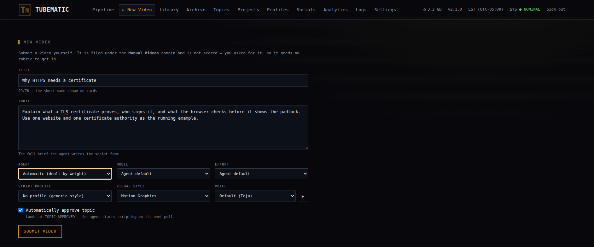
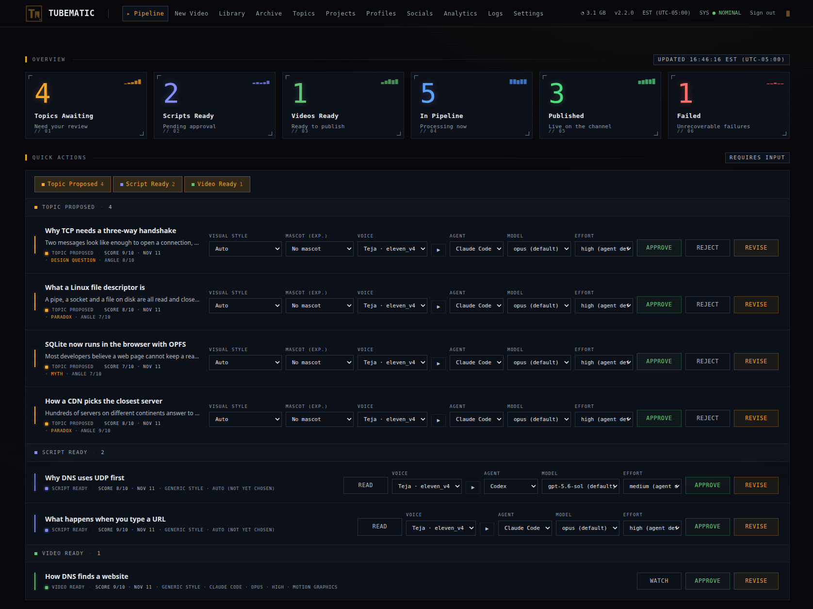

# Quickstart

Install Tubematic on a Linux machine and make a first video. [Installing](user-guide/02-installing.md)
covers each step in more detail.

---

## Before you start

You need:

- A Linux machine with 2 CPU cores, 4 GB of memory and about 15 GB of free disk. More cores render
  faster.
- Docker Engine 29 or newer with the Compose plugin. Docker must be running, and your user must be
  able to run `docker` without `sudo`.
- Python 3.11 or newer with its `venv` module. On Debian and Ubuntu, install the `python3-venv`
  package.
- Node.js 22.20 or newer. The agent uses it to install a skill for writing scenes. The install
  finishes without Node, and the agent then writes scenes without that skill.
- One agent CLI, installed and logged in: Claude Code (`claude`), Codex (`codex`) or OpenCode v2
  (`opencode`).
- An ElevenLabs API key and an OpenAI API key. The OpenAI key's project needs billing enabled.

On Ubuntu, [Preparing an Ubuntu machine](user-guide/02-installing.md#preparing-an-ubuntu-machine) has
the commands for Docker, `python3-venv` and Node.js.

Tubematic is free. Each video spends ElevenLabs credits, OpenAI image calls and your agent's model
usage. The dashboard shows what each video cost.

---

## 1. Install

Download the newest release, check it, and run the installer:

```bash
curl -LO https://github.com/teja156/tubematic/releases/download/v2.2.0/tubematic-v2.2.0.tar.gz
curl -LO https://github.com/teja156/tubematic/releases/download/v2.2.0/CHECKSUMS.txt
sha256sum -c CHECKSUMS.txt --ignore-missing
tar xzf tubematic-v2.2.0.tar.gz
cd tubematic-v2.2.0
python3 onboard.py
```

The installer asks for:

1. a dashboard password of at least 12 characters,
2. your API keys, which it checks with each provider as you enter them,
3. whether to turn on publishing and AI review (answer no to both for now),
4. the image model,
5. how often to check for work.

On a machine with a usable NVIDIA GPU it also asks whether to render on it. Press Enter to accept a
default. The installer then downloads two images and starts five
containers.

To build from source or to run inside Kasm Workspaces instead, see
[Ways to install](user-guide/02-installing.md#ways-to-install).

## 2. Install an agent

Tubematic does nothing until it has an agent. With the agent's CLI logged in, run:

```bash
python3 onboard.py --install-agent claude    # or: codex, opencode
```

It asks where to install and which models the agent may use. The first model you enter is the
agent's default.

## 3. Create a video

1. Open `http://localhost:3000` and sign in with the password you set.
2. Open **New Video**.
3. Enter a **Title** of up to 70 characters, and a **Topic**: what the video is about and
   anything it must cover. **Angle** is optional; the agent finds one when you leave it empty.
4. Leave **Automatically approve topic** ticked and press **Submit video**.



The dashboard listens on this machine only. To open it from another machine, see
[Remote Access](user-guide/09-remote-access.md).

## 4. Follow it through

Open the **Pipeline** page. Your video moves across the board from left to right, and stops twice
for you.



| Stage | Who | What you do |
|---|---|---|
| The script is written | The agent | Wait. The agent starts within the poll interval, 30 minutes by default. To start it now, run `python3 scripts/poll.py` |
| Script Ready | You | Press **Read** on the video's row under **Quick Actions**, then **Approve**. Voicing spends ElevenLabs credits from this point |
| Voice, images and scenes | The agent | Wait. This is the longest stage |
| Rendering | The renderer | Wait |
| Video Ready | You | Press **Watch**, then **Approve** |

The finished video is at Video Approved. Play it in its window, or take the file from
`~/.tubematic-data/output_videos/`.

To ask for changes at either stop, press **Revise** and say what to change. The agent reworks the
script or the video and brings it back.

---

## If nothing happens

- Check the **Quick Actions** list. The usual cause is a video waiting for you.
- Run `python3 scripts/service.py status` to check the containers and the schedule.
- Read `~/.tubematic-agent/logs/poll.log` to see what the agent did.

[Troubleshooting](user-guide/08-troubleshooting.md) covers the rest.

## Next

- [Using Tubematic](user-guide/03-using-tubematic.md): let Tubematic find topics for you.
- [Visual Styles and Mascots](user-guide/13-visual-styles-and-mascots.md): choose how videos look.
- [Publishing](user-guide/06-publishing.md): post videos to YouTube, Instagram, TikTok and Facebook.
- [GPU Rendering](user-guide/10-gpu-rendering.md): render about three times faster on an NVIDIA GPU.
- [Remote Renderers](user-guide/11-remote-renderers.md): let other machines render for this install.
