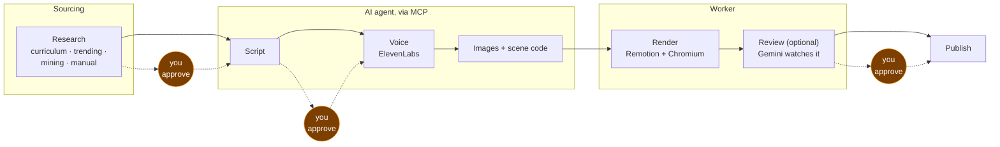

# Overview

Tubematic is an automated pipeline that turns a topic into a finished YouTube Short. It researches
topics, writes a script, voices it, generates imagery, animates it in code, renders an mp4, has an
AI watch the result for defects, and holds the video at three points where a human has to say yes —
unless its project is on Auto Pilot, which approves those three itself and posts the video.

It is not a video editor and not a template filler. Every scene is a **React component the AI agent
writes for that specific video**, compiled and rendered by [Remotion](https://remotion.dev). The
system's output is real code, which is why an AI can meaningfully improve on a revision round and
why you can read exactly what produced any frame.

---

## What it produces

A 1080×1920 mp4 at 30fps — vertical, YouTube Shorts format — typically 90 to 180 seconds long, with
a synthesised voiceover, word-timed captions, generated imagery, and animated diagrams.

---

## How it works, in one picture

Three checkpoints, chosen where they cost the least and matter the most: before research becomes
work, before **voicing spends money**, and before a finished video goes out.

---

## The parts

| Piece | What it is | Where |
|---|---|---|
| **Pipeline API** | Flask. The state machine, settings, and every read/write the dashboard makes | `renderer/api/`, port 4000 |
| **MCP server** | The AI agent's entire interface — 38 tools and nothing else | `mcp/`, its own container, port 4100 |
| **Render worker** | Polls for queued videos, runs Remotion, runs AI review; also sends due scheduled posts and settles posts in flight, runs Auto Pilot, and does the periodic sweeps. See [The Worker](../developer/12-the-worker.md) | `renderer/api/worker.py` |
| **Remotion project** | The React video codebase — a curated component library plus per-video generated scenes | `renderer/remotion/` |
| **Dashboard** | Next.js. Where a human creates videos, approves, configures, and watches — the way you run Tubematic | `dashboard/`, port 3000 |
| **Agent skills** | Markdown that teaches the agent the workflow. The real "business logic" of the AI half | `agent_files/skills/` |
| **Installer** | A questionary wizard that sets up all of the above, plus `--install-agent` to install the agent that runs the skills | `onboard.py`, `onboard/` |
| **Poller** | The cron entry point that wakes the agent each piece of work is assigned to | `scripts/poll.py` |

Everything installs on **one machine**. There is no host/agent split.

---

## The design decisions that shape everything else

Five choices explain most of the codebase. If you understand these, the rest follows.

**The database is the entire coordination layer.** One SQLite file holds the state machine, the
settings, the credentials, and the work queue. Processes poll it and take work with guarded
`UPDATE … WHERE status = ?` statements. There is no broker and no scheduler. This is why WAL mode is
non-negotiable and why `updated_at` is load-bearing rather than decorative.

**The agent touches nothing directly.** It has no database handle and no filesystem access to job
directories. Every action is an MCP tool call, which is where validation, cost accounting, path
resolution and concurrency control live. Adding a capability to the agent means adding a tool, and
that boundary is what makes the agent's behaviour reviewable.

**Scenes are generated code, not configuration.** The agent writes TSX. `validate_job` typechecks
the whole project before any render is queued, so a broken scene fails in seconds instead of after a
twenty-minute render.

**Human checkpoints are placed by cost, not by ceremony.** The only non-refundable spend in the
pipeline is text-to-speech, so the checkpoint sits immediately before it.

**Failures degrade rather than stop — with one deliberate exception.** A render timeout requeues; a
crash routes to the agent; an AI review that errors *fails open* and lets the video through. That
last one is a considered tradeoff — a broken reviewer must not wedge the pipeline — and it is
compensated by writing feedback on every outcome so a silently failing reviewer stays visible.

---

## Glossary

| Term | Meaning |
|---|---|
| **Project domain** | A subject area. Every video files into exactly one. Pausing a domain stops all sourcing into it, and so does reaching its topic cap |
| **Producibility score** | 1–10, how well a topic suits a short explainer video. Below 5 is refused at creation |
| **Strategy** | How a topic was sourced: `curriculum`, `trending`, `mining` or `manual` |
| **Segment** | One beat of a script — `{id, voice, visual}`. `voice` is spoken; `visual` briefs the scene author |
| **`timeline.json`** | Voicing output: total frames, plus word-level and segment-level frame spans |
| **`scene-config.json`** | The render manifest: which component renders which frame range with which props |
| **Generated scene** | A TSX component the agent wrote for one specific video |
| **Installed scene** | A curated, committed, reusable component in `scenes/installed/` |
| **Script profile** | A creator's *style*, learned from YouTube transcripts and stored as markdown |
| **Scene-work claim** | The MCP server's lock preventing two agent sessions authoring the same video at once |
| **Skill** | A markdown document teaching the agent one workflow |
| **MCP** | Model Context Protocol — the standard by which an AI agent calls tools |

---

## What this documentation covers

The documentation is split by audience — see [the README](../README.md) for the full map. In short:

- **Run it** — the [Quickstart](../quickstart.md), then the rest of this user guide:
  [Installing](02-installing.md), [Using Tubematic](03-using-tubematic.md),
  [The Dashboard](04-dashboard.md), [Settings](05-settings.md), [Publishing](06-publishing.md),
  [Upgrading](07-upgrading.md) and [Troubleshooting](08-troubleshooting.md).
- **Understand it** — this page, then [Architecture](../developer/01-architecture.md) and
  [The Pipeline](../developer/02-pipeline.md).
- **Build on it** — [Scene Authoring](../developer/10-scene-authoring.md) and
  [The Agent Layer](../developer/07-agent-layer.md) are the two real extension surfaces.
- **Look things up** — [HTTP API](../developer/05-http-api.md), [MCP Server](../developer/06-mcp-server.md),
  [Database](../developer/03-database.md), [Settings internals](../developer/04-settings.md).
