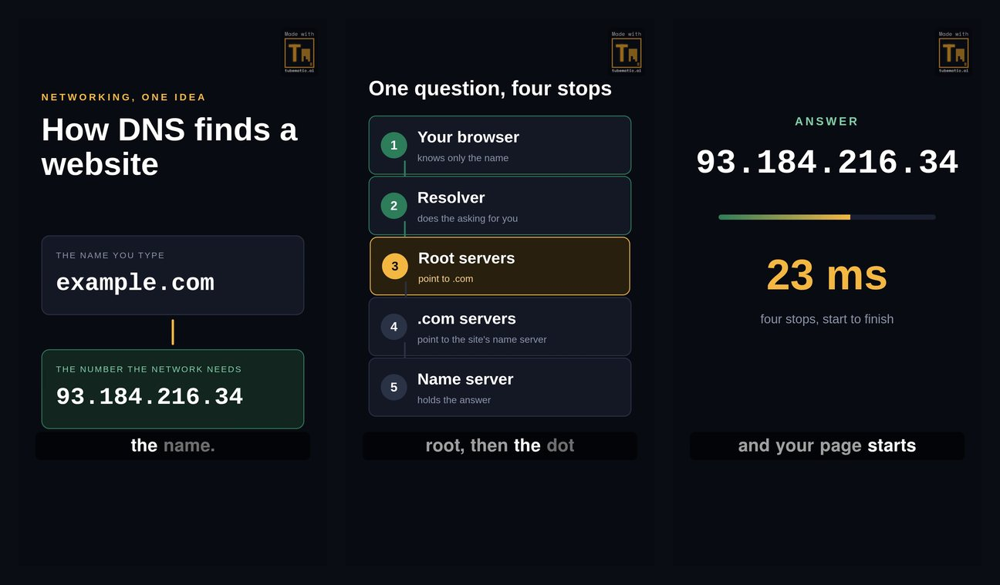
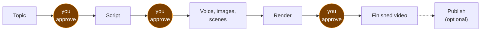

# Overview

Tubematic turns a topic into a finished vertical video. An AI agent writes the script, voices it,
generates images and writes the animation as code. A renderer turns that code into an mp4. You
approve the work at three points, on a web dashboard.

It runs on your own Linux machine, in Docker.

---

## What it makes

A 1080×1920 mp4 at 30 frames a second, in YouTube Shorts format, usually 90 to 180 seconds long. It
has a synthesised voiceover, word-timed captions, generated images and animated diagrams.

The agent writes each scene as a React component for that one video, and
[Remotion](https://remotion.dev) renders it. Because the output is code, the agent can change one
scene when you ask for a revision, and you can read what produced any frame.

## How a video moves

1. A topic arrives. You type it in, or Tubematic's research proposes it.
2. You approve the topic, and the agent writes the script.
3. You approve the script. This is the approval that starts spending: the agent voices the script
   with ElevenLabs, generates images with OpenAI, and writes the scenes.
4. The renderer renders the video. If you turned AI review on, Gemini watches the result and can
   send it back to the agent, once by default.
5. You watch the video and approve it.
6. If you set up publishing, you post it from the dashboard. Otherwise you take the mp4 and post it
   yourself.

At each approval you can ask for a revision instead. You write what to change, and the agent reworks
the topic, the script or the video and brings it back.

[Auto Pilot](14-auto-pilot.md) can make all three approvals for you and post the result. It is off
by default.

## Statuses

Every video has a status. The dashboard shows it as a column on the **Pipeline** page.

| Status | What is happening | Who acts next |
|---|---|---|
| Topic Proposed | A topic is waiting for your decision | You |
| Topic Approved | The topic is waiting for the agent to write its script | The agent |
| Script Ready | The script is written and waiting for your decision | You |
| Voicing | The agent is voicing the script | The agent |
| Voice Ready | The voice is done. The agent generates images and writes the scenes | The agent |
| Rendering | The video is waiting for a renderer, or rendering | The renderer |
| Video Ready | The video is rendered and waiting for your decision | You |
| Video Approved | The video is finished | You, if you publish |
| Scheduled | A post is waiting for its time | Tubematic |
| Publishing | A post is going out | Tubematic |
| Partially Published | Some accounts have the post and some failed | You |
| Published | Every account has the post | Nobody |
| Revision Requested | The video is back with the agent for changes | The agent |
| Rejected | You rejected the topic | Nobody |
| Failed | The video could not be rendered or published | You |

The developer docs and the logs write statuses as constants, such as `SCRIPT_READY`. A video waiting
for a renderer has the status `RENDER_QUEUED`, which the dashboard shows under Rendering. A
Partially Published video is shown under Published, with a **PARTIAL** tag.

## What it costs and how long it takes

Tubematic is free. The services it calls charge you:

| Service | Charged for | When |
|---|---|---|
| ElevenLabs | The voiceover, by script length, from your plan's credits | After you approve a script |
| OpenAI | Each scene image, and each character pose in the Illustrated style | While the agent writes scenes |
| Your agent's provider | Each agent session: a script, a set of scenes, a revision, a research run | Whenever the agent works |
| Gemini, if you add a key | Finding topics in YouTube videos, and AI review | During research, and after each render |

The dashboard records what each call cost. A video's window shows its own total, and
**Analytics → Spend** shows the whole install. See [Settings](05-settings.md#costs).

Most of the waiting is in two places. Writing the scenes is the longest agent session. Rendering
comes second: on one test machine, 5 seconds of an ordinary scene took about 2 minutes to render on
a 6-core CPU and 35 seconds on an NVIDIA GTX 1650. See [GPU Rendering](10-gpu-rendering.md).

## What runs on your machine

| Part | What it does |
|---|---|
| The dashboard | The web page where you create, approve and publish videos. Port 3000 |
| The agent | Claude Code, Codex or OpenCode, with Tubematic's skills installed. It writes scripts and scenes |
| The poller | A scheduled job that starts the agent when there is work. It runs from your crontab |
| The renderer | Renders videos. One runs on this machine, and [other machines can render too](11-remote-renderers.md) |
| The worker | Runs the AI review, sends scheduled posts, and runs Auto Pilot |
| The API and the tool server | What the other parts talk to. You do not use them directly |

Everything Tubematic stores is under `~/.tubematic-data/`: the database, which also holds your API
keys, each video's working files, and the rendered videos. That directory is outside the install
directory, so deleting the install does not delete your videos.

How the parts fit together is in [Architecture](../developer/01-architecture.md).

---

## Glossary

| Term | Meaning |
|---|---|
| Agent | The AI coding tool that writes scripts and scenes. See [Agents](12-agents.md) |
| Approval | One of the three points where a video waits for you: the topic, the script and the finished video |
| Auto Pilot | A mode that makes the approvals and posts videos for the domains you select |
| Domain | A subject area that videos are filed under, such as "Python Internals". The dashboard's **Projects** page lists your domains |
| Mascot | An optional character that reacts on screen. See [Visual Styles and Mascots](13-visual-styles-and-mascots.md) |
| Poll interval | How often the poller checks for work while idle. 30 minutes by default |
| postforme | The service Tubematic publishes through. It holds the connections to your social accounts |
| Research | The agent looking for topics on a schedule |
| Research mode | A way research finds topics: curriculum, trending or mining. See [Using Tubematic](03-using-tubematic.md#where-topics-come-from) |
| Revision | A request for changes, with a comment saying what to change |
| Score | How well a topic suits a short explainer video, from 1 to 10. Research files only topics that score 5 or more |
| Angle | One sentence saying what a video's opening will use, with a kind and a score from 0 to 10. Research files only topics whose angle scores 5 or more. See [The angle](03-using-tubematic.md#the-angle) |
| Script profile | A writing style learned from YouTube videos you choose |
| Session | One run of the agent on one video and one stage |
| Visual style | How a video looks. See [Visual Styles and Mascots](13-visual-styles-and-mascots.md) |
| Voice | An ElevenLabs voice, with the model it speaks with |
