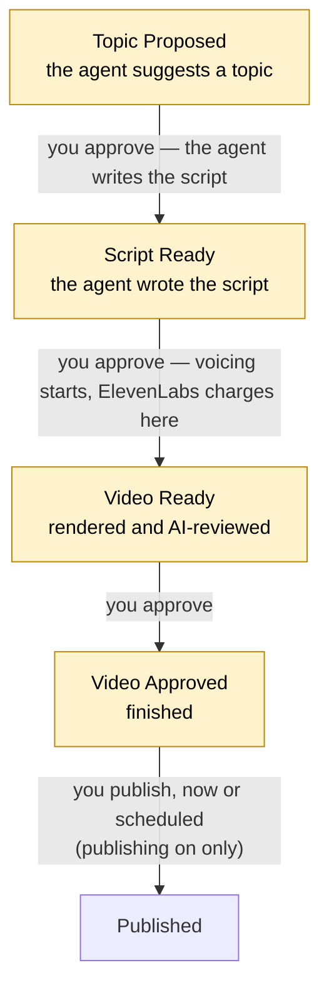

# Using Tubematic

Day-to-day use, once [installation](02-installing.md) is done and an agent is installed. To move to a
newer version later, see [Upgrading](07-upgrading.md). The dashboard itself, page by page, is in
[The Dashboard](04-dashboard.md).

---

## How the pipeline works

Tubematic is an **agent-first** video factory. An AI agent researches topics, writes scripts, voices
them and writes the scenes; a render worker renders each video and has an AI watch the result for
defects. You make the decisions the agent is not allowed to make, on the dashboard.

**You run Tubematic from the dashboard.** Creating a video, approving it at each checkpoint, pausing,
choosing what research looks for — all of it is there, and none of it needs an agent session: the
scheduled pipeline starts the agent by itself. Agent slash commands are an optional second way in,
covered in [Agent commands](#agent-commands).

The agent stops and waits for you at three checkpoints, and a fourth exists once publishing is on:



At each checkpoint you can also **request a revision** with a comment saying what to change; the
agent reworks the topic, script or video and brings it back. A topic can be **rejected** outright.
Every status in between, and every transition, is in
[The Pipeline](../developer/02-pipeline.md#the-states).

**The agent never publishes.** No agent tool can, and a finished video is not something the agent
can act on — publishing is irreversible, so it is something you click. With publishing off (the
default), Video Approved is simply where a finished video stops: watch it in its window on the
dashboard, save it from the player's menu or from `~/.tubematic-data/output_videos/` on the host, and post
it yourself. Publishing and scheduling posts are in [Publishing](06-publishing.md).

**Auto Pilot removes the checkpoints, for the projects you choose.** It is off by default. For a
project you select on **Settings → Auto Pilot**, Tubematic approves the topic, the script and the
finished video itself and then posts the video, spaced out by the gap and the per-account daily
number you set there. Before turning it on, know that:

- it approves topics, scripts and finished videos with no human review;
- it spends money on every topic research files — ElevenLabs credits, image generation and agent
  sessions — bounded only by the research caps and, if you set one, the limit on videos in progress;
- it posts publicly to real accounts, including videos the AI review flagged, could not check, or
  never ran on;
- a published post cannot be taken back by Tubematic.

Projects you do not select keep every checkpoint. Pausing the pipeline pauses Auto Pilot too, and
cancelling a scheduled post takes that video off it. The full rules are in
[Publishing — Auto Pilot](06-publishing.md#auto-pilot).

---

## Starting the dashboard

From the Tubematic directory:

```bash
python3 scripts/service.py start
```

This starts all four containers. Prefer it to a bare `docker compose up -d`: it creates any missing
data directory and re-points Docker volumes whose data location has moved before starting anything.
`python3 scripts/service.py status` shows whether everything is up, and `stop` stops it.

Open <http://localhost:3000> and sign in with the dashboard password you set during onboarding.
Signing in, signing out, and using the dashboard from another machine are in
[The Dashboard — Signing in](04-dashboard.md#signing-in). Forgot the password?
`python onboard.py --set-password` on the host sets a new one and signs every browser out.

---

## Four ways to generate videos

Every video belongs to a **project domain** — a subject area such as "Python Internals". Three modes
find topics on a schedule and one is you asking. Why it is shaped this way is in
[Where topics come from](../developer/02-pipeline.md#where-topics-come-from).

### Manual — "make a video about X"

Use the dashboard's **New Video** page. Enter a title (at most 70 characters) and the topic, and
optionally pick the agent, model, effort, script profile, visual style and voice. **Automatically
approve topic** is on by default, so scripting starts with the next agent session; untick it to
review the topic on the Pipeline page first. Videos submitted this way are filed under a **Manual
Videos** domain and are not scored. See [The Dashboard — New Video](04-dashboard.md#new-video).

**Or, from an agent session** (optional — see [Agent commands](#agent-commands)): run
`/tubematic-submit-new-job How TCP three-way handshake works` on Claude Code or OpenCode, or on
Codex, which has no slash commands, ask in plain words. This route differs in two ways: the agent
scores the topic first and refuses one below 5, telling you how to reframe it, and it files the
topic in a matching domain (or creates one) instead of **Manual Videos**. Asking is the approval, so
scripting starts with the next agent session; with more than one voice or a ready script profile,
it asks which to use.

### Curriculum — sub-topics of a subject, on a schedule

Add a **curriculum seed** domain on the dashboard's **Topics** page, and scheduled research
enumerates sub-topics of it. Each research run proposes up to **Max curriculum per run** new topics
per active seed (2 by default, **Settings → Research**).

Or, from an agent session: `/tubematic-add-topic Python Internals — CPython internals: GIL, memory
management, bytecode`.

### Trending — what is popular now

When trending is on, research scans the trending sources for producible angles on popular topics.
The sources are GitHub Trending, Hacker News, Lobsters and Dev.to, read from the public web with no
login; the first two are on by default. Choose them on **Settings → Research**. Each run files up to
**Max trending per run** topics (2 by default).

### Mining — spin-offs of YouTube videos

When mining is on, research hands the YouTube videos you list to Gemini, which picks out concepts
they only mention in passing that deserve a video of their own. It needs a Gemini API key: while
none is stored, mining is off — its toggle is greyed out, scheduled research leaves it out, and
turning it on is refused — and it comes back on its own once a key is added. Each run
files at most **Max mining per run** topics (2 by default, **Settings → Research**; 0 turns mining
off): Gemini is asked for only that many and is shown the topics that already exist, so it neither
over-produces nor repeats one. A run also makes at most that many Gemini calls, one video per call,
and the next run carries on from the next video. Only one mining run happens at a time.

Add the videos on the **Topics** page under **Mining Sources** (an agent session can also set them).
Only YouTube video URLs are accepted — `youtube.com/watch?v=…`, `youtu.be/…`,
`youtube.com/shorts/…` or `youtube.com/live/…` — at most 50. Each is saved as
`https://www.youtube.com/watch?v=<id>`, so the list shows that form after you add one, and the same
video added twice is kept once. A list with anything else in it is refused whole, and the message
names the entries that were not accepted.

---

## How work advances

Cron starts the **poller** at the interval chosen during onboarding (30 minutes by default). When
there is work, the poller starts the agent each video is assigned to; until an agent is installed
(`python onboard.py --install-agent <claude|codex|opencode>`) it logs "No agent installed" and does
nothing.

**The poller keeps running while there is work.** It runs one agent session per video — up to **3
at once** by default, each doing one stage (writing the script, voicing, writing scenes, or a
revision) — and starts the next stage as soon as one finishes, instead of waiting for the next cron
tick. When nothing is left it exits, and the next tick starts it again. So the poll interval is how
soon an idle install notices new work, not how often work advances. Set the number of sessions and
the session timeout (90 minutes by default) on **Settings → Scheduling**. Each session is a paid
agent run, so on a tight budget set sessions to 1.

**Research runs once each time the poller starts**, and only when both research caps allow it (see
[Control knobs](#control-knobs)). That keeps research reactive — it can top up the topic queue soon
after you approve or reject topics — while the daily cap bounds cost on a day where research keeps
coming up dry. There is no separate daily research job.

**A video the agent cannot move is flagged STUCK.** If three sessions in a row leave a video where
they found it, the poller stops picking it up and comments on the video. It keeps its status. Open
it on the dashboard to read why, then press **Retry agent**, or change its status.

Each agent runs from its own workspace, `~/.tubematic-agent/<agent>` by default, beside the shared
logs in `~/.tubematic-agent/logs`. Scheduled runs never stop for a permission prompt: the installer
sets up what each agent may do without asking. How that is done for each agent is in
[The Agent Layer — Deployment](../developer/07-agent-layer.md#deployment).

To change the poll interval, re-run `python onboard.py --step cron`. The whole mechanism is in
[The Poller](../developer/13-the-poller.md).

---

## Control knobs

Five controls decide how many topics research produces.

### Research modes

Turn curriculum, trending and mining on or off individually with the mode toggles on the **Topics**
page. Or, from an agent session: `/tubematic-set-strategy curriculum,trending` (any combination of
`curriculum`, `trending` and `mining` — `mining` only while a Gemini key is stored). With no mode on
at all, scheduled research does not run.

### Domain pause (curriculum seeds only)

Stop one curriculum seed producing more topics, without affecting the others: press **Pause topic
generation** on the seed's row on the **Topics** page, and the same button to resume. Or, from an
agent session: `/tubematic-pause-domain python-internals` and `/tubematic-resume-domain
python-internals`.

A paused seed is not enumerated by curriculum research, and new videos are refused there even when
trending or mining finds a topic that matches it. A topic you submit yourself is still accepted.
Videos already in the domain carry on. Only a curriculum seed can be paused: any other domain only
receives topics researched elsewhere, so a pause there could not stop them. To stop those topics,
reject them on the dashboard or turn trending or mining off. See
[Domain pause](../developer/02-pipeline.md#domain-pause).

### Topic cap (per domain)

Each domain may only ever hold so many topics: 100 by default, anywhere from 25 to 750, set in the
**Topic cap** field on its row on the **Topics** page. Research checks every candidate against
everything the domain has had, deleted and rejected topics included, so it never proposes one
again; the cap keeps that history a size the agent can read.

A domain that reaches its cap shows **EXPIRED**, and research files nothing more into it until you
raise the cap. Videos already there carry on, and a topic you submit yourself still goes through. See
[Topic cap](../developer/02-pipeline.md#topic-cap).

### Pending-proposal cap

Once this many topics are waiting for your approval (15 by default, **Settings → Research**),
scheduled research is skipped entirely — no agent session, no cost. It clears itself as you approve
or reject topics.

### Research runs per day

Separately, **Max research runs per day** (8 by default, **Settings → Research**) bounds how many
research sessions can start in any trailing 24 hours. It exists for the day when the pending cap
never closes — research keeps finding topics that score too low to file — which would otherwise
start a research session every time the poller starts. **Settings → Scheduling** shows how many runs
the last 24 hours used and when the next one frees.

---

## Where to change what later

Onboarding asks for a lot up front. This table answers "I set this during onboarding — where do I
change it now?" What every setting means, with its default, is in [Settings](05-settings.md).

| Value | Change it via |
|---|---|
| ElevenLabs voices (up to five, each with its own model) and the default voice | **Settings → Voice** |
| Image model, and the model used for illustrated characters | **Settings → Images** |
| AI review on or off (off by default, experimental), its model, frame rate and number of rounds | **Settings → AI Review** |
| Topics per run (curriculum, trending, mining), pending-proposal cap, research runs per day, trending sources | **Settings → Research** |
| Research modes | **Topics** page, or `/tubematic-set-strategy` |
| Mining videos | **Topics** page → Mining Sources, or ask an agent session |
| Pipeline pause | **Settings**, the switch above the tabs, or `/tubematic-pause` |
| Agent sessions at once, and the session timeout | **Settings → Scheduling** |
| Your standing preferences for every video (topics, script tone, visuals, ...) | **Settings → Preferences**. Up to 6000 characters. The agent receives them on every run and applies only the parts that fit the stage it is working on. Not asked during onboarding |
| Discord notifications — webhook URL, which events notify, the dashboard link | **Settings → Notifications**. Not asked during onboarding |
| The "Made with tubematic.ai" watermark | **Settings → Rendering**. On by default and not asked during onboarding. The agent cannot change it |
| Render timeout and render retries | **Settings → Rendering** |
| How long things are kept — published videos (7 days by default), failed and rejected videos (off by default), logs (14 days by default) | **Settings → Retention** for videos, **Settings → Logs** for logs. The Retention tab also shows how many failed and rejected videos there are and how much disk they hold |
| Poll interval | `python onboard.py --step cron`. Not on the dashboard: it is baked into your crontab, which the dashboard cannot reach |
| API keys (ElevenLabs, Gemini, OpenAI, youtube-transcript.io, postforme.dev) | **Settings → API Keys**, or `python onboard.py --step install_config`. The dashboard shows a mask, never the key — type over it to replace it, clear it to remove it. A new key applies to the next call with no restart. Only onboarding checks a key with its provider as you type it |
| Publishing on or off | **Settings → Publishing**. Off by default; needs the postforme.dev key |
| Auto Pilot — on or off, which projects, which accounts each posts to, posts per day per account, gap between posts, most videos in progress | **Settings → Auto Pilot**. Off by default. `python onboard.py --full-questionnaire` asks only the on/off |
| Which social accounts may be published to | **Socials** page. An allowlist: an account connected to the same postforme.dev project is left alone unless you tick it here |
| Agent models, install scope, workspace | Re-run `python onboard.py --install-agent <agent>` — every model is re-checked against the installed CLI. **Settings → Agents** cannot add or remove models, because the dashboard has no agent CLI to check one against |
| An agent's default model, the default agent, and each agent's share of new videos | **Settings → Agents** |
| An agent's effort level | **Settings → Agents** — `low`, `medium`, `high` (the default), `xhigh` or `max`. Also asked by `python onboard.py --install-agent <agent> --full-questionnaire` |
| Uninstall an agent | `python onboard.py --uninstall-agent <agent>` — removes the skills, commands and MCP registration it deployed and keeps its workspace and logs. `python onboard.py --list-agents` shows what is installed |
| A video's agent, model or effort | At any checkpoint on the dashboard (Topic Proposed, Script Ready, Video Ready). Changing the agent resets the model to that agent's default. A new video is given an agent automatically, by the shares on **Settings → Agents** |
| A video's voice | It starts with its domain's default voice, or the install default. Change it on the dashboard at Topic Proposed (any voice) or Script Ready (only a voice whose model can speak the written script) |
| A domain's default voice, visual style and script profile, and its topic cap | Its row on the **Topics** page |
| Dashboard password | `python onboard.py --set-password` on the host. Changing it signs every browser out. There is no reset on the dashboard |
| The service tokens (API, MCP, session signing) | `python onboard.py --rotate-tokens`. Replaces all three, restarts the containers that hold them and signs every browser out. See [Infrastructure](../developer/16-infrastructure.md#changing-the-password-and-rotating-tokens) |
| MCP port | `python onboard.py --step install_config`. Not on the dashboard, because only onboarding rewrites the agents' MCP registration that uses it |
| Timezone (logs, CLI, dashboard) | Detected from the host. Override it with a `TZ` entry in the Compose `environment:` block, then restart |

**Rule of thumb:** there is no `.env`. The settings database is the single source of truth, and the
dashboard edits it live — no setting needs a restart. The exceptions are the poll interval and the
MCP port: each is baked into something only `onboard.py` rewrites (the cron line, the agents' MCP
registration), so editing the stored value alone would do nothing, and the dashboard does not offer
them. An agent's models, scope and workspace change only through `--install-agent`, which checks
them against the real CLI.

**Times** are stored in UTC and shown in the host's timezone everywhere a person reads them — the
dashboard, `poll.log`, the render worker's log and `scripts/status.py`. A raw database query or the
API's own JSON therefore shows UTC while the dashboard shows local time; that is expected. Why is in
[HTTP API — Time](../developer/05-http-api.md#time).

---

## A day with Tubematic

### 1. See what is waiting

Open the dashboard: the **Quick Actions** list on the Pipeline page holds everything waiting for
you. Or, in an agent session, `/tubematic-status`.

Better still, have the pipeline tell you. **Settings → Notifications** takes a Discord webhook URL
and sends a message when topics are proposed, a script is ready, or a video is ready — each
switchable on its own. Topics arrive bundled, one message per research run. Set **Dashboard URL**
there too (for example `http://192.168.1.20:3000`) and each message links to the right page. Saving
the URL checks the webhook exists without posting anything. Beyond the three triggers, a video that
nothing is voicing raises an alert whenever a webhook is set — see
[Settings — Notifications](05-settings.md#notifications).

### 2. Approve topics

Review each proposed topic: **Approve** sends it to scripting, **Reject** removes it, **Revise**
asks the agent to rework the proposal. This is also where you fix the video's script profile and
visual style, and the moment to pick a voice on a different ElevenLabs model (for example
`eleven_v3` rather than `eleven_multilingual_v2`), because the script is written for its voice's
model. Leave the voice alone to keep the one the video already has.

### 3. Review scripts

The agent leaves a comment explaining what it wrote. **Approve** starts voicing — **ElevenLabs
charges from here** — and then scene writing and rendering. A voice whose model cannot speak the
written script is greyed out; to switch to it, request a revision naming the voice and the agent
rewrites the script for it. **Revise** asks for a rewrite.

### 4. Approve videos

When rendering (and AI review, if you turned it on) is complete, watch the video. **Approve** moves it to Video Approved;
nothing is posted anywhere by this. **Revise** sends it back with your notes.

### 5. Publish

Only with publishing enabled; otherwise Video Approved is where a finished video stops and you post
it yourself. **Publish** in the video's window opens a dialog where you pick the accounts, check the
title and caption the agent wrote, choose each platform's privacy, and post now or schedule a time.
Nothing is pre-ticked: publishing is irreversible, so every destination is an explicit choice.
Connecting accounts, scheduling and what happens after you press Publish are in
[Publishing](06-publishing.md).

Every action, and the choices each one carries, is in
[The Dashboard — Making decisions](04-dashboard.md#making-decisions). **Request Revision is the only
way to leave a comment on a video**: the Comments tab is a read-only thread.

---

## Agent commands

**You do not need an agent session to run Tubematic.** Everything you do day to day — creating
videos, approving, pausing, choosing research modes and domains — is on the dashboard, and the
scheduled pipeline drives the agent by itself. Agent commands are an optional second way in, for
people who already live in an agent terminal. The table pairs each with its dashboard equivalent.

Open the agent from its workspace — `cd ~/.tubematic-agent/claude && claude`,
`cd ~/.tubematic-agent/opencode && opencode`, or wherever you put it at `--install-agent` time.
**Claude Code and OpenCode** have these slash commands:

| Command | What it does | On the dashboard |
|---|---|---|
| `/tubematic` | List all the commands | — |
| `/tubematic-status` | Pipeline status — videos by stage, spend, container health | **Pipeline** page |
| `/tubematic-submit-new-job <topic>` | Score a topic and create a video from it | **New Video** page (not scored; filed under Manual Videos) |
| `/tubematic-add-topic <domain>` | Add a curriculum seed domain | **Topics** page |
| `/tubematic-pause-domain <id>` | Pause topic generation for a seed domain | **Pause topic generation** on the seed's row, **Topics** page |
| `/tubematic-resume-domain <id>` | Resume a paused seed domain | The same button |
| `/tubematic-list-strategies` | Show the active research modes and seed domains | **Topics** page |
| `/tubematic-set-strategy <modes>` | Turn research modes on or off | The mode toggles on the **Topics** page |
| `/tubematic-pause` | Pause the pipeline | The switch above the tabs on **Settings** |
| `/tubematic-resume` | Resume the pipeline | The same switch |
| `/tubematic-dashboard-status` | Check the containers are running | The API status light in the top bar (the API only), or `python3 scripts/service.py status` for every container |
| `/tubematic-register-mcp` | Re-register the Tubematic tools with the agent, after moving or reinstalling | None — an agent repair, see [Troubleshooting](08-troubleshooting.md) |

**Codex has no slash commands** — its CLI has no mechanism for them. Open it from its workspace
(`cd ~/.tubematic-agent/codex && codex`) and ask in plain words, for example *"show the Tubematic
pipeline status"* or *"pause the Tubematic pipeline"*. It has the same tools and skills. Scheduled
work is unaffected either way: the poller drives every agent with a prompt, not a command.

**When something is wrong**, any of the three can walk through it with you using the
troubleshooting skill: `/tubematic-troubleshooting` in Claude Code, `$tubematic-troubleshooting`
in Codex, or *"use the tubematic-troubleshooting skill"* in OpenCode. It only runs when you ask for
it by name, and it drafts a bug report for you to file rather than posting one. See
[Reporting a bug](08-troubleshooting.md#reporting-a-bug).

After the containers are rebuilt or the agent is reinstalled, start a new agent session: the agent
reads its tools and skills once, when the session starts.

---

## Pausing the pipeline

To stop all automated work for a while, click the switch above the tabs on the **Settings** page;
it applies at once. Cron still fires, but no new agent session starts; sessions already running
finish, and script profiles waiting to be built are still built. Auto Pilot pauses too. Resume with
the same switch. (From an agent session, `/tubematic-pause` and `/tubematic-resume` do the same.)

This is different from pausing a single domain, which only stops research filing topics there.

---

## Monitoring

```bash
tail -f ~/.tubematic-agent/logs/poll.log              # the poller and every agent session
python3 scripts/service.py status                     # containers, version, cron
python3 scripts/service.py logs tubematic-api -f      # the API
python3 scripts/service.py logs tubematic-mcp -f      # the agent's tools
python3 scripts/service.py logs tubematic-renderer -f # rendering, AI review, publishing
python3 scripts/status.py                             # health, checkpoints, costs, disk
```

`poll.log` is in a fixed place whichever agent runs. The dashboard's **Logs** page shows the
structured logs of every service, and each video's window has its own **Logs** tab.

---

## Script profiles

A script profile teaches the pipeline to write in a particular creator's style, learned from the
transcripts of YouTube videos you choose. It is not part of setting Tubematic up — make one whenever
you have videos whose style you want to borrow.

On the dashboard's **Script Profiles** page, give the profile a name and up to 10 YouTube URLs.
Tubematic fetches the transcripts straight away, which needs a youtube-transcript.io key
(**Settings → API Keys**), and the next agent session writes the style. Once the profile is
**Ready**, pick it for any topic awaiting approval, or make it a domain's default on the **Topics**
page so the domain's curriculum topics arrive with it preselected. A profile cannot be edited;
delete it and create another. See [The Dashboard — Script Profiles](04-dashboard.md#script-profiles).

---

## When something goes wrong

[Troubleshooting](08-troubleshooting.md) lists symptoms and their usual causes. A few quick checks:

- **See what the poller would do**, without starting anything: `python scripts/poll.py --dry-run`.
- **"Skipping research — N topics already pending (cap=15)"** in `poll.log` means the pending cap is
  full: approve or reject topics, or raise the cap. **"Skipping research — N run(s) in the last 24h
  (cap=8)"** means the daily run cap is used up; **Settings → Scheduling** shows when the next run
  frees.
- **The API and the MCP server are separate containers**, so check both:
  `curl http://localhost:4000/health` and `curl http://localhost:4100/health`. Restart one with
  `python3 scripts/service.py restart tubematic-api` (or `tubematic-mcp`, which drops an open agent
  session's tools). `restart` refuses while a render, a voicing, an agent session or a publish
  upload is in flight, because restarting would kill it; `--force` restarts anyway.
- **A video stuck in Rendering** may still be inside the render timeout (40 minutes by default). A
  restart of the renderer puts any video stuck there back in the queue, or marks it failed once it
  has used up its retries. See [Rendering and Review](../developer/11-rendering-and-review.md).
