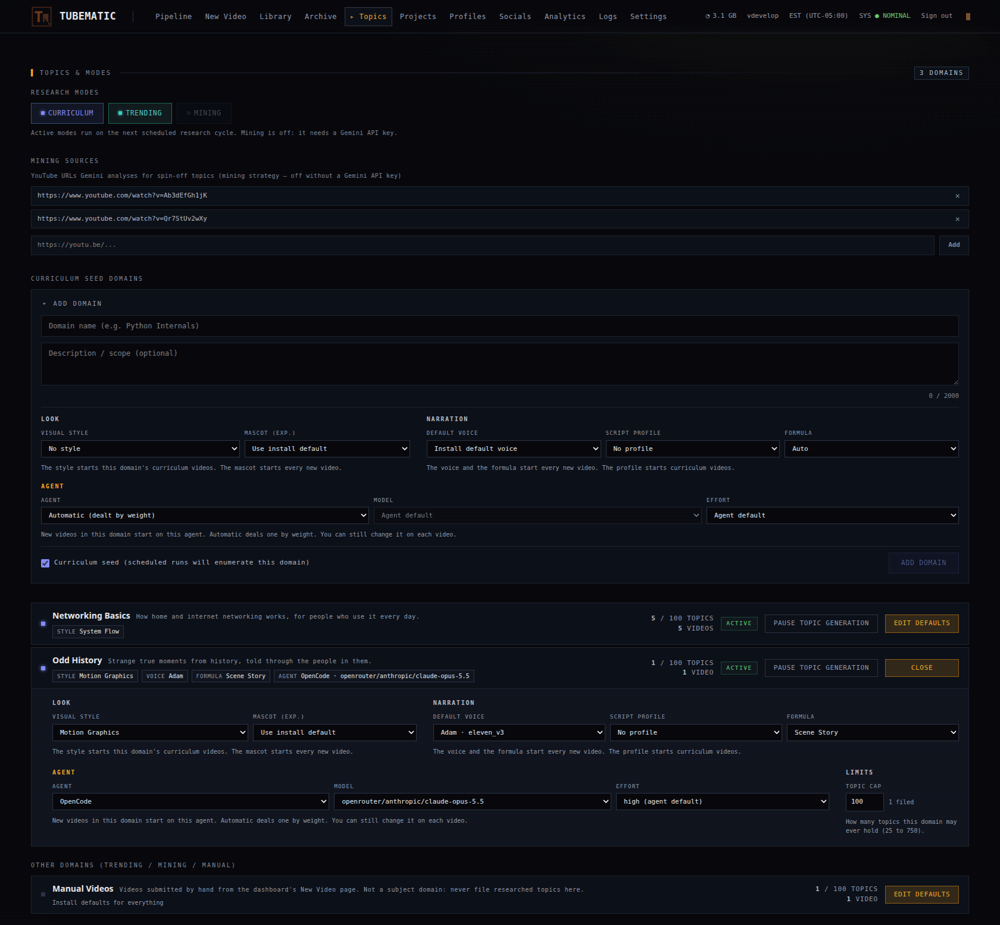
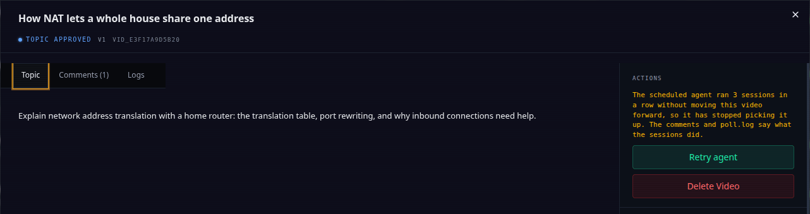

# Using Tubematic

What you do from day to day, once Tubematic and an agent are [installed](02-installing.md). You do
all of it on the dashboard at `http://localhost:3000`. [The Dashboard](04-dashboard.md) describes
each page.

---

## The daily loop

### 1. See what is waiting

Open the **Pipeline** page. **Quick Actions** lists every video that needs a decision from you,
grouped as Topic Proposed, Script Ready and Video Ready.

Tubematic can also tell you. On **Settings → Notifications**, enter a Discord webhook URL and choose
which events send a message: new topics, a script ready, a video ready, a publish that partly
failed, a video that failed.

### 2. Decide on topics

For each proposed topic, press **Approve**, **Reject** or **Revise**.

Before you approve, set the choices that are fixed from then on:

- the **script profile**, if you want a particular writing style,
- the **visual style** and, optionally, a **mascot**
  (see [Visual Styles and Mascots](13-visual-styles-and-mascots.md)),
- the **voice**, if you want one that uses a different ElevenLabs model. The agent writes the script
  for the voice's model, so this is the time to switch.

Leave a picker alone to keep what the video already has.

### 3. Read and approve scripts

Press **Read** to open the script. The agent leaves a comment explaining what it wrote.

Above the script, the **Script** tab shows what the agent built it on:

- **Formula** is the structure the agent chose for this topic. See
  [Script formulas](#script-formulas).
- **Openings considered** lists the three openings the agent drafted, with the one it used marked.
  To have the script start with another one, press **Revise** and say which.
- **Script warnings** are automatic checks on the script's words, such as an ending that asks
  viewers to follow, or a script longer than its formula runs. They are advice for you and the
  agent, and you can approve a script that has them.

A script written before version 2.2.0 shows none of these.

**Approve** starts the voiceover, and ElevenLabs charges from this point. **Revise** asks the agent
to rewrite.

A voice is greyed out here when its model cannot speak the script as written. To use that voice,
press **Revise** and name the voice in your comment. The agent rewrites the script for it.

### 4. Watch and approve videos

Press **Watch**, and watch the whole video. **Approve** moves it to Video Approved. **Revise** sends
it back with your notes.

Approving does not post anything.

### 5. Publish, or take the file

With publishing set up, open the approved video and press **Publish…**. See
[Publishing](06-publishing.md).

Without it, play the video in its window, or take the mp4 from
`~/.tubematic-data/output_videos/`, and post it yourself.

### Leaving a comment

**Revise** is the only way to comment on a video. It opens a dialog where you say what to change,
and the agent acts on it. The **Comments** tab in a video's window shows everything you and the
agent have said, and you cannot type there.

---

## Where topics come from

Every video belongs to a domain: a subject area such as "Python Internals". Topics reach a domain in
four ways.

| Source | How it works | Set it up on |
|---|---|---|
| You | You type a title and a topic | The **New Video** page |
| Curriculum | Research lists sub-topics of a domain you describe | The **Topics** page: add a domain as a curriculum seed |
| Trending | Research looks for video angles on what is popular on GitHub Trending, Hacker News, Lobsters and Dev.to | **Settings → Research** chooses the sites. The first two are on by default |
| Mining | Research hands YouTube videos you list to Gemini, which picks out ideas they mention in passing | The **Topics** page, under **Mining Sources**. Needs a Gemini key |

Curriculum, trending and mining are the three research modes. Switch each on or off with the
toggles at the top of the **Topics** page. With all three off, research does not run.

Research scores each topic from 1 to 10 for how well it suits a short explainer video, and files
only topics that score 5 or more. Each research run files at most 2 topics per mode, or 2 per
curriculum seed. You can change those numbers on **Settings → Research**.

A video you create on the **New Video** page is not scored. It is filed under a domain called
**Manual Videos**.

### Adding a domain

On the **Topics** page, under **Curriculum Seed Domains**, fill in **Add Domain**:

1. Enter a name, for example "Python Internals".
2. Describe the scope in up to 2000 characters. Research works from this description, so say what
   belongs in the domain and what does not.
3. Leave **Curriculum seed** ticked to have research propose topics for it.
4. Optionally choose the visual style, voice, script profile and mascot its videos start with.
5. Press **Add Domain**.

You can change the same choices later on the domain's row.

### Mining sources

Add YouTube video links under **Mining Sources** on the **Topics** page, up to 50. A link to a video,
a Short or a live video is accepted, in the `youtube.com/watch?v=…` or `youtu.be/…` form. A link to
a channel or a playlist is not.

While no Gemini key is stored, the **Mining** toggle is greyed out. It works again once you add a
key on **Settings → API Keys**.

---

## Limiting how many topics arrive

Five controls bound what research produces, and so what it costs.

| Control | Where | Default | What it does |
|---|---|---|---|
| Research modes | Toggles on the **Topics** page | All on | Turns curriculum, trending or mining off |
| Pause a domain | **Pause topic generation** on a seed's row on the **Topics** page | Not paused | Stops research filing topics in that domain |
| Topic cap | **Topic cap** on a domain's row | 100 | The most topics a domain may hold over its lifetime, from 25 to 750 |
| Pending-topic limit | **Research pending cap** on **Settings → Research** | 15 | Research does not run while this many topics are waiting for your decision |
| Research runs per day | **Max research runs per day** on **Settings → Research** | 8 | The most research runs in any 24 hours |

### Pausing a domain

A paused domain receives no researched topics, including trending and mining topics that match it.
Videos already in it carry on, and you can still create a video in it yourself.

You can pause a curriculum seed only. Other domains receive topics that research found elsewhere,
so a pause on them would stop nothing. To stop those topics, reject them or turn the research mode
off.

### The topic cap

Research checks each new idea against every topic the domain has had, including ones you rejected
or deleted, so that it does not propose the same thing twice. The cap keeps that history short
enough for the agent to read.

A domain at its cap shows **EXPIRED**, and research files nothing more in it. Raise the cap on the
domain's row to continue. The row shows how many topics the domain has had, as "N filed".

### The two research limits

The pending-topic limit stops research while you have a backlog. It clears as you approve or reject
topics.

The daily limit covers the case where research runs and files nothing, for example because every
idea scores too low. Without it, research would run again each time Tubematic checks for work.
**Settings → Scheduling** shows how many runs the last 24 hours used.

---

## How work gets done

A scheduled job, the poller, checks for work at the poll interval you chose during the install, 30
minutes by default. When it finds work it starts the agent.

- Each agent session works on one video and does one stage: a script, the voice, the scenes, or a
  revision.
- Up to 3 sessions run at once. When one finishes, the poller starts the next stage without waiting
  for the next check.
- When no work is left, the poller exits. The next check starts it again.

So the poll interval sets how soon an idle install notices new work. It does not slow down a video
that is under way.

Each session is a paid run of your agent's model. On a tight budget, set the number of sessions to 1
on **Settings → Scheduling**. The same tab sets how long a session may run before Tubematic stops
it, 90 minutes by default.

Research runs once each time the poller starts, if the two research limits allow it.

To change the poll interval, run `python3 onboard.py --step cron` from the install directory.

### When a video is STUCK

If three sessions in a row leave a video where they found it, the poller stops picking it up and
marks its card **STUCK**. Open the video and read its comments to see why. Then press
**Retry agent**, or fix the cause first.

---

## Pausing everything

The switch above the tabs on the **Settings** page pauses the pipeline. It applies at once.

While paused, Tubematic starts no new work on videos and no research, and Auto Pilot approves
nothing. Sessions that are running finish, and renders that are queued still render. Script profiles
and mascots are still built. You can still approve by hand.

---

## Script profiles

A script profile teaches the agent to write in the style of YouTube videos you choose.

1. Add a youtube-transcript.io key on **Settings → API Keys**.
2. Open **Profiles** and create a profile with a name and up to 10 YouTube links.
3. Wait for the next agent session, which writes the style. The profile then shows **Ready**.
4. Pick the profile on a topic before you approve it, or make it a domain's default on the
   **Topics** page.

You cannot edit a profile. Delete it and create another.

A profile decides how a script sounds: its tone, its vocabulary and its phrasing. The
[formula](#script-formulas) decides how the script is built, so the agent does not copy a
profile's structure or its sign-off.

---

## Script formulas

A formula is the structure of a script: its parts in order, how it opens, where it turns and how
it ends. The agent picks one for each video from the kind of topic it is, then writes the script
in your script profile's voice.

| Formula | The agent picks it for |
|---|---|
| Paradox, Mechanism, Reframe | A thing the viewer owns or uses every day works in a way that seems impossible |
| Broken Expectation | A tool did something that looks wrong |
| Follow the Flow | A process with a natural order: a request, a boot, a login, a payment, a signal through the body |
| Myth, Break, Model | A belief most people hold is wrong |
| Why Don't They Just | A design decision that looks stupid from outside |
| Incident File | An outage, a loss or a bug with a timeline |
| Scheme Machine | A scam, a fraud, a loophole or an exploit that works as a loop |
| Anomaly File | Evidence that looked wrong: every gauge normal during a failure, a record that should not exist |
| Scene Story | One person inside one moment: a near miss, a strange true incident, an ordinary life in a big event |
| Escalating Ladder | Something with a natural measure: size, cost, speed, time to break, risk, depth |

Each formula has its own length, so scripts are not all the same length. No script is longer than
three minutes.

A script ends on its payoff, with no closing line after it. To have scripts end with a line of
your own, such as asking viewers to follow, say so in
[Preferences](05-settings.md#preferences).

---

## Checking on it

| To see | Look at |
|---|---|
| What the agent did in each session | `~/.tubematic-agent/logs/poll.log` |
| Errors from any part of Tubematic | The **Logs** page, filtered to errors |
| What happened to one video | The **Comments** and **Logs** tabs in its window |
| Whether everything is running | `python3 scripts/service.py status` |
| What the next scheduled run would do | `python3 scripts/poll.py --dry-run` |

The containers start with Docker after a reboot. If you stopped them, start them with
`python3 scripts/service.py start`.

If something looks wrong, see [Troubleshooting](08-troubleshooting.md).
