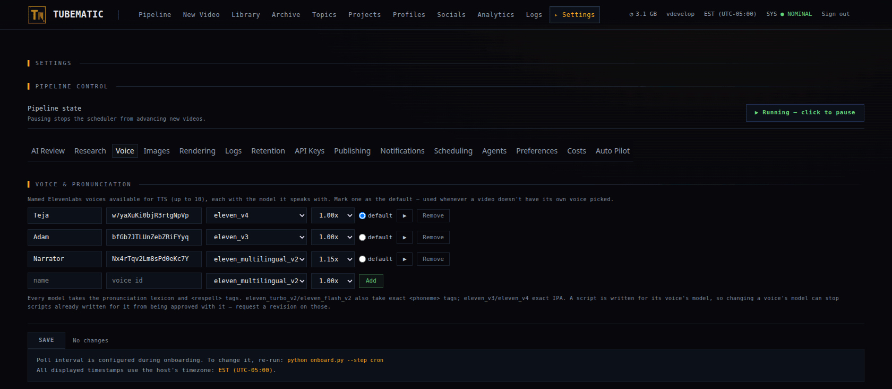
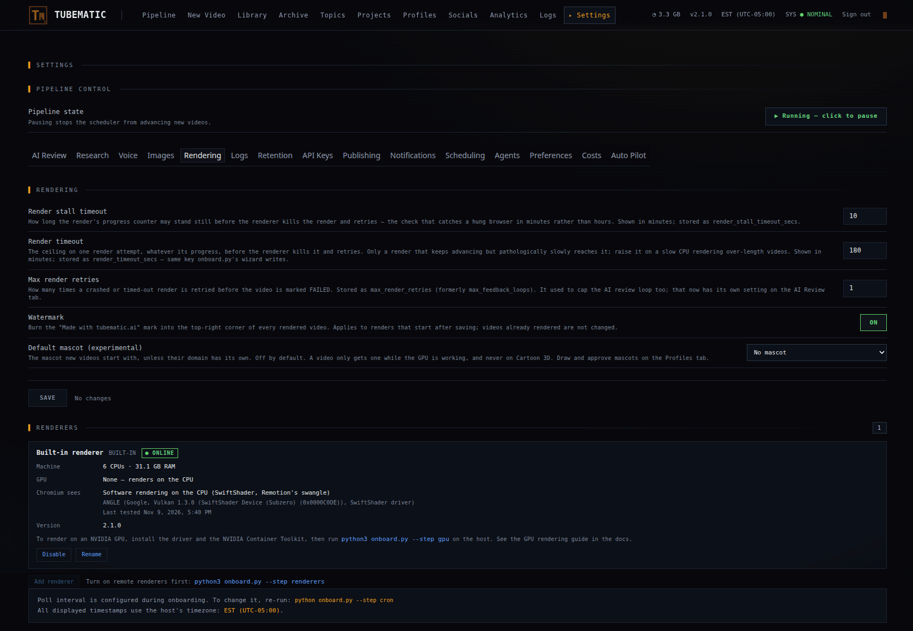

# Settings

Every setting on the dashboard's **Settings** page, tab by tab: what it does, its default, and when
to change it.

A change applies to the next piece of work. You do not restart anything.

---

## How the page works

The switch at the top, **Pipeline state**, pauses and resumes the pipeline. It applies when you
click it. See [Pausing everything](03-using-tubematic.md#pausing-everything).

Below it are fifteen tabs. On most tabs your edits wait until you press that tab's **SAVE**:

- A tab with unsaved edits shows an amber dot.
- **SAVE** saves that tab only.
- If one value is not allowed, nothing on the tab is saved, and a message names the problem.

Three tabs work differently. **Agents** and **Costs** apply each change as you make it. **Auto
Pilot** has its own **SAVE** and asks you to confirm.

---

## AI Review

AI review sends each rendered video to Gemini, which looks for defects. If it finds any, the video
goes back to the agent for a revision before you see it. It is experimental and needs a Gemini key.

| Setting | Default | What it does |
|---|---|---|
| **Gemini review** | Off | Turns the review on |
| **Review model** | `gemini-2.5-flash` | The Gemini model that watches the video. The 3.x models cost about 1.4 times as much per video |
| **Sampling rate** | 10 | How many frames a second Gemini looks at, from 1 to 24. The cost of a review rises in step with it |
| **Max review rounds** | 1 | How many times the review may send a video back, 1 or 2. After that the video comes to you with its findings |

If the review itself fails, for example because Gemini is unreachable, the video comes to you as if
it had passed. Check the video's comments to see whether a review ran.

Turn it on if you want a first pass on visual defects before you watch. Leave it off if you watch
every video anyway, or if its findings send good videos back.

## Research

These limit how many topics research proposes. [Using Tubematic](03-using-tubematic.md#limiting-how-many-topics-arrive)
explains how they work together.

| Setting | Default | What it does |
|---|---|---|
| **Curriculum topics per run** | 2 | The most topics one research run proposes for each curriculum seed |
| **Trending topics per run** | 2 | The most topics one run proposes from the trending sites |
| **Mining topics per run** | 2 | The most topics one run proposes from your mining sources. 0 turns mining off |
| **Research pending cap** | 15 | Research does not run while this many topics are waiting for your decision |
| **Max research runs per day** | 8 | The most research runs in any 24 hours. 0 stops research |
| **Trending Sources** | GitHub Trending, Hacker News | The sites trending research reads. Lobsters and Dev.to are also offered |

Lower the per-run numbers if topics arrive faster than you review them. Raise the pending cap if
research stops before you have enough to choose from.

## Voice

The list of ElevenLabs voices videos can use. A new install starts with two, Teja and Adam.



For each voice you set:

- a name, which is what the pickers show,
- the voice's ElevenLabs ID, from your ElevenLabs voice library,
- the ElevenLabs model it speaks with.

Mark one voice as **default**. Videos use it unless their domain or you choose another. The **▶**
button plays a sample, which spends a few ElevenLabs credits the first time you play it for a voice
and model.

You can have up to 10 voices.

The model matters because the agent writes the script for it. Different models accept different
pronunciation and pause markup. If you change a voice's model, scripts already written for that
voice may be refused at approval. Request a revision on those, and the agent rewrites them.

## Images

| Setting | Default | What it does |
|---|---|---|
| **Image model** | `gpt-image-2.5-flare` | The OpenAI model that draws scene images |
| **Character model** | `gpt-image-2.5-flare` | The OpenAI model that draws characters in the Illustrated style |

Both offer `gpt-image-2.5-flare` and `gpt-image-2.5-sunburst`. Your OpenAI key's project must have
access to the model you choose. If it does not, the first image fails with an error that names the
project and the model.

In the Illustrated style, a character's first image is a new image and each further pose is an edit
of it. An edit costs about three times as much as a new image, so a character with many poses costs
mostly its poses.

## Rendering

| Setting | Default | What it does |
|---|---|---|
| **Render stall timeout** | 10 minutes | If a render makes no progress for this long, Tubematic stops it and tries again |
| **Render timeout** | 180 minutes | The longest one render may take, whatever its progress |
| **Max render retries** | 1 | How many times a render that crashed or timed out is tried again before the video is marked Failed |
| **Watermark** | On | Puts the "Made with tubematic.ai" mark in the top right corner of every video rendered from now on |
| **Default mascot (experimental)** | No mascot | The mascot new videos start with. See [Mascots](13-visual-styles-and-mascots.md#mascots) |

Raise the render timeout on a slow CPU if long videos fail with a timeout. Leave the stall timeout
alone unless renders are stopped while they are still working.

### Renderers

Below those settings, the **Renderers** panel has a card for each machine that renders for this
install. The renderer on this machine is first and is marked **BUILT-IN**. Actions on a card apply
at once.



| Status | Meaning |
|---|---|
| online | Connected and idle |
| busy | Rendering. The card names the video |
| offline | Not heard from. The card says when it was last seen |
| disabled | You disabled it. It takes no new work |
| needs upgrade | It runs a different version from this install, and takes no work until you upgrade it |
| credential expired | Its credential ran out, so it cannot connect. Remove it and add it again |

Each card also shows the machine's CPUs and memory, its GPU and whether the GPU test passed, and its
last error.

| Button | What it does |
|---|---|
| **Disable** / **Enable** | Stops or resumes work on that renderer |
| **Rename** | Changes the name shown here |
| **Test GPU** | Runs the GPU test again. Shown when the renderer has a GPU |
| **Remove** | Removes a renderer on another machine |
| **Add renderer** | Creates the one-time token that adds another machine |

You choose the built-in renderer's GPU with `python3 onboard.py --step gpu`. See
[GPU Rendering](10-gpu-rendering.md). To add machines, see
[Remote Renderers](11-remote-renderers.md).

## Logs

| Setting | Default | What it does |
|---|---|---|
| **Keep logs for** | 14 days | How long log records are kept, from 1 to 365 days |

This is the one setting that does not apply at once. Old logs are removed once a day and when a
container starts.

## Retention

Tubematic can delete videos' files to free disk. The video's record, its post links and its view
counts stay, on the **Archive** page. A deleted file cannot be recovered.

| Setting | Default | What it does |
|---|---|---|
| **Delete published videos after** | 7 days | Deletes a video's files this many days after it was published. 0 keeps them |
| **Delete failed and rejected videos after** | 0, which keeps them | Deletes a failed or rejected video's files this many days after it last changed |

The tab also shows how many failed and rejected videos there are and how much disk they use.

Set the first to 0 if you want to keep every mp4. Turn the second on when failed videos fill the
disk. A failed video cannot be retried once it is archived.

## API Keys

One field each for ElevenLabs, Gemini, OpenAI, youtube-transcript.io and postforme.dev.

A stored key shows as dots and its last four characters. Type over it to replace it, or clear the
field to remove it, then press **SAVE**. The new key is used from the next call.

This page stores a key without checking it with its provider. To have a key checked as you enter it,
run `python3 onboard.py --step install_config`.

Keys are stored in the database file in plain text. See
[Where things are](02-installing.md#where-things-are).

## Publishing

| Setting | Default | What it does |
|---|---|---|
| **Publishing** | Off | Lets you post approved videos from the dashboard. Needs the postforme.dev key |

See [Publishing](06-publishing.md).

## Notifications

Tubematic can send a message to a Discord channel when a video needs you.

| Setting | Default | What it does |
|---|---|---|
| **Webhook URL** | Not set | The Discord webhook messages go to. Create one under the channel's Integrations → Webhooks |
| **Dashboard URL** | Not set | The address you open the dashboard at, such as `http://192.168.1.20:3000`. Messages link to it. Left blank, messages have no links |
| **Topics are proposed** | Off | One message for each research run that proposed topics |
| **A script is ready** | Off | A message when a script waits for your approval |
| **A video is ready** | Off | A message when a video waits for your approval |
| **A publish partly fails** | Off | An alert when a post reached some accounts and failed on others. It names each failed account and its error |
| **A video fails** | Off | An alert when a video becomes Failed, with the reason |

Nothing is sent until you set the webhook URL and turn on at least one of the switches. Saving checks
that the webhook exists, without posting to it.

Treat the webhook URL as a password. Anyone who has it can post to that channel.

Two details:

- A video sent back to you after a revision is announced again.
- If a webhook is set, Tubematic also sends an alert when a video sits in Voicing without being
  voiced, whatever the switches say. See
  [Troubleshooting](08-troubleshooting.md#a-video-is-stuck-in-voicing).

## Scheduling

| Setting | Default | What it does |
|---|---|---|
| **Concurrent sessions** | 3 | How many videos the agent works on at once, from 1 to 10 |
| **Session timeout** | 90 minutes | How long one agent session may run before Tubematic stops it |

Each session is a paid run of your agent's model. Set **Concurrent sessions** to 1 to spend more
slowly. Raise **Session timeout** if long scene-writing sessions are stopped before they finish.

The tab also shows how many research runs the last 24 hours used, when the next one becomes
available, and when research last ran.

The poll interval is not on this page. Change it with `python3 onboard.py --step cron`.

## Agents

One card for each installed agent. Changes here apply as you make them.

| Setting | What it does |
|---|---|
| **Default agent** | The agent that runs research and builds script profiles. It also takes new videos when every weight is 0 |
| **weight** | The agent's share of new videos. With weights 3 and 1, three of every four new videos go to the first agent. 0 gives it none |
| **default model** | The model the agent uses unless a video names another |
| **effort** | How hard the agent thinks on each run: `low`, `medium`, `high`, `xhigh` or `max`. Higher levels cost more and take longer. The default is `high` |

You cannot add or remove a model here. See [Agents](12-agents.md#update-an-agent).

## Preferences

A text box of up to 6000 characters for standing instructions to the agent, such as:

```
Topics: favour Linux internals; skip crypto.
Scripts: calm tone, no jokes, UK spelling.
Visuals: prefer diagrams over stock-style photos.
```

The agent receives the text on every run and applies the parts that fit what it is doing. A
preference cannot make the agent skip one of your approvals.

**Experimental formulas**, below the text box, lets Auto pick the
[script formulas](03-using-tubematic.md#the-formulas) marked experimental. It is off by default.
While it is off, an experimental formula is used only where you chose it yourself.

A script ends on its payoff. To have scripts end with a closing line, ask for one here:

```
Scripts: end with one line asking the viewer to follow.
```

The agent then adds one sentence after the payoff and words it for each video. The **Script** tab
can list that sentence under **Script warnings**, because the checks cannot tell that you asked
for it. You can approve the script as it is.

Every run pays for this text in tokens, so keep it short.

## Costs

The dashboard records what each call to a paid service cost. This tab holds the prices it uses.

- Gemini, OpenAI and Codex calls are priced from the table on this tab.
- Claude Code and OpenCode report their own cost for each session.
- ElevenLabs is recorded in credits, and is not converted to dollars.

Every dollar figure is the provider's API list price. It does not reflect a subscription, plan
credits or a discount, so use it to compare videos and models, and read your bill from the provider.

Prices update once a week from public price lists. A price you enter yourself is kept through every
update.

| Button | What it does |
|---|---|
| **Sync now** | Updates the prices now |
| **Override** | Sets a price for a model yourself |
| **Reset** | Removes your price and goes back to the synced one |
| **Add price** | Sets a price for a model that has calls and no price. Those calls are then counted in every total |

A call with no price is counted separately beside each total until you add a price.

## Auto Pilot

See [Auto Pilot](14-auto-pilot.md).

---

## Set on the command line

Some things cannot be changed on the dashboard. Run these from the install directory.

| To change | Run |
|---|---|
| The poll interval | `python3 onboard.py --step cron` |
| The GPU the built-in renderer uses | `python3 onboard.py --step gpu` |
| Whether other machines may render, and the address they use | `python3 onboard.py --step renderers` |
| The dashboard password | `python3 onboard.py --set-password` |
| An agent's models, scope or workspace | `python3 onboard.py --install-agent <agent>` |

The timezone comes from the machine Tubematic runs on.

How settings are stored, and the name of each one for the API, are in
[Settings internals](../developer/04-settings.md).
