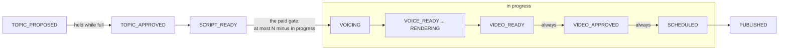

# Publishing

An approved video can be published to YouTube, Instagram, TikTok and Facebook — now, or at a time
you schedule — and its views, likes, comments and shares are read back onto the Analytics page.
With [Auto Pilot](#auto-pilot), Tubematic can also approve and post a project's videos with nobody
at the controls.

Tubematic does **not** hold your social logins. It goes through [postforme.dev](https://postforme.dev),
a service that owns the connections to each platform: you connect your accounts there, through
Tubematic's Socials page, and Tubematic refers to them by id.

Publishing is **off by default** (`publishing_enabled`). With it off, `VIDEO_APPROVED` is the end of
the line: you download the mp4 and post it yourself, and nothing on this page applies.

How it works inside — the postforme client, the routes, the worker's passes and the design decisions
behind them — is on [Publishing internals](../developer/14-publishing.md).

---

## The agent never publishes

No tool the AI agent has can publish, schedule or approve a post, and a video waiting at
`VIDEO_APPROVED` never wakes the agent. A post is started in one of two places only: by you, in the
Publish dialog, or — for a project you have put on [Auto Pilot](#auto-pilot) — by the render worker.
Auto Pilot changes nothing about what the agent can do. See
[why this is structural](../developer/14-publishing.md#the-agent-never-publishes-and-that-is-structural).

---

## Setting up

1. **Turn publishing on.** The install wizard asks *"Enable publishing to social platforms?"*, and
   asks for the postforme key only if you say yes. You can also turn it on later on **Settings →
   Publishing**.
2. **Add your postforme key** — at that prompt, or on **Settings → API Keys** (`postforme_api_key`).
   It is found on your postforme.dev dashboard. The install wizard checks it with postforme and
   refuses a key postforme rejects.
   This is the most powerful credential in the install: it can post to every social account
   connected to that postforme project.
3. **Connect your accounts** on the **Socials** page, then tick the ones Tubematic may use. See
   below.

### Connecting accounts

The Socials page has a **Connect** button for each platform (YouTube, Instagram, TikTok, Facebook).

1. Press **Connect** for the platform. A new tab opens on that platform's consent screen, through
   postforme.
2. Approve the connection. The flow ends on postforme.dev's own page — postforme offers no way to
   send you back automatically.
3. Come back to the dashboard and press **Refresh accounts list**.
4. **Tick the account.** A new account arrives unticked: the Socials list is an allowlist, and
   Tubematic publishes only to ticked accounts.

If your browser blocks the new tab, the page shows the link to open instead. If the platform is not
enabled on your postforme project, the page shows postforme's own message, which says to enable it in
postforme's Project Setup.

Accounts you connected directly on postforme.dev appear on the Socials page in exactly the same way.

**Analytics need a second permission, and the Connect button always asks for it.** postforme grants
*posting* and *reading the account's feed* (`feeds`) separately, and asks for posting only unless
told otherwise. Without `feeds`, an account publishes perfectly but never reports a single view.
The Connect button always requests both. An account connected directly on postforme.dev gets
whatever was chosen there — by default, posting alone.

**A missing feed permission does not announce itself.** On Instagram the posts are still listed, and
every figure on the Analytics page shows `—`, indefinitely. The `NO ANALYTICS` badge on the Socials
page cannot catch this case, because nothing is rejected. If an account's figures stay `—` long
after its posts went out, **reconnect it with the Connect button**. Reconnecting keeps the account's
id, so it stays ticked, keeps its Auto Pilot settings, and its past posts keep their name on the
Analytics page — nothing needs redoing. Why the badge cannot tell is on
[Publishing internals](../developer/14-publishing.md#connecting-accounts).

Instagram insights also exist only on **Business and Creator** accounts. A Personal account reports
nothing however it is connected.

`NOT CONNECTED` on the Socials page marks a ticked account that postforme no longer has. Untick it
to clear it.

---

## Publishing a video

Open a `VIDEO_APPROVED` video — on the Pipeline board, the Library or a project — and press
**Publish…**. The dialog opens on:

- **Accounts:** every ticked account, grouped by platform. **Nothing is pre-ticked** — every
  target is your explicit choice, because a post cannot be taken back.
- **Title and description:** the ones the agent wrote alongside the script. A video scripted before
  that existed opens on its own title and topic instead. Edit either freely.
- **Privacy**, per platform, where the platform offers one — see [Platforms](#platforms).
- **When:** **Publish now** (the default, every time the dialog opens) or **Schedule** — see
  [Scheduling a post](#scheduling-a-post).

Publishing uploads the mp4 while you wait — about 50 seconds for a 150 MB file — and then hands the
post to postforme.

### What the statuses mean

| Status | What it means for you |
|---|---|
| `PUBLISHING` | The video was uploaded and the post created; Tubematic is waiting for each platform to report back. It checks every twenty seconds |
| `SCHEDULED` | The post is uploaded and waiting at postforme for its time — see [Scheduling a post](#scheduling-a-post) |
| `PUBLISHED` | **At least one** account published it. If some accounts failed, their errors are on the video's **Publishing Results** tab |
| `FAILED` | **Every** account failed, or none reported success within an hour |

A video live on two of four accounts reads `PUBLISHED`, because it genuinely is published and none of
these platforms can un-publish it. The failures are recorded per account rather than hidden. See
[the design decisions](../developer/14-publishing.md#design-decisions-that-will-look-wrong-later).

The **Publishing Results** tab of a video shows each target: its platform, status, the live post's
URL, and the reason for a failure. How a post is *performing* is on the **Analytics** page.

### When publishing goes wrong

- **The upload fails.** Nothing was posted. The video goes back to `VIDEO_APPROVED` with a comment,
  and you can publish it again.
- **The upload worked, but creating the post failed in a way that may have succeeded anyway** — a
  timeout or a server error from postforme. The video stays at `PUBLISHING` and the comment tells
  you **not to retry**. Tubematic looks the post up itself on its next pass: if it went out, the
  video settles normally; if not, it fails after an hour.
- **A `FAILED` video offers Retry publishing.** It checks postforme first. If a live post exists
  after all, the video moves back to `PUBLISHING` and settles with no second post. If nothing is
  live, the video goes back to `VIDEO_APPROVED`, each account's error is kept in a comment, and the
  Publish dialog opens. Pick the accounts and privacy again; they are not stored.

### Analytics

Once a video is published, the render worker reads each account's figures hourly; **Refresh metrics**
on the Analytics page reads them at once. The figures are kept as a history, so they survive the
[retention sweep](05-settings.md#video-retention) that deletes a published video's files: an
archived video still shows its numbers. A figure a platform did not report shows `—`, never `0`.

---

## Scheduling a post

Choose **Schedule** in the Publish dialog, then a timezone (your browser's, unless you pick another),
a date and a time — or one of the presets *In 1 hour*, *Tomorrow 9:00* and *Tomorrow 18:00*, which
are worked out in the zone you picked. postforme holds the post and sends it at that time.

- **The time must be at least 5 minutes and at most 365 days away.** The 5 minutes leave you a real
  window to cancel in.
- **The upload happens when you click**, not at the scheduled time. The video then waits in the
  **Scheduled** column; its card shows when it goes out, in the zone you picked it in.
- **Daylight-saving gaps are refused, not shifted.** A wall time the clocks skip does not exist, so
  it is refused rather than quietly moved by an hour. A time that occurs twice (when the clocks go
  back) means the first occurrence, or the second if the first is already too soon.
- **A post can go out a couple of minutes late.** postforme checks for due posts about every two
  minutes.
- **To cancel**, open the video and press **Cancel schedule**. The post is deleted at postforme and
  the video goes back to `VIDEO_APPROVED`. Once postforme has started sending it, it can no longer be
  cancelled.
- **There is no reschedule.** To change the time, cancel and schedule again, which uploads the video
  again. postforme's only way to edit a post can send it immediately, so Tubematic does not use it —
  see [why](../developer/14-publishing.md#scheduling-a-post).
- **A scheduled video cannot be deleted.** postforme would still send the post. Cancel it first.

---

## Auto Pilot

Auto Pilot runs selected projects with nobody at the controls: it approves the topic, the script
and the finished video, then posts the video. It is **off by default**, and switching it on does
nothing until a project is selected on **Settings → Auto Pilot**. A project that is not selected
behaves exactly as described everywhere else in these docs.

> **Read this before turning it on.**
>
> - Auto Pilot approves topics, scripts and finished videos with no human review.
> - It spends money on every topic research files: ElevenLabs credits, image generation and agent
>   sessions. The pending-proposal cap no longer holds anything back, so only the research caps
>   and the in-progress limit bound how many videos are made.
> - It posts publicly to real accounts, including videos the AI review flagged, could not check, or
>   never ran on.
> - A published post cannot be taken back by Tubematic.

The second point deserves spelling out. `research_pending_cap` stops research once that many
topics are waiting for a decision. Under Auto Pilot nothing waits, so the cap never fills, and the
number of videos made per day is bounded only by `max_research_runs_per_day` times the per-run
caps. Set those to what you are prepared to pay for. See [Settings](05-settings.md#research). The
[in-progress limit](#the-in-progress-limit) is the other brake: it bounds how many videos Auto Pilot
pays to produce ahead of posting them, whatever research files.

The third follows from how the AI review works: it lets a video through when the review itself
fails, a disabled review sends every render straight to `VIDEO_READY`, and a video that has used up
its review rounds is passed on with its findings still open. Auto Pilot approves whatever reaches
`VIDEO_READY`. See [Rendering and Review](../developer/11-rendering-and-review.md).

### What is configured

Everything is on the one tab, and it is saved as one document:

| Setting | Meaning |
|---|---|
| **Auto Pilot** on / off | `auto_pilot_enabled`. Off stops all of it, and keeps the rest of the configuration |
| **Gap between publishes** | `auto_pilot_gap_mins`, entered in minutes or hours. The shortest time between two posts on the same account |
| **Most videos in progress** | `auto_pilot_max_in_flight`. How many videos may be between voicing and publishing before Auto Pilot stops voicing new scripts and approving topics. It keeps approving finished videos and scheduling them. **0** (the default) means no limit. See [the in-progress limit](#the-in-progress-limit) |
| **Projects** | Which projects are on Auto Pilot. Each selected project has its own list of accounts to post to, chosen from the accounts ticked on the Socials page |
| **Auto post per day**, per account | How many posts an account takes in one day. An account you have not set posts **1** a day. **0** means Auto Pilot never posts to it |

Turning Auto Pilot on, or adding a project while it is on, asks for confirmation first and says how
many videos are waiting at a checkpoint in those projects, because they are approved as soon as the
change is saved.

### How approval works

Every twenty seconds the render worker looks for videos of the selected projects at `TOPIC_PROPOSED`,
`SCRIPT_READY` and `VIDEO_READY` and approves each one exactly as the dashboard would, with a comment
saying Auto Pilot did it and that no human reviewed it. If you act on a video first, your decision
wins. It is the worker that does this, never the agent, so the agent's rule that it never crosses a
checkpoint stays whole — see [why](../developer/14-publishing.md#auto-pilot).

- **Two approvals the dashboard would refuse are not made.** A topic whose visual style is
  `illustrated` on an install with no OpenAI key, and a script that its voice's model cannot speak.
  Approving either would send the video on to fail after money was spent. The video stays at its
  checkpoint with one comment explaining why, and is approved once you fix the cause.
- **Pausing the pipeline pauses Auto Pilot.** Pause is the switch you reach for to stop spend, and
  approving a script spends. Nothing is approved and nothing is posted while paused. You can still
  approve by hand.
- **An approval can wait behind a render.** The worker renders one video at a time, so a video that
  reaches a checkpoint while another is rendering is approved when that render ends.
- **No checkpoint notification is sent** for a video Auto Pilot approves: by the time notifications
  are sent, the video has already moved on.

### How posting works

For a `VIDEO_APPROVED` video in a selected project, Auto Pilot picks a time and starts the post.

- **One post per video, to all of its project's accounts at once**, through the same publish a
  human makes. A post for later becomes a [scheduled post](#scheduling-a-post), which you can still
  cancel.
- **An account is used only if it is still usable**: chosen for the project, still ticked on the
  Socials page, still connected at postforme, and with a daily number above 0. These are checked at
  posting time, because any of them can change after you saved the configuration. If no account is
  left, or publishing is off, the video waits at `VIDEO_APPROVED` for you.
- **Always public.** There is no privacy setting for Auto Pilot.
- **The title and description** are the ones the agent wrote with the script, or the video's title
  and topic for a video that has none.
- **Posts start one at a time.** The worker uploads Auto Pilot's posts itself, which takes about a
  minute each, so it starts at most one per pass.

**The time is the earliest moment that is free for every account of the post.** A moment is free for
an account when:

1. none of the account's posts is closer than the gap, **before or after** it, and
2. the account has fewer posts than its daily number on that day, in the host's timezone.

If that moment is now, the video is posted immediately; otherwise it is scheduled.

Every post that has not failed counts, whoever started it. So a post you publish or schedule by hand
uses up the gap and the daily number too, and a failed post uses up neither. The gap is checked in
both directions because a post you scheduled for later is already on the calendar; posting an hour
before it breaks the gap just as posting an hour after it would.

Two consequences:

- **A full day sends the next post to midnight.** With a short gap and one post a day, every post
  after the first goes out at 00:00 local time. Set the gap to 24 hours divided by the daily number
  and posts keep a steady time of day instead.
- **The busiest account sets the pace** for a project that posts to several, because the post goes
  to all of them at one time.

### The in-progress limit

With **Most videos in progress** set to N, Auto Pilot stops **starting** videos once N are in
progress, and starts one again each time one publishes. It does not wait for the count to fall to
zero, and it never stops **finishing** them.

- **Only the paid step is held back.** Money is spent from the moment a script is approved for
  voicing: ElevenLabs charges per character, and rendering and AI review follow. So that is the
  approval the limit budgets, one video per free slot. Topic approvals stop while the limit is full
  too, because each one starts an agent scripting session that also costs money; they all resume once
  there is room.
- **Finished videos always move.** Approving a finished video and scheduling it never wait for the
  limit, because scheduling is what drains it.
- **It cannot overshoot.** A video enters the count only by passing the gate, and the gate is
  budgeted against the count.

**What counts:**

- **Every video in an Auto Pilot project that has been voiced and has not yet published or failed.**
  A video sent back for revision keeps its place in the count, and does not need a second slot to be
  voiced again. Videos in projects that are not on Auto Pilot never count.
- **Every post waiting to go out at a future time, across the whole install** — including posts you
  schedule by hand, because they share the accounts' calendar. So scheduling a week of posts by
  hand can hold Auto Pilot back.

A video counts once, however many accounts it posts to. Archived videos and videos you have taken off
Auto Pilot (see [Stopping one video](#stopping-one-video)) never count, nor do rows stuck in a state
that does not clear by itself. The exact rules and why each exists are on
[Publishing internals](../developer/14-publishing.md#the-in-progress-limit).

**Size it in days of posting, not in posts.** The count covers every video between voicing and
publishing, so N is roughly how many days of posts are buffered, times the posts per day. At 5 posts
a day, N = 5 is a single day of cover. Any render retry, revision round or slow agent run then
empties the queue and misses a post. 15 to 25 (three to five days) is a sane start.

The Auto Pilot tab shows the count, for example *"3 of 20 videos in progress."* When the limit is
full it says why nothing new is starting: *"Paused — 20 of 20 videos in progress…"*. The tab
re-reads the count every 20 seconds while it is open.

### Stopping one video

**Cancelling a scheduled post takes the video off Auto Pilot's posting for good.** Otherwise it
would return to `VIDEO_APPROVED` and be scheduled again twenty seconds later, so a cancel could never
stick. Publish it by hand when you want it out; nothing in the dashboard puts it back on Auto Pilot.

**Retry publishing is not a hold.** A video that failed on every account and is sent back to
`VIDEO_APPROVED` by Retry publishing is posted again by Auto Pilot.

### When a post cannot be started

A failed upload returns the video to `VIDEO_APPROVED`. Rather than trying again twenty seconds later
and commenting each time, Auto Pilot waits 15 minutes after the first failure on a video, an hour
after the second and six hours after each one after that. Restarting the render container resets
that wait, so it tries once more straight away. A video that cannot be published at all, such as one
with no rendered file, gets one comment saying so. If postforme cannot be reached, Auto Pilot simply
tries again later, without commenting.

---

## Platforms

| Platform | What is sent | Privacy |
|---|---|---|
| YouTube | Title, description, and the AI-generated-content disclosure | public · unlisted · private |
| TikTok | Title, caption, and the AI-generated-content disclosure | public · private |
| Instagram | Caption, posted as a Reel | none — a Reel is public or not posted |
| Facebook | Caption, posted as a Reel | none |

- **The AI-content disclosure is always set** on YouTube and TikTok. It is platform policy, not a
  preference, so there is no switch for it.
- **YouTube has no Shorts option.** YouTube decides from the file: vertical *and* at most three
  minutes long. Renders are always vertical, so only the length matters; the Publish dialog warns
  that a longer video will post as a regular video, not a Short. Nothing stops you posting it.
- postforme supports more platforms than these four. An account on another one can be ticked and
  posted to, but gets no platform-specific settings.
