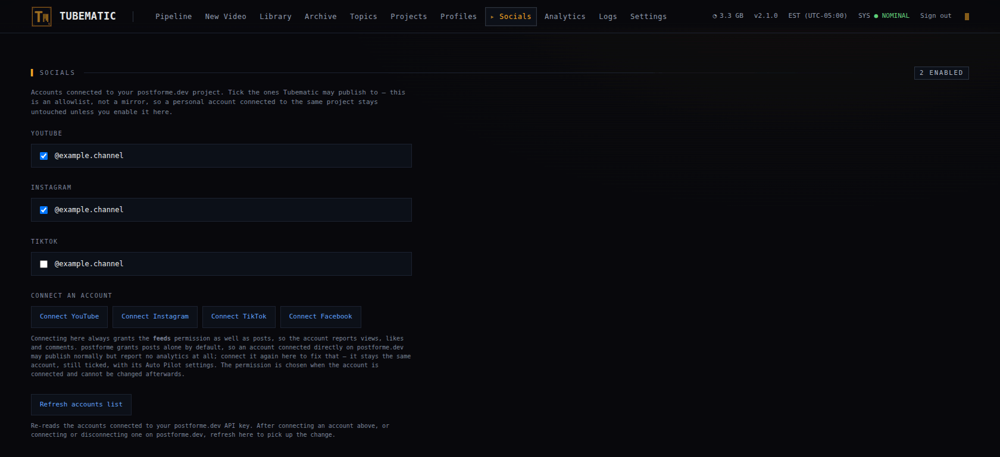
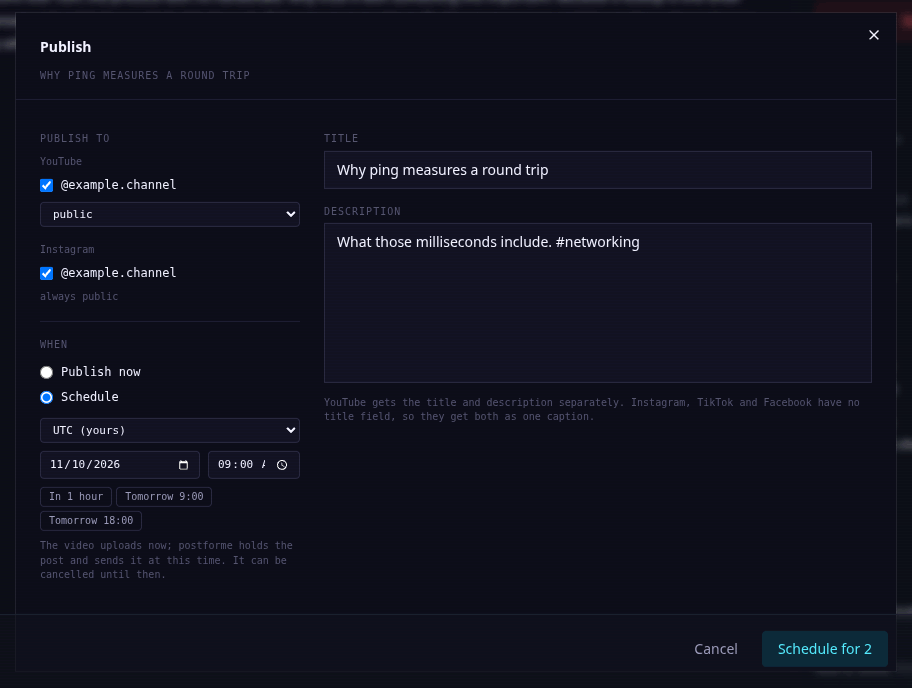
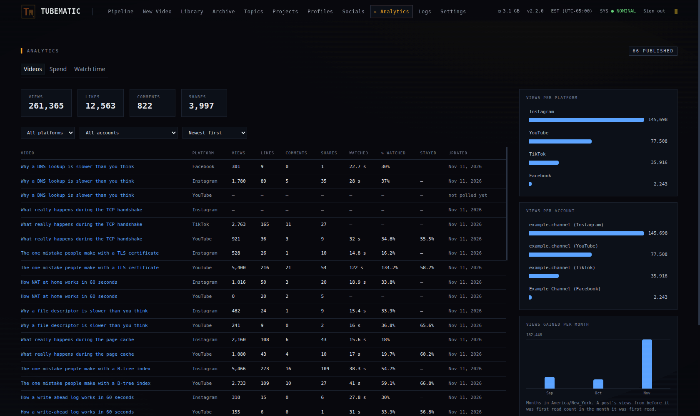
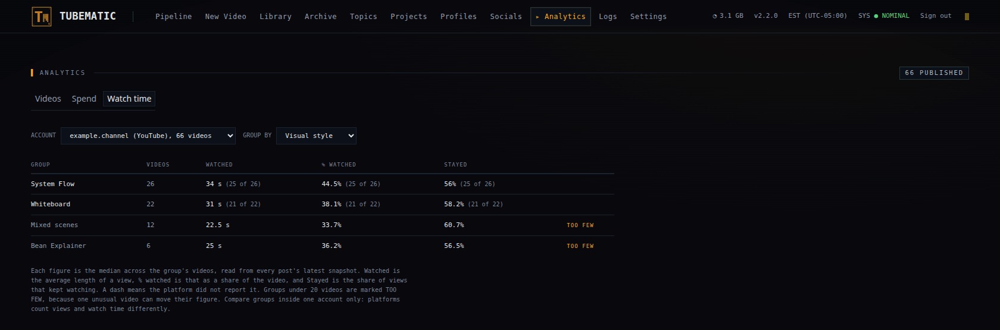

# Publishing

You can post an approved video to YouTube, Instagram, TikTok and Facebook from the dashboard, now or
at a time you choose. Tubematic then reads the views, likes, comments and shares back onto the
**Analytics** page.

Publishing is off by default. With it off, you take the mp4 of an approved video and post it
yourself, and this page does not apply.

Tubematic posts through [postforme.dev](https://postforme.dev), a service that holds the connections
to your social accounts. Tubematic does not store your social logins.

Only you start a post, in the Publish dialog. The agent has no way to publish. The one exception is
[Auto Pilot](14-auto-pilot.md), which you turn on per domain.

---

## Setting up

1. Create an account and a project at postforme.dev, and enable each platform you want to post to in
   the project's setup there.
2. Copy the project's API key and enter it on **Settings → API Keys**, under **postforme.dev**.
3. Turn **Publishing** on, on **Settings → Publishing**.
4. Connect your accounts on the **Socials** page, as described below.

The install wizard does steps 2 and 3 for you if you answer yes to "Enable publishing to social
platforms?".

The postforme key can post to every account connected to that postforme project. Keep it private,
and connect only accounts you want Tubematic to reach.

### Connecting accounts

On the **Socials** page:

1. Press **Connect YouTube**, **Connect Instagram**, **Connect TikTok** or **Connect Facebook**. The
   platform's consent page opens in a new tab.
2. Approve the connection. The flow ends on a postforme.dev page.
3. Go back to the dashboard and press **Refresh accounts list**.
4. Tick the account. A new account arrives unticked, and Tubematic posts only to ticked accounts.
   The tick saves at once, and **✓ Saved** shows beside the account.

If your browser blocks the new tab, the page shows a link to open instead. If the platform is not
enabled in your postforme project, the page shows postforme's message saying so.

Accounts you connected on postforme.dev itself appear in the same list.

### If an account shows no views

postforme grants two permissions separately: posting, and reading the account's figures. The
**Connect** buttons ask for both. An account connected on postforme.dev itself gets posting only,
unless you chose otherwise there.

An account without the second permission posts normally and reports no views, likes or comments.
Its figures on the **Analytics** page stay as dashes. Some accounts in this state show a
**NO ANALYTICS** badge on the **Socials** page, and some show nothing.

To fix it, connect the account again with its **Connect** button. It stays the same account, stays
ticked, and keeps its Auto Pilot settings.

Instagram reports figures only for Business and Creator accounts.

A **NOT CONNECTED** badge marks a ticked account that postforme does not have any more. Untick it.

---

## Publishing a video

Open a video at Video Approved and press **Publish…**. In the dialog:

1. Under **Publish to**, tick the accounts. Nothing is ticked for you, because a post cannot be
   taken back.
2. Check the **Title** and **Description**. The agent wrote them with the script, and you can edit
   them. YouTube gets them separately. The other platforms get both as one caption.
3. Choose the privacy for YouTube and TikTok. Instagram and Facebook posts are public.
4. Under **When**, keep **Publish now** or choose **Schedule**.
5. Press **Publish to N**.

Tubematic uploads the mp4 while the dialog is open, about 50 seconds for a 150 MB file, and then
hands the post to postforme.

A video longer than three minutes posts to YouTube as a regular video. YouTube decides what is a
Short from the file. The dialog warns you when this applies.

### After you publish

| Status | Meaning |
|---|---|
| Publishing | The post is created. Tubematic checks every 20 seconds for each platform's answer |
| Scheduled | The post is uploaded and waiting for its time |
| Published | Every account has the post, or you marked a partial publish as published |
| Partially Published | Some accounts have the post and some failed. It waits for you |
| Failed | Every account failed, or none succeeded within an hour |

The **Publishing Results** tab in the video's window lists each account with its status, the link to
the post, and the reason for any failure.

### When a publish partly fails

A video that reached some accounts and failed on others becomes Partially Published. A platform
cannot take a post back, so the video is not Failed, and it is not finished either. It sits in the
Published column with a **PARTIAL** tag, and under **Partially published** in the Library.

1. Open the video and press **Mark as published…**.
2. Press **Download video** in that dialog to save the mp4.
3. Post the video to the failed accounts yourself.
4. Press **Mark as published**.

Download the video before you confirm. Tubematic keeps a Partially Published video's files. Once you
mark it Published, the retention setting applies, counted from the first post. For a post older than
your retention period, the file is deleted within a minute.

To hear about a partial publish when it happens, turn on **A publish partly fails** on
**Settings → Notifications**.

## Scheduling a post

Choose **Schedule** in the Publish dialog, then a timezone, a date and a time. The timezone starts
as your browser's. The buttons **In 1 hour**, **Tomorrow 9:00** and **Tomorrow 18:00** fill the date
and time for you.

- The time must be between 5 minutes and 365 days from now.
- Tubematic uploads the video when you press **Schedule for N**. postforme holds the post and sends
  it at the time you set. A post can go out a couple of minutes late.
- The video waits in the **Scheduled** column, and its card shows when it goes out.
- A time that the clocks skip for daylight saving is refused. Pick another.

To cancel, open the video and press **Cancel schedule**. The video returns to Video Approved. You
cannot cancel once postforme has started sending the post.

To change the time, cancel and schedule again. This uploads the video again.

You cannot delete a scheduled video. Cancel its post first.

## When publishing goes wrong

| What happened | What Tubematic does | What you do |
|---|---|---|
| The upload failed | Returns the video to Video Approved with a comment. Nothing was posted | Publish again |
| The upload worked, and postforme did not confirm the post | Keeps the video at Publishing, with a comment telling you not to retry. It looks the post up itself | Wait. The video becomes Published if the post went out, or Failed after an hour |
| Every account failed | Marks the video Failed | Press **Retry publishing** |

**Retry publishing** first asks postforme whether a post went out after all. If one did, the video
becomes Published and nothing is posted twice. If none did, the video returns to Video Approved and
the Publish dialog opens. Pick the accounts and privacy again.

## Analytics

Tubematic reads each published post's figures once an hour. **Refresh metrics** on the
**Analytics** page reads them now.

A figure the platform did not report shows as a dash. Figures are kept after a video's files are
deleted, so an archived video still shows its numbers.

### Watch figures

The **Videos** tab shows three watch figures beside the counts. You can sort the list by each of
them.

| Figure | Meaning |
|---|---|
| **Watched** | The average length of a view, in seconds |
| **% watched** | That length as a share of the video. A video that loops can pass 100% |
| **Stayed** | The share of views in which the viewer kept watching |

The **Publishing Results** tab in a video's window shows the same figures for each post, with its
reach and saves, and says "not reported" where the platform gave none.

Each platform reports its own set:

| Platform | Watched | % watched | Stayed | Reach | Saves |
|---|---|---|---|---|---|
| YouTube | Yes | Yes | Yes | No | No |
| Instagram | Yes | Yes, when Tubematic knows the video's length | No | Yes | Yes |
| Facebook | Yes | Yes | No | Yes | No |
| TikTok | No | No | No | No | No |

Instagram reports seconds only, so Tubematic divides them by the video's length. It stores that
length while the video's files exist. An Instagram post of a video whose files were deleted before
its length was stored shows a dash under **% watched**.

postforme states that Instagram can take up to 48 hours to report some figures of a new post.

### Comparing groups of videos

The **Watch time** tab groups one account's posts and shows the three figures for each group.

1. Choose the account. The tab opens on the account with the most posts.
2. Choose **Group by**: visual style, script profile, domain, script length, formula or opening.
   Script length is the script's word count, in bands of 50 words. Formula is the
   [script formula](03-using-tubematic.md#script-formulas) the agent chose, and opening is the kind
   of opening the script starts with, such as a question or a scene.

How to read the table:

- Each figure is the median of the group's videos, so one video with an unusual audience does not
  set it.
- **Videos** is the number of posts in the group. A figure that only some of them report says how
  many, for example `25% (30 of 40)`. It adds `too few` when fewer than 20 report it.
- A group with fewer than 20 videos is marked `TOO FEW`. One unusual video can move its figure, so
  treat it as a hint.
- **Not recorded** holds the videos whose script has no formula or opening on record.
- Compare groups inside one account. Platforms count views and watch time differently, and every
  account has its own audience.

## Platforms

| Platform | What is posted | Privacy choices |
|---|---|---|
| YouTube | Title and description | public, unlisted, private |
| TikTok | Title and description as one caption | public, private |
| Instagram | Title and description as one caption, as a Reel | Public only |
| Facebook | Title and description as one caption, as a Reel | Public only |

Tubematic marks every YouTube and TikTok post as AI-generated content, as those platforms require.
You cannot turn this off.

postforme supports other platforms too. You can tick an account on one of them and post to it, with
no privacy choice.

How publishing is built is in [Publishing internals](../developer/14-publishing.md).
