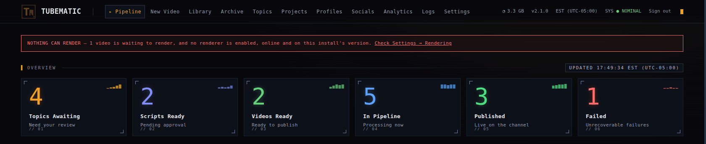
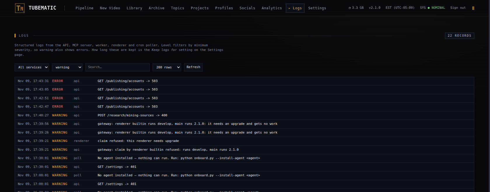

# Troubleshooting

Find your symptom below. Run commands from the install directory.

| Where the problem shows | Go to |
|---|---|
| No video is moving | [Nothing is happening](#nothing-is-happening) |
| No topics arrive | [No new topics](#no-new-topics) |
| A card says STUCK, or a video is Failed | [A video is stuck or failed](#a-video-is-stuck-or-failed) |
| Rendering | [Renders](#renders) |
| Voice, images or AI review | [Voice](#voice), [Images](#images), [AI review](#ai-review) |
| The dashboard itself | [The dashboard](#the-dashboard) |
| The agent | [The agent](#the-agent) |
| Posting and view counts | [Publishing](#publishing) |
| Discord messages | [Notifications](#notifications) |
| Disk space, or a missing video | [Disk and data](#disk-and-data) |

To find out what happened to one video, see [Finding out what happened](#finding-out-what-happened).
To report a bug, see [Reporting a bug](#reporting-a-bug).

---

## Nothing is happening

Check these in order.

1. Open the **Pipeline** page. A video under **Quick Actions** is waiting for you. This is the usual
   cause.
2. Check the pause switch at the top of **Settings**. It should read "Running".
3. Run `python3 scripts/service.py status`. Each line should start with `✔`.
4. Read the end of `~/.tubematic-agent/logs/poll.log`.

| `poll.log` or `status` says | Meaning | Fix |
|---|---|---|
| `No agent installed` | Tubematic has no agent to run | `python3 onboard.py --install-agent <agent>` |
| `No Tubematic cron entry` | The scheduled job is missing | `python3 onboard.py --step cron` |
| `Cannot call the API without its token` | A service token file is missing | `python3 onboard.py --step auth` |
| A video "is assigned to agent …, which is uninstalled" | That video waits for its agent | Install the agent again, or pick another agent on the video |
| `Agent rejected model` | The model stopped working for that CLI or account. The session ran with the CLI's default | `python3 onboard.py --install-agent <agent>` to check the models again |
| `Session passed agent_session_timeout_secs` | A session ran too long and was stopped | Raise **Session timeout** on **Settings → Scheduling** |
| `Already running` | An earlier run is still working | Nothing |
| "A supervisor holds the poll lock but has not touched …" | The scheduled job has hung | Find it with `ps -ef \| grep poll.py` and stop it once its sessions finish |

## No new topics

Research runs only when all of these hold:

- At least one research mode is on, on the **Topics** page. Mining counts only while a Gemini key
  is stored.
- Fewer topics are waiting for you than **Research pending cap**.
- Fewer research runs happened in the last 24 hours than **Max research runs per day**.
  **Settings → Scheduling** shows the count.

A paused domain and a domain marked **EXPIRED** receive no topics. Resume the domain, or raise its
topic cap, on the **Topics** page.

A research run can also end with fewer topics than its limit. Research leaves out a subject that
scores under 5, that repeats a topic the domain already has, or that offers no
[angle](03-using-tubematic.md#the-angle). The agent's summary at the end of the run names each
subject it left out and why. Read it on the **Logs** page.

## A video is stuck or failed

### A card says STUCK

Three agent sessions in a row left the video where they found it, so Tubematic stopped trying. Open
the video and read its **Comments** tab, which says what the sessions did. Fix the cause, then press
**Retry agent**.

### A video is Failed

Open the video and read its **Comments** tab. The last comment gives the reason.

- A render that fails more times than **Max render retries** allows marks the video Failed. With
  the default of 1, the second failure does it. Restarting the renderer during a render counts as
  one failure. The first time a video's render times out inside the browser, which happens on a
  machine short of memory, it is tried again as it is and does not count.
- A post that failed on every account marks the video Failed. See [Publishing](#publishing).

A video that failed while rendering cannot be retried. Create it again.

---

## Renders

### NOTHING CAN RENDER



The **Pipeline** page shows this banner when videos are waiting to render and no renderer can take
them. Open **Settings → Rendering** and look at each renderer's status:

- **disabled**: press **Enable**.
- **offline**: for the built-in renderer, run `python3 scripts/service.py start tubematic-renderer`.
  For a renderer on another machine, see
  [Remote Renderers](11-remote-renderers.md#troubleshooting).
- **needs upgrade**: upgrade that renderer.

### The renderer is running and renders nothing

Read its log with `python3 scripts/service.py logs tubematic-renderer`.

| The log says | Meaning | Fix |
|---|---|---|
| `heartbeat failed` or `claim failed`, every 30 seconds | The renderer cannot reach the API's render gateway | Run `python3 scripts/service.py logs tubematic-api` and look for "render gateway not started". See the next table |
| `heartbeat answered 401 unauthorized` | The renderer and the API hold different tokens | `python3 scripts/service.py restart` |
| A TLS certificate error | The renderer and the API hold different certificates | `python3 scripts/service.py restart` |
| `this renderer needs upgrade` | The renderer runs another version | `python3 scripts/service.py restart tubematic-renderer` |
| `short of disk space` | Less than 2 GB would be left after saving the video | Free disk space. The attempt counts as one failed render |

If the API's log says "render gateway not started":

| It adds | Fix |
|---|---|
| its TLS key or certificate is missing | Run `python3 scripts/service.py start`, which creates a new pair, then `python3 scripts/service.py restart` |
| its TLS key and certificate cannot be used as a pair | Restore both files in `~/.tubematic-data/secrets/` from one backup. Or delete both and do as in the row above |
| it cannot listen on port 4443 | Another program uses that port. Stop it, then `python3 scripts/service.py restart tubematic-api` |

A new key and certificate cut off every renderer on another machine. Add each one again with a new
token. See [Remote Renderers](11-remote-renderers.md#adding-a-renderer).

A renderer that logs `first heartbeat accepted` and then stays quiet has nothing it may take. A
video that needs a GPU waits for a renderer whose GPU test passed.

### A video goes back and forth between waiting and rendering

Tubematic is stopping the render and trying again. The video's comment says which limit it hit.

- No progress for the **Render stall timeout**: the browser that draws the frames hung.
- The **Render timeout**: the render was advancing too slowly. Raise it on
  **Settings → Rendering**.

### A Cartoon 3D or mascot video failed with "renders on the GPU only"

These videos render on a GPU only. If the GPU stops working after you approve the topic, the video
fails. Fix the GPU, using **Test GPU** on the renderer's card under **Settings → Rendering**, then
create the video again. See [GPU Rendering](10-gpu-rendering.md#troubleshooting).

### Renders are slow on a machine with an NVIDIA GPU

Open **Settings → Rendering** and read the built-in renderer's **GPU** line. A red reason means the
renderer could not use the GPU you chose. "None" means no GPU is chosen, or the renderer was started
without it. `python3 scripts/service.py status` says which. See
[GPU Rendering](10-gpu-rendering.md#troubleshooting).

### A scene is a blank dark rectangle

The scene's code failed to load, and the renderer left it out. Request a revision on the video and
say which part is blank.

---

## Voice

### "No default voice set"

The voice list is empty, or its default voice was removed. Pick a default on **Settings → Voice**.

### A voice is greyed out, or "This script can't be voiced with that voice"

The script uses pronunciation or pause markup that the voice's model does not accept. This also
happens when you change a voice's model after its script was written.

Keep a voice that can speak the script, or press **Revise** and name the voice you want. The agent
rewrites the script for it. Nothing is charged for a refused approval.

The same applies to a segment's own voice on the **Script** tab: a voice that cannot speak that
segment's markup is greyed out, and approval is refused when a segment's voice had its model changed
since the script was written. Give the segment another voice, or request a revision.

### "Ignores speed"

You set a speed on a voice whose model is `eleven_v3` or `eleven_v4`. Those models ignore speed, so
Tubematic refuses it. Keep the speed at 1.00x, or move the voice to a model that honours speed (see
[Voice](05-settings.md#voice)).

### A video is stuck in Voicing

Tubematic adds a "Stuck in VOICING" comment when a video has waited in Voicing for three poll
intervals. If a Discord webhook is set, it sends an alert as well. The usual causes:

- The voiceover call fails, for example because the ElevenLabs key is missing or out of credits. The
  agent's comment on the video gives the error.
- The scheduled job is not running. See [Nothing is happening](#nothing-is-happening).
- The agent's skills are out of date. See [The agent has stale skills](#the-agent-has-stale-skills).

Once you fix the cause, the next scheduled run voices the video. If the video is also marked STUCK,
press **Retry agent**.

## Images

### Every scene image fails

Check the OpenAI key on **Settings → API Keys**. An error that names a project and a model means
that the key's OpenAI project has no access to that model. Use a key from a project that has
access, or choose the other model on **Settings → Images**.

Act on the first failure. Each retry is a paid agent session that fails the same way, until the
video is marked STUCK.

## AI review

### Every video passes

The review may be failing without saying so. When the review cannot run, the video comes to you as
if it had passed. Look in the video's comments for "AI review did not run".

### A video keeps coming back with small suggestions

Any finding sends the video back to the agent. **Max review rounds** on **Settings → AI Review**
limits how often.

### Gemini answers 429

Filter the **Logs** page to errors and read Gemini's reply.

- `limit: 0` means your Google project has no quota for that model. Waiting does not help. Choose a
  model your project has quota for, on **Settings → AI Review**.
- "Your prepayment credits are depleted" means the balance is zero. Add credit.

A Gemini chat subscription does not include API access.

---

## The dashboard

| Symptom | Meaning | Fix |
|---|---|---|
| You forgot the password | | `python3 onboard.py --set-password` |
| "Too many failed attempts" | Five wrong passwords in a row | Wait up to 15 minutes, or run `python3 scripts/service.py restart tubematic-api` |
| "Upstream unreachable" | The dashboard cannot reach the API | `python3 scripts/service.py status` |
| "The API refused the dashboard's token" | The two hold different tokens | `python3 scripts/service.py restart` |
| A "Status conflict" message | The video moved after the page last refreshed | Refresh the page |
| A video does not play | The file is missing, or your session ended | Sign in again. If it still fails, the video may be archived: see [Disk and data](#disk-and-data) |
| Times look wrong | The dashboard shows the timezone of the machine it runs on | See [Times](04-dashboard.md#times) |
| An approval says an agent "is uninstalled" | The video's agent was uninstalled | Reload the page and pick another agent, or install that agent again |

### Remote access

[Remote Access](09-remote-access.md) covers the setup.

| Symptom | Fix |
|---|---|
| The login page loads over plain HTTP from another machine | Your password crosses the network unencrypted. Set up Twingate or an HTTPS proxy |
| Behind an HTTPS proxy, the session cookie is not marked Secure | The proxy does not send `X-Forwarded-Proto: https`. See [nginx](09-remote-access.md#nginx) |
| Saves fail with `403 cross-site request refused` | Open the dashboard at the proxy's own address, outside any frame |
| The browser warns about the certificate, with Caddy's `tls internal` | Install Caddy's root certificate on that device. See [On a private network](09-remote-access.md#on-a-private-network) |
| Twingate connects and the dashboard does not load | See [Twingate](09-remote-access.md#twingate) |

---

## The agent

### The agent has no Tubematic tools

In an agent session you opened yourself:

1. Run `/tubematic-register-mcp`, then restart the session. An agent reads its tools once, when a
   session starts.
2. If the agent reports a 401, or OpenCode says "needs authentication", run
   `python3 onboard.py --install-agent <agent>`.
3. If registering fails, the tool server is not running. Check it:

   ```bash
   python3 scripts/service.py status
   python3 scripts/service.py logs tubematic-mcp
   ```

`python3 upgrade.py --check` reports which agents have a working registration.

### The agent has stale skills

The agent uses the copy of Tubematic's skills made when you installed it. After an upgrade, or
after you edit a skill file, copy them again:

```bash
python3 onboard.py --install-agent claude     # or: codex, opencode
```

Do this for each installed agent, then restart any open session.

---

## Publishing

| Symptom | Meaning | Fix |
|---|---|---|
| No **Publish…** button | Publishing is off, the postforme key is missing, or the video is not at Video Approved | See [Setting up](06-publishing.md#setting-up) |
| A publish failed with "media upload took longer than 30 minutes" | The upload was too slow. Nothing was posted | Publish again |
| A video stays at Publishing | Tubematic is waiting for the platforms. After an hour it marks accounts with no answer as failed | Check the worker: `python3 scripts/service.py logs tubematic-worker` |
| A video is Failed and the post is live | The platform answered late | Press **Retry publishing**. Nothing is posted twice |
| A video is Partially Published | The post reached some accounts and failed on others | See [When a publish partly fails](06-publishing.md#when-a-publish-partly-fails) |
| A scheduled post is still Scheduled after its time | postforme sends it. The dashboard catches up within a few minutes, while publishing is on | Wait |
| **Cancel schedule** is refused | postforme has started sending the post | Nothing |
| A schedule is refused | The time is under 5 minutes or over 365 days away, or the clocks skip it | Pick another time |
| Analytics are empty | Figures are read once an hour, for published posts only | Press **Refresh metrics** |
| One account's figures stay as dashes | The account lacks permission to report figures | See [If an account shows no views](06-publishing.md#if-an-account-shows-no-views) |

## Notifications

| Symptom | Meaning |
|---|---|
| Nothing arrives | Set the **Webhook URL** and turn on at least one of the switches, on **Settings → Notifications**. The `tubematic-worker` container must be running |
| Saving the webhook URL is refused | Discord says the webhook does not exist. Create a new one and paste its URL |
| Messages have no links | **Dashboard URL** is blank |
| Topics arrive in two messages | A slow research run can be split in two |
| A video is announced twice | It came back to you after a revision |
| Nothing arrived for videos that were already waiting | A switch announces videos from the time you turn it on |

---

## Disk and data

### The disk is filling up

Click the disk figure in the dashboard's top bar for a breakdown of what Tubematic holds
([The disk figure](04-dashboard.md#the-disk-figure)). Rendered videos and old Docker images usually
take the most space. For the machine as a whole, measure with `df -h ~`.

Each successful upgrade removes the previous version's images. An upgrade that needs attention
keeps them until the next successful one.

Tubematic deletes a published video's files 7 days after it is published. It keeps failed and
rejected videos unless you set **Delete failed and rejected videos after** on
**Settings → Retention**. That tab shows how much disk they use.

### A video vanished from the board

It was archived. Either someone pressed **Delete Video**, or the retention settings removed its
files. Its record is on the **Archive** page. The mp4 cannot be recovered.

### The containers start on an empty data folder

Start Tubematic with `python3 scripts/service.py start`. A bare `docker compose up` skips the checks
that connect the containers to `~/.tubematic-data/`.

### The Logs page shows nothing for the poller

The scheduled job cannot write to `~/.tubematic-data/logs/`. Run:

```bash
sudo chown "$USER:$USER" ~/.tubematic-data/logs
```

---

## Finding out what happened

Start with the video. Its **Comments** tab records each failure Tubematic handled, and its **Logs**
tab lists what every part of Tubematic did to it.



For the whole install, open the **Logs** page and filter by level. On that page:

| Level | Meaning |
|---|---|
| error | A paid service failed, or part of Tubematic crashed |
| warning | Tubematic refused something before spending anything, such as a topic for a paused domain |
| info | Normal work |

The same records are in files under `~/.tubematic-data/logs/`, one file per service per day. The
scheduled job also writes `~/.tubematic-agent/logs/poll.log`, which holds what the agent printed in
each session.

Tubematic removes API keys from the log files under `~/.tubematic-data/logs/`. It does not remove
them from `poll.log`, and no log is cleared of your topics, email addresses or file paths. To share
logs, use the report below.

## Reporting a bug

Collect a report:

```bash
python3 scripts/collect_diagnostics.py --video vid_…    # --video is optional
```

It writes `report.md` to a new folder, `~/tubematic-diagnostics-<time>/`, and prints the path. It
reads your install and changes nothing. It sends nothing anywhere.

| Option | What it does |
|---|---|
| `--video <id>` | Limits the report to one video |
| `--since <hours>` | How far back to read logs. The default is 24 |
| `--lines <n>` | The most lines kept per log. The default is 200 |
| `--include-content` | Adds your topics, scripts, comments, preferences and pronunciation list |
| `--out <dir>` | Writes somewhere else |

Before it writes the report, the script removes:

- every API key, webhook URL, service token and the password hash that Tubematic stores,
- anything shaped like a key, a login or a cookie,
- email addresses, IP addresses, your host name, user name and home directory,
- your account, voice and social IDs, each replaced by a short code so related lines still match,
- your topics, scripts, comments, domain names, mining sources and preferences, unless you pass
  `--include-content`.

If one of your stored keys is still in the report after all of that, the script writes nothing and
says so. Please report that too.

The script cannot remove what it does not recognise, such as a person's name. Read the report before
you post it. GitHub issues are public.

The end of the report gives the link for a new issue.

Any installed agent can walk you through this. See
[Getting help from the agent](12-agents.md#getting-help-from-the-agent).
