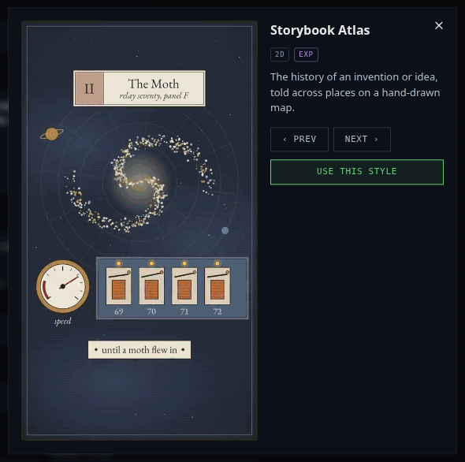
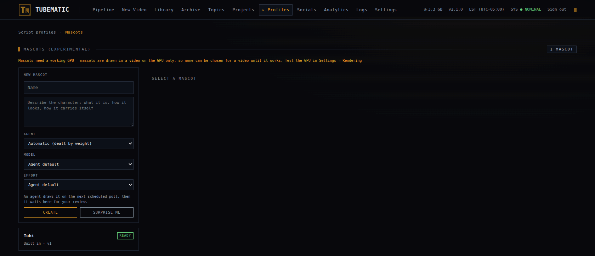

# Visual Styles and Mascots

A visual style decides how a video looks. A mascot is an optional character that reacts on screen
while the narration plays. You choose both when you approve a topic, and both are fixed from then on.

---

## What every video has

Whatever the style, a video is 1080×1920 at 30 frames a second, with a synthesised voiceover and
word-timed captions. A small "Made with tubematic.ai" mark sits in the top right
corner unless you turn it off on **Settings → Rendering**.

## The styles

| Style | What you get | Needs |
|---|---|---|
| **Auto** | The agent picks the style that suits the topic before it writes the script, or mixes treatments when no style fits. See [What Auto does](#what-auto-does) | Nothing |
| **Photo Explainer** | A dark canvas. Full-frame generated pictures of the real things the video is about, with slow camera moves. No drawn figures | Nothing |
| **Stick Explainer** | A white canvas. Black hand-drawn line art, with stick figures for roles such as "the user" or "an attacker" | Nothing |
| **Illustrated** | Generated cartoon or rendered characters that stay the same from scene to scene | An OpenAI key |
| **Bean Explainer (experimental)** | A bald cartoon character with a thick outline reacts pose by pose to the narration on a bright colour field, while props and short handwritten labels build up beside it. No images | Nothing |
| **Storybook Atlas (experimental)** | A vintage picture book told in chapters, each opened by a plaque over a hand-drawn room or landscape. A small mouse guide walks beside the story while its people, named by printed tags, and hatched objects arrive on the narrator's words. No images | Nothing |
| **Under the Hood (experimental)** | A dark canvas and close-up photographs of one physical object. Short capital labels point at its parts, gold arcs show fields and flows, numbers tick, and a cartoon presenter reacts in the bottom corner | An OpenAI key. Up to 12 generated photographs per video |
| **Case File Story (experimental)** | A suspense story in painted pictures that puts the viewer inside a scheme or a money dilemma. One blank-faced character stands in for the viewer, meters change with the plot, cards count the numbers out, and it ends on a choice between two buttons | An OpenAI key. Up to 16 generated pictures per video, and one reference picture |
| **Cartoon 3D (experimental)** | Inked cartoon characters in a painted 3D world, with a moving camera | A renderer with a working NVIDIA GPU |
| **Whiteboard** | One big white board. A floating marker writes and draws each step just after the narrator says it, and the camera glides between parts of the board. It ends on the whole board, each part numbered. No people and no images | Nothing |

Photo Explainer, Stick Explainer and Illustrated set the canvas and how people are drawn. They do not limit what a scene can show. A Stick
Explainer video still draws a process as a diagram, and still shows a generated image for a real
place or person, inside a panel on the white canvas.

The canvas is the same for the whole video. A video that switched between a dark and a white
background would flash, and a viewer reads that as a broken render.

### Picking one

- Choose **Auto** when you have no preference.
- Choose **Photo Explainer** for real, specific things the viewer came to see: products, buildings,
  artworks, machines, named people and places, or a real event and the machine or company it
  happened to.
- Choose **Stick Explainer** for a process acted out by generic people in roles: what a user clicks,
  what an attacker tries, how a kitchen team gets an order out, what a rescuer does in CPR. It also
  suits how a system works, such as a request crossing a network, with its parts acting as roles.
- Choose **Illustrated** when the video follows the same characters through several scenes. Each new
  pose is one more OpenAI image call, so this style costs more per video than the two above.
- Choose **Bean Explainer** for relatable, conversational topics: habits, health, money mistakes,
  how people behave, and "every X explained" lists, where each item gets its own section. The props
  come from a fixed library of everyday objects, so it suits subjects a phone, a coin, a clock or a
  sign can stand for better than specific real products or places. It is experimental.
- Choose **Storybook Atlas** for the story of an invention, a discovery or an idea: how the first
  program was written, where a word or an everyday thing came from, a person from history and what
  they made. The script is written as a calm story in three to five chapters, and people appear as
  picture-book figures recognised by their name and clothes, never by their face. It suits history
  better than a list of tips or a mechanism explained part by part. It is experimental.
- Choose **Under the Hood** for how one physical thing works inside: a touchscreen, a battery, a
  lock, an SSD, a fridge, or the price of a part. The script goes one layer deeper per scene and
  quotes real numbers, which become labels, counters and charts. Each photograph is an OpenAI image
  call, up to 12 per video, so it costs more per video than the styles without images. It is
  experimental.
- Choose **Case File Story** for how a fraud, a scam, money laundering or a heist works, or for a
  money dilemma: found money, an offer that is too good, a rule someone is about to break. The
  script is a suspense story told to the viewer as "you". It names what happened and what the law
  calls it, then ends on a choice between two options. Its people are invented, so it does not suit
  a real, named case. A scheme is explained the way a news report would explain it, and it always
  ends found out or named as a crime. Each picture is an OpenAI image call, up to 16 per video and
  one more for the character's reference picture, so it costs more per video than the styles
  without images. It is experimental.
- Choose **Cartoon 3D** for a story told by characters on a 3D set. It is experimental.
- Choose **Whiteboard** for an idea worked out step by step: a formula built up, money arithmetic
  such as interest or a percentage, an everyday chain of causes that ends in one picture, two ideas
  side by side. The script is written like a teacher at a board, one step per sentence, ending on one
  sentence that sums the idea up.

### What Auto does

When you approve a topic left on Auto, the agent picks a style before it writes the script, because
the script is written for the style: a Whiteboard script works an idea out one step at a time,
for example. It reads what each style is made for and avoids, compares that with the topic, and
picks the style that clearly fits. It considers every style this install can make: Illustrated only
while an OpenAI key is stored, Under the Hood and Case File Story only while an OpenAI key is stored
and the video has no mascot, Cartoon 3D only while a GPU is working and the video has no mascot.
It may pick a style that generates images, which costs more per video. It does not pick a style for
variety: the same kind of topic gets the same style every time.

The agent keeps **mixed scenes** when the topic needs two things no single style has, such as
full-frame pictures of a real bank next to stick figures acting out the run on it, or when no style
clearly fits.
A real event told through its pictures goes to Photo Explainer. So does a real
failure with a technical cause, such as a rocket lost to a software bug: the agent rules out any
style that cannot show the real rocket, however much of the topic is about a number or a line of
code. The agent then
chooses a dark or a white canvas for the whole video once the voice exists (dark when images carry
the video, white when roles, processes and diagrams do), and draws each part of the script in
whatever way suits it: an image, a diagram, line-art figures or generated characters. A mixed video can combine what the named
styles keep apart. One on a dark canvas can use line-art figures for "the user" and "the server",
which Photo Explainer leaves out. The agent uses generated characters only for a character the
viewer must recognise across scenes, and only while an OpenAI key is stored.

The video's window shows the choice under **Visual style**, after the word Auto: the picked style's
name, or Mixed scenes with its canvas once chosen. Until the agent has chosen, it reads
"Auto (not yet chosen)". The **Why this style** row gives the agent's reason and the runner-up, the
style that came second.

At Script Ready you can take the runner-up instead: **Switch to …** in the video's window sends the
video back to the agent, which picks the script's [formula](03-using-tubematic.md#script-formulas)
again and writes a new script for that style. The old script is discarded. For
a new video nothing has been paid for at this point; for a video you sent back for revision after it
was voiced, the new script is voiced again when you approve it. To give the style back to Auto entirely, request a revision of the
topic: a revised topic returns to Auto, and the agent picks again after you approve it.

A Bean Explainer video has a fixed look, so its pick is the whole decision: the agent picks the background colour, the character's
accessory and the props, and times every pose to the narration. When the library has nothing for an
object the video needs, the agent draws that prop itself in the same style and checks the drawing
before the video renders. A Whiteboard video is the same again: the agent picks what to write and
draw for each step from a fixed set of layouts and a library of simple drawings, times it to the
narration, and draws a simple one of its own, checked before use, when the library has nothing for
an object such as a bicycle.
A Storybook Atlas video works the same way too: the agent splits the narration into chapters, picks
each chapter's room or landscape, dresses the people of the story, and times every walk, object and
plate to the narration, drawing an object of its own when the library lacks one.

An Under the Hood video works the same way: the agent makes the photographs, looks at each one and
makes it again if it shows the wrong thing, pins the labels to the parts, and times the labels,
numbers and the presenter's poses to the narration. The presenter is the same character in every
video.

For a Case File Story video the agent first makes a reference picture of the character in the
clothes the story calls for, then makes each painting from it, so the character stays the same.
It looks at each painting and makes it again if the character changed or the picture shows the
wrong thing. It then chooses the meters and times the pictures, the cards and the two buttons to
the narration. The character's head is the same in every video.

### Insert scenes

An insert is a short scene, a few seconds long, in another look inside a video's style, where the
narration reaches something that look shows best. The video's style carries everything else: the
opening, the answer it builds to, and the ending. The captions stay on screen through an insert,
and the video goes back to its style right after it.

| Insert | What it shows |
|---|---|
| **System Flow** | A diagram of parts: components appear as line icons in boxes, connectors draw between them, and points of light travel along the connectors, for a request crossing a network or the steps of a protocol |
| **Terminal Doc** | Text as the picture: a password being hashed, letters scrambled into a cipher, a command typed and what it prints, a large number resolving out of noise |

An insert follows the video's canvas, so on a white video it is drawn dark on paper. A Cartoon 3D
video takes no inserts.

The **Inserts** setting decides whether a video may have them. On **Auto** the agent decides, after
it picks the style and before it writes the script; many videos get none. On **None** the video has
none. The video's window shows the decision in the **Inserts** row, with the agent's reason, and the
Script tab marks each part of the script an insert shows.

Videos voiced before System Flow and Terminal Doc became inserts keep their whole-video look.

### Where you choose

| Where | What it sets |
|---|---|
| A topic waiting for approval, on its Quick Actions row or in its window | That video's style and its **Inserts** setting |
| The **New Video** page | The style and the **Inserts** setting of the video you are creating |
| **Edit defaults** on a domain's row on the **Topics** page | The style its curriculum topics arrive with, and the **Inserts** setting every new video in it starts with. You can still change both on each topic |

Once you approve the topic, the style and the **Inserts** setting are fixed.

Click the style field to open the list. **Auto** comes first, then the 2D styles, then the 3D
styles. A style marked **EXP** is experimental. A style marked **GPU** renders on a GPU only. A
style this install cannot make is greyed out, with the reason under its name.

The eye button on a row plays a few seconds of that style in a window, with **Prev** and **Next**
to step through the others and **Use this style** to pick the one you are watching. Picking a style
there does not approve the topic.

At the bottom of the list, **Inserts** are styles used for a few seconds inside another style, such
as a diagram of a mechanism. You can watch their preview, and you cannot choose one for a whole
video.

After the topic is approved, the eye button beside **Visual style** in the video's window plays the
preview of the style the video uses.

### When a style is greyed out

A style the install cannot make stays in the list, greyed out, with the reason under its name:

- **needs an OpenAI key** (Illustrated, Under the Hood, Case File Story): no OpenAI key is stored.
  Add one on **Settings → API Keys**.
- **needs a working GPU** (Cartoon 3D): no renderer has passed its GPU test. See
  [GPU Rendering](10-gpu-rendering.md).
- **GPU not tested yet** (Cartoon 3D): the renderer has not finished its first test. Wait a minute,
  or press **Test GPU** on its card under **Settings → Rendering**.

A topic that already holds a greyed-out style cannot be approved until you pick another.

A Cartoon 3D video renders on a GPU only. If the GPU stops working after you approve the topic, the
video fails with a comment saying why. See
[GPU Rendering](10-gpu-rendering.md) for how to check the GPU.

---

## Mascots

A mascot is a small character that walks on and off screen and reacts to the narration. It looks
surprised, has an idea, hops, glances at something. It does not narrate and does not lip-sync.

Mascots are experimental and off by default. A video has one only if you pick it. They are drawn on
the GPU, so you can pick a mascot only while a renderer's GPU test has passed. Cartoon 3D, Under
the Hood and Case File Story videos cannot have one: Under the Hood has its own presenter and Case
File Story its own lead character.

### Tubi

Tubematic ships with one mascot, Tubi: a small retro terminal whose screen is its face. You can pick
Tubi without setting anything up. You cannot edit Tubi, but **Ask for a variation** creates a new
mascot based on it.

### Making your own

1. Open **Profiles → Mascots**.
2. Enter a name and describe the character: what it is, how it looks, how it carries itself. Or
   press **Surprise me** and let the agent invent one.
3. Optionally pick the agent, model and effort that should draw it. Without a pick, the default
   agent draws it.
4. Wait for the next agent session. The agent writes the drawing code and renders three sheets: a
   turnaround, the mascot's ten emotions and a strip of poses. This happens while the pipeline is
   paused too.
5. Open the mascot when it reaches **In review** and look at the sheets. Press **Approve** to make
   it available, or **Request changes** with a comment saying what to fix.

A mascot moves through **Pending**, **Building** and **In review**. If drawing fails twice, it
shows **Failed** with the reason, and any approved version stays in use.

Asking for changes to an approved mascot does not disturb videos that use it. Videos keep the last
approved version while the new one is drawn. A video whose scenes are already written stays on the
version it was written for.

**Archive** removes a mascot from every picker. Videos already past topic approval keep rendering
with it. A topic still waiting for approval with an archived mascot cannot be approved until you
pick another mascot or none.

### Choosing a mascot

Three places set it. Each overrides the one above.

| Where | What it sets |
|---|---|
| **Settings → Rendering → Default mascot (experimental)** | The default for the whole install. Empty means none |
| **Mascot (exp.)**, under **Edit defaults** on a domain's row on the **Topics** page | The default for that domain. *Use install default* follows the setting above. *None* means no mascot in this domain |
| The mascot picker on a topic waiting for approval | That one video. Fixed once you approve the topic |

You can set a default only while a renderer's GPU works. A default you set earlier stays stored if
the GPU stops working, and applies again once the GPU is back.

The agent decides when the mascot appears and what it reacts to.
[Scene Authoring](../developer/10-scene-authoring.md#mascots) explains how.
