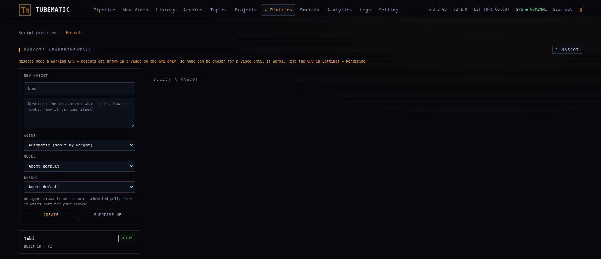

# Visual Styles and Mascots

A visual style decides how a video looks. A mascot is an optional character that reacts on screen
while the narration plays. You choose both when you approve a topic, and both are fixed from then on.

---

## What every video has

Whatever the style, a video is 1080×1920 at 30 frames a second, with a synthesised voiceover and
word-timed captions. A small "Made with tubematic.ai" mark sits in the top right
corner unless you turn it off on **Settings → Rendering**.

## The styles

| Style | What you get | Needs |
|---|---|---|
| **Auto** | No restriction. The agent chooses the canvas, and draws each part of the video in whatever way suits it. See [What Auto does](#what-auto-does) | Nothing |
| **Motion Graphics** | A dark canvas. Generated images with slow camera moves, and animated diagrams. No drawn figures | Nothing |
| **Stick Explainer** | A white canvas. Black hand-drawn line art, with stick figures for roles such as "the user" or "an attacker" | Nothing |
| **Illustrated** | Generated cartoon or rendered characters that stay the same from scene to scene | An OpenAI key |
| **System Flow** | A dark canvas with one diagram per subject. Components appear as line icons in boxes, connectors draw between them, and points of light travel along the connectors while the narration explains each step. No people and no images | Nothing |
| **Cartoon 3D (experimental)** | Inked cartoon characters in a painted 3D world, with a moving camera | A renderer with a working NVIDIA GPU |

Motion Graphics, Stick Explainer and Illustrated set the canvas and how people are drawn. They do not limit what a scene can show. A Stick
Explainer video still draws a process as a diagram, and still shows a generated image for a real
place or person, inside a panel on the white canvas.

The canvas is the same for the whole video. A video that switched between a dark and a white
background would flash, and a viewer reads that as a broken render.

### Picking one

- Choose **Auto** when you have no preference.
- Choose **Motion Graphics** for subjects you can photograph or diagram: places, machines, events,
  how data moves.
- Choose **Stick Explainer** for walkthroughs with generic people in them: what a user clicks, what
  an attacker tries, what a scientist measures.
- Choose **Illustrated** when the video follows the same characters through several scenes. Each new
  pose is one more OpenAI image call, so this style costs more per video than the two above.
- Choose **System Flow** for how a system works: a request crossing a network, the steps of a
  protocol, a data pipeline, where an attack is stopped. The script is written as a walk through
  the system, one component and one step at a time.
- Choose **Cartoon 3D** for a story told by characters on a 3D set. It is experimental.

### What Auto does

Auto does not pick one of the named styles, and it never makes a System Flow video: choose System
Flow yourself. The agent makes two choices for the whole video, then decides how to draw each part of
the script.

1. Whether the video is Cartoon 3D. The agent chooses it when a place, and people moving through
   it, carry the video. It can choose it only while a GPU is working and the video has no mascot.
2. For every other video, a dark or a white canvas. It chooses dark when images carry the video,
   and white when roles, processes and diagrams do.

Each part of the script then gets its own treatment: an image, a diagram, line-art figures or
generated characters. An Auto video can therefore mix what the named styles keep apart. One on a
dark canvas can use line-art figures for "the user" and "the server", which Motion Graphics leaves
out. The agent uses generated characters only for a character the viewer must recognise across
scenes, and only while an OpenAI key is stored.

The video's window shows what the agent settled under **Visual style**: Auto with a dark canvas,
Auto with a light canvas, or Auto with Cartoon 3D. Until the agent has chosen, it reads
"Auto (not yet chosen)". It does not name Motion Graphics, Stick Explainer or Illustrated, because
an Auto video is none of them.

A System Flow video has a fixed look, so its pick is the whole decision: the agent lays out the
diagrams and times them to the narration, but it does not change the canvas or add images.

### Where you choose

| Where | What it sets |
|---|---|
| A topic waiting for approval, on its Quick Actions row or in its window | That video's style |
| The **New Video** page | The style of the video you are creating |
| A domain's row on the **Topics** page | The style its curriculum topics arrive with. You can still change it on each topic |

Once you approve the topic, the style is fixed.

### When a style is greyed out

- **Illustrated (needs an OpenAI key)**: no OpenAI key is stored. Add one on **Settings → API Keys**.
- **Cartoon 3D (experimental) (needs a working GPU)**: no renderer has passed its GPU test. See
  [GPU Rendering](10-gpu-rendering.md).
- **Cartoon 3D (experimental) (GPU not tested yet)**: the renderer has not finished its first test.
  Wait a minute, or press **Test GPU** on its card under **Settings → Rendering**.

A topic that already holds a greyed-out style cannot be approved until you pick another.

A Cartoon 3D video renders on a GPU only. If the GPU stops working after you approve the topic, the
video fails with a comment saying why. See
[GPU Rendering](10-gpu-rendering.md) for how to check the GPU.

---

## Mascots

A mascot is a small character that walks on and off screen and reacts to the narration. It looks
surprised, has an idea, hops, glances at something. It does not narrate and does not lip-sync.

Mascots are experimental and off by default. A video has one only if you pick it. They are drawn on
the GPU, so you can pick a mascot only while a renderer's GPU test has passed. Cartoon 3D videos
cannot have one.

### Tubi

Tubematic ships with one mascot, Tubi: a small retro terminal whose screen is its face. You can pick
Tubi without setting anything up. You cannot edit Tubi, but **Ask for a variation** creates a new
mascot based on it.

### Making your own

1. Open **Profiles → Mascots**.
2. Enter a name and describe the character: what it is, how it looks, how it carries itself. Or
   press **Surprise me** and let the agent invent one.
3. Optionally pick the agent, model and effort that should draw it. Without a pick, the default
   agent draws it.
4. Wait for the next agent session. The agent writes the drawing code and renders three sheets: a
   turnaround, the mascot's ten emotions and a strip of poses. This happens while the pipeline is
   paused too.
5. Open the mascot when it reaches **In review** and look at the sheets. Press **Approve** to make
   it available, or **Request changes** with a comment saying what to fix.

A mascot moves through **Pending**, **Building** and **In review**. If drawing fails twice, it
shows **Failed** with the reason, and any approved version stays in use.

Asking for changes to an approved mascot does not disturb videos that use it. Videos keep the last
approved version while the new one is drawn. A video whose scenes are already written stays on the
version it was written for.

**Archive** removes a mascot from every picker. Videos already past topic approval keep rendering
with it. A topic still waiting for approval with an archived mascot cannot be approved until you
pick another mascot or none.

### Choosing a mascot

Three places set it. Each overrides the one above.

| Where | What it sets |
|---|---|
| **Settings → Rendering → Default mascot (experimental)** | The default for the whole install. Empty means none |
| The **Mascot (exp.)** column of a domain's row on the **Topics** page | The default for that domain. *Use install default* follows the setting above. *None* means no mascot in this domain |
| The mascot picker on a topic waiting for approval | That one video. Fixed once you approve the topic |

You can set a default only while a renderer's GPU works. A default you set earlier stays stored if
the GPU stops working, and applies again once the GPU is back.

The agent decides when the mascot appears and what it reacts to.
[Scene Authoring](../developer/10-scene-authoring.md#mascots) explains how.
