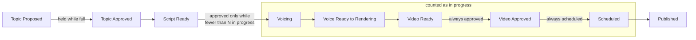

# Auto Pilot

Auto Pilot runs the domains you select with nobody approving anything. It approves each topic, each
script and each finished video, then posts the video to the accounts you chose.

It is off by default. Switching it on does nothing until you select a domain on
**Settings → Auto Pilot**. Domains you do not select keep all three approvals.

> **Read this before you turn it on.**
>
> - Nobody reviews the topics, scripts or videos Auto Pilot approves.
> - It spends money on every topic research files: ElevenLabs credits, OpenAI images and agent
>   sessions.
> - It posts publicly to real accounts. That includes videos the AI review flagged, could not check,
>   or did not run on.
> - Tubematic cannot take a published post back.

---

## Before you start

- Set up [publishing](06-publishing.md) and tick at least one account on the **Socials** page.
  Without a usable account, Auto Pilot still approves videos, and they wait at Video Approved for
  you to post.
- Decide how many videos a day you are willing to pay for, and set the research limits to match.
  See [Limiting what it spends](#limiting-what-it-spends).

## Turning it on

Open **Settings → Auto Pilot**. The tab has its own **Save**, and saves everything on it together.

| Setting | What it does | Default |
|---|---|---|
| **Auto Pilot** on or off | Off stops all of it and keeps the rest of the tab as you set it | Off |
| **Gap between publishes** | The shortest time between two posts on one account. Enter minutes or hours, up to a week | 4 hours |
| **Most videos in progress** | How many videos may be between voicing and publishing at once. See [The in-progress limit](#the-in-progress-limit) | 0, which means no limit |
| **Projects** | Which domains are on Auto Pilot. Each one has its own list of accounts, chosen from the accounts ticked on the Socials page | None |
| A number for each account, under **Accounts** | How many videos Auto Pilot posts to the account in one day. 0 means it does not post there | 1 |

When you turn Auto Pilot on, or add a domain while it is on, the dashboard asks you to confirm and
tells you how many videos are waiting for approval in those domains. Auto Pilot approves them as
soon as you save.

## What it approves

About every 20 seconds, Tubematic looks for videos in the selected domains at Topic Proposed,
Script Ready and Video Ready, and approves each one. It adds a comment saying Auto Pilot approved it
and that nobody reviewed it. If you act on a video first, your decision stands.

Auto Pilot approves whatever reaches Video Ready. With AI review off, that is every video that
renders. With AI review on, it includes a video the review could not check and a video that used up
its review rounds with findings still open.

Auto Pilot holds back in these cases:

- A topic is set to Illustrated and no OpenAI key is stored, or a script cannot be spoken by its
  voice's model. The dashboard would refuse these approvals too. The video stays where it is with
  one comment explaining why, and Auto Pilot approves it once you fix the cause.
- The pipeline is paused. Nothing is approved and nothing is posted. You can still approve by hand.
- The [in-progress limit](#the-in-progress-limit) is full.

Auto Pilot sends no "script ready" or "video ready" notification for a video it approves.

## How it posts

For each video at Video Approved in a selected domain, Auto Pilot picks a time and starts one post
to all of that domain's accounts.

- Posts are public. Auto Pilot has no privacy setting.
- The title and description are the ones the agent wrote with the script.
- Auto Pilot uses an account only if it is selected for the domain, still ticked on the Socials
  page, still connected, and has a daily number above 0. It checks this when it posts. If no account
  is left, the video waits at Video Approved for you.
- It starts one post at a time, because each upload takes about a minute.

### When a post goes out

Auto Pilot picks the earliest time that is free on every account of the post. A time is free on an
account when both of these hold:

1. No other post on that account is closer than the gap, before or after.
2. The account has fewer posts that day than its daily number. Days are counted in the timezone of
   the machine Tubematic runs on.

If that time is now, the video posts at once. Otherwise it becomes a
[scheduled post](06-publishing.md#scheduling-a-post), which you can cancel.

Every post that did not fail counts, including posts you publish or schedule by hand.

Two things follow from these rules:

- When an account's day is full, the next post goes out at midnight. With a short gap and one post a
  day, every post lands at 00:00. Set the gap to 24 hours divided by the daily number to keep a
  steady time of day.
- A domain that posts to several accounts moves at the pace of its busiest account, because one
  post goes to all of them at the same time.

## Limiting what it spends

Research normally stops once 15 topics are waiting for your approval (**Research pending cap** on
**Settings → Research**). In an Auto Pilot domain no topic waits, so that limit does not fill. Two
things bound the spend instead.

The first is the research limits. The number of videos started per day is at most **Max research
runs per day** multiplied by the per-run topic limits, all on **Settings → Research**. Set them to
what you are prepared to pay for.

The second is the in-progress limit.

### The in-progress limit

With **Most videos in progress** set to N, Auto Pilot stops starting videos once N are in progress.
It starts another each time one publishes. It keeps approving and scheduling finished videos
whatever the count is.

Voicing is where a video starts to cost money, so the limit applies to the script approval. Topic
approvals stop while the limit is full as well, because each one starts a paid agent session.

What counts as in progress:

- A video in an Auto Pilot domain that has been voiced and has not yet published or failed. A video
  sent back for a revision keeps its place.
- A post waiting to go out, anywhere on the install. That includes posts you schedule by hand, so
  a week of hand-scheduled posts can hold Auto Pilot back.

A video counts once, however many accounts it posts to. Archived videos, and videos you took off
Auto Pilot, do not count.

Size the limit in days of posting. N is roughly the number of days you want buffered, multiplied by
your posts per day. At 5 posts a day, a limit of 5 covers one day, and one slow render then leaves a
gap in your schedule. A limit of 15 to 25 covers three to five days.

The tab shows the count, for example "3 of 20 videos in progress", and says so when the limit is
holding new videos back.

## Stopping it

| To stop | Do this |
|---|---|
| Everything, for now | Pause the pipeline with the switch above the tabs on **Settings** |
| Auto Pilot, and keep the pipeline running | Switch **Auto Pilot** off on its tab and save |
| One domain | Untick it on the tab and save |
| One scheduled post | Open the video and press **Cancel schedule** |

Cancelling a scheduled post takes that video off Auto Pilot for good. Publish it by hand when you
want it out. The dashboard has no control that puts it back.

**Retry publishing** does not take a video off Auto Pilot. A video that failed on every account, and
that you send back to Video Approved with Retry publishing, is posted again by Auto Pilot.

## When a post cannot start

If an upload fails, the video returns to Video Approved and Auto Pilot waits before it tries again:
15 minutes after the first failure, an hour after the second, and six hours after each one after
that. Restarting the `tubematic-worker` container clears the wait.

A video that cannot be published at all, for example one with no rendered file, gets one comment
saying so. If postforme cannot be reached, Auto Pilot tries again later without commenting.

How Auto Pilot is built is in
[Publishing internals](../developer/14-publishing.md#auto-pilot).
